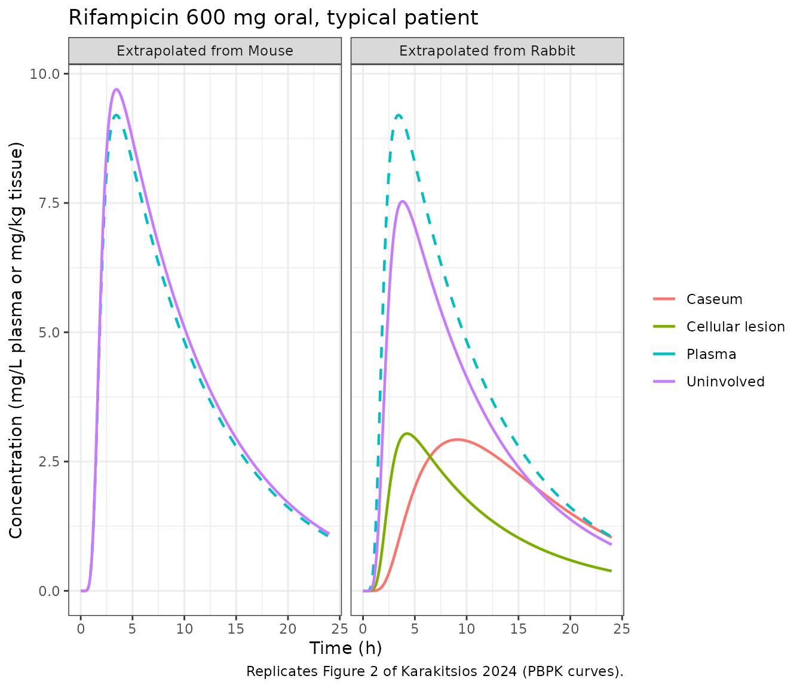
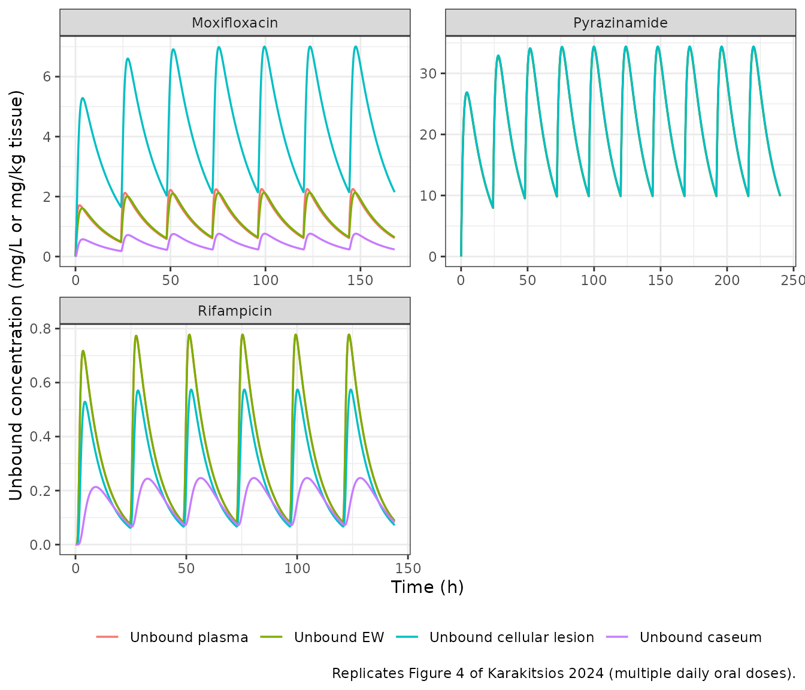
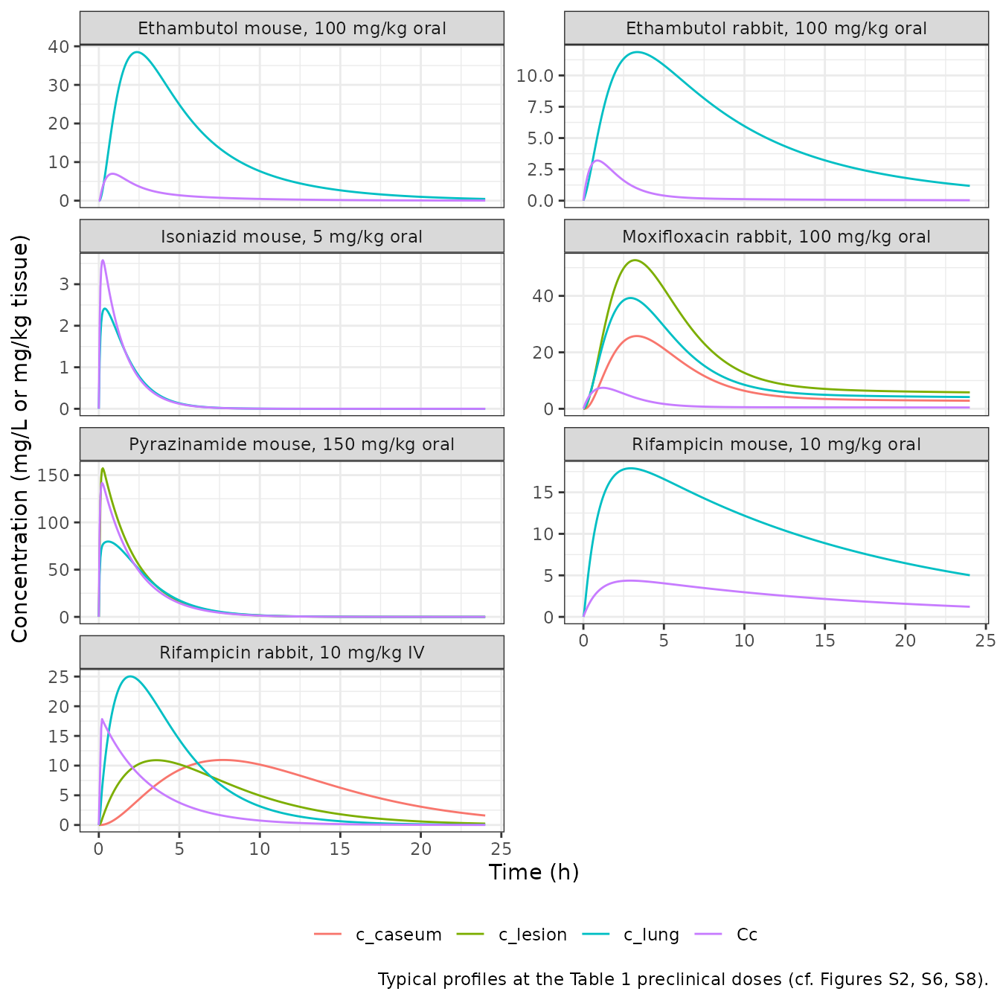
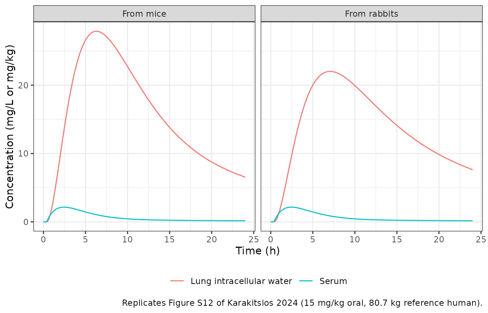

# Rifampicin, moxifloxacin, ethambutol, pyrazinamide and isoniazid lung PBPK (Karakitsios 2024)

## Model and source

Karakitsios 2024 builds one middle-out, permeability-limited lung PBPK
structure for five first-line and second-line antitubercular drugs. An
empirical plasma (or blood) model for each species drives a lung divided
into pulmonary blood (PB), extracellular water (EW) and intracellular
water (IW). Lung, lesion and caseum distribution parameters were
estimated in mice or rabbits and then extrapolated to humans by keeping
them constant and swapping in human physiology, protein binding and
ionisation. Each drug x species combination has its own plasma model and
its own physiology, so the paper maps onto fourteen model files: seven
preclinical fits and seven human extrapolations.

``` r

model_names <- c(
  "Karakitsios_2024_rifampicin_rabbit_pbpk",
  "Karakitsios_2024_rifampicin_mouse_pbpk",
  "Karakitsios_2024_moxifloxacin_rabbit_pbpk",
  "Karakitsios_2024_ethambutol_rabbit_pbpk",
  "Karakitsios_2024_ethambutol_mouse_pbpk",
  "Karakitsios_2024_pyrazinamide_mouse_pbpk",
  "Karakitsios_2024_isoniazid_mouse_pbpk",
  "Karakitsios_2024_rifampicin_human_fromRabbit_pbpk",
  "Karakitsios_2024_rifampicin_human_fromMouse_pbpk",
  "Karakitsios_2024_moxifloxacin_human_fromRabbit_pbpk",
  "Karakitsios_2024_ethambutol_human_fromRabbit_pbpk",
  "Karakitsios_2024_ethambutol_human_fromMouse_pbpk",
  "Karakitsios_2024_pyrazinamide_human_fromMouse_pbpk",
  "Karakitsios_2024_isoniazid_human_fromMouse_pbpk"
)
uis <- lapply(model_names, function(n) rxode2::rxode2(readModelDb(n)))
#> ℹ parameter labels from comments will be replaced by 'label()'
names(uis) <- model_names

tibble(
  Model   = model_names,
  Species = vapply(uis, function(u) u$population$species, character(1)),
  States  = vapply(uis, function(u) length(u$state), integer(1))
) |>
  knitr::kable(caption = "The fourteen model files contributed by this paper.")
```

| Model | Species | States |
|:---|:---|---:|
| Karakitsios_2024_rifampicin_rabbit_pbpk | rabbit (New Zealand White) | 5 |
| Karakitsios_2024_rifampicin_mouse_pbpk | mouse | 4 |
| Karakitsios_2024_moxifloxacin_rabbit_pbpk | rabbit (New Zealand White) | 8 |
| Karakitsios_2024_ethambutol_rabbit_pbpk | rabbit (New Zealand White) | 5 |
| Karakitsios_2024_ethambutol_mouse_pbpk | mouse | 5 |
| Karakitsios_2024_pyrazinamide_mouse_pbpk | mouse (BALB/c) | 5 |
| Karakitsios_2024_isoniazid_mouse_pbpk | mouse | 4 |
| Karakitsios_2024_rifampicin_human_fromRabbit_pbpk | human | 16 |
| Karakitsios_2024_rifampicin_human_fromMouse_pbpk | human | 14 |
| Karakitsios_2024_moxifloxacin_human_fromRabbit_pbpk | human | 7 |
| Karakitsios_2024_ethambutol_human_fromRabbit_pbpk | human | 5 |
| Karakitsios_2024_ethambutol_human_fromMouse_pbpk | human | 5 |
| Karakitsios_2024_pyrazinamide_human_fromMouse_pbpk | human | 5 |
| Karakitsios_2024_isoniazid_human_fromMouse_pbpk | human | 5 |

The fourteen model files contributed by this paper. {.table}

- Citation: Karakitsios E, Dokoumetzidis A. Extrapolation of lung
  pharmacokinetics of antitubercular drugs from preclinical species to
  humans using PBPK modelling. J Antimicrob Chemother. 2024;79(6):1362.
  <doi:10.1093/jac/dkae109>. The plasma layer is the rabbit model of
  Rifat D, Prideaux B, Savic RM, et al. Pharmacokinetics of rifapentine
  and rifampin in a rabbit model of tuberculosis and correlation with
  clinical trial data. Sci Transl Med. 2018;10:eaai7786.
  <doi:10.1126/scitranslmed.aai7786>.
- Article (open access): <https://doi.org/10.1093/jac/dkae109>
- Supplementary data (Tables S1-S12, equations 1-14): with the article.

`lung_ew` holds the **unbound** EW concentration and `lung_iw` the
**total** IW concentration; `lesion` and `caseum` hold total
concentrations. All lung states hold concentrations, not amounts.
Pulmonary blood is in instantaneous equilibrium with EW for every drug
except moxifloxacin, a P-glycoprotein substrate, whose PB is a separate
state (`vp_lung`) with permeability-limited capillary transfer. Each
file reports the total uninvolved-lung homogenate concentration
(`c_lung`, the volume-weighted mean of PB, EW and IW, Table S1) and,
where the paper models them, `c_lesion` and `c_caseum`. The human files
also report the unbound concentrations of Figure 4 (`cu_plasma`,
`cu_ew`, `cu_lesion`, `cu_caseum`).

## Population

The preclinical fits used MEAN digitised concentrations: mouse lung data
from Muliaditan 2022 (rifampicin, ethambutol, isoniazid) and Irwin 2016
(pyrazinamide, BALB/c mice with cellular lesions); rabbit data from
Rifat 2018 (rifampicin, intravenous), Pienaar 2017 and Sarathy 2019
(moxifloxacin) and Zimmerman 2017 (ethambutol) in Mycobacterium
tuberculosis-infected rabbits (Table 1). Reference animals are a 0.025
kg mouse (Table S2) and a 2.5 kg rabbit (Table S3). The human
extrapolations represent “a typical mean patient” (Methods) of the
Strydom 2019 lung-resection cohort: 15 adults with treatment-refractory
pulmonary tuberculosis, aged 23 to 58 years, 5 of them women, in South
Korea. Human ethambutol uses a serum model fitted by the authors to 14
healthy fasted adults (Peloquin 1999; Table S11). Every simulation below
is a typical-value simulation, as in the paper.

``` r

typ <- lapply(uis, function(u) if (nrow(u$iniDf[!is.na(u$iniDf$neta1), , drop = FALSE]) > 0) rxode2::zeroRe(u) else u)

solve_typical <- function(name, amt, dose_times = 0, obs_times = seq(0, 24, by = 0.05),
                          cmt = "depot", dur = NA_real_, covs = NULL) {
  dos <- data.frame(id = 1L, time = dose_times, amt = amt, evid = 1L, cmt = cmt, dur = dur)
  obs <- data.frame(id = 1L, time = obs_times, amt = NA_real_, evid = 0L, cmt = "central",
                    dur = NA_real_)
  ev <- rbind(dos, obs)
  if (all(is.na(ev$dur))) ev$dur <- NULL
  if (!is.null(covs)) for (nm in names(covs)) ev[[nm]] <- covs[[nm]]
  ev <- ev[order(ev$time, -ev$evid), ]
  out <- rxode2::rxSolve(typ[[name]], ev, returnType = "data.frame")
  if (is.null(out$id)) out$id <- 1L
  stopifnot(nrow(out) == length(obs_times), max(out$Cc) > 0)
  out
}
```

## Source trace

| Element | Source location |
|----|----|
| Lung structure, EW and IW ODEs | Supplementary equations (1)-(2); Figure 1 |
| Moxifloxacin PB and EW ODEs (permeability-limited capillary) | Supplementary equations (3)-(4), encoded in mass-conserving form (see below) |
| Cellular-lesion and caseum ODEs | Supplementary equations (10)-(11) |
| Human lesion unbound fraction, pH 5.84 | Supplementary equation (14); Table S12; Supplementary Section 1 |
| Homogenate = volume-weighted PB + EW + IW | Table S1 (“healthy/uninvolved lung included pulmonary capillaries”) |
| Mouse, rabbit, human physiology | Tables S2, S3, S4 |
| Molecular weight, pKa, logP | Table S5 |
| Mouse, rabbit, human B/P, fu plasma, fu EW, fu IW, permeabilities | Tables S6, S7, S8 |
| Estimated permeabilities, fu IW / fu EW, lesion and caseum rates and ratio | Table 3 |
| Human fu cellular lesion | Table S12 |
| Caseum unbound fraction (RIF 7.3%, MXF 16.8%) | Sarathy 2016 Supplementary Table 1 (cited in Supplementary Section 1) |
| Rabbit and human ethambutol plasma/serum models | Tables S10 and S11 |
| Mouse rifampicin, ethambutol, isoniazid blood models | Chen 2016 (Eur J Pharm Sci 93:319) Table 5 |
| Mouse pyrazinamide plasma model (BALB/c) | Irwin 2016 (ACS Infect Dis 2:251) Supplemental Table 1 |
| Rabbit rifampicin plasma model (10 mg/kg IV, ~10-min infusion) | Rifat 2018 (Sci Transl Med 10:eaai7786) Table 2 and Supplementary Methods |
| Rabbit moxifloxacin plasma model | Pienaar 2017 (PLoS Comput Biol 13:e1005650) Table 3 |
| Human rifampicin, moxifloxacin, pyrazinamide, isoniazid plasma models | Strydom 2019 (PLoS Med 16:e1002773) Table 2 |
| Human rifampicin transit chain (MTT 1.4 h, 10 transits) | Not reported; back-solved from Table 4 (see Assumptions) |
| Validation targets | Table 4 (human AUC24, Cmax, Tmax), Figure 2, Figure 4 |

Every `ini()` line in the model files carries the same trace as an
in-file comment.

## Validation 1 – human Table 4 “Predicted” AUC24, Cmax and Tmax

Table 4 reports, for single oral doses of 600, 400, 1500 and 300 mg, the
authors’ own PBPK predictions of the human tissue profiles. This
implementation is compared with those predictions; the paper’s
“Observed” column (simulations of the Strydom 2019 empirical lung
models) is shown for context in the figures.

``` r

t4_runs <- tribble(
  ~model,                                                  ~amt, ~drug,          ~source,
  "Karakitsios_2024_rifampicin_human_fromRabbit_pbpk",     600,  "Rifampicin",   "Rabbit",
  "Karakitsios_2024_rifampicin_human_fromMouse_pbpk",      600,  "Rifampicin",   "Mouse",
  "Karakitsios_2024_moxifloxacin_human_fromRabbit_pbpk",   400,  "Moxifloxacin", "Rabbit",
  "Karakitsios_2024_pyrazinamide_human_fromMouse_pbpk",    1500, "Pyrazinamide", "Mouse",
  "Karakitsios_2024_isoniazid_human_fromMouse_pbpk",       300,  "Isoniazid",    "Mouse"
)
site_cols <- c(c_lung = "Uninvolved", c_lesion = "Cellular lesion", c_caseum = "Caseum")

t4_sim <- lapply(seq_len(nrow(t4_runs)), function(i) {
  out <- solve_typical(t4_runs$model[i], amt = t4_runs$amt[i])
  cols <- intersect(names(site_cols), names(out))
  out |>
    dplyr::select(id, time, dplyr::all_of(cols)) |>
    tidyr::pivot_longer(dplyr::all_of(cols), names_to = "col", values_to = "conc") |>
    dplyr::mutate(site = site_cols[col], drug = t4_runs$drug[i], source = t4_runs$source[i],
                  amt = t4_runs$amt[i])
}) |>
  dplyr::bind_rows() |>
  dplyr::mutate(treatment = paste(drug, site, paste0("(", source, ")")))
```

``` r

conc_t4 <- t4_sim |> dplyr::filter(!is.na(conc))
dose_t4 <- conc_t4 |> dplyr::distinct(treatment, id, amt) |> dplyr::mutate(time = 0)

res_t4 <- PKNCA::pk.nca(PKNCA::PKNCAdata(
  PKNCA::PKNCAconc(conc_t4, conc ~ time | treatment + id),
  PKNCA::PKNCAdose(dose_t4, amt ~ time | treatment + id),
  intervals = data.frame(start = 0, end = 24, auclast = TRUE, cmax = TRUE, tmax = TRUE),
  options = list(auc.method = "linear")
))
#> Warning in assert_conc(conc, any_missing_conc = any_missing_conc): Negative
#> concentrations found
#> Warning in assert_conc(conc, any_missing_conc = any_missing_conc): Negative
#> concentrations found
#> Warning in assert_conc(conc = conc): Negative concentrations found
#> Warning in assert_conc(conc, any_missing_conc = any_missing_conc): Negative
#> concentrations found
#> Warning in assert_conc(conc, any_missing_conc = any_missing_conc): Negative
#> concentrations found
#> Warning in assert_conc(conc = conc): Negative concentrations found
#> Warning in assert_conc(conc, any_missing_conc = any_missing_conc): Negative
#> concentrations found
#> Warning in assert_conc(conc, any_missing_conc = any_missing_conc): Negative
#> concentrations found
#> Warning in assert_conc(conc = conc): Negative concentrations found
#> Warning in assert_conc(conc, any_missing_conc = any_missing_conc): Negative
#> concentrations found

published_t4 <- tribble(
  ~treatment,                                ~auclast, ~cmax, ~tmax,
  "Rifampicin Uninvolved (Rabbit)",            35.7,    3.48,  3.75,
  "Rifampicin Cellular lesion (Rabbit)",       32.49,   3.08,  4.25,
  "Rifampicin Caseum (Rabbit)",                44.02,   2.93,  9.25,
  "Rifampicin Uninvolved (Mouse)",             45.73,   4.5,   3.25,
  "Moxifloxacin Uninvolved (Rabbit)",         118,      7.92,  3.75,
  "Moxifloxacin Cellular lesion (Rabbit)",    108.54,   7.29,  3.75,
  "Moxifloxacin Caseum (Rabbit)",              53.17,   3.58,  4,
  "Pyrazinamide Uninvolved (Mouse)",          441.52,  27.58,  6,
  "Pyrazinamide Cellular lesion (Mouse)",     415.05,  27.14,  4.25,
  "Isoniazid Uninvolved (Mouse)",               5.73,   1.15,  2
)

cmp_t4 <- nlmixr2lib::ncaComparisonTable(
  simulated = res_t4,
  reference = published_t4,
  by        = "treatment",
  units     = c(auclast = "mg*h/kg", cmax = "mg/kg", tmax = "h"),
  tolerance_pct = 20
)
knitr::kable(
  cmp_t4,
  caption = paste("Human tissue exposure after a single oral dose: this implementation versus",
                  "the PBPK prediction printed in Table 4. The moxifloxacin cavity wall and",
                  "the rifampicin cavity wall are represented by the cellular lesion.",
                  "* marks >20% difference."),
  align = c("l", "l", "r", "r", "r")
)
```

| NCA parameter | treatment | Reference | Simulated | % diff |
|:---|:---|---:|---:|---:|
| Cmax (mg/kg) | Rifampicin Uninvolved (Rabbit) | 3.48 | 7.53 | +116.4%\* |
| Cmax (mg/kg) | Rifampicin Cellular lesion (Rabbit) | 3.08 | 3.04 | -1.3% |
| Cmax (mg/kg) | Rifampicin Caseum (Rabbit) | 2.93 | 2.92 | -0.2% |
| Cmax (mg/kg) | Rifampicin Uninvolved (Mouse) | 4.5 | 9.7 | +115.5%\* |
| Cmax (mg/kg) | Moxifloxacin Uninvolved (Rabbit) | 7.92 | 7.59 | -4.2% |
| Cmax (mg/kg) | Moxifloxacin Cellular lesion (Rabbit) | 7.29 | 6.98 | -4.2% |
| Cmax (mg/kg) | Moxifloxacin Caseum (Rabbit) | 3.58 | 3.42 | -4.5% |
| Cmax (mg/kg) | Pyrazinamide Uninvolved (Mouse) | 27.6 | 28.9 | +4.7% |
| Cmax (mg/kg) | Pyrazinamide Cellular lesion (Mouse) | 27.1 | 27.2 | +0.0% |
| Cmax (mg/kg) | Isoniazid Uninvolved (Mouse) | 1.15 | 1.17 | +1.7% |
| Tmax (h) | Rifampicin Uninvolved (Rabbit) | 3.75 | 3.8 | +1.3% |
| Tmax (h) | Rifampicin Cellular lesion (Rabbit) | 4.25 | 4.25 | +0.0% |
| Tmax (h) | Rifampicin Caseum (Rabbit) | 9.25 | 9.1 | -1.6% |
| Tmax (h) | Rifampicin Uninvolved (Mouse) | 3.25 | 3.45 | +6.2% |
| Tmax (h) | Moxifloxacin Uninvolved (Rabbit) | 3.75 | 3.8 | +1.3% |
| Tmax (h) | Moxifloxacin Cellular lesion (Rabbit) | 3.75 | 3.75 | +0.0% |
| Tmax (h) | Moxifloxacin Caseum (Rabbit) | 4 | 3.85 | -3.7% |
| Tmax (h) | Pyrazinamide Uninvolved (Mouse) | 6 | 5.95 | -0.8% |
| Tmax (h) | Pyrazinamide Cellular lesion (Mouse) | 4.25 | 4.3 | +1.2% |
| Tmax (h) | Isoniazid Uninvolved (Mouse) | 2 | 2.05 | +2.5% |
| AUClast (mg\*h/kg) | Rifampicin Uninvolved (Rabbit) | 35.7 | 78.8 | +120.7%\* |
| AUClast (mg\*h/kg) | Rifampicin Cellular lesion (Rabbit) | 32.5 | 32.5 | +0.1% |
| AUClast (mg\*h/kg) | Rifampicin Caseum (Rabbit) | 44 | 44.1 | +0.2% |
| AUClast (mg\*h/kg) | Rifampicin Uninvolved (Mouse) | 45.7 | 101 | +119.8%\* |
| AUClast (mg\*h/kg) | Moxifloxacin Uninvolved (Rabbit) | 118 | 113 | -4.2% |
| AUClast (mg\*h/kg) | Moxifloxacin Cellular lesion (Rabbit) | 109 | 104 | -4.3% |
| AUClast (mg\*h/kg) | Moxifloxacin Caseum (Rabbit) | 53.2 | 50.8 | -4.5% |
| AUClast (mg\*h/kg) | Pyrazinamide Uninvolved (Mouse) | 442 | 462 | +4.7% |
| AUClast (mg\*h/kg) | Pyrazinamide Cellular lesion (Mouse) | 415 | 415 | +0.0% |
| AUClast (mg\*h/kg) | Isoniazid Uninvolved (Mouse) | 5.73 | 5.82 | +1.6% |

Human tissue exposure after a single oral dose: this implementation
versus the PBPK prediction printed in Table 4. The moxifloxacin cavity
wall and the rifampicin cavity wall are represented by the cellular
lesion. \* marks \>20% difference. {.table}

Every lesion and caseum prediction and every pyrazinamide, moxifloxacin
and isoniazid uninvolved-lung prediction agrees with Table 4 within 5%
for AUC24 and Cmax and within 0.25 h for Tmax (the moxifloxacin rows run
about 4% low throughout, consistently with a plasma-level difference,
since lung, lesion and caseum share it). **The two rifampicin
uninvolved-lung rows are starred at about +120%** and were investigated
rather than tuned; see the Assumptions section. The rifampicin lesion
and caseum rows, which are driven by the unbound EW concentration and
not by intracellular binding, match to within 2%, which localises the
discrepancy to the intracellular-water term.

``` r

pk_wide <- as.data.frame(res_t4$result) |>
  dplyr::select(treatment, PPTESTCD, PPORRES) |>
  tidyr::pivot_wider(names_from = PPTESTCD, values_from = PPORRES) |>
  dplyr::inner_join(published_t4, by = "treatment", suffix = c("_sim", "_pub"))
reproduced <- pk_wide |> dplyr::filter(!grepl("^Rifampicin Uninvolved", treatment))
# Typical-value solves of a deterministic model: an exact window is the right gate.
stopifnot(
  nrow(reproduced) == 8,
  all(abs(reproduced$auclast_sim / reproduced$auclast_pub - 1) < 0.06),
  all(abs(reproduced$cmax_sim / reproduced$cmax_pub - 1) < 0.06),
  all(abs(reproduced$tmax_sim - reproduced$tmax_pub) <= 0.25)
)
```

## Validation 2 – Figure 2 (rifampicin in humans)

``` r

fig2 <- t4_sim |>
  dplyr::filter(drug == "Rifampicin") |>
  dplyr::bind_rows(
    solve_typical("Karakitsios_2024_rifampicin_human_fromRabbit_pbpk", amt = 600) |>
      dplyr::transmute(id, time, conc = Cc, site = "Plasma", source = "Rabbit"),
    solve_typical("Karakitsios_2024_rifampicin_human_fromMouse_pbpk", amt = 600) |>
      dplyr::transmute(id, time, conc = Cc, site = "Plasma", source = "Mouse")
  ) |>
  dplyr::mutate(panel = paste("Extrapolated from", source))

ggplot(fig2, aes(time, conc, colour = site, linetype = site == "Plasma")) +
  geom_line(linewidth = 0.8) +
  facet_wrap(~panel) +
  scale_linetype_manual(values = c(`TRUE` = "dashed", `FALSE` = "solid"), guide = "none") +
  labs(x = "Time (h)", y = "Concentration (mg/L plasma or mg/kg tissue)", colour = NULL,
       title = "Rifampicin 600 mg oral, typical patient",
       caption = "Replicates Figure 2 of Karakitsios 2024 (PBPK curves).") +
  theme_bw()
```



The plasma peak (about 9.2 mg/L at 3.5 h), the cellular-lesion peak (3.0
mg/kg at 4.25 h) and the slowly rising caseum (2.9 mg/kg near 9 h) match
Figure 2. The uninvolved-lung curves sit roughly twice as high as the
Figure 2 PBPK curves (about 7.5 instead of 3.5 mg/kg from rabbits, 9.7
instead of 4.5 mg/kg from mice), which is the Table 4 discrepancy above.

## Validation 3 – Figure 4 (unbound concentrations at steady state)

``` r

fig4_runs <- tribble(
  ~model,                                                ~amt, ~days, ~drug,
  "Karakitsios_2024_rifampicin_human_fromRabbit_pbpk",   600,  6,    "Rifampicin",
  "Karakitsios_2024_moxifloxacin_human_fromRabbit_pbpk", 400,  7,    "Moxifloxacin",
  "Karakitsios_2024_pyrazinamide_human_fromMouse_pbpk",  1500, 10,   "Pyrazinamide"
)
fig4 <- lapply(seq_len(nrow(fig4_runs)), function(i) {
  out <- solve_typical(fig4_runs$model[i], amt = fig4_runs$amt[i],
                       dose_times = 24 * (seq_len(fig4_runs$days[i]) - 1),
                       obs_times = seq(0, 24 * fig4_runs$days[i], by = 0.1))
  cols <- intersect(c("cu_plasma", "cu_ew", "cu_lesion", "cu_caseum"), names(out))
  out |>
    dplyr::select(time, dplyr::all_of(cols)) |>
    tidyr::pivot_longer(-time, names_to = "site", values_to = "conc") |>
    dplyr::mutate(drug = fig4_runs$drug[i])
}) |>
  dplyr::bind_rows() |>
  dplyr::mutate(site = factor(site, c("cu_plasma", "cu_ew", "cu_lesion", "cu_caseum"),
                              c("Unbound plasma", "Unbound EW", "Unbound cellular lesion",
                                "Unbound caseum")))
```

``` r

ggplot(fig4, aes(time, conc, colour = site)) +
  geom_line(linewidth = 0.6) +
  facet_wrap(~drug, scales = "free", ncol = 2) +
  labs(x = "Time (h)", y = "Unbound concentration (mg/L or mg/kg tissue)", colour = NULL,
       caption = "Replicates Figure 4 of Karakitsios 2024 (multiple daily oral doses).") +
  theme_bw() +
  theme(legend.position = "bottom")
```



``` r

fig4_peaks <- fig4 |>
  dplyr::filter(time <= 24) |>
  dplyr::group_by(drug, site) |>
  dplyr::summarise(`First-dose peak` = max(conc), .groups = "drop") |>
  dplyr::left_join(
    tribble(
      ~drug,          ~site,                       ~`Figure 4 (approximate read)`,
      "Rifampicin",   "Unbound plasma",            0.73,
      "Rifampicin",   "Unbound cellular lesion",   0.54,
      "Rifampicin",   "Unbound caseum",            0.21,
      "Moxifloxacin", "Unbound plasma",            1.7,
      "Moxifloxacin", "Unbound EW",                1.7,
      "Moxifloxacin", "Unbound cellular lesion",   5.5,
      "Moxifloxacin", "Unbound caseum",            0.6,
      "Pyrazinamide", "Unbound plasma",            25.5,
      "Pyrazinamide", "Unbound cellular lesion",   25.5
    ) |> dplyr::mutate(site = factor(site, levels(fig4$site))),
    by = c("drug", "site")
  )
knitr::kable(fig4_peaks, digits = 2,
             caption = "First-dose unbound peaks against values read by eye from Figure 4.")
```

| drug | site | First-dose peak | Figure 4 (approximate read) |
|:---|:---|---:|---:|
| Moxifloxacin | Unbound plasma | 1.71 | 1.70 |
| Moxifloxacin | Unbound EW | 1.61 | 1.70 |
| Moxifloxacin | Unbound cellular lesion | 5.28 | 5.50 |
| Moxifloxacin | Unbound caseum | 0.57 | 0.60 |
| Pyrazinamide | Unbound plasma | 26.78 | 25.50 |
| Pyrazinamide | Unbound EW | 26.78 | NA |
| Pyrazinamide | Unbound cellular lesion | 26.91 | 25.50 |
| Rifampicin | Unbound plasma | 0.72 | 0.73 |
| Rifampicin | Unbound EW | 0.72 | NA |
| Rifampicin | Unbound cellular lesion | 0.53 | 0.54 |
| Rifampicin | Unbound caseum | 0.21 | 0.21 |

First-dose unbound peaks against values read by eye from Figure 4.
{.table}

The unbound profiles reproduce Figure 4: rifampicin’s unbound
cellular-lesion concentrations lie slightly below unbound plasma and its
unbound caseum well below; moxifloxacin’s unbound cellular-lesion
concentrations lie far above unbound plasma; pyrazinamide’s unbound
lesion and plasma curves are indistinguishable.

### The ionisation ratio behind Figure 4

Results state that at steady state the ratio of unbound EW to unbound
cellular-lesion concentration equals the ratio of the lesion to EW
non-ionised fractions: 1.3 for rifampicin and 0.3 for moxifloxacin. In
the model this follows from equation (10), so the ratio of the solved
`cu_ew` and `cu_lesion` late in the dosing interval checks it directly.

``` r

ratio_tab <- lapply(c("Karakitsios_2024_rifampicin_human_fromRabbit_pbpk",
                      "Karakitsios_2024_moxifloxacin_human_fromRabbit_pbpk"), function(m) {
  out <- solve_typical(m, amt = 600, obs_times = c(0, 24))
  data.frame(model = m, fni_lesion_over_fni_ew = out$fni_lesion[2] / out$fni_ew[2])
}) |> dplyr::bind_rows()
knitr::kable(ratio_tab, digits = 2)
```

| model | fni_lesion_over_fni_ew |
|:---|---:|
| Karakitsios_2024_rifampicin_human_fromRabbit_pbpk | 1.3 |
| Karakitsios_2024_moxifloxacin_human_fromRabbit_pbpk | 0.3 |

``` r

stopifnot(
  abs(ratio_tab$fni_lesion_over_fni_ew[1] - 1.3) < 0.05,
  abs(ratio_tab$fni_lesion_over_fni_ew[2] - 0.3) < 0.02
)
```

### Ionisation factors reproduce the tabulated non-ionised fractions

The model files compute non-ionised fractions from pKa and compartment
pH rather than copying the rounded tabulated values. The product form
`(1 + 10^(pH - pKa_acid)) * (1 + 10^(pKa_base - pH))` for the ampholytes
and `(1 + 10^(pKa1 - pH)) * (1 + 10^(pKa2 - pH))` for ethambutol
reproduces Tables S6-S8:

``` r

fni_check <- tribble(
  ~model,                                                ~column,      ~tabulated,
  "Karakitsios_2024_rifampicin_rabbit_pbpk",             "fni_iw",     5.38e-7,
  "Karakitsios_2024_rifampicin_mouse_pbpk",              "fni_iw",     4.90e-7,
  "Karakitsios_2024_rifampicin_human_fromRabbit_pbpk",   "fni_iw",     5.94e-7,
  "Karakitsios_2024_rifampicin_human_fromRabbit_pbpk",   "fni_ew",     4.79e-7,
  "Karakitsios_2024_moxifloxacin_rabbit_pbpk",           "fni_iw",     8.02e-4,
  "Karakitsios_2024_moxifloxacin_human_fromRabbit_pbpk", "fni_iw",     6.67e-4,
  "Karakitsios_2024_ethambutol_rabbit_pbpk",             "fni_iw",     3.15e-3,
  "Karakitsios_2024_ethambutol_mouse_pbpk",              "fni_plasma", 6.10e-3,
  "Karakitsios_2024_ethambutol_human_fromMouse_pbpk",    "fni_iw",     8.38e-4,
  "Karakitsios_2024_isoniazid_human_fromMouse_pbpk",     "fni_iw",     0.99962
)
fni_check$model_value <- vapply(seq_len(nrow(fni_check)), function(i) {
  covs <- if (grepl("isoniazid_mouse", fni_check$model[i])) list(DOSE_ISONIAZID_MGKG = 5) else NULL
  dose_cmt <- if ("depot" %in% typ[[fni_check$model[i]]]$state) "depot" else "central"
  out <- solve_typical(fni_check$model[i], amt = 1, obs_times = c(0, 1), cmt = dose_cmt,
                       covs = covs)
  out[[fni_check$column[i]]][1]
}, numeric(1))
#> ℹ omega/sigma items treated as zero: 'etalcl', 'etalvc', 'etalq'
knitr::kable(fni_check, digits = 8)
```

| model | column | tabulated | model_value |
|:---|:---|---:|---:|
| Karakitsios_2024_rifampicin_rabbit_pbpk | fni_iw | 0.00000054 | 0.00000054 |
| Karakitsios_2024_rifampicin_mouse_pbpk | fni_iw | 0.00000049 | 0.00000049 |
| Karakitsios_2024_rifampicin_human_fromRabbit_pbpk | fni_iw | 0.00000059 | 0.00000059 |
| Karakitsios_2024_rifampicin_human_fromRabbit_pbpk | fni_ew | 0.00000048 | 0.00000048 |
| Karakitsios_2024_moxifloxacin_rabbit_pbpk | fni_iw | 0.00080200 | 0.00080225 |
| Karakitsios_2024_moxifloxacin_human_fromRabbit_pbpk | fni_iw | 0.00066700 | 0.00066741 |
| Karakitsios_2024_ethambutol_rabbit_pbpk | fni_iw | 0.00315000 | 0.00315305 |
| Karakitsios_2024_ethambutol_mouse_pbpk | fni_plasma | 0.00610000 | 0.00610220 |
| Karakitsios_2024_ethambutol_human_fromMouse_pbpk | fni_iw | 0.00083800 | 0.00083765 |
| Karakitsios_2024_isoniazid_human_fromMouse_pbpk | fni_iw | 0.99962000 | 0.99961996 |

``` r

stopifnot(all(abs(fni_check$model_value / fni_check$tabulated - 1) < 0.01))
```

## Validation 4 – the preclinical fits

The paper shows its preclinical fits as observed-versus-predicted plots
and digitised lung profiles (Figures S1-S8) without tabulated exposure
metrics, so the preclinical files are shown at the Table 1 dose with
their lung, lesion and caseum outputs. Doses are entered in mg for the
reference animal (0.025 kg mouse, 2.5 kg rabbit).

``` r

pre_runs <- tribble(
  ~model,                                       ~amt,         ~cmt,      ~dur,  ~label,
  "Karakitsios_2024_rifampicin_rabbit_pbpk",    10 * 2.5,     "central", 1 / 6, "Rifampicin rabbit, 10 mg/kg IV",
  "Karakitsios_2024_moxifloxacin_rabbit_pbpk",  100 * 2.5,    "depot",   NA,    "Moxifloxacin rabbit, 100 mg/kg oral",
  "Karakitsios_2024_ethambutol_rabbit_pbpk",    100 * 2.5,    "depot",   NA,    "Ethambutol rabbit, 100 mg/kg oral",
  "Karakitsios_2024_rifampicin_mouse_pbpk",     10 * 0.025,   "depot",   NA,    "Rifampicin mouse, 10 mg/kg oral",
  "Karakitsios_2024_ethambutol_mouse_pbpk",     100 * 0.025,  "depot",   NA,    "Ethambutol mouse, 100 mg/kg oral",
  "Karakitsios_2024_pyrazinamide_mouse_pbpk",   150 * 0.025,  "depot",   NA,    "Pyrazinamide mouse, 150 mg/kg oral",
  "Karakitsios_2024_isoniazid_mouse_pbpk",      5 * 0.025,    "depot",   NA,    "Isoniazid mouse, 5 mg/kg oral"
)
pre <- lapply(seq_len(nrow(pre_runs)), function(i) {
  covs <- if (grepl("isoniazid", pre_runs$model[i])) list(DOSE_ISONIAZID_MGKG = 5) else NULL
  out <- solve_typical(pre_runs$model[i], amt = pre_runs$amt[i], cmt = pre_runs$cmt[i],
                       dur = pre_runs$dur[i], covs = covs)
  cols <- intersect(c("Cc", "c_lung", "c_lesion", "c_caseum"), names(out))
  out |>
    dplyr::select(id, time, dplyr::all_of(cols)) |>
    tidyr::pivot_longer(dplyr::all_of(cols), names_to = "site", values_to = "conc") |>
    dplyr::mutate(treatment = pre_runs$label[i], amt = pre_runs$amt[i])
}) |> dplyr::bind_rows()
#> ℹ omega/sigma items treated as zero: 'etalcl', 'etalvc', 'etalq'
```

``` r

ggplot(pre, aes(time, conc, colour = site)) +
  geom_line() +
  facet_wrap(~treatment, scales = "free_y", ncol = 2) +
  labs(x = "Time (h)", y = "Concentration (mg/L or mg/kg tissue)", colour = NULL,
       caption = "Typical profiles at the Table 1 preclinical doses (cf. Figures S2, S6, S8).") +
  theme_bw() +
  theme(legend.position = "bottom")
```



``` r

conc_pre <- pre |>
  dplyr::filter(!is.na(conc)) |>
  dplyr::mutate(treatment = paste(treatment, site, sep = ": "))
dose_pre <- conc_pre |> dplyr::distinct(treatment, id, amt) |> dplyr::mutate(time = 0)
res_pre <- PKNCA::pk.nca(PKNCA::PKNCAdata(
  PKNCA::PKNCAconc(conc_pre, conc ~ time | treatment + id),
  PKNCA::PKNCAdose(dose_pre, amt ~ time | treatment + id),
  intervals = data.frame(start = 0, end = 24, auclast = TRUE, cmax = TRUE, tmax = TRUE),
  options = list(auc.method = "linear")
))
as.data.frame(res_pre$result) |>
  dplyr::select(treatment, PPTESTCD, PPORRES) |>
  tidyr::pivot_wider(names_from = PPTESTCD, values_from = PPORRES) |>
  dplyr::rename("Animal, dose and site" = treatment, "AUC0-24" = auclast,
                "Cmax" = cmax, "Tmax (h)" = tmax) |>
  knitr::kable(digits = 3, caption = "Simulated preclinical exposure (no published targets).")
```

| Animal, dose and site                         | AUC0-24 |    Cmax | Tmax (h) |
|:----------------------------------------------|--------:|--------:|---------:|
| Ethambutol mouse, 100 mg/kg oral: c_lung      | 250.476 |  38.501 |     2.35 |
| Ethambutol mouse, 100 mg/kg oral: Cc          |  24.853 |   6.976 |     0.85 |
| Ethambutol rabbit, 100 mg/kg oral: c_lung     | 127.015 |  11.865 |     3.35 |
| Ethambutol rabbit, 100 mg/kg oral: Cc         |  10.209 |   3.205 |     0.85 |
| Isoniazid mouse, 5 mg/kg oral: c_lung         |   5.202 |   2.413 |     0.35 |
| Isoniazid mouse, 5 mg/kg oral: Cc             |   5.871 |   3.579 |     0.25 |
| Moxifloxacin rabbit, 100 mg/kg oral: c_caseum | 202.307 |  25.768 |     3.30 |
| Moxifloxacin rabbit, 100 mg/kg oral: c_lesion | 413.476 |  52.644 |     3.20 |
| Moxifloxacin rabbit, 100 mg/kg oral: c_lung   | 297.301 |  39.240 |     2.95 |
| Moxifloxacin rabbit, 100 mg/kg oral: Cc       |  34.393 |   7.429 |     1.20 |
| Pyrazinamide mouse, 150 mg/kg oral: c_lesion  | 363.511 | 157.265 |     0.25 |
| Pyrazinamide mouse, 150 mg/kg oral: c_lung    | 286.560 |  79.737 |     0.60 |
| Pyrazinamide mouse, 150 mg/kg oral: Cc        | 325.491 | 141.769 |     0.20 |
| Rifampicin mouse, 10 mg/kg oral: c_lung       | 260.063 |  17.893 |     2.95 |
| Rifampicin mouse, 10 mg/kg oral: Cc           |  63.479 |   4.365 |     2.90 |
| Rifampicin rabbit, 10 mg/kg IV: c_caseum      | 147.621 |  10.950 |     7.70 |
| Rifampicin rabbit, 10 mg/kg IV: c_lesion      | 103.240 |  10.910 |     3.55 |
| Rifampicin rabbit, 10 mg/kg IV: c_lung        | 144.691 |  25.029 |     1.95 |
| Rifampicin rabbit, 10 mg/kg IV: Cc            |  57.087 |  17.834 |     0.20 |

Simulated preclinical exposure (no published targets). {.table}

The rabbit rifampicin plasma layer gives a peak of about 17.8 ug/mL
after the 10 mg/kg infusion, against the 17 ug/mL Rifat 2018 measured.
As an independent cross-check of the lung layer, Rifat 2018 (Table 2)
estimated an uninvolved-lung to plasma ratio of 0.78 for rifampicin in
rabbits. The rabbit file gives a lung-to-plasma AUC ratio of about 2.5,
the same direction and similar size as the human uninvolved-lung
discrepancy.

## Human ethambutol (Figure S12)

``` r

eth <- dplyr::bind_rows(
  solve_typical("Karakitsios_2024_ethambutol_human_fromRabbit_pbpk", amt = 15 * 80.7) |>
    dplyr::mutate(source = "From rabbits"),
  solve_typical("Karakitsios_2024_ethambutol_human_fromMouse_pbpk", amt = 15 * 80.7) |>
    dplyr::mutate(source = "From mice")
) |>
  dplyr::select(time, source, Cc, c_lung_iw) |>
  tidyr::pivot_longer(c(Cc, c_lung_iw), names_to = "site", values_to = "conc") |>
  dplyr::mutate(site = dplyr::recode(site, Cc = "Serum", c_lung_iw = "Lung intracellular water"))

ggplot(eth, aes(time, conc, colour = site)) +
  geom_line() +
  facet_wrap(~source) +
  labs(x = "Time (h)", y = "Concentration (mg/L or mg/kg)", colour = NULL,
       caption = "Replicates Figure S12 of Karakitsios 2024 (15 mg/kg oral, 80.7 kg reference human).") +
  theme_bw() +
  theme(legend.position = "bottom")
```



## Assumptions and deviations

**Rifampicin uninvolved lung does not reproduce Table 4 from the
published parameters.** With the tabulated human intracellular unbound
fractions (0.058 from rabbits, 0.044 from mice; Tables S8 and S12) and
the printed equations (1)-(2), the human uninvolved-lung AUC24 and Cmax
are about 2.2-fold the Table 4 predictions and the Figure 2 PBPK curves.
Every other Table 4 row, including the rifampicin lesion and caseum rows
that share the same plasma and extracellular-water layer, reproduces
within 5%, and moxifloxacin – the other base whose lung exposure is
dominated by intracellular binding – reproduces within 5% as well. The
difference is therefore specific to how the rifampicin intracellular
term was evaluated in the authors’ implementation, which the paper does
not let us recover: matching Table 4 would need intracellular unbound
fractions of about 0.16 (rabbit-derived) and 0.11 (mouse-derived). A
units slip in the cell permeability was ruled out (scaling it 10-fold
moves Tmax, not the level). The rabbit fit shows the same pattern
against Rifat 2018’s uninvolved-lung to plasma ratio of 0.78. The
published values are kept unchanged; the rifampicin `c_lung` output
should be read with this in mind, while `c_lesion`, `c_caseum` and all
unbound outputs are unaffected.

**Human rifampicin transit absorption.** Strydom 2019 describes
rifampicin absorption with a Savic transit chain but reports only ka, CL
and V. Without a transit chain, AUC and Cmax match Table 4 but every
Tmax is about 1.5 h early. The mean transit time was therefore
back-solved from the Table 4 “Observed” Tmax of all four rifampicin
tissues (1.4 h); the number of transit compartments is not identifiable
(5 to 30 fit equally well) and was set to 10. Both are fixed and marked
as not reported. With them, the rifampicin lesion and caseum rows also
match the Table 4 PBPK predictions.

**Human isoniazid clearance.** Strydom 2019 estimated separate
clearances for slow (9.41), intermediate (24.0) and fast (38.1 L/h)
acetylators. The typical mean patient uses the cohort-weighted mean, (11
x 38.1 + 2 x 24.0 + 2 x 9.41) / 15 = 32.4 L/h, which reproduces the
Table 4 “Observed” isoniazid lung exposure exactly (5.03 mg\*h/kg, 0.84
mg/kg, 3 h).

Both plasma-driver choices are checked below against the Table 4
“Observed” column, which the paper obtained by simulating the Strydom
2019 empirical tissue model
`dC_tissue/dt = KPL (RPL C_plasma - C_tissue)` (Strydom 2019 equations
2-3, Table 3 and S3 Table). The plasma layers are taken from the human
model files themselves.

``` r

tissue_profile <- function(model, amt, kpl, rpl) {
  pl <- solve_typical(model, amt = amt)
  dt <- diff(pl$time)
  ct <- numeric(nrow(pl))
  # Exact solution of the first-order tissue equation over each 0.05 h step
  # with the plasma concentration interpolated linearly within the step.
  for (i in seq_along(dt)) {
    a <- exp(-kpl * dt[i])
    c0 <- rpl * pl$Cc[i]
    c1 <- rpl * pl$Cc[i + 1]
    slope <- (c1 - c0) / dt[i]
    ct[i + 1] <- c1 - slope / kpl + (ct[i] - c0 + slope / kpl) * a
  }
  data.frame(time = pl$time, conc = ct)
}
obs_nca <- function(d) {
  c(auc = sum(diff(d$time) * (head(d$conc, -1) + tail(d$conc, -1)) / 2),
    cmax = max(d$conc), tmax = d$time[which.max(d$conc)])
}
obs_tab <- rbind(
  "Rifampicin uninvolved lung" = obs_nca(tissue_profile(
    "Karakitsios_2024_rifampicin_human_fromRabbit_pbpk", 600, kpl = 1.68, rpl = 0.694)),
  "Isoniazid uninvolved lung" = obs_nca(tissue_profile(
    "Karakitsios_2024_isoniazid_human_fromMouse_pbpk", 300, kpl = 0.625, rpl = 0.552))
)
obs_tab <- cbind(obs_tab, "Table 4 AUC24" = c(65.56, 5.03), "Table 4 Cmax" = c(6.19, 0.84),
                 "Table 4 Tmax" = c(4.25, 3))
knitr::kable(obs_tab, digits = 2,
             caption = "Strydom 2019 empirical lung model driven by this package's plasma layers.")
```

|  | auc | cmax | tmax | Table 4 AUC24 | Table 4 Cmax | Table 4 Tmax |
|:---|---:|---:|---:|---:|---:|---:|
| Rifampicin uninvolved lung | 65.71 | 6.13 | 4.25 | 65.56 | 6.19 | 4.25 |
| Isoniazid uninvolved lung | 5.03 | 0.84 | 3.00 | 5.03 | 0.84 | 3.00 |

Strydom 2019 empirical lung model driven by this package’s plasma
layers. {.table}

``` r

stopifnot(
  all(abs(obs_tab[, "auc"] / obs_tab[, "Table 4 AUC24"] - 1) < 0.02),
  all(abs(obs_tab[, "cmax"] / obs_tab[, "Table 4 Cmax"] - 1) < 0.02),
  all(abs(obs_tab[, "tmax"] - obs_tab[, "Table 4 Tmax"]) <= 0.1)
)
```

**Moxifloxacin equations (3)-(4) are encoded in mass-conserving form.**
As printed, the capillary term enters PB and EW with signs that move
drug from lower to higher unbound concentration, and PB has no venous
outflow. The files use
`V_PB dC_PB/dt = Q (C_blood - C_PB) - PS_cap (fu_pls fni_pls C_PB / BP - Cu_EW fni_EW)`
with the same flux entering EW. This form reproduces all three
moxifloxacin Table 4 rows within 5%.

**Ionisation.** The text describes the factors `W` and `a` of equations
(1)-(2) as monoprotic Henderson-Hasselbalch terms. For these ampholytes
and diprotic bases the files use the product form, which reproduces
every tabulated non-ionised fraction (check above); `W` and `a` are
applied as full factors (unbound concentration divided by the factor =
unbound non-ionised concentration).

**Rates printed as L/h.** Table 3 lists the lesion and caseum
distribution rates in L/h; equations (10)-(11) require 1/h, and they are
used as 1/h.

**Partition between PB and EW.** `K_EW:B` is not tabulated; it is
computed as total EW over total blood concentration when the unbound
non-ionised plasma and EW concentrations are equal,
`fu_pls fni_pls / (fu_EW fni_EW B/P)`.

**Human lesion product.** For humans, the product
`fni_lesion x fu_lesion` uses the Table S12 lesion unbound fraction and
the non-ionised fraction at the human lesion pH of 5.84. This reproduces
the rifampicin and pyrazinamide lesion rows of Table 4 within 1%.

**Rabbit ethambutol plasma units.** Table S10 prints clearances and
volumes in mL/h and mL without a per-kg qualifier. They are read as
absolute values for the 2.5 kg reference rabbit (dose 250 mg for 100
mg/kg): read per kilogram, the apparent clearance would be 23.5 L/h/kg,
about twice rabbit cardiac output. Only the rabbit ethambutol file
depends on this choice.

**Preclinical plasma drivers.** Chen 2016 models blood, so the mouse
rifampicin, ethambutol and isoniazid files feed their central
concentration to the lung directly; the Irwin 2016, Rifat 2018 and
Pienaar 2017 models are plasma and are converted with the
blood-to-plasma ratio. The mouse rifampicin file uses the Chen 2016 day
1-2 clearance and the volume for doses above 1 mg/kg; the isoniazid file
keeps the Chen 2016 dose-dependent clearance through
`DOSE_ISONIAZID_MGKG` and the volume for doses above 0.2 mg/kg. The
Rifat 2018 rifampicin infusion lasted about 10 minutes (8 mL at 50 mL/h,
Supplementary Methods). Between-animal variability of the upstream
plasma models is not carried, because the paper simulated typical
profiles; the authors’ own rabbit and human ethambutol fits keep their
Table S10 and S11 variability and residual error.

**Human ethambutol dose.** Figure S12 uses 15 mg/kg; this vignette
applies it to the 80.7 kg reference human of Table S4. Ethambutol is not
in Table 4, so there is no numeric target.
