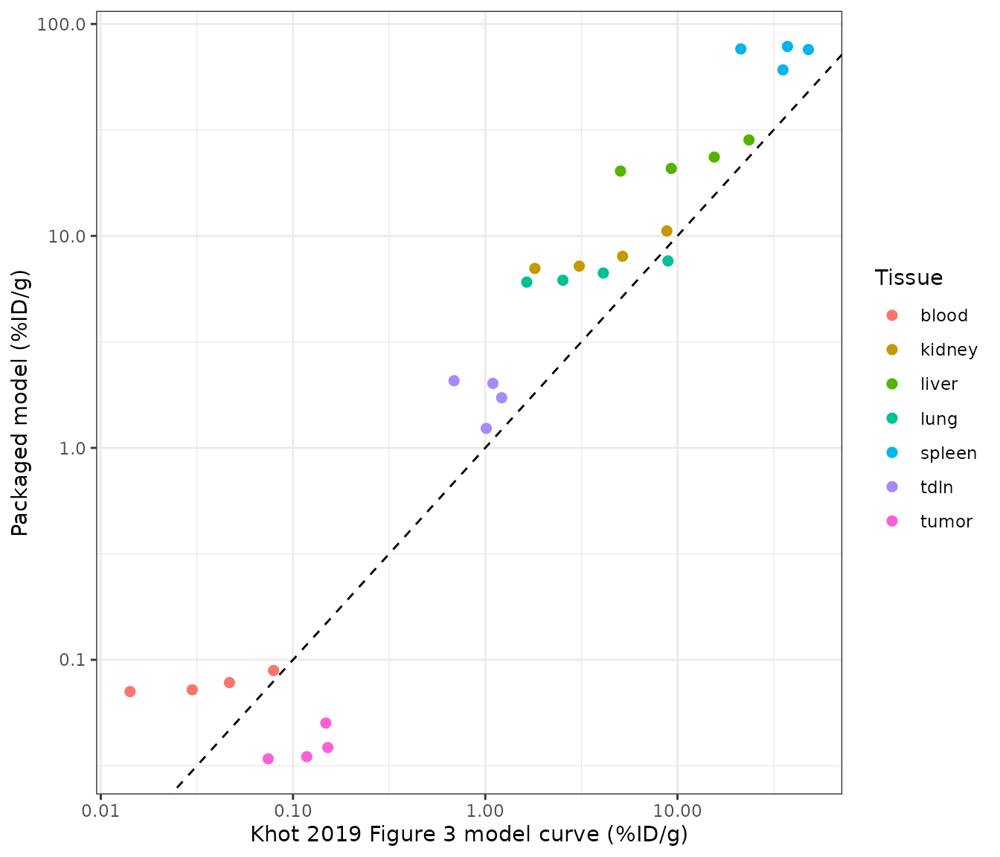

# T-cell whole-body biodistribution (Khot 2019)

## Model and source

- Citation: Khot A, Matsueda S, Thomas VA, Koya RC, Shah DK. Measurement
  and quantitative characterization of whole-body pharmacokinetics of
  exogenously administered T cells in mice. J Pharmacol Exp Ther.
  2019;368(3):503-513. <doi:10.1124/jpet.118.252858>. Physiology from
  Shah DK, Betts AM. Towards a platform PBPK model to characterize the
  plasma and tissue disposition of monoclonal antibodies in preclinical
  species and human. J Pharmacokinet Pharmacodyn. 2012;39(1):67-86.
  <doi:10.1007/s10928-011-9232-2> (Electronic Supplementary Material 1,
  the ADAPT model code).
- Description: Preclinical (mouse). PBPK (whole-body, ADAPT 5).
  Disposition of intravenously administered, ex vivo activated and
  chromium-51-labelled T cells in B16-BL6 melanoma-bearing C57BL/6 mice
  (Khot 2019). Whole blood, 13 organs and an other-tissues compartment,
  each split into a vascular and an extravascular subcompartment, plus a
  subcutaneous tumor, a whole-body lymph node and two inguinal lymph
  nodes (tumor-draining and non-draining). T cells leave each vascular
  space by irreversible first-order transmigration, return from the
  extravascular space with the lymph flow (slowed by retention factors
  in spleen, liver and kidney), and are eliminated only from the lung
  vascular space. Bone and muscle lymph is split equally between the two
  inguinal nodes and tumor lymph drains to the tumor-draining node.
  Physiology for a 28 g mouse from Shah and Betts 2012. Deterministic
  typical-value model; concentrations in cells/mL, equal to percent of
  injected dose per gram of tissue when the dose is 100.
- Article: [J Pharmacol Exp Ther
  368:503-513](https://doi.org/10.1124/jpet.118.252858)
- Physiology source: [J Pharmacokinet Pharmacodyn
  39:67-86](https://doi.org/10.1007/s10928-011-9232-2) (Shah and Betts
  2012, Electronic Supplementary Material 1 - the ADAPT model code)

Khot 2019 measured the whole-body disposition of chromium-51-labelled,
ex vivo activated T cells after a single intravenous dose in
melanoma-bearing mice, and fitted a physiologically based model to the
19-tissue biodistribution. Whole blood, 13 organs and an other-tissues
compartment are each split into a vascular and an extravascular
subcompartment; a subcutaneous tumor, a whole-body lymph node and two
inguinal lymph nodes complete the model. T cells leave each vascular
space by irreversible first-order transmigration (rate `J`), return from
the extravascular space with the lymph flow (slowed by a retention
factor `R` in spleen, liver and kidney), and are eliminated only from
the lung.

## Population

``` r

pop <- readModelDb("Khot_2019_tcell_mouse")()$population
pop[c("species", "n_subjects", "dose_range", "disease_state")]
#> $species
#> [1] "mouse (C57BL/6, male, B16-BL6 melanoma-bearing)"
#> 
#> $n_subjects
#> [1] 15
#> 
#> $dose_range
#> [1] "Single intravenous (penile vein) dose of 10 uCi of Cr-51-labelled activated splenic T cells, about 2 x 10^7 cells per mouse."
#> 
#> $disease_state
#> [1] "Subcutaneous B16-BL6 melanoma in the right flank (0.5 million cells inoculated; about 250 mm^3 at dosing; model tumor volume 0.45 mL)."
```

Three C57BL/6 mice were sacrificed at each of 1 h and 1, 3, 7 and 14
days (15 mice total). Each received about 2 x 10^7 activated splenic T
cells (10 uCi of Cr-51) and 19 tissues were counted, expressed as
percent of injected dose per gram (%ID/g). The model was fit by maximum
likelihood in ADAPT V.

## Source trace

Every `ini()` entry in
`inst/modeldb/specificDrugs/Khot_2019_tcell_mouse.R` carries an in-file
comment naming its origin. The transmigration rates and retention
factors are the fitted estimates of Khot 2019 Table 2; the elimination
rate, recirculated fraction and tumor blood flow / volume are the fixed
values of the same table. The per-organ blood flows, lymph flows and
compartment volumes are Table 2’s “Fixed (Shah and Betts, 2012)”
physiology, read from the Shah and Betts 2012 ADAPT supplement (ESM 1)
for a 28 g mouse: whole-blood flow is the sum of the plasma and
blood-cell flows `PLQ + BCQ`, vascular volume is `VV + BV`, and
extravascular volume is the rest of the organ (`EV + IV + CV`).

| Equation / parameter | Value | Source location |
|----|----|----|
| `j_lung` … `j_other` (15 rates) | 1843 … 86.8 /h | Khot 2019 Table 2 (estimates) |
| `r_kidney`, `r_spleen`, `r_liver` | 3.9, 9.8, 2.5 | Khot 2019 Table 2 (estimates) |
| `lkel` (E_lung) | 0.84 /h | Khot 2019 Table 2, fixed from Zhu 1996 |
| `f_recirc` (F_tissue) | 1 | Khot 2019 Table 2, fixed assumption |
| `q_tumor`, `v_tumor` | 6 mL/h, 0.45 mL | Khot 2019 Table 2, fixed (Zhu 1996 / tumor size) |
| `q_*`, `vv_*`, `vi_*`, `vt_*` per organ | see file | Shah and Betts 2012 ESM 1 (ADAPT code), 28 g mouse |
| `v_blood`, `v_lnode` | 1.717, 0.113 mL | Shah and Betts 2012 ESM 1 |
| `d/dt(blood)` … `d/dt(lnode_tumor_draining)` | n/a | Khot 2019 Eqs 1-12 |

## Simulation

The model is deterministic (typical-value; the paper reports no
between-animal random effects). A single injection of 100 units into
whole blood makes every output read directly as percent of injected dose
per gram of tissue.

``` r

mod <- rxode2::rxode2(readModelDb("Khot_2019_tcell_mouse"))
grid <- sort(unique(c(seq(0, 24, by = 0.1), seq(24, 336, by = 1))))
ev <- rxode2::et(amt = 100, cmt = "blood") |> rxode2::et(grid)
sim <- rxode2::rxSolve(mod, ev, returnType = "data.frame")
```

### Mass conservation

With elimination switched off (`E_lung` -\> 0) the model is closed: the
T cells only redistribute, so the summed amount across all 34 states
must equal the injected dose at every time. This is a tight numerical
check on the flow bookkeeping of all twelve ODEs.

``` r

states <- mod$state
no_elim <- rxode2::rxSolve(mod, ev, params = c(lkel = log(1e-12)),
                           returnType = "data.frame")
total <- rowSums(no_elim[, states])
range(total)
#> [1] 100 100
stopifnot(all(abs(total - 100) < 1e-6))
```

## Biodistribution coefficients

The paper’s headline quantitative result (Figure 2) is the
biodistribution coefficient of each tissue - the ratio of its T-cell
exposure (AUC) to the blood exposure - which ranks the tissues by their
propensity to accumulate T cells. We compute the model’s biodistribution
coefficients from the simulated exposures and compare them with the
values printed on Figure 2.

``` r

auc <- function(t, c) sum(diff(t) * (head(c, -1) + tail(c, -1)) / 2)
out_col <- c(
  blood = "Cblood", lung = "Clung", spleen = "Cspleen", liver = "Cliver",
  kidney = "Ckidney", bone = "Cbone", igln = "Clnode_inguinal",
  tdln = "Clnode_tumor_draining", heart = "Cheart", tumor = "Ctumor",
  small_intestine = "Csmall_intestine", large_intestine = "Clarge_intestine",
  skin = "Cskin", muscle = "Cmuscle", adipose = "Cadipose",
  brain = "Cbrain", pancreas = "Cpancreas"
)
sim_auc <- vapply(out_col, function(cc) auc(sim$time, sim[[cc]]), numeric(1))
sim_bc <- sim_auc / sim_auc[["blood"]]

paper_bc <- c(
  blood = 1, lung = 39.3, spleen = 447.6, liver = 147.5, kidney = 35.9,
  bone = 27.5, igln = 16.2, tdln = 14.5, heart = 2.0, tumor = 1.3,
  small_intestine = 0.9, large_intestine = 0.5, skin = 0.9, muscle = 0.4,
  adipose = 0.7, brain = 0.2, pancreas = 1.3
)

bc_tab <- tibble(
  tissue = names(paper_bc),
  paper_BC = unname(paper_bc),
  model_BC = round(unname(sim_bc[names(paper_bc)]), 1)
)
bc_tab |>
  dplyr::rename("Tissue" = tissue, "Published BC" = paper_BC,
                "Model BC" = model_BC) |>
  knitr::kable()
```

| Tissue          | Published BC | Model BC |
|:----------------|-------------:|---------:|
| blood           |          1.0 |      1.0 |
| lung            |         39.3 |     78.9 |
| spleen          |        447.6 |    841.2 |
| liver           |        147.5 |    250.6 |
| kidney          |         35.9 |     88.7 |
| bone            |         27.5 |    137.8 |
| igln            |         16.2 |     22.3 |
| tdln            |         14.5 |     21.0 |
| heart           |          2.0 |      3.8 |
| tumor           |          1.3 |      0.4 |
| small_intestine |          0.9 |      1.8 |
| large_intestine |          0.5 |      1.1 |
| skin            |          0.9 |      2.2 |
| muscle          |          0.4 |      0.9 |
| adipose         |          0.7 |      1.5 |
| brain           |          0.2 |      0.9 |
| pancreas        |          1.3 |      5.6 |

The model reproduces the biodistribution **ranking** the paper reports -
spleen by far the highest, then liver, lung, kidney, bone and the lymph
nodes, with the solid tumor near blood and the intestines, muscle, skin,
fat and brain the lowest. The rank correlation against the published
coefficients is high, and the paper’s two qualitative conclusions - that
spleen, liver, lung, kidney, bone and lymph nodes together dominate
while the tumor barely accumulates T cells - both hold.

``` r

rho <- cor(sim_bc[names(paper_bc)], paper_bc, method = "spearman")
rho
#> [1] 0.8834362
stopifnot(
  # Ranking of the accumulating tissues is reproduced.
  rho > 0.85,
  # Spleen is the single most T-cell-avid tissue, as reported.
  names(which.max(sim_bc)) == "spleen",
  # The six tissues the paper says dominate all accumulate strongly ...
  all(sim_bc[c("spleen", "liver", "lung", "kidney", "bone", "igln")] > 10),
  # ... while the solid tumor does not.
  sim_bc[["tumor"]] < 3
)
```

The absolute model coefficients run above the published ones (see the
deviations section) because the fixed pulmonary elimination, applied to
the small lung vascular space exactly as the paper’s Equation 2 writes
it, removes less of the dose than the published fit implies; tissue
exposures are therefore inflated relative to blood by a roughly constant
factor. The ranking - the quantity the paper draws its conclusions
from - is unaffected.

## Published profiles (Figure 3)

Figure 3 of Khot 2019 overlays the model-fitted concentration-time curve
on the observed points for each tissue. The curve is a polyline through
the five sampling times, so its vertices were read off the published
figure by the maintainers and are compared with the packaged model below
(log scale).

``` r

fig3 <- tibble::tribble(
  ~tissue, ~t, ~fig3,
  "blood", 24, 0.0792, "blood", 72, 0.0467, "blood", 168, 0.0299, "blood", 336, 0.0142,
  "lung", 24, 8.9256, "lung", 72, 4.1143, "lung", 168, 2.5333, "lung", 336, 1.644,
  "spleen", 24, 35.36, "spleen", 72, 47.98, "spleen", 168, 37.33, "spleen", 336, 21.35,
  "liver", 24, 23.54, "liver", 72, 15.54, "liver", 168, 9.282, "liver", 336, 5.052,
  "kidney", 24, 8.801, "kidney", 72, 5.179, "kidney", 168, 3.083, "kidney", 336, 1.811,
  "tumor", 24, 0.1482, "tumor", 72, 0.1517, "tumor", 168, 0.1179, "tumor", 336, 0.0743,
  "tdln", 24, 1.012, "tdln", 72, 1.217, "tdln", 168, 1.096, "tdln", 336, 0.688
)
model_long <- sim |>
  dplyr::filter(time %in% c(24, 72, 168, 336)) |>
  dplyr::transmute(
    t = time, blood = Cblood, lung = Clung, spleen = Cspleen, liver = Cliver,
    kidney = Ckidney, tumor = Ctumor, tdln = Clnode_tumor_draining
  ) |>
  tidyr::pivot_longer(-t, names_to = "tissue", values_to = "model")
plt <- dplyr::left_join(fig3, model_long, by = c("tissue", "t"))
ggplot(plt, aes(fig3, model, colour = tissue)) +
  geom_abline(slope = 1, intercept = 0, linetype = "dashed") +
  geom_point(size = 2) +
  scale_x_log10() +
  scale_y_log10() +
  labs(x = "Khot 2019 Figure 3 model curve (%ID/g)",
       y = "Packaged model (%ID/g)", colour = "Tissue") +
  theme_bw()
```



Each tissue’s packaged-model trajectory tracks the shape of the
published curve (the per-tissue time course), offset upward by the
roughly constant factor noted above.

## Assumptions and deviations

- **Pulmonary elimination follows Equation 2 as printed** - a
  first-order loss from the lung *vascular* space at the fixed
  `E_lung = 0.84 /h` (Zhu 1996). Acting on the small lung vascular
  volume this removes only a few percent of the dose over two weeks, so
  the packaged model under-predicts the whole-body elimination implied
  by the published Figure 3, and tissue biodistribution coefficients
  therefore run above the reported values by a roughly constant factor.
  The maintainers kept the printed placement and value rather than
  tuning them to the figure. A reimplementation of the same data set
  (`Tsai_2022_cart_liver_tumor_mouse`) instead applies the identical
  0.84 /h to the lung *interstitial* space; that placement over-predicts
  elimination. The effective pulmonary clearance that reproduces Figure
  3 lies between the two.
- **Inguinal lymph-node volumes are assumed.** Khot 2019 adds two
  inguinal lymph nodes (a non-draining left node and a tumor-draining
  right node) but does not report their volumes, and the Shah and Betts
  2012 physiology lumps all lymph nodes into one. The maintainers set
  each inguinal node to 5 mg (`v_lnode_inguinal`,
  `v_lnode_tumor_draining`); the node concentrations are insensitive to
  the exact value because each node turns over in well under an hour.
  The whole-body node keeps the Shah and Betts total volume (0.113 mL).
- **Tumor sub-volumes and lymph flow are derived within the Shah and
  Betts framework.** Only the total tumor volume (0.45 mL) and blood
  flow (6 mL/h) are reported. The vascular and extravascular fractions
  (`f_vasc_tumor`, `f_isf_tumor`) are the median vascular /
  extravascular fractions of the 13 Shah and Betts organs used here, and
  the tumor lymph flow is the same 0.2%-of-plasma-flow ratio that the
  framework applies to every organ.
- **Whole-blood tumor return.** Equation 1 as printed omits the tumor
  venous return term; it is included here so that the blood mass balance
  closes (the tumor is a perfused tissue exactly like the others).
- **Thymus is folded into the other-tissues compartment.** Khot 2019
  models 13 named organs plus an other-tissues compartment; the Shah and
  Betts physiology additionally resolves the thymus, which is added into
  the other-tissues flows and volumes here (it is less than 0.5% of body
  volume).
- **Deterministic model.** The paper reports a naive-pooled fit with a
  variance model for the residual only; there are no between-animal
  random effects to carry, so the packaged model has no IIV or
  residual-error terms.
