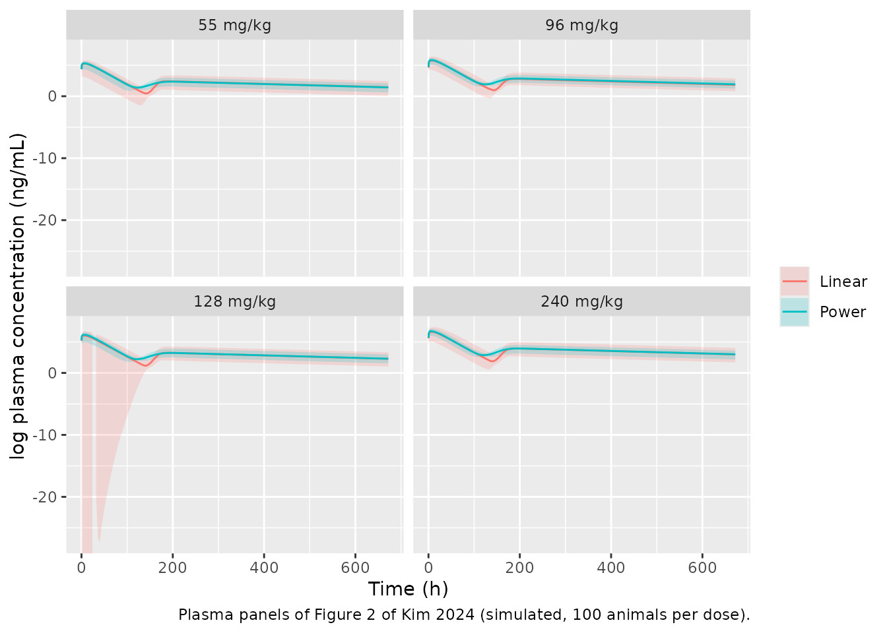
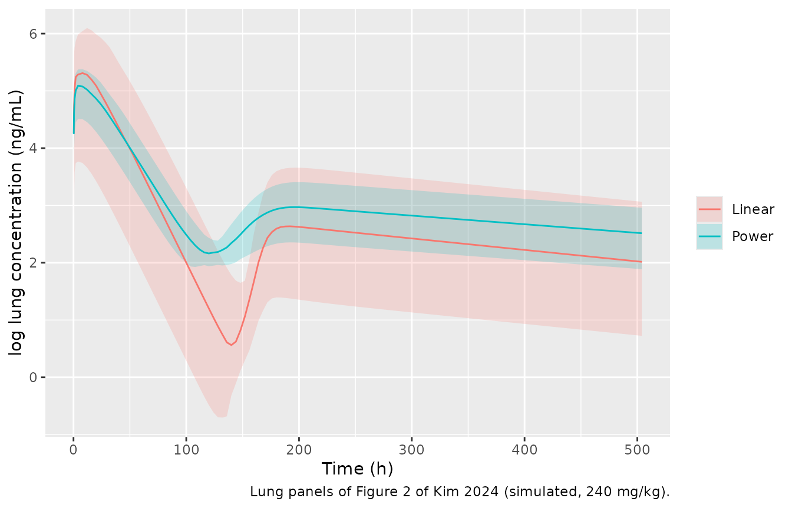
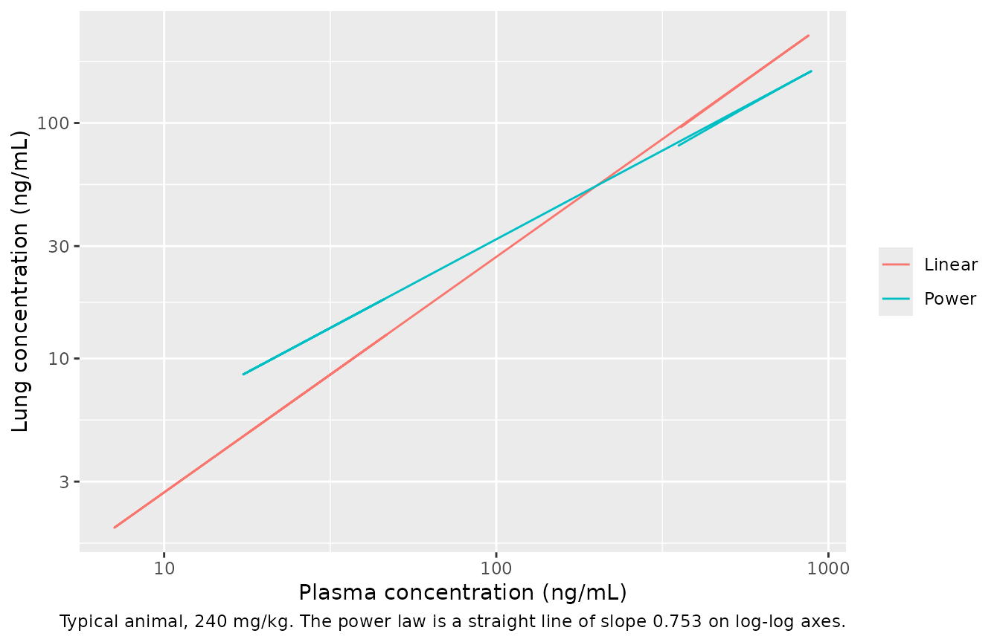
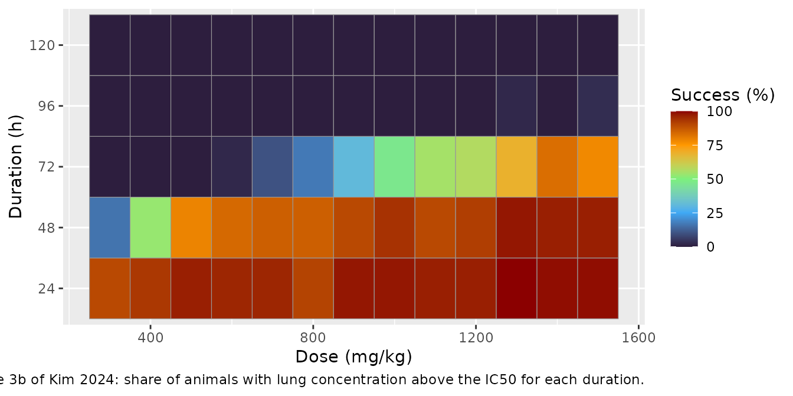

# Niclosamide intramuscular, plasma and lung in hamsters (Kim 2024)

## Model and source

Kim et al. (2024) gave a long-acting intramuscular niclosamide
formulation to Golden Syrian hamsters and modelled plasma and
lung-tissue concentrations jointly. They fitted two models that differ
only in how drug exchanges between plasma and a perfusion-limited lung
compartment:

- `Kim_2024_niclosamide_hamster` – the final **power-law** model (Table
  2, Equation 2), `dAlung/dt = Qlung * (Cplasma^Xcl - Clung)`.
- `Kim_2024_niclosamide_hamster_linear` – the **linear
  partition-coefficient** alternative (Appendix S1 Table S3, Equation
  1), `dAlung/dt = Qlung * (Cplasma - Clung / Kp)`.

The power-law model was preferred (OFV -256.33 versus -200.84, and a
better lung VPC) and was used for the dose optimisation.

- Citation: Kim T, Jung W, Cho S, Kim G, Yun H-y, Chae J-w. Predicting
  lung exposure of intramuscular niclosamide as an antiviral agent:
  Power-law based pharmacokinetic modeling. Clin Transl Sci.
  2024;17(5):e13833. <doi:10.1111/cts.13833>. PMCID: PMC11128490.
  Parameter estimates: Table 2. Structure: Figure 1 and Equation 2.
- Description (power law): Preclinical (hamster). Final power-law
  population PK model for a long-acting intramuscular niclosamide
  formulation in male Golden Syrian hamsters, fit jointly to plasma and
  lung-tissue concentrations. The dose is split between a fast
  first-order depot (fraction 1 - F, rate ka) and a slow depot
  (fraction F) whose first-order rate is switched on by a Weibull
  cumulative-distribution function of time, ka2(t) = kamax \* (1 -
  exp(-(t / lambda)^gamma)). Disposition is two compartments (central,
  peripheral1) with linear clearance plus a perfusion-limited lung
  compartment whose volume and blood flow were held at allometrically
  interpolated hamster values. Exchange with the lung follows the power
  law dAlung/dt = Qlung \* (Cplasma^Xcl - Clung) (Kopelman anomalous
  reaction order Xcl), so lung concentration at equilibrium is
  Cplasma^Xcl rather than proportional to plasma. The power law is tied
  to the paper’s concentration units: Cplasma and Clung are in ng/mL. A
  linear partition-coefficient alternative is
  Kim_2024_niclosamide_hamster_linear.
- Description (linear): Preclinical (hamster). Linear
  partition-coefficient population PK model for a long-acting
  intramuscular niclosamide formulation in male Golden Syrian hamsters,
  fit jointly to plasma and lung-tissue concentrations; the alternative
  the authors compared against their final power-law model
  (Kim_2024_niclosamide_hamster), which it shares in structure except
  for the plasma-lung exchange. The dose is split between a fast
  first-order depot (fraction 1 - F, rate ka) and a slow depot
  (fraction F) whose first-order rate is switched on by a Weibull
  cumulative-distribution function of time, ka2(t) = kamax \* (1 -
  exp(-(t / lambda)^gamma)). Disposition is two compartments (central,
  peripheral1) with linear clearance plus a perfusion-limited lung
  compartment whose volume and blood flow were held at allometrically
  interpolated hamster values, exchanging as dAlung/dt = Qlung \*
  (Cplasma - Clung / Kp). The power-law model fit better (OFV -256.33
  versus -200.84).
- Article: [Clin Transl Sci
  2024;17:e13833](https://doi.org/10.1111/cts.13833)

## Population

Twenty-five 7-week-old male Golden Syrian hamsters (SLC Japan) received
a single intramuscular injection after a 7-day acclimatisation. Plasma
pharmacokinetics were measured at 55, 96, 128 and 240 mg/kg (n = 5 per
dose), and lung tissue was collected from a separate group dosed at 240
mg/kg, with sampling at 0, 0.25, 0.5, 1, 2, 4, 8, 24, 48, 96, 168, 240,
336, 504 and 672 h (Methods, Study design). Body weights are not
reported. The model was fitted in NONMEM 7.5.1 with FOCE-I on
log-transformed observations.

The same information is available programmatically via
`readModelDb("Kim_2024_niclosamide_hamster")()$population`.

## Source trace

| Equation / parameter | Power law (Table 2) | Linear (Table S3) | Notes |
|----|----|----|----|
| `lcl` (CL, L/h) | 0.485 | 0.49 |  |
| `lvc` (Vc, L) | 0.371 | 0.35 |  |
| `lq` (Q inter, L/h) | 0.365 | 0.34 |  |
| `lvp` (Vp, L) | 1.647 | 1.58 |  |
| `lq_lung` (Q lung, L/h) | 0.0613, not estimated | 0.0613, not estimated | allometric interpolation |
| `lv_lung` (V l, L) | 0.000919, not estimated | 0.000919, not estimated | allometric interpolation |
| `lpow_lung` (X cl) | 0.753 | – | Equation 2 |
| `lkp_lung` (Kp) | – | 0.27 | Equation 1 |
| `lka` (K A1, 1/h) | 0.042 | 0.04 | fast depot |
| `lkamax` (K A2, 1/h) | 0.002 | 0.002 | Table S3 prints 0.00; bootstrap median 0.002 used |
| `lra` (1 / Lambda, 1/h) | 1 / 155.80 | 1 / 164.60 | Weibull time scale |
| `lgam1` (Gamma) | 7.199 | 22.08 | Weibull shape |
| `lfdepot2` (F) | 0.430 | 0.42 | fraction to slow depot |
| `etalvc` | 0.299 | 0.53 | omega^2 |
| `etalcl` | 0.0233 | 0.16 | omega^2 |
| `etalfdepot2` | 0.169 | 0.33 | omega^2 |
| `expSd` (plasma) | 0.373 | 0.39 | log-scale SD |
| `expSd_Clung` (lung) | 0.361 | 0.50 | log-scale SD |
| Absorption | Figure 1 | Figure 1 | fast depot `1 - F` at Ka1; slow depot `F` at `Ka2 * WB`, `WB = 1 - exp(-(time/lambda)^gamma)` |
| Lung exchange | Equation 2 | Equation 1 |  |

## Virtual cohort

The doses are in mg/kg and the model volumes and clearances are absolute
(L, L/h), so a body weight is needed to turn a mg/kg dose into an
amount. The paper does not report one. The maintainers used **0.12 kg**
for every animal: with complete absorption, dose = CL x AUCinf, and
Table 1 AUCinf with the model’s CL of 0.485 L/h implies 0.12, 0.10, 0.12
and 0.17 kg at 55, 96, 128 and 240 mg/kg, consistent with the usual
weight of an 8-week-old male Golden Syrian hamster.

``` r

body_wt <- 0.12 # kg, assumed (see above)
obs_times <- sort(unique(c(
  0, 0.25, 0.5, 1, 2, 4, 8, 24, 48, 96, 168, 240, 336, 504, 672,
  seq(4, 672, by = 4)
)))

# One intramuscular dose is two dose records with the full amount (depot and
# depot2); the model's f() splits the dose between the fast and slow depots.
make_cohort <- function(n, dose_mgkg, id_offset = 0L) {
  ids <- id_offset + seq_len(n)
  amt <- dose_mgkg * body_wt
  doses <- tidyr::expand_grid(id = ids, cmt = c("depot", "depot2")) |>
    mutate(time = 0, evid = 1L, amt = amt)
  obs <- tidyr::expand_grid(id = ids, time = obs_times) |>
    mutate(cmt = "central", dvid = 1L, evid = 0L, amt = 0)
  bind_rows(doses, obs) |>
    mutate(dose_group = paste(dose_mgkg, "mg/kg")) |>
    arrange(id, time, desc(evid))
}

dose_levels <- c(55, 96, 128, 240)
n_per_group <- 100L
events <- bind_rows(lapply(seq_along(dose_levels), function(i) {
  make_cohort(n_per_group, dose_levels[i], id_offset = (i - 1L) * n_per_group)
}))
events$dose_group <- factor(events$dose_group, levels = paste(dose_levels, "mg/kg"))
stopifnot(!anyDuplicated(unique(events[, c("id", "time", "evid", "cmt")])))
```

Both models declare two endpoints (`Cc` and `Clung`), so observation
rows carry `dvid = 1` on the `central` compartment. The lung
concentration is returned as a column on every row.

## Simulation

``` r

mod_pow <- readModelDb("Kim_2024_niclosamide_hamster")
mod_lin <- readModelDb("Kim_2024_niclosamide_hamster_linear")

rxode2::rxSetSeed(20240530)
sim_pow <- rxode2::rxSolve(mod_pow, events = events, keep = "dose_group") |>
  as.data.frame() |>
  mutate(model = "Power")
#> ℹ parameter labels from comments will be replaced by 'label()'
rxode2::rxSetSeed(20240530)
sim_lin <- rxode2::rxSolve(mod_lin, events = events, keep = "dose_group") |>
  as.data.frame() |>
  mutate(model = "Linear")
#> ℹ parameter labels from comments will be replaced by 'label()'
sim <- bind_rows(sim_pow, sim_lin)
stopifnot(all(is.finite(sim$Cc)), all(is.finite(sim$Clung)))
```

Typical-value (no between-animal variability) predictions are used for
the structural checks and the NCA comparison:

``` r

typ <- bind_rows(
  rxode2::rxSolve(rxode2::zeroRe(mod_pow), events = events |> filter(id %% n_per_group == 1L),
                  keep = "dose_group") |> as.data.frame() |> mutate(model = "Power"),
  rxode2::rxSolve(rxode2::zeroRe(mod_lin), events = events |> filter(id %% n_per_group == 1L),
                  keep = "dose_group") |> as.data.frame() |> mutate(model = "Linear")
)
#> ℹ parameter labels from comments will be replaced by 'label()'
#> ℹ omega/sigma items treated as zero: 'etalvc', 'etalcl', 'etalfdepot2'
#> Warning: multi-subject simulation without without 'omega'
#> ℹ parameter labels from comments will be replaced by 'label()'
#> ℹ omega/sigma items treated as zero: 'etalvc', 'etalcl', 'etalfdepot2'
#> Warning: multi-subject simulation without without 'omega'
```

## Replicate published figures

### Figure 2 – plasma and lung concentration-time profiles

Figure 2 of Kim 2024 is a prediction-corrected VPC pooled across dose
groups, on the natural-log scale. The panels below show the simulated
5th, 50th and 95th percentiles (between-animal variability only) of the
plasma concentration by dose group and of the lung concentration in the
240 mg/kg group, for both models.

``` r

sim |>
  filter(time > 0) |>
  group_by(model, dose_group, time) |>
  summarise(
    Q05 = quantile(Cc, 0.05), Q50 = median(Cc), Q95 = quantile(Cc, 0.95),
    .groups = "drop"
  ) |>
  ggplot(aes(time, log(Q50), colour = model, fill = model)) +
  geom_ribbon(aes(ymin = log(Q05), ymax = log(Q95)), alpha = 0.2, colour = NA) +
  geom_line() +
  facet_wrap(~dose_group) +
  labs(
    x = "Time (h)", y = "log plasma concentration (ng/mL)", colour = NULL, fill = NULL,
    caption = "Plasma panels of Figure 2 of Kim 2024 (simulated, 100 animals per dose)."
  )
#> Warning in log(Q05): NaNs produced
#> Warning: Removed 1 row containing missing values or values outside the scale range
#> (`geom_ribbon()`).
```



``` r

sim |>
  filter(time > 0, time <= 504, dose_group == "240 mg/kg") |>
  group_by(model, time) |>
  summarise(
    Q05 = quantile(Clung, 0.05), Q50 = median(Clung), Q95 = quantile(Clung, 0.95),
    .groups = "drop"
  ) |>
  ggplot(aes(time, log(Q50), colour = model, fill = model)) +
  geom_ribbon(aes(ymin = log(Q05), ymax = log(Q95)), alpha = 0.2, colour = NA) +
  geom_line() +
  labs(
    x = "Time (h)", y = "log lung concentration (ng/mL)", colour = NULL, fill = NULL,
    caption = "Lung panels of Figure 2 of Kim 2024 (simulated, 240 mg/kg)."
  )
```



As in Figure 2, both models show a fast-absorption peak in the first
day, a trough near 96 h and a second, flatter peak once the
Weibull-triggered slow depot switches on (lambda = 156-165 h). The
paper’s observed plasma median is about 5.7 log units at the peak, 2.6
at 96 h and 3.0 at 250-330 h; the observed lung median is about 5.3 at
the peak, 3.0 at 96 h and 2.6-3.2 thereafter.

### Plasma-lung relationship: power law versus partition coefficient

The two models differ in the lung-to-plasma concentration ratio. With a
lung volume of 0.92 mL and a blood flow of 61 mL/h the lung equilibrates
within minutes, so the lung concentration tracks its equilibrium value,
`Cplasma^0.753` (power) or `0.27 * Cplasma` (linear). The check below
confirms that the typical-value solution sits on that relationship once
the absorption peak has passed.

``` r

eq_chk <- typ |>
  filter(time >= 48, dose_group == "240 mg/kg") |>
  mutate(
    Clung_eq = ifelse(model == "Power", Cc^0.753, 0.27 * Cc),
    rel = Clung / Clung_eq - 1
  )
eq_chk |>
  group_by(model) |>
  summarise(max_abs_rel_dev_pct = 100 * max(abs(rel)), .groups = "drop") |>
  knitr::kable(digits = 3, caption = "Deviation of the simulated lung concentration from its equilibrium value, 48-672 h.")
```

| model  | max_abs_rel_dev_pct |
|:-------|--------------------:|
| Linear |               0.035 |
| Power  |               0.050 |

Deviation of the simulated lung concentration from its equilibrium
value, 48-672 h. {.table}

``` r

stopifnot(max(abs(eq_chk$rel)) < 0.02)

typ |>
  filter(time > 0, dose_group == "240 mg/kg") |>
  ggplot(aes(Cc, Clung, colour = model)) +
  geom_path() +
  scale_x_log10() +
  scale_y_log10() +
  labs(
    x = "Plasma concentration (ng/mL)", y = "Lung concentration (ng/mL)", colour = NULL,
    caption = "Typical animal, 240 mg/kg. The power law is a straight line of slope 0.753 on log-log axes."
  )
```



The amount of drug in the lung is negligible against the dose (well
under 0.01%), so including the lung exchange in the central mass balance
does not change the plasma profile.

``` r

typ |>
  filter(model == "Power", dose_group == "240 mg/kg") |>
  summarise(max_lung_fraction_of_dose = max(lung) / (240 * body_wt)) |>
  knitr::kable(digits = 8)
```

| max_lung_fraction_of_dose |
|--------------------------:|
|                   5.3e-06 |

## PKNCA validation

Plasma NCA by dose group over the sampling window (0-672 h), and lung
NCA in the 240 mg/kg group over 0-504 h (the extent of the lung panels
of Figure 2), on the simulated individual concentrations at the paper’s
nominal sampling times.

``` r

nominal <- c(0, 0.25, 0.5, 1, 2, 4, 8, 24, 48, 96, 168, 240, 336, 504, 672)

run_nca <- function(df, conc_col, end_time) {
  conc_df <- df |>
    filter(time %in% nominal, time <= end_time) |>
    mutate(conc = .data[[conc_col]]) |>
    filter(!is.na(conc)) |>
    select(id, time, conc, dose_group)
  conc_df <- bind_rows(
    conc_df,
    conc_df |> distinct(id, dose_group) |> mutate(time = 0, conc = 0)
  ) |>
    distinct(id, dose_group, time, .keep_all = TRUE) |>
    arrange(id, dose_group, time)
  # Each dose record carries the full amount (f() splits it), so the depot
  # record alone is the administered dose.
  dose_df <- events |>
    filter(evid == 1, cmt == "depot", id %in% conc_df$id) |>
    select(id, time, amt, dose_group)
  conc_obj <- PKNCA::PKNCAconc(conc_df, conc ~ time | dose_group + id)
  dose_obj <- PKNCA::PKNCAdose(dose_df, amt ~ time | dose_group + id)
  intervals <- data.frame(
    start = c(0, 0), end = c(end_time, Inf),
    cmax = c(TRUE, FALSE), tmax = c(TRUE, FALSE), auclast = c(TRUE, FALSE),
    half.life = c(FALSE, TRUE), aucinf.obs = c(FALSE, TRUE)
  )
  PKNCA::pk.nca(PKNCA::PKNCAdata(conc_obj, dose_obj, intervals = intervals))
}

nca_plasma_pow <- run_nca(sim_pow, "Cc", 672)
#> Warning in assert_conc(conc, any_missing_conc = any_missing_conc): Negative
#> concentrations found
#> Warning in assert_conc(conc, any_missing_conc = any_missing_conc): Negative
#> concentrations found
#> Warning in log(conc.2/conc.1): NaNs produced
#> Warning in assert_conc(conc = conc): Negative concentrations found
#> Warning in assert_conc(conc, any_missing_conc = any_missing_conc): Negative
#> concentrations found
#> Warning in assert_conc(conc, any_missing_conc = any_missing_conc): Negative
#> concentrations found
#> Warning in assert_conc(conc, any_missing_conc = any_missing_conc): Negative
#> concentrations found
#> Warning in assert_conc(conc, any_missing_conc = any_missing_conc): Negative
#> concentrations found
#> Warning in assert_conc(conc, any_missing_conc = any_missing_conc): Negative
#> concentrations found
#> Warning in assert_conc(conc, any_missing_conc = any_missing_conc): Negative
#> concentrations found
#> Warning in log(data$conc): NaNs produced
#> Warning in assert_conc(conc, any_missing_conc = any_missing_conc): Negative
#> concentrations found
#> Warning in log(conc.2/conc.1): NaNs produced
#> Warning in assert_conc(conc, any_missing_conc = any_missing_conc): Negative
#> concentrations found
#> Warning in log(conc.2/conc.1): NaNs produced
#> Warning in assert_conc(conc = conc): Negative concentrations found
#> Warning in assert_conc(conc, any_missing_conc = any_missing_conc): Negative
#> concentrations found
#> Warning in assert_conc(conc, any_missing_conc = any_missing_conc): Negative
#> concentrations found
#> Warning in assert_conc(conc, any_missing_conc = any_missing_conc): Negative
#> concentrations found
#> Warning in assert_conc(conc, any_missing_conc = any_missing_conc): Negative
#> concentrations found
#> Warning in assert_conc(conc, any_missing_conc = any_missing_conc): Negative
#> concentrations found
#> Warning in assert_conc(conc, any_missing_conc = any_missing_conc): Negative
#> concentrations found
#> Warning in log(data$conc): NaNs produced
#> Warning in assert_conc(conc, any_missing_conc = any_missing_conc): Negative
#> concentrations found
#> Warning in log(conc.2/conc.1): NaNs produced
#> Warning in assert_conc(conc, any_missing_conc = any_missing_conc): Negative
#> concentrations found
#> Warning in log(conc.2/conc.1): NaNs produced
#> Warning in assert_conc(conc = conc): Negative concentrations found
#> Warning in assert_conc(conc, any_missing_conc = any_missing_conc): Negative
#> concentrations found
#> Warning in assert_conc(conc, any_missing_conc = any_missing_conc): Negative
#> concentrations found
#> Warning in assert_conc(conc, any_missing_conc = any_missing_conc): Negative
#> concentrations found
#> Warning in assert_conc(conc, any_missing_conc = any_missing_conc): Negative
#> concentrations found
#> Warning in assert_conc(conc, any_missing_conc = any_missing_conc): Negative
#> concentrations found
#> Warning in assert_conc(conc, any_missing_conc = any_missing_conc): Negative
#> concentrations found
#> Warning in log(data$conc): NaNs produced
#> Warning in assert_conc(conc, any_missing_conc = any_missing_conc): Negative
#> concentrations found
#> Warning in log(conc.2/conc.1): NaNs produced
#> Warning in assert_conc(conc, any_missing_conc = any_missing_conc): Negative
#> concentrations found
#> Warning in log(conc.2/conc.1): NaNs produced
#> Warning in assert_conc(conc = conc): Negative concentrations found
#> Warning in assert_conc(conc, any_missing_conc = any_missing_conc): Negative
#> concentrations found
#> Warning in assert_conc(conc, any_missing_conc = any_missing_conc): Negative
#> concentrations found
#> Warning in assert_conc(conc, any_missing_conc = any_missing_conc): Negative
#> concentrations found
#> Warning in assert_conc(conc, any_missing_conc = any_missing_conc): Negative
#> concentrations found
#> Warning in assert_conc(conc, any_missing_conc = any_missing_conc): Negative
#> concentrations found
#> Warning in assert_conc(conc, any_missing_conc = any_missing_conc): Negative
#> concentrations found
#> Warning in log(data$conc): NaNs produced
#> Warning in assert_conc(conc, any_missing_conc = any_missing_conc): Negative
#> concentrations found
#> Warning in log(conc.2/conc.1): NaNs produced
#> Warning in assert_conc(conc, any_missing_conc = any_missing_conc): Negative
#> concentrations found
#> Warning in log(conc.2/conc.1): NaNs produced
#> Warning in assert_conc(conc = conc): Negative concentrations found
#> Warning in assert_conc(conc, any_missing_conc = any_missing_conc): Negative
#> concentrations found
#> Warning in assert_conc(conc, any_missing_conc = any_missing_conc): Negative
#> concentrations found
#> Warning in assert_conc(conc, any_missing_conc = any_missing_conc): Negative
#> concentrations found
#> Warning in assert_conc(conc, any_missing_conc = any_missing_conc): Negative
#> concentrations found
#> Warning in assert_conc(conc, any_missing_conc = any_missing_conc): Negative
#> concentrations found
#> Warning in assert_conc(conc, any_missing_conc = any_missing_conc): Negative
#> concentrations found
#> Warning in log(data$conc): NaNs produced
#> Warning in assert_conc(conc, any_missing_conc = any_missing_conc): Negative
#> concentrations found
#> Warning in log(conc.2/conc.1): NaNs produced
nca_lung_pow <- run_nca(sim_pow |> filter(dose_group == "240 mg/kg"), "Clung", 504)
```

### Comparison against published NCA

Table 1 of Kim 2024 reports means of five animals per group.

``` r

published_plasma <- tibble::tribble(
  ~dose_group, ~cmax, ~tmax, ~half.life, ~auclast, ~aucinf.obs,
  "55 mg/kg", 160, 7.8, 283, 10938, 13684,
  "96 mg/kg", 225, 12.0, 240, 16845, 19266,
  "128 mg/kg", 431, 4.4, 332, 26278, 32779,
  "240 mg/kg", 2086, 7.3, 351, 68494, 84064
)
published_lung <- tibble::tribble(
  ~dose_group, ~cmax, ~tmax, ~half.life, ~auclast, ~aucinf.obs,
  "240 mg/kg", 256, 11.6, 226, 16377, 21821
)
nca_units <- c(
  cmax = "ng/mL", tmax = "h", half.life = "h",
  auclast = "ng*h/mL", aucinf.obs = "ng*h/mL"
)

knitr::kable(
  nlmixr2lib::ncaComparisonTable(
    simulated = nca_plasma_pow, reference = published_plasma,
    by = "dose_group", units = nca_units, tolerance_pct = 20
  ),
  caption = "Plasma, power-law model: simulated (median) vs. Table 1 (mean). * differs by >20%."
)
```

| NCA parameter           | dose_group | Reference | Simulated | % diff   |
|:------------------------|:-----------|:----------|:----------|:---------|
| Cmax (ng/mL)            | 55 mg/kg   | 160       | 204       | +27.8%\* |
| Cmax (ng/mL)            | 96 mg/kg   | 225       | 343       | +52.3%\* |
| Cmax (ng/mL)            | 128 mg/kg  | 431       | 474       | +9.9%    |
| Cmax (ng/mL)            | 240 mg/kg  | 2090      | 866       | -58.5%\* |
| Tmax (h)                | 55 mg/kg   | 7.8       | 8         | +2.6%    |
| Tmax (h)                | 96 mg/kg   | 12        | 8         | -33.3%\* |
| Tmax (h)                | 128 mg/kg  | 4.4       | 8         | +81.8%\* |
| Tmax (h)                | 240 mg/kg  | 7.3       | 8         | +9.6%    |
| AUC0-∞ (obs) (ng\*h/mL) | 55 mg/kg   | 13700     | 13700     | +0.4%    |
| AUC0-∞ (obs) (ng\*h/mL) | 96 mg/kg   | 19300     | 23400     | +21.5%\* |
| AUC0-∞ (obs) (ng\*h/mL) | 128 mg/kg  | 32800     | 31500     | -3.9%    |
| AUC0-∞ (obs) (ng\*h/mL) | 240 mg/kg  | 84100     | 61000     | -27.4%\* |
| AUClast (ng\*h/mL)      | 55 mg/kg   | 10900     | 11500     | +5.6%    |
| AUClast (ng\*h/mL)      | 96 mg/kg   | 16800     | 19700     | +17.1%   |
| AUClast (ng\*h/mL)      | 128 mg/kg  | 26300     | 26300     | +0.0%    |
| AUClast (ng\*h/mL)      | 240 mg/kg  | 68500     | 50500     | -26.2%\* |
| t½ (h)                  | 55 mg/kg   | 283       | 346       | +22.3%\* |
| t½ (h)                  | 96 mg/kg   | 240       | 346       | +44.2%\* |
| t½ (h)                  | 128 mg/kg  | 332       | 346       | +4.2%    |
| t½ (h)                  | 240 mg/kg  | 351       | 346       | -1.4%    |

Plasma, power-law model: simulated (median) vs. Table 1 (mean). \*
differs by \>20%. {.table}

``` r

knitr::kable(
  nlmixr2lib::ncaComparisonTable(
    simulated = nca_lung_pow, reference = published_lung,
    by = "dose_group", units = nca_units, tolerance_pct = 20
  ),
  caption = "Lung, power-law model, 240 mg/kg: simulated (median) vs. Table 1 (mean). * differs by >20%."
)
```

| NCA parameter           | dose_group | Reference | Simulated | % diff    |
|:------------------------|:-----------|:----------|:----------|:----------|
| Cmax (ng/mL)            | 240 mg/kg  | 256       | 163       | -36.4%\*  |
| Tmax (h)                | 240 mg/kg  | 11.6      | 8         | -31.0%\*  |
| AUC0-∞ (obs) (ng\*h/mL) | 240 mg/kg  | 21800     | 21100     | -3.3%     |
| AUClast (ng\*h/mL)      | 240 mg/kg  | 16400     | 13200     | -19.1%    |
| t½ (h)                  | 240 mg/kg  | 226       | 459       | +103.2%\* |

Lung, power-law model, 240 mg/kg: simulated (median) vs. Table 1 (mean).
\* differs by \>20%. {.table}

Plasma AUC agrees with Table 1 within about 20% at 55, 96 and 128 mg/kg,
and lung AUCinf at 240 mg/kg within a few percent. The starred rows have
known causes. Table 1 is more than dose-proportional at 240 mg/kg (Cmax
2086 ng/mL, 4.8-fold the 128 mg/kg group for 1.9-fold the dose), which
the linear-clearance model cannot reproduce, so the 240 mg/kg plasma
Cmax and AUC are low; the lung Cmax is low for the same reason.
Simulated Cmax is 28-52% high at 55 and 96 mg/kg, and Tmax in the
five-animal groups is highly variable (SD 2-11 h). The assumed 0.12 kg
body weight scales every simulated concentration. NCA half-lives depend
on whether the last points fall on the secondary peak (lung NCA stops at
504 h, mid-way down the slow phase), so they are reported for
completeness only.

``` r

# Typical-value plasma AUC over 0-672 h against Table 1 at the three doses where
# the data are dose-proportional. A mis-transcribed clearance, volume or unit
# moves this by far more than the 30% allowed for the unreported body weight.
typ_auc <- typ |>
  filter(model == "Power", time %in% nominal) |>
  group_by(dose_group) |>
  summarise(auc = sum(diff(time) * (head(Cc, -1) + tail(Cc, -1)) / 2), .groups = "drop") |>
  mutate(dose_group = as.character(dose_group)) |>
  inner_join(published_plasma |> select(dose_group, auclast), by = "dose_group") |>
  mutate(pct_diff = 100 * (auc / auclast - 1))
knitr::kable(typ_auc, digits = 1, caption = "Typical-animal plasma AUC0-672 vs. Table 1 AUClast.")
```

| dose_group |     auc | auclast | pct_diff |
|:-----------|--------:|--------:|---------:|
| 55 mg/kg   | 12102.2 |   10938 |     10.6 |
| 96 mg/kg   | 21123.9 |   16845 |     25.4 |
| 128 mg/kg  | 28165.2 |   26278 |      7.2 |
| 240 mg/kg  | 52809.8 |   68494 |    -22.9 |

Typical-animal plasma AUC0-672 vs. Table 1 AUClast. {.table}

``` r

stopifnot(all(abs(typ_auc$pct_diff[typ_auc$dose_group != "240 mg/kg"]) < 30))
```

## Dose optimisation (Figure 3)

The authors searched for the intramuscular dose at which more than 90%
of simulated hamsters keep the lung concentration above the in vitro
IC50 against SARS-CoV-2 (0.28 uM) for as long as possible. With a
niclosamide molar mass of 327.12 g/mol the IC50 is 91.6 ng/mL, matching
the dashed line of Figure 3a. The paper reports a minimum dose of about
1115 mg/kg, giving a maximum duration of 72 h, and no dose up to 1500
mg/kg reaching 168 h.

The grid below uses 100 animals per dose at 100 mg/kg steps (the paper
used 5 mg/kg steps) and counts the time from the dose until the
individual lung concentration first falls back below the IC50, without
residual error.

``` r

ic50 <- 0.28 * 327.12 # ng/mL
opt_doses <- seq(300, 1500, by = 100)
opt_times <- seq(0, 168, by = 1)
opt_events <- bind_rows(lapply(seq_along(opt_doses), function(i) {
  ids <- (i - 1L) * 100L + seq_len(100L)
  amt <- opt_doses[i] * body_wt
  bind_rows(
    tidyr::expand_grid(id = ids, cmt = c("depot", "depot2")) |>
      mutate(time = 0, evid = 1L, amt = amt),
    tidyr::expand_grid(id = ids, time = opt_times) |>
      mutate(cmt = "central", dvid = 1L, evid = 0L, amt = 0)
  ) |>
    mutate(dose = opt_doses[i])
})) |>
  arrange(id, time, desc(evid))

rxode2::rxSetSeed(20240531)
opt_sim <- rxode2::rxSolve(mod_pow, events = opt_events, keep = "dose") |>
  as.data.frame()

dur <- opt_sim |>
  group_by(id, dose) |>
  summarise(
    t_below = {
      below <- time > 0 & Clung < ic50
      if (any(below)) min(time[below]) else Inf
    },
    .groups = "drop"
  )

success <- tidyr::expand_grid(dose = opt_doses, duration = c(24, 48, 72, 96, 120)) |>
  rowwise() |>
  mutate(ratio = 100 * mean(dur$t_below[dur$dose == dose] >= duration)) |>
  ungroup()

ggplot(success, aes(dose, factor(duration), fill = ratio)) +
  geom_tile(colour = "grey60") +
  scale_fill_gradientn(colours = c("#2d1e3e", "#3fa9f5", "#7cf07c", "#ff9900", "#8b0000"), limits = c(0, 100)) +
  labs(
    x = "Dose (mg/kg)", y = "Duration (h)", fill = "Success (%)",
    caption = "Figure 3b of Kim 2024: share of animals with lung concentration above the IC50 for each duration."
  )
```



``` r


success |>
  filter(duration == 72) |>
  rename("Dose (mg/kg)" = dose, "Animals above IC50 for 72 h (%)" = ratio) |>
  select(-duration) |>
  knitr::kable(digits = 0)
```

| Dose (mg/kg) | Animals above IC50 for 72 h (%) |
|-------------:|--------------------------------:|
|          300 |                               0 |
|          400 |                               0 |
|          500 |                               0 |
|          600 |                               2 |
|          700 |                              10 |
|          800 |                              17 |
|          900 |                              31 |
|         1000 |                              47 |
|         1100 |                              55 |
|         1200 |                              57 |
|         1300 |                              69 |
|         1400 |                              83 |
|         1500 |                              78 |

The simulated grid reproduces the shape of Figure 3b: 24 and 48 h are
covered in more than 90% of animals from moderate doses, 72 h coverage
rises steeply with dose, and 96-120 h is essentially never reached. The
72 h crossing is later than the paper’s: at 1100 mg/kg about half the
simulated animals stay above the IC50 for 72 h (the median duration is
close to 72 h), and 90% is not reached by 1500 mg/kg. This is recorded
as a known deviation rather than tuned. The dose needed for a given lung
concentration scales with the unreported body weight, and the paper’s
success criterion and its inclusion of residual error are only partly
described. Figure 3b also shows some success at 96-120 h for the highest
doses, which a contiguous-duration criterion without residual error
cannot produce.

``` r

# Trend only (see the deviation above): 72 h coverage is low at 600 mg/kg and
# high at 1500 mg/kg. Realised 2% and 78% at 16 threads with 100 animals per dose.
r72 <- success |> filter(duration == 72)
stopifnot(
  r72$ratio[r72$dose == 600] < 30,
  r72$ratio[r72$dose == 1500] > 50
)
```

## Assumptions and deviations

- **Body weight.** Not reported. A uniform 0.12 kg was used to convert
  mg/kg doses to amounts, chosen from the weights implied by Table 1
  AUCinf and the model clearance (0.10-0.17 kg) and consistent with
  8-week-old male Golden Syrian hamsters. Every simulated concentration
  scales with it.
- **Concentration units of the power law.** The power law is not
  unit-invariant. Figure 2 plots log concentrations in ng/mL for both
  plasma and lung, and the observed lung Cmax at 240 mg/kg (256 ng/mL)
  is close to the observed plasma Cmax raised to 0.753 (2086^0.753 =
  316), so the model uses plasma and lung concentrations in ng/mL.
  Dosing is in mg and volumes in L, with the factor of 1000 written into
  `model()`.
- **Central-lung mass balance.** Equations 1 and 2 give only the lung
  equation. Figure 1 draws a two-way arrow between central and lung, so
  the same flux is subtracted from central. Because the lung holds well
  under 0.01% of the dose, this choice has no visible effect on plasma.
- **Weibull switch time.** Figure 1 writes the Weibull function of
  `time`; the model uses time since the start of the simulation (`t`),
  which equals time after the dose for the single-dose design of the
  study. For repeated dosing the switch would need to be re-expressed
  per dose.
- **Variability scale.** Table 2 does not say whether the IIV values are
  variances or standard deviations. They are read as omega^2 (the usual
  NONMEM report). The residual values are read as log-scale standard
  deviations: the observed 5th-95th percentile spread in the plasma
  panels of Figure 2 is about 1 log unit late in the profile, which a
  variance of 0.373 (SD 0.61, spread at least 2 log units) could not
  produce.
- **IIV on F.** The paper investigated additive and exponential IIV
  without naming the final form; exponential IIV is used. Under it the
  slow-depot fraction exceeds 1 in about 2% (power law) and 7% (linear)
  of simulated animals, which would give the fast depot a negative dose.
  The fraction is capped at 1 in `model()`.
- **Linear model (Table S3).** Values are printed to two decimals. K A2
  is printed as 0.00; the bootstrap median 0.002 (5th-95th 0.001-0.002)
  from the same table is used, which also equals the power-law estimate.
  The Table S3 bootstrap medians of the IIV rows (0.023, 0.1085, 0.269)
  do not match the final estimates (0.53, 0.16, 0.33); the final
  estimates are used.
- **IC50 conversion.** The molar mass of niclosamide (327.12 g/mol) is
  not given in the paper; it converts the 0.28 uM IC50 to 91.6 ng/mL.
- **Dose-optimisation replication.** The paper’s success criterion, dose
  step (5 mg/kg) and inclusion of residual error are only partly
  described; the grid above uses 100 mg/kg steps, no residual error, and
  the time until the lung concentration first falls below the IC50. The
  simulated 72 h crossing is above 1500 mg/kg rather than at 1115 mg/kg
  (see Figure 3 above).
- **Numerical floor in the power law.** The power-law model raises
  `max(Cc, 0)` to the power 0.753: an animal whose whole dose is in the
  slow depot has plasma near zero for days, and a non-integer power of a
  tiny negative integrator undershoot is NaN.
- No erratum or correction notice for Kim 2024 was found as of
  2026-10-30.
