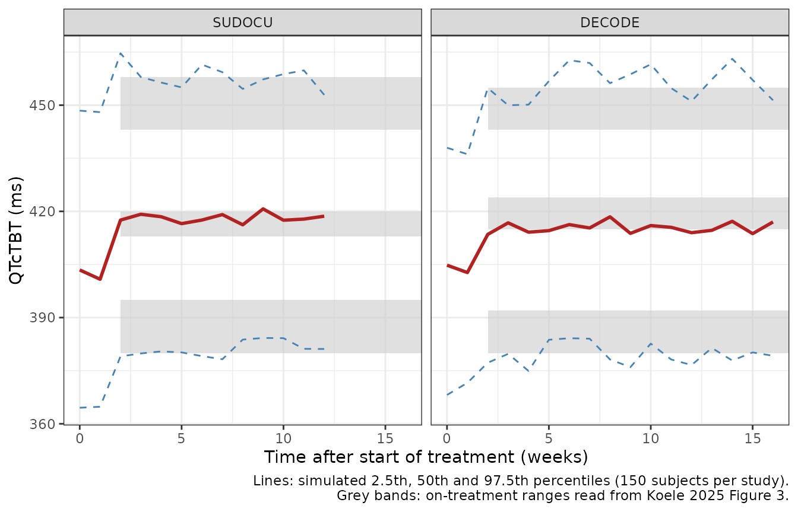

# QTc prolongation on bedaquiline, delamanid and moxifloxacin regimens (Koele 2025)

## Model and source

- Citation: Koele SE, Stoycheva K, Mtweve C, Manyama C, Mpagama S,
  Mhimbira F, et al.; PanACEA consortium. Cardiac safety of bedaquiline,
  delamanid and moxifloxacin co-administered with or without varying
  doses of sutezolid or delpazolid for the treatment of drug-susceptible
  TB. J Antimicrob Chemother. 2025;80(8):2305-2313.
  <doi:10.1093/jac/dkaf210>
- Article: <https://doi.org/10.1093/jac/dkaf210> (open access;
  PMC12313457)
- Supplement: Tables S1-S6, Figures S1-S3 and the NONMEM code (Text S1),
  at the same address.

Koele 2025 pooled the weekly ECGs of two phase IIb dose-finding trials
in drug-susceptible pulmonary tuberculosis, SUDOCU (sutezolid) and
PanACEA DECODE (delpazolid). Every arm received standard-dose
bedaquiline, delamanid and moxifloxacin, with or without one of four
doses of the new oxazolidinone. The paper fitted a population model to
the QT interval corrected by a TB-specific time-varying formula
(QTcTBT), and refitted it to the Fridericia-corrected QTcF as a
sensitivity analysis. Both fits are packaged:

| Model                           | Endpoint           | Source           |
|---------------------------------|--------------------|------------------|
| `Koele_2025_bedaquiline_QTcTBT` | QTcTBT (primary)   | Table 2, Text S1 |
| `Koele_2025_bedaquiline_QTcF`   | QTcF (sensitivity) | Table S4         |

Both are step functions in time: the QTc is the individual baseline
until day 10 of treatment and baseline plus a constant increase
afterwards. Female sex and age shift the baseline, and the day-14
AUC0-24 of the bedaquiline metabolite M2 shifts the increase. No
exposure-response was found for sutezolid, delpazolid, bedaquiline,
delamanid or moxifloxacin (Table S3), so the model has no PK part.

## Population

149 adults (73 in SUDOCU, 76 in DECODE) with newly diagnosed
smear-positive drug-susceptible pulmonary TB, recruited in Tanzania and
South Africa (Koele 2025 Table 1). 76.5% were male, median age 33
(SUDOCU) and 34 (DECODE) years (range 20-58), median weight 53 kg
(40-84), and 13 were living with HIV. Pre-existing cardiac disease, a
QTcF above 450 ms and QT-prolonging co-medication were exclusion
criteria. The 2373 ECG observations were recorded weekly between 8 and
10 AM, before the daily dose, after 10 min of supine rest. Treatment
lasted 12 weeks in SUDOCU and 16 weeks in DECODE.

``` r

str(readModelDb("Koele_2025_bedaquiline_QTcTBT")()$population)
#> Warning: some etas defaulted to non-mu referenced, possible parsing error: eta_re_repl
#> as a work-around try putting the mu-referenced expression on a simple line
#> List of 14
#>  $ species       : chr "human"
#>  $ n_subjects    : int 149
#>  $ n_studies     : int 2
#>  $ n_observations: int 2373
#>  $ age_range     : chr "20-58 years"
#>  $ age_median    : chr "33 years (SUDOCU), 34 years (DECODE)"
#>  $ weight_range  : chr "40.0-84.0 kg"
#>  $ weight_median : chr "53.0 kg in both studies"
#>  $ sex_female_pct: num 23.5
#>  $ race_ethnicity: chr "Not tabulated; participants recruited in Tanzania and South Africa"
#>  $ disease_state : chr "Newly diagnosed smear-positive drug-susceptible pulmonary tuberculosis; 13 of 149 (8.7%) living with HIV. Pre-e"| __truncated__
#>  $ dose_range    : chr "Bedaquiline 400 mg daily for 2 weeks then 200 mg thrice weekly, delamanid 100 mg twice daily and moxifloxacin 4"| __truncated__
#>  $ regions       : chr "Tanzania, South Africa"
#>  $ notes         : chr "Koele 2025 Table 1: SUDOCU n = 73 (54 male), DECODE n = 76 (60 male); female share (19 + 16) / 149. 2373 ECG ob"| __truncated__
```

## Source trace

Every `ini()` value carries an in-file comment pointing to its source.
The QTcTBT values are the `$THETA`, `$OMEGA` and `$SIGMA` records of
Text S1, which reproduce every Table 2 estimate; the QTcF values are
from Table S4.

| Quantity | QTcTBT model | QTcF model | Source |
|----|----|----|----|
| Baseline, male, 34 years (`lrbase`) | log(400) ms | log(388) ms | Table 2 / Table S4 |
| Increase from day 10 (`emax`) | 13.2 ms | 21.8 ms | Table 2 / Table S4 |
| Female sex on baseline (`e_sexf_rbase`) | 13.5 ms | 11.8 ms | Table 2 / Table S4 |
| Age on baseline (`e_age_rbase`), centred at 34 y | 0.367 ms/y | 0.391 ms/y | Table 2 / Table S4; centring Text S1 |
| M2 AUC0-24 on the increase (`e_auc_bedaquiline_m2_emax`), centred at 10.54 mg\*h/L | 0.783 | 0.850 ms per mg\*h/L | Table 2 / Table S4; centring Text S1 |
| IIV baseline, exponential (`etalrbase`) | 0.00162 | 0.0018473 | Text S1 `$OMEGA BLOCK(2)` / Table S4 4.30% |
| IIV increase, `TV * (1 + eta)` (`etaemax`) | 0.481 | 0.17330 | Text S1 / Table S4 43.5% |
| Covariance baseline-increase | -0.0136 | -0.0086063 | Text S1 / Table S4 correlation -48.1% |
| IIV on the timepoint residual (`eta_re_add`) | 0.225 | 0.19728 | Text S1 / Table S4 46.7% |
| IIV on the replicate residual (`eta_re_repl`) | 0.155 | 0.18067 | Text S1 / Table S4 44.5% |
| Timepoint residual SD (`addSd`) | sqrt(77) = 8.775 ms | 9.41 ms | Text S1 `$SIGMA` / Table S4 |
| Replicate residual SD (`addSdRepl`) | sqrt(24.2) = 4.919 ms | 4.48 ms | Text S1 `$SIGMA BLOCK(1)` / Table S4 |
| Step at `TIME > 10` days |  |  | Text S1 `IF(TIME.GT.10)` |
| `Y = IPRED + ERR(1)*EXP(ETA(3)) + repERR*EXP(ETA(4))` |  |  | Text S1 |

Table 2 and Table S4 print the variances as a coefficient of variation,
`100 * sqrt(exp(omega^2) - 1)`, even for the increase, whose random
effect is additive-proportional. The check below shows that this
convention reproduces Table 2 from the Text S1 omegas; the QTcF omegas
were obtained by inverting the same formula.

``` r

cv <- function(omega2) 100 * sqrt(exp(omega2) - 1)
tab2 <- tibble::tibble(
  quantity = c("IIV baseline", "IIV increase", "IIV timepoint error", "IIV replicate error"),
  omega2 = c(0.00162, 0.481, 0.225, 0.155),
  table2_cv = c(4.00, 78.6, 50.2, 40.9)
) |>
  mutate(cv_from_code = cv(omega2))
knitr::kable(tab2, digits = 3)
```

| quantity            | omega2 | table2_cv | cv_from_code |
|:--------------------|-------:|----------:|-------------:|
| IIV baseline        |  0.002 |       4.0 |        4.027 |
| IIV increase        |  0.481 |      78.6 |       78.593 |
| IIV timepoint error |  0.225 |      50.2 |       50.232 |
| IIV replicate error |  0.155 |      40.9 |       40.946 |

``` r

corr_tbt <- -0.0136 / sqrt(0.00162 * 0.481)
stopifnot(
  all(abs(tab2$cv_from_code - tab2$table2_cv) < 0.06),
  abs(corr_tbt - (-0.487)) < 0.001
)
```

## The QTcTBT correction

The endpoint itself is a correction of the measured QT by the measured
RR interval, with an exponent that moves from Olliaro’s 0.4081 before
treatment towards Fridericia’s 1/3 as the disease-related tachycardia of
untreated TB resolves (Koele 2025 Methods, with TAST the time after the
start of treatment in weeks):

`QTcTBT = QT / RR^(0.4081 - 0.0781 * (1 - exp(-log(2) * TAST / 7.74)))`

The paper writes RR in ms; the power-law corrections only return a
QT-sized value when RR is in seconds (equivalently RR / 1000 ms), which
is how the helper below uses it.

``` r

qtc_tbt <- function(qt_ms, rr_s, tast_wk) {
  qt_ms / rr_s^(0.4081 - 0.0781 * (1 - exp(-log(2) * tast_wk / 7.74)))
}
exponent <- function(tast_wk) 0.4081 - 0.0781 * (1 - exp(-log(2) * tast_wk / 7.74))
stopifnot(
  abs(exponent(0) - 0.4081) < 1e-12,
  # The exponent halves its way to Fridericia's 0.33 after 7.74 weeks.
  abs(exponent(7.74) - (0.4081 - 0.0781 / 2)) < 1e-12,
  abs(exponent(1e4) - 0.33) < 1e-6
)
# A QT of 330 ms at a heart rate of 110 bpm before treatment.
qtc_tbt(330, 60 / 110, 0)
#> [1] 422.6129
```

## Typical-value checks

[`rxode2::zeroRe()`](https://nlmixr2.github.io/rxode2/reference/zeroRe.html)
removes all random effects; the output column `QTcTBT` is then the
closed-form prediction. Each covariate profile is evaluated before (day
5) and after (day 20) the step.

``` r

mod_tbt <- readModelDb("Koele_2025_bedaquiline_QTcTBT")
mod_f <- readModelDb("Koele_2025_bedaquiline_QTcF")

profiles <- tibble::tribble(
  ~profile, ~SEXF, ~AGE, ~AUC_BEDAQUILINE_M2,
  "Reference: male, 34 y, M2 AUC 10.54", 0, 34, 10.54,
  "Female", 1, 34, 10.54,
  "Age 50 years", 0, 50, 10.54,
  "M2 AUC 20 mg*h/L", 0, 34, 20
) |>
  mutate(id = row_number())
ev_typ <- tidyr::crossing(profiles, time = c(5, 20)) |>
  mutate(evid = 0L, amt = 0, cmt = NA_character_) |>
  arrange(id, time)

typ_tbt <- rxode2::rxSolve(rxode2::zeroRe(mod_tbt), events = ev_typ,
                           keep = c("SEXF", "AGE", "AUC_BEDAQUILINE_M2")) |>
  as.data.frame()
#> Warning: some etas defaulted to non-mu referenced, possible parsing error: eta_re_repl
#> as a work-around try putting the mu-referenced expression on a simple line
#> Warning: No sigma parameters in the model
#> Warning: some etas defaulted to non-mu referenced, possible parsing error: eta_re_repl
#> as a work-around try putting the mu-referenced expression on a simple line
#> ℹ omega/sigma items treated as zero: 'etalrbase', 'etaemax', 'eta_re_add', 'eta_re_repl'
#> Warning: multi-subject simulation without without 'omega'
typ_f <- rxode2::rxSolve(rxode2::zeroRe(mod_f), events = ev_typ,
                         keep = c("SEXF", "AGE", "AUC_BEDAQUILINE_M2")) |>
  as.data.frame()
#> ℹ parameter labels from comments will be replaced by 'label()'
#> Warning: some etas defaulted to non-mu referenced, possible parsing error: eta_re_repl
#> as a work-around try putting the mu-referenced expression on a simple line
#> Warning: No sigma parameters in the model
#> Warning: some etas defaulted to non-mu referenced, possible parsing error: eta_re_repl
#> as a work-around try putting the mu-referenced expression on a simple line
#> ℹ omega/sigma items treated as zero: 'etalrbase', 'etaemax', 'eta_re_add', 'eta_re_repl'
#> Warning: multi-subject simulation without without 'omega'

closed_form <- function(time, SEXF, AGE, AUC, base, inc, sexf, age, m2) {
  base + sexf * SEXF + age * (AGE - 34) + (time > 10) * (inc + m2 * (AUC - 10.54))
}
typ_tbt$expected <- with(typ_tbt, closed_form(time, SEXF, AGE, AUC_BEDAQUILINE_M2,
                                              400, 13.2, 13.5, 0.367, 0.783))
typ_f$expected <- with(typ_f, closed_form(time, SEXF, AGE, AUC_BEDAQUILINE_M2,
                                          388, 21.8, 11.8, 0.391, 0.850))
stopifnot(
  max(abs(typ_tbt$QTcTBT - typ_tbt$expected)) < 1e-8,
  max(abs(typ_f$QTcF - typ_f$expected)) < 1e-8
)

typ_tbt |>
  select(id, time, QTcTBT) |>
  left_join(select(typ_f, id, time, QTcF), by = c("id", "time")) |>
  left_join(select(profiles, id, profile), by = "id") |>
  select(profile, time, QTcTBT, QTcF) |>
  dplyr::rename("Covariate profile" = profile, "Day" = time,
                "QTcTBT (ms)" = QTcTBT, "QTcF (ms)" = QTcF) |>
  knitr::kable(digits = 1)
```

| Covariate profile                   | Day | QTcTBT (ms) | QTcF (ms) |
|:------------------------------------|----:|------------:|----------:|
| Reference: male, 34 y, M2 AUC 10.54 |   5 |       400.0 |     388.0 |
| Reference: male, 34 y, M2 AUC 10.54 |  20 |       413.2 |     409.8 |
| Female                              |   5 |       413.5 |     399.8 |
| Female                              |  20 |       426.7 |     421.6 |
| Age 50 years                        |   5 |       405.9 |     394.3 |
| Age 50 years                        |  20 |       419.1 |     416.1 |
| M2 AUC 20 mg\*h/L                   |   5 |       400.0 |     388.0 |
| M2 AUC 20 mg\*h/L                   |  20 |       420.6 |     417.8 |

The Discussion of Koele 2025 contrasts the two corrections for the
typical patient: a QTcF baseline of 388 ms and increase of 21.8 ms
against 400 ms and 13.2 ms with QTcTBT. Fridericia under-corrects the
high pre-treatment heart rate, so it starts lower and appears to rise
more.

``` r

ref_tbt <- typ_tbt |> filter(id == 1)
ref_f <- typ_f |> filter(id == 1)
stopifnot(
  abs(diff(ref_tbt$QTcTBT) - 13.2) < 1e-8,
  abs(diff(ref_f$QTcF) - 21.8) < 1e-8,
  abs(ref_tbt$QTcTBT[1] - ref_f$QTcF[1] - 12) < 1e-8
)
```

## Virtual cohort

The individual data are not public. The cohort below reproduces the
design of each study: weekly single ECGs from the start of treatment to
week 12 (SUDOCU) or week 16 (DECODE), with sex, age and M2 exposure
drawn to match Table 1 and Tables S5-S6. Age is drawn from a normal
distribution around the 34-year median clipped to the observed 20-58
range; M2 AUC0-24 from a log-normal around the 10.54 mg\*h/L median
whose spread covers the 3.5-23.5 range of the arm tables. 150 virtual
subjects per study, within the 200-per-arm cap.

``` r

set.seed(2025)
n_per_study <- 150L
make_study <- function(study, n, female_frac, last_week, id0) {
  tibble::tibble(
    id = id0 + seq_len(n),
    study = study,
    SEXF = rbinom(n, 1, female_frac),
    AGE = pmin(pmax(rnorm(n, 34, 9), 20), 58),
    AUC_BEDAQUILINE_M2 = 10.54 * exp(rnorm(n, 0, 0.3))
  ) |>
    tidyr::crossing(time = 7 * (0:last_week))
}
cohort <- bind_rows(
  make_study("SUDOCU", n_per_study, 19 / 73, 12, 0L),
  make_study("DECODE", n_per_study, 16 / 76, 16, n_per_study)
) |>
  mutate(evid = 0L, amt = 0, cmt = NA_character_) |>
  arrange(id, time)
```

## Simulation

The stochastic solve draws every random effect, including the two
residual-error random effects; the `sim` column holds the simulated ECG
reading and `QTcTBT` the individual prediction.

``` r

rxode2::rxSetSeed(2025)
sim <- rxode2::rxSolve(mod_tbt, events = cohort,
                       keep = c("study", "SEXF", "AGE", "AUC_BEDAQUILINE_M2")) |>
  as.data.frame() |>
  mutate(week = time / 7)
#> Warning: some etas defaulted to non-mu referenced, possible parsing error: eta_re_repl
#> as a work-around try putting the mu-referenced expression on a simple line
```

## Replicate Figure 3 (VPC)

Figure 3 of Koele 2025 overlays the 2.5th, 50th and 97.5th percentiles
of the observed QTcTBT on the model-simulated percentiles for each
study. The reference values in the figure below were read from Figure 3
by the maintainers (approximate, to about 3 ms): the median rises from
about 403-405 ms at the start of treatment to about 413-420 ms (SUDOCU)
and 415-424 ms (DECODE), and the 2.5th and 97.5th percentiles sit at
about 380-395 ms and 443-458 ms on treatment.

``` r

pct <- sim |>
  group_by(study, week) |>
  summarise(
    p025 = quantile(sim, 0.025),
    p50 = quantile(sim, 0.5),
    p975 = quantile(sim, 0.975),
    .groups = "drop"
  ) |>
  mutate(study = factor(study, levels = c("SUDOCU", "DECODE")))

fig3_ref <- tibble::tribble(
  ~study, ~lo, ~hi, ~percentile,
  "SUDOCU", 413, 420, "50th",
  "SUDOCU", 380, 395, "2.5th",
  "SUDOCU", 443, 458, "97.5th",
  "DECODE", 415, 424, "50th",
  "DECODE", 380, 392, "2.5th",
  "DECODE", 443, 455, "97.5th"
) |>
  mutate(study = factor(study, levels = c("SUDOCU", "DECODE")))

ggplot(pct, aes(week)) +
  geom_rect(data = fig3_ref, aes(xmin = 2, xmax = Inf, ymin = lo, ymax = hi),
            inherit.aes = FALSE, fill = "grey80", alpha = 0.6) +
  geom_line(aes(y = p50), colour = "firebrick", linewidth = 1) +
  geom_line(aes(y = p025), colour = "steelblue", linetype = "dashed") +
  geom_line(aes(y = p975), colour = "steelblue", linetype = "dashed") +
  facet_wrap(~study) +
  labs(x = "Time after start of treatment (weeks)", y = "QTcTBT (ms)",
       caption = paste("Lines: simulated 2.5th, 50th and 97.5th percentiles (150 subjects per study).",
                       "Grey bands: on-treatment ranges read from Koele 2025 Figure 3.",
                       sep = "\n")) +
  theme_bw()
```



The on-treatment percentiles from week 2 onwards are checked against the
Figure 3 ranges, widened for the reading accuracy and for the
cohort-to-cohort spread of a 150-subject simulation: by 5 ms for the
median and 10 ms for the 2.5th and 97.5th percentiles, which move more
between cohorts.

``` r

on_trt <- sim |>
  filter(week >= 2) |>
  group_by(study) |>
  summarise(p025 = quantile(sim, 0.025), p50 = median(sim), p975 = quantile(sim, 0.975))
baseline <- sim |> filter(week == 0) |> summarise(p50 = median(sim))
knitr::kable(on_trt, digits = 1)
```

| study  |  p025 |   p50 |  p975 |
|:-------|------:|------:|------:|
| DECODE | 378.3 | 415.6 | 457.1 |
| SUDOCU | 380.7 | 418.1 | 459.0 |

``` r

# Over three cohort seeds the simulated values were 415.6-418.1 (median),
# 372.8-380.8 (2.5th), 456.6-461.7 (97.5th) and 403.9-404.7 (baseline
# median). Reading the $SIGMA variances (77, 24.2) as SDs widens the tails by
# well over 50 ms; a mis-transcribed baseline or increase moves the median.
stopifnot(
  all(on_trt$p50 > 410 - 5 & on_trt$p50 < 424 + 5),
  all(on_trt$p025 > 380 - 10 & on_trt$p025 < 395 + 10),
  all(on_trt$p975 > 443 - 10 & on_trt$p975 < 458 + 10),
  abs(baseline$p50 - 404) < 6
)
```

The paper also notes that “participants with a low baseline QTcTBT
typically had a longer QTcTBT prolongation on treatment”, which is the
-0.49 correlation between the baseline and increase random effects. The
individual predictions show it:

``` r

indiv <- sim |>
  group_by(id) |>
  summarise(baseline = QTcTBT[time == 0], increase = QTcTBT[time == 84] - QTcTBT[time == 0])
r <- cor(indiv$baseline, indiv$increase)
r
#> [1] -0.4814962
# Sex and age add uncorrelated spread to the baseline, so the correlation of
# the predictions sits a little closer to zero than -0.49.
stopifnot(r < -0.2)
```

## Assumptions and deviations

- **Step placed at day 10.** Text S1 switches the increase on at
  `TIME.GT.10` with TIME in days, and that is what the model does. The
  Results describe the step as “implemented between baseline and Week
  1”, and the VPC of Figure 3 already shows the increase at the week-1
  visit, which a day-7 ECG would fall before under the code. The paper
  does not give the exact visit days. Under the code a week-1 ECG on day
  7 is predicted at baseline; from day 11 the two readings agree. The
  VPC above is therefore compared from week 2.
- **Residual error correlation within an ECG timepoint.** Text S1 uses
  the L2 data item so that the per-timepoint error `ERR(1)` is shared by
  the triplicate readings of one timepoint, while each replicate has its
  own `ERR(2-4)` (common variance, `$SIGMA BLOCK(1) SAME`). rxode2 has
  no L2 structure; the model gives the marginal SD of a single reading,
  `sqrt((addSd * exp(eta_re_add))^2 + (addSdRepl * exp(eta_re_repl))^2)`,
  which is exact for single readings (most of the data) but treats
  triplicate readings as independent.
- **Missing M2 exposure.** Text S1 imputes a missing M2 AUC0-24 to the
  10.54 mg\*h/L median; supply 10.54 for subjects without one.
- **QTcF model values.** Table S4 prints only typical values and CV%;
  its omegas were obtained by inverting the CV convention verified above
  against the QTcTBT model. The QTcF model shares the QTcTBT model’s
  structure, step day and covariate centring, as the paper describes it
  as the same model refitted to QTcF; it prints no separate code.
- **RR units in the QTcTBT formula.** The paper writes RR in ms; the
  correction is used with RR in seconds (above).
- **Virtual cohort.** Age and M2 exposure distributions are
  approximations of Table 1 and Tables S5-S6; the baseline in the
  simulation is a single reading, whereas the trials averaged three
  pre-treatment ECGs.
