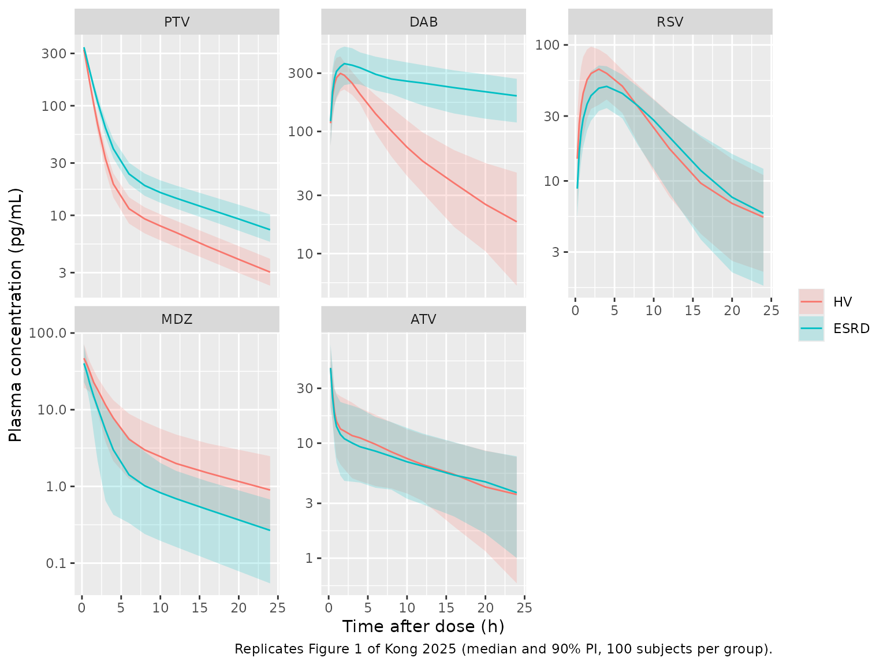
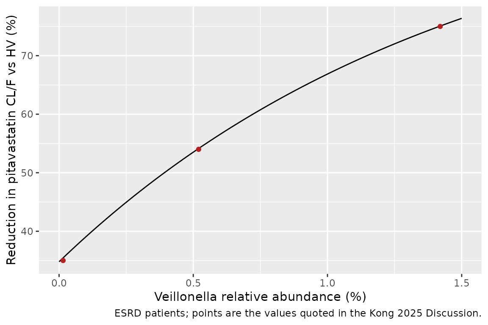

# Microdose cocktail in end-stage renal disease: pitavastatin, dabigatran, rosuvastatin, midazolam, atorvastatin (Kong 2025)

## Model and source

Kong 2025 gave a single oral microdose cocktail of five probe substrates
to Chinese healthy volunteers (HV) and haemodialysis-dependent end-stage
renal disease (ESRD) patients, and fitted one population PK model per
drug to the pooled pre-dialysis concentrations. The five models were
fitted independently, so they are packaged as five model files that
share this article.

- Citation: Kong W, Pan Y, Wu Y, Hu Y, Jiang Z, Tian X, Bi S, Wang S,
  Feng F, Jin Y, Li J, Li H, Wang Y, Liang H, Tang W, Liu D. Microdose
  Cocktail Study Reveals the Activity and Key Influencing Factors of
  OATP1B, P-Gp, BCRP, and CYP3A in End-Stage Renal Disease Patients.
  Clin Pharmacol Ther. 2025;117(5):1303-. <doi:10.1002/cpt.3546>.
- Article: <https://doi.org/10.1002/cpt.3546> (open access; PMC11993298)

| Model | Probe for | Covariates on the final model |
|----|----|----|
| `Kong_2025_pitavastatin` | OATP1B | ESRD and gut *Veillonella* abundance on CL/F |
| `Kong_2025_dabigatran` | intestinal P-gp (dose given as dabigatran etexilate) | ESRD on CL/F |
| `Kong_2025_rosuvastatin` | OATP1B / BCRP | gut *Clostridium* XIVb abundance on CL/F; serum albumin on Vc/F |
| `Kong_2025_midazolam` | CYP3A | ESRD on CL/F |
| `Kong_2025_atorvastatin` | CYP3A4 / OATP1B / P-gp / BCRP | none |

All five are two-compartment models with first-order absorption and
first-order elimination, parameterised as apparent oral values (CL/F,
Vc/F, Vp/F, Q/F). Doses are in ug and concentrations in pg/mL, the
paper’s units.

## Population

Fourteen HV (5 male, 9 female; mean age 35.6 years, BMI 22.4 kg/m^2,
eGFR 106.6 mL/min/1.73 m^2) and ten ESRD patients on haemodialysis three
times a week (7 male, 3 female; mean age 43.4 years, BMI 21.9 kg/m^2,
eGFR 4 mL/min/1.73 m^2) were enrolled at Peking University Third
Hospital (Kong 2025 Table 1). All ESRD patients had chronic
glomerulonephritis; diabetes was an exclusion criterion. Serum albumin
was 44.9 g/L (HV) and 42.1 g/L (ESRD). The cocktail (midazolam 10 ug,
dabigatran etexilate 375 ug, pitavastatin 10 ug, rosuvastatin 50 ug,
atorvastatin 100 ug) was taken fasted 24 h before dialysis. HV were
sampled at 0.5-24 h and ESRD patients at 1, 4 and 24 h; the 28-h
post-dialysis sample was not modelled. One ESRD patient was excluded
from the atorvastatin analysis. The same information is available from
`readModelDb("Kong_2025_pitavastatin")()$population`.

## Source trace

Every `ini()` value carries an in-file source comment; this table
collects them. “IIV” is the Table 3 `IIV%` column, converted to a
log-normal variance with `omega^2 = log(1 + CV^2)`.

| Drug | Parameter | Value | Source |
|----|----|----|----|
| PTV | ka (1/h) | 18, fixed | Table 3 (RSE NA; bootstrap 18 (18, 18)) |
| PTV | CL/F (L/h) | 16.5; IIV 9.60% | Table 3 |
| PTV | ESRD on CL/F | -0.381, as (1 + DIS) | Table 3 ‘DISPTV on CL/F’; Eq. 1 |
| PTV | Veil on CL/F | -0.677, as (exp(Veil)/1.08)^theta | Table 3 ‘Veil on CL/F’; Eq. 1 |
| PTV | Vc/F, Vp/F (L) | 25.2, 76.1 | Table 3 |
| PTV | Q/F (L/h) | 8.01; IIV 7.60% | Table 3 |
| DAB | ka (1/h) | 1.22; IIV 21.5% | Table 3 |
| DAB | CL/F (L/h) | 146; IIV 22.5% | Table 3 |
| DAB | ESRD on CL/F | -0.869, as (1 + DIS) | Table 3 ‘DISDZB on CL/F’; Eq. 2 |
| DAB | Vc/F (L) | 794; IIV 25.9% | Table 3 |
| DAB | Vp/F (L) | 429; IIV 86.0% | Table 3 |
| DAB | Q/F (L/h) | 92.5 | Table 3 |
| RSV | ka (1/h) | 0.30 | Table 3 |
| RSV | CL/F (L/h) | 43.1; IIV 50.8% | Table 3 |
| RSV | Clos on CL/F | -3.26, as (exp(Clos)/1.08)^theta | Table 3 ‘Clos on CL/F’; Eq. 4 |
| RSV | Vc/F (L) | 289; IIV 22.4% | Table 3 |
| RSV | ALB on Vc/F | -6.42, as (ALB/44)^theta | Table 3 ‘ALB on Vc/F’ (form assumed, see below) |
| RSV | Vp/F (L), Q/F (L/h) | 2740, 48.6 | Table 3 |
| MDZ | ka (1/h) | 13, fixed | Table 3 (RSE NA; bootstrap 13 (13, 13)) |
| MDZ | CL/F (L/h) | 67.6; IIV 37.9% | Table 3 |
| MDZ | ESRD on CL/F | +0.94, as (1 + DIS) | Table 3 ‘DISMDZ on CL/F’; Eq. 3 |
| MDZ | Vc/F (L) | 195; IIV 42.1% | Table 3 |
| MDZ | Vp/F (L), Q/F (L/h) | 333, 34.7 | Table 3 |
| ATV | ka (1/h) | 7.53 | Table 3 |
| ATV | CL/F (L/h) | 363; IIV 48.0% | Table 3; Eq. 5 |
| ATV | Vc/F (L) | 835; IIV 99.3% | Table 3 |
| ATV | Vp/F (L) | 5830; IIV 62.6% | Table 3 |
| ATV | Q/F (L/h) | 3920; IIV 30.2% | Table 3 |
| all | residual error | `propSd` fixed at 0 | not reported |
| all | structure | 2-compartment, first-order absorption | Results, ‘PPK model’ |

## Virtual cohort

Each drug is simulated in 100 HV and 100 ESRD subjects. Serum albumin is
drawn from a normal distribution matching the Table 1 group mean and CV.
The microbiome abundances are not reported per subject, so both are set
to the value at which their effect equals 1 (`log(1.08)` = 0.077%); the
*Veillonella* effect is explored separately below.

``` r

set.seed(20250601)
rxode2::rxSetSeed(20250601)

n_per_arm <- 100L
obs_times <- c(
  0, 0.25, 0.5, 0.75, 1, 1.5, 2, 3, 4, 6, 8, 10, 12, 16, 20, 24,
  30, 36, 48, 60, 72, 96, 120, 150
)
drugs <- tibble::tribble(
  ~drug, ~model, ~dose_ug,
  "PTV", "Kong_2025_pitavastatin", 10,
  "DAB", "Kong_2025_dabigatran", 375,
  "RSV", "Kong_2025_rosuvastatin", 50,
  "MDZ", "Kong_2025_midazolam", 10,
  "ATV", "Kong_2025_atorvastatin", 100
)

subjects <- tibble(
  id = seq_len(2 * n_per_arm),
  group = rep(c("HV", "ESRD"), each = n_per_arm),
  RENALIMP_ESRD = rep(c(0L, 1L), each = n_per_arm),
  ALB = c(
    rnorm(n_per_arm, 44.9, 0.08 * 44.9),
    rnorm(n_per_arm, 42.1, 0.04 * 42.1)
  ),
  GUT_VEILLONELLA_PCT = log(1.08),
  GUT_CLOSTRIDIUM_XIVB_PCT = log(1.08)
)

make_events <- function(dose_ug) {
  doses <- subjects |>
    mutate(time = 0, evid = 1L, amt = dose_ug, cmt = "depot")
  obs <- tidyr::crossing(subjects, time = obs_times) |>
    mutate(evid = 0L, amt = 0, cmt = "central")
  bind_rows(doses, obs) |>
    arrange(id, time, desc(evid))
}
```

## Simulation

``` r

sim <- lapply(seq_len(nrow(drugs)), function(i) {
  ev <- make_events(drugs$dose_ug[i])
  rxode2::rxSolve(
    readModelDb(drugs$model[i]),
    events = ev,
    keep = c("group")
  ) |>
    as.data.frame() |>
    mutate(drug = drugs$drug[i])
}) |>
  bind_rows() |>
  mutate(
    drug = factor(drug, levels = drugs$drug),
    group = factor(group, levels = c("HV", "ESRD"))
  )
#> ℹ parameter labels from comments will be replaced by 'label()'
#> ℹ parameter labels from comments will be replaced by 'label()'
#> ℹ parameter labels from comments will be replaced by 'label()'
#> ℹ parameter labels from comments will be replaced by 'label()'
#> ℹ parameter labels from comments will be replaced by 'label()'
```

## Replicate Figure 1

Kong 2025 Figure 1 shows the observed concentration-time curves by group
over 0-24 h. The simulated median and 90% prediction interval follow.

``` r

sim |>
  filter(time > 0, time <= 24) |>
  group_by(drug, group, time) |>
  summarise(
    Q05 = quantile(Cc, 0.05),
    Q50 = median(Cc),
    Q95 = quantile(Cc, 0.95),
    .groups = "drop"
  ) |>
  ggplot(aes(time, Q50, colour = group, fill = group)) +
  geom_ribbon(aes(ymin = Q05, ymax = Q95), alpha = 0.2, colour = NA) +
  geom_line() +
  facet_wrap(~drug, scales = "free_y") +
  scale_y_log10() +
  labs(
    x = "Time after dose (h)", y = "Plasma concentration (pg/mL)",
    colour = NULL, fill = NULL,
    caption = "Replicates Figure 1 of Kong 2025 (median and 90% PI, 100 subjects per group)."
  )
```



## PKNCA validation

AUC0-24 and Cmax are computed over 0-24 h (the window of Kong 2025 Table
2, which reports geometric means of the observed data). AUCinf is
computed over the full 150-h simulation, the window of Kong 2025 Table
S7, in which the authors simulated each participant with the final
models.

``` r

sim_nca <- sim |>
  filter(!is.na(Cc)) |>
  mutate(treatment = paste(drug, group)) |>
  select(id, time, Cc, treatment)
sim_nca <- bind_rows(
  sim_nca,
  sim_nca |> distinct(id, treatment) |> mutate(time = 0, Cc = 0)
) |>
  distinct(id, treatment, time, .keep_all = TRUE) |>
  arrange(treatment, id, time)

dose_df <- tidyr::crossing(drugs, subjects |> select(id, group)) |>
  mutate(treatment = paste(drug, group), time = 0, amt = dose_ug) |>
  select(id, time, amt, treatment)

conc_obj <- PKNCA::PKNCAconc(sim_nca, Cc ~ time | treatment + id)
#> Warning in assert_conc(conc, any_missing_conc = any_missing_conc): Negative
#> concentrations found
dose_obj <- PKNCA::PKNCAdose(dose_df, amt ~ time | treatment + id)
intervals <- data.frame(
  start = c(0, 0),
  end = c(24, Inf),
  cmax = c(TRUE, FALSE),
  auclast = c(TRUE, FALSE),
  aucinf.obs = c(FALSE, TRUE)
)
nca_res <- PKNCA::pk.nca(
  PKNCA::PKNCAdata(conc_obj, dose_obj, intervals = intervals)
)
#> Warning in assert_conc(conc, any_missing_conc = any_missing_conc): Negative
#> concentrations found
#> Warning in assert_conc(conc, any_missing_conc = any_missing_conc): Negative
#> concentrations found
#> Warning in assert_conc(conc, any_missing_conc = any_missing_conc): Negative
#> concentrations found
#> Warning in assert_conc(conc, any_missing_conc = any_missing_conc): Negative
#> concentrations found
#> Warning in assert_conc(conc, any_missing_conc = any_missing_conc): Negative
#> concentrations found
#> Warning in log(data$conc): NaNs produced
#> Warning in assert_conc(conc, any_missing_conc = any_missing_conc): Negative
#> concentrations found
#> Warning in log(conc.2/conc.1): NaNs produced
#> Warning in assert_conc(conc, any_missing_conc = any_missing_conc): Negative
#> concentrations found
#> Warning in assert_conc(conc, any_missing_conc = any_missing_conc): Negative
#> concentrations found
#> Warning in assert_conc(conc, any_missing_conc = any_missing_conc): Negative
#> concentrations found
#> Warning in assert_conc(conc, any_missing_conc = any_missing_conc): Negative
#> concentrations found
#> Warning in assert_conc(conc, any_missing_conc = any_missing_conc): Negative
#> concentrations found
#> Warning in log(data$conc): NaNs produced
#> Warning in assert_conc(conc, any_missing_conc = any_missing_conc): Negative
#> concentrations found
#> Warning in log(conc.2/conc.1): NaNs produced
```

### Comparison against published NCA

Cmax and AUC0-24 references are the observed geometric means of Kong
2025 Table 2; AUCinf references are the geometric means of the authors’
own per-participant simulations (Table S7). Simulated values are
medians.

``` r

published <- tibble::tribble(
  ~treatment, ~cmax, ~auclast, ~aucinf.obs,
  "PTV HV", 222, 500, 636,
  "PTV ESRD", 246, 922, 1107,
  "DAB HV", 303, 2233, 2533,
  "DAB ESRD", 384, 6872, 19847,
  "RSV HV", 73.0, 591, 1184,
  "RSV ESRD", 58.6, 656, 1656,
  "MDZ HV", 48.8, 121, 145,
  "MDZ ESRD", 16.6, 34.0, 73.0,
  "ATV HV", 23.6, 141, 255,
  "ATV ESRD", 22.0, 181, 282
)

cmp <- nlmixr2lib::ncaComparisonTable(
  simulated = nca_res,
  reference = published,
  by = "treatment",
  units = c(cmax = "pg/mL", auclast = "h*pg/mL", aucinf.obs = "h*pg/mL"),
  tolerance_pct = 20
)
knitr::kable(
  cmp,
  caption = "Simulated (median) vs. published NCA. * differs from the reference by >20%."
)
```

| NCA parameter           | treatment | Reference | Simulated | % diff    |
|:------------------------|:----------|:----------|:----------|:----------|
| Cmax (pg/mL)            | PTV HV    | 222       | 325       | +46.3%\*  |
| Cmax (pg/mL)            | PTV ESRD  | 246       | 341       | +38.8%\*  |
| Cmax (pg/mL)            | DAB HV    | 303       | 299       | -1.3%     |
| Cmax (pg/mL)            | DAB ESRD  | 384       | 366       | -4.8%     |
| Cmax (pg/mL)            | RSV HV    | 73        | 68.9      | -5.6%     |
| Cmax (pg/mL)            | RSV ESRD  | 58.6      | 50        | -14.6%    |
| Cmax (pg/mL)            | MDZ HV    | 48.8      | 46.9      | -3.8%     |
| Cmax (pg/mL)            | MDZ ESRD  | 16.6      | 40.2      | +142.2%\* |
| Cmax (pg/mL)            | ATV HV    | 23.6      | 45.2      | +91.6%\*  |
| Cmax (pg/mL)            | ATV ESRD  | 22        | 45        | +104.8%\* |
| AUC0-∞ (obs) (h\*pg/mL) | PTV HV    | 636       | 585       | -8.0%     |
| AUC0-∞ (obs) (h\*pg/mL) | PTV ESRD  | 1110      | 959       | -13.3%    |
| AUC0-∞ (obs) (h\*pg/mL) | DAB HV    | 2530      | 2580      | +1.9%     |
| AUC0-∞ (obs) (h\*pg/mL) | DAB ESRD  | 19800     | 19400     | -2.2%     |
| AUC0-∞ (obs) (h\*pg/mL) | RSV HV    | 1180      | 1220      | +3.0%     |
| AUC0-∞ (obs) (h\*pg/mL) | RSV ESRD  | 1660      | 1120      | -32.7%\*  |
| AUC0-∞ (obs) (h\*pg/mL) | MDZ HV    | 145       | 147       | +1.5%     |
| AUC0-∞ (obs) (h\*pg/mL) | MDZ ESRD  | 73        | 77.2      | +5.7%     |
| AUC0-∞ (obs) (h\*pg/mL) | ATV HV    | 255       | 280       | +9.9%     |
| AUC0-∞ (obs) (h\*pg/mL) | ATV ESRD  | 282       | 314       | +11.3%    |
| AUClast (h\*pg/mL)      | PTV HV    | 500       | 539       | +7.9%     |
| AUClast (h\*pg/mL)      | PTV ESRD  | 922       | 824       | -10.7%    |
| AUClast (h\*pg/mL)      | DAB HV    | 2230      | 2270      | +1.7%     |
| AUClast (h\*pg/mL)      | DAB ESRD  | 6870      | 6040      | -12.1%    |
| AUClast (h\*pg/mL)      | RSV HV    | 591       | 630       | +6.6%     |
| AUClast (h\*pg/mL)      | RSV ESRD  | 656       | 564       | -14.0%    |
| AUClast (h\*pg/mL)      | MDZ HV    | 121       | 132       | +8.9%     |
| AUClast (h\*pg/mL)      | MDZ ESRD  | 34        | 73.8      | +117.2%\* |
| AUClast (h\*pg/mL)      | ATV HV    | 141       | 189       | +33.8%\*  |
| AUClast (h\*pg/mL)      | ATV ESRD  | 181       | 174       | -3.8%     |

Simulated (median) vs. published NCA. \* differs from the reference by
\>20%. {.table}

The starred rows are explained by known features of the source rather
than by the model code:

- **Cmax of pitavastatin and atorvastatin.** The fixed ka of 18 1/h for
  pitavastatin and the ka of 7.53 1/h for atorvastatin give an early,
  sharp peak that the HV sampling schedule (first sample at 0.5 h)
  cannot capture. The authors’ own simulations show the same overshoot
  (Table S7 Cmax 313 and 317 pg/mL for pitavastatin, 45.1 and 52.8 pg/mL
  for atorvastatin).
- **ESRD Cmax and AUC0-24 of midazolam.** The observed ESRD exposure is
  lower than the model predicts. The ESRD patients were sampled only at
  1, 4 and 24 h, and the Table S7 simulations (AUCinf 73.0 h\*pg/mL)
  agree with the model, not with the sparse observed AUC0-24.
- **HV AUC0-24 of atorvastatin.** The model gives a higher exposure than
  the observed NCA (Table 2, 141 h*pg/mL); the authors’ own
  per-participant simulations show the same (Table S7 AUClast 253
  h*pg/mL in HV).
- **ESRD AUCinf of rosuvastatin.** CL/F depends on the per-subject
  *Clostridium* XIVb abundance, which the paper does not report; this
  cohort holds it at the reference value. The Table S7 ESRD CL/F (30.2
  L/h vs 42.2 L/h in HV) implies higher abundance in the ESRD patients.
  The ESRD AUCinf of pitavastatin is low for the same reason
  (*Veillonella*), though within 20%.

### Typical-value check against the authors’ simulations

AUCinf after a single oral dose of a linear model equals dose / (CL/F).
The typical-value AUCinf of each model is compared with the Table S7
geometric means where the covariates of this cohort fully determine
CL/F: all HV groups (microbiome at the reference value) and the ESRD
groups of dabigatran and midazolam, whose only covariate is ESRD.

``` r

typical <- lapply(seq_len(nrow(drugs)), function(i) {
  ev <- make_events(drugs$dose_ug[i]) |>
    filter(id %in% c(1L, n_per_arm + 1L)) |>
    mutate(ALB = 44)
  rxode2::rxSolve(
    rxode2::zeroRe(readModelDb(drugs$model[i])),
    events = ev,
    keep = c("group")
  ) |>
    as.data.frame() |>
    group_by(group) |>
    summarise(cl = first(cl), .groups = "drop") |>
    mutate(drug = drugs$drug[i], aucinf = 1000 * drugs$dose_ug[i] / cl)
}) |>
  bind_rows() |>
  mutate(treatment = paste(drug, group)) |>
  left_join(published |> select(treatment, ref = aucinf.obs), by = "treatment") |>
  mutate(pct_diff = 100 * (aucinf - ref) / ref)
#> ℹ parameter labels from comments will be replaced by 'label()'
#> ℹ omega/sigma items treated as zero: 'etalcl', 'etalq'
#> Warning: multi-subject simulation without without 'omega'
#> ℹ parameter labels from comments will be replaced by 'label()'
#> ℹ omega/sigma items treated as zero: 'etalka', 'etalcl', 'etalvc', 'etalvp'
#> Warning: multi-subject simulation without without 'omega'
#> ℹ parameter labels from comments will be replaced by 'label()'
#> ℹ omega/sigma items treated as zero: 'etalcl', 'etalvc'
#> Warning: multi-subject simulation without without 'omega'
#> ℹ parameter labels from comments will be replaced by 'label()'
#> ℹ omega/sigma items treated as zero: 'etalcl', 'etalvc'
#> Warning: multi-subject simulation without without 'omega'
#> ℹ parameter labels from comments will be replaced by 'label()'
#> ℹ omega/sigma items treated as zero: 'etalcl', 'etalvc', 'etalvp', 'etalq'
#> Warning: multi-subject simulation without without 'omega'

knitr::kable(
  typical |>
    select(treatment, cl, aucinf, ref, pct_diff) |>
    rename(
      "Group" = treatment,
      "Typical CL/F (L/h)" = cl,
      "Typical AUCinf (h*pg/mL)" = aucinf,
      "Table S7 AUCinf (h*pg/mL)" = ref,
      "% diff" = pct_diff
    ),
  digits = 1
)
```

| Group | Typical CL/F (L/h) | Typical AUCinf (h\*pg/mL) | Table S7 AUCinf (h\*pg/mL) | % diff |
|:---|---:|---:|---:|---:|
| PTV ESRD | 10.2 | 979.1 | 1107 | -11.6 |
| PTV HV | 16.5 | 606.1 | 636 | -4.7 |
| DAB ESRD | 19.1 | 19606.8 | 19847 | -1.2 |
| DAB HV | 146.0 | 2568.5 | 2533 | 1.4 |
| RSV ESRD | 43.1 | 1160.1 | 1656 | -29.9 |
| RSV HV | 43.1 | 1160.1 | 1184 | -2.0 |
| MDZ ESRD | 131.1 | 76.3 | 73 | 4.5 |
| MDZ HV | 67.6 | 147.9 | 145 | 2.0 |
| ATV ESRD | 363.0 | 275.5 | 282 | -2.3 |
| ATV HV | 363.0 | 275.5 | 255 | 8.0 |

``` r


gated <- typical |>
  filter(group == "HV" | drug %in% c("DAB", "MDZ"))
# Deterministic: typical values against the authors' per-participant
# geometric means. Observed spread is -5% to +8%; a mis-transcribed CL/F or
# ESRD shift moves a row by tens of percent.
stopifnot(all(abs(gated$pct_diff) < 15))
```

## Gut *Veillonella* effect on pitavastatin clearance

The Discussion of Kong 2025 states that, together with the direct ESRD
effect, the *Veillonella* term reduces OATP1B-mediated pitavastatin
clearance by 35% at the lowest observed abundance (0.015%), by 54% at
0.52%, and by up to 75% at the highest (1.42%). Those figures follow
from Eq. 1 with the abundance in percent, which confirms the covariate
units.

``` r

mod_ptv <- rxode2::rxode2(readModelDb("Kong_2025_pitavastatin"))
#> ℹ parameter labels from comments will be replaced by 'label()'
theta <- mod_ptv$theta
veil_reduction <- function(veil) {
  100 * (1 - (exp(veil) / 1.08)^theta[["e_gut_veillonella_pct_cl"]] *
    (1 + theta[["e_renalimp_esrd_cl"]]))
}
claims <- tibble(
  veil = c(0.015, 0.52, 1.42),
  paper = c(35, 54, 75),
  model = veil_reduction(veil)
)
knitr::kable(
  claims |>
    rename(
      "Veillonella (%)" = veil,
      "Paper reduction (%)" = paper,
      "Model reduction (%)" = model
    ),
  digits = c(3, 0, 1)
)
```

| Veillonella (%) | Paper reduction (%) | Model reduction (%) |
|----------------:|--------------------:|--------------------:|
|           0.015 |                  35 |                35.4 |
|           0.520 |                  54 |                54.1 |
|           1.420 |                  75 |                75.1 |

``` r

stopifnot(all(abs(claims$model - claims$paper) < 1.5))

tibble(veil = seq(0, 1.5, by = 0.01)) |>
  mutate(reduction = veil_reduction(veil)) |>
  ggplot(aes(veil, reduction)) +
  geom_line() +
  geom_point(data = claims, aes(veil, paper), colour = "firebrick") +
  labs(
    x = "Veillonella relative abundance (%)",
    y = "Reduction in pitavastatin CL/F vs HV (%)",
    caption = "ESRD patients; points are the values quoted in the Kong 2025 Discussion."
  )
```



## Assumptions and deviations

- **IIV scale.** Table 3 reports IIV as a percentage, and Eqs. 1-5 print
  the random effect as `e^0.096`, `e^0.225` and so on. The maintainers
  read the percentage as a CV and convert it with
  `omega^2 = log(1 + CV^2)`; for the large values (atorvastatin Vc/F
  99.3%, dabigatran Vp/F 86.0%) this gives smaller variances than
  reading the percentage as omega directly.
- **Residual error.** The paper does not report the residual error model
  or its magnitude. `propSd` is fixed at 0 in all five models, so
  simulations are individual predictions; add a residual error before
  using the models for VPCs against observed data.
- **Final estimates vs Eqs. 1-5.** The equations print rounded bootstrap
  medians (e.g. CL/F 17 and exponent -0.68 for pitavastatin); the models
  use the Table 3 final estimates (16.5 and -0.677). The 1.08 normaliser
  of the microbiome terms appears only in the equations and is used as
  printed for both *Veillonella* and *Clostridium* XIVb.
- **Albumin on rosuvastatin Vc/F.** Table 3 gives the coefficient -6.42
  without a functional form. The maintainers encode it as the power form
  (ALB / 44)^-6.42, with 44 g/L the rounded pooled Table 1 mean (43.7
  g/L); an exponential or linear form with that coefficient would be
  implausible over the observed 40-48 g/L range.
- **Fixed absorption rates.** Pitavastatin ka (18 1/h) and midazolam ka
  (13 1/h) have no RSE and a degenerate bootstrap interval, so they are
  encoded with `fixed()`. Pitavastatin Q/F is printed with RSE 0 but has
  a non-degenerate bootstrap interval (6.6-9.4 L/h), so it is treated as
  estimated. Atorvastatin ka has a bootstrap median of 22 1/h against
  the estimate of 7.53 1/h; the estimate is used.
- **Dabigatran dose.** The model was fitted to dabigatran concentrations
  with the dose expressed as the administered dabigatran etexilate (375
  ug); the molecular-weight ratio and prodrug conversion are part of
  CL/F. Enter doses as dabigatran etexilate. The typical-value check
  above (dose/CL = 2568 vs Table S7 2533 h\*pg/mL) confirms this.
- **ESRD and dialysis.** Only pre-dialysis samples were modelled, so the
  models describe the interdialytic period. Table S8 shows that dialysis
  removes dabigatran substantially, which the models do not include.
- **Microbiome covariates.** The per-subject abundances are not
  reported; the virtual cohort holds them at the reference value of
  0.077%, which understates the ESRD exposure of pitavastatin and,
  plausibly, of rosuvastatin.
- **Errata.** No correction notice was found for Kong 2025 as of
  2026-11-09.
