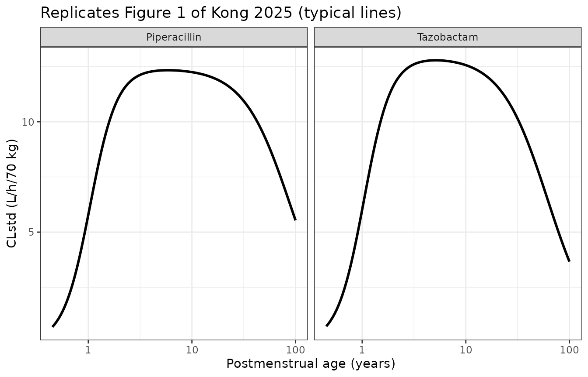
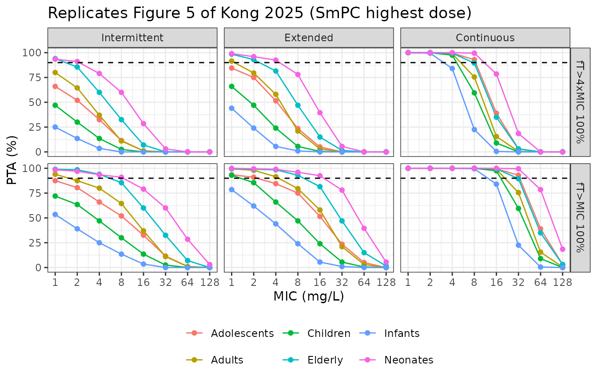

# Piperacillin + tazobactam from premature infants to the elderly (Kong 2025)

## Model and source

Kong et al. 2025 pooled individual piperacillin/tazobactam data from 13
published studies – premature neonates to very elderly adults,
critically ill, obese and underweight patients, and febrile neutropenic
patients with haematological malignancy – into one *general-purpose*
population PK model intended as an a priori model for Bayesian dose
individualisation.

The final combined model has four compartments: a two-compartment
disposition model for each drug, with linear elimination from each
central compartment.

- Volumes scale linearly with total body weight and elimination
  clearance with exponent 0.75 (70 kg reference). The
  inter-compartmental clearances use *compartmental allometry*, scaling
  with the individual peripheral volume.
- Elimination clearance of both drugs shares a sigmoidal
  postmenstrual-age (PMA) maturation function (MAT50 = 54.2 weeks PMA),
  declines with age through a drug-specific sigmoidal function (50% at
  89.1 years for piperacillin and 61.6 years for tazobactam, shared
  shape factor), and carries a shared exponential serum-creatinine (SCR)
  effect centred on a PMA-standardised SCR.
- The random effects on the central volume, peripheral volume and
  inter-compartmental clearance are each shared by the two drugs;
  clearance has drug-specific random effects.
- Three observables: total piperacillin, unbound piperacillin (fraction
  unbound 0.645) and total tazobactam, each with its own residual error.
  Dried blood spot concentrations are 0.368 (piperacillin) and 0.448
  (tazobactam) times the plasma concentration.
- Two study-specific effects: in the Sime 2014 haematological-malignancy
  study, piperacillin clearance is 1.73-fold and its peripheral volume
  0.512-fold; in the Sukarnjanaset 2019 study the piperacillin unbound
  fraction is 1.

The authors’ companion paper on patients on intermittent haemodialysis
extends this model and is packaged separately as
`Kong_2025_piperacillin_tazobactam`.

- Citation: Kong D, Koomen JV, Colin PJ, et al. A Pooled Pharmacokinetic
  Analysis for Piperacillin/Tazobactam Across Different Patient
  Populations: From Premature Infants to the Elderly. Clin
  Pharmacokinet. 2025;64(1):107-126.
- Article: <https://doi.org/10.1007/s40262-024-01460-6>

``` r

mod <- readModelDb("Kong_2025b_piperacillin_tazobactam")
ui <- rxode2::rxode(mod)
#> ℹ parameter labels from comments will be replaced by 'label()'
ui$state
#> [1] "central"         "peripheral1"     "central_taz"     "peripheral1_taz"
```

## Population

``` r

str(ui$population)
#> List of 10
#>  $ species       : chr "human"
#>  $ n_subjects    : num 415
#>  $ n_studies     : num 13
#>  $ age_range     : chr "Postnatal age 1 day to 94 years; postmenstrual age 0.5-94.8 years"
#>  $ weight_range  : chr "0.5-200 kg"
#>  $ sex_female_pct: num 41
#>  $ disease_state : chr "Pooled individual data from 13 published piperacillin/tazobactam PK studies: critically ill adults with sepsis "| __truncated__
#>  $ dose_range    : chr "Intravenous piperacillin/tazobactam (8:1) by intermittent, extended or continuous infusion as per the component studies"
#>  $ regions       : chr "Multinational; pooled from 13 published studies (Table 1), countries not tabulated by Kong 2025"
#>  $ notes         : chr "415 patients by the Results text: 32 newborns, 127 children and adolescents, 163 adults (42 obese, 12 underweig"| __truncated__
```

The pooled dataset (Kong 2025 Table 1 and Results, “Data”) holds 415
patients: 32 newborns (PMA \< 0.87 years), 127 children and adolescents,
163 adults (42 obese, 12 underweight), 74 elderly and 19 very elderly
patients. Postnatal age ran from 1 day to 94 years, body weight from 0.5
to 200 kg and SCR from 0.17 to 5.82 mg/dL. There were 3798 piperacillin
observations (2855 total plasma, 888 unbound plasma and 55 dried blood
spot) and 1948 tazobactam observations (1893 total plasma and 55 dried
blood spot). Patients on renal replacement therapy or extracorporeal
membrane oxygenation were excluded.

## Source trace

The Electronic Supplementary Material 3 (ESM3) of Kong 2025 is the
complete final NONMEM control stream with its output, so every equation
can be checked against the implemented code as well as against the
printed Eqs. 6-25.

| Model element | Source location | Value / form |
|----|----|----|
| `lvc`, `lcl`, `lvp`, `lq` | Table 3 piperacillin; ESM3 TH1-TH4 | 10.4 L, 10.6 L/h, 11.6 L, 15.2 L/h (70 kg) |
| `lvc_taz`, `lcl_taz`, `lvp_taz`, `lq_taz` | Table 3 tazobactam; ESM3 TH5-TH8 | 10.5 L, 9.58 L/h, 13.7 L, 16.8 L/h (70 kg) |
| `e_wt_cl`, `e_wt_vc`, `e_wt_q` | Methods, “Weight-Based and Compartmental Allometry”; Eqs. 1, 6-9 | 0.75, 1, 0.75 (not estimated) |
| `lhill_mat`, `ltmat50` | Table 3; ESM3 TH9-TH10 | gamma1 = 3.35; MAT50 = 54.2 weeks |
| `lhill_dec`, `ltdec50`, `ltdec50_taz` | Table 3; ESM3 TH11-TH13 | gamma2 = 1.92; DEC50 = 89.1 / 61.6 years |
| `e_creat_cl` | Table 3; ESM3 TH14 | 0.346 dL/mg |
| `lfu`, `lfu_sukarnjanaset` | Table 3; Eq. 23; ESM3 TH15-TH16 | 0.645; 1 (held constant) |
| `lfdbs`, `lfdbs_taz` | Table 3; Eqs. 24-25; ESM3 TH17-TH18 | 0.368; 0.448 |
| `e_sime2014_cl`, `e_sime2014_vp` | Table 3; Eqs. 21-22; ESM3 TH19-TH20 | 1.73; 0.512 |
| `etalvc`, `etalcl`, `etalcl_taz`, `etalvp`, `etalq` | ESM3 final OMEGA; Table 3 IIV (CV% = sqrt(exp(omega) - 1)) | 0.167, 0.171, 0.159, 0.548, 0.358 |
| `propSd`, `addSd` | Table 3 sigma TOT&DBS piperacillin; ESM3 SIGMA 1-2 | 30.2%, 0.147 mg/L |
| `propSd_Cu`, `addSd_Cu` | Table 3 sigma UNB; ESM3 SIGMA 3-4 | 36.5%, 0.747 mg/L |
| `propSd_taz` | Table 3 sigma TOT&DBS tazobactam; ESM3 SIGMA 5 | 28.5% (additive 0, held constant) |
| `fsize` | Eq. 16 | WT / 70 |
| `fmat`, `fmat_ref` | Eq. 17; ESM3 `FMAT/RFMAT` | sigmoid in PMA, normalised to PMA = 35 + 40/52 years |
| `fdec`, `fdec_taz` and references | Eqs. 18-19; ESM3 `FDEC/RFDEC` | 1 - sigmoid in PMA, normalised to the same reference |
| `creat_std` | Eq. 20; ESM3 `SCRstd` | exp\[1.42 - (1.17 + 0.203 ln(PMA/100)) / sqrt(PMA/100)\] |
| `f_scr` | Eq. 4 | exp(-theta_SCR (SCR - SCR_std)) |
| `cl`, `vc`, `vp`, `q` | Eqs. 6-9 | as printed, with the ESM3 reference normalisation |
| `cl_taz`, `vc_taz`, `vp_taz`, `q_taz` | Eqs. 11-14 | as printed, with the ESM3 reference normalisation |
| ODEs | ESM3 `$DES` | two independent two-compartment systems |
| `Cc`, `Cu`, `Cc_taz` | Eqs. 10, 15, 23-25; ESM3 `$ERROR` | A1/V1 times fUNB and fDBS |
| Residual error form | ESM3 `$ERROR` `Y = IPRED*(1+PROP) + ADD` | combined proportional + additive |

### Published estimates reproduce from the packaged `ini()`

``` r

th <- ui$theta
om <- diag(ui$omega)

back <- tibble::tribble(
  ~Parameter, ~Published, ~Recovered,
  "theta_V1 pip (L)", 10.4, exp(th[["lvc"]]),
  "theta_CL pip (L/h)", 10.6, exp(th[["lcl"]]),
  "theta_V2 pip (L)", 11.6, exp(th[["lvp"]]),
  "theta_Q2 pip (L/h)", 15.2, exp(th[["lq"]]),
  "theta_V1 taz (L)", 10.5, exp(th[["lvc_taz"]]),
  "theta_CL taz (L/h)", 9.58, exp(th[["lcl_taz"]]),
  "theta_V2 taz (L)", 13.7, exp(th[["lvp_taz"]]),
  "theta_Q2 taz (L/h)", 16.8, exp(th[["lq_taz"]]),
  "MAT50 (weeks)", 54.2, 52 * exp(th[["ltmat50"]]),
  "gamma1", 3.35, exp(th[["lhill_mat"]]),
  "DEC50 pip (years)", 89.1, exp(th[["ltdec50"]]),
  "DEC50 taz (years)", 61.6, exp(th[["ltdec50_taz"]]),
  "gamma2", 1.92, exp(th[["lhill_dec"]]),
  "theta_SCR (dL/mg)", 0.346, th[["e_creat_cl"]],
  "fUNB", 0.645, exp(th[["lfu"]]),
  "fUNB Sukarnjanaset", 1, exp(th[["lfu_sukarnjanaset"]]),
  "fDBS pip", 0.368, exp(th[["lfdbs"]]),
  "fDBS taz", 0.448, exp(th[["lfdbs_taz"]]),
  "theta_CL_Sime", 1.73, th[["e_sime2014_cl"]],
  "theta_V2_Sime", 0.512, th[["e_sime2014_vp"]],
  "IIV V1 (%)", 42.6, 100 * sqrt(exp(om[["etalvc"]]) - 1),
  "IIV CL pip (%)", 43.2, 100 * sqrt(exp(om[["etalcl"]]) - 1),
  "IIV CL taz (%)", 41.5, 100 * sqrt(exp(om[["etalcl_taz"]]) - 1),
  "IIV V2 (%)", 85.4, 100 * sqrt(exp(om[["etalvp"]]) - 1),
  "IIV Q2 (%)", 65.6, 100 * sqrt(exp(om[["etalq"]]) - 1),
  "sigma prop pip (%)", 30.2, 100 * th[["propSd"]],
  "sigma add pip (mg/L)", 0.147, th[["addSd"]],
  "sigma prop unbound (%)", 36.5, 100 * th[["propSd_Cu"]],
  "sigma add unbound (mg/L)", 0.747, th[["addSd_Cu"]],
  "sigma prop taz (%)", 28.5, 100 * th[["propSd_taz"]]
)
back$pct_diff <- round(100 * (back$Recovered / back$Published - 1), 2)
back |>
  mutate(Recovered = signif(Recovered, 4)) |>
  rename("% difference" = pct_diff) |>
  knitr::kable(caption = "Kong 2025 Table 3 recovered from the packaged ini() block.")
```

| Parameter                | Published | Recovered | % difference |
|:-------------------------|----------:|----------:|-------------:|
| theta_V1 pip (L)         |    10.400 |    10.400 |         0.00 |
| theta_CL pip (L/h)       |    10.600 |    10.600 |         0.00 |
| theta_V2 pip (L)         |    11.600 |    11.600 |         0.00 |
| theta_Q2 pip (L/h)       |    15.200 |    15.200 |         0.00 |
| theta_V1 taz (L)         |    10.500 |    10.500 |         0.00 |
| theta_CL taz (L/h)       |     9.580 |     9.580 |         0.00 |
| theta_V2 taz (L)         |    13.700 |    13.700 |         0.00 |
| theta_Q2 taz (L/h)       |    16.800 |    16.800 |         0.00 |
| MAT50 (weeks)            |    54.200 |    54.200 |         0.00 |
| gamma1                   |     3.350 |     3.350 |         0.00 |
| DEC50 pip (years)        |    89.100 |    89.100 |         0.00 |
| DEC50 taz (years)        |    61.600 |    61.600 |         0.00 |
| gamma2                   |     1.920 |     1.920 |         0.00 |
| theta_SCR (dL/mg)        |     0.346 |     0.346 |         0.00 |
| fUNB                     |     0.645 |     0.645 |         0.00 |
| fUNB Sukarnjanaset       |     1.000 |     1.000 |         0.00 |
| fDBS pip                 |     0.368 |     0.368 |         0.00 |
| fDBS taz                 |     0.448 |     0.448 |         0.00 |
| theta_CL_Sime            |     1.730 |     1.730 |         0.00 |
| theta_V2_Sime            |     0.512 |     0.512 |         0.00 |
| IIV V1 (%)               |    42.600 |    42.630 |         0.08 |
| IIV CL pip (%)           |    43.200 |    43.180 |        -0.04 |
| IIV CL taz (%)           |    41.500 |    41.510 |         0.03 |
| IIV V2 (%)               |    85.400 |    85.430 |         0.03 |
| IIV Q2 (%)               |    65.600 |    65.610 |         0.02 |
| sigma prop pip (%)       |    30.200 |    30.200 |         0.00 |
| sigma add pip (mg/L)     |     0.147 |     0.147 |         0.00 |
| sigma prop unbound (%)   |    36.500 |    36.500 |         0.00 |
| sigma add unbound (mg/L) |     0.747 |     0.747 |         0.00 |
| sigma prop taz (%)       |    28.500 |    28.500 |         0.00 |

Kong 2025 Table 3 recovered from the packaged ini() block. {.table}

``` r


# Every entry agrees with the published value to its printed precision.
stopifnot(all(abs(back$pct_diff) < 0.4))
```

## Typical-value checks against the paper’s worked numbers

Kong 2025 quotes typical clearances for several example patients in the
Abstract, Results and Discussion, and the per-kg clearance of each
simulated age group in the Discussion. Each is reproduced below from a
typical-value (`zeroRe()`) solve, so every factor of Eqs. 6-20 is
exercised: size, maturation, decline and the SCR effect.

``` r

mod_typ <- rxode2::zeroRe(ui)

# Eq. 20, used to build the virtual patients.
creat_std_fn <- function(pma) exp(1.42 - (1.17 + 0.203 * log(pma / 100)) / sqrt(pma / 100))

# zeroRe() solves of several subjects warn that no omega is present, which is
# the intent here.
muffle_no_omega <- function(w) {
  if (grepl("without 'omega'", conditionMessage(w), fixed = TRUE)) invokeRestart("muffleWarning")
}

# One dosing record and one observation per patient; the parameter columns
# (cl, cl_taz, ...) are read from the observation row.
typical_params <- function(pts) {
  ev <- bind_rows(lapply(seq_len(nrow(pts)), function(i) {
    data.frame(
      id = i, time = c(0, 1), amt = c(1000, 0), evid = c(1L, 0L),
      cmt = "central", dvid = c(NA_integer_, 1L),
      PAGE = pts$pma_y[i] * 12, WT = pts$WT[i], CREAT = pts$CREAT[i],
      SAMPLE_DBS = 0, STUDY_SIME2014 = pts$sime[i],
      STUDY_SUKARNJANASET2019 = 0
    )
  }))
  sim <- withCallingHandlers(
    as.data.frame(rxode2::rxSolve(mod_typ, ev, returnType = "data.frame")),
    warning = muffle_no_omega
  )
  sim <- sim[sim$time == 1, ]
  cbind(pts, sim[, c("cl", "cl_taz", "vc", "vp", "q", "vc_taz", "vp_taz", "creat_std")])
}
```

The neonate PMA is taken as the value whose standardised SCR equals the
0.764 mg/dL printed in ESM4 Table S3 (the virtual patients’ SCR was
fixed to SCR_std), i.e. 7.17 months rather than the rounded 7.3 months
of the same table. Because maturation is steep in this range (gamma1 =
3.35), the rounding alone moves the neonatal clearance by about 5%; see
Assumptions.

``` r

pma_neon <- uniroot(function(p) creat_std_fn(p) - 0.764, c(0.3, 0.9))$root

pts <- tibble::tribble(
  ~patient, ~pma_y, ~WT, ~CREAT, ~sime, ~pub_cl, ~pub_cl_taz, ~pub_clkg, ~source,
  "Reference (70 kg, 35 y)", 35 + 40 / 52, 70, NA, 0, 10.6, 9.58, NA, "Abstract; Table 3",
  "30 y, 70 kg, SCR 0.773", 30 + 40 / 52, 70, 0.773, 0, 11.0, 10.3, NA, "Discussion",
  "70 y, 70 kg, SCR 1.12", 70 + 40 / 52, 70, 1.12, 0, 7.33, 5.37, NA, "Discussion",
  "Infant 44.3 wk PMA, 4.5 kg, SCR 0.416", 44.3 / 52, 4.5, 0.416, 0, 0.543, 0.565, NA, "Discussion",
  "Neonate (ESM4 Table S3)", pma_neon, 1.30, 0.764, 0, NA, NA, 0.0648, "Discussion; Table S3",
  "Infant (ESM4 Table S3)", 18.0 / 12, 7.74, 0.312, 0, NA, NA, 0.235, "Discussion; Table S3",
  "Child (ESM4 Table S3)", 5.0, 16.4, 0.336, 0, NA, NA, 0.253, "Discussion; Table S3",
  "Adolescent (ESM4 Table S3)", 13.4, 37.0, 0.517, 0, NA, NA, 0.203, "Discussion; Table S3",
  "Adult (ESM4 Table S3)", 48.8, 75.0, 0.954, 0, NA, NA, 0.132, "Discussion; Table S3",
  "Elderly (ESM4 Table S3)", 74.8, 75.0, 1.145, 0, NA, NA, 0.102, "Discussion; Table S3",
  "Reference, Sime 2014 study", 35 + 40 / 52, 70, NA, 1, 10.6 * 1.73, 9.58, NA, "Eq. 21"
)
pts$CREAT[is.na(pts$CREAT)] <- creat_std_fn(pts$pma_y[is.na(pts$CREAT)])
typ <- typical_params(pts)
#> ℹ omega/sigma items treated as zero: 'etalvc', 'etalcl', 'etalcl_taz', 'etalvp', 'etalq'

typ_tab <- typ |>
  mutate(
    sim_clkg = cl / WT,
    pct_cl = 100 * (cl / pub_cl - 1),
    pct_cl_taz = 100 * (cl_taz / pub_cl_taz - 1),
    pct_clkg = 100 * (sim_clkg / pub_clkg - 1)
  )
typ_tab |>
  transmute(
    patient, source,
    "CL pip published" = pub_cl, "CL pip simulated" = signif(cl, 4),
    "CL taz published" = pub_cl_taz, "CL taz simulated" = signif(cl_taz, 4),
    "CL pip/kg published" = pub_clkg, "CL pip/kg simulated" = signif(sim_clkg, 3)
  ) |>
  knitr::kable(caption = "Typical clearances (L/h; L/h/kg) quoted by Kong 2025 versus the packaged model.")
```

| patient | source | CL pip published | CL pip simulated | CL taz published | CL taz simulated | CL pip/kg published | CL pip/kg simulated |
|:---|:---|---:|---:|---:|---:|---:|---:|
| Reference (70 kg, 35 y) | Abstract; Table 3 | 10.600 | 10.60000 | 9.580 | 9.5800 | NA | 0.1510 |
| 30 y, 70 kg, SCR 0.773 | Discussion | 11.000 | 11.01000 | 10.300 | 10.2500 | NA | 0.1570 |
| 70 y, 70 kg, SCR 1.12 | Discussion | 7.330 | 7.57000 | 5.370 | 5.6180 | NA | 0.1080 |
| Infant 44.3 wk PMA, 4.5 kg, SCR 0.416 | Discussion | 0.543 | 0.54370 | 0.565 | 0.5662 | NA | 0.1210 |
| Neonate (ESM4 Table S3) | Discussion; Table S3 | NA | 0.08392 | NA | 0.0874 | 0.0648 | 0.0646 |
| Infant (ESM4 Table S3) | Discussion; Table S3 | NA | 1.83900 | NA | 1.9140 | 0.2350 | 0.2380 |
| Child (ESM4 Table S3) | Discussion; Table S3 | NA | 4.14900 | NA | 4.3040 | 0.2530 | 0.2530 |
| Adolescent (ESM4 Table S3) | Discussion; Table S3 | NA | 7.50900 | NA | 7.6190 | 0.2030 | 0.2030 |
| Adult (ESM4 Table S3) | Discussion; Table S3 | NA | 9.96500 | NA | 8.3230 | 0.1320 | 0.1330 |
| Elderly (ESM4 Table S3) | Discussion; Table S3 | NA | 7.63900 | NA | 5.5640 | 0.1020 | 0.1020 |
| Reference, Sime 2014 study | Eq. 21 | 18.338 | 18.34000 | 9.580 | 9.5800 | NA | 0.2620 |

Typical clearances (L/h; L/h/kg) quoted by Kong 2025 versus the packaged
model. {.table style="width:100%;"}

``` r


# The SCR standardisation at the reference age reproduces the Abstract's 0.83 mg/dL.
stopifnot(abs(typ$creat_std[1] - 0.83) < 0.005)

# Every quoted clearance except the 70-year-old example reproduces within 1.5%.
not70 <- typ_tab$patient != "70 y, 70 kg, SCR 1.12"
stopifnot(
  all(abs(typ_tab$pct_cl[not70]) < 1.5, na.rm = TRUE),
  all(abs(typ_tab$pct_cl_taz[not70]) < 1.5, na.rm = TRUE),
  all(abs(typ_tab$pct_clkg) < 1.5, na.rm = TRUE)
)
# The 70-year-old example sits 3-5% above the quoted values for both drugs;
# see Assumptions.
stopifnot(all(abs(c(typ_tab$pct_cl[!not70], typ_tab$pct_cl_taz[!not70])) < 6))

# Discussion: volumes per kg for the 70 kg reference.
vkg <- c(typ$vc[1], typ$vp[1], typ$vc_taz[1], typ$vp_taz[1]) / 70
stopifnot(all(abs(vkg / c(0.149, 0.166, 0.150, 0.196) - 1) < 0.005))

# Results: every 0.20 mg/dL rise in SCR lowers both clearances by 6.7%.
stopifnot(abs(100 * (1 - exp(-th[["e_creat_cl"]] * 0.2)) - 6.7) < 0.05)

# Eqs. 9 and 22: in the Sime 2014 study V2 is 0.512-fold, and the
# compartmental allometry carries that into Q2 with exponent 0.75.
sime <- typ[typ$patient == "Reference, Sime 2014 study", ]
stopifnot(
  abs(sime$vp / typ$vp[1] - 0.512) < 1e-6,
  abs(sime$q / typ$q[1] - 0.512^0.75) < 1e-6
)
```

### Observables

On a single subject, the unbound piperacillin observable is exactly
0.645 times the total concentration (1 in the Sukarnjanaset 2019 study),
and dried blood spot records are 0.368 (piperacillin) and 0.448
(tazobactam) times plasma.

``` r

obs_ev <- bind_rows(lapply(1:3, function(i) {
  data.frame(
    id = i,
    time = c(0, 0, 1, 2, 4),
    amt = c(4000, 500, 0, 0, 0),
    rate = c(8000, 1000, 0, 0, 0),
    evid = c(1L, 1L, 0L, 0L, 0L),
    cmt = c("central", "central_taz", "central", "central", "central"),
    dvid = c(NA, NA, 1L, 1L, 1L),
    PAGE = (35 + 40 / 52) * 12, WT = 70, CREAT = 0.829,
    SAMPLE_DBS = as.numeric(i == 2), STUDY_SIME2014 = 0,
    STUDY_SUKARNJANASET2019 = as.numeric(i == 3)
  )
}))
obs <- withCallingHandlers(
  as.data.frame(rxode2::rxSolve(mod_typ, obs_ev, returnType = "data.frame")),
  warning = muffle_no_omega
)
#> ℹ omega/sigma items treated as zero: 'etalvc', 'etalcl', 'etalcl_taz', 'etalvp', 'etalq'
obs$plasma <- obs$central / obs$vc
obs$plasma_taz <- obs$central_taz / obs$vc_taz
stopifnot(
  all(abs(obs$Cu[obs$id == 1] / obs$plasma[obs$id == 1] - 0.645) < 1e-9),
  all(abs(obs$Cu[obs$id == 3] / obs$plasma[obs$id == 3] - 1) < 1e-9),
  all(abs(obs$Cc[obs$id == 2] / obs$plasma[obs$id == 2] - 0.368) < 1e-9),
  all(abs(obs$Cc_taz[obs$id == 2] / obs$plasma_taz[obs$id == 2] - 0.448) < 1e-9),
  all(abs(obs$Cc[obs$id == 1] / obs$plasma[obs$id == 1] - 1) < 1e-9)
)
```

## Replicate Kong 2025 Figure 1

Typical standardised clearance (L/h per 70 kg, SCR equal to SCR_std)
over the lifespan. The post hoc individual values of the figure are not
reproducible without the data.

``` r

grid <- data.frame(pma_y = exp(seq(log(0.45), log(100), length.out = 120)))
grid$WT <- 70
grid$CREAT <- creat_std_fn(grid$pma_y)
grid$sime <- 0
fig1 <- typical_params(grid)
#> ℹ omega/sigma items treated as zero: 'etalvc', 'etalcl', 'etalcl_taz', 'etalvp', 'etalq'

bind_rows(
  data.frame(pma = fig1$pma_y, cl = fig1$cl, drug = "Piperacillin"),
  data.frame(pma = fig1$pma_y, cl = fig1$cl_taz, drug = "Tazobactam")
) |>
  ggplot(aes(pma, cl)) +
  geom_line(linewidth = 1) +
  facet_wrap(~drug) +
  scale_x_log10() +
  labs(
    x = "Postmenstrual age (years)", y = "CLstd (L/h/70 kg)",
    title = "Replicates Figure 1 of Kong 2025 (typical lines)"
  ) +
  theme_bw()
```



## Virtual cohort and Figure 5 simulation

Figure 5 of Kong 2025 shows the steady-state probability of target
attainment (PTA) of unbound piperacillin under the highest dose of the
summary of product characteristics (SmPC) for six age groups, by
infusion mode. The virtual patients of each group are male, with the
median PMA, weight and SCR of ESM4 Table S3 (SCR at SCR_std), and differ
only through their random effects. The paper simulated 1000 patients per
group and mode; 200 are used here.

``` r

groups <- tibble::tribble(
  ~group, ~pma_y, ~WT, ~CREAT, ~dose_pip, ~dose_taz, ~tau,
  "Neonates", pma_neon, 1.30, 0.764, 70 * 1.30, 8.75 * 1.30, 8,
  "Infants", 18.0 / 12, 7.74, 0.312, 70 * 7.74, 8.75 * 7.74, 8,
  "Children", 5.0, 16.4, 0.336, 80 * 16.4, 10 * 16.4, 6,
  "Adolescents", 13.4, 37.0, 0.517, 4000, 500, 6,
  "Adults", 48.8, 75.0, 0.954, 4000, 500, 6,
  "Elderly", 74.8, 75.0, 1.145, 4000, 500, 6
)
modes <- c("Intermittent", "Extended", "Continuous")
n_per_arm <- 200
t_end <- 72

arms <- tidyr::expand_grid(groups, mode = modes) |>
  mutate(arm = row_number())

make_arm <- function(a) {
  ids <- (a$arm - 1) * n_per_arm + seq_len(n_per_arm)
  if (a$mode == "Continuous") {
    daily <- 24 / a$tau
    dose <- data.frame(
      time = 0, amt = c(a$dose_pip, a$dose_taz) * daily * t_end / 24,
      dur = t_end, cmt = c("central", "central_taz")
    )
  } else {
    dur <- if (a$mode == "Intermittent") 0.5 else a$tau / 2
    times <- seq(0, t_end - a$tau, by = a$tau)
    dose <- rbind(
      data.frame(time = times, amt = a$dose_pip, dur = dur, cmt = "central"),
      data.frame(time = times, amt = a$dose_taz, dur = dur, cmt = "central_taz")
    )
  }
  dose$evid <- 1L
  dose$dvid <- NA_integer_
  obs <- data.frame(
    time = seq(t_end - a$tau, t_end, by = 0.1), amt = 0, dur = 0,
    cmt = "central", evid = 0L, dvid = 1L
  )
  one <- rbind(dose, obs)
  ev <- one[rep(seq_len(nrow(one)), n_per_arm), ]
  ev$id <- rep(ids, each = nrow(one))
  ev$rate <- ifelse(ev$evid == 1L, ev$amt / ev$dur, 0)
  ev$dur <- NULL
  ev$PAGE <- a$pma_y * 12
  ev$WT <- a$WT
  ev$CREAT <- a$CREAT
  ev$SAMPLE_DBS <- 0
  ev$STUDY_SIME2014 <- 0
  ev$STUDY_SUKARNJANASET2019 <- 0
  ev
}
events <- bind_rows(lapply(seq_len(nrow(arms)), function(i) make_arm(arms[i, ]))) |>
  arrange(id, time, desc(evid))
```

``` r

rxode2::rxSetSeed(20250101)
sim <- as.data.frame(rxode2::rxSolve(ui, events, returnType = "data.frame"))
sim$arm <- (sim$id - 1) %/% n_per_arm + 1
sim <- left_join(sim, arms[, c("arm", "group", "mode", "tau")], by = "arm")
```

``` r

# fT>MIC 100% at steady state: the unbound concentration stays above the MIC
# for the whole last dosing interval, i.e. the interval minimum exceeds it.
cmin_u <- sim |>
  group_by(group, mode, id) |>
  summarise(cmin_u = min(Cu), cl = first(cl), .groups = "drop")

mics <- 2^(0:7)
pta <- bind_rows(lapply(mics, function(m) {
  cmin_u |>
    group_by(group, mode) |>
    summarise(
      pta_mic = 100 * mean(cmin_u > m), pta_4mic = 100 * mean(cmin_u > 4 * m),
      .groups = "drop"
    ) |>
    mutate(mic = m)
}))

pta |>
  tidyr::pivot_longer(c(pta_mic, pta_4mic), names_to = "target", values_to = "pta") |>
  mutate(
    target = ifelse(target == "pta_mic", "fT>MIC 100%", "fT>4xMIC 100%"),
    mode = factor(mode, levels = modes)
  ) |>
  ggplot(aes(mic, pta, colour = group)) +
  geom_line() +
  geom_point() +
  geom_hline(yintercept = 90, linetype = "dashed") +
  scale_x_log10(breaks = mics) +
  facet_grid(target ~ mode) +
  labs(
    x = "MIC (mg/L)", y = "PTA (%)", colour = NULL,
    title = "Replicates Figure 5 of Kong 2025 (SmPC highest dose)"
  ) +
  theme_bw() +
  theme(legend.position = "bottom")
```



### Continuous infusion: a closed-form check

Under continuous infusion the steady-state unbound concentration of each
subject is `fu x R / CL_i`, using that subject’s own drawn clearance.
The simulated interval minimum must equal it.

``` r

cont <- cmin_u |>
  filter(mode == "Continuous") |>
  left_join(groups[, c("group", "dose_pip", "tau")], by = "group") |>
  mutate(
    css_u = 0.645 * (dose_pip / tau) / cl,
    rel = cmin_u / css_u - 1
  )
stopifnot(
  abs(median(cont$rel)) < 0.01,
  quantile(abs(cont$rel), 0.9) < 0.03
)
```

### Comparison with the published PTA curves

The PTA values below were digitised by the maintainers from the fT\>MIC
100% row of Figure 5 (intermittent and continuous panels, readable to
about 3 percentage points).

``` r

digitised <- tibble::tribble(
  ~group, ~mode, ~mic, ~pub,
  "Neonates", "Intermittent", 1, 99, "Neonates", "Intermittent", 4, 96,
  "Neonates", "Intermittent", 16, 80, "Neonates", "Intermittent", 64, 25,
  "Infants", "Intermittent", 1, 52, "Infants", "Intermittent", 4, 24,
  "Infants", "Intermittent", 16, 4,
  "Children", "Intermittent", 1, 74, "Children", "Intermittent", 4, 46,
  "Children", "Intermittent", 16, 11,
  "Adolescents", "Intermittent", 1, 88, "Adolescents", "Intermittent", 4, 70,
  "Adolescents", "Intermittent", 16, 30,
  "Adults", "Intermittent", 1, 96, "Adults", "Intermittent", 4, 81,
  "Adults", "Intermittent", 16, 39,
  "Elderly", "Intermittent", 1, 99, "Elderly", "Intermittent", 4, 92,
  "Elderly", "Intermittent", 16, 61, "Elderly", "Intermittent", 64, 8,
  "Neonates", "Continuous", 64, 77, "Neonates", "Continuous", 128, 17,
  "Infants", "Continuous", 16, 84, "Infants", "Continuous", 32, 25,
  "Children", "Continuous", 32, 56, "Children", "Continuous", 64, 7,
  "Adolescents", "Continuous", 32, 92, "Adolescents", "Continuous", 64, 39,
  "Adults", "Continuous", 32, 77, "Adults", "Continuous", 64, 17,
  "Elderly", "Continuous", 32, 91, "Elderly", "Continuous", 64, 37
)
cmp <- digitised |>
  left_join(pta[, c("group", "mode", "mic", "pta_mic")], by = c("group", "mode", "mic")) |>
  mutate(diff = pta_mic - pub)
cmp |>
  rename(
    "Age group" = group, "Infusion" = mode, "MIC (mg/L)" = mic,
    "Published PTA (%)" = pub, "Simulated PTA (%)" = pta_mic,
    "Difference (points)" = diff
  ) |>
  knitr::kable(caption = "Simulated versus digitised Figure 5 PTA (fT>MIC 100%).")
```

| Age group | Infusion | MIC (mg/L) | Published PTA (%) | Simulated PTA (%) | Difference (points) |
|:---|:---|---:|---:|---:|---:|
| Neonates | Intermittent | 1 | 99 | 98.5 | -0.5 |
| Neonates | Intermittent | 4 | 96 | 93.5 | -2.5 |
| Neonates | Intermittent | 16 | 80 | 79.0 | -1.0 |
| Neonates | Intermittent | 64 | 25 | 28.5 | 3.5 |
| Infants | Intermittent | 1 | 52 | 53.5 | 1.5 |
| Infants | Intermittent | 4 | 24 | 25.0 | 1.0 |
| Infants | Intermittent | 16 | 4 | 3.5 | -0.5 |
| Children | Intermittent | 1 | 74 | 72.0 | -2.0 |
| Children | Intermittent | 4 | 46 | 47.0 | 1.0 |
| Children | Intermittent | 16 | 11 | 13.5 | 2.5 |
| Adolescents | Intermittent | 1 | 88 | 87.5 | -0.5 |
| Adolescents | Intermittent | 4 | 70 | 66.0 | -4.0 |
| Adolescents | Intermittent | 16 | 30 | 32.5 | 2.5 |
| Adults | Intermittent | 1 | 96 | 94.0 | -2.0 |
| Adults | Intermittent | 4 | 81 | 80.0 | -1.0 |
| Adults | Intermittent | 16 | 39 | 37.0 | -2.0 |
| Elderly | Intermittent | 1 | 99 | 99.0 | 0.0 |
| Elderly | Intermittent | 4 | 92 | 94.0 | 2.0 |
| Elderly | Intermittent | 16 | 61 | 60.0 | -1.0 |
| Elderly | Intermittent | 64 | 8 | 7.0 | -1.0 |
| Neonates | Continuous | 64 | 77 | 78.5 | 1.5 |
| Neonates | Continuous | 128 | 17 | 18.5 | 1.5 |
| Infants | Continuous | 16 | 84 | 84.0 | 0.0 |
| Infants | Continuous | 32 | 25 | 22.5 | -2.5 |
| Children | Continuous | 32 | 56 | 59.5 | 3.5 |
| Children | Continuous | 64 | 7 | 9.0 | 2.0 |
| Adolescents | Continuous | 32 | 92 | 93.0 | 1.0 |
| Adolescents | Continuous | 64 | 39 | 39.0 | 0.0 |
| Adults | Continuous | 32 | 77 | 75.5 | -1.5 |
| Adults | Continuous | 64 | 17 | 15.5 | -1.5 |
| Elderly | Continuous | 32 | 91 | 89.5 | -1.5 |
| Elderly | Continuous | 64 | 37 | 35.0 | -2.0 |

Simulated versus digitised Figure 5 PTA (fT\>MIC 100%). {.table
style="width:100%;"}

``` r


# Centre and envelope, not extremes: each simulated PTA carries a Monte Carlo
# standard error of up to 3.5 points at n = 200, on top of digitisation error.
stopifnot(
  abs(median(cmp$diff)) < 4,
  quantile(abs(cmp$diff), 0.9) < 12
)
```

The qualitative conclusions of the Results reproduce: neonates attain
the targets most often and infants least often, the elderly more often
than adults, adolescents more often than children, and longer infusions
raise the PTA in every age group. Each comparison below is on the PTA
averaged over the eight MICs, where the gaps are tens of points.

``` r

avg <- pta |>
  group_by(group, mode) |>
  summarise(avg_pta = mean(pta_mic), .groups = "drop")
int_avg <- with(filter(avg, mode == "Intermittent"), setNames(avg_pta, group))
stopifnot(
  names(which.max(int_avg)) == "Neonates",
  names(which.min(int_avg)) == "Infants",
  int_avg[["Elderly"]] > int_avg[["Adults"]] + 5,
  int_avg[["Adolescents"]] > int_avg[["Children"]] + 5
)
by_mode <- tidyr::pivot_wider(avg, names_from = mode, values_from = avg_pta)
stopifnot(
  all(by_mode$Extended > by_mode$Intermittent),
  all(by_mode$Continuous > by_mode$Extended)
)
```

## PKNCA validation

Kong 2025 reports no NCA parameters. PKNCA is run on the last
steady-state intermittent-infusion dosing interval of each age group,
and the interval AUC is checked against the steady-state identity
`AUCtau = Dose / CL` for each subject’s own clearance.

``` r

int_ids <- sim |>
  filter(mode == "Intermittent")
conc <- int_ids |>
  filter(!is.na(Cc)) |>
  select(id, time, Cc, group)
dose_last <- distinct(int_ids, id, group) |>
  left_join(groups[, c("group", "dose_pip", "tau")], by = "group") |>
  mutate(time = t_end - tau, amt = dose_pip)

conc_obj <- PKNCAconc(conc, Cc ~ time | group + id)
dose_obj <- PKNCAdose(dose_last, amt ~ time | group + id)
intervals <- groups |>
  transmute(
    group, start = t_end - tau, end = t_end,
    auclast = TRUE, cmax = TRUE, cmin = TRUE
  )
nca <- pk.nca(PKNCAdata(conc_obj, dose_obj, intervals = intervals))
nca_res <- as.data.frame(nca$result)

summary(nca)
#>  start end       group   N     auclast       cmax        cmin
#>     64  72    Neonates 200 1100 [42.7] 321 [30.5]  49.7 [155]
#>     64  72     Infants 200  298 [43.8] 216 [35.0] 1.27 [1030]
#>     66  72    Children 200  315 [45.2] 256 [28.6]  3.50 [730]
#>     66  72 Adolescents 200  507 [47.2] 371 [30.6]  9.04 [461]
#>     66  72      Adults 200  405 [46.4] 239 [33.1]  13.9 [218]
#>     66  72     Elderly 200  527 [41.9] 256 [29.1]  29.1 [120]
#> 
#> Caption: auclast, cmax, cmin: geometric mean and geometric coefficient of variation; N: number of subjects

auc_chk <- nca_res |>
  filter(PPTESTCD == "auclast") |>
  left_join(distinct(int_ids, id, cl), by = "id") |>
  left_join(groups[, c("group", "dose_pip")], by = "group") |>
  mutate(rel = PPORRES * cl / dose_pip - 1)

# Same drawn parameters on both sides; only trapezoid and solver error remain.
stopifnot(
  abs(median(auc_chk$rel)) < 0.01,
  quantile(abs(auc_chk$rel), 0.9) < 0.02
)
```

## Tazobactam exposure

The Results report a median unbound tazobactam mean steady-state
concentration (`AUCss,24h / 24`, unbound fraction 0.70) of 3.69 mg/L
across the age groups (range 1.64-6.77 mg/L, lowest in infants). At
steady state this equals `0.70 x daily dose / (24 x CL_taz)`; the
typical values per group are below.

``` r

taz <- typical_params(transmute(groups, patient = group, pma_y, WT, CREAT, sime = 0)) |>
  left_join(groups[, c("group", "dose_taz", "tau")], by = c("patient" = "group")) |>
  mutate(cm_u = 0.70 * dose_taz * (24 / tau) / (24 * cl_taz))
#> ℹ omega/sigma items treated as zero: 'etalvc', 'etalcl', 'etalcl_taz', 'etalvp', 'etalq'
taz |>
  transmute("Age group" = patient, "CL taz (L/h)" = signif(cl_taz, 3), "Unbound Cm (mg/L)" = signif(cm_u, 3)) |>
  knitr::kable(caption = "Typical unbound tazobactam mean steady-state concentration by age group.")
```

| Age group   | CL taz (L/h) | Unbound Cm (mg/L) |
|:------------|-------------:|------------------:|
| Neonates    |       0.0874 |             11.40 |
| Infants     |       1.9100 |              3.10 |
| Children    |       4.3000 |              4.45 |
| Adolescents |       7.6200 |              7.66 |
| Adults      |       8.3200 |              7.01 |
| Elderly     |       5.5600 |             10.50 |

Typical unbound tazobactam mean steady-state concentration by age group.
{.table}

``` r

stopifnot(taz$patient[which.min(taz$cm_u)] == "Infants")
```

Infants have the lowest exposure, as reported, but the packaged model
gives higher values overall than the quoted 3.69 mg/L median (see
Assumptions).

## Assumptions and deviations

- **Reference normalisation of maturation and decline.** The printed
  Eqs. 7, 12 and 17-19 omit it, but the ESM3 control stream divides the
  maturation and decline factors by their values at the reference PMA of
  35 + 40/52 years, so theta_CL is the clearance of a 35-year-old. The
  model follows the control stream; the Abstract’s reference patient and
  the infant and 30-year-old examples of the Discussion reproduce only
  with it.
- **MAT50 units.** Table 3 prints 54.2 weeks; the control stream
  estimates it on the log-year scale (0.0359, i.e. 1.037 years). The
  packaged value converts 54.2 weeks with the 52 weeks per year that the
  control stream uses for the reference PMA.
- **Missing serum creatinine.** The source coded subjects without any
  SCR record as 0 and set F_SCR to 1 for them. The packaged model has no
  such sentinel; supply CREAT equal to SCR_std (model variable
  `creat_std`) to reproduce it.
- **Neonate PMA in the Table S3 simulations.** The neonatal PMA was
  taken as 7.17 months, the value at which SCR_std equals the printed
  0.764 mg/dL, instead of the rounded 7.3 months; with 7.3 months the
  neonatal clearance per kg is 0.068 instead of the quoted 0.0648
  L/h/kg.
- **70-year-old example.** The Discussion quotes CL = 7.33
  (piperacillin) and 5.37 L/h (tazobactam) for a 70-year-old, 70-kg
  patient with SCR 1.12 mg/dL; the model gives 3% and 5% more. Both
  drugs would match at an age of about 73.5 years, which points at the
  example’s inputs rather than the parameters. The same model reproduces
  the per-kg clearance of the 74.8-year-old elderly group to within
  0.2%.
- **Tazobactam exposure.** The packaged model does not reproduce the
  quoted median unbound tazobactam concentration of 3.69 mg/L (range
  1.64-6.77). The paper does not state how the median was pooled across
  groups and scenarios, and the per-group typical values above are 1.7-2
  times higher (median 7.3 mg/L, range 3.1-11.4 mg/L). The relative
  ordering (infants lowest) is reproduced. Piperacillin PTA, computed
  from the same clearances, matches Figure 5.
- **Residual error for tazobactam.** The additive tazobactam term is 0
  and held constant in the source and is omitted, leaving a proportional
  error.
- **Dried blood spots** share the residual error of the total plasma
  observations (Table 3, sigma TOT&DBS), so `SAMPLE_DBS` changes only
  the prediction.
- **Population counts.** The Results text gives 415 patients, while the
  per-study N column of Table 1 sums to 435. The female percentage (41%)
  is derived from the per-study percentage of males in Table 1.
- **PTA simulation size.** 200 virtual patients per age group and
  infusion mode instead of 1000; PTA values carry Monte Carlo error of
  up to 3.5 points.
