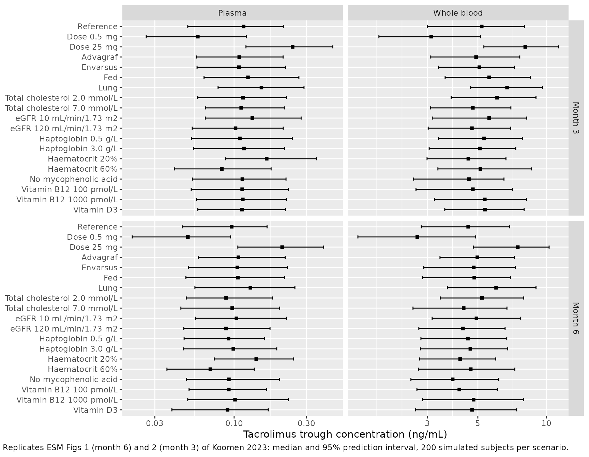
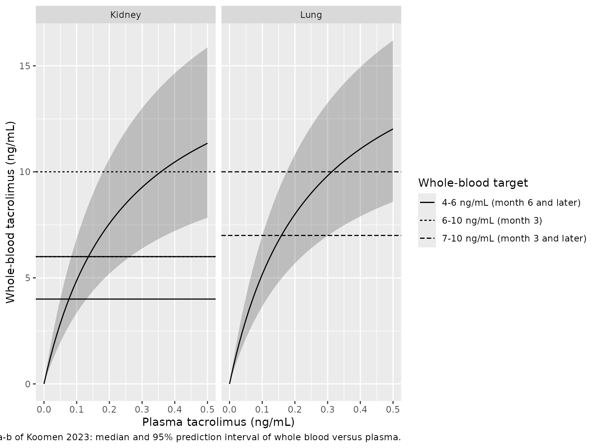

# Tacrolimus plasma and whole blood (Koomen 2023)

## Model and source

- Citation: Koomen JV, Knobbe TJ, Zijp TR, Kremer D, Gan CT, Verschuuren
  EAM, Bakker SJL, Touw DJ, Colin PJ; TransplantLines Investigators. A
  Joint Pharmacokinetic Model for the Simultaneous Description of Plasma
  and Whole Blood Tacrolimus Concentrations in Kidney and Lung
  Transplant Recipients. Clin Pharmacokinet. 2023;62(8):1117.
  <doi:10.1007/s40262-023-01259-x>
- Description: Joint one-compartment population PK model for plasma (Cc)
  and whole-blood (Cblood) tacrolimus trough concentrations in adult
  kidney and lung transplant recipients (Koomen 2023). Plasma is
  described by first-order absorption (ka and F fixed) and first-order
  elimination; whole blood is the haematocrit-weighted sum of the plasma
  concentration and an erythrocyte-bound concentration that saturates in
  plasma (Bmax, Kd). Bioavailability depends on daily dose (per
  formulation: Prograf, Advagraf, Envarsus), food intake and time after
  transplantation (Prograf only); apparent CL on haematocrit, eGFR and
  transplant type; V on haptoglobin; Bmax on haematocrit, total
  cholesterol, haptoglobin, vitamin B12, transplant type and concomitant
  mycophenolic acid and vitamin D3.
- Article: <https://doi.org/10.1007/s40262-023-01259-x> (open access;
  the electronic supplementary material holds the covariate screen, the
  base-model estimates and the covariate-effect simulations ESM Figs 1
  and 2)

Koomen 2023 fitted plasma and whole-blood tacrolimus trough
concentrations jointly. Plasma follows a one-compartment model with
first-order absorption (Eq. 1). Whole blood is the haematocrit-weighted
sum of the plasma concentration and an erythrocyte-bound concentration
that saturates in plasma (Eqs. 2 and 4):

- `Cblood = Cc * (1 - HCT/100) + Cbound * HCT/100`
- `Cbound = Cc * Bmax / (Kd + Cc)`

with `Bmax` the maximum bound concentration and `Kd` the plasma
concentration at half-maximal binding (Table 2 calls it `C50`). The two
concentrations are assumed to be in equilibrium at sampling.

## Population

The model was developed in 1060 adult transplant recipients of the
TransplantLines Biobank and Cohort Study (University Medical Center
Groningen, the Netherlands): 845 kidney and 215 lung recipients (Table
1). Mean (SD) age was 54.7 (13.6) years, body weight 81.0 (16.3) kg,
eGFR 50.2 (19.2) mL/min/1.73 m^2 and haematocrit 39.0 (5.5)%; 39.5% were
female and 91.0% Caucasian. The first sample was taken a median of 47
days (range 2-409) after transplantation. Tacrolimus was titrated by
whole-blood therapeutic drug monitoring: Prograf twice daily (74.7% of
plasma samples), Advagraf once daily (18.5%) or Envarsus once daily
(5.4%). The data comprised 1973 plasma and 1961 whole-blood trough
concentrations (2.5 samples per patient on average), drawn at 08:00
after an overnight fast, which places the sample 10 h after the last
dose of a twice-daily regimen and 22 h after a once-daily dose.

The same information is available programmatically via
`readModelDb("Koomen_2023_tacrolimus")()$population`.

## Source trace

Every `ini()` value carries an in-file comment pointing to its source.
The table collects them.

| Equation / parameter | Value | Source location |
|----|----|----|
| `lka` (fixed) | log(3.5) 1/h | Methods, Eq. 5 |
| `lfdepot` (fixed) | log(0.25) | Methods, Eq. 8 |
| `lcl` | log(257.6) L/h | Table 2, Eq. 6 |
| `lvc` | log(4213.2) L | Table 2, Eq. 7 |
| `lbmax` | log(35.7) ng/mL | Table 2, Eq. 9 |
| `lkd` | log(0.24) ng/mL | Table 2 (`C50`), Eq. 10 |
| `e_dose_tac_fdepot_prograf` / `_advagraf` / `_envarsus` | -0.64 / -0.62 / -0.74 | Table 2, Eq. 8 |
| `e_pod_fdepot` | -0.32 | Table 2, Eq. 8 |
| `e_fasted_fdepot` | -0.11 | Table 2, Eq. 8 |
| `e_hct_cl`, `e_crcl_cl`, `e_tx_lung_cl` | 0.49, 0.07, -0.22 | Table 2, Eq. 6 |
| `e_haptoglobin_vc` | 0.13 | Table 2, Eq. 7 |
| `e_hct_bmax`, `e_tchol_bmax`, `e_haptoglobin_bmax`, `e_vitamin_b12_bmax` | -0.43, -0.18, -0.05, 0.04 | Table 2, Eq. 9 |
| `e_tx_lung_bmax`, `e_conmed_mpa_bmax`, `e_conmed_colecalciferol_bmax` | 0.10, 0.14, 0.05 | Table 2, Eq. 9 |
| `etalfdepot + etalbmax` | 0.13, -0.02, 0.02 | Table 2 (BSV F, BSV Bmax, covariance) |
| `propSd` | 0.371 | Table 2 (plasma, CV 37.1%) |
| `propSd_Cblood` | 0.253 | Table 2 (whole blood, CV 25.3%) |
| `d/dt(depot)`, `d/dt(central)` | – | Eq. 1 (ADVAN2/TRANS2) |
| `Cblood`, `Cbound` | – | Eqs. 2 and 4 |
| Covariate reference values | Dose 2.5 mg/day, HCT 39%, eGFR 51, haptoglobin 1.4 g/L, cholesterol 4.6 mmol/L, vitamin B12 320 pmol/L | Eqs. 6-9 |

## Reference subject and marginal covariate effects (ESM Figs 1 and 2)

ESM Figs 1 and 2 show the median and 95% prediction interval of the
plasma and whole-blood trough for a reference subject and for
one-at-a-time covariate changes, at month 6 and month 3 after
transplantation. The reference subject is a kidney recipient on 3 mg/day
Prograf, fasted, with haematocrit 39%, eGFR 50 mL/min/1.73 m^2,
haptoglobin 1.5 g/L, total cholesterol 4.8 mmol/L, vitamin B12 400
pmol/L, mycophenolic acid and no vitamin D3 (ESM figure captions).

Each scenario is simulated at steady state, sampled at the trough time
the paper assumed (10 h after a twice-daily dose, 22 h after a
once-daily dose), both as the typical value and as 200 subjects with
between-subject variability on F and Bmax. The paper’s prediction
intervals come from between-subject variability alone: the reference
interval 0.05-0.19 ng/mL is the typical 0.09 times
`exp(+/-1.96 * sqrt(0.13))`, with no residual error.

``` r

mod <- readModelDb("Koomen_2023_tacrolimus")
mod_typ <- rxode2::zeroRe(mod)
#> ℹ parameter labels from comments will be replaced by 'label()'

ref_cov <- tibble(
  DOSE_TAC_MGD = 3, FORM_TAC_IR = 1, FORM_TAC_ENVARSUS = 0, FED = 0,
  HCT = 39, CRCL = 50, TX_LUNG = 0, HAPTOGLOBIN = 1.5, TCHOL = 4.8,
  VITAMIN_B12 = 400, CONMED_MPA = 1, CONMED_COLECALCIFEROL = 0
)

scenario_changes <- list(
  "Reference" = list(),
  "Dose 0.5 mg" = list(DOSE_TAC_MGD = 0.5),
  "Dose 25 mg" = list(DOSE_TAC_MGD = 25),
  "Advagraf" = list(FORM_TAC_IR = 0),
  "Envarsus" = list(FORM_TAC_IR = 0, FORM_TAC_ENVARSUS = 1),
  "Fed" = list(FED = 1),
  "Lung" = list(TX_LUNG = 1),
  "Total cholesterol 2.0 mmol/L" = list(TCHOL = 2),
  "Total cholesterol 7.0 mmol/L" = list(TCHOL = 7),
  "eGFR 10 mL/min/1.73 m2" = list(CRCL = 10),
  "eGFR 120 mL/min/1.73 m2" = list(CRCL = 120),
  "Haptoglobin 0.5 g/L" = list(HAPTOGLOBIN = 0.5),
  "Haptoglobin 3.0 g/L" = list(HAPTOGLOBIN = 3),
  "Haematocrit 20%" = list(HCT = 20),
  "Haematocrit 60%" = list(HCT = 60),
  "No mycophenolic acid" = list(CONMED_MPA = 0),
  "Vitamin B12 100 pmol/L" = list(VITAMIN_B12 = 100),
  "Vitamin B12 1000 pmol/L" = list(VITAMIN_B12 = 1000),
  "Vitamin D3" = list(CONMED_COLECALCIFEROL = 1)
)
months <- c("Month 3" = 91.25, "Month 6" = 182.5)

# One steady-state dose and one trough observation per subject. The daily dose
# is split over two administrations for Prograf; DOSE_TAC_MGD stays the daily
# total because Eq. 8 normalises it to 2.5 mg/day.
make_scenario <- function(scenario, month, n, id_offset) {
  cv <- ref_cov
  for (k in names(scenario_changes[[scenario]])) {
    cv[[k]] <- scenario_changes[[scenario]][[k]]
  }
  once_daily <- cv$FORM_TAC_IR == 0
  tau <- if (once_daily) 24 else 12
  subj <- cv[rep(1, n), ] |>
    mutate(
      id = id_offset + seq_len(n),
      POD = months[[month]],
      scenario = scenario,
      month = month
    )
  bind_rows(
    subj |> mutate(time = 0, amt = DOSE_TAC_MGD * tau / 24, ii = tau, ss = 1L,
                   evid = 1L, cmt = "depot", dvid = NA_integer_),
    subj |> mutate(time = if (once_daily) 22 else 10, amt = 0, ii = 0, ss = 0L,
                   evid = 0L, cmt = "central", dvid = 1L)
  ) |>
    arrange(id, time, desc(evid))
}

grid <- expand_grid(scenario = names(scenario_changes), month = names(months))
build <- function(n) {
  bind_rows(lapply(seq_len(nrow(grid)), function(i) {
    make_scenario(grid$scenario[i], grid$month[i], n, id_offset = (i - 1L) * n)
  }))
}
ev_typ <- build(1L)
ev_iiv <- build(200L)
stopifnot(!anyDuplicated(unique(ev_iiv[, c("id", "time", "evid")])))

keep_cols <- c("scenario", "month")
sim_typ <- rxode2::rxSolve(mod_typ, events = ev_typ, keep = keep_cols,
                           returnType = "data.frame")
#> ℹ omega/sigma items treated as zero: 'etalfdepot', 'etalbmax'
#> Warning: multi-subject simulation without without 'omega'
rxode2::rxSetSeed(20230601)
sim_iiv <- rxode2::rxSolve(mod, events = ev_iiv, keep = keep_cols,
                           returnType = "data.frame")
#> ℹ parameter labels from comments will be replaced by 'label()'
# Residual error is not part of the published intervals: use the individual
# predictions (Cc and Cblood are the error-free model values in the output).
stopifnot(!anyNA(sim_typ$Cc), !anyNA(sim_iiv$Cc), !anyNA(sim_iiv$Cblood))

forest <- sim_iiv |>
  pivot_longer(c(Cc, Cblood), names_to = "matrix", values_to = "conc") |>
  group_by(scenario, month, matrix) |>
  summarise(med = median(conc), lo = quantile(conc, 0.025),
            hi = quantile(conc, 0.975), .groups = "drop") |>
  mutate(scenario = factor(scenario, levels = rev(names(scenario_changes))),
         matrix = factor(ifelse(matrix == "Cc", "Plasma", "Whole blood"),
                         levels = c("Plasma", "Whole blood")))
```

``` r

ggplot(forest, aes(med, scenario)) +
  geom_errorbar(aes(xmin = lo, xmax = hi), width = 0.3, orientation = "y") +
  geom_point(shape = 15) +
  facet_grid(month ~ matrix, scales = "free_x") +
  scale_x_log10() +
  labs(x = "Tacrolimus trough concentration (ng/mL)", y = NULL,
       caption = paste("Replicates ESM Figs 1 (month 6) and 2 (month 3) of",
                       "Koomen 2023: median and 95% prediction interval,",
                       "200 simulated subjects per scenario."))
```



### Comparison with the reported values

The Results (“Simulations”) quote the month-6 medians and 95% prediction
intervals for the reference subject and for the dose and haematocrit
extremes. The paper reports plasma to 0.01 ng/mL and whole blood to 0.1
ng/mL.

``` r

published <- tribble(
  ~scenario, ~pub_cc, ~pub_cc_lo, ~pub_cc_hi, ~pub_cb, ~pub_cb_lo, ~pub_cb_hi,
  "Reference", 0.09, 0.05, 0.19, 4.4, 2.7, 7.0,
  "Dose 0.5 mg", 0.05, 0.02, 0.10, 2.7, 1.6, 4.6,
  "Dose 25 mg", 0.20, 0.10, 0.41, 7.2, 4.9, 10.6,
  "Haematocrit 20%", 0.14, 0.07, 0.29, 4.1, 2.7, 6.3,
  "Haematocrit 60%", 0.07, 0.04, 0.14, 4.5, 2.7, 7.4
)

typ6 <- sim_typ |>
  filter(month == "Month 6") |>
  select(scenario, typ_cc = Cc, typ_cb = Cblood)
pi6 <- forest |>
  filter(month == "Month 6") |>
  mutate(scenario = as.character(scenario)) |>
  select(scenario, matrix, med, lo, hi) |>
  pivot_wider(names_from = matrix, values_from = c(med, lo, hi))

cmp <- published |>
  left_join(typ6, by = "scenario") |>
  left_join(pi6, by = "scenario")

cmp |>
  transmute(
    scenario,
    plasma_pub = sprintf("%.2f (%.2f-%.2f)", pub_cc, pub_cc_lo, pub_cc_hi),
    plasma_typ = sprintf("%.3f", typ_cc),
    plasma_sim = sprintf("%.3f (%.3f-%.3f)", med_Plasma, lo_Plasma, hi_Plasma),
    wb_pub = sprintf("%.1f (%.1f-%.1f)", pub_cb, pub_cb_lo, pub_cb_hi),
    wb_typ = sprintf("%.2f", typ_cb),
    wb_sim = sprintf("%.2f (%.2f-%.2f)", `med_Whole blood`,
                     `lo_Whole blood`, `hi_Whole blood`)
  ) |>
  rename(
    "Scenario (month 6)" = scenario,
    "Plasma, published" = plasma_pub,
    "Plasma, typical" = plasma_typ,
    "Plasma, simulated median (95% PI)" = plasma_sim,
    "Whole blood, published" = wb_pub,
    "Whole blood, typical" = wb_typ,
    "Whole blood, simulated median (95% PI)" = wb_sim
  ) |>
  knitr::kable(caption = paste("Month-6 trough concentrations (ng/mL):",
                               "Koomen 2023 Results versus the packaged model."))
```

| Scenario (month 6) | Plasma, published | Plasma, typical | Plasma, simulated median (95% PI) | Whole blood, published | Whole blood, typical | Whole blood, simulated median (95% PI) |
|:---|:---|:---|:---|:---|:---|:---|
| Reference | 0.09 (0.05-0.19) | 0.094 | 0.096 (0.045-0.165) | 4.4 (2.7-7.0) | 4.50 | 4.54 (2.82-6.89) |
| Dose 0.5 mg | 0.05 (0.02-0.10) | 0.049 | 0.050 (0.021-0.095) | 2.7 (1.6-4.6) | 2.72 | 2.71 (1.49-4.89) |
| Dose 25 mg | 0.20 (0.10-0.41) | 0.201 | 0.207 (0.106-0.388) | 7.2 (4.9-10.6) | 7.34 | 7.49 (4.79-10.28) |
| Haematocrit 20% | 0.14 (0.07-0.29) | 0.140 | 0.140 (0.074-0.246) | 4.1 (2.7-6.3) | 4.10 | 4.18 (2.78-5.99) |
| Haematocrit 60% | 0.07 (0.04-0.14) | 0.071 | 0.070 (0.036-0.136) | 4.5 (2.7-7.4) | 4.66 | 4.66 (2.74-7.27) |

Month-6 trough concentrations (ng/mL): Koomen 2023 Results versus the
packaged model. {.table style="width:100%;"}

``` r


# Typical values are deterministic (same parameters, no random draw), so the
# check is tight: plasma within the 0.01 ng/mL rounding of the paper plus a
# small margin, whole blood within 6%. A mis-transcribed CL, V, Bmax, Kd or
# covariate exponent moves at least one of these rows by far more.
stopifnot(
  all(abs(cmp$typ_cc - cmp$pub_cc) < 0.006),
  all(abs(cmp$typ_cb / cmp$pub_cb - 1) < 0.06)
)
```

The typical values match the reported medians within their rounding. The
simulated intervals come from 200 subjects per scenario, so their tails
move by several percent between renders; they agree with the published
intervals to about that precision.

### Time after transplantation is in hours

Table 2 labels the time-after-transplantation covariate in days, and Eq.
8 divides it by 1000. With time in days the Prograf term
`1 + exp(-0.32 * time / 1000)` changes by only 1.5% between month 3 and
month 6, whereas ESM Figs 1 and 2 show the reference plasma trough
falling from about 0.115 ng/mL (month 3, digitised by the maintainers)
to 0.093 ng/mL (month 6), a 1.2-fold drop. Only time in hours reproduces
that drop, so the model converts `POD` (days) to hours before applying
the published coefficient.

``` r

ratio_hours <- with(
  sim_typ |> filter(scenario == "Reference"),
  Cc[month == "Month 3"] / Cc[month == "Month 6"]
)
time_term <- function(t) 1 + exp(-0.32 * t / 1000)
ratio_days <- time_term(91.25) / time_term(182.5)
tibble(
  reading = c("Time in hours (packaged model)", "Time in days", "ESM Figs 1-2 (digitised)"),
  "Month 3 / month 6 plasma trough" = c(ratio_hours, ratio_days, 0.115 / 0.093)
) |>
  knitr::kable(digits = 3)
```

| reading                        | Month 3 / month 6 plasma trough |
|:-------------------------------|--------------------------------:|
| Time in hours (packaged model) |                           1.201 |
| Time in days                   |                           1.014 |
| ESM Figs 1-2 (digitised)       |                           1.237 |

``` r


stopifnot(abs(ratio_hours - 0.115 / 0.093) < 0.08)
```

## Plasma-whole blood relationship and plasma target ranges (Fig. 3)

Fig. 3 maps plasma trough concentrations onto whole-blood concentrations
using each patient’s covariates and the between-subject variability on
Bmax, and translates the whole-blood target ranges into plasma ranges.
The original covariates are not public, so a virtual cohort of 200
kidney and 200 lung recipients is drawn from the Table 1 means and SDs.

``` r

set.seed(2023)
draw_lognormal <- function(n, m, s) {
  sg <- sqrt(log(1 + (s / m)^2))
  rlnorm(n, log(m) - sg^2 / 2, sg)
}
make_cohort <- function(n, lung, hct, tchol, hapto, b12, p_mpa, p_vitd,
                        id_offset) {
  tibble(
    id = id_offset + seq_len(n),
    TX_LUNG = lung,
    HCT = pmin(pmax(rnorm(n, hct[1], hct[2]), 20), 60),
    TCHOL = pmax(rnorm(n, tchol[1], tchol[2]), 2),
    HAPTOGLOBIN = pmax(rnorm(n, hapto[1], hapto[2]), 0.1),
    VITAMIN_B12 = draw_lognormal(n, b12[1], b12[2]),
    CONMED_MPA = rbinom(n, 1, p_mpa),
    CONMED_COLECALCIFEROL = rbinom(n, 1, p_vitd)
  )
}
cohort <- bind_rows(
  make_cohort(200, 0, c(39.5, 5.6), c(4.7, 1.1), c(1.5, 0.7), c(380.7, 232.3),
              0.839, 0.399, id_offset = 0L),
  make_cohort(200, 1, c(37.2, 4.6), c(4.9, 1.3), c(1.4, 0.7), c(476.0, 322.9),
              0.828, 0.372, id_offset = 200L)
) |>
  mutate(DOSE_TAC_MGD = 3, FORM_TAC_IR = 1, FORM_TAC_ENVARSUS = 0, FED = 0,
         POD = 182.5, CRCL = 50)

ev_cohort <- bind_rows(
  cohort |> mutate(time = 0, amt = 1.5, ii = 12, ss = 1L, evid = 1L,
                   cmt = "depot", dvid = NA_integer_),
  cohort |> mutate(time = 10, amt = 0, ii = 0, ss = 0L, evid = 0L,
                   cmt = "central", dvid = 1L)
) |>
  arrange(id, time, desc(evid))
stopifnot(!anyDuplicated(unique(ev_cohort[, c("id", "time", "evid")])))

rxode2::rxSetSeed(20230602)
sim_cohort <- rxode2::rxSolve(mod, events = ev_cohort, keep = c("TX_LUNG", "HCT"),
                              returnType = "data.frame")
binding <- sim_cohort |>
  select(id, TX_LUNG, HCT, bmax, kd) |>
  distinct(id, .keep_all = TRUE)
stopifnot(nrow(binding) == 400, !anyNA(binding$bmax))
```

For each simulated patient the whole-blood concentration at a given
plasma concentration follows directly from Eqs. 2 and 4 with that
patient’s `bmax` and `kd`; residual error is not added, matching the
paper’s prediction intervals.

``` r

plasma_grid <- seq(0, 2, by = 0.01)
relation <- expand_grid(binding, Cc = plasma_grid) |>
  mutate(
    Cblood = Cc * (1 - HCT / 100) + Cc * bmax / (kd + Cc) * HCT / 100,
    recipient = ifelse(TX_LUNG == 1, "Lung", "Kidney")
  )

targets <- tribble(
  ~recipient, ~range, ~lo, ~hi,
  "Kidney", "6-10 ng/mL (month 3)", 6, 10,
  "Kidney", "4-6 ng/mL (month 6 and later)", 4, 6,
  "Lung", "7-10 ng/mL (month 3 and later)", 7, 10
)

relation |>
  filter(Cc <= 0.5) |>
  group_by(recipient, Cc) |>
  summarise(lo = quantile(Cblood, 0.025), med = median(Cblood),
            hi = quantile(Cblood, 0.975), .groups = "drop") |>
  ggplot(aes(Cc, med)) +
  geom_ribbon(aes(ymin = lo, ymax = hi), alpha = 0.25) +
  geom_line() +
  geom_hline(data = targets, aes(yintercept = lo, linetype = range)) +
  geom_hline(data = targets, aes(yintercept = hi, linetype = range)) +
  facet_wrap(~recipient) +
  labs(x = "Plasma tacrolimus (ng/mL)", y = "Whole-blood tacrolimus (ng/mL)",
       linetype = "Whole-blood target",
       caption = paste("Replicates Fig. 3a-b of Koomen 2023: median and 95%",
                       "prediction interval of whole blood versus plasma."))
```



``` r

plasma_ranges <- targets |>
  rowwise() |>
  mutate(
    sel = list(relation$Cc[relation$recipient == recipient &
                             relation$Cblood >= lo & relation$Cblood <= hi]),
    sim_lo = quantile(sel, 0.025),
    sim_hi = quantile(sel, 0.975)
  ) |>
  ungroup() |>
  mutate(published = c("0.10-1.18", "0.06-0.26", "0.10-0.93"))

plasma_ranges |>
  transmute(recipient, range,
            simulated = sprintf("%.2f-%.2f", sim_lo, sim_hi), published) |>
  rename(
    "Recipient" = recipient,
    "Whole-blood target" = range,
    "Plasma range, virtual cohort (ng/mL)" = simulated,
    "Plasma range, Koomen 2023 (ng/mL)" = published
  ) |>
  knitr::kable(caption = paste("95% range of plasma concentrations whose",
                               "predicted whole-blood concentration lies in",
                               "the target range."))
```

| Recipient | Whole-blood target | Plasma range, virtual cohort (ng/mL) | Plasma range, Koomen 2023 (ng/mL) |
|:---|:---|:---|:---|
| Kidney | 6-10 ng/mL (month 3) | 0.12-1.20 | 0.10-1.18 |
| Kidney | 4-6 ng/mL (month 6 and later) | 0.06-0.24 | 0.06-0.26 |
| Lung | 7-10 ng/mL (month 3 and later) | 0.14-0.75 | 0.10-0.93 |

95% range of plasma concentrations whose predicted whole-blood
concentration lies in the target range. {.table}

The kidney ranges from the virtual cohort agree closely with the
published ones. The lung range comes out narrower than the published
0.10-0.93 ng/mL, mostly at its upper end. The paper used the observed
covariates of all 1060 patients, whose joint distribution (for example
the correlation of haematocrit with cholesterol and haptoglobin) a
cohort drawn from independent marginal summaries does not carry. The
ranges are therefore shown for comparison and are not used as a gate.

## PKNCA: steady-state exposure of the reference subject

The paper reports troughs only and no NCA. As an internal check, PKNCA
computes the steady-state average, minimum and maximum plasma
concentration of the typical reference subject (3 mg/day, month 6) for
each formulation over one dosing interval. Under linear kinetics the
average must equal `F * dose / (CL * tau)` with the subject’s own F and
CL.

``` r

form_cov <- list(
  Prograf = list(FORM_TAC_IR = 1, FORM_TAC_ENVARSUS = 0, tau = 12),
  Advagraf = list(FORM_TAC_IR = 0, FORM_TAC_ENVARSUS = 0, tau = 24),
  Envarsus = list(FORM_TAC_IR = 0, FORM_TAC_ENVARSUS = 1, tau = 24)
)
ev_nca <- bind_rows(lapply(seq_along(form_cov), function(i) {
  f <- form_cov[[i]]
  subj <- ref_cov |>
    mutate(id = i, POD = 182.5, treatment = names(form_cov)[i],
           FORM_TAC_IR = f$FORM_TAC_IR, FORM_TAC_ENVARSUS = f$FORM_TAC_ENVARSUS)
  bind_rows(
    subj |> mutate(time = 0, amt = DOSE_TAC_MGD * f$tau / 24, ii = f$tau,
                   ss = 1L, evid = 1L, cmt = "depot", dvid = NA_integer_),
    subj[rep(1, f$tau * 10 + 1), ] |>
      mutate(time = seq(0, f$tau, by = 0.1), amt = 0, ii = 0, ss = 0L,
             evid = 0L, cmt = "central", dvid = 1L)
  )
})) |>
  arrange(id, time, desc(evid))

sim_nca <- rxode2::rxSolve(mod_typ, events = ev_nca, keep = "treatment",
                           returnType = "data.frame")
#> ℹ omega/sigma items treated as zero: 'etalfdepot', 'etalbmax'
#> Warning: multi-subject simulation without without 'omega'
stopifnot(!anyNA(sim_nca$Cc))

conc_df <- sim_nca |>
  filter(!is.na(Cc)) |>
  select(id, time, Cc, treatment)
dose_df <- ev_nca |>
  filter(evid == 1) |>
  select(id, time, amt, treatment)
tau_df <- tibble(treatment = names(form_cov),
                 tau = vapply(form_cov, function(f) f$tau, numeric(1)))

conc_obj <- PKNCA::PKNCAconc(conc_df, Cc ~ time | treatment + id)
dose_obj <- PKNCA::PKNCAdose(dose_df, amt ~ time | treatment + id)
intervals <- tau_df |>
  transmute(treatment, start = 0, end = tau, cmax = TRUE, cmin = TRUE,
            cav = TRUE) |>
  as.data.frame()
nca_res <- PKNCA::pk.nca(PKNCA::PKNCAdata(conc_obj, dose_obj,
                                          intervals = intervals))

nca_tab <- as.data.frame(nca_res) |>
  select(treatment, PPTESTCD, PPORRES) |>
  pivot_wider(names_from = PPTESTCD, values_from = PPORRES)

closed_form <- sim_nca |>
  group_by(treatment) |>
  slice(1) |>
  ungroup() |>
  left_join(tau_df, by = "treatment") |>
  mutate(cav_expected = 1000 * fdepot * ref_cov$DOSE_TAC_MGD * tau / 24 /
           (cl * tau)) |>
  select(treatment, cav_expected)

nca_check <- left_join(nca_tab, closed_form, by = "treatment")
nca_check |>
  rename(
    "Formulation" = treatment,
    "AUC0-tau (ng*h/mL)" = auclast,
    "Cmax (ng/mL)" = cmax,
    "Cmin (ng/mL)" = cmin,
    "Cav, PKNCA (ng/mL)" = cav,
    "Cav, F x dose / (CL x tau) (ng/mL)" = cav_expected
  ) |>
  knitr::kable(digits = 4, caption = paste("Steady-state plasma exposure of",
                                           "the typical reference subject."))
```

| Formulation | AUC0-tau (ng\*h/mL) | Cmax (ng/mL) | Cmin (ng/mL) | Cav, PKNCA (ng/mL) | Cav, F x dose / (CL x tau) (ng/mL) |
|:---|---:|---:|---:|---:|---:|
| Prograf | 1.4385 | 0.1589 | 0.0830 | 0.1199 | 0.1199 |
| Advagraf | 5.2069 | 0.3849 | 0.0980 | 0.2170 | 0.2170 |
| Envarsus | 5.0942 | 0.3765 | 0.0959 | 0.2123 | 0.2123 |

Steady-state plasma exposure of the typical reference subject. {.table}

``` r


# Same parameters on both sides; the difference is trapezoidal error on a
# 0.1 h grid only.
stopifnot(all(abs(nca_check$cav / nca_check$cav_expected - 1) < 0.01))
```

## Assumptions and deviations

- **Dose is the daily dose.** Eq. 8 writes the bioavailability covariate
  as `Dose / 2.5` without saying whether `Dose` is the daily or the
  per-administration amount. The daily-dose reading reproduces the
  paper’s own reference-subject simulations (3 mg Prograf -\> 0.09 ng/mL
  plasma, 4.4 ng/mL whole blood); a per-administration reading gives
  0.15-0.19 ng/mL. The model takes `DOSE_TAC_MGD` in mg/day, and a
  twice-daily regimen gives half of it per administration.
- **Time after transplantation in hours.** See the section above: Table
  2 labels the covariate in days, but only hours reproduce ESM Figs 1
  and 2. The model accepts `POD` in days and converts it.
- **Food effect in ESM Fig. 1.** The model applies the 11% lower F when
  fasted to Prograf only, as Eq. 8 prints it. In ESM Fig. 1 the “Fed”,
  “Advagraf” and “Envarsus” scenarios all lie about 11% below what Eq. 8
  gives (digitised by the maintainers: about 0.094, 0.098 and 0.096
  ng/mL against 0.105, 0.111 and 0.108 ng/mL here), which matches the
  fasted factor being applied in every scenario of that figure. The
  printed equation and the Table 2 label (“Prograft, fasted”) were
  followed. The ESM figure panels are therefore replicated in shape but
  are not used as a gate.
- **Vitamin D term.** Eq. 9 is typeset as `1 x 0.05 + VitaminD`; the
  model uses `1 + 0.05 * CONMED_COLECALCIFEROL`, the “Proportional”
  structure Table 2 lists for this effect.
- **Fed indicator orientation.** The paper codes `fasted` (1 = fasted).
  The model uses the register column `FED` (1 = fed), with
  `fasted = 1 - FED`.
- **Formulation coding.** Prograf, Advagraf and Envarsus are encoded by
  `FORM_TAC_IR` (Prograf) and `FORM_TAC_ENVARSUS`; Advagraf is the level
  with both indicators 0. The time-after-transplantation and food terms
  apply to Prograf only (Eq. 8); for the once-daily products the time
  term evaluates to `1 + exp(0) = 2` as printed.
- **Residual error.** Both matrices have proportional error. Table 2
  gives variances 0.14 and 0.06 with CV 37.1% and 25.3% (CV =
  sqrt(variance), per the table footnote); the CVs carry more digits and
  are used. The Results text quotes 37.3% for plasma, which is the CV of
  the between-subject variability on F; Table 2 is followed. The
  covariance between the plasma and whole-blood residuals (0.06, r =
  0.60, estimated with the NONMEM L2 data item) cannot be expressed in
  the model’s residual-error syntax and is not encoded, so simulations
  that add residual error draw the two matrices independently.
- **Between-subject variability.** Only F and Bmax carry random effects;
  the variances 0.13 and 0.02 and covariance -0.02 are taken as printed.
  The printed CV for Bmax (14.4%) implies a variance of 0.0205, so 0.02
  is a rounded value.
- **Haematocrit units.** `HCT` is in percent for the power effects
  (reference 39%) and used as the fraction `HCT / 100` in the
  whole-blood equation.
- **New covariate columns.** `HAPTOGLOBIN` (g/L) and `VITAMIN_B12`
  (pmol/L) were added to the covariate register for this model, with
  spelled-out names ratified by the maintainers. `CONMED_MPA` and
  `CONMED_COLECALCIFEROL` follow the `CONMED_<INN>` family.
- **Not reproduced.** The prediction-corrected VPCs of Fig. 2 need the
  observed data, which are not public. Fig. 3c-d (percentage of patients
  in the whole-blood target range by plasma concentration) is summarised
  by the plasma-range table rather than redrawn.
- **Errata.** No correction notice is linked to this article in Europe
  PMC or PubMed as of 2026-11-06.
