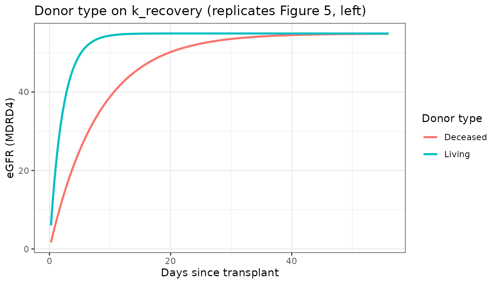
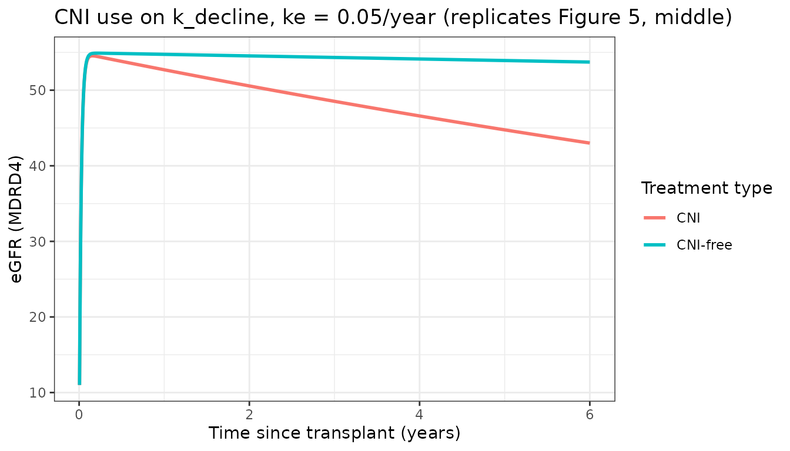
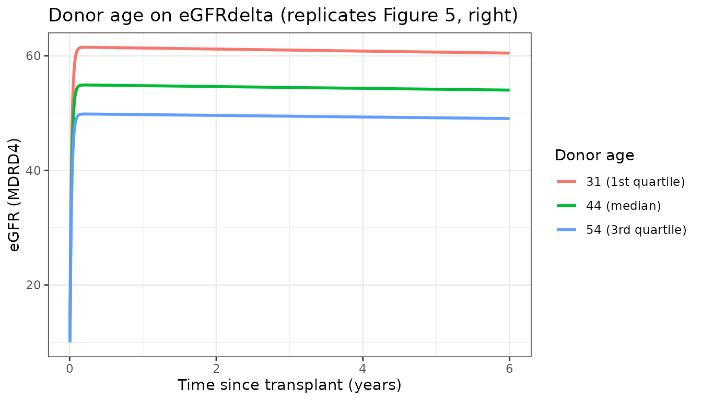
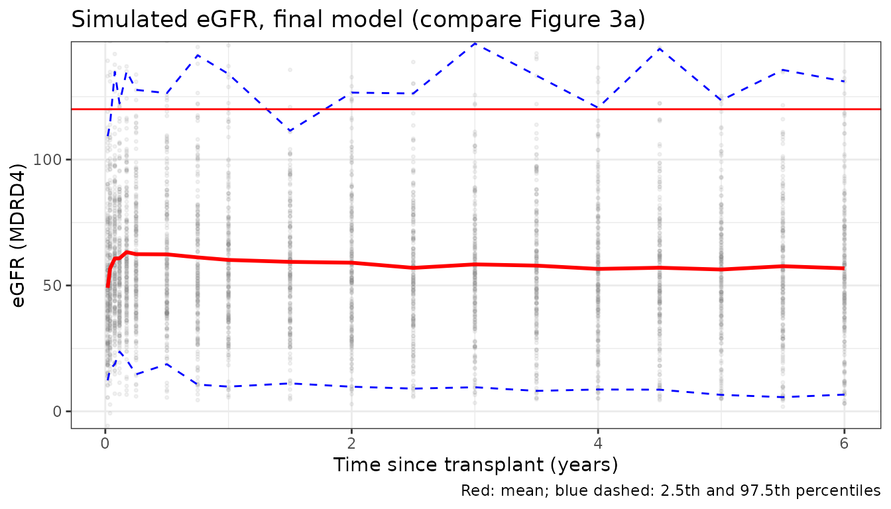

# eGFR after kidney transplantation (Kosinski 2023)

## Model and source

- Citation: Kosinski L, et al. Longitudinal estimated glomerular
  filtration rate (eGFR) modeling in long-term renal function to inform
  clinical trial design in kidney transplantation. Clin Transl Sci.
  2023;16:1680-1690.
- Article: <https://doi.org/10.1111/cts.13579> (open access,
  PMC10499426)
- Model: `Kosinski_2023_kidneyTransplant_egfr`

``` r

mod <- readModelDb("Kosinski_2023_kidneyTransplant_egfr")
mod_ui <- rxode2::rxode(mod)
#> ℹ parameter labels from comments will be replaced by 'label()'
mod_typ <- rxode2::zeroRe(mod_ui)
```

The model describes eGFR (MDRD4, mL/min/1.73 m^2) from the day of a
kidney transplant to 6 years. There is no drug input: time zero is the
transplant, and the trajectory is an algebraic function of time. It is
the paper’s final Chapman-Richards growth with stabilizing decay (CR-SD)
model (Table 1 Eq. 5):

``` math
\mathrm{eGFR}(t) = (\mathrm{eGFR}_{stable} + \mathrm{eGFR}_{\Delta})\,(1 - e^{-k_a t})
  + \mathrm{eGFR}_{\Delta}\,(e^{-k_e t} - 1)
```

The graft recovers quickly towards a peak, eGFRstable + eGFRdelta, at
rate ka. The trajectory then decays slowly at rate ke towards
eGFRstable. Here ka and ke are a recovery rate and a decline rate;
nothing is absorbed or eliminated. In the model file they are
`k_recovery_egfr` and `k_decline_egfr`, eGFRstable is `rmin_egfr`,
eGFRdelta is `amp_decline_egfr`, and the peak eGFRgrowth is `rmax_egfr`.

## Population

The data come from the Critical Path Institute Transplant Therapeutics
Consortium:

- three single-centre observational cohorts (Mayo Clinic Rochester,
  Helsinki University Hospital and Houston Methodist Hospital,
  2000-2020);
- the BENEFIT and BENEFIT-EXT belatacept trials.

After data cleaning, 143,517 eGFR values from 4868 recipients remained,
censored at 6 years. Of these, 80% were used for fitting and 20% for the
VPC (Figure 1).

Table S1 summarises the 4904 patients before exclusions:

| Characteristic | Value |
|----|----|
| Recipient age | median 51 years (18-84) |
| Female recipients | 38.5% |
| Black recipients | 12.3% |
| Previous kidney transplant | 9.8% |
| Deceased donor | 51.3% |
| Donor age | median 45 years |
| Female donors | 51.7% |
| Cold ischemia time | median 10.2 h (19.5 h deceased-donor, 0.95 h living-donor kidneys) |
| CNI-based regimen | 81.8% |
| Induction: basiliximab or daclizumab | 39.4% |
| Induction: anti-thymocyte globulin | 31.9% |
| Induction: none | 7.8% |
| Induction: other | 8.7% |
| Induction: alemtuzumab | 4.4% |

eGFR values above 120 mL/min/1.73 m^2 were treated as above an upper
limit of quantification (ULOQ) with an M3-like likelihood (Eq. 1).
Before exclusions this was under 2% of the data.

``` r

str(mod_ui$population, max.level = 1)
#> List of 13
#>  $ species       : chr "human"
#>  $ n_subjects    : int 4868
#>  $ n_studies     : int 5
#>  $ age_range     : chr "18-84 years (recipients)"
#>  $ age_median    : chr "51 years (recipients)"
#>  $ weight_range  : chr "not reported"
#>  $ sex_female_pct: num 38.5
#>  $ race_ethnicity: Named num [1:2] 12.3 87.6
#>   ..- attr(*, "names")= chr [1:2] "Black" "NonBlack"
#>  $ disease_state : chr "Adult kidney-transplant recipients (end-stage kidney disease), followed from transplant to 6 years"
#>  $ dose_range    : chr "not applicable (no drug dosing); 81.8% on calcineurin-inhibitor-based immunosuppression"
#>  $ regions       : chr "USA (Mayo Clinic Rochester, Houston Methodist), Finland (Helsinki University Hospital) and international (BENEF"| __truncated__
#>  $ n_observations: chr "143,517 eGFR values after data cleaning (80% training / 20% test split)"
#>  $ notes         : chr "C-Path Transplant Therapeutics Consortium data: three single-centre observational cohorts (2000-2020) and the B"| __truncated__
```

## Source trace

| Model element | Value | Source |
|----|----|----|
| Structural equation (CR-SD) | `rmax * (1 - exp(-k_recovery t)) + amp * (exp(-k_decline t) - 1)`, `rmax = rmin + amp` | Table 1 Eq. 5; Methods “Base model” |
| `lk_recovery_egfr` (ka) | 44.7 1/year | Table 2 |
| `lk_decline_egfr` (ke) | 0.0034 1/year | Table 2 |
| `lamp_decline_egfr` (eGFRdelta) | 46.1 mL/min/1.73 m^2 | Table 2 (46.06 in Appendix S2) |
| `lrmin_egfr` (eGFRstable) | 8.85 mL/min/1.73 m^2 | Table 2 |
| Covariate form | `param * (1 + beta * cov)`; CIT centred at 10 h, donor age at 44, recipient age at 51 | Methods “Baseline covariates”; Table S2 |
| `e_cold_ischemia_time_k_recovery_egfr` | -0.012 per h | Table 2 ka CIT |
| `e_donor_living_k_recovery_egfr` | 2.77 | Table 2 ka ‘Living donor’ |
| `e_race_black_k_recovery_egfr` | -0.32 | Table 2 ka ‘Black race’ |
| `e_sexf_k_recovery_egfr` | 0.27 | Table 2 ka ‘Female recipients’ |
| `e_tx_kidney_prior_k_recovery_egfr` | 0.24 | Table 2 ka ‘Previous kidney transplant’ |
| `e_induction_atg_k_recovery_egfr` | 0.084 | Table 2 ka induction, anti-thymocyte globulin |
| `e_induction_alemtuzumab_k_recovery_egfr` | 0.5 | Table 2 ka induction, alemtuzumab |
| `e_induction_other_k_recovery_egfr` | 0.21 | Table 2 ka induction, other |
| `e_induction_none_k_recovery_egfr` | -0.015 | Table 2 ka induction, none |
| `e_cni_free_k_decline_egfr` | -0.91 | Table 2 ke ‘CNI not used’ |
| `e_age_donor_k_decline_egfr` | 0.020 per year | Table 2 ke ‘Donor age’ |
| `e_race_black_k_decline_egfr` | 3.97 | Table 2 ke ‘Black recipients’ |
| `e_age_donor_amp_decline_egfr` | -0.011 per year | Table 2 eGFRdelta ‘Donor age’ |
| `e_sexf_donor_amp_decline_egfr` | 0.091 | Table 2 eGFRdelta ‘Female donors’ |
| `e_age_amp_decline_egfr` | -0.0024 per year | Table 2 eGFRdelta ‘Recipient age’ |
| `e_race_black_amp_decline_egfr` | 0.11 | Table 2 eGFRdelta ‘Black recipients’ |
| `e_age_donor_rmin_egfr` | 0.0091 per year | Table 2 eGFRstable ‘Donor age’ |
| `e_age_rmin_egfr` | 0.0058 per year | Table 2 eGFRstable ‘Recipient age’ |
| IIV variances (log-normal) | 0.89, 15.6, 0.081, 0.78 | Table 2 ‘IIV’ column |
| `propSd` | 0.229 | Table 2 eps_prop |
| `addSd` (divided by time) | 0.021 | Table 2 eps_add; Eq. 2 |

## Replicating Figure 5: typical trajectories

Figure 5 plots typical-value curves. Each panel shifts one parameter by
one covariate and holds every other covariate at its reference. The
reference is a deceased-donor kidney with 10 h cold ischemia, a
44-year-old male donor, a 51-year-old non-Black male recipient on his
first transplant, with basiliximab or daclizumab induction and a
CNI-based regimen. Appendix S2 states that the middle panel sets ke to
0.05 per year so that the CNI effect is visible. The left and right
panels use the population ke.

``` r

ref_cov <- data.frame(
  DONOR_DECEASED = 1, COLD_ISCHEMIA_TIME = 10, RACE_BLACK = 0, SEXF = 0,
  TX_KIDNEY_PRIOR = 0, INDUCTION_ATG = 0, INDUCTION_ALEMTUZUMAB = 0,
  INDUCTION_OTHER = 0, INDUCTION_NONE = 0, CONMED_CNI = 1,
  AGE_DONOR = 44, SEXF_DONOR = 0, AGE = 51
)

solve_typical <- function(model, scenarios, times) {
  ev <- tidyr::crossing(scenarios, time = times) |>
    dplyr::arrange(id, time) |>
    dplyr::mutate(evid = 0L, amt = 0)
  # zeroRe() models solved for several typical subjects warn that there is no
  # omega; that is intended here, so only that warning is muffled.
  withCallingHandlers(
    as.data.frame(rxode2::rxSolve(model, events = ev, keep = "scenario")),
    warning = function(w) {
      if (grepl("without 'omega'", conditionMessage(w), fixed = TRUE)) {
        invokeRestart("muffleWarning")
      }
    }
  )
}
```

``` r

t_days <- seq(0.25, 56, by = 0.25)
scen_donor <- dplyr::bind_rows(
  dplyr::mutate(ref_cov, id = 1L, scenario = "Deceased"),
  dplyr::mutate(ref_cov, id = 2L, scenario = "Living", DONOR_DECEASED = 0)
)
fig5a <- solve_typical(mod_typ, scen_donor, t_days / 365.25) |>
  dplyr::mutate(day = time * 365.25)
#> ℹ omega/sigma items treated as zero: 'etalk_recovery_egfr', 'etalk_decline_egfr', 'etalamp_decline_egfr', 'etalrmin_egfr'

ggplot(fig5a, aes(day, egfr, colour = scenario)) +
  geom_line(linewidth = 1) +
  labs(x = "Days since transplant", y = "eGFR (MDRD4)", colour = "Donor type",
       title = "Donor type on k_recovery (replicates Figure 5, left)") +
  theme_bw()
```



``` r

# ke fixed at 0.05 / year for this panel only, as in the source figure.
mod_ke05 <- rxode2::ini(mod_typ, lk_decline_egfr = log(0.05))
#> ℹ change initial estimate of `lk_decline_egfr` to `-2.99573227355399`
t_years <- c(seq(0.005, 0.25, by = 0.005), seq(0.3, 6, by = 0.05))
scen_cni <- dplyr::bind_rows(
  dplyr::mutate(ref_cov, id = 1L, scenario = "CNI"),
  dplyr::mutate(ref_cov, id = 2L, scenario = "CNI-free", CONMED_CNI = 0)
)
fig5b <- solve_typical(mod_ke05, scen_cni, t_years)
#> ℹ omega/sigma items treated as zero: 'etalk_recovery_egfr', 'etalk_decline_egfr', 'etalamp_decline_egfr', 'etalrmin_egfr'

ggplot(fig5b, aes(time, egfr, colour = scenario)) +
  geom_line(linewidth = 1) +
  labs(x = "Time since transplant (years)", y = "eGFR (MDRD4)",
       colour = "Treatment type",
       title = "CNI use on k_decline, ke = 0.05/year (replicates Figure 5, middle)") +
  theme_bw()
```



``` r

# Only the donor-age effect on eGFRdelta is applied in this panel; the
# donor-age effects on ke and eGFRstable are switched off to match the figure.
mod_dage <- rxode2::ini(
  mod_typ,
  e_age_donor_k_decline_egfr = 0,
  e_age_donor_rmin_egfr = 0
)
#> ℹ change initial estimate of `e_age_donor_k_decline_egfr` to `0`
#> ℹ change initial estimate of `e_age_donor_rmin_egfr` to `0`
scen_dage <- dplyr::bind_rows(
  dplyr::mutate(ref_cov, id = 1L, scenario = "31 (1st quartile)", AGE_DONOR = 31),
  dplyr::mutate(ref_cov, id = 2L, scenario = "44 (median)", AGE_DONOR = 44),
  dplyr::mutate(ref_cov, id = 3L, scenario = "54 (3rd quartile)", AGE_DONOR = 54)
)
fig5c <- solve_typical(mod_dage, scen_dage, t_years)
#> ℹ omega/sigma items treated as zero: 'etalk_recovery_egfr', 'etalk_decline_egfr', 'etalamp_decline_egfr', 'etalrmin_egfr'

ggplot(fig5c, aes(time, egfr, colour = scenario)) +
  geom_line(linewidth = 1) +
  labs(x = "Time since transplant (years)", y = "eGFR (MDRD4)",
       colour = "Donor age",
       title = "Donor age on eGFRdelta (replicates Figure 5, right)") +
  theme_bw()
```



The checks below compare the curves with values read from Figure 5. The
model has no random effects here, so the closed form is exact, and the
tolerances only allow for reading values off the figure.

``` r

at <- function(d, scen, t) {
  d$egfr[d$scenario == scen & abs(d$time - t) < 1e-9]
}
fig5_check <- data.frame(
  quantity = c(
    "Deceased donor, day 56",
    "Living donor, day 8",
    "Deceased donor, day 16",
    "CNI, 6 years (ke = 0.05)",
    "CNI-free, 6 years (ke = 0.05)",
    "Donor age 31, peak",
    "Donor age 44, peak",
    "Donor age 54, peak",
    "Donor age 44, 6 years"
  ),
  figure = c(55, 54, 47, 43.0, 53.8, 61.4, 54.9, 49.8, 54.0),
  model = c(
    at(fig5a, "Deceased", 56 / 365.25),
    at(fig5a, "Living", 8 / 365.25),
    at(fig5a, "Deceased", 16 / 365.25),
    at(fig5b, "CNI", 6),
    at(fig5b, "CNI-free", 6),
    max(fig5c$egfr[fig5c$scenario == "31 (1st quartile)"]),
    max(fig5c$egfr[fig5c$scenario == "44 (median)"]),
    max(fig5c$egfr[fig5c$scenario == "54 (3rd quartile)"]),
    at(fig5c, "44 (median)", 6)
  )
) |>
  dplyr::mutate(pct_diff = 100 * (model - figure) / figure)

fig5_check |>
  dplyr::rename(
    "Quantity" = quantity, "Figure 5 (read)" = figure,
    "Model" = model, "% difference" = pct_diff
  ) |>
  knitr::kable(digits = c(0, 1, 2, 1))
```

| Quantity                      | Figure 5 (read) | Model | % difference |
|:------------------------------|----------------:|------:|-------------:|
| Deceased donor, day 56        |            55.0 | 54.87 |         -0.2 |
| Living donor, day 8           |            54.0 | 53.58 |         -0.8 |
| Deceased donor, day 16        |            47.0 | 47.19 |          0.4 |
| CNI, 6 years (ke = 0.05)      |            43.0 | 43.00 |          0.0 |
| CNI-free, 6 years (ke = 0.05) |            53.8 | 53.72 |         -0.1 |
| Donor age 31, peak            |            61.4 | 61.50 |          0.2 |
| Donor age 44, peak            |            54.9 | 54.91 |          0.0 |
| Donor age 54, peak            |            49.8 | 49.85 |          0.1 |
| Donor age 44, 6 years         |            54.0 | 54.02 |          0.0 |

``` r


stopifnot(all(abs(fig5_check$pct_diff) < 3))
```

## Stochastic simulation and Figure 3

Figure 3 is a VPC of the CR-SD **base** model against the 20% test data.
The paper does not show a VPC of the final covariate model. The
simulation below uses the final model with a virtual cohort drawn
independently from the Table S1 marginal distributions, so it is an
approximate comparison. It checks two things: the centre of the
distribution and the share of values above the ULOQ (Figure 3b, about
1.5-3% observed and 2.5-4.5% simulated). The paper did not report
covariate correlations, apart from cold ischemia time by donor type,
which is used here.

``` r

rxode2::rxSetSeed(20231579)
set.seed(20231579)
n_sub <- 200
induction <- sample(
  c("BAS", "ATG", "ALEM", "NONE", "OTHER"), n_sub, replace = TRUE,
  prob = c(0.394, 0.319, 0.044, 0.078, 0.087)
)
cohort <- data.frame(
  id = seq_len(n_sub),
  DONOR_DECEASED = rbinom(n_sub, 1, 0.513),
  RACE_BLACK = rbinom(n_sub, 1, 0.123),
  SEXF = rbinom(n_sub, 1, 0.385),
  TX_KIDNEY_PRIOR = rbinom(n_sub, 1, 0.098),
  INDUCTION_ATG = as.integer(induction == "ATG"),
  INDUCTION_ALEMTUZUMAB = as.integer(induction == "ALEM"),
  INDUCTION_OTHER = as.integer(induction == "OTHER"),
  INDUCTION_NONE = as.integer(induction == "NONE"),
  CONMED_CNI = rbinom(n_sub, 1, 0.82),
  AGE_DONOR = pmin(84, pmax(0, rnorm(n_sub, 43.7, 15.1))),
  SEXF_DONOR = rbinom(n_sub, 1, 0.517),
  AGE = pmin(84, pmax(18, rnorm(n_sub, 50.1, 13.8)))
) |>
  dplyr::mutate(
    COLD_ISCHEMIA_TIME = ifelse(
      DONOR_DECEASED == 1,
      pmin(59.5, pmax(0, rnorm(n_sub, 19.6, 7.4))),
      pmin(85, pmax(0, rnorm(n_sub, 1.5, 3.1)))
    )
  )

t_obs <- c(1, 2, 4, 6, 9, 13, 26, 39) / 52
t_obs <- c(t_obs, seq(1, 6, by = 0.5))
ev_vpc <- tidyr::crossing(cohort, time = t_obs) |>
  dplyr::arrange(id, time) |>
  dplyr::mutate(evid = 0L, amt = 0)

sim_vpc <- as.data.frame(rxode2::rxSolve(mod_ui, events = ev_vpc, nStud = 1))
```

``` r

vpc_sum <- sim_vpc |>
  dplyr::group_by(time) |>
  dplyr::summarise(
    q025 = quantile(sim, 0.025), q50 = median(sim), mean = mean(sim),
    q975 = quantile(sim, 0.975), pct_alq = 100 * mean(sim > 120),
    .groups = "drop"
  )

ggplot(sim_vpc, aes(time, sim)) +
  geom_point(alpha = 0.1, size = 0.6, colour = "grey50") +
  geom_line(data = vpc_sum, aes(y = mean), colour = "red", linewidth = 1) +
  geom_line(data = vpc_sum, aes(y = q025), colour = "blue", linetype = 2) +
  geom_line(data = vpc_sum, aes(y = q975), colour = "blue", linetype = 2) +
  geom_hline(yintercept = 120, colour = "red") +
  coord_cartesian(ylim = c(0, 140)) +
  labs(x = "Time since transplant (years)", y = "eGFR (MDRD4)",
       title = "Simulated eGFR, final model (compare Figure 3a)",
       caption = "Red: mean; blue dashed: 2.5th and 97.5th percentiles") +
  theme_bw()
```



``` r


vpc_sum |>
  dplyr::rename(
    "Time (years)" = time, "2.5th pct" = q025, "Median" = q50, "Mean" = mean,
    "97.5th pct" = q975, "% above ULOQ" = pct_alq
  ) |>
  knitr::kable(digits = 2)
```

| Time (years) | 2.5th pct | Median |  Mean | 97.5th pct | % above ULOQ |
|-------------:|----------:|-------:|------:|-----------:|-------------:|
|         0.02 |     12.32 |  45.96 | 49.05 |     109.30 |          1.0 |
|         0.04 |     16.75 |  52.09 | 56.69 |     114.00 |          2.0 |
|         0.08 |     18.74 |  57.36 | 60.73 |     134.83 |          3.5 |
|         0.12 |     23.75 |  55.72 | 60.80 |     122.28 |          4.0 |
|         0.17 |     20.48 |  57.71 | 63.25 |     135.09 |          3.5 |
|         0.25 |     14.72 |  57.77 | 62.44 |     127.69 |          3.5 |
|         0.50 |     18.73 |  55.97 | 62.36 |     126.40 |          4.5 |
|         0.75 |     10.64 |  54.07 | 61.15 |     141.43 |          5.0 |
|         1.00 |      9.83 |  54.62 | 60.14 |     133.99 |          4.5 |
|         1.50 |     11.11 |  55.15 | 59.38 |     111.46 |          2.5 |
|         2.00 |      9.79 |  55.07 | 59.04 |     126.60 |          4.5 |
|         2.50 |      9.04 |  53.00 | 56.99 |     126.26 |          3.0 |
|         3.00 |      9.58 |  54.58 | 58.38 |     146.10 |          4.5 |
|         3.50 |      8.14 |  54.51 | 57.89 |     133.35 |          3.5 |
|         4.00 |      8.69 |  53.18 | 56.57 |     120.60 |          3.0 |
|         4.50 |      8.62 |  52.49 | 57.05 |     144.00 |          4.0 |
|         5.00 |      6.56 |  53.32 | 56.34 |     123.53 |          3.5 |
|         5.50 |      5.66 |  53.44 | 57.65 |     135.62 |          4.0 |
|         6.00 |      6.66 |  53.38 | 56.81 |     131.03 |          3.5 |

In Figure 3a the observed and simulated mean is about 50-55 mL/min/1.73
m^2 from 3 months onwards, and the 97.5th percentile is about 100-105.
The simulated share above the ULOQ in Figure 3b is about 2.5-4.5%. The
checks below look at the centre and the pooled share of values above the
ULOQ from 3 months onwards, not at the extremes of a 200-subject cohort.

The simulated 97.5th percentile here (about 110-145) is higher than the
upper band in Figure 3a, whose axis stops at 120. The paper itself
reports that the model over-predicts the upper end of the distribution
(Figure 3b). The covariates in this cohort are also drawn independently,
which widens the tails. Values above 90 all indicate good graft
function, so the paper did not treat this as clinically relevant.

``` r

late <- dplyr::filter(sim_vpc, time >= 0.25)
vpc_check <- data.frame(
  quantity = c("Median eGFR, t >= 3 months", "Mean eGFR, t >= 3 months",
               "% above ULOQ, t >= 3 months"),
  value = c(median(late$sim), mean(late$sim), 100 * mean(late$sim > 120))
)
knitr::kable(dplyr::rename(vpc_check, "Quantity" = quantity, "Simulated" = value),
             digits = 1)
```

| Quantity                     | Simulated |
|:-----------------------------|----------:|
| Median eGFR, t \>= 3 months  |      54.4 |
| Mean eGFR, t \>= 3 months    |      58.7 |
| % above ULOQ, t \>= 3 months |       3.8 |

``` r


stopifnot(
  # Centre: a mistranscribed eGFRdelta / eGFRstable moves this by > 10 units.
  vpc_check$value[1] > 42, vpc_check$value[1] < 62,
  vpc_check$value[2] > 45, vpc_check$value[2] < 65,
  # Share above ULOQ: Figure 3b about 2.5-4.5% simulated; a variance-scale
  # misreading of the residual SDs roughly doubles it.
  vpc_check$value[3] > 0.5, vpc_check$value[3] < 7
)
```

## Covariate effects on typical parameters

``` r

cov_scen <- dplyr::bind_rows(
  dplyr::mutate(ref_cov, scenario = "Reference"),
  dplyr::mutate(ref_cov, scenario = "Living donor (CIT 1 h)",
                DONOR_DECEASED = 0, COLD_ISCHEMIA_TIME = 1),
  dplyr::mutate(ref_cov, scenario = "Black recipient", RACE_BLACK = 1),
  dplyr::mutate(ref_cov, scenario = "CNI-free regimen", CONMED_CNI = 0),
  dplyr::mutate(ref_cov, scenario = "Alemtuzumab induction", INDUCTION_ALEMTUZUMAB = 1),
  dplyr::mutate(ref_cov, scenario = "Donor age 64", AGE_DONOR = 64)
) |>
  dplyr::mutate(id = dplyr::row_number())
cov_sim <- solve_typical(mod_typ, cov_scen, c(1, 6))
#> ℹ omega/sigma items treated as zero: 'etalk_recovery_egfr', 'etalk_decline_egfr', 'etalamp_decline_egfr', 'etalrmin_egfr'
cov_tab <- cov_sim |>
  dplyr::filter(time == 1) |>
  dplyr::select(scenario, k_recovery_egfr, k_decline_egfr, amp_decline_egfr,
                rmin_egfr, egfr_1y = egfr) |>
  dplyr::left_join(
    cov_sim |> dplyr::filter(time == 6) |> dplyr::select(scenario, egfr_6y = egfr),
    by = "scenario"
  )
cov_tab |>
  dplyr::rename(
    "Scenario" = scenario, "k_recovery (1/y)" = k_recovery_egfr,
    "k_decline (1/y)" = k_decline_egfr, "eGFRdelta" = amp_decline_egfr,
    "eGFRstable" = rmin_egfr, "eGFR 1 y" = egfr_1y, "eGFR 6 y" = egfr_6y
  ) |>
  knitr::kable(digits = 4)
```

| Scenario | k_recovery (1/y) | k_decline (1/y) | eGFRdelta | eGFRstable | eGFR 1 y | eGFR 6 y |
|:---|---:|---:|---:|---:|---:|---:|
| Reference | 44.7000 | 0.0034 | 46.100 | 8.8500 | 54.7935 | 54.0191 |
| Living donor (CIT 1 h) | 186.7191 | 0.0034 | 46.100 | 8.8500 | 54.7935 | 54.0191 |
| Black recipient | 30.3960 | 0.0169 | 51.171 | 8.8500 | 59.1636 | 55.0872 |
| CNI-free regimen | 44.7000 | 0.0003 | 46.100 | 8.8500 | 54.9359 | 54.8654 |
| Alemtuzumab induction | 67.0500 | 0.0034 | 46.100 | 8.8500 | 54.7935 | 54.0191 |
| Donor age 64 | 44.7000 | 0.0048 | 35.958 | 10.4607 | 46.2479 | 45.4063 |

## PKNCA

This model has no drug input or concentration, so there is no NCA to do.
The checks are the closed-form Figure 5 comparison and the Figure 3
distribution checks above.

## Assumptions and deviations

- **Time unit.** Table 2 does not give units for ka and ke. Years
  reproduce Figure 5: the deceased-donor curve plateaus at about day 48
  and the CNI curve with ke = 0.05 reaches 43.0 at 6 years. The model
  time unit is therefore years since transplant.
- **IIV and residual scale.** The Table 2 ‘IIV’ column is taken as
  omega-squared variances of log-normal random effects. eps_prop = 0.229
  and eps_add = 0.021 sit in the estimate column with confidence
  intervals and are taken as standard deviations. Under this reading the
  simulated share above the ULOQ (about 3%) and the 2.5th percentile
  band agree with Figure 3. Reading the residual values as variances
  roughly doubles the share above the ULOQ, and reading the IIV values
  as standard deviations moves the centre well away from the data.
- **Time-varying additive error.** Eq. 2 adds eps_a / t, so the additive
  SD is `addSd / time` and is infinite at time 0. The source data had no
  observations at or before the transplant, so simulate only at time \>
  0.
- **ULOQ.** The M3-like handling of values above 120 mL/min/1.73 m^2 is
  a property of the estimation data (censoring flag and limit columns),
  not of the model. Simulated values are not truncated.
- **Missing covariates.** The paper set beta x covariate = 0 for missing
  values. To reproduce that here, set a missing binary covariate to its
  reference value, or a missing continuous covariate to its centring
  value (10 h, 44 years, 51 years). For missing induction, set all four
  `INDUCTION_*` indicators to 0. Missing induction data reached 41% in
  the source.
- **Orientation of two covariates.** The source codes ‘Living donor’ and
  ‘CNI not used’ as the index levels. The model keeps the registered
  canonical columns, with `DONOR_DECEASED` = 1 for a deceased donor and
  `CONMED_CNI` = 1 for a CNI-based regimen, and applies the coefficients
  to `(1 - DONOR_DECEASED)` and `(1 - CONMED_CNI)`. The typical values
  are unchanged.
- **Non-significant induction levels.** The anti-thymocyte globulin and
  ‘None’ induction effects have confidence intervals that include zero,
  but the paper kept them in the final model. They are kept here too.
- **eGFRdelta.** Table 2 prints 46.1 and Appendix S2 prints 46.06. The
  model uses the Table 2 value.
- **Virtual cohort.** Covariates are drawn independently from the Table
  S1 marginal distributions, except that cold ischemia time depends on
  donor type. Figure 3 is a base-model VPC against test data, so the
  simulation is compared with it only at the centre and in the share
  above the ULOQ.
- **Recovery faster than decline.** The paper notes that ka \> ke was
  not enforced. With ke IIV variance 15.6, an occasional simulated
  subject has a very fast decline to eGFRstable. This follows from the
  published variance and is kept.
