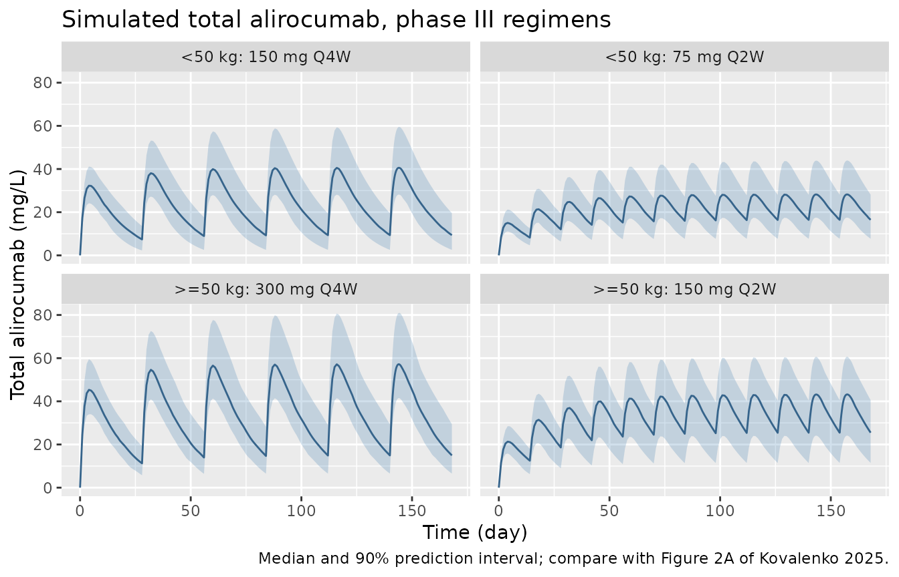
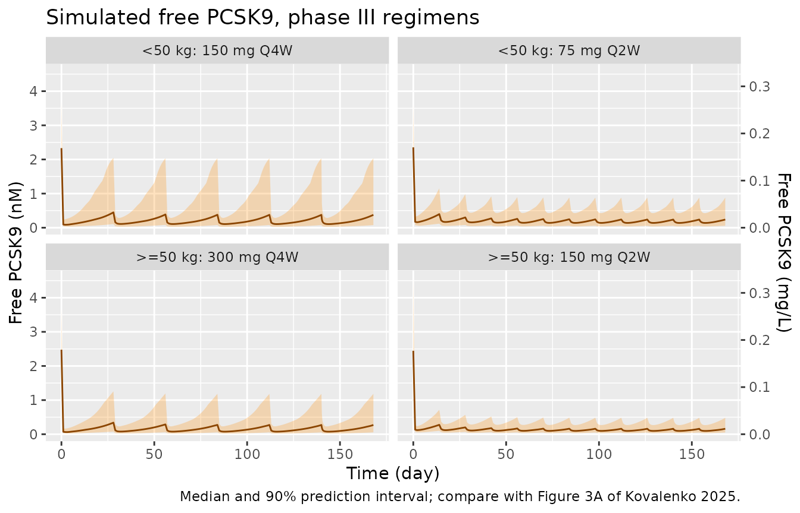
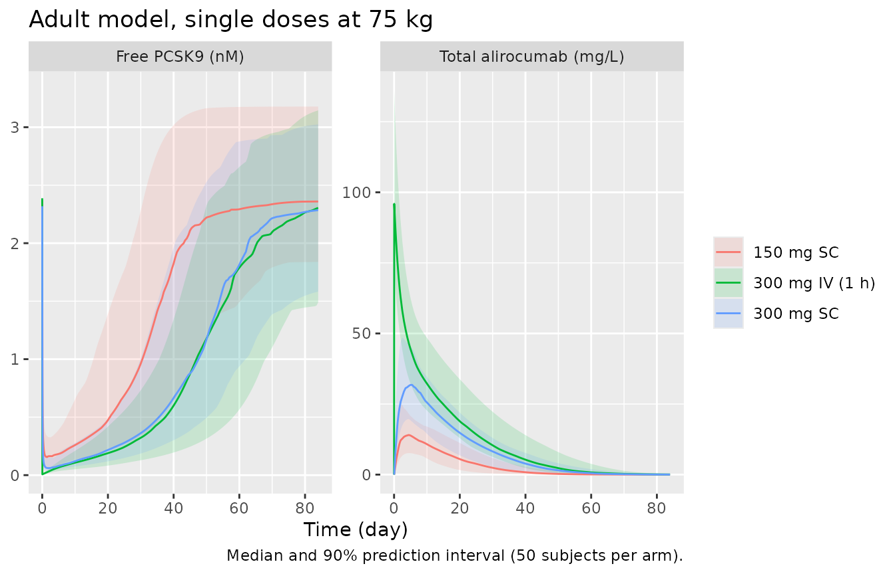

# Alirocumab full TMDD in pediatric HeFH and healthy adults (Kovalenko 2025)

## Model and source

- Citation: Kovalenko P, Harnisch L, Mendell J, Wang Y, Davis JD,
  DiCioccio AT. Target-Mediated Modeling of Alirocumab in Adolescents
  and Children \>=8 to \<12 Years of Age Using Phase II and III Data.
  Clin Pharmacol Drug Dev. 2025;14(5):347. <doi:10.1002/cpdd.1523>
- Article: [Clin Pharmacol Drug Dev 14(5):347
  (2025)](https://doi.org/10.1002/cpdd.1523) (open access, PMC12044327)

Kovalenko et al. 2025 describe total alirocumab and free PCSK9 in
children and adolescents with heterozygous familial
hypercholesterolaemia (HeFH) with a **full** target-mediated drug
disposition (TMDD) model. The analysis has two steps, and the library
carries one model file for each:

1.  `Kovalenko_2025_alirocumab_adult` – the model fitted to two densely
    sampled phase I studies in healthy adults (IV and SC single doses),
    which estimated every structural parameter (Table 2, “Adults”
    column).
2.  `Kovalenko_2025_alirocumab_pediatric` – the primary pediatric
    covariate model (Table 2, “Pediatric population” column).
    Bioavailability, the absorption and transit rates, and the
    intercompartmental rate constants are fixed to the adult estimates;
    weight on Vc and high-dose statins (HDS) on PCSK9 synthesis are the
    retained covariates.

The structure (Figure 1 of the paper) is the same in both:

- SC dose -\> depot transit compartment (`ktr`) -\> transit compartment
  (`ka`) -\> central compartment, with bioavailability F.
- Free alirocumab `L`, free PCSK9 `R`, the 1:1 complex `L:R` and the 1:2
  complex `L:R:R` all distribute to a peripheral compartment with the
  same rate constants `kcp` and `kpc`.
- In the central compartment `L + R <-> L:R` and `L:R + R <-> L:R:R`,
  each with `kon` and `koff` (fixed to Biacore values).
- `L` is eliminated at `keL`, both complexes at `keLR`, free PCSK9 at
  `keR = ksyn / R0`, and PCSK9 is synthesised at the zero-order rate
  `ksyn`.
- Observations are total alirocumab (`L + L:R + L:R:R`, the total assay)
  and free PCSK9 in the central compartment, each with a proportional
  residual error.

``` r

mod_ped <- readModelDb("Kovalenko_2025_alirocumab_pediatric")
mod_adult <- readModelDb("Kovalenko_2025_alirocumab_adult")
ui_ped <- rxode2::rxode2(mod_ped)
#> ℹ parameter labels from comments will be replaced by 'label()'
ui_adult <- rxode2::rxode2(mod_adult)
#> ℹ parameter labels from comments will be replaced by 'label()'
ui_ped
#>  ── rxode2-based free-form 10-cmt ODE model ───────────────────────────────────── 
#>  ── Initalization: ──  
#> Fixed Effects ($theta): 
#>                    lktr                     lka                 lfdepot 
#>               3.1135153              -1.0996128              -0.4231200 
#>                    lk12                    lk21                     lvc 
#>              -1.6398971              -1.2729657               0.4946962 
#>                    lkel                   lkint                   lksyn 
#>              -2.5257286              -0.9888614               1.7509375 
#>                     lr0                    lkon                   lkoff 
#>               0.8878913               4.0587174               4.6634391 
#>                 e_wt_vc e_conmed_statin_hi_ksyn                  propSd 
#>               0.7240000               0.5760000               0.2470000 
#>          propSd_Ctarget 
#>               0.4140000 
#> 
#> Omega ($omega): 
#>            etalvc etalkint etalksyn   etalr0  etalkel
#> etalvc   0.011664 0.000000 0.000000 0.000000 0.000000
#> etalkint 0.000000 0.126736 0.000000 0.000000 0.000000
#> etalksyn 0.000000 0.000000 0.379456 0.000000 0.000000
#> etalr0   0.000000 0.000000 0.000000 0.076729 0.000000
#> etalkel  0.000000 0.000000 0.000000 0.000000 0.026896
#> attr(,"lotriLabels")
#> [1] "Table 2 'SD(ln[Vc])' pediatric 0.108 -> variance 0.108^2"  
#> [2] "Table 2 'SD(ln[keLR])' pediatric 0.356 -> variance 0.356^2"
#> [3] "Table 2 'SD(ln[ksyn])' pediatric 0.616 -> variance 0.616^2"
#> [4] "Table 2 'SD(ln[R0])' pediatric 0.277 -> variance 0.277^2"  
#> [5] "Table 2 'SD(ln[keL])' pediatric 0.164 -> variance 0.164^2" 
#> attr(,"lotriFix")
#>          etalvc etalkint etalksyn etalr0 etalkel
#> etalvc    FALSE    FALSE    FALSE  FALSE   FALSE
#> etalkint  FALSE    FALSE    FALSE  FALSE   FALSE
#> etalksyn  FALSE    FALSE    FALSE  FALSE   FALSE
#> etalr0    FALSE    FALSE    FALSE  FALSE   FALSE
#> etalkel   FALSE    FALSE    FALSE  FALSE   FALSE
#> 
#> States ($state or $stateDf): 
#>    Compartment Number       Compartment Name
#> 1                   1                  depot
#> 2                   2               transit1
#> 3                   3                central
#> 4                   4            peripheral1
#> 5                   5                 target
#> 6                   6     target_peripheral1
#> 7                   7                complex
#> 8                   8    complex_peripheral1
#> 9                   9             complex_db
#> 10                 10 complex_db_peripheral1
#>  ── Multiple Endpoint Model ($multipleEndpoint): ──  
#>      variable                     cmt                    dvid*
#> 1      Cc ~ …      cmt='Cc' or cmt=11      dvid='Cc' or dvid=1
#> 2 Ctarget ~ … cmt='Ctarget' or cmt=12 dvid='Ctarget' or dvid=2
#>   * If dvids are outside this range, all dvids are re-numered sequentially, ie 1,7, 10 becomes 1,2,3 etc
#> 
#>  ── μ-referencing ($muRefTable): ──  
#>   theta      eta level
#> 1   lvc   etalvc    id
#> 2  lkel  etalkel    id
#> 3 lkint etalkint    id
#> 4 lksyn etalksyn    id
#> 5   lr0   etalr0    id
#> 
#>  ── Model (Normalized Syntax): ── 
#> function() {
#>     compartmentData <- list(depot = list(analyte = "alirocumab", 
#>         units = "nmol", specimen = "administration site", verified = TRUE), 
#>         transit1 = list(analyte = "alirocumab", units = "nmol", 
#>             specimen = "administration site", verified = TRUE), 
#>         central = list(analyte = "alirocumab (free)", units = "nmol", 
#>             specimen = "serum", verified = TRUE), peripheral1 = list(analyte = "alirocumab (free)", 
#>             units = "nmol", specimen = "not applicable", verified = TRUE), 
#>         target = list(analyte = "PCSK9 (free)", units = "nmol", 
#>             specimen = "serum", verified = TRUE), target_peripheral1 = list(analyte = "PCSK9 (free)", 
#>             units = "nmol", specimen = "not applicable", verified = TRUE), 
#>         complex = list(analyte = "alirocumab:PCSK9 (1:1 complex)", 
#>             units = "nmol", specimen = "serum", verified = TRUE), 
#>         complex_peripheral1 = list(analyte = "alirocumab:PCSK9 (1:1 complex)", 
#>             units = "nmol", specimen = "not applicable", verified = TRUE), 
#>         complex_db = list(analyte = "alirocumab:PCSK9:PCSK9 (1:2 complex)", 
#>             units = "nmol", specimen = "serum", verified = TRUE), 
#>         complex_db_peripheral1 = list(analyte = "alirocumab:PCSK9:PCSK9 (1:2 complex)", 
#>             units = "nmol", specimen = "not applicable", verified = TRUE))
#>     covariateData <- list(WT = list(description = "Body weight at baseline", 
#>         units = "kg", type = "continuous", reference_category = NULL, 
#>         notes = "Baseline (time-fixed) weight; the paper repeated covariate selection with time-dependent weight and kept the baseline form because time-dependent covariates gave unstable OFVs (Methods, 'Population PK Analysis'). Power effect on Vc centred at 50 kg: the dataset median 50.1 kg was replaced by 50 kg because treatment groups were assigned at the 50 kg cut-off (Methods). Analysis-set weight mean 52.0 kg (SD 18.8).", 
#>         source_name = "weight"), CONMED_STATIN_HI = list(description = "Concomitant high-dose statin therapy", 
#>         units = "(binary)", type = "binary", reference_category = "0 (no statin or low-dose statin)", 
#>         notes = "The paper's HDS covariate (Table 2 'ksyn ~ HDS'). The paper does not state the dose threshold that defines a high-dose statin; it reports that 19 participants received HDS and that pediatric statin doses were mostly <=20 mg once daily (Discussion). Multiplicative exponential effect on PCSK9 synthesis rate, ksyn = 5.76 * exp(0.576 * HDS), i.e. 10.3 nM/day on HDS (Table 2 derived row; Results 'ksyn was 79% higher').", 
#>         source_name = "HDS"))
#>     covariatesDataExcluded <- list(AGE = list(description = "Age", 
#>         units = "years", type = "continuous", reference_category = NULL, 
#>         notes = "Tested in the stepwise covariate search (Methods) and not retained in the final model.", 
#>         source_name = "age"), ALB = list(description = "Serum albumin", 
#>         units = "g/L", type = "continuous", reference_category = NULL, 
#>         notes = "Tested in the stepwise covariate search (Methods) and not retained in the final model.", 
#>         source_name = "albumin"), CRCL = list(description = "Creatinine clearance", 
#>         units = "mL/min/1.73 m^2", type = "continuous", reference_category = NULL, 
#>         notes = "Tested in the stepwise covariate search (Methods) and not retained in the final model.", 
#>         source_name = "creatinine clearance"), BMI = list(description = "Body mass index", 
#>         units = "kg/m^2", type = "continuous", reference_category = NULL, 
#>         notes = "Tested in the stepwise covariate search (Methods) and not retained in the final model.", 
#>         source_name = "BMI"), ADA_POS = list(description = "Anti-drug antibody positive at any time", 
#>         units = "(binary)", type = "binary", reference_category = "0 (ADA negative)", 
#>         notes = "Tested in the stepwise covariate search; not statistically significant or clinically meaningful (Results).", 
#>         source_name = "ADA at any time"), SEXF = list(description = "Female sex indicator", 
#>         units = "(binary)", type = "binary", reference_category = "0 (male)", 
#>         notes = "Tested in the stepwise covariate search (Methods) and not retained in the final model.", 
#>         source_name = "sex"), CONMED_EZE = list(description = "Concomitant ezetimibe", 
#>         units = "(binary)", type = "binary", reference_category = "0 (no ezetimibe)", 
#>         notes = "Tested in the stepwise covariate search (Methods) and not retained in the final model.", 
#>         source_name = "ezetimibe"))
#>     description <- "Full target-mediated drug disposition (TMDD) population PK model for total alirocumab and free PCSK9 in children and adolescents (8-17 years) with heterozygous familial hypercholesterolaemia (Kovalenko 2025, primary pediatric covariate model). Two-compartment disposition of free alirocumab, free PCSK9 and both alirocumab:PCSK9 complexes (1:1 and 1:2) sharing the same intercompartmental rate constants; SC absorption through one depot-transit compartment; two-step binding of alirocumab to one and then a second PCSK9 molecule in the central compartment; zero-order PCSK9 synthesis. Weight on Vc (power, 50 kg reference) and high-dose statin on PCSK9 synthesis rate. Absorption, distribution and bioavailability fixed to the adult estimates; kon and koff fixed to Biacore values."
#>     paper_specific_compartments <- c("complex_db", "complex_db_peripheral1")
#>     population <- list(species = "human", n_subjects = 119L, 
#>         n_studies = 2L, n_observations = "390 total alirocumab and 531 free PCSK9 concentrations", 
#>         age_range = "8-17 years", age_mean = "13.1 years (SD 2.86)", 
#>         weight_mean = "52.0 kg (SD 18.8)", sex_female_pct = 57.5, 
#>         disease_state = "Children and adolescents with heterozygous familial hypercholesterolaemia (HeFH)", 
#>         dose_range = "Weight-banded SC alirocumab: <50 kg 30 or 40 mg Q2W, 75 or 150 mg Q4W (up-titration to 75 mg Q2W); >=50 kg 50 or 75 mg Q2W, 150 or 300 mg Q4W (up-titration to 150 mg Q2W) (Table 1)", 
#>         co_medication = "More than 90% received statins; 19 participants received a high-dose statin (Discussion, Results)", 
#>         studies = "Phase II NCT02890992 (DFI14223, 8-week dose finding, 42 treated) and phase III NCT03510884 (EFC14643, 99 treated, 20 also in phase II)", 
#>         notes = "121 patients received active treatment across the two studies; one had no PK observations and one had only one post-dose observation, leaving 119 in the analysis (Methods). 42.5% male (Methods). Absorption, distribution and bioavailability parameters were fixed to the adult model fitted to two dense-sampling phase I studies in healthy adults (see Kovalenko_2025_alirocumab_adult).")
#>     reference <- "Kovalenko P, Harnisch L, Mendell J, Wang Y, Davis JD, DiCioccio AT. Target-Mediated Modeling of Alirocumab in Adolescents and Children >=8 to <12 Years of Age Using Phase II and III Data. Clin Pharmacol Drug Dev. 2025;14(5):347. doi:10.1002/cpdd.1523"
#>     units <- list(time = "day", dosing = "mg", concentration = "mg/L")
#>     vignette <- "Kovalenko_2025_alirocumab"
#>     ini({
#>         lktr <- fix(3.11351530921037)
#>         label("Transit rate constant depot -> transit1, ktr (1/day)")
#>         lka <- fix(-1.09961278900169)
#>         label("Absorption rate constant transit1 -> central, ka (1/day)")
#>         lfdepot <- fix(-0.423120043346885)
#>         label("SC bioavailability F (fraction)")
#>         lk12 <- fix(-1.63989711991881)
#>         label("Central-to-peripheral rate constant kcp (1/day)")
#>         lk21 <- fix(-1.27296567581289)
#>         label("Peripheral-to-central rate constant kpc (1/day)")
#>         lvc <- 0.494696241836107
#>         label("Central volume Vc at 50 kg (L)")
#>         lkel <- -2.52572864430826
#>         label("Elimination rate constant of free alirocumab keL (1/day)")
#>         lkint <- -0.988861424708991
#>         label("Elimination rate constant of alirocumab:PCSK9 complexes keLR (1/day)")
#>         lksyn <- 1.7509374747078
#>         label("PCSK9 synthesis rate ksyn without high-dose statin (nM/day)")
#>         lr0 <- 0.887891257352457
#>         label("Baseline free PCSK9 concentration R0 (nM)")
#>         lkon <- fix(4.05871738457895)
#>         label("Association rate constant kon (1/nM/day)")
#>         lkoff <- fix(4.66343909411207)
#>         label("Dissociation rate constant koff (1/day)")
#>         e_wt_vc <- 0.724
#>         label("Power exponent of body weight (WT / 50 kg) on Vc (unitless)")
#>         e_conmed_statin_hi_ksyn <- 0.576
#>         label("Exponential effect of high-dose statin on ksyn, exp(theta * HDS) (unitless)")
#>         propSd <- c(0, 0.247)
#>         label("Proportional residual error, total alirocumab (fraction)")
#>         propSd_Ctarget <- c(0, 0.414)
#>         label("Proportional residual error, free PCSK9 (fraction)")
#>         etalvc ~ 0.011664
#>         label("Table 2 'SD(ln[Vc])' pediatric 0.108 -> variance 0.108^2")
#>         etalkint ~ 0.126736
#>         label("Table 2 'SD(ln[keLR])' pediatric 0.356 -> variance 0.356^2")
#>         etalksyn ~ 0.379456
#>         label("Table 2 'SD(ln[ksyn])' pediatric 0.616 -> variance 0.616^2")
#>         etalr0 ~ 0.076729
#>         label("Table 2 'SD(ln[R0])' pediatric 0.277 -> variance 0.277^2")
#>         etalkel ~ 0.026896
#>         label("Table 2 'SD(ln[keL])' pediatric 0.164 -> variance 0.164^2")
#>     })
#>     model({
#>         mw_alirocumab <- 146000
#>         nmol_per_mg <- 1e+06/mw_alirocumab
#>         ktr <- exp(lktr)
#>         ka <- exp(lka)
#>         fdepot <- exp(lfdepot)
#>         k12 <- exp(lk12)
#>         k21 <- exp(lk21)
#>         vc <- exp(lvc + etalvc) * (WT/50)^e_wt_vc
#>         kel <- exp(lkel + etalkel)
#>         kint <- exp(lkint + etalkint)
#>         ksyn <- exp(lksyn + etalksyn) * exp(e_conmed_statin_hi_ksyn * 
#>             CONMED_STATIN_HI)
#>         r0 <- exp(lr0 + etalr0)
#>         kon <- exp(lkon)
#>         koff <- exp(lkoff)
#>         kdeg <- ksyn/r0
#>         bind1 <- kon * central * target/vc - koff * complex
#>         bind2 <- kon * complex * target/vc - koff * complex_db
#>         d/dt(depot) <- -ktr * depot
#>         d/dt(transit1) <- ktr * depot - ka * transit1
#>         d/dt(central) <- ka * transit1 - kel * central - k12 * 
#>             central + k21 * peripheral1 - bind1
#>         d/dt(peripheral1) <- k12 * central - k21 * peripheral1
#>         d/dt(target) <- ksyn * vc - kdeg * target - k12 * target + 
#>             k21 * target_peripheral1 - bind1 - bind2
#>         d/dt(target_peripheral1) <- k12 * target - k21 * target_peripheral1
#>         d/dt(complex) <- bind1 - bind2 - kint * complex - k12 * 
#>             complex + k21 * complex_peripheral1
#>         d/dt(complex_peripheral1) <- k12 * complex - k21 * complex_peripheral1
#>         d/dt(complex_db) <- bind2 - kint * complex_db - k12 * 
#>             complex_db + k21 * complex_db_peripheral1
#>         d/dt(complex_db_peripheral1) <- k12 * complex_db - k21 * 
#>             complex_db_peripheral1
#>         target(0) <- r0 * vc
#>         target_peripheral1(0) <- r0 * vc * k12/k21
#>         f(depot) <- fdepot * nmol_per_mg
#>         f(central) <- nmol_per_mg
#>         Cc <- (central + complex + complex_db)/vc/nmol_per_mg
#>         Ctarget <- target/vc
#>         Cc ~ prop(propSd)
#>         Ctarget ~ prop(propSd_Ctarget)
#>     })
#> }
```

## Population

The pediatric model was fitted to 119 children and adolescents aged 8-17
years with HeFH from the phase II dose-finding study NCT02890992 (42
treated) and the phase III study NCT03510884 (99 treated, 20 of whom had
also taken part in phase II). Mean (SD) age was 13.1 (2.86) years and
weight 52.0 (18.8) kg, and 42.5% were male. Doses were weight-banded at
50 kg (Table 1 of the paper); more than 90% of patients took statins and
19 took a high-dose statin. The analysis used 390 total alirocumab and
531 free PCSK9 concentrations.

The adult model was fitted to two phase I single-dose studies in healthy
adults (NCT01026597, NCT01074372) with dense sampling. Kovalenko 2025
does not report their subject counts or demographics.

``` r

str(mod_ped()$population)
#> List of 13
#>  $ species       : chr "human"
#>  $ n_subjects    : int 119
#>  $ n_studies     : int 2
#>  $ n_observations: chr "390 total alirocumab and 531 free PCSK9 concentrations"
#>  $ age_range     : chr "8-17 years"
#>  $ age_mean      : chr "13.1 years (SD 2.86)"
#>  $ weight_mean   : chr "52.0 kg (SD 18.8)"
#>  $ sex_female_pct: num 57.5
#>  $ disease_state : chr "Children and adolescents with heterozygous familial hypercholesterolaemia (HeFH)"
#>  $ dose_range    : chr "Weight-banded SC alirocumab: <50 kg 30 or 40 mg Q2W, 75 or 150 mg Q4W (up-titration to 75 mg Q2W); >=50 kg 50 o"| __truncated__
#>  $ co_medication : chr "More than 90% received statins; 19 participants received a high-dose statin (Discussion, Results)"
#>  $ studies       : chr "Phase II NCT02890992 (DFI14223, 8-week dose finding, 42 treated) and phase III NCT03510884 (EFC14643, 99 treate"| __truncated__
#>  $ notes         : chr "121 patients received active treatment across the two studies; one had no PK observations and one had only one "| __truncated__
str(mod_adult()$population)
#> List of 7
#>  $ species      : chr "human"
#>  $ n_studies    : int 2
#>  $ disease_state: chr "Healthy adults"
#>  $ dose_range   : chr "Single IV and single SC doses of alirocumab with dense PK sampling"
#>  $ studies      : chr "Phase I NCT01026597 (R727-CL-0902) and NCT01074372 (R727-CL-0904)"
#>  $ co_medication: chr "No high-dose statins (healthy volunteers), so no statin covariate was tested"
#>  $ notes        : chr "Kovalenko 2025 reports the adult parameter estimates (Table 2, 'Adults' column) but not the adult subject count"| __truncated__
```

## Source trace

All values are from Table 2 of Kovalenko 2025 unless stated; `kon` and
`koff` come from Supplemental Table 11 (they are fixed in every model of
the paper). Variances in `ini()` are the squares of the reported SD of
the log-parameter.

| Parameter | Pediatric | Adult | Source location |
|----|----|----|----|
| `lktr` (ktr, 1/day) | 22.5 (fixed) | 22.5 | Table 2 ‘ktr’ |
| `lka` (ka, 1/day) | 0.333 (fixed) | 0.333 | Table 2 ‘ka’ |
| `lfdepot` (F) | 0.655 (fixed) | 0.655 | Table 2 ‘F’ |
| `lk12` (kcp, 1/day) | 0.194 (fixed) | 0.194 | Table 2 ‘kcp’ |
| `lk21` (kpc, 1/day) | 0.280 (fixed) | 0.280 | Table 2 ‘kpc’ |
| `lvc` (Vc, L) | 1.64 at 50 kg | 3.01 at 75 kg | Table 2 ‘Vc (L)’ and footnote |
| `lkel` (keL, 1/day) | 0.0800 | 0.0698 | Table 2 ‘keL’ |
| `lkint` (keLR, 1/day) | 0.372 | 0.320 | Table 2 ‘keLR’ |
| `lksyn` (ksyn, nM/day) | 5.76 (HDS = No) | 4.97 | Table 2 ‘ksyn’ |
| `lr0` (R0, nM) | 2.43 | 2.28 | Table 2 ‘R0’ |
| `lkon` (kon, 1/nM/day) | 57.9 (fixed) | 57.9 (fixed) | Table S11 ‘kon’; Methods (Biacore) |
| `lkoff` (koff, 1/day) | 106 (fixed) | 106 (fixed) | Table S11 ‘koff’; Methods (Biacore) |
| `e_wt_vc` | 0.724 | 0.787 | Table 2 ‘Vc ~ weight’ |
| `e_conmed_statin_hi_ksyn` | 0.576 | – | Table 2 ‘ksyn ~ HDS’ |
| `etalvc` (SD) | 0.108 | 0.241 | Table 2 ‘SD(ln\[Vc\])’ |
| `etalkint` (SD) | 0.356 | 0.271 | Table 2 ‘SD(ln\[keLR\])’ |
| `etalksyn` (SD) | 0.616 | 0.354 | Table 2 ‘SD(ln\[ksyn\])’ |
| `etalr0` (SD) | 0.277 | 0.214 | Table 2 ‘SD(ln\[R0\])’ |
| `etalkel` (SD) | 0.164 | 0.242 | Table 2 ‘SD(ln\[keL\])’ |
| `etalka` (SD) | – | 0.578 | Table 2 ‘SD(ln\[ka\])’ |
| `etalktr` (SD) | – | 1.01 | Table 2 ‘SD(ln\[ktr\])’ |
| `propSd` | 0.247 | 0.147 | Table 2 ‘SD(alirocumab)’; Table S1 ‘b2’ (proportional) |
| `propSd_Ctarget` | 0.414 | 0.249 | Table 2 ‘SD(PCSK9)’; Table S1 ‘b5’ (proportional) |
| Structure | n/a | n/a | Figure 1; Methods ‘Population PK Analysis’ |
| `kdeg = ksyn / r0` | n/a | n/a | Methods (‘keR = ksyn/R0’) |
| Covariate forms | n/a | n/a | Methods (log-linear power for weight, `exp(theta * HDS)` for HDS) |

## Checks against the paper’s derived parameters

Table 2 reports derived linear-PK parameters. They follow from the
model’s rate constants (`CL = keL * Vc`, `Q = kcp * Vc`,
`Vp = Vc * kcp / kpc`, and the terminal half-life of the linear
two-compartment system), and `ksyn` with HDS is `5.76 * exp(0.576)`.
These are closed-form checks on the packaged values.

``` r

derived <- function(ui) {
  th <- ui$theta
  vc <- exp(th[["lvc"]])
  kel <- exp(th[["lkel"]])
  k12 <- exp(th[["lk12"]])
  k21 <- exp(th[["lk21"]])
  s <- kel + k12 + k21
  beta <- (s - sqrt(s^2 - 4 * kel * k21)) / 2
  c(cl = kel * vc, q = k12 * vc, vp = vc * k12 / k21, thalf_beta = log(2) / beta)
}
der <- rbind(Pediatric = derived(ui_ped), Adult = derived(ui_adult))
published_der <- rbind(
  Pediatric = c(cl = 0.131, q = 0.318, vp = 1.14, thalf_beta = 15.8),
  Adult = c(cl = 0.210, q = 0.584, vp = 2.09, thalf_beta = 17.9)
)
ksyn_hds <- exp(ui_ped$theta[["lksyn"]] + ui_ped$theta[["e_conmed_statin_hi_ksyn"]])

data.frame(
  model = rep(rownames(der), each = 4),
  parameter = rep(colnames(der), 2),
  packaged = signif(c(t(der)), 3),
  published = c(t(published_der))
) |>
  dplyr::rename(
    "Model" = model,
    "Derived parameter" = parameter,
    "From packaged values" = packaged,
    "Table 2" = published
  ) |>
  knitr::kable(caption = "Derived parameters (CL, Q in L/day; Vp in L; t1/2 beta in days).")
```

| Model     | Derived parameter | From packaged values | Table 2 |
|:----------|:------------------|---------------------:|--------:|
| Pediatric | cl                |                0.131 |   0.131 |
| Pediatric | q                 |                0.318 |   0.318 |
| Pediatric | vp                |                1.140 |   1.140 |
| Pediatric | thalf_beta        |               15.800 |  15.800 |
| Adult     | cl                |                0.210 |   0.210 |
| Adult     | q                 |                0.584 |   0.584 |
| Adult     | vp                |                2.090 |   2.090 |
| Adult     | thalf_beta        |               17.900 |  17.900 |

Derived parameters (CL, Q in L/day; Vp in L; t1/2 beta in days).
{.table}

``` r


# Table 2 prints three significant figures, so the closed forms agree within
# rounding.
stopifnot(
  all(abs(der / published_der - 1) < 0.01),
  abs(ksyn_hds / 10.3 - 1) < 0.01
)
```

The packaged pediatric `ksyn` on HDS is 10.25 nM/day (Table 2: 10.3
nM/day, 79% above the no-HDS value).

## Baseline steady state

Free PCSK9 starts at `R0` in the central compartment and at the matching
distribution equilibrium in the peripheral compartment, and
`keR = ksyn / R0`. Without drug, free PCSK9 must therefore stay at `R0`
for any covariates.

``` r

ev_nodrug <- rxode2::et(seq(0, 168, by = 7), cmt = "central") |>
  as.data.frame() |>
  dplyr::mutate(dvid = 1L, WT = 50, CONMED_STATIN_HI = 1)
ss_ped <- rxode2::rxSolve(rxode2::zeroRe(mod_ped), ev_nodrug, returnType = "data.frame")
#> ℹ parameter labels from comments will be replaced by 'label()'
#> ℹ omega/sigma items treated as zero: 'etalvc', 'etalkint', 'etalksyn', 'etalr0', 'etalkel'
r0_ped <- exp(ui_ped$theta[["lr0"]])
stopifnot(max(abs(ss_ped$Ctarget / r0_ped - 1)) < 1e-4, max(abs(ss_ped$Cc)) < 1e-8)
range(ss_ped$Ctarget)
#> [1] 2.43 2.43
```

## Virtual pediatric cohort

The cohort reproduces the four phase III regimens (Table 1,
NCT03510884): below 50 kg 150 mg Q4W or 75 mg Q2W, at or above 50 kg 300
mg Q4W or 150 mg Q2W, each for 24 weeks without up-titration. Weight is
drawn from a log-normal distribution with the reported mean (52.0 kg)
and SD (18.8 kg), truncated to 25-110 kg, and split at 50 kg; 16%
(19/119) of subjects take a high-dose statin.

``` r

set.seed(20250501)
n_per_arm <- 100L

draw_weights <- function(n, band) {
  sdlog <- sqrt(log(1 + (18.8 / 52.0)^2))
  meanlog <- log(52.0) - sdlog^2 / 2
  w <- numeric(0)
  while (length(w) < n) {
    x <- rlnorm(4 * n, meanlog, sdlog)
    x <- x[x >= 25 & x <= 110]
    x <- if (band == "<50 kg") x[x < 50] else x[x >= 50]
    w <- c(w, x)
  }
  w[seq_len(n)]
}

arms <- tibble::tribble(
  ~arm, ~band, ~amt, ~ii,
  "<50 kg: 150 mg Q4W", "<50 kg", 150, 28,
  "<50 kg: 75 mg Q2W", "<50 kg", 75, 14,
  ">=50 kg: 300 mg Q4W", ">=50 kg", 300, 28,
  ">=50 kg: 150 mg Q2W", ">=50 kg", 150, 14
)

obs_times <- sort(unique(c(seq(0, 168, by = 1), seq(140, 168, by = 0.25))))

make_arm <- function(i, id_offset) {
  a <- arms[i, ]
  subj <- tibble::tibble(
    id = id_offset + seq_len(n_per_arm),
    WT = draw_weights(n_per_arm, a$band),
    CONMED_STATIN_HI = rbinom(n_per_arm, 1, 19 / 119),
    arm = a$arm
  )
  dose_times <- seq(0, 168 - a$ii, by = a$ii)
  doses <- tidyr::expand_grid(subj, time = dose_times) |>
    dplyr::mutate(evid = 1L, amt = a$amt, cmt = "depot")
  # Two declared endpoints (Cc, Ctarget): observation rows carry dvid = 1 on
  # the central compartment, and every row returns both observables.
  obs <- tidyr::expand_grid(subj, time = obs_times) |>
    dplyr::mutate(evid = 0L, amt = 0, cmt = "central", dvid = 1L)
  dplyr::bind_rows(doses, obs)
}

events <- dplyr::bind_rows(lapply(seq_len(nrow(arms)), function(i) make_arm(i, (i - 1L) * n_per_arm))) |>
  dplyr::arrange(id, time, dplyr::desc(evid))
stopifnot(!anyDuplicated(unique(events[, c("id", "time", "evid")])))

events |>
  dplyr::distinct(id, arm, WT, CONMED_STATIN_HI) |>
  dplyr::group_by(arm) |>
  dplyr::summarise(
    n = dplyr::n(),
    median_wt = median(WT),
    hds_pct = 100 * mean(CONMED_STATIN_HI),
    .groups = "drop"
  ) |>
  dplyr::rename("Arm" = arm, "N" = n, "Median weight (kg)" = median_wt, "HDS (%)" = hds_pct) |>
  knitr::kable(digits = 1)
```

| Arm                  |   N | Median weight (kg) | HDS (%) |
|:---------------------|----:|-------------------:|--------:|
| \<50 kg: 150 mg Q4W  | 100 |               38.8 |      19 |
| \<50 kg: 75 mg Q2W   | 100 |               38.9 |      20 |
| \>=50 kg: 150 mg Q2W | 100 |               61.9 |      16 |
| \>=50 kg: 300 mg Q4W | 100 |               61.2 |      17 |

## Simulation

``` r

rxode2::rxSetSeed(20250501)
sim <- rxode2::rxSolve(mod_ped, events = events, keep = "arm", returnType = "data.frame") |>
  dplyr::mutate(arm = factor(arm, levels = arms$arm))
#> ℹ parameter labels from comments will be replaced by 'label()'
```

### Total alirocumab (Figure 2A)

``` r

sim |>
  dplyr::group_by(arm, time) |>
  dplyr::summarise(
    Q05 = quantile(Cc, 0.05), Q50 = median(Cc), Q95 = quantile(Cc, 0.95),
    .groups = "drop"
  ) |>
  ggplot(aes(time, Q50)) +
  geom_ribbon(aes(ymin = Q05, ymax = Q95), alpha = 0.25, fill = "steelblue") +
  geom_line(colour = "steelblue4") +
  facet_wrap(~arm) +
  labs(
    x = "Time (day)", y = "Total alirocumab (mg/L)",
    title = "Simulated total alirocumab, phase III regimens",
    caption = "Median and 90% prediction interval; compare with Figure 2A of Kovalenko 2025."
  )
```



Figure 2A of the paper pools all phase II and III sequences; its
observed and predicted medians lie at roughly 10-25 mg/L during the
first 24 weeks, the same range as the simulated regimens above.

### Free PCSK9 (Figure 3A)

``` r

# The paper pairs R0 = 2.43 nM with a baseline free PCSK9 of 0.176 mg/L
# (Results), which is used here only to label a mg/L axis for comparison with
# Figure 3A.
mgL_per_nM <- 0.176 / 2.43
sim |>
  dplyr::group_by(arm, time) |>
  dplyr::summarise(
    Q05 = quantile(Ctarget, 0.05), Q50 = median(Ctarget), Q95 = quantile(Ctarget, 0.95),
    .groups = "drop"
  ) |>
  ggplot(aes(time, Q50)) +
  geom_ribbon(aes(ymin = Q05, ymax = Q95), alpha = 0.25, fill = "darkorange") +
  geom_line(colour = "darkorange4") +
  facet_wrap(~arm) +
  scale_y_continuous(sec.axis = sec_axis(~ . * mgL_per_nM, name = "Free PCSK9 (mg/L)")) +
  labs(
    x = "Time (day)", y = "Free PCSK9 (nM)",
    title = "Simulated free PCSK9, phase III regimens",
    caption = "Median and 90% prediction interval; compare with Figure 3A of Kovalenko 2025."
  )
```



As in Figure 3A, free PCSK9 falls from about 0.2 mg/L at baseline to
near the assay floor within days of dosing and recovers partially at the
end of each Q4W interval.

### Free PCSK9 suppression at trough

The paper reports that “free trough PCSK9 levels were suppressed by more
than 90% in at least 1 treatment regimen among 2 treatments available
for each pediatric weight cohort”. Using the typical-value model at a
representative weight in each band (40 kg and 65 kg, no HDS) and the
trough at week 24:

``` r

typical_trough <- function(wt, amt, ii) {
  n_dose <- 168 / ii
  ev <- rxode2::et(amt = amt, cmt = "depot", ii = ii, addl = n_dose - 1) |>
    rxode2::et(c(0, 168), cmt = "central") |>
    as.data.frame() |>
    dplyr::mutate(dvid = ifelse(evid == 0, 1L, NA_integer_), WT = wt, CONMED_STATIN_HI = 0)
  s <- rxode2::rxSolve(rxode2::zeroRe(mod_ped), ev, returnType = "data.frame")
  100 * (1 - s$Ctarget[s$time == 168] / s$Ctarget[s$time == 0])
}
trough <- arms |>
  dplyr::mutate(
    wt = ifelse(band == "<50 kg", 40, 65),
    suppression = mapply(typical_trough, wt, amt, ii)
  )
#> ℹ parameter labels from comments will be replaced by 'label()'
#> ℹ omega/sigma items treated as zero: 'etalvc', 'etalkint', 'etalksyn', 'etalr0', 'etalkel'
#> ℹ parameter labels from comments will be replaced by 'label()'
#> ℹ omega/sigma items treated as zero: 'etalvc', 'etalkint', 'etalksyn', 'etalr0', 'etalkel'
#> ℹ parameter labels from comments will be replaced by 'label()'
#> ℹ omega/sigma items treated as zero: 'etalvc', 'etalkint', 'etalksyn', 'etalr0', 'etalkel'
#> ℹ parameter labels from comments will be replaced by 'label()'
#> ℹ omega/sigma items treated as zero: 'etalvc', 'etalkint', 'etalksyn', 'etalr0', 'etalkel'
trough |>
  dplyr::select(arm, wt, suppression) |>
  dplyr::rename("Arm" = arm, "Weight (kg)" = wt, "Free PCSK9 suppression at week-24 trough (%)" = suppression) |>
  knitr::kable(digits = 1)
```

| Arm | Weight (kg) | Free PCSK9 suppression at week-24 trough (%) |
|:---|---:|---:|
| \<50 kg: 150 mg Q4W | 40 | 86.5 |
| \<50 kg: 75 mg Q2W | 40 | 91.5 |
| \>=50 kg: 300 mg Q4W | 65 | 91.3 |
| \>=50 kg: 150 mg Q2W | 65 | 94.3 |

``` r


best_by_band <- tapply(trough$suppression, trough$band, max)
stopifnot(all(best_by_band > 90))
```

In each weight band the Q2W regimen keeps the typical trough suppression
above 90%, matching the paper’s statement; at the end of a Q4W interval
the suppression is 86.5% (\<50 kg, 150 mg) and 91.3% (\>=50 kg, 300 mg).

## PKNCA: steady-state interval (week 20-24)

The paper reports no NCA, so this section summarises the simulated
exposure over the last dosing interval for reference, by arm. No
published values are available for a side-by-side comparison.

``` r

last_dose <- events |>
  dplyr::filter(evid == 1) |>
  dplyr::group_by(id) |>
  dplyr::slice_max(time, n = 1) |>
  dplyr::ungroup() |>
  dplyr::select(id, time, amt, arm)
tau <- arms$ii[match(last_dose$arm, arms$arm)]

conc_ped <- sim |>
  dplyr::filter(!is.na(Cc)) |>
  dplyr::select(id, time, Cc, arm) |>
  dplyr::mutate(arm = as.character(arm))
conc_obj <- PKNCA::PKNCAconc(conc_ped, Cc ~ time | arm + id)
dose_obj <- PKNCA::PKNCAdose(
  events |> dplyr::filter(evid == 1) |> dplyr::select(id, time, amt, arm),
  amt ~ time | arm + id
)
intervals_ped <- last_dose |>
  dplyr::mutate(start = time, end = time + tau, cmax = TRUE, cmin = TRUE, auclast = TRUE, cav = TRUE) |>
  dplyr::select(arm, id, start, end, cmax, cmin, auclast, cav)
nca_ped <- PKNCA::pk.nca(PKNCA::PKNCAdata(conc_obj, dose_obj, intervals = intervals_ped))

nca_ped_summary <- as.data.frame(nca_ped$result) |>
  dplyr::group_by(arm, PPTESTCD) |>
  dplyr::summarise(median = median(PPORRES, na.rm = TRUE), .groups = "drop") |>
  tidyr::pivot_wider(names_from = PPTESTCD, values_from = median) |>
  dplyr::mutate(arm = factor(arm, levels = arms$arm)) |>
  dplyr::arrange(arm)
nca_ped_summary |>
  dplyr::select(arm, cmax, cmin, cav, auclast) |>
  dplyr::rename(
    "Arm" = arm,
    "Cmax (mg/L)" = cmax,
    "Cmin (mg/L)" = cmin,
    "Cav (mg/L)" = cav,
    "AUCtau (mg*day/L)" = auclast
  ) |>
  knitr::kable(digits = 2, caption = "Median steady-state NCA of total alirocumab over the last dosing interval.")
```

| Arm                  | Cmax (mg/L) | Cmin (mg/L) | Cav (mg/L) | AUCtau (mg\*day/L) |
|:---------------------|------------:|------------:|-----------:|-------------------:|
| \<50 kg: 150 mg Q4W  |       40.57 |        9.37 |      24.15 |             676.14 |
| \<50 kg: 75 mg Q2W   |       28.22 |       16.46 |      23.08 |             323.17 |
| \>=50 kg: 300 mg Q4W |       57.18 |       14.93 |      35.48 |             993.33 |
| \>=50 kg: 150 mg Q2W |       43.19 |       25.47 |      35.28 |             493.87 |

Median steady-state NCA of total alirocumab over the last dosing
interval. {.table style="width:100%;"}

``` r


# Within a weight band the Q2W and Q4W arms deliver the same mg per 4 weeks.
# At these concentrations total alirocumab clearance is dominated by the linear
# keL pathway, so the median average concentration over the interval must agree
# between the two schedules (about 1-5% apart when rendered; the 15% bound
# leaves room for the sampling error of a 100-subject median).
cav <- setNames(nca_ped_summary$cav, as.character(nca_ped_summary$arm))
stopifnot(
  abs(log(cav[["<50 kg: 75 mg Q2W"]] / cav[["<50 kg: 150 mg Q4W"]])) < log(1.15),
  abs(log(cav[[">=50 kg: 150 mg Q2W"]] / cav[[">=50 kg: 300 mg Q4W"]])) < log(1.15)
)
```

## Adult model

The adult model is shown for single 150 mg and 300 mg SC doses at 75 kg
and, to exercise the IV path, an illustrative 300 mg IV dose given over
one hour. (The adult studies’ actual dose levels are not given in
Kovalenko 2025.)

``` r

adult_arms <- tibble::tribble(
  ~arm, ~amt, ~cmt, ~dur,
  "150 mg SC", 150, "depot", 0,
  "300 mg SC", 300, "depot", 0,
  "300 mg IV (1 h)", 300, "central", 1 / 24
)
adult_times <- sort(unique(c(seq(0, 2, by = 1 / 24), seq(2, 84, by = 0.5))))
make_adult <- function(i, n, id_offset) {
  a <- adult_arms[i, ]
  subj <- tibble::tibble(id = id_offset + seq_len(n), WT = 75, arm = a$arm)
  dose <- subj |> dplyr::mutate(time = 0, evid = 1L, amt = a$amt, cmt = a$cmt, dur = a$dur)
  obs <- tidyr::expand_grid(subj, time = adult_times) |>
    dplyr::mutate(evid = 0L, amt = 0, cmt = "central", dvid = 1L, dur = 0)
  dplyr::bind_rows(dose, obs)
}
events_adult <- dplyr::bind_rows(lapply(seq_len(nrow(adult_arms)), function(i) make_adult(i, 50L, (i - 1L) * 50L))) |>
  dplyr::arrange(id, time, dplyr::desc(evid))
stopifnot(!anyDuplicated(unique(events_adult[, c("id", "time", "evid")])))

sim_adult <- rxode2::rxSolve(mod_adult, events = events_adult, keep = "arm", returnType = "data.frame")
#> ℹ parameter labels from comments will be replaced by 'label()'

sim_adult |>
  dplyr::select(id, time, arm, Cc, Ctarget) |>
  tidyr::pivot_longer(c(Cc, Ctarget), names_to = "output") |>
  dplyr::mutate(output = dplyr::recode(output, Cc = "Total alirocumab (mg/L)", Ctarget = "Free PCSK9 (nM)")) |>
  dplyr::group_by(arm, output, time) |>
  dplyr::summarise(Q05 = quantile(value, 0.05), Q50 = median(value), Q95 = quantile(value, 0.95), .groups = "drop") |>
  ggplot(aes(time, Q50, colour = arm, fill = arm)) +
  geom_ribbon(aes(ymin = Q05, ymax = Q95), alpha = 0.15, colour = NA) +
  geom_line() +
  facet_wrap(~output, scales = "free_y") +
  labs(x = "Time (day)", y = NULL, colour = NULL, fill = NULL,
       title = "Adult model, single doses at 75 kg",
       caption = "Median and 90% prediction interval (50 subjects per arm).")
```



``` r

conc_adult <- sim_adult |>
  dplyr::filter(!is.na(Cc)) |>
  dplyr::select(id, time, Cc, arm)
conc_adult <- dplyr::bind_rows(
  conc_adult,
  conc_adult |> dplyr::distinct(id, arm) |> dplyr::mutate(time = 0, Cc = 0)
) |>
  dplyr::distinct(id, arm, time, .keep_all = TRUE) |>
  dplyr::arrange(id, arm, time)
nca_adult <- PKNCA::pk.nca(PKNCA::PKNCAdata(
  PKNCA::PKNCAconc(conc_adult, Cc ~ time | arm + id),
  PKNCA::PKNCAdose(events_adult |> dplyr::filter(evid == 1) |> dplyr::select(id, time, amt, arm), amt ~ time | arm + id),
  intervals = data.frame(start = 0, end = 84, cmax = TRUE, tmax = TRUE, auclast = TRUE)
))
as.data.frame(nca_adult$result) |>
  dplyr::group_by(arm, PPTESTCD) |>
  dplyr::summarise(median = median(PPORRES, na.rm = TRUE), .groups = "drop") |>
  tidyr::pivot_wider(names_from = PPTESTCD, values_from = median) |>
  dplyr::select(arm, cmax, tmax, auclast) |>
  dplyr::rename("Arm" = arm, "Cmax (mg/L)" = cmax, "Tmax (day)" = tmax, "AUC0-84 day (mg*day/L)" = auclast) |>
  knitr::kable(digits = 2, caption = "Median single-dose NCA of total alirocumab (adult model).")
```

| Arm             | Cmax (mg/L) | Tmax (day) | AUC0-84 day (mg\*day/L) |
|:----------------|------------:|-----------:|------------------------:|
| 150 mg SC       |       14.78 |       4.00 |                  257.19 |
| 300 mg IV (1 h) |       95.91 |       0.04 |                 1046.37 |
| 300 mg SC       |       32.81 |       4.00 |                  710.62 |

Median single-dose NCA of total alirocumab (adult model). {.table}

## Assumptions and deviations

- **Alirocumab molecular weight.** The paper estimates its parameters in
  nM and reports pediatric concentrations in mg/L without stating the
  mass conversion. Both models use 146,000 g/mol, the approximate
  molecular weight on the Praluent label (the same value as
  `Nolain_2022_alirocumab`), to turn mg doses into nmol and total
  alirocumab back into mg/L. Free PCSK9 is returned in nM, the unit of
  `R0` and `ksyn`.
- **Binding stoichiometry.** Figure 1 labels both binding steps
  (`L + R <-> L:R` and `L:R + R <-> L:R:R`) with the same `kon` and
  `koff` and the paper prints no equations, so both steps use `kon` and
  `koff` without statistical (valency) factors. The 1:2 complex is
  eliminated at `keLR`, as drawn in Figure 1.
- **Distribution of every species.** Figure 1 draws free alirocumab,
  free PCSK9 and both complexes moving to a peripheral compartment with
  the same `kcp` and `kpc`, and binding only in the central compartment.
  The peripheral states are carried as amounts on the central-volume
  scale, which reproduces the paper’s derived `Vp = Vc * kcp / kpc`
  (Table 2).
- **One transit compartment.** Figure 1 shows a single “Depot Transit
  -\> Transit” chain (`ktr` then `ka`); the text mentions that changing
  the number of transit compartments changed only `ktr`.
- **High-dose statin definition.** The paper does not define the dose
  threshold for HDS; the covariate is mapped to `CONMED_STATIN_HI` with
  that gap recorded in the model’s covariate notes.
- **Residual error.** The Methods describe exploring a combined additive
  and proportional error, but the final tables report one proportional
  term per analyte (Table S1 ‘b2’, ‘b5’), which is what is encoded. The
  paper handled BLQ data with the M4 method; this affects estimation
  only.
- **Adult population.** Kovalenko 2025 does not report the adult subject
  count, demographics or dose levels, so the adult `population` metadata
  carries only what the paper states; the adult IV dose in this article
  is illustrative.
- **Virtual cohort.** Weight follows a log-normal distribution with the
  published mean and SD; the HDS fraction is 19/119. Phase II regimens
  and the week-12 up-titration of phase III are not simulated.
- No erratum or correction notice was found for this article (EuropePMC
  search, 2026-11-04).
