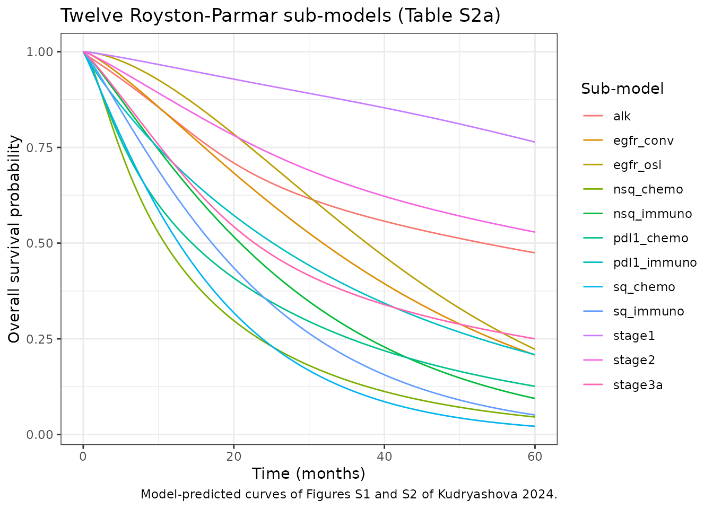
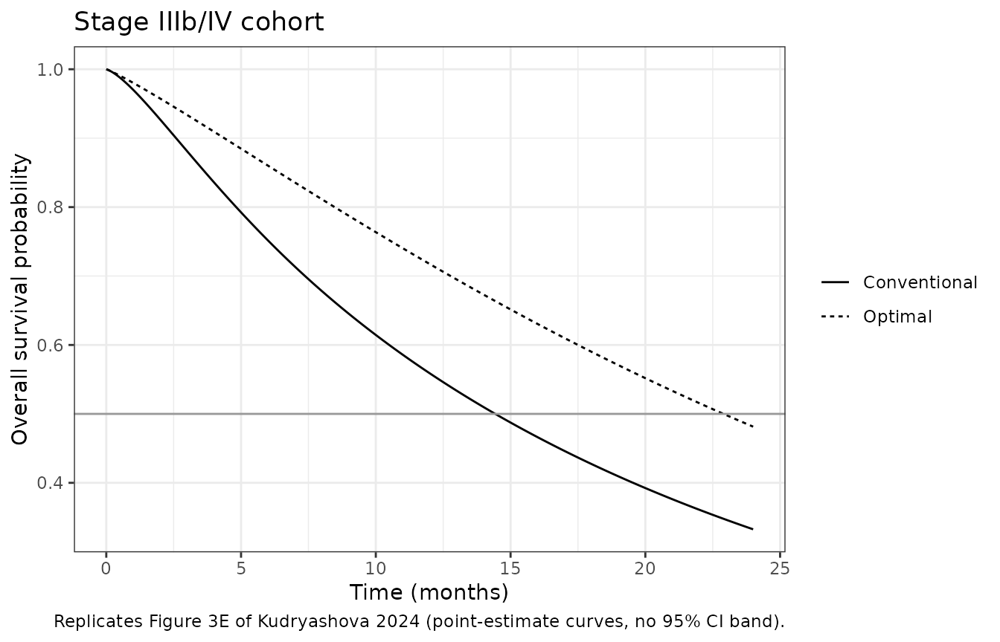
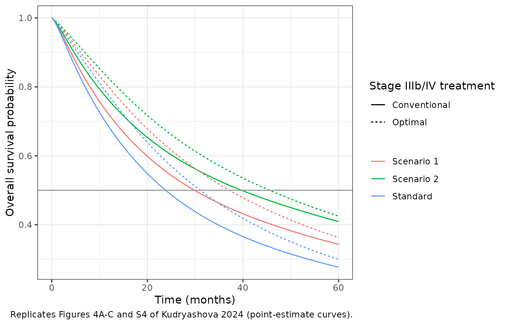
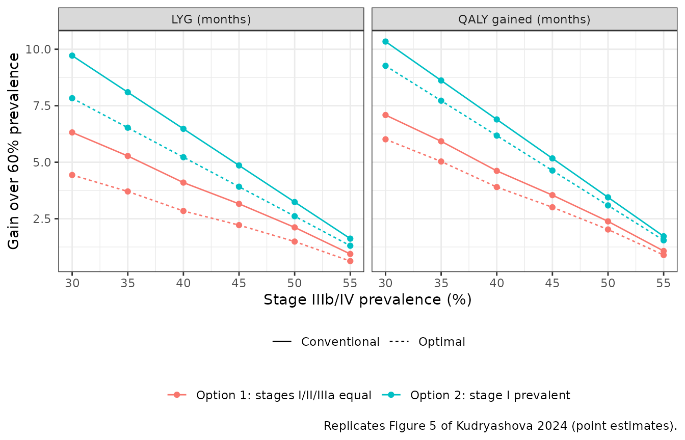

# NSCLC overall survival and disease burden MBMA (Kudryashova 2024)

- Citation: Kudryashova N, Shulgin B, Katuninks N, Kulesh V, Helmlinger
  G, Zhudenkov K, Peskov K. Assessment of NSCLC disease burden: A
  survival model-based meta-analysis study. Comput Struct Biotechnol J.
  2024;24:611-621. <doi:10.1016/j.csbj.2024.09.012>. Equations: main
  text Eqs. 2-11. Spline coefficients and knots: Supplementary Table
  S2a. Stage IIIb/IV sub-group prevalence: Figure 2. Stage distributions
  and utility scores: Table 1.
- Article: [Comput Struct Biotechnol J.
  2024;24:611-621](https://doi.org/10.1016/j.csbj.2024.09.012)

## Model and source

Kudryashova 2024 builds an integrative overall-survival (OS) model for a
mixed non-small cell lung cancer (NSCLC) cohort. They use it to ask how
much a cohort gains from newer stage IIIb/IV therapies compared with
earlier detection of the disease. The authors digitised published
Kaplan-Meier curves and reconstructed individual patient data with the
Guyot algorithm. They then fit one Royston-Parmar flexible parametric
survival model per curve:

``` math
\log H(t) = \gamma_0 + \gamma_1 \log t + \sum_{j=1}^{m} \gamma_{j+1}\, v_j(\log t), \qquad S(t) = \exp(-H(t))
```

``` math
v_j(x) = (x - k_j)^3_+ - \lambda_j (x - k_{min})^3_+ - (1 - \lambda_j)(x - k_{max})^3_+, \qquad \lambda_j = \frac{k_{max} - k_j}{k_{max} - k_{min}}
```

with time in months and knots on the log-month scale (Eqs. 2-6). When
there are no internal knots ($`m = 0`$) the model reduces to a Weibull.
Twelve sub-models result:

- three early-stage curves (I, II, IIIa; surgery with or without
  adjuvant therapy) from the IASLC 8th-edition staging project;
- nine first-line stage IIIb/IV treatment arms from ALEX, FLAURA,
  KEYNOTE-407, KEYNOTE-189 and KEYNOTE-024.

Cohort OS is a prevalence-weighted mixture of the sub-model curves (Eq.
7). It is computed twice, once with the **conventional** stage IIIb/IV
standard of care (crizotinib/alectinib, gefitinib/erlotinib, platinum
chemotherapy) and once with the **optimal** scheme
(crizotinib/alectinib, osimertinib, pembrolizumab plus chemotherapy,
pembrolizumab monotherapy for PD-L1-high tumours). Life-years gained
(LYG) is the difference in area under two cohort survival curves up to a
time horizon $`T`$ (Eqs. 8-10). Quality-adjusted life-years (QALY)
gained weights each stage’s contribution by a stage-specific utility
score (Eq. 11).

The packaged model exposes:

- `sur_<sub-model>`: the twelve sub-model survival curves;
- `sur_stage3b4_conv` / `sur_stage3b4_opt`: the stage IIIb/IV mixtures;
- `sur_conv` / `sur_opt`: the whole-cohort mixtures;
- four ODE accumulators: `auc_sur_conv` and `auc_sur_opt` (area under
  the cohort survival curve, months) and `auc_qaly_conv` and
  `auc_qaly_opt` (area under the utility-weighted curve, months).

The stage distribution (`frac_stage1`, `frac_stage2`, `frac_stage3a`,
`frac_stage3b4`) defaults to the paper’s “Standard” scenario. Change it
through `params` in `rxSolve()`.

## Population

The early-stage curves come from 13,469 patients in the IASLC staging
project (Goldstraw 2016) who had surgery with or without adjuvant
therapy:

- stage I: 8,231 patients (IA1 781, IA2 3,105, IA3 2,417, IB 1,928);
- stage II: 2,038 patients (IIA 585, IIB 1,453);
- stage IIIa: 3,200 patients.

The stage IIIb/IV curves come from 2,339 patients in ten first-line
trial arms (Supplementary Table S6):

- ALEX, ALK-positive: alectinib 152, crizotinib 151, pooled into one
  model;
- FLAURA, EGFR-mutated: osimertinib 279, gefitinib/erlotinib 277;
- KEYNOTE-407, squamous: pembrolizumab plus chemotherapy 278,
  chemotherapy 281;
- KEYNOTE-189, non-squamous: pembrolizumab plus chemotherapy 410,
  chemotherapy 206;
- KEYNOTE-024, PD-L1 tumour proportion score of 50% or more:
  pembrolizumab 154, chemotherapy 151.

Trials enrolling only Asian patients, only elderly patients, patients
with poor performance status, or heavy smokers were excluded to avoid
outcome bias. The authors describe the resulting cohort as
representative of a Caucasian population. Within stage IIIb/IV the
sub-groups are weighted 5% ALK-positive, 15% EGFR-mutated, 25% squamous
without a driver mutation, 45% non-squamous without a driver mutation
and 10% PD-L1-high (the ovals in Figure 2).

``` r

str(mod_meta$population, give.attr = FALSE)
#> List of 11
#>  $ species       : chr "human"
#>  $ n_subjects    : int 15808
#>  $ n_studies     : int 6
#>  $ age_range     : chr "Not reported at the cohort level; summary-level data from one staging-epidemiology source and five randomised trials."
#>  $ weight_range  : chr "Not reported."
#>  $ sex_female_pct: num NA
#>  $ race_ethnicity: chr "Described as representative of a Caucasian population; trials enrolling only Asian patients were excluded (Kudr"| __truncated__
#>  $ disease_state : chr "Non-small cell lung cancer, all TNM stages. Early stages (I, II, IIIa): 13469 patients treated with surgery wit"| __truncated__
#>  $ dose_range    : chr "Not modelled. Each treatment arm is a separate survival sub-model; no dose or exposure enters the model."
#>  $ regions       : chr "Multinational trials; Asian-only, elderly-only, poor-performance-status and heavy-smoker studies were excluded."
#>  $ notes         : chr "Summary-level model-based meta-analysis: individual patient data were reconstructed from digitised Kaplan-Meier"| __truncated__
```

## Source trace

Every `ini()` value carries an in-file comment naming its source. The
table below collects them.

| Equation / parameter | Value | Source location |
|----|----|----|
| Royston-Parmar log cumulative hazard, spline basis | n/a | Eqs. 2-6 (page 613) |
| Mixture over sub-cohorts | n/a | Eq. 7 |
| Area under survival curve, LYG | n/a | Eqs. 8-10 |
| Utility-weighted QALY gained | n/a | Eq. 11 |
| `rpg0_stage1` … `rpg3_stage1`; knots `rpkmin_stage1`, `rpk1_stage1`, `rpk2_stage1`, `rpkmax_stage1` | -6.19, 1.26, 0.24, -0.62; -0.43, 3.24, 3.90, 4.26 | Table S2a, model 1 |
| `rpg0_stage2` … `rpg3_stage2`; knots | -4.89, 1.24, -0.09, 0.21; -1.50, 2.69, 3.52, 4.26 | Table S2a, model 2 |
| `rpg0_stage3a` … `rpg3_stage3a`; knots | -3.94, 1.11, -0.13, 0.23; -1.98, 2.29, 3.17, 4.23 | Table S2a, model 3 |
| `rpg0_sq_immuno`, `rpg1_sq_immuno` | -3.66, 1.16 | Table S2a, model 4 |
| `rpg0_sq_chemo`, `rpg1_sq_chemo` | -3.16, 1.10 | Table S2a, model 5 |
| `rpg0_egfr_conv`, `rpg1_egfr_conv` | -4.83, 1.29 | Table S2a, model 6 |
| `rpg0_egfr_osi`, `rpg1_egfr_osi` | -6.39, 1.66 | Table S2a, model 7 |
| `rpg0_alk` … `rpg3_alk`; knots | -4.24, 0.71, -0.23, 0.39; -2.74, 2.34, 3.08, 3.90 | Table S2a, model 8 |
| `rpg0_nsq_immuno`, `rpg1_nsq_immuno` | -3.89, 1.16 | Table S2a, model 9 |
| `rpg0_nsq_chemo` … `rpg2_nsq_chemo`; knots | -3.43, 1.63, 0.06; -1.21, 2.01, 3.36 | Table S2a, model 10 |
| `rpg0_pdl1_immuno`, `rpg1_pdl1_immuno` | -3.40, 0.94 | Table S2a, model 11 |
| `rpg0_pdl1_chemo` … `rpg2_pdl1_chemo`; knots | -3.29, 1.37, 0.06; -0.84, 2.04, 3.21 | Table S2a, model 12 |
| `frac_alk`, `frac_egfr`, `frac_sq`, `frac_nsq`, `frac_pdl1` | 0.05, 0.15, 0.25, 0.45, 0.10 | Figure 2 (prevalence ovals) |
| `frac_stage1`, `frac_stage2`, `frac_stage3a`, `frac_stage3b4` | 0.15, 0.14, 0.14, 0.57 | Table 1, “Standard” scenario |
| `util_stage1`, `util_stage2`, `util_stage3a`, `util_stage3b4` | 0.87, 0.87, 0.77, 0.57 | Table 1, “Utility Score” row |

## Virtual cohort and simulation

The model is deterministic and works at the level of the cohort, so
there are no virtual subjects. Each row of `params` below is one
stage-distribution scenario from Table 1. The extra “IIIb/IV only” row
sets the whole cohort to stage IIIb/IV, which is how the paper analyses
the advanced sub-cohort.

``` r

scenarios <- tibble::tribble(
  ~id, ~scenario,      ~frac_stage1, ~frac_stage2, ~frac_stage3a, ~frac_stage3b4,
  1L,  "Standard",     0.15,         0.14,         0.14,          0.57,
  2L,  "Scenario 1",   0.29,         0.08,         0.13,          0.50,
  3L,  "Scenario 2",   0.35,         0.15,         0.10,          0.40,
  4L,  "IIIb/IV only", 0.00,         0.00,         0.00,          1.00
)
stopifnot(all(abs(rowSums(scenarios[, 3:6]) - 1) < 1e-12))

grid <- seq(0, 60, by = 0.01)
events <- rxode2::et(grid, id = scenarios$id)
sim <- rxode2::rxSolve(
  mod, events,
  params = as.data.frame(scenarios[, c("id", "frac_stage1", "frac_stage2", "frac_stage3a", "frac_stage3b4")]),
  returnType = "data.frame"
) |>
  left_join(scenarios[, c("id", "scenario")], by = "id")
```

### Identity check against an independent implementation

The function below re-derives every sub-model survival curve directly
from Eqs. 2-6. Its coefficients are transcribed from Table S2a
separately from the model file. Both sides evaluate the same arithmetic,
so the only difference should be floating-point error, and a tight bound
is appropriate. The check fails on a mis-transcribed coefficient or
knot, a knot assigned to the wrong basis function, or a sign error in
$`\lambda_j`$.

``` r

rp_survival <- function(t, gamma, knots) {
  x <- log(pmax(t, 1e-6))
  pos3 <- function(z) ifelse(z > 0, z^3, 0)
  lh <- gamma[1] + gamma[2] * x
  if (length(knots) > 2) {
    kmin <- knots[1]
    kmax <- knots[length(knots)]
    for (j in 2:(length(knots) - 1)) {
      lam <- (kmax - knots[j]) / (kmax - kmin)
      lh <- lh + gamma[j + 1] * (pos3(x - knots[j]) - lam * pos3(x - kmin) - (1 - lam) * pos3(x - kmax))
    }
  }
  exp(-exp(lh))
}

table_s2a <- list(
  stage1      = list(gamma = c(-6.19, 1.26, 0.24, -0.62), knots = c(-0.43, 3.24, 3.90, 4.26)),
  stage2      = list(gamma = c(-4.89, 1.24, -0.09, 0.21), knots = c(-1.50, 2.69, 3.52, 4.26)),
  stage3a     = list(gamma = c(-3.94, 1.11, -0.13, 0.23), knots = c(-1.98, 2.29, 3.17, 4.23)),
  sq_immuno   = list(gamma = c(-3.66, 1.16), knots = c(-1.15, 3.28)),
  sq_chemo    = list(gamma = c(-3.16, 1.10), knots = c(-0.95, 3.38)),
  egfr_conv   = list(gamma = c(-4.83, 1.29), knots = c(-0.80, 3.84)),
  egfr_osi    = list(gamma = c(-6.39, 1.66), knots = c(0.53, 3.87)),
  alk         = list(gamma = c(-4.24, 0.71, -0.23, 0.39), knots = c(-2.74, 2.34, 3.08, 3.90)),
  nsq_immuno  = list(gamma = c(-3.89, 1.16), knots = c(-0.50, 3.29)),
  nsq_chemo   = list(gamma = c(-3.43, 1.63, 0.06), knots = c(-1.21, 2.01, 3.36)),
  pdl1_immuno = list(gamma = c(-3.40, 0.94), knots = c(-3.08, 3.17)),
  pdl1_chemo  = list(gamma = c(-3.29, 1.37, 0.06), knots = c(-0.84, 2.04, 3.21))
)
# Every sub-model lists (internal knots + 2) knots and the same number of
# gammas, which is how Table S2a's knot list is known to include both
# boundary knots.
stopifnot(all(vapply(table_s2a, function(p) length(p$gamma) == length(p$knots), logical(1))))

one <- sim[sim$id == 1L, ]
max_err <- vapply(names(table_s2a), function(nm) {
  max(abs(one[[paste0("sur_", nm)]] - rp_survival(one$time, table_s2a[[nm]]$gamma, table_s2a[[nm]]$knots)))
}, numeric(1))
max_err
#>       stage1       stage2      stage3a    sq_immuno     sq_chemo    egfr_conv 
#> 0.000000e+00 0.000000e+00 1.110223e-16 0.000000e+00 1.110223e-16 0.000000e+00 
#>     egfr_osi          alk   nsq_immuno    nsq_chemo  pdl1_immuno   pdl1_chemo 
#> 0.000000e+00 0.000000e+00 0.000000e+00 0.000000e+00 0.000000e+00 0.000000e+00
stopifnot(max(max_err) < 1e-10)
```

The accumulators are checked against a trapezoidal integral of the same
solve’s survival curves. The two differ only by the integration scheme.

``` r

trap <- function(x, y) sum(diff(x) * (head(y, -1) + tail(y, -1)) / 2)
auc_check <- sim |>
  group_by(scenario) |>
  summarise(
    err_conv = abs(last(auc_sur_conv) - trap(time, sur_conv)),
    err_opt = abs(last(auc_sur_opt) - trap(time, sur_opt)),
    .groups = "drop"
  )
auc_check
#> # A tibble: 4 × 3
#>   scenario         err_conv      err_opt
#>   <chr>               <dbl>        <dbl>
#> 1 IIIb/IV only 0.0000000668 0.0000000917
#> 2 Scenario 1   0.0000000365 0.0000000475
#> 3 Scenario 2   0.0000000293 0.0000000367
#> 4 Standard     0.0000000439 0.0000000570
stopifnot(max(auc_check$err_conv, auc_check$err_opt) < 1e-3)
```

## Sub-model survival curves

Replicates the model-predicted curves of Figure S2 (stage IIIb/IV) and
Figure S1 (early stages).

``` r

sub_long <- one |>
  select(time, starts_with("sur_")) |>
  select(-sur_early, -sur_conv, -sur_opt, -sur_stage3b4_conv, -sur_stage3b4_opt) |>
  pivot_longer(-time, names_to = "sub_model", values_to = "survival") |>
  mutate(sub_model = sub("^sur_", "", sub_model))

ggplot(sub_long, aes(time, survival, colour = sub_model)) +
  geom_line() +
  labs(
    x = "Time (months)", y = "Overall survival probability", colour = "Sub-model",
    title = "Twelve Royston-Parmar sub-models (Table S2a)",
    caption = "Model-predicted curves of Figures S1 and S2 of Kudryashova 2024."
  ) +
  theme_bw()
```



``` r

# Time at which a monotone survival curve first reaches 0.5, by linear
# interpolation between grid points. NA when the curve stays above 0.5.
median_time <- function(time, surv) {
  i <- which(surv <= 0.5)[1]
  if (is.na(i) || i == 1L) {
    return(NA_real_)
  }
  time[i - 1] + (surv[i - 1] - 0.5) / (surv[i - 1] - surv[i]) * (time[i] - time[i - 1])
}
sub_medians <- sub_long |>
  group_by(sub_model) |>
  summarise(`Median OS (months)` = round(median_time(time, survival), 2), .groups = "drop")
knitr::kable(sub_medians, caption = "Median OS of each sub-model. Stage I and II survival stays above 0.5 to 60 months.")
```

| sub_model   | Median OS (months) |
|:------------|-------------------:|
| alk         |              53.12 |
| egfr_conv   |              31.82 |
| egfr_osi    |              37.66 |
| nsq_chemo   |              10.82 |
| nsq_immuno  |              20.85 |
| pdl1_chemo  |              14.44 |
| pdl1_immuno |              25.21 |
| sq_chemo    |              12.67 |
| sq_immuno   |              17.10 |
| stage1      |                 NA |
| stage2      |                 NA |
| stage3a     |              22.77 |

Median OS of each sub-model. Stage I and II survival stays above 0.5 to
60 months. {.table}

## Stage IIIb/IV: conventional vs optimal treatment

Replicates Figure 3E and the stage IIIb/IV rows of Table S3 and Table 1.

``` r

adv <- sim |>
  filter(scenario == "IIIb/IV only", time <= 24) |>
  select(time, Conventional = sur_conv, Optimal = sur_opt) |>
  pivot_longer(-time, names_to = "treatment", values_to = "survival")

ggplot(adv, aes(time, survival, linetype = treatment)) +
  geom_line() +
  geom_hline(yintercept = 0.5, colour = "grey60") +
  labs(
    x = "Time (months)", y = "Overall survival probability", linetype = NULL,
    title = "Stage IIIb/IV cohort",
    caption = "Replicates Figure 3E of Kudryashova 2024 (point-estimate curves, no 95% CI band)."
  ) +
  theme_bw()
```



## Whole cohort: stage distribution scenarios

Replicates Figures 4A-C and S4.

``` r

coh <- sim |>
  filter(scenario != "IIIb/IV only") |>
  select(scenario, time, Conventional = sur_conv, Optimal = sur_opt) |>
  pivot_longer(c(Conventional, Optimal), names_to = "treatment", values_to = "survival")

ggplot(coh, aes(time, survival, linetype = treatment, colour = scenario)) +
  geom_line() +
  geom_hline(yintercept = 0.5, colour = "grey60") +
  labs(
    x = "Time (months)", y = "Overall survival probability", linetype = "Stage IIIb/IV treatment", colour = NULL,
    caption = "Replicates Figures 4A-C and S4 of Kudryashova 2024 (point-estimate curves)."
  ) +
  theme_bw()
```



## Comparison against the published medians (Table S3)

``` r

med_sim <- sim |>
  group_by(scenario) |>
  summarise(
    Conventional = median_time(time, sur_conv),
    Optimal = median_time(time, sur_opt),
    .groups = "drop"
  ) |>
  pivot_longer(-scenario, names_to = "treatment", values_to = "simulated")

med_pub <- tibble::tribble(
  ~scenario,      ~treatment,     ~published,
  "Standard",     "Conventional", 25.56,
  "Scenario 1",   "Conventional", 32.43,
  "Scenario 2",   "Conventional", 43.19,
  "Standard",     "Optimal",      32.41,
  "Scenario 1",   "Optimal",      39.08,
  "Scenario 2",   "Optimal",      48.09,
  "IIIb/IV only", "Conventional", 14.91,
  "IIIb/IV only", "Optimal",      22.96
)

med_cmp <- med_pub |>
  left_join(med_sim, by = c("scenario", "treatment")) |>
  mutate(pct_diff = 100 * (simulated - published) / published)

med_cmp |>
  mutate(simulated = round(simulated, 2), pct_diff = round(pct_diff, 1)) |>
  rename(
    Scenario = scenario, `Stage IIIb/IV treatment` = treatment,
    `Published median (months)` = published, `Simulated median (months)` = simulated,
    `Difference (%)` = pct_diff
  ) |>
  knitr::kable(caption = "Median OS: model point estimates vs Kudryashova 2024 Table S3.")
```

| Scenario | Stage IIIb/IV treatment | Published median (months) | Simulated median (months) | Difference (%) |
|:---|:---|---:|---:|---:|
| Standard | Conventional | 25.56 | 23.84 | -6.7 |
| Scenario 1 | Conventional | 32.43 | 29.86 | -7.9 |
| Scenario 2 | Conventional | 43.19 | 39.71 | -8.1 |
| Standard | Optimal | 32.41 | 31.06 | -4.2 |
| Scenario 1 | Optimal | 39.08 | 37.16 | -4.9 |
| Scenario 2 | Optimal | 48.09 | 45.58 | -5.2 |
| IIIb/IV only | Conventional | 14.91 | 14.43 | -3.2 |
| IIIb/IV only | Optimal | 22.96 | 22.90 | -0.3 |

Median OS: model point estimates vs Kudryashova 2024 Table S3. {.table}

The stage IIIb/IV medians reproduce to within a few percent. The
whole-cohort medians come out 4-8% low. The model is deterministic, so
these numbers do not vary between machines. The assertions bound the gap
that the 2-decimal rounding of the published coefficients can produce
(see “Sensitivity to the published rounding” below). The check still
fails on a mis-transcribed coefficient, knot or prevalence, each of
which moves the medians by much more.

``` r

adv_rows <- med_cmp$scenario == "IIIb/IV only"
stopifnot(
  all(abs(med_cmp$pct_diff[adv_rows]) < 5),
  all(abs(med_cmp$pct_diff[!adv_rows]) < 12)
)
```

## Life-years and QALY gained (Tables 1, S4)

LYG and QALY gained are differences between the accumulators at the time
horizon: 60 months for the whole cohort and 24 months for stage IIIb/IV.

``` r

at_t <- function(scen, tt) sim[sim$scenario == scen & abs(sim$time - tt) < 1e-9, ]
gain <- function(test_scen, test_trt, base_scen, base_trt, tt) {
  a <- at_t(test_scen, tt)
  b <- at_t(base_scen, tt)
  c(
    LYG = a[[paste0("auc_sur_", test_trt)]] - b[[paste0("auc_sur_", base_trt)]],
    QALY = a[[paste0("auc_qaly_", test_trt)]] - b[[paste0("auc_qaly_", base_trt)]]
  )
}

comparisons <- tibble::tribble(
  ~test_scen,     ~test_trt, ~base_scen,     ~base_trt, ~horizon, ~pub_lyg, ~pub_qaly, ~source,
  "Standard",     "opt",     "Standard",     "conv",    60,       3.24,     1.85,      "Table 1",
  "Scenario 1",   "opt",     "Scenario 1",   "conv",    60,       2.84,     1.62,      "Table 1",
  "Scenario 2",   "opt",     "Scenario 2",   "conv",    60,       2.27,     1.30,      "Table 1",
  "Scenario 2",   "opt",     "Standard",     "conv",    60,       8.40,     7.86,      "Table 1",
  "IIIb/IV only", "opt",     "IIIb/IV only", "conv",    24,       2.89,     1.65,      "Table 1",
  "Scenario 1",   "conv",    "Standard",     "conv",    60,       3.04,     3.13,      "Table S4",
  "Scenario 2",   "conv",    "Standard",     "conv",    60,       6.13,     6.57,      "Table S4",
  "Scenario 1",   "opt",     "Standard",     "opt",     60,       2.64,     2.91,      "Table S4",
  "Scenario 2",   "opt",     "Standard",     "opt",     60,       5.16,     6.02,      "Table S4"
)

gains <- comparisons |>
  rowwise() |>
  mutate(
    sim_lyg = gain(test_scen, test_trt, base_scen, base_trt, horizon)[["LYG"]],
    sim_qaly = gain(test_scen, test_trt, base_scen, base_trt, horizon)[["QALY"]]
  ) |>
  ungroup() |>
  mutate(
    pct_lyg = 100 * (sim_lyg - pub_lyg) / pub_lyg,
    pct_qaly = 100 * (sim_qaly - pub_qaly) / pub_qaly
  )

gains |>
  mutate(
    Test = paste(test_scen, test_trt, sep = ": "),
    Baseline = paste(base_scen, base_trt, sep = ": "),
    across(c(sim_lyg, sim_qaly), \(x) round(x, 2)),
    across(c(pct_lyg, pct_qaly), \(x) round(x, 1))
  ) |>
  select(Test, Baseline, horizon, pub_lyg, sim_lyg, pct_lyg, pub_qaly, sim_qaly, pct_qaly, source) |>
  rename(
    `T (months)` = horizon,
    `Published LYG` = pub_lyg, `Simulated LYG` = sim_lyg, `LYG diff (%)` = pct_lyg,
    `Published QALY` = pub_qaly, `Simulated QALY` = sim_qaly, `QALY diff (%)` = pct_qaly,
    Source = source
  ) |>
  knitr::kable(caption = "LYG and QALY gained (months): model vs Kudryashova 2024 Tables 1 and S4.")
```

| Test | Baseline | T (months) | Published LYG | Simulated LYG | LYG diff (%) | Published QALY | Simulated QALY | QALY diff (%) | Source |
|:---|:---|---:|---:|---:|---:|---:|---:|---:|:---|
| Standard: opt | Standard: conv | 60 | 3.24 | 3.58 | 10.4 | 1.85 | 2.04 | 10.3 | Table 1 |
| Scenario 1: opt | Scenario 1: conv | 60 | 2.84 | 3.14 | 10.5 | 1.62 | 1.79 | 10.4 | Table 1 |
| Scenario 2: opt | Scenario 2: conv | 60 | 2.27 | 2.51 | 10.6 | 1.30 | 1.43 | 10.1 | Table 1 |
| Scenario 2: opt | Standard: conv | 60 | 8.40 | 8.87 | 5.6 | 7.86 | 8.15 | 3.7 | Table 1 |
| IIIb/IV only: opt | IIIb/IV only: conv | 24 | 2.89 | 3.07 | 6.1 | 1.65 | 1.75 | 5.9 | Table 1 |
| Scenario 1: conv | Standard: conv | 60 | 3.04 | 3.12 | 2.5 | 3.13 | 3.18 | 1.6 | Table S4 |
| Scenario 2: conv | Standard: conv | 60 | 6.13 | 6.36 | 3.7 | 6.57 | 6.72 | 2.3 | Table S4 |
| Scenario 1: opt | Standard: opt | 60 | 2.64 | 2.68 | 1.4 | 2.91 | 2.93 | 0.7 | Table S4 |
| Scenario 2: opt | Standard: opt | 60 | 5.16 | 5.29 | 2.5 | 6.02 | 6.11 | 1.5 | Table S4 |

LYG and QALY gained (months): model vs Kudryashova 2024 Tables 1 and S4.
{.table style="width:100%;"}

Gains from earlier detection (Table S4 rows) reproduce within about 4%.
Gains from optimal treatment come out 4-11% high. The difference between
the conventional and optimal stage IIIb/IV curves is a small difference
of two large areas, so it is the quantity most exposed to the
coefficients’ rounding. For stage IIIb/IV this is quantified in the next
section.

``` r

stopifnot(
  all(abs(gains$pct_lyg) < 12),
  all(abs(gains$pct_qaly) < 12)
)
# Eq. 11 with a single stage: QALY gained is the stage IIIb/IV utility times LYG.
adv_gain <- gains[gains$test_scen == "IIIb/IV only", ]
stopifnot(abs(adv_gain$sim_qaly - 0.57 * adv_gain$sim_lyg) < 1e-6)
```

## Sensitivity analysis (Table S5, Figure 5)

Table S5 varies the stage IIIb/IV prevalence from 30% to 55% against a
baseline of 60%, under two options. In option 1 stages I, II and IIIa
are shared about equally. In option 2 stages II and IIIa stay at 13% and
stage I absorbs the rest.

``` r

s5 <- tibble::tribble(
  ~row,     ~frac_stage1, ~frac_stage2, ~frac_stage3a, ~frac_stage3b4, ~pub_lyg_conv, ~pub_qaly_conv, ~pub_lyg_opt, ~pub_qaly_opt,
  "SA_Base", 0.14, 0.13, 0.13, 0.60, NA,   NA,    NA,   NA,
  "SA1_1",   0.24, 0.23, 0.23, 0.30, 6.58, 7.33,  4.87, 6.36,
  "SA2_1",   0.22, 0.22, 0.21, 0.35, 5.48, 6.12,  4.06, 5.31,
  "SA3_1",   0.20, 0.20, 0.20, 0.40, 4.28, 4.79,  3.15, 4.14,
  "SA4_1",   0.19, 0.18, 0.18, 0.45, 3.29, 3.67,  2.44, 3.18,
  "SA5_1",   0.17, 0.17, 0.16, 0.50, 2.19, 2.46,  1.62, 2.13,
  "SA6_1",   0.15, 0.15, 0.15, 0.55, 1.00, 1.12,  0.71, 0.96,
  "SA1_2",   0.44, 0.13, 0.13, 0.30, 9.58, 10.28, 7.88, 9.31,
  "SA2_2",   0.39, 0.13, 0.13, 0.35, 7.99, 8.57,  6.56, 7.76,
  "SA3_2",   0.34, 0.13, 0.13, 0.40, 6.39, 6.86,  5.25, 6.21,
  "SA4_2",   0.29, 0.13, 0.13, 0.45, 4.79, 5.14,  3.94, 4.66,
  "SA5_2",   0.24, 0.13, 0.13, 0.50, 3.19, 3.43,  2.63, 3.10,
  "SA6_2",   0.19, 0.13, 0.13, 0.55, 1.60, 1.71,  1.31, 1.55
) |>
  mutate(id = seq_len(n()))
stopifnot(all(abs(s5$frac_stage1 + s5$frac_stage2 + s5$frac_stage3a + s5$frac_stage3b4 - 1) < 1e-12))

s5_sim <- rxode2::rxSolve(
  mod, rxode2::et(c(0, 60), id = s5$id),
  params = as.data.frame(s5[, c("id", "frac_stage1", "frac_stage2", "frac_stage3a", "frac_stage3b4")]),
  returnType = "data.frame"
) |>
  filter(time == 60) |>
  left_join(s5[, c("id", "row")], by = "id")
base60 <- s5_sim[s5_sim$row == "SA_Base", ]

s5_cmp <- s5_sim |>
  filter(row != "SA_Base") |>
  transmute(
    row,
    sim_lyg_conv = auc_sur_conv - base60$auc_sur_conv,
    sim_qaly_conv = auc_qaly_conv - base60$auc_qaly_conv,
    sim_lyg_opt = auc_sur_opt - base60$auc_sur_opt,
    sim_qaly_opt = auc_qaly_opt - base60$auc_qaly_opt
  ) |>
  left_join(s5, by = "row") |>
  mutate(option = ifelse(grepl("_1$", row), "Option 1: stages I/II/IIIa equal", "Option 2: stage I prevalent"))

s5_cmp |>
  transmute(
    Row = row, `IIIb/IV (%)` = 100 * frac_stage3b4,
    `LYG conv: published` = pub_lyg_conv, `LYG conv: simulated` = round(sim_lyg_conv, 2),
    `QALY conv: published` = pub_qaly_conv, `QALY conv: simulated` = round(sim_qaly_conv, 2),
    `LYG opt: published` = pub_lyg_opt, `LYG opt: simulated` = round(sim_lyg_opt, 2),
    `QALY opt: published` = pub_qaly_opt, `QALY opt: simulated` = round(sim_qaly_opt, 2)
  ) |>
  knitr::kable(caption = "Table S5 of Kudryashova 2024: gain over SA_Base (60% stage IIIb/IV), 60-month horizon.")
```

| Row | IIIb/IV (%) | LYG conv: published | LYG conv: simulated | QALY conv: published | QALY conv: simulated | LYG opt: published | LYG opt: simulated | QALY opt: published | QALY opt: simulated |
|:---|---:|---:|---:|---:|---:|---:|---:|---:|---:|
| SA1_1 | 30 | 6.58 | 6.32 | 7.33 | 7.09 | 4.87 | 4.43 | 6.36 | 6.01 |
| SA2_1 | 35 | 5.48 | 5.28 | 6.12 | 5.93 | 4.06 | 3.71 | 5.31 | 5.03 |
| SA3_1 | 40 | 4.28 | 4.10 | 4.79 | 4.62 | 3.15 | 2.84 | 4.14 | 3.90 |
| SA4_1 | 45 | 3.29 | 3.16 | 3.67 | 3.54 | 2.44 | 2.22 | 3.18 | 3.01 |
| SA5_1 | 50 | 2.19 | 2.12 | 2.46 | 2.38 | 1.62 | 1.49 | 2.13 | 2.02 |
| SA6_1 | 55 | 1.00 | 0.94 | 1.12 | 1.07 | 0.71 | 0.63 | 0.96 | 0.89 |
| SA1_2 | 30 | 9.58 | 9.72 | 10.28 | 10.34 | 7.88 | 7.83 | 9.31 | 9.27 |
| SA2_2 | 35 | 7.99 | 8.10 | 8.57 | 8.62 | 6.56 | 6.53 | 7.76 | 7.72 |
| SA3_2 | 40 | 6.39 | 6.48 | 6.86 | 6.89 | 5.25 | 5.22 | 6.21 | 6.18 |
| SA4_2 | 45 | 4.79 | 4.86 | 5.14 | 5.17 | 3.94 | 3.92 | 4.66 | 4.63 |
| SA5_2 | 50 | 3.19 | 3.24 | 3.43 | 3.45 | 2.63 | 2.61 | 3.10 | 3.09 |
| SA6_2 | 55 | 1.60 | 1.62 | 1.71 | 1.72 | 1.31 | 1.31 | 1.55 | 1.54 |

Table S5 of Kudryashova 2024: gain over SA_Base (60% stage IIIb/IV),
60-month horizon. {.table style="width:100%;"}

``` r

s5_pct <- with(s5_cmp, 100 * c(
  (sim_lyg_conv - pub_lyg_conv) / pub_lyg_conv, (sim_qaly_conv - pub_qaly_conv) / pub_qaly_conv,
  (sim_lyg_opt - pub_lyg_opt) / pub_lyg_opt, (sim_qaly_opt - pub_qaly_opt) / pub_qaly_opt
))
summary(s5_pct)
#>    Min. 1st Qu.  Median    Mean 3rd Qu.    Max. 
#> -11.848  -5.011  -1.930  -2.714  -0.129   1.534
# The smallest gains (SA6, 55% vs 60%) are differences of under one month,
# so their relative difference is the largest; bound the centre tightly and
# the envelope loosely.
stopifnot(abs(median(s5_pct)) < 5, max(abs(s5_pct)) < 15)
```

Option 2, which moves prevalence into stage I, reproduces within about
2%. Option 1 also raises the stage II and IIIa shares and comes out
3-12% low, largest for the optimal-treatment gains and the smallest
prevalence change. The stage II and IIIa sub-models carry the smallest
spline coefficients in Table S2a (-0.09 to 0.23). Their printed values
therefore have the largest relative rounding error.

``` r

s5_cmp |>
  select(option, frac_stage3b4, sim_lyg_conv, sim_lyg_opt, sim_qaly_conv, sim_qaly_opt) |>
  pivot_longer(starts_with("sim_"), names_to = "metric", values_to = "gain") |>
  mutate(
    treatment = ifelse(grepl("conv", metric), "Conventional", "Optimal"),
    metric = ifelse(grepl("lyg", metric), "LYG (months)", "QALY gained (months)")
  ) |>
  ggplot(aes(100 * frac_stage3b4, gain, colour = option, linetype = treatment)) +
  geom_line() +
  geom_point() +
  facet_wrap(~metric) +
  labs(
    x = "Stage IIIb/IV prevalence (%)", y = "Gain over 60% prevalence", colour = NULL, linetype = NULL,
    caption = "Replicates Figure 5 of Kudryashova 2024 (point estimates)."
  ) +
  theme_bw() +
  theme(legend.position = "bottom", legend.box = "vertical")
```



## Sensitivity to the published rounding

Table S2a prints every coefficient and knot to two decimal places. The
spline basis contains cubes of log time. At 24 months,
$`(\log t - k_{min})^3`$ is about 125 for a lower boundary knot near
-1.8, so a rounding error of 0.005 on a spline coefficient can move the
log cumulative hazard by up to about 0.6. The chunk below perturbs every
printed value of the nine stage IIIb/IV sub-models uniformly within its
rounding interval ($`\pm 0.005`$). It then records the range of the
stage IIIb/IV conventional median and of the stage IIIb/IV LYG.

``` r

set.seed(20241015)
tt <- seq(0.01, 24, by = 0.02)
w_conv <- c(alk = 0.05, egfr_conv = 0.15, sq_chemo = 0.25, nsq_chemo = 0.45, pdl1_chemo = 0.10)
w_opt <- c(alk = 0.05, egfr_osi = 0.15, sq_immuno = 0.25, nsq_immuno = 0.45, pdl1_immuno = 0.10)
adv_models <- union(names(w_conv), names(w_opt))
jitter_draw <- function(p) {
  list(
    gamma = p$gamma + stats::runif(length(p$gamma), -0.005, 0.005),
    knots = p$knots + stats::runif(length(p$knots), -0.005, 0.005)
  )
}
one_draw <- function() {
  s <- vapply(adv_models, function(nm) {
    p <- jitter_draw(table_s2a[[nm]])
    rp_survival(tt, p$gamma, p$knots)
  }, numeric(length(tt)))
  conv <- drop(s[, names(w_conv)] %*% w_conv)
  opt <- drop(s[, names(w_opt)] %*% w_opt)
  c(median_conv = median_time(tt, conv), lyg = trap(tt, opt - conv))
}
draws <- t(replicate(500, one_draw()))
rounding_range <- apply(draws, 2, range)
rownames(rounding_range) <- c("min", "max")
round(rounding_range, 2)
#>     median_conv  lyg
#> min       13.61 2.70
#> max       15.19 3.41
```

Rounding alone spans the published stage IIIb/IV conventional median
(14.91 months) and LYG (2.89 months). The remaining gaps above are
therefore what the published precision allows, not evidence of a
structural misreading. The check is a deterministic draw from a fixed
seed in base R. It asserts only that the published value lies inside the
rounding envelope, with headroom.

``` r

stopifnot(
  rounding_range["min", "median_conv"] < 14.91, rounding_range["max", "median_conv"] > 14.91,
  rounding_range["min", "lyg"] < 2.89, rounding_range["max", "lyg"] > 2.89
)
```

## Assumptions and deviations

- **Point estimates, not uncertainty draws.** The paper’s 95% CIs come
  from 500 multivariate-normal draws per sub-model from the Table S2b
  covariance matrices. The model carries the Table S2a point estimates,
  which are what the published medians reproduce. The model was also
  evaluated over 500 such draws, and the median of the drawn stage
  IIIb/IV LYG matched the point-estimate LYG rather than the published
  value. So the published central values are not explained by averaging
  over draws. Table S2b is printed to two decimals, with several
  variances shown as 0.00. Three of its matrices (stage IIIa, models 10
  and 12) are printed asymmetrically, e.g. model 10 row $`\gamma_0`$ =
  (0.10, -0.10, -0.01) but column $`\gamma_0`$ = (0.10, -0.07, -0.01).
  The printed matrices therefore cannot reproduce the published CI
  widths and are not encoded.
- **Rounding.** The whole-cohort medians reproduce 4-8% low and the
  optimal-versus-conventional gains 4-11% high. The rounding analysis
  above shows that 2-decimal precision in Table S2a is enough to produce
  gaps of this size. No coefficient was adjusted to close them.
- **Equation typesetting.** Printed Eq. 2 reads
  $`\gamma_0 + \gamma_1 z_1 + \gamma_2 z_1 + \dots + y_{m+1} z_m`$. The
  second term is $`\gamma_2 z_2`$ and the last coefficient is
  $`\gamma_{m+1}`$, as in the standard Royston-Parmar form the paper
  cites. The identity check above confirms that this reading and the
  boundary-inclusive knot list reproduce the published curves.
- **Knot list includes the boundary knots.** Every Table S2a sub-model
  lists exactly as many knots as $`\gamma`$ coefficients, (internal
  knots + 2). The three Weibull sub-models selected by AIC in Table S1
  still list two knots, which can only be the boundaries. Those two
  boundary knots do not enter a Weibull survival function and are
  recorded only as comments in the model file.
- **Sub-model numbering.** Figure 2 and Table S2a number models 4-9
  differently. For example, Figure 2 numbers the ALK model 4 and Table
  S2a numbers it 8. The sub-group and treatment labels agree between the
  two, and the model is keyed on those labels. The trailing comments
  cite the Table S2a numbers.
- **Stage IIIb/IV prevalences** (5/15/25/45/10%) are printed only inside
  the Figure 2 graphic, not in any table or the text layer.
- **ALK sub-cohort.** The paper pools alectinib and crizotinib into one
  sub-model and uses it in both treatment schemes, so ALK-positive
  patients contribute nothing to the optimal-versus-conventional gain.
- **Time at zero.** $`\log t`$ is floored at $`10^{-6}`$ months so the
  model stays finite at $`t = 0`$. All survival curves are 1 to within
  $`10^{-5}`$ at that time.
- **Scope.** The model predicts cohort-level survival curves and areas
  under them. It has no between-subject variability and cannot simulate
  individual event times. Outside each sub-model’s fitted window the
  curves are extrapolations; the upper boundary knots range from 3.17 to
  4.26 on the log-month scale, i.e. 24 to 71 months.
- **No PKNCA.** The model has no drug concentration. Validation uses the
  identity checks and the reproduction of the paper’s medians, LYG and
  QALY gained above.
