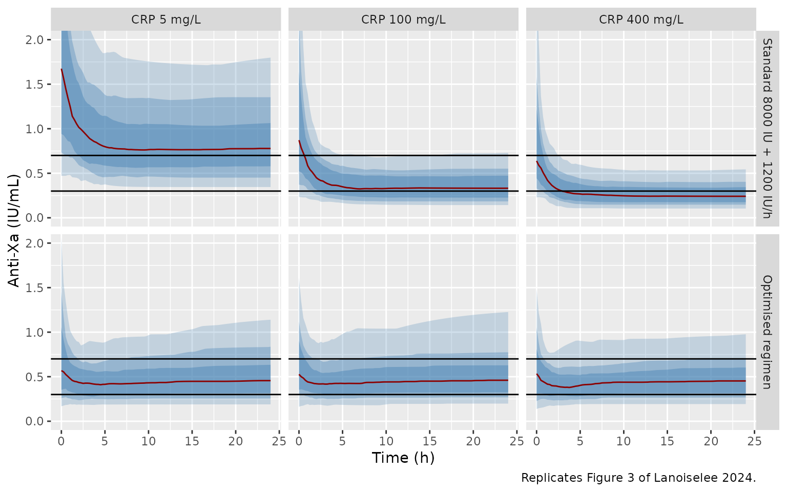
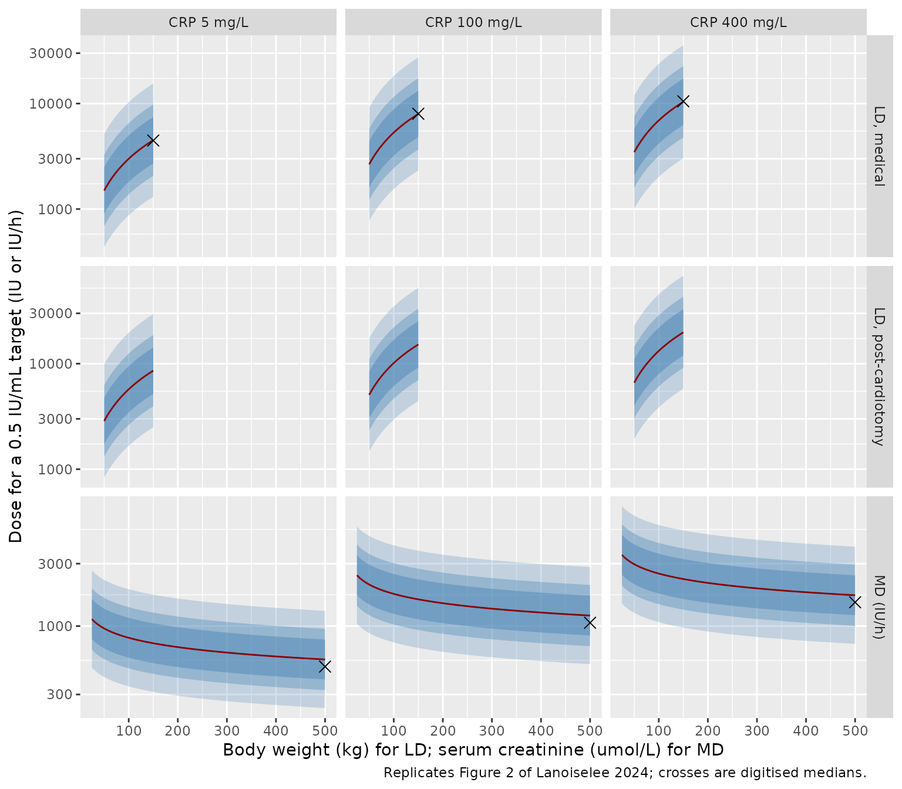
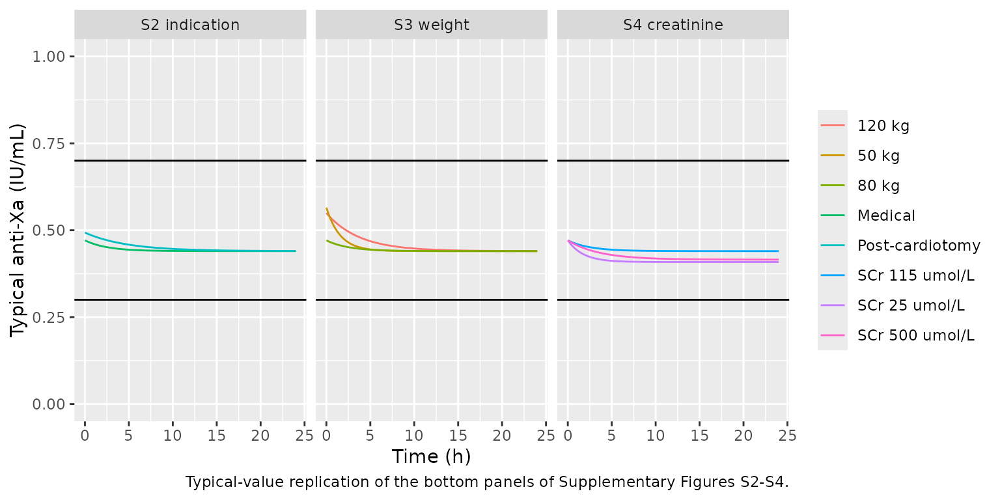

# Unfractionated heparin in VA-ECMO (Lanoiselee 2024)

## Model and source

- Citation: Lanoiselee J, Mourer J, Jungling M, Molliex S, Thellier L,
  Tabareau J, Jeanpierre E, Robin E, Susen S, Tavernier B, Vincentelli
  A, Ollier E, Moussa MD. Heparin Dosing Regimen Optimization in
  Veno-Arterial Extracorporeal Membrane Oxygenation: A Pharmacokinetic
  Analysis. Pharmaceutics. 2024;16(6):770.
  <doi:10.3390/pharmaceutics16060770>. PMC11207075.
- Description: One-compartment population PK model for intravenous
  unfractionated heparin (UFH) in adults on veno-arterial extracorporeal
  membrane oxygenation (VA-ECMO), with exposure measured as plasma
  anti-Xa activity (Lanoiselee 2024). Clearance rises with C-reactive
  protein and falls with serum creatinine; volume scales linearly with
  body weight, rises with C-reactive protein and is 1.91-fold larger
  when ECMO was instituted for post-cardiotomy shock. Combined additive
  and proportional residual error.
- Article: <https://doi.org/10.3390/pharmaceutics16060770> (open access)

## Population

Lanoiselee 2024 retrospectively included 74 consecutive adults supported
by veno-arterial extracorporeal membrane oxygenation (VA-ECMO) in the
cardiac and thoracic intensive care unit of Lille University Hospital
(France) between January 2020 and June 2021. Patients were randomly
split into a development cohort (64 patients, 1487 anti-Xa samples) and
a validation cohort (10 patients, 216 samples). Mean age was 52 (SD 13)
years, 72% were men and the median body weight was 75 (range 54-122) kg
(Table 1). ECMO was instituted for post-cardiotomy low cardiac output
syndrome in 39% of patients and for a medical cardiogenic shock
(myocardial infarction, myocarditis, acute-on-chronic heart disease,
cardiac arrest and others) in the rest. Continuous renal replacement
therapy was used in 46%. Over the ECMO run, median C-reactive protein
(CRP) was 107 (3-547) mg/L and median serum creatinine 114.9
(26.5-530.4) umol/L.

Unfractionated heparin (UFH) was given as a 100 IU/kg loading dose
before cannulation (omitted after cardiac surgery, coagulopathy or prior
heparin) and then as a continuous infusion titrated to an anti-Xa of
0.2-0.7 IU/mL; the mean infusion rate was 11.4 IU/kg/h. Anti-Xa was
measured by a chromogenic assay with quantification limits of 0.1 and
1.8 IU/mL; 25% of the samples were below the lower limit and were
handled as censored data.

The same information is available programmatically via
`readModelDb("Lanoiselee_2024_unfractionatedHeparin")()$population`.

## Source trace

| Equation / parameter | Value | Source location |
|----|----|----|
| One-compartment model, IV bolus and infusion, first-order elimination | n/a | Section 3.2 |
| Combined error `y = F + (a + b F) eps` | n/a | Section 2.6 equation; Table 2 |
| `CL = theta1 (SCr/115)^theta2 (CRP/100)^theta3` | n/a | Table 2; Section 3.3 MD equation |
| `V = theta4 exp(theta5 Indic) (BW/80)^theta6 (CRP/110)^theta7` | n/a | Table 2 (CRP/110); Section 3.3 LD equation (exponential Indic term) |
| `lcl` | log(3.41 L/h) | Table 2 theta1 |
| `e_creat_cl` | -0.237 | Table 2 theta2 |
| `e_crp_cl` | 0.258 | Table 2 theta3 |
| `lvc` | log(8.65 L) | Table 2 theta4 |
| `e_ecmo_ind_postcardiotomy_vc` | 0.647 | Table 2 theta5 |
| `e_wt_vc` | 1 (fixed) | Table 2 theta6 |
| `e_crp_vc` | 0.191 | Table 2 theta7 |
| `etalcl` | 0.52^2 = 0.2704 | Table 2 Omega CL (SD) |
| `etalvc` | 0.75^2 = 0.5625 | Table 2 Omega V (SD) |
| `addSd` | 0.07 IU/mL | Table 2 additive residual variability (SD) |
| `propSd` | 0.41 | Table 2 proportional residual variability (SD) |
| `Cc = central / vc / 1000` | IU/L to IU/mL | Units: doses in IU, volume in L, anti-Xa in IU/mL |

## Typical-value check against the paper’s dose equations

The paper derives its optimised regimen from the typical volume and
clearance (Section 2.8): loading dose `LD = V * T` and maintenance
infusion `MD = CL * T` for a target anti-Xa `T`. For the reference
patient of Figure 3 (medical indication, 80 kg, serum creatinine 115
umol/L) these give the doses below at a 0.5 IU/mL target, next to the
rounded doses the paper used in the bottom panels of Figure 3.

``` r

mod <- readModelDb("Lanoiselee_2024_unfractionatedHeparin")
ini_df <- rxode2::rxode(mod)$iniDf
#> ℹ parameter labels from comments will be replaced by 'label()'
ini_vals <- setNames(ini_df$est, ini_df$name)

typ_cl <- function(creat, crp) {
  exp(ini_vals[["lcl"]]) * (creat / 115)^ini_vals[["e_creat_cl"]] *
    (crp / 100)^ini_vals[["e_crp_cl"]]
}
typ_v <- function(wt, crp, postcard) {
  exp(ini_vals[["lvc"]] + ini_vals[["e_ecmo_ind_postcardiotomy_vc"]] * postcard) *
    (wt / 80)^ini_vals[["e_wt_vc"]] * (crp / 110)^ini_vals[["e_crp_vc"]]
}

target <- 500 # IU/L = 0.5 IU/mL
fig3_doses <- tibble(
  crp = c(5, 100, 400),
  paper_ld = c(2500, 4000, 5500),
  paper_md = c(750, 1500, 2200)
) |>
  mutate(
    model_ld = typ_v(80, crp, 0) * target,
    model_md = typ_cl(115, crp) * target
  )
fig3_doses |>
  select(crp, paper_ld, model_ld, paper_md, model_md) |>
  dplyr::rename(
    "CRP (mg/L)" = crp,
    "Paper LD (IU)" = paper_ld,
    "Model V x 0.5 IU/mL (IU)" = model_ld,
    "Paper MD (IU/h)" = paper_md,
    "Model CL x 0.5 IU/mL (IU/h)" = model_md
  ) |>
  knitr::kable(digits = 0, caption = "Figure 3 (bottom) optimised doses versus the packaged typical values.")
```

| CRP (mg/L) | Paper LD (IU) | Model V x 0.5 IU/mL (IU) | Paper MD (IU/h) | Model CL x 0.5 IU/mL (IU/h) |
|---:|---:|---:|---:|---:|
| 5 | 2500 | 2397 | 750 | 787 |
| 100 | 4000 | 4247 | 1500 | 1705 |
| 400 | 5500 | 5534 | 2200 | 2438 |

Figure 3 (bottom) optimised doses versus the packaged typical values.
{.table}

``` r


# The loading doses are the typical volumes rounded to the nearest 500 IU.
stopifnot(all(abs(fig3_doses$model_ld / fig3_doses$paper_ld - 1) < 0.10))
```

The loading doses agree within 7%. The paper’s maintenance doses sit
5-12% below `CL x 0.5 IU/mL`; the same offset appears in Figure 2 (next
section) and is discussed under Assumptions and deviations.

## Virtual cohort

The paper’s simulations (Figure 3, Supplementary Figures S2-S4) hold the
covariates at fixed values and draw only the between-subject random
effects (5000 draws per scenario in Mlxplore). The replication below
uses 200 draws per scenario and plots the anti-Xa without residual
error, as the paper’s interpatient-variability bands do.

``` r

n_per <- 200
grid <- seq(0, 24, by = 0.25)

make_events <- function(scen) {
  ids <- seq_len(nrow(scen) * n_per)
  subj <- scen[rep(seq_len(nrow(scen)), each = n_per), ] |>
    mutate(id = ids)
  dose_bolus <- subj |>
    transmute(id, time = 0, amt = ld, rate = 0, evid = 1L, cmt = "central")
  dose_inf <- subj |>
    transmute(id, time = 0, amt = md * 24, rate = md, evid = 1L, cmt = "central")
  obs <- subj |>
    select(id) |>
    tidyr::crossing(time = grid) |>
    mutate(amt = NA_real_, rate = NA_real_, evid = 0L, cmt = "central")
  bind_rows(dose_bolus, dose_inf, obs) |>
    left_join(subj |> select(id, scenario, panel, WT, CREAT, CRP, ECMO_IND_POSTCARDIOTOMY),
              by = "id") |>
    arrange(id, time, desc(evid))
}

fig3_scen <- bind_rows(
  tibble(panel = "Standard 8000 IU + 1200 IU/h", crp = c(5, 100, 400),
         ld = 8000, md = 1200),
  tibble(panel = "Optimised regimen", crp = c(5, 100, 400),
         ld = c(2500, 4000, 5500), md = c(750, 1500, 2200))
) |>
  mutate(
    scenario = paste0(panel, ", CRP ", crp, " mg/L"),
    WT = 80, CREAT = 115, CRP = crp, ECMO_IND_POSTCARDIOTOMY = 0
  )
events <- make_events(fig3_scen)
```

## Simulation

``` r

rxode2::rxSetSeed(2024)
sim <- rxode2::rxSolve(mod, events = events, returnType = "data.frame",
                       keep = "scenario") |>
  left_join(fig3_scen |> select(scenario, panel, crp, ld, md), by = "scenario")
#> ℹ parameter labels from comments will be replaced by 'label()'
```

## Replicate published figures

### Figure 3: anti-Xa time course by CRP

Replicates Figure 3 of Lanoiselee 2024: a medical patient of 80 kg with
serum creatinine 115 umol/L, under the standard regimen (top) and the
optimised regimen (bottom). Line: median; bands: 50%, 70% and 90%
interpatient intervals.

``` r

pct <- sim |>
  group_by(panel, CRP = crp, time) |>
  summarise(
    q05 = quantile(Cc, 0.05), q15 = quantile(Cc, 0.15), q25 = quantile(Cc, 0.25),
    q50 = median(Cc),
    q75 = quantile(Cc, 0.75), q85 = quantile(Cc, 0.85), q95 = quantile(Cc, 0.95),
    .groups = "drop"
  ) |>
  mutate(
    CRP = factor(paste("CRP", CRP, "mg/L"), levels = paste("CRP", c(5, 100, 400), "mg/L")),
    panel = factor(panel, levels = c("Standard 8000 IU + 1200 IU/h", "Optimised regimen"))
  )

ggplot(pct, aes(time)) +
  geom_ribbon(aes(ymin = q05, ymax = q95), fill = "steelblue", alpha = 0.25) +
  geom_ribbon(aes(ymin = q15, ymax = q85), fill = "steelblue", alpha = 0.35) +
  geom_ribbon(aes(ymin = q25, ymax = q75), fill = "steelblue", alpha = 0.45) +
  geom_line(aes(y = q50), colour = "darkred") +
  geom_hline(yintercept = c(0.3, 0.7)) +
  facet_grid(panel ~ CRP) +
  coord_cartesian(ylim = c(0, 2)) +
  labs(x = "Time (h)", y = "Anti-Xa (IU/mL)",
       caption = "Replicates Figure 3 of Lanoiselee 2024.")
```



The medians at the start and the end of the 24 h course are compared
below with values digitised by the maintainers from Figure 3 (read to
about 0.05 IU/mL).

``` r

fig3_digit <- tibble(
  panel = rep(c("Standard 8000 IU + 1200 IU/h", "Optimised regimen"), each = 3),
  CRP = rep(c(5, 100, 400), 2),
  paper_t0 = c(1.60, 0.90, 0.70, 0.52, 0.45, 0.48),
  paper_t24 = c(0.72, 0.35, 0.25, 0.45, 0.42, 0.42)
)
fig3_sim <- pct |>
  filter(time %in% c(0, 24)) |>
  mutate(CRP = as.numeric(sub("CRP ([0-9]+) mg/L", "\\1", CRP)),
         panel = as.character(panel)) |>
  select(panel, CRP, time, q50) |>
  pivot_wider(names_from = time, values_from = q50, names_prefix = "sim_t")
fig3_cmp <- inner_join(fig3_digit, fig3_sim, by = c("panel", "CRP")) |>
  mutate(pct_t0 = 100 * (sim_t0 / paper_t0 - 1),
         pct_t24 = 100 * (sim_t24 / paper_t24 - 1))
fig3_cmp |>
  dplyr::rename(
    "Regimen" = panel, "CRP (mg/L)" = CRP,
    "Paper median t = 0" = paper_t0, "Simulated median t = 0" = sim_t0,
    "Paper median t = 24 h" = paper_t24, "Simulated median t = 24 h" = sim_t24,
    "% diff t = 0" = pct_t0, "% diff t = 24 h" = pct_t24
  ) |>
  knitr::kable(digits = 2)
```

| Regimen | CRP (mg/L) | Paper median t = 0 | Paper median t = 24 h | Simulated median t = 0 | Simulated median t = 24 h | % diff t = 0 | % diff t = 24 h |
|:---|---:|---:|---:|---:|---:|---:|---:|
| Standard 8000 IU + 1200 IU/h | 5 | 1.60 | 0.72 | 1.67 | 0.78 | 4.64 | 8.07 |
| Standard 8000 IU + 1200 IU/h | 100 | 0.90 | 0.35 | 0.87 | 0.33 | -3.16 | -5.13 |
| Standard 8000 IU + 1200 IU/h | 400 | 0.70 | 0.25 | 0.64 | 0.24 | -8.77 | -3.41 |
| Optimised regimen | 5 | 0.52 | 0.45 | 0.57 | 0.46 | 9.27 | 1.30 |
| Optimised regimen | 100 | 0.45 | 0.42 | 0.53 | 0.46 | 16.95 | 9.54 |
| Optimised regimen | 400 | 0.48 | 0.42 | 0.53 | 0.45 | 11.12 | 7.71 |

``` r


# Medians of 200 log-normal draws; the paper's 5000-draw medians are read off
# a figure. A wrong clearance, volume or CRP exponent moves these by far more.
all_diff <- c(fig3_cmp$pct_t0, fig3_cmp$pct_t24)
stopifnot(
  abs(median(all_diff)) < 10,
  quantile(abs(all_diff), 0.75) < 20
)
```

### Figure 2: covariate-adjusted loading and maintenance doses

Replicates Figure 2 of Lanoiselee 2024: the dose needed to reach 0.5
IU/mL as a function of body weight (loading dose) or serum creatinine
(maintenance dose). Because the doses are `V x T` and `CL x T` and both
parameters are log-normal, the 50%, 70% and 90% interpatient intervals
follow directly from the IIV standard deviations. Points: medians
digitised by the maintainers from the figure.

``` r

z <- qnorm(c(0.05, 0.15, 0.25, 0.75, 0.85, 0.95))
sd_v <- sqrt(0.5625)
sd_cl <- sqrt(0.2704)
band <- function(med, sd) {
  q <- outer(med, exp(z * sd))
  tibble(med = med, q05 = q[, 1], q15 = q[, 2], q25 = q[, 3],
         q75 = q[, 4], q85 = q[, 5], q95 = q[, 6])
}

ld_curve <- tidyr::crossing(wt = seq(50, 150, by = 2), crp = c(5, 100, 400),
                            postcard = c(0, 1)) |>
  mutate(med = typ_v(wt, crp, postcard) * target)
ld_curve <- bind_cols(ld_curve |> select(-med), band(ld_curve$med, sd_v)) |>
  mutate(row = ifelse(postcard == 1, "LD, post-cardiotomy", "LD, medical"),
         x = wt)
md_curve <- tidyr::crossing(creat = seq(25, 500, by = 5), crp = c(5, 100, 400)) |>
  mutate(med = typ_cl(creat, crp) * target)
md_curve <- bind_cols(md_curve |> select(-med), band(md_curve$med, sd_cl)) |>
  mutate(row = "MD (IU/h)", x = creat)

fig2_digit <- tibble(
  row = c(rep("LD, medical", 3), rep("MD (IU/h)", 3)),
  crp = rep(c(5, 100, 400), 2),
  x = c(150, 150, 150, 500, 500, 500),
  paper = c(4460, 8000, 10500, 490, 1060, 1520)
)

curves <- bind_rows(ld_curve, md_curve) |>
  mutate(crp = factor(paste("CRP", crp, "mg/L"), levels = paste("CRP", c(5, 100, 400), "mg/L")))
ggplot(curves, aes(x)) +
  geom_ribbon(aes(ymin = q05, ymax = q95), fill = "steelblue", alpha = 0.25) +
  geom_ribbon(aes(ymin = q15, ymax = q85), fill = "steelblue", alpha = 0.35) +
  geom_ribbon(aes(ymin = q25, ymax = q75), fill = "steelblue", alpha = 0.45) +
  geom_line(aes(y = med), colour = "darkred") +
  geom_point(data = fig2_digit |>
               mutate(crp = factor(paste("CRP", crp, "mg/L"),
                                   levels = paste("CRP", c(5, 100, 400), "mg/L"))),
             aes(y = paper), shape = 4, size = 3) +
  scale_y_log10() +
  facet_grid(row ~ crp, scales = "free") +
  labs(x = "Body weight (kg) for LD; serum creatinine (umol/L) for MD",
       y = "Dose for a 0.5 IU/mL target (IU or IU/h)",
       caption = "Replicates Figure 2 of Lanoiselee 2024; crosses are digitised medians.")
```



``` r

fig2_cmp <- fig2_digit |>
  mutate(model = ifelse(row == "LD, medical",
                        typ_v(x, crp, 0) * target,
                        typ_cl(x, crp) * target),
         pct_diff = 100 * (model / paper - 1))
fig2_cmp |>
  dplyr::rename("Curve" = row, "CRP (mg/L)" = crp, "BW (kg) or SCr (umol/L)" = x,
                "Paper (digitised)" = paper, "Model" = model, "% diff" = pct_diff) |>
  knitr::kable(digits = 0)
```

| Curve       | CRP (mg/L) | BW (kg) or SCr (umol/L) | Paper (digitised) | Model | % diff |
|:------------|-----------:|------------------------:|------------------:|------:|-------:|
| LD, medical |          5 |                     150 |              4460 |  4493 |      1 |
| LD, medical |        100 |                     150 |              8000 |  7963 |      0 |
| LD, medical |        400 |                     150 |             10500 | 10377 |     -1 |
| MD (IU/h)   |          5 |                     500 |               490 |   556 |     13 |
| MD (IU/h)   |        100 |                     500 |              1060 |  1204 |     14 |
| MD (IU/h)   |        400 |                     500 |              1520 |  1721 |     13 |

``` r


ld_rows <- fig2_cmp$row == "LD, medical"
# Loading doses: same formula on both sides, so only digitisation error.
stopifnot(all(abs(fig2_cmp$pct_diff[ld_rows]) < 8))
# Maintenance doses: the CRP ratios the figure implies match the CRP exponent.
md <- fig2_cmp[!ld_rows, ]
stopifnot(abs((md$paper[3] / md$paper[2]) / (md$model[3] / md$model[2]) - 1) < 0.08)
```

The loading-dose medians match the packaged volume to within
digitisation error, including the post-cardiotomy factor exp(0.647) =
1.91. The maintenance-dose medians share the packaged CRP and creatinine
dependence (the CRP ratios agree) but lie about 13% below
`CL x 0.5 IU/mL` across every panel. See Assumptions and deviations.

### Supplementary Figures S2-S4: indication, weight and creatinine

Typical-value anti-Xa under the optimised regimens of Supplementary
Figures S2-S4 (all scenarios with CRP 100 mg/L). The rounded doses keep
the typical anti-Xa inside 0.3-0.7 IU/mL over 24 h, as the paper
reports.

``` r

supp_scen <- tribble(
  ~panel, ~scenario, ~WT, ~CREAT, ~ECMO_IND_POSTCARDIOTOMY, ~ld, ~md,
  "S2 indication", "Medical", 80, 115, 0, 4000, 1500,
  "S2 indication", "Post-cardiotomy", 80, 115, 1, 8000, 1500,
  "S3 weight", "50 kg", 50, 115, 0, 3000, 1500,
  "S3 weight", "80 kg", 80, 115, 0, 4000, 1500,
  "S3 weight", "120 kg", 120, 115, 0, 7000, 1500,
  "S4 creatinine", "SCr 25 umol/L", 80, 25, 0, 4000, 2000,
  "S4 creatinine", "SCr 115 umol/L", 80, 115, 0, 4000, 1500,
  "S4 creatinine", "SCr 500 umol/L", 80, 500, 0, 4000, 1000
) |>
  mutate(CRP = 100, id = row_number())
supp_ev <- bind_rows(
  supp_scen |> transmute(id, time = 0, amt = ld, rate = 0, evid = 1L, cmt = "central"),
  supp_scen |> transmute(id, time = 0, amt = md * 24, rate = md, evid = 1L, cmt = "central"),
  supp_scen |> select(id) |> tidyr::crossing(time = grid) |>
    mutate(amt = NA_real_, rate = NA_real_, evid = 0L, cmt = "central")
) |>
  left_join(supp_scen |> select(id, panel, scenario, WT, CREAT, CRP, ECMO_IND_POSTCARDIOTOMY),
            by = "id") |>
  arrange(id, time, desc(evid))
# A multi-subject typical-value solve has no omega; rxode2's note about that
# is expected and muffled.
supp_sim <- withCallingHandlers(
  rxode2::rxSolve(rxode2::zeroRe(mod), events = supp_ev,
                  returnType = "data.frame", keep = c("panel", "scenario")),
  warning = function(w) {
    if (grepl("without 'omega'", conditionMessage(w), fixed = TRUE)) {
      invokeRestart("muffleWarning")
    }
  }
)
#> ℹ parameter labels from comments will be replaced by 'label()'
#> ℹ omega/sigma items treated as zero: 'etalcl', 'etalvc'

ggplot(supp_sim, aes(time, Cc, colour = scenario)) +
  geom_line() +
  geom_hline(yintercept = c(0.3, 0.7)) +
  facet_wrap(~panel) +
  coord_cartesian(ylim = c(0, 1)) +
  labs(x = "Time (h)", y = "Typical anti-Xa (IU/mL)", colour = NULL,
       caption = "Typical-value replication of the bottom panels of Supplementary Figures S2-S4.")
```



``` r


stopifnot(all(supp_sim$Cc > 0.3 & supp_sim$Cc < 0.7))
```

## PKNCA validation

Lanoiselee 2024 reports no non-compartmental results, so the NCA check
is one of internal consistency: PKNCA AUC0-24 on the simulated Figure 3
cohort is compared, subject by subject, with the closed-form AUC of a
bolus plus a constant-rate infusion into one compartment.

``` r

sim_nca <- sim |>
  filter(!is.na(Cc)) |>
  select(id, time, Cc, scenario)
dose_df <- events |>
  filter(evid == 1) |>
  group_by(id, scenario) |>
  summarise(time = 0, amt = sum(amt), .groups = "drop")

conc_obj <- PKNCA::PKNCAconc(sim_nca, Cc ~ time | scenario + id)
dose_obj <- PKNCA::PKNCAdose(dose_df, amt ~ time | scenario + id, route = "intravascular")
intervals <- data.frame(start = 0, end = 24, cmax = TRUE, auclast = TRUE, cav = TRUE)
nca_res <- PKNCA::pk.nca(PKNCA::PKNCAdata(conc_obj, dose_obj, intervals = intervals))

nca_res$result |>
  as.data.frame() |>
  filter(PPTESTCD %in% c("cmax", "auclast", "cav")) |>
  group_by(scenario, PPTESTCD) |>
  summarise(median = median(PPORRES), .groups = "drop") |>
  pivot_wider(names_from = PPTESTCD, values_from = median) |>
  dplyr::rename("Scenario" = scenario, "Cmax (IU/mL)" = cmax,
                "AUC0-24 (IU*h/mL)" = auclast, "Cavg 0-24 (IU/mL)" = cav) |>
  knitr::kable(digits = 2, caption = "Median simulated NCA parameters by scenario.")
```

| Scenario | AUC0-24 (IU\*h/mL) | Cavg 0-24 (IU/mL) | Cmax (IU/mL) |
|:---|---:|---:|---:|
| Optimised regimen, CRP 100 mg/L | 10.67 | 0.44 | 0.69 |
| Optimised regimen, CRP 400 mg/L | 10.78 | 0.45 | 0.67 |
| Optimised regimen, CRP 5 mg/L | 10.44 | 0.44 | 0.75 |
| Standard 8000 IU + 1200 IU/h, CRP 100 mg/L | 9.13 | 0.38 | 0.88 |
| Standard 8000 IU + 1200 IU/h, CRP 400 mg/L | 6.72 | 0.28 | 0.66 |
| Standard 8000 IU + 1200 IU/h, CRP 5 mg/L | 19.80 | 0.82 | 1.80 |

Median simulated NCA parameters by scenario. {.table}

``` r


params <- sim |>
  filter(time == 0) |>
  distinct(id, cl, vc, ld, md) |>
  mutate(
    k = cl / vc,
    auc_cf = (ld / cl * (1 - exp(-24 * k)) +
                md / cl * (24 - (1 - exp(-24 * k)) / k)) / 1000
  )
auc_chk <- nca_res$result |>
  as.data.frame() |>
  filter(PPTESTCD == "auclast") |>
  select(id, auc = PPORRES) |>
  inner_join(params, by = "id") |>
  mutate(pct_diff = 100 * (auc / auc_cf - 1))
stopifnot(nrow(auc_chk) == nrow(fig3_scen) * n_per)
# Same drawn parameters on both sides: the gap is trapezoidal error on a
# 0.25 h grid, largest for fast-eliminating subjects right after the bolus.
stopifnot(
  abs(median(auc_chk$pct_diff)) < 1,
  quantile(abs(auc_chk$pct_diff), 0.9) < 3
)
```

## Assumptions and deviations

- **ECMO-indication term on V.** Table 2 prints the volume as
  `theta4^(Indic x theta5) x ...`, which would give a volume of 1 L for
  every medical patient. The Section 3.3 loading-dose equation writes
  the same term as `exp(Indic x theta_Indic)`, and that form reproduces
  Figure 2 (the post-cardiotomy loading doses are 1.91-fold the medical
  ones) and Supplementary Figure S2 (4000 versus 8000 IU). The packaged
  model uses
  `V = 8.65 * exp(0.647 * ECMO_IND_POSTCARDIOTOMY) * (WT/80) * (CRP/110)^0.191`.
- **CRP centring on V.** Table 2 centres CRP on 110 mg/L for V and on
  100 mg/L for CL; the Section 3.3 loading-dose equation and the Section
  3.4 text use 100 mg/L. The maintainers kept the Table 2 value of 110
  mg/L for V (the development-cohort median was 113 mg/L). The
  difference is 1.8% in the typical volume; the digitised loading doses
  of Figure 2 fit 110 marginally better.
- **theta5 has no reported RSE.** It is encoded as an estimated
  parameter, because Table 2 marks only theta6 as fixed.
- **Maintenance doses in Figure 2 and Figure 3.** The paper’s
  maintenance-dose curves are about 13% below `CL x 0.5 IU/mL` computed
  from Table 2, at every CRP and creatinine level, while the
  loading-dose curves match `V x 0.5 IU/mL`. The paper does not explain
  the offset, and the packaged clearance is not changed to absorb it.
  The anti-Xa simulations in Figure 3 agree with the packaged clearance.
- **Time-varying covariates.** CRP and serum creatinine were
  time-varying in the fit (Section 2.6). The simulations here hold them
  constant, as the paper’s own simulations do. Users simulating real
  patients can supply them as time-varying columns in the event table.
- **Censoring.** Anti-Xa values below 0.1 IU/mL and above 1.8 IU/mL were
  handled as censored observations in the fit; the simulated anti-Xa is
  not censored.
- **Covariates tested but not retained** (age, fibrinogen, continuous
  renal replacement therapy) are listed in the model’s
  `covariatesDataExcluded`.
