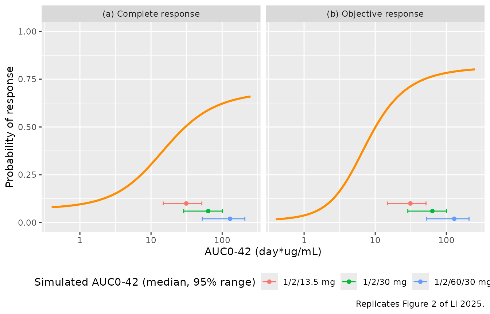
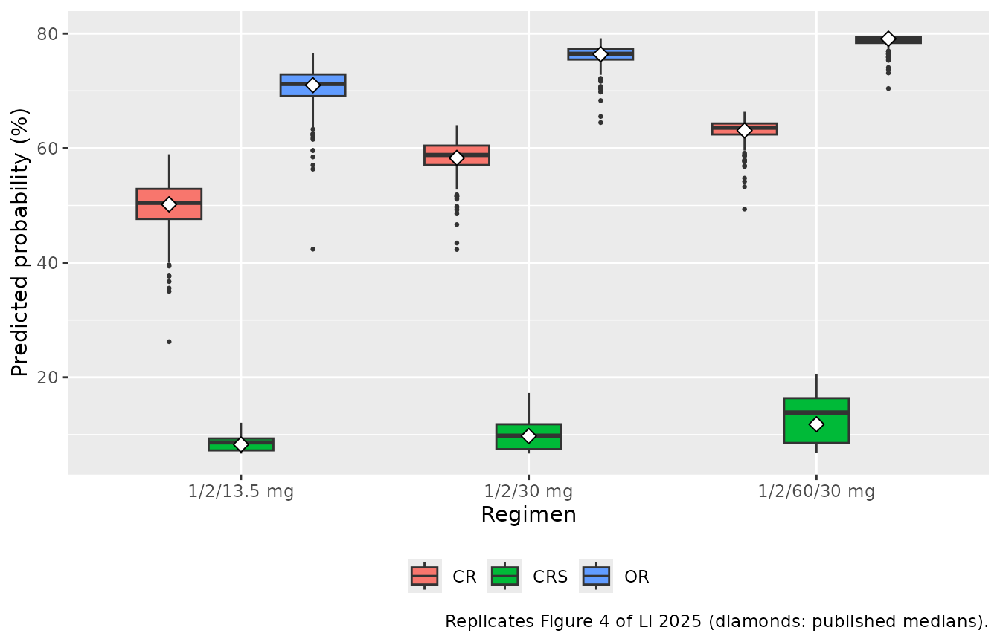
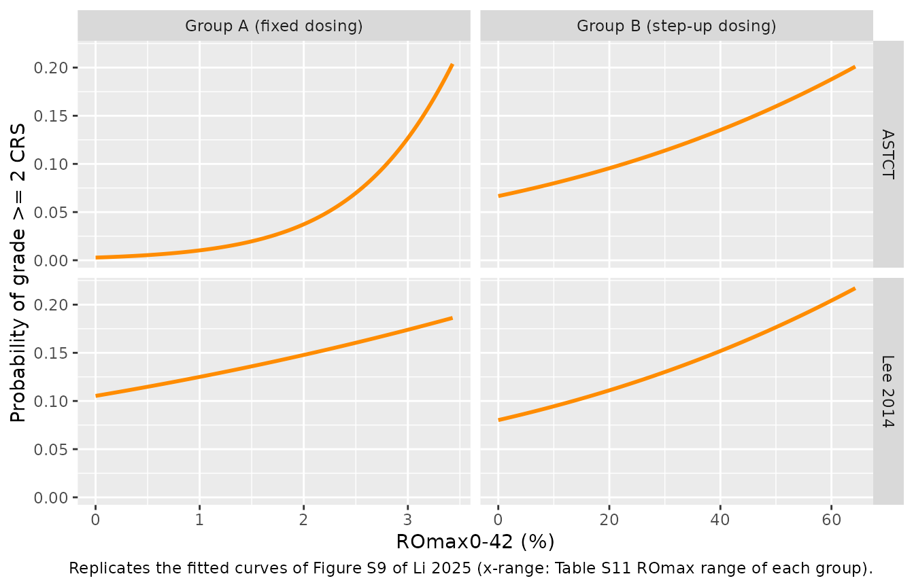
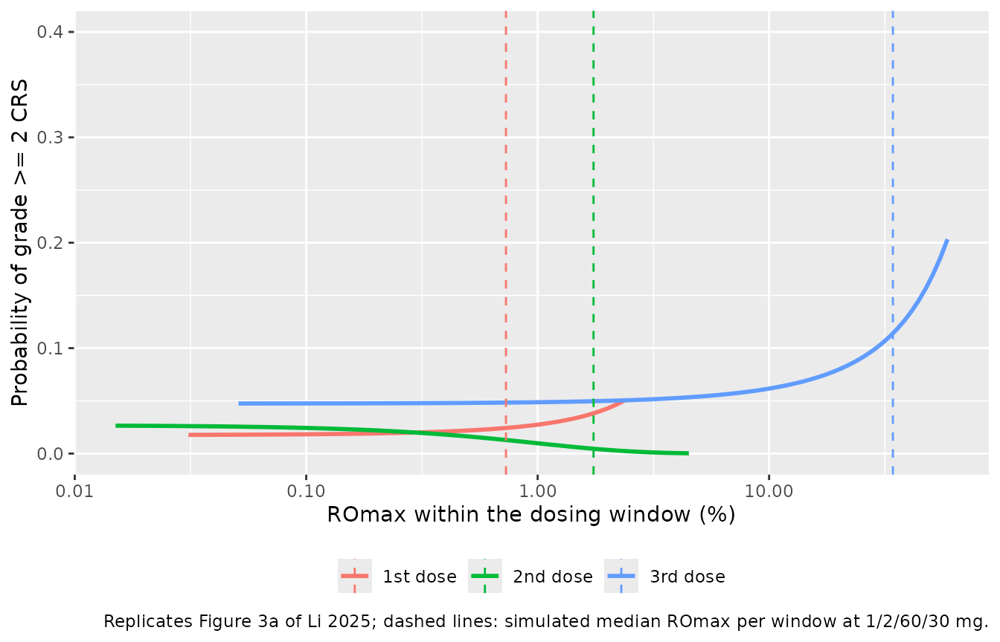
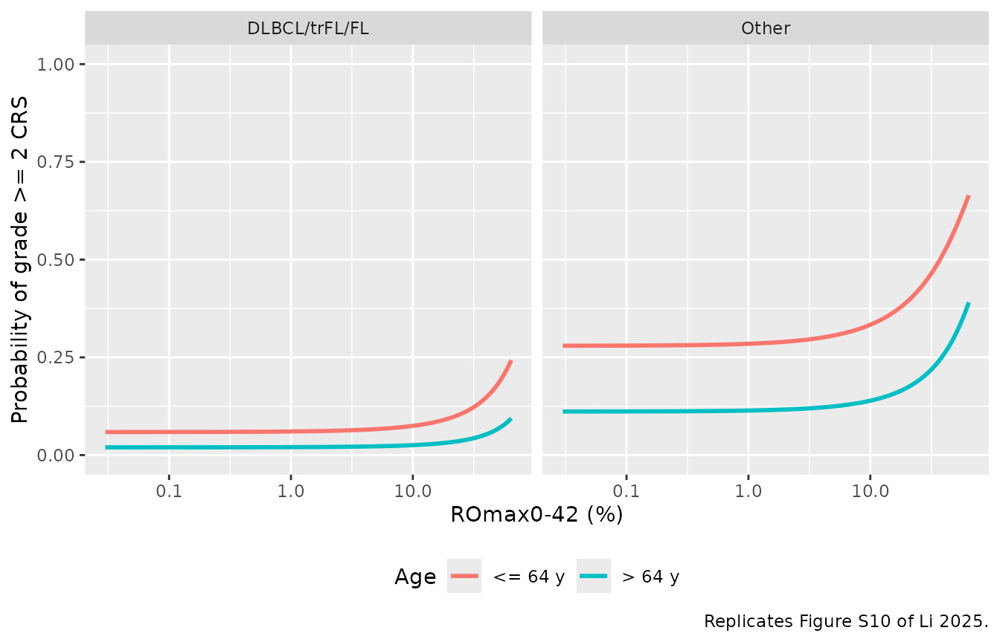
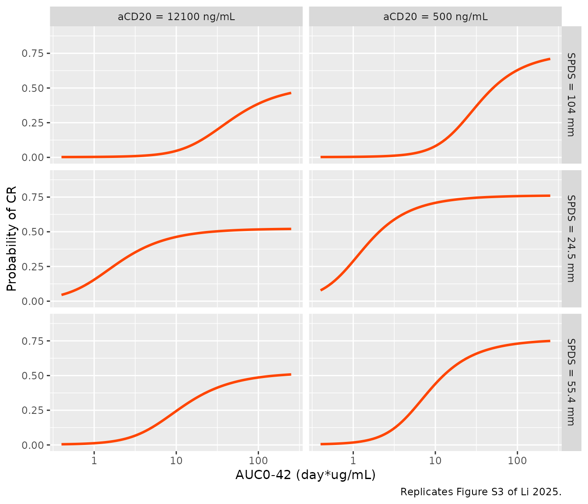

# Mosunetuzumab exposure-response for efficacy and cytokine release syndrome (Li 2025)

## Model and source

- Citation: Li C-C, Bender B, Wilkins J, Li F, Turner DC, Wang B, Deng
  R, Vadhavkar S, Li Z, Kwan A, Huang H, Peng K, Penuel E, Huw L-Y,
  Chanu P, Li C, Yin S, Wei MC. A Novel Step-Up Dosage Regimen for
  Enhancing the Benefit-to-Risk Ratio of Mosunetuzumab in Relapsed or
  Refractory Follicular Lymphoma. Clin Pharmacol Ther.
  2025;117(2):465-474. <doi:10.1002/cpt.3445>.
- Article: <https://doi.org/10.1002/cpt.3445> (open access; Data S1
  holds Tables S1-S12 and Figures S1-S10).

Li 2025 supports the approved intravenous step-up regimen of
mosunetuzumab, a CD20 x CD3 T-cell-engaging bispecific antibody (1 mg on
Cycle 1 Day 1, 2 mg on Day 8, 60 mg on Day 15 and Cycle 2 Day 1, then 30
mg every 3 weeks), with exposure-response (E-R) models from the phase
I/II GO29781 study. PK was not re-estimated: every exposure metric is an
empirical-Bayes prediction from the Bender 2024 population PK model,
packaged as `Bender_2024_mosunetuzumab`.

- **Efficacy** is driven by the two-cycle AUC0-42 (`AUC_MOSUNETUZUMAB`)
  through Emax logistic regressions for investigator-assessed complete
  response (CR) and objective response (OR).
- **Grade \>= 2 cytokine release syndrome (CRS)** is driven by the
  maximum model-predicted CD20 receptor occupancy (`ROMAX`, percent),
  either over days 0-42 or within each Cycle 1 dosing window, through
  linear logistic regressions.

The paper contributes eleven static (no ODE, no time dimension) models:

``` r

models <- tibble::tribble(
  ~model, ~endpoint, ~exposure, ~source,
  "Li_2025_mosunetuzumab_cr", "CR (INV)", "AUC0-42", "Table S7",
  "Li_2025_mosunetuzumab_orr", "OR (INV)", "AUC0-42", "Table S7",
  "Li_2025_mosunetuzumab_cr_cov", "CR (INV), + aCD20, SPD", "AUC0-42", "Figure S3 (back-solved)",
  "Li_2025_mosunetuzumab_crs_groupa_astct", "Grade >= 2 CRS, ASTCT, Group A", "ROmax 0-42", "Table S12",
  "Li_2025_mosunetuzumab_crs_groupa_lee", "Grade >= 2 CRS, Lee 2014, Group A", "ROmax 0-42", "Table S12",
  "Li_2025_mosunetuzumab_crs_groupb_astct", "Grade >= 2 CRS, ASTCT, Group B", "ROmax 0-42", "Table S12",
  "Li_2025_mosunetuzumab_crs_groupb_lee", "Grade >= 2 CRS, Lee 2014, Group B", "ROmax 0-42", "Table S12",
  "Li_2025_mosunetuzumab_crs_cov", "Grade >= 2 CRS, Group B, + age, histology", "ROmax 0-42", "Figure S4 + Figure S10",
  "Li_2025_mosunetuzumab_crs_stepup1", "Grade >= 2 CRS, ASTCT, after dose 1", "ROmax in window", "Figure 3a (digitised)",
  "Li_2025_mosunetuzumab_crs_stepup2", "Grade >= 2 CRS, ASTCT, after dose 2", "ROmax in window", "Figure 3a (digitised)",
  "Li_2025_mosunetuzumab_crs_fulldose1", "Grade >= 2 CRS, ASTCT, after dose 3", "ROmax in window", "Figure 3a (digitised)"
)
stopifnot(all(models$model %in% nlmixr2lib::modeldb$name))
knitr::kable(models, caption = "Models contributed by Li 2025.")
```

| model | endpoint | exposure | source |
|:---|:---|:---|:---|
| Li_2025_mosunetuzumab_cr | CR (INV) | AUC0-42 | Table S7 |
| Li_2025_mosunetuzumab_orr | OR (INV) | AUC0-42 | Table S7 |
| Li_2025_mosunetuzumab_cr_cov | CR (INV), + aCD20, SPD | AUC0-42 | Figure S3 (back-solved) |
| Li_2025_mosunetuzumab_crs_groupa_astct | Grade \>= 2 CRS, ASTCT, Group A | ROmax 0-42 | Table S12 |
| Li_2025_mosunetuzumab_crs_groupa_lee | Grade \>= 2 CRS, Lee 2014, Group A | ROmax 0-42 | Table S12 |
| Li_2025_mosunetuzumab_crs_groupb_astct | Grade \>= 2 CRS, ASTCT, Group B | ROmax 0-42 | Table S12 |
| Li_2025_mosunetuzumab_crs_groupb_lee | Grade \>= 2 CRS, Lee 2014, Group B | ROmax 0-42 | Table S12 |
| Li_2025_mosunetuzumab_crs_cov | Grade \>= 2 CRS, Group B, + age, histology | ROmax 0-42 | Figure S4 + Figure S10 |
| Li_2025_mosunetuzumab_crs_stepup1 | Grade \>= 2 CRS, ASTCT, after dose 1 | ROmax in window | Figure 3a (digitised) |
| Li_2025_mosunetuzumab_crs_stepup2 | Grade \>= 2 CRS, ASTCT, after dose 2 | ROmax in window | Figure 3a (digitised) |
| Li_2025_mosunetuzumab_crs_fulldose1 | Grade \>= 2 CRS, ASTCT, after dose 3 | ROmax in window | Figure 3a (digitised) |

Models contributed by Li 2025. {.table}

## Population

- **Efficacy** (Table S10): 159 adults with relapsed/refractory
  follicular lymphoma (FL) after \>= 2 prior systemic therapies; median
  age 60 (27-90) years, median weight 80.4 kg, 38.4% female, 76.1% White
  and 15.1% Asian. Seven patients received fixed dosing (Group A,
  0.2-2.8 mg q3w) and 152 a Cycle 1 step-up regimen (Group B; 90 in the
  pivotal B11 cohort at 1/2/60/30 mg). Median sqrt(SPD) 55.4 mm.
- **Safety** (Table S11): 439 adults with relapsed/refractory B-cell
  non-Hodgkin lymphoma (NHL; DLBCL 35.8%, FL 37.1%, transformed FL
  13.0%, MCL 8.9%, Richter’s syndrome 3.2%); median age 63 (19-96)
  years, 35.3% female. 418 were ROmax-evaluable (31 in Group A, 387 in
  Group B). Median ROmax0-42 0.81% in Group A, 7.5% in cohorts B1-B10
  and 36% in B11.

## Source trace

| Model | Element | Value | Source |
|----|----|----|----|
| all | Emax logistic `logit(p) = beta0 + Emax*AUC/(E50 + AUC)` | – | Methods, first E-R equation |
| all CRS | Linear logistic `logit(p) = beta0 + beta*ROmax + ...` | – | Methods, second E-R equation |
| `_cr` | `logite0`, `emax`, `lec50` | -2.58, 3.36, log(9.18) | Table S7, CR row |
| `_orr` | `logite0`, `emax`, `lec50` | -4.76, 6.23, log(3.12) | Table S7, OR row |
| `_cr_cov` | `logite0` | -6.23 | back-solved from Figure S3 curves |
| `_cr_cov` | `emax`, `e_acd20_emax` | 7.394, -0.3363 | back-solved from Figure S3 ‘Max CR’ 76.2% / 52.3% |
| `_cr_cov` | `lec50`, `e_tumsz_e50`, `e_acd20_e50` | log(2.346), 2.207, 0.0061 | back-solved from Figure S3 E90 annotations |
| `_crs_groupa_astct` | `logite0`, `e_romax_logit` | -5.89, 1.32 | Table S12, Group A, ASTCT |
| `_crs_groupa_lee` | `logite0`, `e_romax_logit` | -2.14, 0.194 | Table S12, Group A, Lee |
| `_crs_groupb_astct` | `logite0`, `e_romax_logit` | -2.64, 0.0196 | Table S12, Group B, ASTCT |
| `_crs_groupb_lee` | `logite0`, `e_romax_logit` | -2.44, 0.0180 | Table S12, Group B, Lee |
| `_crs_cov` | `e_romax_logit` | log(1.289)/10 | Figure S4, ‘ROmax (day 42, per 10%)’ |
| `_crs_cov` | `e_age_gt64_logit` | log(0.323) | Figure S4, ‘Baseline age (\>64 y)’ |
| `_crs_cov` | `e_tumtp_other_nhl_logit` | log(6.193) | Figure S4, ‘Histology: other’ |
| `_crs_cov` | `logite0` | -2.77 | digitised from the Figure S10 plateaus |
| `_crs_stepup1` | `logite0`, `e_romax_logit` | -4.03, 0.461 | digitised from Figure 3a, 1st dose |
| `_crs_stepup2` | `logite0`, `e_romax_logit` | -3.59, -1.03 | digitised from Figure 3a, 2nd dose |
| `_crs_fulldose1` | `logite0`, `e_romax_logit` | -3.00, 0.0277 | digitised from Figure 3a, 3rd dose |

Each model also carries a placeholder `addSd_<output> = fixed(0.001)`
because rxode2 needs an observation declaration; the source likelihood
is Bernoulli.

``` r

# The Li 2025 models are purely algebraic: no ODE, no dose, no time
# dimension. A covariate grid is swept along a dummy time axis for one
# subject, and the probability output is read back row by row.
solve_static <- function(model_name, covs) {
  n <- max(vapply(covs, length, integer(1)))
  ev <- data.frame(id = 1L, time = seq_len(n), amt = 0, evid = 0L)
  for (nm in names(covs)) ev[[nm]] <- rep_len(covs[[nm]], n)
  s <- as.data.frame(rxode2::rxSolve(
    # The models carry no etas, so only the placeholder residual is zeroed.
    rxode2::zeroRe(rxode2::rxode(readModelDb(model_name)), which = "sigma"),
    events = ev, returnType = "data.frame"
  ))
  stopifnot(nrow(s) == n)
  s
}
```

## Virtual cohort and exposure metrics

The exposure metrics are re-derived here from
`Bender_2024_mosunetuzumab`, whose `auc` state read at day 42 is AUC0-42
and whose `RO` output is the competitive CD20 receptor occupancy (%).
Three regimens are simulated, as in Li 2025 Figure 4: the approved
1/2/60/30 mg, the 1/2/13.5 mg B7 expansion regimen, and a hypothetical
1/2/30 mg regimen without the 60 mg loading doses. Over days 0-42 the
doses are Day 1, 8, 15 and Cycle 2 Day 1 (t = 0, 7, 14, 21 days). The
covariate distributions follow the Bender 2024 safety population, as in
the `Bender_2024_mosunetuzumab` vignette.

``` r

# set.seed() seeds R's RNG, used by the covariate draws. It does NOT seed
# rxode2's simulation RNG, whose streams are partitioned per solver thread, so
# the cohort differs between machines with different thread counts. Every
# cohort-based assertion below is on a median, with headroom.
set.seed(20250117)
rxode2::rxSetSeed(20250117)

n_per_arm <- 200L
regimens <- list(
  "1/2/60/30 mg" = c(1, 2, 60, 60),
  "1/2/30 mg" = c(1, 2, 30, 30),
  "1/2/13.5 mg" = c(1, 2, 13.5, 13.5)
)
dose_times <- c(0, 7, 14, 21)

make_covariates <- function(n, id_offset) {
  d <- tibble::tibble(
    id = id_offset + seq_len(n),
    WT = pmin(pmax(stats::rlnorm(n, log(78), 0.22), 37.1), 163),
    ALB = pmin(pmax(stats::rnorm(n, 39, 5.5), 19), 50),
    SEXF = stats::rbinom(n, 1L, 0.353),
    TUMSZ = pmin(pmax(stats::rlnorm(n, log(2970), 0.94), 96), 70900),
    # 44.4% carry detectable rituximab, the rest sit at the 0.5 ug/mL LOQ;
    # 8.0% carry detectable obinutuzumab (Bender 2024 Table 1).
    CP_RITUXIMAB_UGML = ifelse(stats::rbinom(n, 1L, 0.444) == 1L,
                               pmin(stats::rlnorm(n, log(10), 1.1), 151), 0.5),
    CP_OBINUTUZUMAB_UGML = ifelse(stats::rbinom(n, 1L, 0.080) == 1L,
                                  pmin(stats::rlnorm(n, log(10), 1.3), 305), 0)
  )
  d$CP_ACD20_UGML <- pmax(d$CP_RITUXIMAB_UGML, d$CP_OBINUTUZUMAB_UGML)
  d
}

# RO% peaks at the instant of each IV bolus, so the grid includes a point
# just after every dose; ROmax would otherwise be a sampling artefact. An
# observation at exactly a later dose time is recorded after that dose, so
# those times are replaced by points just before and just after the dose;
# otherwise a trapezoidal AUC would ramp linearly up to the post-dose value.
obs_times <- sort(unique(c(
  setdiff(seq(0, 42, by = 0.25), dose_times[-1]),
  dose_times[-1] - 1e-6,
  dose_times + 1e-6
)))

events <- dplyr::bind_rows(lapply(seq_along(regimens), function(i) {
  cov <- make_covariates(n_per_arm, id_offset = (i - 1L) * n_per_arm)
  rxode2::et(amt = regimens[[i]], time = dose_times, cmt = "central") |>
    rxode2::et(obs_times, cmt = "central") |>
    as.data.frame() |>
    dplyr::select(-dplyr::any_of("id")) |>
    tidyr::crossing(cov) |>
    dplyr::mutate(treatment = names(regimens)[i])
})) |>
  dplyr::arrange(id, time, dplyr::desc(evid))
stopifnot(dplyr::n_distinct(events$id) == 3L * n_per_arm)

sim_pk <- rxode2::rxSolve(
  readModelDb("Bender_2024_mosunetuzumab"),
  events,
  keep = c("treatment", "TUMSZ", "CP_ACD20_UGML"),
  returnType = "data.frame"
)
#> ℹ parameter labels from comments will be replaced by 'label()'
```

``` r

exposure <- sim_pk |>
  dplyr::group_by(id, treatment, TUMSZ, CP_ACD20_UGML) |>
  dplyr::summarise(
    AUC_MOSUNETUZUMAB = auc[which.min(abs(time - 42))],
    ROMAX = max(RO[time <= 42]),
    ROMAX_dose1 = max(RO[time < 7]),
    ROMAX_dose2 = max(RO[time >= 7 & time < 14]),
    ROMAX_dose3 = max(RO[time >= 14 & time < 21]),
    .groups = "drop"
  )

exposure_summary <- exposure |>
  dplyr::group_by(treatment) |>
  dplyr::summarise(
    dplyr::across(c(AUC_MOSUNETUZUMAB, ROMAX, ROMAX_dose1, ROMAX_dose2, ROMAX_dose3), median),
    .groups = "drop"
  )
exposure_summary |>
  dplyr::rename(
    Regimen = treatment, `AUC0-42 (day*ug/mL)` = AUC_MOSUNETUZUMAB,
    `ROmax 0-42 (%)` = ROMAX, `ROmax dose 1 (%)` = ROMAX_dose1,
    `ROmax dose 2 (%)` = ROMAX_dose2, `ROmax dose 3 (%)` = ROMAX_dose3
  ) |>
  knitr::kable(digits = 2, caption = "Median simulated exposure metrics by regimen.")
```

| Regimen | AUC0-42 (day\*ug/mL) | ROmax 0-42 (%) | ROmax dose 1 (%) | ROmax dose 2 (%) | ROmax dose 3 (%) |
|:---|---:|---:|---:|---:|---:|
| 1/2/13.5 mg | 31.32 | 14.37 | 0.76 | 1.83 | 11.54 |
| 1/2/30 mg | 63.65 | 21.47 | 0.59 | 1.35 | 17.33 |
| 1/2/60/30 mg | 129.32 | 41.45 | 0.73 | 1.74 | 34.26 |

Median simulated exposure metrics by regimen. {.table}

``` r


b11 <- exposure_summary[exposure_summary$treatment == "1/2/60/30 mg", ]
stopifnot(
  # Li 2025 Table S10: median AUC0-42 145 day*ug/mL in cohort B11 (FL).
  abs(b11$AUC_MOSUNETUZUMAB / 145 - 1) < 0.25,
  # Li 2025 Table S11: median ROmax0-42 36% in cohort B11 (NHL).
  abs(b11$ROMAX / 36 - 1) < 0.30
)
```

The simulated B11 medians are close to the observed medians of Tables
S10 and S11. The per-window maxima reproduce the x-ranges of Figure 3:
below about 2.5% after the first two step-up doses and up to about 60%
after the third.

## Efficacy: CR and OR (Figure 2, Table S7)

``` r

auc_grid <- exp(seq(log(0.4), log(251), length.out = 200))
cr_curve <- solve_static("Li_2025_mosunetuzumab_cr", list(AUC_MOSUNETUZUMAB = auc_grid))
orr_curve <- solve_static("Li_2025_mosunetuzumab_orr", list(AUC_MOSUNETUZUMAB = auc_grid))
eff_curves <- dplyr::bind_rows(
  data.frame(auc = auc_grid, p = cr_curve$prob_cr_investigator, endpoint = "(a) Complete response"),
  data.frame(auc = auc_grid, p = orr_curve$prob_orr_investigator, endpoint = "(b) Objective response")
)
auc_ranges <- exposure |>
  dplyr::group_by(treatment) |>
  dplyr::summarise(lo = quantile(AUC_MOSUNETUZUMAB, 0.025), med = median(AUC_MOSUNETUZUMAB),
                   hi = quantile(AUC_MOSUNETUZUMAB, 0.975), .groups = "drop") |>
  dplyr::mutate(y = c(0.02, 0.06, 0.10)[match(treatment, names(regimens))])

ggplot(eff_curves, aes(auc, p)) +
  geom_line(colour = "darkorange", linewidth = 1) +
  geom_errorbar(data = tidyr::crossing(auc_ranges, endpoint = unique(eff_curves$endpoint)),
                aes(y = y, xmin = lo, xmax = hi, colour = treatment), width = 0.02,
                orientation = "y", inherit.aes = FALSE) +
  geom_point(data = tidyr::crossing(auc_ranges, endpoint = unique(eff_curves$endpoint)),
             aes(x = med, y = y, colour = treatment), inherit.aes = FALSE) +
  facet_wrap(~endpoint) +
  scale_x_log10() +
  coord_cartesian(ylim = c(0, 1)) +
  labs(x = "AUC0-42 (day*ug/mL)", y = "Probability of response", colour = "Simulated AUC0-42 (median, 95% range)",
       caption = "Replicates Figure 2 of Li 2025.") +
  theme(legend.position = "bottom")
```



Table S7 derives the maximal response as `expit(beta0 + Emax)`, and the
Results quote the E90 (the AUC0-42 giving 90% of that maximal
probability). Both follow from the packaged parameters exactly:

``` r

e90 <- function(b0, emax, e50) {
  pmax_ <- plogis(b0 + emax)
  frac <- (qlogis(0.9 * pmax_) - b0) / emax
  e50 * frac / (1 - frac)
}
ini_val <- function(model_name, par) {
  df <- rxode2::rxode(readModelDb(model_name))$iniDf
  df$est[df$name == par]
}
eff_check <- tibble::tibble(
  endpoint = c("CR", "OR"),
  model = c("Li_2025_mosunetuzumab_cr", "Li_2025_mosunetuzumab_orr"),
  published_max = c(0.686, 0.814),
  published_e90 = c(92.7, 38.4)
) |>
  dplyr::rowwise() |>
  dplyr::mutate(
    b0 = ini_val(model, "logite0"), emax = ini_val(model, "emax"), e50 = exp(ini_val(model, "lec50")),
    model_max = plogis(b0 + emax),
    model_e90 = e90(b0, emax, e50)
  ) |>
  dplyr::ungroup()
eff_check |>
  dplyr::select(endpoint, published_max, model_max, published_e90, model_e90) |>
  dplyr::rename(Endpoint = endpoint, `Max response (Table S7)` = published_max,
                `Max response (model)` = model_max, `E90 (Results)` = published_e90,
                `E90 (model)` = model_e90) |>
  knitr::kable(digits = 3, caption = "Maximal response and E90 versus Li 2025.")
```

| Endpoint | Max response (Table S7) | Max response (model) | E90 (Results) | E90 (model) |
|:---|---:|---:|---:|---:|
| CR | 0.686 | 0.686 | 92.7 | 92.722 |
| OR | 0.814 | 0.813 | 38.4 | 38.549 |

Maximal response and E90 versus Li 2025. {.table}

``` r


stopifnot(
  # Deterministic: the bound is the rounding of the published values.
  all(abs(eff_check$model_max - eff_check$published_max) < 0.001),
  all(abs(eff_check$model_e90 / eff_check$published_e90 - 1) < 0.02)
)
```

Both maximal responses and both E90 values are reproduced to within the
rounding of the three printed coefficients (OR E90 38.5 versus 38.4).

## Integrated benefit-risk by regimen (Figure 4)

Figure 4 overlays the base CR and OR models with the Group B ASTCT CRS
model (the base models, without covariates) over simulated PK profiles
at each regimen.

``` r

pred <- exposure |>
  dplyr::mutate(
    CR = solve_static("Li_2025_mosunetuzumab_cr", list(AUC_MOSUNETUZUMAB = AUC_MOSUNETUZUMAB))$prob_cr_investigator,
    OR = solve_static("Li_2025_mosunetuzumab_orr", list(AUC_MOSUNETUZUMAB = AUC_MOSUNETUZUMAB))$prob_orr_investigator,
    CRS = solve_static("Li_2025_mosunetuzumab_crs_groupb_astct", list(ROMAX = ROMAX))$prob_crs_grade2
  )

fig4 <- pred |>
  tidyr::pivot_longer(c(CR, OR, CRS), names_to = "endpoint", values_to = "p") |>
  dplyr::group_by(treatment, endpoint) |>
  dplyr::summarise(simulated = 100 * median(p), .groups = "drop") |>
  dplyr::left_join(
    tibble::tribble(
      ~treatment, ~endpoint, ~published,
      "1/2/60/30 mg", "CR", 63.1, "1/2/60/30 mg", "OR", 79.1, "1/2/60/30 mg", "CRS", 11.8,
      "1/2/30 mg", "CR", 58.3, "1/2/30 mg", "OR", 76.4, "1/2/30 mg", "CRS", 9.75,
      "1/2/13.5 mg", "CR", 50.2, "1/2/13.5 mg", "OR", 71.0, "1/2/13.5 mg", "CRS", 8.27
    ),
    by = c("treatment", "endpoint")
  ) |>
  dplyr::mutate(difference = simulated - published)

fig4 |>
  dplyr::rename(Regimen = treatment, Endpoint = endpoint, `Simulated median (%)` = simulated,
                `Li 2025 Figure 4 median (%)` = published, `Difference (points)` = difference) |>
  knitr::kable(digits = 1, caption = "Median predicted probability by regimen versus Li 2025 Figure 4.")
```

| Regimen | Endpoint | Simulated median (%) | Li 2025 Figure 4 median (%) | Difference (points) |
|:---|:---|---:|---:|---:|
| 1/2/13.5 mg | CR | 50.5 | 50.2 | 0.3 |
| 1/2/13.5 mg | CRS | 8.6 | 8.3 | 0.4 |
| 1/2/13.5 mg | OR | 71.2 | 71.0 | 0.2 |
| 1/2/30 mg | CR | 58.8 | 58.3 | 0.5 |
| 1/2/30 mg | CRS | 9.8 | 9.8 | 0.1 |
| 1/2/30 mg | OR | 76.5 | 76.4 | 0.1 |
| 1/2/60/30 mg | CR | 63.6 | 63.1 | 0.5 |
| 1/2/60/30 mg | CRS | 13.9 | 11.8 | 2.1 |
| 1/2/60/30 mg | OR | 79.0 | 79.1 | -0.1 |

Median predicted probability by regimen versus Li 2025 Figure 4.
{.table}

``` r


ggplot(pred |> tidyr::pivot_longer(c(CR, OR, CRS), names_to = "endpoint", values_to = "p"),
       aes(factor(treatment, levels = rev(names(regimens))), 100 * p, fill = endpoint)) +
  geom_boxplot(outlier.size = 0.5) +
  geom_point(data = fig4, aes(y = published, group = endpoint), shape = 23, size = 2.5,
             fill = "white", position = position_dodge(width = 0.75)) +
  labs(x = "Regimen", y = "Predicted probability (%)", fill = NULL,
       caption = "Replicates Figure 4 of Li 2025 (diamonds: published medians).") +
  theme(legend.position = "bottom")
```



``` r


stopifnot(
  # Cohort medians; the efficacy curves are near their plateau at these
  # exposures, so CR/OR medians move little between cohorts. ROmax depends on
  # the residual anti-CD20 mix of the cohort, so CRS gets more headroom.
  all(abs(fig4$difference[fig4$endpoint != "CRS"]) < 4),
  all(abs(fig4$difference[fig4$endpoint == "CRS"]) < 5)
)
```

The CR and OR medians match Figure 4 to within about one percentage
point. The CRS medians are slightly higher than published at the
approved regimen, because the simulated ROmax0-42 median of the virtual
cohort sits a few points above the observed B11 median of 36%; the
ranking of the three regimens and the “\< 12%” headline at 1/2/60/30 mg
are reproduced to within about two points.

## Grade \>= 2 CRS over days 0-42 (Figure S9, Table S12)

``` r

crs_fits <- tibble::tribble(
  ~model, ~group, ~grading, ~ro_max, ~published_or,
  "Li_2025_mosunetuzumab_crs_groupa_astct", "Group A (fixed dosing)", "ASTCT", 3.43, 3.74,
  "Li_2025_mosunetuzumab_crs_groupa_lee", "Group A (fixed dosing)", "Lee 2014", 3.43, 1.21,
  "Li_2025_mosunetuzumab_crs_groupb_astct", "Group B (step-up dosing)", "ASTCT", 64.3, 1.02,
  "Li_2025_mosunetuzumab_crs_groupb_lee", "Group B (step-up dosing)", "Lee 2014", 64.3, 1.02
)
s9 <- dplyr::bind_rows(lapply(seq_len(nrow(crs_fits)), function(i) {
  ro <- seq(0, crs_fits$ro_max[i], length.out = 100)
  data.frame(ROMAX = ro, group = crs_fits$group[i], grading = crs_fits$grading[i],
             p = solve_static(crs_fits$model[i], list(ROMAX = ro))$prob_crs_grade2)
}))
ggplot(s9, aes(ROMAX, p)) +
  geom_line(colour = "darkorange", linewidth = 1) +
  facet_grid(grading ~ group, scales = "free_x") +
  labs(x = "ROmax0-42 (%)", y = "Probability of grade >= 2 CRS",
       caption = "Replicates the fitted curves of Figure S9 of Li 2025 (x-range: Table S11 ROmax range of each group).")
```



``` r


crs_fits$model_or <- vapply(crs_fits$model, function(m) exp(ini_val(m, "e_romax_logit")), numeric(1))
crs_fits |>
  dplyr::select(group, grading, published_or, model_or) |>
  dplyr::rename(Group = group, Grading = grading, `OR per 1% (Table S12)` = published_or,
                `OR per 1% (model)` = model_or) |>
  knitr::kable(digits = 3, caption = "Odds ratio per 1% ROmax: Table S12 versus exp(slope).")
```

| Group                    | Grading  | OR per 1% (Table S12) | OR per 1% (model) |
|:-------------------------|:---------|----------------------:|------------------:|
| Group A (fixed dosing)   | ASTCT    |                  3.74 |             3.743 |
| Group A (fixed dosing)   | Lee 2014 |                  1.21 |             1.214 |
| Group B (step-up dosing) | ASTCT    |                  1.02 |             1.020 |
| Group B (step-up dosing) | Lee 2014 |                  1.02 |             1.018 |

Odds ratio per 1% ROmax: Table S12 versus exp(slope). {.table}

``` r

stopifnot(all(abs(crs_fits$model_or - crs_fits$published_or) < 0.006))
```

The positive E-R relationship under fixed dosing (Group A, odds ratio
3.74 per 1% ROmax, not significant) flattens to 1.02 per 1% with step-up
dosing, which allowed escalation to more than 20-fold higher occupancy.

## Grade \>= 2 CRS by dosing window (Figure 3a)

``` r

win <- tibble::tribble(
  ~model, ~output, ~window, ~lo, ~hi,
  "Li_2025_mosunetuzumab_crs_stepup1", "prob_crs_stepup1_grade2", "1st dose", 0.031, 2.4,
  "Li_2025_mosunetuzumab_crs_stepup2", "prob_crs_stepup2_grade2", "2nd dose", 0.015, 4.5,
  "Li_2025_mosunetuzumab_crs_fulldose1", "prob_crs_fulldose1_grade2", "3rd dose", 0.051, 59
)
f3a <- dplyr::bind_rows(lapply(seq_len(nrow(win)), function(i) {
  ro <- exp(seq(log(win$lo[i]), log(win$hi[i]), length.out = 100))
  data.frame(ROMAX = ro, window = win$window[i],
             p = solve_static(win$model[i], list(ROMAX = ro))[[win$output[i]]])
}))
b11_windows <- exposure |>
  dplyr::filter(treatment == "1/2/60/30 mg") |>
  dplyr::summarise(`1st dose` = median(ROMAX_dose1), `2nd dose` = median(ROMAX_dose2),
                   `3rd dose` = median(ROMAX_dose3)) |>
  tidyr::pivot_longer(dplyr::everything(), names_to = "window", values_to = "ROMAX")

ggplot(f3a, aes(ROMAX, p, colour = window)) +
  geom_line(linewidth = 1) +
  geom_vline(data = b11_windows, aes(xintercept = ROMAX, colour = window), linetype = 2) +
  scale_x_log10() +
  coord_cartesian(ylim = c(0, 0.4)) +
  labs(x = "ROmax within the dosing window (%)", y = "Probability of grade >= 2 CRS", colour = NULL,
       caption = "Replicates Figure 3a of Li 2025; dashed lines: simulated median ROmax per window at 1/2/60/30 mg.") +
  theme(legend.position = "bottom")
```



``` r


# The coefficients were least-squares fitted to the pixel-traced curve; the
# traced end points are an exact check that the fit reproduces the drawing.
traced <- tibble::tribble(
  ~model, ~output, ~ROMAX, ~traced_p,
  "Li_2025_mosunetuzumab_crs_stepup1", "prob_crs_stepup1_grade2", 0.0312, 0.0172,
  "Li_2025_mosunetuzumab_crs_stepup1", "prob_crs_stepup1_grade2", 2.116, 0.0437,
  "Li_2025_mosunetuzumab_crs_stepup2", "prob_crs_stepup2_grade2", 0.0151, 0.0263,
  "Li_2025_mosunetuzumab_crs_stepup2", "prob_crs_stepup2_grade2", 1.379, 0.0063,
  "Li_2025_mosunetuzumab_crs_fulldose1", "prob_crs_fulldose1_grade2", 0.0511, 0.0476,
  "Li_2025_mosunetuzumab_crs_fulldose1", "prob_crs_fulldose1_grade2", 31.56, 0.1076,
  "Li_2025_mosunetuzumab_crs_fulldose1", "prob_crs_fulldose1_grade2", 59.02, 0.2019
)
traced$model_p <- vapply(seq_len(nrow(traced)), function(i)
  solve_static(traced$model[i], list(ROMAX = traced$ROMAX[i]))[[traced$output[i]]], numeric(1))
knitr::kable(traced[, c("model", "ROMAX", "traced_p", "model_p")], digits = 4,
             caption = "Pixel-traced Figure 3a points versus the packaged models.")
```

| model                               |   ROMAX | traced_p | model_p |
|:------------------------------------|--------:|---------:|--------:|
| Li_2025_mosunetuzumab_crs_stepup1   |  0.0312 |   0.0172 |  0.0177 |
| Li_2025_mosunetuzumab_crs_stepup1   |  2.1160 |   0.0437 |  0.0450 |
| Li_2025_mosunetuzumab_crs_stepup2   |  0.0151 |   0.0263 |  0.0265 |
| Li_2025_mosunetuzumab_crs_stepup2   |  1.3790 |   0.0063 |  0.0066 |
| Li_2025_mosunetuzumab_crs_fulldose1 |  0.0511 |   0.0476 |  0.0475 |
| Li_2025_mosunetuzumab_crs_fulldose1 | 31.5600 |   0.1076 |  0.1066 |
| Li_2025_mosunetuzumab_crs_fulldose1 | 59.0200 |   0.2019 |  0.2034 |

Pixel-traced Figure 3a points versus the packaged models. {.table}

``` r

# One pixel of Figure 3a is 0.0025 in probability.
stopifnot(all(abs(traced$model_p - traced$traced_p) < 0.003))
```

The curves shift to the right with each dose: CRS risk at the third
(first full) dose stays near 5% until ROmax exceeds about 10%, and the
occupancy reached by each dose of the approved regimen sits at the
bottom of the corresponding curve.

## Covariate model for grade \>= 2 CRS (Figures S4 and S10)

``` r

s10 <- tidyr::crossing(
  ROMAX = exp(seq(log(0.03), log(64.3), length.out = 100)),
  AGE_GT64 = 0:1, TUMTP_OTHER_NHL = 0:1
)
s10$p <- solve_static("Li_2025_mosunetuzumab_crs_cov",
                      list(ROMAX = s10$ROMAX, AGE_GT64 = s10$AGE_GT64,
                           TUMTP_OTHER_NHL = s10$TUMTP_OTHER_NHL))$prob_crs_grade2
s10 <- s10 |>
  dplyr::mutate(histology = ifelse(TUMTP_OTHER_NHL == 1, "Other", "DLBCL/trFL/FL"),
                age = ifelse(AGE_GT64 == 1, "> 64 y", "<= 64 y"))
ggplot(s10, aes(ROMAX, p, colour = age)) +
  geom_line(linewidth = 1) +
  facet_wrap(~histology) +
  scale_x_log10() +
  coord_cartesian(ylim = c(0, 1)) +
  labs(x = "ROmax0-42 (%)", y = "Probability of grade >= 2 CRS", colour = "Age",
       caption = "Replicates Figure S10 of Li 2025.") +
  theme(legend.position = "bottom")
```



``` r


plateau <- s10 |>
  dplyr::filter(ROMAX == min(ROMAX)) |>
  dplyr::select(histology, age, p) |>
  dplyr::left_join(
    tibble::tribble(
      ~histology, ~age, ~digitised,
      "DLBCL/trFL/FL", "<= 64 y", 0.0595, "DLBCL/trFL/FL", "> 64 y", 0.0194,
      "Other", "<= 64 y", 0.2851, "Other", "> 64 y", 0.1096
    ),
    by = c("histology", "age")
  )
knitr::kable(plateau, digits = 4, caption = "Low-ROmax plateau: model versus Figure S10 (pixel-traced).")
```

| histology     | age      |      p | digitised |
|:--------------|:---------|-------:|----------:|
| DLBCL/trFL/FL | \<= 64 y | 0.0590 |    0.0595 |
| Other         | \<= 64 y | 0.2797 |    0.2851 |
| DLBCL/trFL/FL | \> 64 y  | 0.0199 |    0.0194 |
| Other         | \> 64 y  | 0.1115 |    0.1096 |

Low-ROmax plateau: model versus Figure S10 (pixel-traced). {.table}

``` r

# The intercept is the mean of four plateau-derived estimates; the odds ratios
# are the printed Figure S4 values, so each stratum is matched to within the
# spread of those four estimates (0.05 logit) plus the drawing resolution.
stopifnot(all(abs(qlogis(plateau$p) - qlogis(plateau$digitised)) < 0.06))
```

## Exploratory covariate model for CR (Figure S3)

Li 2025 prints no coefficients for this model; the packaged values were
back-solved from the Figure S3 annotations and fitted curves (see the
model file). The six panels are reproduced here, and the twelve
annotations are checked against the packaged model.

``` r

s3_grid <- tidyr::crossing(
  CP_ACD20_UGML = c(0.5, 12.1),
  SPDS = c(24.5, 55.4, 104),
  AUC_MOSUNETUZUMAB = exp(seq(log(0.4), log(251), length.out = 80))
) |>
  dplyr::mutate(TUMSZ = SPDS^2)
s3_grid$p <- solve_static("Li_2025_mosunetuzumab_cr_cov",
                          as.list(s3_grid[, c("CP_ACD20_UGML", "TUMSZ", "AUC_MOSUNETUZUMAB")]))$prob_cr_investigator
ggplot(s3_grid, aes(AUC_MOSUNETUZUMAB, p)) +
  geom_line(colour = "orangered", linewidth = 1) +
  facet_grid(paste0("SPDS = ", SPDS, " mm") ~ paste0("aCD20 = ", CP_ACD20_UGML * 1000, " ng/mL")) +
  scale_x_log10() +
  coord_cartesian(ylim = c(0, 0.9)) +
  labs(x = "AUC0-42 (day*ug/mL)", y = "Probability of CR", caption = "Replicates Figure S3 of Li 2025.")
```



``` r


p_cov <- function(par, acd20, spds, auc) {
  emax_i <- par[["emax"]] + par[["e_acd20_emax"]] * log(acd20 / 0.5)
  e50 <- exp(par[["lec50"]]) * (spds / 55.4)^par[["e_tumsz_e50"]] * (acd20 / 0.5)^par[["e_acd20_e50"]]
  plogis(par[["logite0"]] + emax_i * auc / (e50 + auc))
}
ini_cov <- rxode2::rxode(readModelDb("Li_2025_mosunetuzumab_cr_cov"))$iniDf
par_cov <- stats::setNames(ini_cov$est, ini_cov$name)
s3_check <- tibble::tribble(
  ~acd20, ~spds, ~max_cr, ~e90,
  0.5, 24.5, 0.762, 7.07, 0.5, 55.4, 0.762, 42.9, 0.5, 104, 0.762, 173,
  12.1, 24.5, 0.523, 11.7, 12.1, 55.4, 0.523, 68.2, 12.1, 104, 0.523, 283
) |>
  dplyr::rowwise() |>
  dplyr::mutate(
    model_max = p_cov(par_cov, acd20, spds, 1e9),
    model_e90 = stats::uniroot(function(a) p_cov(par_cov, acd20, spds, a) - 0.9 * model_max,
                               c(1e-6, 1e6))$root
  ) |>
  dplyr::ungroup()
# p_cov() restates the model() equations; tie it to the packaged model.
stopifnot(abs(p_cov(par_cov, 12.1, 104, 100) -
                solve_static("Li_2025_mosunetuzumab_cr_cov",
                             list(CP_ACD20_UGML = 12.1, TUMSZ = 104^2, AUC_MOSUNETUZUMAB = 100))$prob_cr_investigator) < 1e-6)
s3_check |>
  dplyr::rename(`aCD20 (ug/mL)` = acd20, `SPDS (mm)` = spds, `Max CR (Fig S3)` = max_cr,
                `Max CR (model)` = model_max, `E90 (Fig S3)` = e90, `E90 (model)` = model_e90) |>
  knitr::kable(digits = 3, caption = "Figure S3 annotations versus the back-solved model.")
```

| aCD20 (ug/mL) | SPDS (mm) | Max CR (Fig S3) | E90 (Fig S3) | Max CR (model) | E90 (model) |
|---:|---:|---:|---:|---:|---:|
| 0.5 | 24.5 | 0.762 | 7.07 | 0.762 | 7.090 |
| 0.5 | 55.4 | 0.762 | 42.90 | 0.762 | 42.921 |
| 0.5 | 104.0 | 0.762 | 173.00 | 0.762 | 172.321 |
| 12.1 | 24.5 | 0.523 | 11.70 | 0.523 | 11.533 |
| 12.1 | 55.4 | 0.523 | 68.20 | 0.523 | 69.819 |
| 12.1 | 104.0 | 0.523 | 283.00 | 0.523 | 280.311 |

Figure S3 annotations versus the back-solved model. {.table}

``` r

stopifnot(
  all(abs(s3_check$model_max - s3_check$max_cr) < 0.001),
  all(abs(s3_check$model_e90 / s3_check$e90 - 1) < 0.03)
)
```

## PKNCA validation of the exposure metric

The efficacy models take AUC0-42 as an input, so the derivation of that
input is checked independently: a PKNCA AUC over days 0-42 of the
simulated concentration profiles must agree with the integrated `auc`
state, and the cohort exposures are compared with the published B11
summaries.

``` r

sim_nca <- sim_pk |>
  dplyr::filter(!is.na(Cc)) |>
  dplyr::select(id, time, Cc, treatment)
# Guarantee a time-zero record per subject (the pre-dose concentration is 0
# for these first doses; distinct() keeps the simulated post-bolus row if one
# already exists at t = 0).
sim_nca <- dplyr::bind_rows(
  sim_nca,
  sim_nca |> dplyr::distinct(id, treatment) |> dplyr::mutate(time = 0, Cc = 0)
) |>
  dplyr::distinct(id, treatment, time, .keep_all = TRUE) |>
  dplyr::arrange(id, treatment, time)

conc_obj <- PKNCA::PKNCAconc(sim_nca, Cc ~ time | treatment + id)
dose_df <- events |>
  dplyr::filter(evid == 1) |>
  dplyr::select(id, time, amt, treatment)
dose_obj <- PKNCA::PKNCAdose(dose_df, amt ~ time | treatment + id)
intervals <- data.frame(start = 0, end = 42, auclast = TRUE, cmax = TRUE)
nca_res <- PKNCA::pk.nca(PKNCA::PKNCAdata(conc_obj, dose_obj, intervals = intervals))

nca_by_id <- as.data.frame(nca_res) |>
  dplyr::select(id, treatment, PPTESTCD, PPORRES)
auc_check <- nca_by_id |>
  dplyr::filter(PPTESTCD == "auclast") |>
  dplyr::left_join(dplyr::select(exposure, id, AUC_MOSUNETUZUMAB), by = "id") |>
  dplyr::mutate(rel = PPORRES / AUC_MOSUNETUZUMAB - 1)
# Same profiles, two integrators (trapezoid on a 0.25-day grid vs the ODE),
# so the difference is pure numerical error and a tight bound is correct.
stopifnot(abs(median(auc_check$rel)) < 0.01)

published <- tibble::tribble(
  ~treatment, ~auclast, ~cmax,
  "1/2/60/30 mg", 145, 17.9
)
cmp <- nlmixr2lib::ncaComparisonTable(
  simulated = dplyr::select(nca_by_id, treatment, PPTESTCD, PPORRES),
  reference = published,
  by = "treatment",
  units = c(auclast = "day*ug/mL", cmax = "ug/mL"),
  tolerance_pct = 20
)
knitr::kable(cmp, caption = "Simulated cohort medians versus Li 2025 (AUC0-42: Table S10 B11 median; Cmax: Table S5 mean). * marks a difference above 20%.")
```

| NCA parameter        | treatment    | Reference | Simulated | % diff   |
|:---------------------|:-------------|:----------|:----------|:---------|
| Cmax (ug/mL)         | 1/2/60/30 mg | 17.9      | 14.3      | -20.1%\* |
| AUClast (day\*ug/mL) | 1/2/60/30 mg | 145       | 129       | -10.8%   |

Simulated cohort medians versus Li 2025 (AUC0-42: Table S10 B11 median;
Cmax: Table S5 mean). \* marks a difference above 20%. {.table}

The AUC0-42 reference is the observed B11 median of Table S10. The Cmax
reference is the Table S5 arithmetic mean (Cmax over days 0-42, CV
49.6%), which sits above a median for a right-skewed distribution; that
is why the simulated median Cmax is flagged at about 20% below it. Table
S5 also lists a mean AUC0-42 of 246 day*ug/mL for the same regimen,
which cannot be reconciled with the 1.59-251 day*ug/mL range Table S10
reports for B11 and is not used.

## Assumptions and deviations

- **Static models, exposure as input.** None of the eleven models
  simulates PK; `AUC_MOSUNETUZUMAB` and `ROMAX` are data columns. Li
  2025 derived them from the Bender 2024 popPK model, which is packaged
  separately (`Bender_2024_mosunetuzumab`); this vignette derives them
  the same way.
- **Placeholder residual error.** Each model carries
  `addSd_<output> = fixed(0.001)` only because rxode2 needs an
  observation declaration; the source likelihood is Bernoulli. Sample
  events with [`rbinom()`](https://rdrr.io/r/stats/Binomial.html) on the
  predicted probability.
- **Figure 3a coefficients are digitised.** Li 2025 prints no
  coefficients for the per-dosing-window CRS models. Each curve of
  Figure 3a (709 x 261 pixel image) was pixel-traced on the calibrated
  axes and a logistic linear in untransformed ROmax was least-squares
  fitted (RMSE below 0.001 in probability). The linear-in-ROmax form
  follows the Methods equation. The dosing windows are taken as Cycle 1
  Day 1 to Day 8, Day 8 to Day 15, and Day 15 to Cycle 2 Day 1; the
  paper defines them only as “each dosing window”.
- **The reduced CRS covariate model intercept is digitised.** Figure S4
  prints the three odds ratios but not the intercept. It was recovered
  from the four low-ROmax plateaus of Figure S10 (estimates -2.760,
  -2.793, -2.743 and -2.789; mean -2.77). The CRS grading scale of this
  model is not stated; it is presumed to be the ASTCT grading the paper
  uses for its main CRS results.
- **The exploratory CR covariate model is back-solved, with assumed
  forms.** Li 2025 prints no coefficients, equations or reference values
  for it. Its maximal CR (76.2% / 52.3%) and E90 annotations fix Emax
  and the six E50 values once beta0 is known. beta0 = -6.23 was chosen
  by least squares to the six pixel-traced curves (the fit is shallow
  between about -5.5 and -7). The covariate forms are assumed: the
  natural-log anti-CD20 concentration of Table S8 enters linearly in
  log(aCD20/500 ng/mL) on Emax and on log E50, and sqrt(SPD) enters as a
  power on E50 referenced to the 55.4 mm median. The back-solve found
  that aCD20 acts almost entirely on Emax (E50 exponent 0.006) and that
  the SPD exponent is consistent across both aCD20 levels (2.16-2.26).
  Only aCD20 = 500 and 12100 ng/mL are constrained by the source, so
  predictions between and beyond those levels rest on the assumed form.
  Supply `CP_ACD20_UGML = 0.5` (the assay LOQ used in the analysis
  data), not 0, for a patient without quantifiable residual antibody.
- **‘Other’ histology.** `TUMTP_OTHER_NHL` follows Li 2025’s grouping:
  MCL, Richter’s syndrome and rarer histologies versus a reference that
  pools FL, DLBCL and transformed FL.
- **Age threshold.** `AGE_GT64` follows the paper’s ‘\<= 64’ / ‘\> 64’
  years split.
- **Virtual cohort.** The covariate distributions for the Bender 2024 PK
  simulation (weight, albumin, sex, tumour size, residual rituximab and
  obinutuzumab) follow the Bender 2024 safety population, not the
  narrower FL efficacy population, as Li 2025 does not report the
  distribution it used for the Figure 4 simulations.
- **Not extracted.** The IFN-gamma versus ROmax relationship of Figure
  3b is a LOESS smoother rather than a parametric model, and the
  progression-free survival and duration-of-response analyses (Figure 5)
  and the AE-by-tertile analyses (Figure 6, Table S6) are Kaplan-Meier
  summaries without a fitted model.
