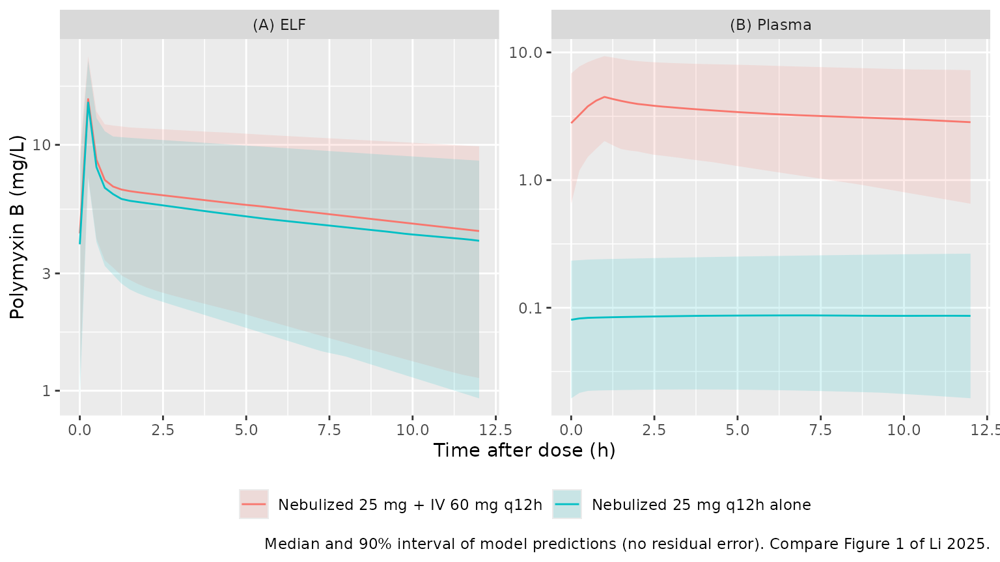
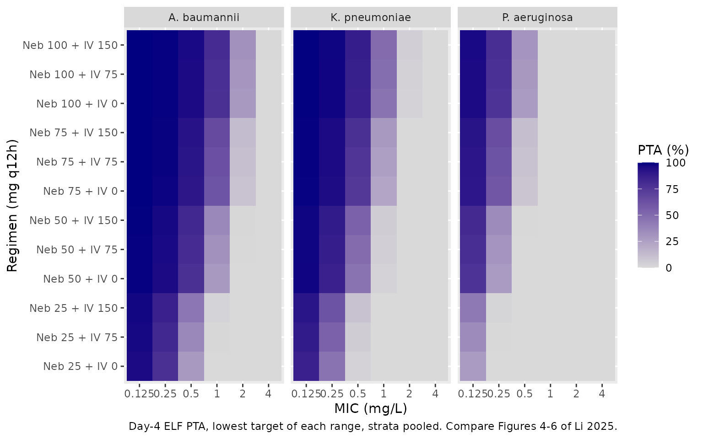

# Nebulized and intravenous polymyxin B in plasma and ELF (Li 2025)

## Model and source

- Citation: Li X, Zhou L, Wang D, Wu Q, Huang X, Zhang H, Wu W, Liu M,
  Wu X, Qiu H, Cheng Y. Population pharmacokinetics study on nebulized
  and intravenous administration of polymyxin B in patients with
  pneumonia caused by multidrug-resistant gram-negative bacteria.
  Antimicrob Agents Chemother. 2025;69(5):e00044-25.
  <doi:10.1128/aac.00044-25>. PMID 40237505. PMCID PMC12057357.
- Description: Coupled plasma + epithelial-lining-fluid (ELF) population
  PK model for polymyxin B given intravenously and/or by nebulization to
  critically ill adults with multidrug-resistant Gram-negative pneumonia
  (Li 2025). Two two-compartment models with linear elimination: an IV
  infusion enters the plasma central compartment (central \<-\>
  peripheral1, clearance from central), a nebulized dose enters the ELF
  central compartment (elf \<-\> lung, clearance from elf) with a
  fraction F = 0.557 reaching the lung, and the two central compartments
  exchange through a single inter-compartmental clearance Q = 0.03 L/h.
  Age is a power covariate on the ELF central volume and serum albumin a
  power covariate on the ELF clearance, both normalised to the cohort
  medians (66 years, 32.1 g/L). Exponential IIV on the plasma and ELF
  central clearances and volumes; one proportional residual error (43%)
  estimated jointly for the plasma and ELF concentrations. Fit in NONMEM
  7.5 (FOCE-I).
- Article: [Antimicrob Agents Chemother.
  2025;69(5):e00044-25](https://doi.org/10.1128/aac.00044-25) (open
  access, PMC12057357)

## Population

Li 2025 is a prospective single-centre study (Fujian Medical University
Union Hospital, China, January 2022 - October 2024) of 76 critically
ill, mechanically ventilated adults with pneumonia caused by
microbiologically proven multidrug-resistant Gram-negative bacteria.
Every patient received nebulized polymyxin B (25 mg in 5 mL every 12 h
over 15 min by vibrating-mesh or jet nebulizer), either alone or
together with intravenous polymyxin B (loading dose 100-150 mg, then
40-75 mg every 12 h as ~1 h infusions). Table 1 gives 59 men and 17
women (22.4% female), median age 66.0 years (IQR 55.0-76.3), weight 65.0
kg (54.38-70.0), serum albumin 32.1 g/L (28.5-37.5), Cockcroft-Gault
creatinine clearance 55.7 mL/min (35.4-101.3), APACHE II 21 and SOFA 7;
55.3% had sepsis. Patients on continuous renal replacement therapy were
excluded.

At steady state (after at least four doses) 156 epithelial lining fluid
(ELF) concentrations were obtained from all 76 patients by
bronchoalveolar lavage, corrected for dilution with the plasma/BAL urea
ratio (Eq. 1), and 188 plasma concentrations from 65 patients, pre-dose
and 1, 2, 4, 6, 8 and 12 h after administration. Polymyxin B1 and B2
were summed. The model was fit in NONMEM 7.5 with FOCE-I.

The same information is available programmatically via
`readModelDb("Li_2025_polymyxinB")()$population`.

## Model structure

Figure 2 of the paper couples two two-compartment models. Compartment 1
is the plasma central compartment (IV infusion, clearance CL1),
compartment 2 the plasma peripheral compartment (inter-compartmental
clearance CL2), compartment 3 the ELF central compartment (nebulized
dose, clearance CL3) and compartment 4 the ELF peripheral compartment
(inter-compartmental clearance CL4). The two central compartments
exchange through a single clearance Q, and only a fraction F of a
nebulized dose reaches the ELF. In the package the four states are
`central`, `peripheral1`, `elf` and `lung`; following the interpretation
the authors cite (Lin et al.), the ELF peripheral compartment is the
deeper lung region the drug reaches from the airway lining fluid.

## Source trace

The per-parameter origin is recorded as an in-file comment next to each
`ini()` entry in `inst/modeldb/specificDrugs/Li_2025_polymyxinB.R`.

| Equation / parameter | Value | Source location |
|----|----|----|
| `lcl` (CL1) | 1.39 L/h | Table 2 (RSE 6%) |
| `lvc` (V1) | 27.6 L | Table 2 (RSE 12%) |
| `lq` (CL2) | 13.11 L/h | Table 2 (RSE 18%) |
| `lvp` (V2) | 17.1 L | Table 2 (RSE 11%) |
| `lcl_elf` (CL3) | 0.186 L/h | Table 2 (RSE 21%) |
| `lv_elf` (V3) | 0.896 L | Table 2 (RSE 19%) |
| `lq_elf_lung` (CL4) | 3.44 L/h | Table 2 (RSE 14%) |
| `lv_lung` (V4) | 4.35 L | Table 2 (RSE 10%) |
| `lq_elf` (Q) | 0.03 L/h | Table 2 (RSE 10%) |
| `lf_elf` (F) | 0.557 | Table 2 (RSE 21%) |
| `e_age_v_elf` | 1.28 | Table 2, “AGE on V3” (RSE 23%); Table S1 model 4 |
| `e_alb_cl_elf` | -0.893 | Table 2, “ALB on CL3” (RSE 17%); Table S1 model 5 |
| `etalcl`, `etalvc` | 0.56, 0.31 | Table 2, omega2 CL1 and V1 (variances) |
| `etalcl_elf`, `etalv_elf` | 0.45, 0.53 | Table 2, omega2 CL3 and V3 (variances) |
| `propSd`, `propSd_Celf` | 0.43 | Table 2, “Proportional error” (one estimate for both matrices) |
| Covariate reference values | 66 years, 32.1 g/L | Table 1 medians (normalising values not printed; see Assumptions) |
| ODE system | n/a | Figure 2 and its legend (micro-constants k10 … k43) |
| `f(elf)` | n/a | Discussion: F is “the fraction of drug reaching the lungs” |

## Virtual cohort

The observed data are not public. The virtual patients draw age and
albumin from normal distributions matching the Table 1 medians and
interquartile ranges (truncated to 18-95 years and 15-50 g/L). The
random effects are drawn in base R from the model’s OMEGA matrix and
passed to the solver as data columns, so the same cohort is produced on
every machine and every regimen below is simulated on identical
patients.

``` r

set.seed(20250517)
mod <- readModelDb("Li_2025_polymyxinB")
ui <- rxode2::rxode2(mod)
#> ℹ parameter labels from comments will be replaced by 'label()'
omega <- ui$omega
n_per_arm <- 200L

draw_etas <- function(n) {
  eta <- matrix(rnorm(n * nrow(omega)), n) %*% chol(omega)
  colnames(eta) <- rownames(omega)
  as.data.frame(eta)
}
rtrunc_norm <- function(n, mean, sd, lower, upper) {
  pmin(pmax(rnorm(n, mean, sd), lower), upper)
}

# IQR / 1.349 is the SD of a normal distribution with that IQR.
patients <- tibble(
  k = seq_len(n_per_arm),
  AGE = rtrunc_norm(n_per_arm, 66, (76.3 - 55.0) / 1.349, 18, 95),
  ALB = rtrunc_norm(n_per_arm, 32.1, (37.5 - 28.5) / 1.349, 15, 50)
) |>
  bind_cols(draw_etas(n_per_arm))

# Dosing every 12 h from time 0 to 84 h (eight doses), so 72-96 h is day 4,
# the interval the paper calls steady state. IV infusions run 1 h with a
# loading dose of twice the maintenance dose; nebulizations run 15 min.
make_events <- function(pat, iv_md, neb_dose, obs_times, id_offset = 0L, arm = "",
                        dose_times = seq(0, 84, by = 12)) {
  pat <- pat |> mutate(id = id_offset + row_number())
  iv <- if (iv_md > 0) {
    tidyr::expand_grid(id = pat$id, time = dose_times) |>
      mutate(amt = ifelse(time == 0, 2 * iv_md, iv_md), cmt = "central", dur = 1)
  }
  neb <- if (neb_dose > 0) {
    tidyr::expand_grid(id = pat$id, time = dose_times) |>
      mutate(amt = neb_dose, cmt = "elf", dur = 0.25)
  }
  doses <- bind_rows(iv, neb) |> mutate(evid = 1L, dvid = NA_integer_)
  obs <- tidyr::expand_grid(id = pat$id, time = obs_times) |>
    mutate(amt = 0, cmt = "central", dur = 0, evid = 0L, dvid = 1L)
  bind_rows(doses, obs) |>
    left_join(pat |> select(-k), by = "id") |>
    mutate(arm = arm) |>
    arrange(id, time, desc(evid))
}

solve_events <- function(events) {
  # Random effects come from the data columns; omega/sigma = NA stops the
  # solver from drawing its own (multi-endpoint model).
  rxode2::rxSolve(
    mod, events = events, omega = NA, sigma = NA, useLinCmt = FALSE,
    keep = "arm", returnType = "data.frame"
  )
}
```

## Concentration-time profiles at steady state

Figure 1 of the paper shows the observed ELF (A) and plasma (B)
concentrations against time after dose at steady state. The study
regimen was 25 mg nebulized every 12 h, with or without IV polymyxin B;
the median daily IV dose of 1.82 mg/kg at the median weight of 65 kg is
about 60 mg every 12 h.

``` r

obs_grid <- seq(72, 96, by = 0.25)
ev_fig1 <- bind_rows(
  make_events(patients, iv_md = 60, neb_dose = 25, obs_times = obs_grid,
              id_offset = 0L, arm = "Nebulized 25 mg + IV 60 mg q12h"),
  make_events(patients, iv_md = 0, neb_dose = 25, obs_times = obs_grid,
              id_offset = 1000L, arm = "Nebulized 25 mg q12h alone")
)
stopifnot(!anyDuplicated(ev_fig1[ev_fig1$evid == 0, c("id", "time")]))
sim_fig1 <- solve_events(ev_fig1)
#> ℹ parameter labels from comments will be replaced by 'label()'
```

``` r

sim_fig1 |>
  filter(time >= 84) |>
  mutate(tad = time - 84) |>
  pivot_longer(c(Celf, Cc), names_to = "matrix", values_to = "conc") |>
  mutate(matrix = ifelse(matrix == "Celf", "(A) ELF", "(B) Plasma")) |>
  group_by(arm, matrix, tad) |>
  summarise(
    Q05 = quantile(conc, 0.05), Q50 = median(conc), Q95 = quantile(conc, 0.95),
    .groups = "drop"
  ) |>
  ggplot(aes(tad, Q50, colour = arm, fill = arm)) +
  geom_ribbon(aes(ymin = Q05, ymax = Q95), alpha = 0.15, colour = NA) +
  geom_line() +
  facet_wrap(~matrix, scales = "free_y") +
  scale_y_log10() +
  labs(
    x = "Time after dose (h)", y = "Polymyxin B (mg/L)", colour = NULL, fill = NULL,
    caption = "Median and 90% interval of model predictions (no residual error). Compare Figure 1 of Li 2025."
  ) +
  theme(legend.position = "bottom")
```



The observed plasma concentrations in Figure 1B lie mostly between 0.5
and 5 mg/L, with the lowest values from patients who received
nebulization only, and the simulated plasma bands cover that range. In
ELF (Figure 1A) the simulated median of roughly 4-7 mg/L through the
middle of the interval matches the observed smooth, but two features of
the observed data are outside the simulated 90% band: the early peaks of
20-100 mg/L in the first hour after nebulization, and the fall to below
1 mg/L in many pre-dose samples. The model’s typical ELF peak is about
14 mg/L, because the 15-min nebulization delivers F = 0.557 of the 25 mg
dose into a 0.9 L central volume, and the large ELF peripheral
compartment (V4 = 4.35 L, CL4 = 3.44 L/h) keeps refilling the central
compartment late in the interval. The bands exclude the 43% proportional
residual error, which widens them for comparison with observations.

## PKNCA validation

PKNCA computes the day-4 (72-96 h) AUC and Cmax in each matrix. Table 1
of the paper reports a cohort median AUC24h of 52.5 mg h/L in ELF and
35.0 mg h/L in plasma, which are compared with the arm closest to the
median regimen.

``` r

nca_conc <- sim_fig1 |>
  filter(!is.na(Cc)) |>
  select(id, time, arm, Cc, Celf) |>
  pivot_longer(c(Cc, Celf), names_to = "matrix", values_to = "conc") |>
  mutate(matrix = ifelse(matrix == "Celf", "ELF", "Plasma"))

# One dose row per time per subject (amounts summed across routes) so that
# PKNCA sees unique dose times within each group.
nca_dose <- ev_fig1 |>
  filter(evid == 1) |>
  group_by(id, arm, time) |>
  summarise(amt = sum(amt), .groups = "drop") |>
  tidyr::expand_grid(matrix = c("ELF", "Plasma"))

conc_obj <- PKNCA::PKNCAconc(nca_conc, conc ~ time | arm + matrix + id)
dose_obj <- PKNCA::PKNCAdose(nca_dose, amt ~ time | arm + matrix + id)
intervals <- data.frame(start = 72, end = 96, auclast = TRUE, cmax = TRUE)
nca_res <- PKNCA::pk.nca(PKNCA::PKNCAdata(conc_obj, dose_obj, intervals = intervals))

nca_summary <- as.data.frame(nca_res$result) |>
  group_by(arm, matrix, PPTESTCD) |>
  summarise(median = median(PPORRES), .groups = "drop") |>
  pivot_wider(names_from = PPTESTCD, values_from = median)
nca_summary |>
  dplyr::rename(
    "Regimen" = arm, "Matrix" = matrix,
    "Median AUC 72-96 h (mg h/L)" = auclast, "Median Cmax (mg/L)" = cmax
  ) |>
  knitr::kable(digits = 1, caption = "Simulated day-4 exposure (PKNCA).")
```

| Regimen | Matrix | Median AUC 72-96 h (mg h/L) | Median Cmax (mg/L) |
|:---|:---|---:|---:|
| Nebulized 25 mg + IV 60 mg q12h | ELF | 136.5 | 15.3 |
| Nebulized 25 mg + IV 60 mg q12h | Plasma | 79.5 | 4.5 |
| Nebulized 25 mg q12h alone | ELF | 123.0 | 14.9 |
| Nebulized 25 mg q12h alone | Plasma | 2.0 | 0.1 |

Simulated day-4 exposure (PKNCA). {.table}

``` r

published <- tibble::tribble(
  ~arm,                               ~matrix,  ~auclast,
  "Nebulized 25 mg + IV 60 mg q12h",  "ELF",    52.5,
  "Nebulized 25 mg + IV 60 mg q12h",  "Plasma", 35.0
)
cmp <- nlmixr2lib::ncaComparisonTable(
  simulated = nca_res,
  reference = published,
  by = c("arm", "matrix"),
  units = c(auclast = "mg*h/L"),
  tolerance_pct = 20
)
knitr::kable(cmp, caption = "Simulated day-4 AUC vs Table 1 AUC24h. * differs from reference by >20%.")
```

| NCA parameter | arm | matrix | Reference | Simulated | % diff |
|:---|:---|:---|:---|:---|:---|
| AUClast (mg\*h/L) | Nebulized 25 mg + IV 60 mg q12h | ELF | 52.5 | 136 | +159.9%\* |
| AUClast (mg\*h/L) | Nebulized 25 mg + IV 60 mg q12h | Plasma | 35 | 79.5 | +127.2%\* |

Simulated day-4 AUC vs Table 1 AUC24h. \* differs from reference by
\>20%. {.table}

Both rows are starred: the simulated AUC over 24 h at the median regimen
is roughly two to three times the Table 1 medians. The paper does not
say how the Table 1 AUCs were obtained or over which interval, and they
are not consistent with the paper’s own target-attainment simulations
either (next section), which assume ELF exposures at least as high as
this model predicts. Half of the simulated daily AUC, i.e. the AUC over
one 12-h dosing interval, is within about 30% of the Table 1 numbers
(see also the closed-form check below), so the Table 1 column may hold
dosing-interval AUCs. This is recorded as a known discrepancy and was
not tuned.

## Closed-form steady-state check

For a linear model the steady-state AUC follows from mass balance. Over
one day, with daily nebulized dose `Dneb` and IV dose `Div`, the ELF and
plasma AUCs satisfy `F*Dneb + Q*AUCp = (CL3 + Q)*AUCelf` and
`Div + Q*AUCelf = (CL1 + Q)*AUCp`. The typical-value simulation over day
20 must reproduce the solution of these two equations.

``` r

typical <- patients[1, ] |>
  mutate(AGE = 66, ALB = 32.1, across(starts_with("eta"), ~0))
ev_ss <- make_events(
  typical, iv_md = 60, neb_dose = 25, obs_times = seq(456, 480, by = 0.05),
  dose_times = seq(0, 468, by = 12)
)
sim_ss <- solve_events(ev_ss)
trap <- function(t, y) sum(diff(t) * (head(y, -1) + tail(y, -1)) / 2)
auc_sim <- c(elf = trap(sim_ss$time, sim_ss$Celf), plasma = trap(sim_ss$time, sim_ss$Cc))

p <- ui$theta
cl1 <- exp(p[["lcl"]]); cl3 <- exp(p[["lcl_elf"]]); q <- exp(p[["lq_elf"]]); f <- exp(p[["lf_elf"]])
d_neb <- 50; d_iv <- 120
auc_elf <- (f * d_neb + q * d_iv / (cl1 + q)) / ((cl3 + q) - q^2 / (cl1 + q))
auc_p <- (d_iv + q * auc_elf) / (cl1 + q)
auc_cf <- c(elf = auc_elf, plasma = auc_p)
# Nebulized contribution alone (Div = 0), used in the PTA discussion below.
auc_elf_neb25 <- f * d_neb / ((cl3 + q) - q^2 / (cl1 + q))
knitr::kable(
  data.frame(matrix = names(auc_cf), closed_form = auc_cf, simulated = auc_sim,
             pct_diff = 100 * (auc_sim - auc_cf) / auc_cf),
  digits = 2, row.names = FALSE,
  caption = "Typical-value AUC over one day at steady state (mg h/L)."
)
```

| matrix | closed_form | simulated | pct_diff |
|:-------|------------:|----------:|---------:|
| elf    |      141.09 |    141.09 |        0 |
| plasma |       87.49 |     87.49 |        0 |

Typical-value AUC over one day at steady state (mg h/L). {.table}

``` r

# Same parameters on both sides: the gap is numerical (trapezoid on a 0.05 h
# grid, residual approach to steady state at day 20), well under 1%.
stopifnot(all(abs(auc_sim - auc_cf) / auc_cf < 0.01))
```

Half of these daily values (about 71 mg h/L in ELF and 44 mg h/L in
plasma per 12-h interval) is close to the Table 1 AUC24h medians.

## Probability of target attainment

The paper’s Monte Carlo simulations (Figures 4-6 and S2-S3) evaluate the
day-4 AUC against these targets: plasma AUC/MIC \>= 50 (fAUC/MIC 20 with
an unbound fraction of 0.42) with AUC \> 100 mg h/L as the
nephrotoxicity threshold, and ELF AUC/MIC of 326-989 for *A. baumannii*,
525-527 for *K. pneumoniae* and 1,326-1,506 for *P. aeruginosa*. The
regimens were IV 50-150 mg q12h (loading dose twice the maintenance
dose) and nebulized 25-100 mg q12h, alone or combined.

Because the model is linear, each patient’s day-4 AUC is a sum of an IV
part proportional to the IV maintenance dose and a nebulized part
proportional to the nebulized dose. Each patient is therefore solved
once per route at a unit dose and every regimen in the grid is formed by
scaling and adding. The three age and three albumin strata of the paper
are represented by one age and one albumin value each.

``` r

strata <- tidyr::expand_grid(
  age_group = c("18-40", "40-65", ">65"),
  alb_group = c("<25", "25-35", ">35")
) |>
  mutate(
    AGE = c("18-40" = 30, "40-65" = 52, ">65" = 75)[age_group],
    ALB = c("<25" = 22, "25-35" = 30, ">35" = 40)[alb_group],
    stratum = row_number()
  )
pta_grid_obs <- seq(72, 96, by = 0.1)
unit_auc <- function(route) {
  ev <- bind_rows(lapply(seq_len(nrow(strata)), function(i) {
    pat <- patients |> mutate(AGE = strata$AGE[i], ALB = strata$ALB[i])
    make_events(
      pat,
      iv_md = if (route == "iv") 1 else 0,
      neb_dose = if (route == "neb") 1 else 0,
      obs_times = pta_grid_obs, id_offset = (i - 1L) * 1000L,
      arm = as.character(i)
    )
  }))
  solve_events(ev) |>
    group_by(id, arm) |>
    summarise(elf = trap(time, Celf), plasma = trap(time, Cc), .groups = "drop") |>
    mutate(stratum = as.integer(arm), k = id - (stratum - 1L) * 1000L) |>
    select(stratum, k, elf, plasma)
}
auc_unit <- inner_join(
  unit_auc("iv") |> rename(elf_iv = elf, plasma_iv = plasma),
  unit_auc("neb") |> rename(elf_neb = elf, plasma_neb = plasma),
  by = c("stratum", "k")
) |>
  left_join(strata, by = "stratum")

regimens <- tidyr::expand_grid(iv = c(0, 50, 75, 100, 125, 150), neb = c(0, 25, 50, 75, 100)) |>
  filter(iv + neb > 0)
auc_reg <- tidyr::expand_grid(auc_unit, regimens) |>
  mutate(
    auc_elf = iv * elf_iv + neb * elf_neb,
    auc_plasma = iv * plasma_iv + neb * plasma_neb
  )
```

### Plasma (IV alone)

``` r

mics <- c(0.125, 0.25, 0.5, 1, 2, 4)
pta_plasma <- auc_reg |>
  filter(neb == 0) |>
  tidyr::expand_grid(mic = mics) |>
  group_by(iv, mic) |>
  summarise(pta = 100 * mean(auc_plasma / mic >= 50), .groups = "drop")
pta_plasma |>
  mutate(mic = paste0("MIC ", mic)) |>
  pivot_wider(names_from = mic, values_from = pta) |>
  dplyr::rename("IV maintenance dose (mg q12h)" = iv) |>
  knitr::kable(digits = 0, caption = "Day-4 plasma PTA (%), AUC/MIC >= 50, all strata pooled (compare Figure S2B).")
```

| IV maintenance dose (mg q12h) | MIC 0.125 | MIC 0.25 | MIC 0.5 | MIC 1 | MIC 2 | MIC 4 |
|------------------------------:|----------:|---------:|--------:|------:|------:|------:|
|                            50 |       100 |       99 |      92 |    65 |    26 |     0 |
|                            75 |       100 |      100 |      98 |    80 |    48 |    11 |
|                           100 |       100 |      100 |      99 |    92 |    65 |    26 |
|                           125 |       100 |      100 |     100 |    96 |    72 |    39 |
|                           150 |       100 |      100 |     100 |    98 |    80 |    48 |

Day-4 plasma PTA (%), AUC/MIC \>= 50, all strata pooled (compare Figure
S2B). {.table style="width:100%;"}

``` r


tox <- auc_reg |>
  filter(neb == 0) |>
  group_by(iv) |>
  summarise(pct_auc_over_100 = 100 * mean(auc_plasma > 100), .groups = "drop")
tox |>
  dplyr::rename("IV maintenance dose (mg q12h)" = iv, "Day-4 AUC > 100 mg h/L (%)" = pct_auc_over_100) |>
  knitr::kable(digits = 0, caption = "Predicted toxicity-threshold exceedance (compare Figure S3).")
```

| IV maintenance dose (mg q12h) | Day-4 AUC \> 100 mg h/L (%) |
|------------------------------:|----------------------------:|
|                            50 |                          26 |
|                            75 |                          48 |
|                           100 |                          65 |
|                           125 |                          72 |
|                           150 |                          80 |

Predicted toxicity-threshold exceedance (compare Figure S3). {.table}

The paper reports that IV 50 and 75 mg q12h reach a plasma PTA of at
least 90% for MICs up to 0.5 and 1 mg/L, respectively. The model
reproduces the first statement (about 92%) and gives about 80% for the
second. The model’s predicted exceedance of the AUC \> 100 mg h/L
threshold rises more gradually with dose than Figure S3 (25-30% at 75 mg
and over 70% at 100 mg q12h): the published curves imply a much narrower
spread of AUC than the plasma clearance variance in Table 2 (omega2 =
0.56, a standard deviation of 0.75 on the log scale) generates. The
paper simulated “on the original data set”, which may mean the patients’
own parameter estimates rather than fresh draws from the population
distribution; the model here uses the published population distribution.

``` r

pta_at <- function(d, iv_dose, mic_value) d$pta[d$iv == iv_dose & d$mic == mic_value]
stopifnot(
  # "MICs of <= 0.5 ... IV doses of 50 ... mg q12h" reached PTA >= 90%.
  pta_at(pta_plasma, 50, 0.5) >= 85,
  # The paper reports >= 90%; this model gives about 80% on the fixed base-R
  # cohort, so the bound checks the level without claiming the 90%.
  pta_at(pta_plasma, 75, 1) >= 70
)
```

### ELF

``` r

targets <- tibble::tribble(
  ~pathogen,        ~target_low, ~target_high,
  "A. baumannii",   326,         989,
  "K. pneumoniae",  525,         527,
  "P. aeruginosa",  1326,        1506
)
pta_elf <- auc_reg |>
  tidyr::expand_grid(targets) |>
  tidyr::expand_grid(mic = mics) |>
  group_by(pathogen, iv, neb, mic) |>
  summarise(
    pta_low_target = 100 * mean(auc_elf / mic >= first(target_low)),
    pta_high_target = 100 * mean(auc_elf / mic >= first(target_high)),
    .groups = "drop"
  )

# Highest MIC with PTA >= 90%, for IV 0-75 mg q12h combined with each nebulized dose.
pta_elf |>
  filter(iv <= 75, neb > 0) |>
  group_by(pathogen, neb, mic) |>
  summarise(min_pta = min(pta_low_target), .groups = "drop") |>
  group_by(pathogen, neb) |>
  summarise(
    max_mic = if (any(min_pta >= 90)) max(mic[min_pta >= 90]) else NA_real_,
    .groups = "drop"
  ) |>
  pivot_wider(names_from = neb, values_from = max_mic, names_prefix = "Neb ") |>
  dplyr::rename("Pathogen" = pathogen) |>
  knitr::kable(caption = "Highest MIC (mg/L) with day-4 ELF PTA >= 90% for every IV dose from 0 to 75 mg q12h, using the lowest target of each range.")
```

| Pathogen      | Neb 25 | Neb 50 | Neb 75 | Neb 100 |
|:--------------|-------:|-------:|-------:|--------:|
| A. baumannii  |  0.125 |  0.250 |  0.500 |   0.500 |
| K. pneumoniae |     NA |  0.125 |  0.250 |   0.250 |
| P. aeruginosa |     NA |     NA |  0.125 |   0.125 |

Highest MIC (mg/L) with day-4 ELF PTA \>= 90% for every IV dose from 0
to 75 mg q12h, using the lowest target of each range. {.table}

``` r

pta_elf |>
  filter(neb %in% c(25, 50, 75, 100), iv %in% c(0, 75, 150)) |>
  arrange(neb, iv) |>
  mutate(regimen = paste0("Neb ", neb, " + IV ", iv), regimen = factor(regimen, levels = unique(regimen))) |>
  ggplot(aes(factor(mic), regimen, fill = pta_low_target)) +
  geom_tile() +
  facet_wrap(~pathogen) +
  scale_fill_gradient(low = "grey85", high = "navy", limits = c(0, 100)) +
  labs(
    x = "MIC (mg/L)", y = "Regimen (mg q12h)", fill = "PTA (%)",
    caption = "Day-4 ELF PTA, lowest target of each range, strata pooled. Compare Figures 4-6 of Li 2025."
  )
```



The paper’s ELF conclusions are that IV administration alone (50-150 mg
q12h) never reaches the ELF targets, that *K. pneumoniae* and *A.
baumannii* with MICs of 0.25, 0.5 and 1 mg/L need nebulized doses of at
least 25, 50 and 75 mg q12h, and that *P. aeruginosa* needs higher
nebulized doses than the other two. The first conclusion holds in the
model, and the last follows directly from the higher *P. aeruginosa*
targets. For the dose-MIC pairs, the model reaches PTA \>= 90% one to
two MIC dilutions lower than the paper: its typical day-4 ELF AUC for 25
mg q12h nebulized is about 129 mg h/L (from nebulization alone), so a
90% attainment of an AUC/MIC of 525 at MIC 0.25 mg/L would need a
narrower spread than the omega2 of 0.45 on CL3 allows. The same narrow
spread is visible in the published heat maps, where PTA falls from near
100% to near 0% within one MIC dilution; as for plasma, this points to
simulations based on the study patients’ own estimates.

``` r

# Paper: "IV administration of 50-150 mg alone failed to achieve the PK/PD
# target values for the three bacteria in ELF", i.e. PTA < 90% everywhere. The
# most favourable IV-only case here (150 mg q12h, A. baumannii at MIC
# 0.125 mg/L against the lowest target of 326) reaches about 23%, because the
# plasma-to-ELF clearance Q (0.03 L/h) is small next to the ELF clearance.
stopifnot(max(pta_elf$pta_low_target[pta_elf$neb == 0]) < 50)
```

## Assumptions and deviations

- **Covariate equations.** Table 2 prints “AGE on V3 = 1.28” and “ALB on
  CL3 = -0.893” without the functional form or the normalising values.
  The model uses power functions normalised to the Table 1 medians,
  `V3 = 0.896 * (AGE/66)^1.28` and `CL3 = 0.186 * (ALB/32.1)^-0.893`. A
  power model is the only form under which coefficients of this size
  give plausible parameter values over the observed age and albumin
  ranges, and the medians are the usual normalising values.
- **Direction of the albumin effect.** With the printed negative
  exponent a lower albumin gives a higher ELF clearance, which is the
  mechanism the Discussion proposes (lower albumin, more unbound drug,
  faster clearance). The Results sentence “higher age and lower ALB
  levels reduced the required dosage”, and the weak trends across the
  strata of Figures 4-6, point the other way. Neither covariate trend in
  those figures can be produced by the model as published: age acts only
  on V3, and at steady state the AUC does not depend on V3 at all. The
  figures are therefore not taken as evidence on the sign, and the
  printed coefficient is used as published.
- **Figure 2 legend.** The legend defines k21 = CL1/V2 and k43 = CL3/V4.
  With CL2 and CL4 defined in the Table 2 footnote as the
  inter-compartmental clearances, these are typographical errors for k21
  = CL2/V2 and k43 = CL4/V4, which is what the model uses.
- **Residual error.** Table 2 reports one proportional error of 0.43 for
  both matrices. It is taken as a standard deviation (43%), because the
  table labels the variances of the random effects explicitly as omega2
  and does not do so for this row. nlmixr2 needs one parameter per
  endpoint, so the value is carried as `propSd` (plasma) and
  `propSd_Celf` (ELF).
- **Bootstrap column.** The bootstrap medians for omega2 CL1 (0.76) and
  omega2 CL3 (0.74) differ from the final estimates (0.56 and 0.45),
  with 95% intervals that exclude them; the final-model estimates are
  used.
- **Nebulization.** The nebulized dose enters the ELF central
  compartment as a 15-min zero-order input, with the bioavailability F
  applied to the amount.
- **Target-attainment simulations.** The covariate strata are
  represented by single values (age 30, 52 and 75 years; albumin 22, 30
  and 40 g/L), and the ELF targets by the lowest value of each published
  range. The paper does not say which value within each range it used.
- **Table 1.** The daily IV dose interquartile range is printed as “1.82
  (15.4-2.17)”; 15.4 is read as 1.54. The Table 1 AUC24h values differ
  from the simulated day-4 AUCs as discussed under PKNCA validation.
- No erratum or correction notice for this article was found as of
  2026-11-04.
