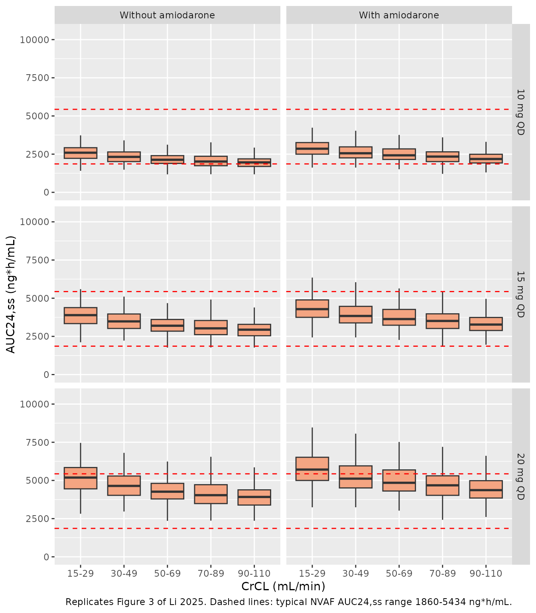
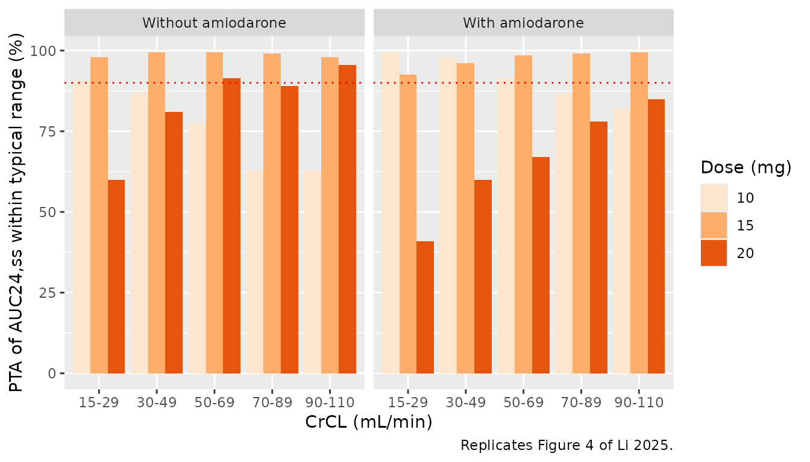
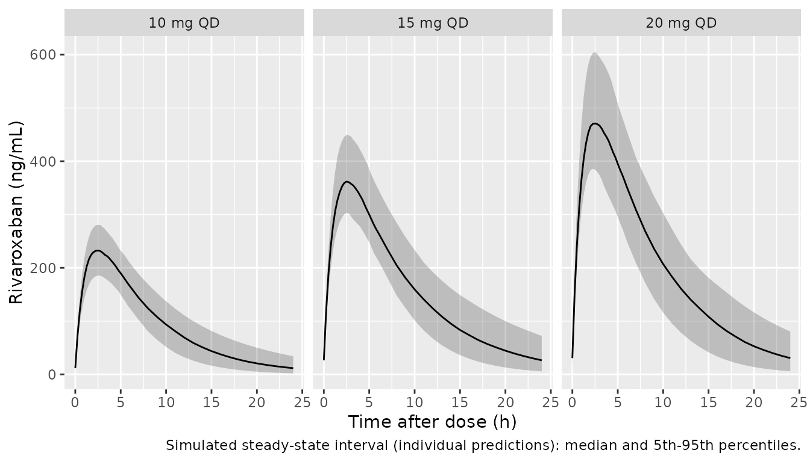

# Rivaroxaban (Li 2025)

## Model and source

- Citation: Li TY, Liu X, Tang L, Cai W, Zhang J, Su Y, Yu C, Liu BJ,
  Jiang LF, Liu C, Yu YX. Dose Optimization of Rivaroxaban in Elderly
  Chinese Patients with Non-Valvular Atrial Fibrillation: Analysis of
  Populations Pharmacokinetics and Exposure-Response Relationships. Drug
  Des Devel Ther. 2025;19:10703. <doi:10.2147/DDDT.S563521>.
- Description: One-compartment population PK model for oral rivaroxaban
  in elderly (65 years and older) Chinese patients with non-valvular
  atrial fibrillation, with a creatinine-clearance power effect and a
  concomitant-amiodarone effect on CL/F (Li 2025)
- Article: <https://doi.org/10.2147/DDDT.S563521> (open access,
  PMC12683255)

The article has no supplementary material. Every value in the model is
printed in the main-text Table 2 and its footnote equation.

## Population

Li 2025 fitted 256 rivaroxaban plasma concentrations from 93 Chinese
patients aged 65 years and older with non-valvular atrial fibrillation
(NVAF), enrolled prospectively at Suzhou Municipal Hospital (Nanjing
Medical University) between January 2021 and March 2022. Patients had
taken rivaroxaban 10, 15 or 20 mg once daily for at least 4 weeks; the
dose was chosen by the treating clinician. Patients with CrCL \< 15
mL/min, Child-Pugh B or C hepatic impairment, other anticoagulants, or a
strong CYP3A4 / P-gp inhibitor were excluded (Methods “Study Design”).

The cohort is old and renally impaired: mean age 79 +/- 7 years (range
66-94), mean weight 61.4 +/- 12.1 kg, 50 men and 43 women, and a median
Cockcroft-Gault creatinine clearance of 48.6 mL/min (range 14.3-91.7)
with 73.1% below 50 mL/min. Amiodarone, usually 200 mg once daily for
rhythm control, was the most common comedication (45 patients, 48.4%)
(Table 1, Results “Population Characteristics”). At steady state each
patient gave a trough sample 0.5 h before the next dose and a peak
sample 3 +/- 1 h after a dose (Methods “Rivaroxaban Quantification”).

The same information is available programmatically via
`readModelDb("Li_2025_rivaroxaban")()$population`.

## Source trace

| Equation / parameter | Value | Source location |
|----|----|----|
| One compartment, first-order absorption and elimination | n/a | Results “PopPK Model of Rivaroxaban” |
| `lka` (fixed) | `log(0.821)` | Table 2 `tvKa 0.821, fixed`; Results “fixed to the reported value (0.821 h-1)” |
| `lcl` | `log(4.501)` | Table 2 final model `tvCL (L/h) 4.501 (2.84)` |
| `lvc` | `log(30.714)` | Table 2 final model `tvV(L) 30.714 (2.19)` |
| `e_crcl_cl` | `0.179` | Table 2 final model `dCLdCrCL 0.179 (18.61)` |
| `e_conmed_amio_cl` | `-0.124` | Table 2 final model `dCLamiodarone -0.124 (30.51)` |
| CrCL reference 47.4 mL/min | `47.4` | Table 2 footnote: `CL (L/h) = 4.5 * (CrCL/47.4)^0.18 * exp(amiodarone * -0.12)*exp(etaCL)` |
| `etalcl` | `0.036` | Table 2 final model `omega2 CL (%) 3.6 [21]` |
| `etalvc` | `0.033` | Table 2 final model `omega2 V (%) 3.3 [19]` |
| `addSd` | `18.025` ng/mL | Table 2 final model `stdev0 18.025 (7.54)`; additive residual model named in Results |

The footnote equation fixes both covariate forms: a power function of
`CrCL / 47.4` and an exponential shift for amiodarone. The footnote
prints rounded values (4.5, 0.18, -0.12); the model uses the
three-decimal Table 2 estimates. The Discussion confirms both effects
arithmetically: “CL increased by approximately 1.8% for every 10%
elevation in CrCL” (`1.1^0.179 = 1.017`) and “reduction in CL to
0.88-fold with concomitant amiodarone use” (`exp(-0.124) = 0.883`).

## Replicate published figures

### Figures 3 and 4: steady-state AUC by renal function and amiodarone

Li 2025 simulated 10, 15 and 20 mg once daily in virtual patients
stratified by five CrCL bands and by amiodarone use, and summarised the
steady-state `AUC24,ss` as boxplots (Figure 3) and as the probability
that `AUC24,ss` lies in the typical NVAF range 1860-5434 ng\*h/mL
(Figure 4). At steady state, `AUC24,ss = Dose / (CL/F)` exactly, so each
virtual patient’s clearance is all that is needed; the PKNCA section
below confirms that identity on full profiles.

``` r

set.seed(20251203)

n_per_cell <- 200L
bands <- tibble::tribble(
  ~band,    ~lo, ~hi,
  "15-29",   15,  29,
  "30-49",   30,  49,
  "50-69",   50,  69,
  "70-89",   70,  89,
  "90-110",  90, 110
)

grid <- tidyr::expand_grid(bands, CONMED_AMIO = c(0L, 1L)) |>
  mutate(cell = row_number())

cohort_f3 <- grid |>
  tidyr::uncount(n_per_cell) |>
  mutate(
    id = row_number(),
    # The paper does not say how CrCL was distributed inside each band; a
    # uniform draw across the band is used here.
    CRCL = stats::runif(n(), lo, hi)
  )

ev_f3 <- bind_rows(
  cohort_f3 |> transmute(id, time = 0, evid = 1L, amt = 10, cmt = "depot", CRCL, CONMED_AMIO),
  cohort_f3 |> transmute(id, time = 1, evid = 0L, amt = NA_real_, cmt = "central", CRCL, CONMED_AMIO)
) |>
  arrange(id, time, desc(evid))

mod <- readModelDb("Li_2025_rivaroxaban")

rxode2::rxSetSeed(20251203)
sim_f3 <- rxode2::rxSolve(mod, events = ev_f3) |> as.data.frame()
#> ℹ parameter labels from comments will be replaced by 'label()'

auc_f3 <- sim_f3 |>
  distinct(id, cl) |>
  left_join(cohort_f3 |> select(id, band, CONMED_AMIO), by = "id") |>
  tidyr::expand_grid(dose = c(10, 15, 20)) |>
  mutate(
    auc = 1000 * dose / cl,
    amio = ifelse(CONMED_AMIO == 1L, "With amiodarone", "Without amiodarone"),
    amio = factor(amio, levels = c("Without amiodarone", "With amiodarone")),
    band = factor(band, levels = bands$band)
  )

stopifnot(nrow(auc_f3) == 3L * nrow(cohort_f3))
```

``` r

# Replicates Figure 3 of Li 2025.
ggplot(auc_f3, aes(band, auc)) +
  geom_boxplot(outlier.shape = NA, fill = "#F4A582") +
  geom_hline(yintercept = c(1860, 5434), linetype = "dashed", colour = "red") +
  facet_grid(paste(dose, "mg QD") ~ amio) +
  coord_cartesian(ylim = c(0, 10500)) +
  labs(
    x = "CrCL (mL/min)",
    y = "AUC24,ss (ng*h/mL)",
    caption = paste(
      "Replicates Figure 3 of Li 2025. Dashed lines: typical NVAF AUC24,ss",
      "range 1860-5434 ng*h/mL."
    )
  )
```



The medians below were digitised by the maintainers from Figure 3 (read
to roughly +/- 50 ng\*h/mL).

``` r

fig3_pub <- tibble::tribble(
  ~dose, ~amio,                ~band,    ~pub_median,
  10,    "Without amiodarone", "15-29",  2650,
  10,    "Without amiodarone", "30-49",  2330,
  10,    "Without amiodarone", "50-69",  2150,
  10,    "Without amiodarone", "70-89",  2000,
  10,    "Without amiodarone", "90-110", 1950,
  10,    "With amiodarone",    "15-29",  2830,
  10,    "With amiodarone",    "30-49",  2530,
  10,    "With amiodarone",    "50-69",  2430,
  10,    "With amiodarone",    "70-89",  2330,
  10,    "With amiodarone",    "90-110", 2290,
  15,    "Without amiodarone", "15-29",  3950,
  15,    "Without amiodarone", "30-49",  3480,
  15,    "Without amiodarone", "50-69",  3200,
  15,    "Without amiodarone", "70-89",  3030,
  15,    "Without amiodarone", "90-110", 2920,
  15,    "With amiodarone",    "15-29",  4230,
  15,    "With amiodarone",    "30-49",  3800,
  15,    "With amiodarone",    "50-69",  3620,
  15,    "With amiodarone",    "70-89",  3480,
  15,    "With amiodarone",    "90-110", 3420,
  20,    "Without amiodarone", "15-29",  5270,
  20,    "Without amiodarone", "30-49",  4640,
  20,    "Without amiodarone", "50-69",  4250,
  20,    "Without amiodarone", "70-89",  4040,
  20,    "Without amiodarone", "90-110", 3900,
  20,    "With amiodarone",    "15-29",  5650,
  20,    "With amiodarone",    "30-49",  5050,
  20,    "With amiodarone",    "50-69",  4830,
  20,    "With amiodarone",    "70-89",  4650,
  20,    "With amiodarone",    "90-110", 4570
)

f3_sim <- auc_f3 |>
  group_by(dose, amio, band) |>
  summarise(
    sim_median = median(auc),
    iqr_ratio = quantile(auc, 0.75) / quantile(auc, 0.25),
    pta = 100 * mean(auc >= 1860 & auc <= 5434),
    .groups = "drop"
  ) |>
  mutate(amio = as.character(amio), band = as.character(band))

f3_chk <- fig3_pub |>
  left_join(f3_sim, by = c("dose", "amio", "band")) |>
  mutate(pct_diff = 100 * (sim_median / pub_median - 1))

f3_chk |>
  select(dose, amio, band, pub_median, sim_median, pct_diff, iqr_ratio) |>
  rename(
    "Dose (mg)" = dose,
    "Amiodarone" = amio,
    "CrCL band (mL/min)" = band,
    "Figure 3 median" = pub_median,
    "Simulated median" = sim_median,
    "Difference (%)" = pct_diff,
    "Simulated Q3/Q1" = iqr_ratio
  ) |>
  knitr::kable(digits = c(0, 0, 0, 0, 0, 1, 2), caption = "Median AUC24,ss (ng*h/mL), simulated versus Figure 3 of Li 2025.")
```

| Dose (mg) | Amiodarone | CrCL band (mL/min) | Figure 3 median | Simulated median | Difference (%) | Simulated Q3/Q1 |
|---:|:---|:---|---:|---:|---:|---:|
| 10 | Without amiodarone | 15-29 | 2650 | 2594 | -2.1 | 1.31 |
| 10 | Without amiodarone | 30-49 | 2330 | 2321 | -0.4 | 1.31 |
| 10 | Without amiodarone | 50-69 | 2150 | 2132 | -0.8 | 1.27 |
| 10 | Without amiodarone | 70-89 | 2000 | 2018 | 0.9 | 1.35 |
| 10 | Without amiodarone | 90-110 | 1950 | 1959 | 0.5 | 1.29 |
| 10 | With amiodarone | 15-29 | 2830 | 2856 | 0.9 | 1.30 |
| 10 | With amiodarone | 30-49 | 2530 | 2559 | 1.1 | 1.32 |
| 10 | With amiodarone | 50-69 | 2430 | 2423 | -0.3 | 1.32 |
| 10 | With amiodarone | 70-89 | 2330 | 2340 | 0.4 | 1.32 |
| 10 | With amiodarone | 90-110 | 2290 | 2183 | -4.7 | 1.30 |
| 15 | Without amiodarone | 15-29 | 3950 | 3891 | -1.5 | 1.31 |
| 15 | Without amiodarone | 30-49 | 3480 | 3482 | 0.0 | 1.31 |
| 15 | Without amiodarone | 50-69 | 3200 | 3198 | -0.1 | 1.27 |
| 15 | Without amiodarone | 70-89 | 3030 | 3027 | -0.1 | 1.35 |
| 15 | Without amiodarone | 90-110 | 2920 | 2939 | 0.7 | 1.29 |
| 15 | With amiodarone | 15-29 | 4230 | 4284 | 1.3 | 1.30 |
| 15 | With amiodarone | 30-49 | 3800 | 3838 | 1.0 | 1.32 |
| 15 | With amiodarone | 50-69 | 3620 | 3635 | 0.4 | 1.32 |
| 15 | With amiodarone | 70-89 | 3480 | 3511 | 0.9 | 1.32 |
| 15 | With amiodarone | 90-110 | 3420 | 3274 | -4.3 | 1.30 |
| 20 | Without amiodarone | 15-29 | 5270 | 5188 | -1.6 | 1.31 |
| 20 | Without amiodarone | 30-49 | 4640 | 4642 | 0.0 | 1.31 |
| 20 | Without amiodarone | 50-69 | 4250 | 4264 | 0.3 | 1.27 |
| 20 | Without amiodarone | 70-89 | 4040 | 4036 | -0.1 | 1.35 |
| 20 | Without amiodarone | 90-110 | 3900 | 3919 | 0.5 | 1.29 |
| 20 | With amiodarone | 15-29 | 5650 | 5712 | 1.1 | 1.30 |
| 20 | With amiodarone | 30-49 | 5050 | 5117 | 1.3 | 1.32 |
| 20 | With amiodarone | 50-69 | 4830 | 4846 | 0.3 | 1.32 |
| 20 | With amiodarone | 70-89 | 4650 | 4681 | 0.7 | 1.32 |
| 20 | With amiodarone | 90-110 | 4570 | 4365 | -4.5 | 1.30 |

Median AUC24,ss (ng\*h/mL), simulated versus Figure 3 of Li 2025.
{.table}

``` r


stopifnot(
  !anyNA(f3_chk$sim_median),
  # Structural: a wrong CL, exponent, reference CrCL or amiodarone sign moves the
  # whole set of medians by well over 5%.
  abs(median(f3_chk$pct_diff)) < 5,
  quantile(abs(f3_chk$pct_diff), 0.9) < 10,
  # Spread: Figure 3 boxes have Q3/Q1 near 1.3, which pins omega2_CL = 0.036
  # (a 3.6% CV would give about 1.05).
  abs(median(f3_chk$iqr_ratio) - 1.3) < 0.1
)
```

``` r

# Replicates Figure 4 of Li 2025.
f3_sim |>
  mutate(
    band = factor(band, levels = bands$band),
    amio = factor(amio, levels = c("Without amiodarone", "With amiodarone"))
  ) |>
  ggplot(aes(band, pta, fill = factor(dose))) +
  geom_col(position = "dodge") +
  geom_hline(yintercept = 90, linetype = "dotted", colour = "red") +
  facet_wrap(~amio) +
  scale_fill_brewer(palette = "Oranges", name = "Dose (mg)") +
  labs(
    x = "CrCL (mL/min)",
    y = "PTA of AUC24,ss within typical range (%)",
    caption = "Replicates Figure 4 of Li 2025."
  )
```



Figure 4 bar heights, digitised by the maintainers (read to roughly +/-
2 percentage points):

``` r

fig4_pub <- tibble::tribble(
  ~dose, ~amio,                ~band,    ~pub_pta,
  10,    "Without amiodarone", "15-29",  97,
  10,    "Without amiodarone", "30-49",  91,
  10,    "Without amiodarone", "50-69",  76,
  10,    "Without amiodarone", "70-89",  67,
  10,    "Without amiodarone", "90-110", 57,
  10,    "With amiodarone",    "15-29", 100,
  10,    "With amiodarone",    "30-49",  98,
  10,    "With amiodarone",    "50-69",  99,
  10,    "With amiodarone",    "70-89",  94,
  10,    "With amiodarone",    "90-110", 94,
  15,    "Without amiodarone", "15-29",  97,
  15,    "Without amiodarone", "30-49", 100,
  15,    "Without amiodarone", "50-69", 100,
  15,    "Without amiodarone", "70-89", 100,
  15,    "Without amiodarone", "90-110", 98,
  15,    "With amiodarone",    "15-29",  77,
  15,    "With amiodarone",    "30-49",  87,
  15,    "With amiodarone",    "50-69",  88,
  15,    "With amiodarone",    "70-89",  98,
  15,    "With amiodarone",    "90-110", 97,
  20,    "Without amiodarone", "15-29",  64,
  20,    "Without amiodarone", "30-49",  88,
  20,    "Without amiodarone", "50-69",  90,
  20,    "Without amiodarone", "70-89",  96,
  20,    "Without amiodarone", "90-110", 96,
  20,    "With amiodarone",    "15-29",  19,
  20,    "With amiodarone",    "30-49",  41,
  20,    "With amiodarone",    "50-69",  63,
  20,    "With amiodarone",    "70-89",  69,
  20,    "With amiodarone",    "90-110", 75
)

f4_chk <- fig4_pub |>
  left_join(f3_sim |> select(dose, amio, band, pta), by = c("dose", "amio", "band")) |>
  mutate(diff_pp = pta - pub_pta)

f4_chk |>
  rename(
    "Dose (mg)" = dose,
    "Amiodarone" = amio,
    "CrCL band (mL/min)" = band,
    "Figure 4 PTA (%)" = pub_pta,
    "Simulated PTA (%)" = pta,
    "Difference (pp)" = diff_pp
  ) |>
  knitr::kable(digits = 1, caption = "Probability of target attainment, simulated versus Figure 4 of Li 2025.")
```

| Dose (mg) | Amiodarone | CrCL band (mL/min) | Figure 4 PTA (%) | Simulated PTA (%) | Difference (pp) |
|---:|:---|:---|---:|---:|---:|
| 10 | Without amiodarone | 15-29 | 97 | 90.5 | -6.5 |
| 10 | Without amiodarone | 30-49 | 91 | 87.0 | -4.0 |
| 10 | Without amiodarone | 50-69 | 76 | 77.5 | 1.5 |
| 10 | Without amiodarone | 70-89 | 67 | 63.0 | -4.0 |
| 10 | Without amiodarone | 90-110 | 57 | 63.0 | 6.0 |
| 10 | With amiodarone | 15-29 | 100 | 99.5 | -0.5 |
| 10 | With amiodarone | 30-49 | 98 | 98.0 | 0.0 |
| 10 | With amiodarone | 50-69 | 99 | 91.5 | -7.5 |
| 10 | With amiodarone | 70-89 | 94 | 86.5 | -7.5 |
| 10 | With amiodarone | 90-110 | 94 | 82.0 | -12.0 |
| 15 | Without amiodarone | 15-29 | 97 | 98.0 | 1.0 |
| 15 | Without amiodarone | 30-49 | 100 | 99.5 | -0.5 |
| 15 | Without amiodarone | 50-69 | 100 | 99.5 | -0.5 |
| 15 | Without amiodarone | 70-89 | 100 | 99.0 | -1.0 |
| 15 | Without amiodarone | 90-110 | 98 | 98.0 | 0.0 |
| 15 | With amiodarone | 15-29 | 77 | 92.5 | 15.5 |
| 15 | With amiodarone | 30-49 | 87 | 96.0 | 9.0 |
| 15 | With amiodarone | 50-69 | 88 | 98.5 | 10.5 |
| 15 | With amiodarone | 70-89 | 98 | 99.0 | 1.0 |
| 15 | With amiodarone | 90-110 | 97 | 99.5 | 2.5 |
| 20 | Without amiodarone | 15-29 | 64 | 60.0 | -4.0 |
| 20 | Without amiodarone | 30-49 | 88 | 81.0 | -7.0 |
| 20 | Without amiodarone | 50-69 | 90 | 91.5 | 1.5 |
| 20 | Without amiodarone | 70-89 | 96 | 89.0 | -7.0 |
| 20 | Without amiodarone | 90-110 | 96 | 95.5 | -0.5 |
| 20 | With amiodarone | 15-29 | 19 | 41.0 | 22.0 |
| 20 | With amiodarone | 30-49 | 41 | 60.0 | 19.0 |
| 20 | With amiodarone | 50-69 | 63 | 67.0 | 4.0 |
| 20 | With amiodarone | 70-89 | 69 | 78.0 | 9.0 |
| 20 | With amiodarone | 90-110 | 75 | 85.0 | 10.0 |

Probability of target attainment, simulated versus Figure 4 of Li 2025.
{.table}

``` r


stopifnot(
  !anyNA(f4_chk$pta),
  abs(median(f4_chk$diff_pp)) < 8,
  quantile(abs(f4_chk$diff_pp), 0.75) < 20
)
```

The Figure 3 medians are reproduced within a few percent in every cell,
and the Figure 3 spread (Q3/Q1 near 1.3) is reproduced too. Figure 4
agrees less closely: 25 of the 30 cells lie within 10 percentage points
of the published bar. The broad dosing picture holds: 15 mg once daily
keeps PTA at or above 98% in every band without amiodarone, and 20 mg
once daily with amiodarone falls well short in renal impairment.

Two things limit the cell-by-cell match, and neither points to a
transcription error in the model. First, PTA is the tail mass of a
distribution beyond a fixed cut-off, so a few-percent shift of a median
that sits near 1860 or 5434 ng*h/mL moves PTA by many percentage points.
Second, some Figure 4 bars cannot be reconciled with the paper’s own
Figure 3. For 20 mg with amiodarone at CrCL 15-29 mL/min, Figure 3c
shows a median of about 5650 ng*h/mL, above the 5434 upper bound, and a
first quartile of about 4900, below it, with the lower whisker well
above 1860. Between 25% and 50% of that cell must therefore be in range,
but Figure 4 reports 19%. The simulation, which matches Figure 3, gives
41%. The published PTAs in the with-amiodarone panel are generally lower
than the simulated ones at high exposure, so the paper’s PTA calculation
appears to have used a wider distribution than its Figure 3 shows. Its
dosing conclusions for 10 mg with amiodarone (PTA above 90% at CrCL of
50 mL/min or more) are therefore somewhat more optimistic than this
model gives.

## Steady-state profiles and PKNCA

A virtual cohort resembling Table 1 is dosed to steady state with each
of the three regimens, and PKNCA is run on the final dosing interval.

``` r

set.seed(20251204)
n_per_arm <- 150L
tau <- 24
n_doses <- 10L
t_last <- (n_doses - 1L) * tau

make_arm <- function(n, dose, offset) {
  tibble(
    id = offset + seq_len(n),
    treatment = paste(dose, "mg QD"),
    dose_mg = dose,
    # Table 1: CrCL median 48.6 mL/min, range 14.3-91.7.
    CRCL = pmin(91.7, pmax(14.3, stats::rlnorm(n, log(48.6), 0.4))),
    CONMED_AMIO = stats::rbinom(n, 1L, 0.484)   # 48.4%, Table 1
  )
}

cov_ss <- bind_rows(
  make_arm(n_per_arm, 10, 0L),
  make_arm(n_per_arm, 15, n_per_arm),
  make_arm(n_per_arm, 20, 2L * n_per_arm)
)

obs_times <- t_last + sort(unique(c(seq(0, 6, by = 0.25), seq(6, tau, by = 1))))

ev_ss <- bind_rows(
  cov_ss |>
    tidyr::expand_grid(k = seq_len(n_doses)) |>
    transmute(id, treatment, time = (k - 1L) * tau, evid = 1L, amt = dose_mg,
              cmt = "depot", CRCL, CONMED_AMIO),
  cov_ss |>
    tidyr::expand_grid(time = obs_times) |>
    transmute(id, treatment, time, evid = 0L, amt = NA_real_,
              cmt = "central", CRCL, CONMED_AMIO)
) |>
  arrange(id, time, desc(evid))

rxode2::rxSetSeed(20251204)
sim_ss <- rxode2::rxSolve(mod, events = ev_ss, keep = "treatment") |>
  as.data.frame()

ipar <- sim_ss |> distinct(id, treatment, cl, vc)
stopifnot(nrow(ipar) == 3L * n_per_arm)
```

``` r

sim_ss |>
  mutate(tad = time - t_last) |>
  group_by(treatment, tad) |>
  summarise(
    Q05 = quantile(Cc, 0.05), Q50 = median(Cc), Q95 = quantile(Cc, 0.95),
    .groups = "drop"
  ) |>
  ggplot(aes(tad, Q50)) +
  geom_ribbon(aes(ymin = Q05, ymax = Q95), alpha = 0.25) +
  geom_line() +
  facet_wrap(~treatment) +
  labs(
    x = "Time after dose (h)",
    y = "Rivaroxaban (ng/mL)",
    caption = "Simulated steady-state interval (individual predictions): median and 5th-95th percentiles."
  )
```



``` r

ss_conc <- sim_ss |>
  filter(!is.na(Cc)) |>
  select(id, time, Cc, treatment)

ss_dose <- ev_ss |>
  filter(evid == 1L, time == t_last) |>
  select(id, time, amt, treatment)

conc_obj <- PKNCA::PKNCAconc(ss_conc, Cc ~ time | treatment + id)
dose_obj <- PKNCA::PKNCAdose(ss_dose, amt ~ time | treatment + id)

intervals <- data.frame(
  start = t_last, end = t_last + tau,
  cmax = TRUE, tmax = TRUE, cmin = TRUE, auclast = TRUE
)

nca_res <- PKNCA::pk.nca(PKNCA::PKNCAdata(conc_obj, dose_obj, intervals = intervals))

nca_wide <- as.data.frame(nca_res) |>
  select(id, treatment, PPTESTCD, PPORRES) |>
  tidyr::pivot_wider(names_from = PPTESTCD, values_from = PPORRES)

summary(nca_res)
#>  start end treatment   N     auclast       cmax        cmin              tmax
#>    216 240  10 mg QD 150 2220 [21.0] 233 [13.3]  10.9 [107] 2.50 [2.00, 3.00]
#>    216 240  15 mg QD 150 3710 [20.3] 365 [12.9] 23.6 [91.2] 2.50 [2.00, 3.00]
#>    216 240  20 mg QD 150 4730 [23.0] 481 [13.8]  26.6 [104] 2.50 [2.00, 3.00]
#> 
#> Caption: auclast, cmax, cmin: geometric mean and geometric coefficient of variation; tmax: median and range; N: number of subjects
```

At steady state the interval AUC equals `Dose / (CL/F)`, which is how Li
2025 derived the individual `AUC24,ss` used in Figures 3-6. Both sides
of this check use the same drawn clearances, so the difference is
numerical (trapezoidal error around the absorption peak) and a tight
bound applies.

``` r

auc_chk <- nca_wide |>
  left_join(ipar, by = c("id", "treatment")) |>
  left_join(cov_ss |> select(id, dose_mg), by = "id") |>
  mutate(
    auc_closed = 1000 * dose_mg / cl,
    pct = 100 * (auclast / auc_closed - 1)
  )

knitr::kable(
  auc_chk |>
    summarise(
      "Median abs % diff" = median(abs(pct)),
      "Max abs % diff" = max(abs(pct))
    ),
  digits = 3,
  caption = "PKNCA AUC0-24,ss against Dose / (CL/F) for the same simulated subjects."
)
```

| Median abs % diff | Max abs % diff |
|------------------:|---------------:|
|             0.071 |          0.163 |

PKNCA AUC0-24,ss against Dose / (CL/F) for the same simulated subjects.
{.table}

``` r


stopifnot(
  nrow(auc_chk) == 3L * n_per_arm,
  all(abs(auc_chk$pct) < 2)
)
```

### Comparison against published exposure

Li 2025 does not report NCA parameters. Its Figure 5a gives the
arithmetic mean post-hoc `AUC24,ss` per dose group in the 80 patients of
the exposure-response analysis (bar heights digitised by the
maintainers: 10 mg about 2380, 15 mg about 3230, 20 mg about 3820
ng\*h/mL; the 20 mg group has only 3 patients).

``` r

published <- tibble::tribble(
  ~treatment, ~auclast,
  "10 mg QD",  2380,
  "15 mg QD",  3230,
  "20 mg QD",  3820
)

nlmixr2lib::ncaComparisonTable(
  simulated = nca_res,
  reference = published,
  by = "treatment",
  units = c(auclast = "ng*h/mL", cmax = "ng/mL", cmin = "ng/mL", tmax = "h"),
  tolerance_pct = 20
) |>
  knitr::kable(caption = paste(
    "Simulated steady-state NCA (median) versus the Figure 5a mean post-hoc",
    "AUC24,ss of Li 2025. Cmax, Cmin and Tmax have no published counterpart.",
    "* differs from reference by more than 20%."
  ))
```

| NCA parameter      | treatment | Reference | Simulated | % diff   |
|:-------------------|:----------|:----------|:----------|:---------|
| AUClast (ng\*h/mL) | 10 mg QD  | 2380      | 2200      | -7.4%    |
| AUClast (ng\*h/mL) | 15 mg QD  | 3230      | 3640      | +12.7%   |
| AUClast (ng\*h/mL) | 20 mg QD  | 3820      | 4770      | +24.9%\* |

Simulated steady-state NCA (median) versus the Figure 5a mean post-hoc
AUC24,ss of Li 2025. Cmax, Cmin and Tmax have no published counterpart.
\* differs from reference by more than 20%. {.table}

The 10 and 15 mg groups agree to within about 15%, and the 20 mg group
lies higher. This comparison is confounded by design: the virtual cohort
assigns every regimen the whole Table 1 covariate distribution, whereas
in the study the clinician chose each patient’s dose. Patients given the
higher doses presumably had better renal function than the cohort as a
whole, which lowers their AUC, and the 20 mg group has only three
patients. The mean-versus-median difference is negligible here (about 2%
at `omega^2 = 0.036`). The same confounding explains why Figure 5b
reports with/without-amiodarone AUC ratios of 1.17 (10 mg) and 1.25 (15
mg) while the model’s amiodarone effect alone is `exp(0.124) = 1.13`.

## Exposure-response findings

The exposure-response part of Li 2025 is descriptive and contributes no
model parameters: patients with thromboembolic events had lower
`AUC24,ss` (2311 vs 2818 ng*h/mL), a ROC analysis gave 2840 ng*h/mL as a
cut-off (AUC 0.70, 95% CI 0.55-0.84), and patients with clinically
relevant non-major bleeding had higher `AUC24,ss` (3378 vs 2531
ng\*h/mL) (Results “Exposure-Response Results”). These can be applied to
the simulated `AUC24,ss` above but are not part of the model.

## Assumptions and deviations

- **IIV magnitude.** Table 2 labels the IIV rows “omega2 CL (%)” and
  “omega2 V (%)” with values 3.6 and 3.3. They are encoded as variances
  0.036 and 0.033 (CV about 19% and 18%). The reading is confirmed by
  the paper’s own simulation: within one CrCL band, Figure 3 boxes have
  Q3/Q1 near 1.3, which matches `omega^2 = 0.036`; reading the values as
  3.6% CV would give about 1.05.
- **CrCL reference value.** The Table 2 footnote equation centres CrCL
  at 47.4 mL/min, while Table 1 reports a cohort median of 48.6 mL/min.
  The value printed in the equation is used. The difference changes the
  typical CL/F by less than 0.5%.
- **CrCL units.** Cockcroft-Gault creatinine clearance in mL/min, not
  normalised to body surface area, as in the sibling rivaroxaban models
  in this package.
- **Fixed ka.** Li 2025 fixed ka at 0.821 1/h from its references 28 and
  29.
- **Residual error.** Phoenix `stdev0` is taken as an additive SD in
  ng/mL, the concentration unit used throughout the paper.
- **CrCL within simulation bands.** Li 2025 does not describe the CrCL
  distribution inside each band of its Figure 3/4 simulation; a uniform
  distribution across the band is used here.
- **Steady-state cohort.** CrCL is drawn log-normal (median 48.6 mL/min,
  truncated to the observed range 14.3-91.7) and amiodarone use with
  probability 0.484, matching Table 1; the paper gives no further
  distributional detail.
