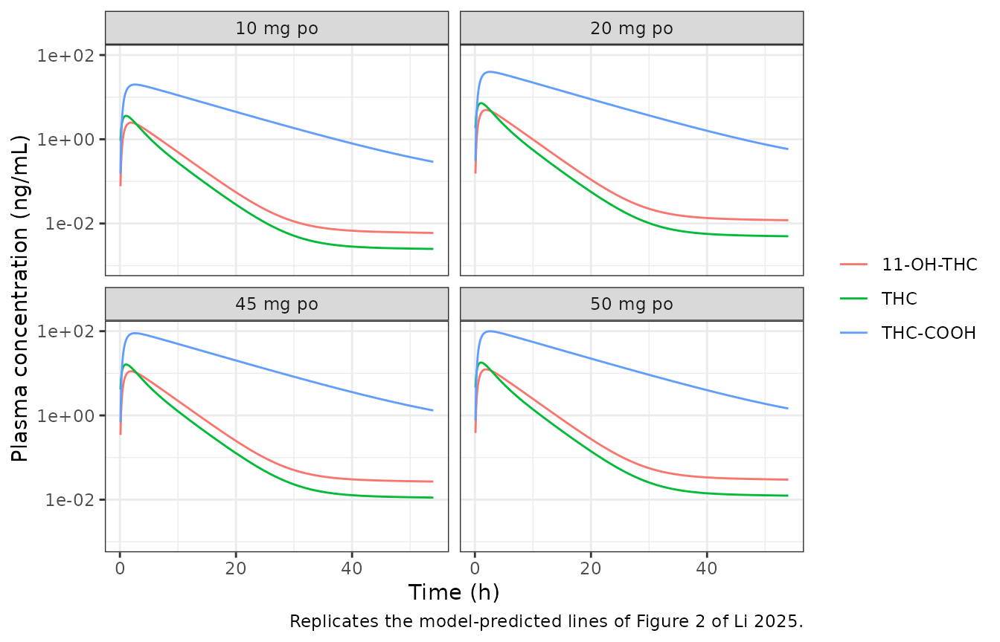
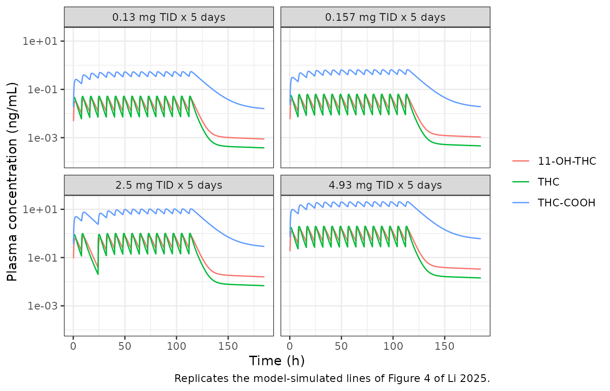
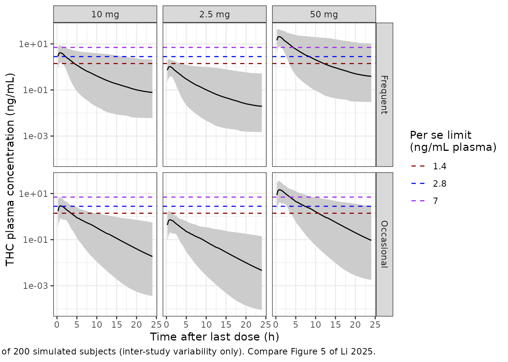

# Delta-9-tetrahydrocannabinol and metabolites after oral cannabis (Li 2025)

## Model and source

Li and An (2025) built a semi-mechanistic parent-metabolite population
PK model for delta-9-tetrahydrocannabinol (THC), its active metabolite
11-hydroxy-THC (11-OH-THC) and its terminal metabolite
11-nor-9-carboxy-THC (THC-COOH), aimed at oral cannabis users, and used
it to ask how well the whole-blood THC “per se” limits of 1, 2 and 5
ng/mL used in some US states separate impaired from unimpaired drivers.

- Citation: Li P, An G. Evaluation of Cannabis Per Se Laws: A
  Semi-Mechanistic Pharmacometrics Model for Quantitative
  Characterization of THC and Metabolites in Oral Users. *J Clin
  Pharmacol*. 2025;65(5):535.
  [doi:10.1002/jcph.6181](https://doi.org/10.1002/jcph.6181)
- Model file:
  `inst/modeldb/specificDrugs/Li_2025_tetrahydrocannabinol.R`

The structure (Figure 1, Equations 1-11) is:

- **THC**: first-order absorption from an oral `depot` with
  bioavailability F; `central` plus two peripheral compartments; the
  second peripheral compartment exchanges with an `adipose` compartment
  through a permeability-surface-area product PS and an adipose:plasma
  partition coefficient KP.
- **11-OH-THC**: formed from the whole of THC clearance; the same
  central / two peripheral / adipose structure with its own PS2 and KP2.
- **THC-COOH**: formed from a fraction Fm of 11-OH-THC clearance (the
  remainder is excreted unchanged); two compartments.

Formation is 1:1 by mass. The authors deliberately fitted weight-based
rather than molar concentrations because the molecular weights differ by
less than 5% per metabolic step (Methods, Data Source), so no
molecular-weight ratio appears in the model.

``` r

mod <- readModelDb("Li_2025_tetrahydrocannabinol")
mod_ui <- rxode2::rxode2(mod)
#> ℹ parameter labels from comments will be replaced by 'label()'
mod_typ <- rxode2::zeroRe(mod_ui)
```

## Population

The model was fitted to **digitised mean concentration-time profiles**,
not to individual data: 25 dose groups from 10 published studies
(Supplement Table S2), seven oral (single doses of 5-90 mg as dronabinol
capsules, cannabis decoction, brownies, commercial edibles or hemp oil)
and three intravenous (1.6-5 mg). Sampling ran from 4 to 54 h after
dose. Only occasional users were included (the frequent-user arms of
Newmeyer 2016 and 2017 were dropped) and only fasted administration (the
fed arm of Lunn 2019 was dropped). Four studies measured whole blood,
which the authors converted to plasma with blood:plasma ratios of 0.71
(THC), 0.73 (11-OH-THC) and 0.65 (THC-COOH).

Because the data were study means, inter-individual variability could
not be estimated. The four random effects in the model (on the THC,
11-OH-THC and THC-COOH central volumes and on THC clearance) are
**inter-study** variabilities; simulating from them gives a
between-study spread that the paper itself used as its “virtual subject”
variability in the per se analysis.

## Source trace

| Quantity | Value | Source |
|----|----|----|
| Structure | depot / 3-cmt + adipose THC; 3-cmt + adipose 11-OH-THC; 2-cmt THC-COOH | Figure 1; Equations 1-11 |
| F | 0.144 | Table 1 |
| Ka | 1.46 1/h | Table 1 |
| CL_THC, V_THC | 87 L/h, 204 L | Table 1 |
| Q1, V_THC,peri1 | 59.9 L/h, 30.2 L | Table 1 |
| Q2, V_THC,peri2 | 29.7 L/h, 88.3 L | Table 1 |
| PS, V_THC,adipose, KP | 5.5 L/h, 91.8 L, 14 | Table 1 |
| CL_11-OH-THC, V_11-OH-THC | 80.4 L/h, 49.1 L | Table 1 |
| Q3, V_11-OH-THC,peri1 | 19.9 L/h, 9.95 L | Table 1 |
| Q4, V_11-OH-THC,peri2 | 47.3 L/h, 84.3 L | Table 1 |
| PS2, V_11-OH-THC,adipose, KP2 | 5.11 L/h, 98.7 L, 9.87 | Table 1 |
| Fm | 0.904 | Table 1 |
| CL_THC-COOH, V_THC-COOH | 4.34 L/h, 0.986 L | Table 1 |
| Q5, V_THC-COOH,peri | 6.35 L/h, 27.6 L | Table 1 |
| omega^2 on CL_THC, V_THC, V_11-OH-THC, V_THC-COOH | 0.506, 1.19, 1.08, 0.846 | Table 1; Equation 12 |
| sigma^2 proportional THC, 11-OH-THC, THC-COOH | 0.375, 0.31, 0.144 | Table 1; Equation 13 |
| Blood:plasma ratio used for per se limits | 0.71 | Methods, Model Simulation |

## Typical-value profiles (Figure 2)

Figure 2 overlays the population-predicted (typical-value) profiles on
the digitised study means for single oral doses of 10, 20, 45 and 50 mg.

``` r

fig2_doses <- c(10, 20, 45, 50)
fig2_grid <- sort(unique(c(seq(0, 12, by = 0.1), seq(12.5, 54, by = 0.5))))
ev_fig2 <- lapply(seq_along(fig2_doses), function(i) {
  rxode2::et(amt = fig2_doses[i], cmt = "depot", id = i) |>
    rxode2::et(fig2_grid, cmt = "central", id = i) |>
    as.data.frame() |>
    mutate(dvid = ifelse(evid == 0, 1L, NA_integer_))
}) |>
  bind_rows()
sim_fig2 <- rxode2::rxSolve(mod_typ, ev_fig2, returnType = "data.frame") |>
  mutate(dose = paste(fig2_doses[id], "mg po"))
#> ℹ omega/sigma items treated as zero: 'etalcl', 'etalvc', 'etalvc_11oh', 'etalvc_thccooh'
#> Warning: multi-subject simulation without without 'omega'

sim_fig2 |>
  select(dose, time, THC = Cc, `11-OH-THC` = Cc_11oh, `THC-COOH` = Cc_thccooh) |>
  pivot_longer(-c(dose, time), names_to = "analyte", values_to = "conc") |>
  filter(time > 0) |>
  ggplot(aes(time, conc, colour = analyte)) +
  geom_line() +
  facet_wrap(~dose) +
  scale_y_log10(limits = c(1e-3, NA)) +
  labs(
    x = "Time (h)", y = "Plasma concentration (ng/mL)", colour = NULL,
    caption = "Replicates the model-predicted lines of Figure 2 of Li 2025."
  ) +
  theme_bw()
```



At 10 mg the typical THC peak is about 3.6 ng/mL near 1 h and the curve
falls to about 0.013 ng/mL by 24 h, 11-OH-THC peaks near 2.5 ng/mL at 2
h, and THC-COOH peaks near 20 ng/mL at 2-3 h and is still about 13 ng/mL
at 8 h, which is what the solid lines of Figure 2 show.

## External validation regimen (Figure 4)

The authors validated against Goodwin 2006: 0.13, 0.157, 2.5 or 4.93 mg
THC three times daily for 5 days, with only two doses on the first day
in the 2.5 mg group.

``` r

goodwin <- tibble::tibble(
  id = 1:4,
  dose = c(0.13, 0.157, 2.5, 4.93)
)
dose_times <- seq(0, by = 8, length.out = 15)
fig4_grid <- seq(0, 185, by = 0.25)
ev_fig4 <- lapply(seq_len(nrow(goodwin)), function(i) {
  tt <- dose_times
  # 2.5 mg group: 14 doses, the third dose of day 1 omitted.
  if (goodwin$dose[i] == 2.5) tt <- setdiff(tt, 16)
  bind_rows(
    data.frame(id = i, time = tt, amt = goodwin$dose[i], evid = 1, cmt = "depot"),
    data.frame(id = i, time = fig4_grid, amt = 0, evid = 0, cmt = "central", dvid = 1L)
  )
}) |>
  bind_rows() |>
  arrange(id, time, desc(evid))
sim_fig4 <- rxode2::rxSolve(mod_typ, ev_fig4, returnType = "data.frame") |>
  mutate(regimen = paste(goodwin$dose[id], "mg TID x 5 days"))
#> ℹ omega/sigma items treated as zero: 'etalcl', 'etalvc', 'etalvc_11oh', 'etalvc_thccooh'
#> Warning: multi-subject simulation without without 'omega'

sim_fig4 |>
  select(regimen, time, THC = Cc, `11-OH-THC` = Cc_11oh, `THC-COOH` = Cc_thccooh) |>
  pivot_longer(-c(regimen, time), names_to = "analyte", values_to = "conc") |>
  filter(time > 0) |>
  ggplot(aes(time, conc, colour = analyte)) +
  geom_line() +
  facet_wrap(~regimen) +
  scale_y_log10(limits = c(1e-4, NA)) +
  labs(
    x = "Time (h)", y = "Plasma concentration (ng/mL)", colour = NULL,
    caption = "Replicates the model-simulated lines of Figure 4 of Li 2025."
  ) +
  theme_bw()
```



## Per se limit analysis (Figure 5, Table 2)

The paper simulated occasional users as a single oral dose and frequent
users as the same dose twice daily for 14 days, at 2.5, 5, 10, 20, 50
and 100 mg, and counted the fraction of simulated plasma THC
concentrations above 1.4, 2.8 and 7 ng/mL (the 1, 2 and 5 ng/mL
whole-blood limits divided by 0.71) between 1 and 8 h and between 8 and
24 h after the last dose (Equations 14 and 15).

The model is linear, so a dose of D mg gives exactly D times the 1 mg
profile for the same random-effect draw. Table 2 shows this: the 2.5 mg
/ 1.4 ng/mL cell equals the 5 mg / 2.8 ng/mL cell, and the 10 mg / 1.4
ng/mL cell equals the 50 mg / 7 ng/mL cell. A single 200-subject cohort
per usage pattern at 1 mg, scaled by dose, therefore reproduces the
paper’s design, including its shared draws across dose groups.

``` r

rxode2::rxSetSeed(20250117)
n_sub <- 200
win_grid <- seq(0, 24, by = 0.25)

ev_occ <- rxode2::et(amt = 1, cmt = "depot") |>
  rxode2::et(win_grid, cmt = "central") |>
  rxode2::et(id = seq_len(n_sub)) |>
  as.data.frame() |>
  mutate(dvid = ifelse(evid == 0, 1L, NA_integer_))
last_dose <- 13 * 24 + 12
ev_freq <- rxode2::et(amt = 1, cmt = "depot", ii = 12, addl = 27) |>
  rxode2::et(last_dose + win_grid, cmt = "central") |>
  rxode2::et(id = seq_len(n_sub)) |>
  as.data.frame() |>
  mutate(dvid = ifelse(evid == 0, 1L, NA_integer_))

sim_occ <- rxode2::rxSolve(mod_ui, ev_occ, returnType = "data.frame") |>
  mutate(user = "Occasional", tald = time)
sim_freq <- rxode2::rxSolve(mod_ui, ev_freq, returnType = "data.frame") |>
  mutate(user = "Frequent", tald = time - last_dose)

# rxode2 returns the per-endpoint simulated observation (residual error
# included) in `sim`; with dvid = 1 on the observation rows that is THC (`Cc`).
sim_perse <- bind_rows(sim_occ, sim_freq) |>
  select(id, user, tald, ipred = Cc, obs = sim)
stopifnot(nrow(sim_perse) == 2 * n_sub * length(win_grid))
```

``` r

limits <- c(1.4, 2.8, 7)
sim_perse |>
  expand_grid(dose = c(2.5, 10, 50)) |>
  mutate(conc = ipred * dose) |>
  group_by(user, dose, tald) |>
  summarise(
    lo = quantile(conc, 0.05), med = median(conc), hi = quantile(conc, 0.95),
    .groups = "drop"
  ) |>
  filter(tald > 0) |>
  ggplot(aes(tald)) +
  geom_ribbon(aes(ymin = lo, ymax = hi), fill = "grey80") +
  geom_line(aes(y = med)) +
  geom_hline(
    data = data.frame(limit = factor(limits)),
    aes(yintercept = as.numeric(as.character(limit)), colour = limit),
    linetype = 2
  ) +
  scale_colour_manual(values = c("darkred", "blue", "purple")) +
  annotate("rect", xmin = 1, xmax = 8, ymin = -Inf, ymax = Inf, alpha = 0.1, fill = "orange") +
  facet_grid(user ~ paste(dose, "mg")) +
  scale_y_log10() +
  labs(
    x = "Time after last dose (h)", y = "THC plasma concentration (ng/mL)",
    colour = "Per se limit\n(ng/mL plasma)",
    caption = paste(
      "Median and 5th-95th percentiles of 200 simulated subjects (inter-study",
      "variability only). Compare Figure 5 of Li 2025."
    )
  ) +
  theme_bw()
#> Warning in transformation$transform(x): NaNs produced
```



``` r

table2 <- tibble::tribble(
  ~limit, ~dose, ~occ_1_8, ~occ_8_24, ~freq_1_8, ~freq_8_24,
  1.4, 2.5, 2.0, 0, 4.9, 0.6,
  1.4, 5, 12.6, 0.1, 21.6, 4.3,
  1.4, 10, 32.8, 2.0, 43.9, 13.6,
  1.4, 20, 53.7, 11.5, 58.5, 27.7,
  1.4, 50, 67.9, 34.2, 69.3, 46.5,
  1.4, 100, 73.0, 48.7, 74.0, 60.7,
  2.8, 2.5, 0, 0, 0.2, 0,
  2.8, 5, 2.0, 0, 4.9, 0.6,
  2.8, 10, 12.6, 0.1, 21.6, 4.3,
  2.8, 20, 32.8, 2.0, 43.9, 13.6,
  2.8, 50, 58.3, 16.6, 61.7, 32.3,
  2.8, 100, 67.9, 34.2, 69.3, 46.5,
  7, 2.5, 0, 0, 0, 0,
  7, 5, 0, 0, 0, 0,
  7, 10, 0.7, 0, 2.3, 0.2,
  7, 20, 7.7, 0, 14.8, 2.6,
  7, 50, 32.8, 2.0, 43.9, 13.6,
  7, 100, 53.7, 11.5, 58.5, 27.7
) |>
  pivot_longer(-c(limit, dose), names_to = "cell", values_to = "paper") |>
  separate(cell, c("user", "w1", "w2"), sep = "_") |>
  mutate(
    user = ifelse(user == "occ", "Occasional", "Frequent"),
    window = paste0(w1, "-", w2, " h")
  ) |>
  select(-w1, -w2)

# Equations 14-15: share of simulated concentrations in the window above
# the limit. The 1 mg concentrations are scaled by dose (linear model).
windows <- list(`1-8 h` = c(1, 8), `8-24 h` = c(8, 24))
pct_above <- function(users, window, dose, limit, column) {
  rng <- windows[[window]]
  d <- sim_perse[sim_perse$user == users & sim_perse$tald >= rng[1] &
    sim_perse$tald <= rng[2], ]
  100 * mean(d[[column]] * dose > limit)
}

sim_table2 <- table2 |>
  mutate(
    sim_ipred = mapply(pct_above, user, window, dose, limit, "ipred"),
    sim_obs = mapply(pct_above, user, window, dose, limit, "obs")
  )

sim_table2 |>
  arrange(user, window, limit, dose) |>
  mutate(across(c(sim_ipred, sim_obs), ~ round(.x, 1))) |>
  select(
    `User` = user, `Window` = window, `Limit (ng/mL)` = limit,
    `Dose (mg)` = dose, `Paper (%)` = paper,
    `Simulated, no residual (%)` = sim_ipred,
    `Simulated, with residual (%)` = sim_obs
  ) |>
  knitr::kable(caption = "Probability of impairment detection: Table 2 of Li 2025 against the packaged model.")
```

| User | Window | Limit (ng/mL) | Dose (mg) | Paper (%) | Simulated, no residual (%) | Simulated, with residual (%) |
|:---|:---|---:|---:|---:|---:|---:|
| Frequent | 1-8 h | 1.4 | 2.5 | 4.9 | 6.9 | 9.4 |
| Frequent | 1-8 h | 1.4 | 5.0 | 21.6 | 28.1 | 27.0 |
| Frequent | 1-8 h | 1.4 | 10.0 | 43.9 | 55.5 | 48.0 |
| Frequent | 1-8 h | 1.4 | 20.0 | 58.5 | 74.0 | 64.5 |
| Frequent | 1-8 h | 1.4 | 50.0 | 69.3 | 87.7 | 78.9 |
| Frequent | 1-8 h | 1.4 | 100.0 | 74.0 | 92.9 | 85.4 |
| Frequent | 1-8 h | 2.8 | 2.5 | 0.2 | 0.2 | 1.6 |
| Frequent | 1-8 h | 2.8 | 5.0 | 4.9 | 6.9 | 9.4 |
| Frequent | 1-8 h | 2.8 | 10.0 | 21.6 | 28.1 | 27.0 |
| Frequent | 1-8 h | 2.8 | 20.0 | 43.9 | 55.5 | 48.0 |
| Frequent | 1-8 h | 2.8 | 50.0 | 61.7 | 78.2 | 68.5 |
| Frequent | 1-8 h | 2.8 | 100.0 | 69.3 | 87.7 | 78.9 |
| Frequent | 1-8 h | 7.0 | 2.5 | 0.0 | 0.0 | 0.0 |
| Frequent | 1-8 h | 7.0 | 5.0 | 0.0 | 0.0 | 0.5 |
| Frequent | 1-8 h | 7.0 | 10.0 | 2.3 | 2.8 | 5.7 |
| Frequent | 1-8 h | 7.0 | 20.0 | 14.8 | 20.4 | 20.6 |
| Frequent | 1-8 h | 7.0 | 50.0 | 43.9 | 55.5 | 48.0 |
| Frequent | 1-8 h | 7.0 | 100.0 | 58.5 | 74.0 | 64.5 |
| Frequent | 8-24 h | 1.4 | 2.5 | 0.6 | 0.2 | 1.4 |
| Frequent | 8-24 h | 1.4 | 5.0 | 4.3 | 5.4 | 5.5 |
| Frequent | 8-24 h | 1.4 | 10.0 | 13.6 | 14.4 | 13.2 |
| Frequent | 8-24 h | 1.4 | 20.0 | 27.7 | 25.5 | 23.0 |
| Frequent | 8-24 h | 1.4 | 50.0 | 46.5 | 42.2 | 37.8 |
| Frequent | 8-24 h | 1.4 | 100.0 | 60.7 | 55.0 | 49.9 |
| Frequent | 8-24 h | 2.8 | 2.5 | 0.0 | 0.0 | 0.0 |
| Frequent | 8-24 h | 2.8 | 5.0 | 0.6 | 0.2 | 1.4 |
| Frequent | 8-24 h | 2.8 | 10.0 | 4.3 | 5.4 | 5.5 |
| Frequent | 8-24 h | 2.8 | 20.0 | 13.6 | 14.4 | 13.2 |
| Frequent | 8-24 h | 2.8 | 50.0 | 32.3 | 29.6 | 26.4 |
| Frequent | 8-24 h | 2.8 | 100.0 | 46.5 | 42.2 | 37.8 |
| Frequent | 8-24 h | 7.0 | 2.5 | 0.0 | 0.0 | 0.0 |
| Frequent | 8-24 h | 7.0 | 5.0 | 0.0 | 0.0 | 0.0 |
| Frequent | 8-24 h | 7.0 | 10.0 | 0.2 | 0.0 | 0.6 |
| Frequent | 8-24 h | 7.0 | 20.0 | 2.6 | 3.3 | 3.9 |
| Frequent | 8-24 h | 7.0 | 50.0 | 13.6 | 14.4 | 13.2 |
| Frequent | 8-24 h | 7.0 | 100.0 | 27.7 | 25.5 | 23.0 |
| Occasional | 1-8 h | 1.4 | 2.5 | 2.0 | 1.4 | 3.8 |
| Occasional | 1-8 h | 1.4 | 5.0 | 12.6 | 13.8 | 16.6 |
| Occasional | 1-8 h | 1.4 | 10.0 | 32.8 | 41.7 | 38.3 |
| Occasional | 1-8 h | 1.4 | 20.0 | 53.7 | 69.4 | 60.7 |
| Occasional | 1-8 h | 1.4 | 50.0 | 67.9 | 88.8 | 78.9 |
| Occasional | 1-8 h | 1.4 | 100.0 | 73.0 | 94.3 | 86.0 |
| Occasional | 1-8 h | 2.8 | 2.5 | 0.0 | 0.0 | 0.3 |
| Occasional | 1-8 h | 2.8 | 5.0 | 2.0 | 1.4 | 3.8 |
| Occasional | 1-8 h | 2.8 | 10.0 | 12.6 | 13.8 | 16.6 |
| Occasional | 1-8 h | 2.8 | 20.0 | 32.8 | 41.7 | 38.3 |
| Occasional | 1-8 h | 2.8 | 50.0 | 58.3 | 76.5 | 66.2 |
| Occasional | 1-8 h | 2.8 | 100.0 | 67.9 | 88.8 | 78.9 |
| Occasional | 1-8 h | 7.0 | 2.5 | 0.0 | 0.0 | 0.0 |
| Occasional | 1-8 h | 7.0 | 5.0 | 0.0 | 0.0 | 0.1 |
| Occasional | 1-8 h | 7.0 | 10.0 | 0.7 | 0.4 | 1.9 |
| Occasional | 1-8 h | 7.0 | 20.0 | 7.7 | 8.3 | 10.9 |
| Occasional | 1-8 h | 7.0 | 50.0 | 32.8 | 41.7 | 38.3 |
| Occasional | 1-8 h | 7.0 | 100.0 | 53.7 | 69.4 | 60.7 |
| Occasional | 8-24 h | 1.4 | 2.5 | 0.0 | 0.0 | 0.0 |
| Occasional | 8-24 h | 1.4 | 5.0 | 0.1 | 0.0 | 0.4 |
| Occasional | 8-24 h | 1.4 | 10.0 | 2.0 | 1.8 | 3.7 |
| Occasional | 8-24 h | 1.4 | 20.0 | 11.5 | 13.1 | 12.7 |
| Occasional | 8-24 h | 1.4 | 50.0 | 34.2 | 33.5 | 29.4 |
| Occasional | 8-24 h | 1.4 | 100.0 | 48.7 | 47.1 | 42.1 |
| Occasional | 8-24 h | 2.8 | 2.5 | 0.0 | 0.0 | 0.0 |
| Occasional | 8-24 h | 2.8 | 5.0 | 0.0 | 0.0 | 0.0 |
| Occasional | 8-24 h | 2.8 | 10.0 | 0.1 | 0.0 | 0.4 |
| Occasional | 8-24 h | 2.8 | 20.0 | 2.0 | 1.8 | 3.7 |
| Occasional | 8-24 h | 2.8 | 50.0 | 16.6 | 18.1 | 16.6 |
| Occasional | 8-24 h | 2.8 | 100.0 | 34.2 | 33.5 | 29.4 |
| Occasional | 8-24 h | 7.0 | 2.5 | 0.0 | 0.0 | 0.0 |
| Occasional | 8-24 h | 7.0 | 5.0 | 0.0 | 0.0 | 0.0 |
| Occasional | 8-24 h | 7.0 | 10.0 | 0.0 | 0.0 | 0.0 |
| Occasional | 8-24 h | 7.0 | 20.0 | 0.0 | 0.0 | 0.2 |
| Occasional | 8-24 h | 7.0 | 50.0 | 2.0 | 1.8 | 3.7 |
| Occasional | 8-24 h | 7.0 | 100.0 | 11.5 | 13.1 | 12.7 |

Probability of impairment detection: Table 2 of Li 2025 against the
packaged model. {.table}

``` r

abs_diff <- abs(sim_table2$sim_obs - sim_table2$paper)
# Centre of the comparison over all 72 cells. With 200 subjects per usage
# pattern the Monte-Carlo SE of a single cell is at most about 3.5 points
# (binomial, p = 0.5, n = 200); the cells share one cohort, so the median
# moves far less than that across seeds. Agreement in the high-dose
# cells is worse than this and is discussed below.
stopifnot(median(abs_diff) < 5)
# Ordering: detection never falls with dose at a fixed limit and window.
stopifnot(all(
  sim_table2 |>
    group_by(user, window, limit) |>
    arrange(dose, .by_group = TRUE) |>
    summarise(mono = all(diff(sim_obs) >= 0), .groups = "drop") |>
    pull(mono)
))
```

The median absolute difference from Table 2 across the 72 cells is 2.5
percentage points when proportional residual error is included. The
doses up to 20 mg agree well; at 50 and 100 mg the simulated detection
probabilities are higher than the published ones (for example 86%
against 73.0% for occasional users at 100 mg and 1.4 ng/mL). The
published values level off near 73% even though a 100 mg dose puts the
typical THC concentration above 1.4 ng/mL for the whole 1-8 h window,
which implies that about a quarter of the paper’s simulated
concentrations in that window stayed below 1.4 ng/mL at any dose,
i.e. more than 70-fold below the typical value. The paper does not
describe its simulation grid or how it handled residual error, and a
ceiling like that does not follow from the Table 1 variances, so the
discrepancy is recorded here rather than adjusted for.

## PKNCA validation

The model is linear with no parallel elimination from THC, so every
milligram of bioavailable THC is cleared through `cl` into 11-OH-THC,
and a fraction `fm` of that through `cl_11oh` into THC-COOH. The total
exposures are therefore exact:

- AUC(0-inf) THC = F x Dose / CL_THC
- AUC(0-inf) 11-OH-THC = F x Dose / CL_11-OH-THC
- AUC(0-inf) THC-COOH = F x Fm x Dose / CL_THC-COOH

with F = 1 for intravenous doses. PKNCA on a typical-value simulation of
a 10 mg oral dose and the 3.495 mg intravenous dose of Naef 2004 (study
ID 9) is checked against these values. The terminal half-life is about
200 h (the slow return from adipose), so the grid runs to 1500 h.

``` r

nca_grid <- sort(unique(c(seq(0, 48, by = 0.25), seq(50, 1500, by = 10))))
nca_arms <- tibble::tibble(
  id = 1:2,
  treatment = c("10 mg oral", "3.495 mg IV"),
  dose = c(10, 3.495),
  cmt = c("depot", "central"),
  f = c(0.144, 1)
)
ev_nca <- lapply(seq_len(nrow(nca_arms)), function(i) {
  rxode2::et(amt = nca_arms$dose[i], cmt = nca_arms$cmt[i], id = i) |>
    rxode2::et(nca_grid, cmt = "central", id = i) |>
    as.data.frame() |>
    mutate(dvid = ifelse(evid == 0, 1L, NA_integer_))
}) |>
  bind_rows()
sim_nca <- rxode2::rxSolve(
  mod_typ, ev_nca,
  returnType = "data.frame", rtol = 1e-10, atol = 1e-12, maxsteps = 1e6
)
#> ℹ omega/sigma items treated as zero: 'etalcl', 'etalvc', 'etalvc_11oh', 'etalvc_thccooh'
#> Warning: multi-subject simulation without without 'omega'

conc_nca <- sim_nca |>
  select(id, time, THC = Cc, `11-OH-THC` = Cc_11oh, `THC-COOH` = Cc_thccooh) |>
  pivot_longer(-c(id, time), names_to = "analyte", values_to = "Cc") |>
  left_join(select(nca_arms, id, treatment), by = "id") |>
  filter(!is.na(Cc)) |>
  mutate(Cc = pmax(Cc, 0))
stopifnot(all(sim_nca$Cc >= -1e-6 * max(sim_nca$Cc)))

dose_nca <- nca_arms |>
  crossing(analyte = c("THC", "11-OH-THC", "THC-COOH")) |>
  mutate(time = 0) |>
  select(id, treatment, analyte, time, dose)

o_conc <- PKNCA::PKNCAconc(conc_nca, Cc ~ time | treatment + analyte / id)
o_dose <- PKNCA::PKNCAdose(dose_nca, dose ~ time | treatment + analyte + id)
o_data <- PKNCA::PKNCAdata(
  o_conc, o_dose,
  intervals = data.frame(
    start = 0, end = Inf, cmax = TRUE, tmax = TRUE,
    aucinf.obs = TRUE, half.life = TRUE
  )
)
nca_res <- as.data.frame(PKNCA::pk.nca(o_data))

nca_wide <- nca_res |>
  filter(PPTESTCD %in% c("cmax", "tmax", "aucinf.obs", "half.life")) |>
  select(treatment, analyte, PPTESTCD, PPORRES) |>
  pivot_wider(names_from = PPTESTCD, values_from = PPORRES)

pars <- c(cl = 87, cl_11oh = 80.4, cl_thccooh = 4.34, fm = 0.904)
nca_check <- nca_wide |>
  left_join(select(nca_arms, treatment, dose, f), by = "treatment") |>
  mutate(
    auc_closed = 1000 * f * dose * case_when(
      analyte == "THC" ~ 1 / pars[["cl"]],
      analyte == "11-OH-THC" ~ 1 / pars[["cl_11oh"]],
      analyte == "THC-COOH" ~ pars[["fm"]] / pars[["cl_thccooh"]]
    ),
    pct_diff = 100 * (aucinf.obs / auc_closed - 1)
  )

nca_check |>
  mutate(across(c(cmax, tmax, aucinf.obs, half.life, auc_closed, pct_diff), ~ signif(.x, 4))) |>
  select(
    Treatment = treatment, Analyte = analyte, `Cmax (ng/mL)` = cmax,
    `Tmax (h)` = tmax, `t1/2 (h)` = half.life,
    `AUC0-inf PKNCA (ng*h/mL)` = aucinf.obs,
    `AUC0-inf closed form (ng*h/mL)` = auc_closed, `Difference (%)` = pct_diff
  ) |>
  knitr::kable(caption = "PKNCA on typical-value profiles against the closed-form total exposure.")
```

| Treatment | Analyte | Cmax (ng/mL) | Tmax (h) | t1/2 (h) | AUC0-inf PKNCA (ng\*h/mL) | AUC0-inf closed form (ng\*h/mL) | Difference (%) |
|:---|:---|---:|---:|---:|---:|---:|---:|
| 10 mg oral | 11-OH-THC | 2.480 | 2.00 | 186.9 | 17.91 | 17.91 | -0.018880 |
| 10 mg oral | THC | 3.594 | 1.00 | 201.6 | 16.49 | 16.55 | -0.356200 |
| 10 mg oral | THC-COOH | 19.890 | 2.50 | 186.8 | 300.00 | 299.90 | 0.028370 |
| 3.495 mg IV | 11-OH-THC | 7.023 | 0.75 | 186.9 | 43.31 | 43.47 | -0.377500 |
| 3.495 mg IV | THC | 17.130 | 0.00 | 201.7 | 40.20 | 40.17 | 0.077830 |
| 3.495 mg IV | THC-COOH | 52.230 | 1.25 | 186.8 | 728.00 | 728.00 | 0.004703 |

PKNCA on typical-value profiles against the closed-form total exposure.
{.table}

``` r


# Same parameter draws on both sides; the residual is trapezoid and
# extrapolation error on a 0.25 h / 10 h grid, measured below 0.5%.
stopifnot(all(abs(nca_check$pct_diff) < 2))
```

The paper reports no NCA summary, so the closed-form exposures are the
reference; the paper’s own model-predicted curves are compared visually
in the Figure 2 and Figure 4 sections above.

## Assumptions and deviations

- **Inter-study, not inter-individual, variability.** The four random
  effects were estimated across study means. They are encoded as
  ordinary etas so the model can be simulated the way the paper did for
  its 1000 virtual subjects, but they describe study-to-study spread of
  mean profiles, not subject-to-subject spread.
- **Residual error.** Equation 13 describes a combined proportional and
  additive model, but Table 1 reports only proportional variances for
  each analyte and no additive component. The model carries proportional
  error only, with SD = sqrt(sigma^2).
- **Supplement Table S3 disagrees on THC-COOH.** Its row for the final
  model (model 8) says “One-compartment for THC-COOH”, while Figure 1,
  Equations 4 and 11 and Table 1 (Q5, V_THC-COOH,peri) all describe two
  compartments. The equations and parameter table are followed.
- **Bioavailability.** Equation 1 starts the depot at the dose; F from
  Table 1 is applied to the oral depot only. Intravenous doses go into
  `central` with F = 1, as the IV studies require.
- **Goodwin 2006 dose times.** The paper gives the sampling times but
  not the dose times. The Figure 4 replication assumes doses every 8 h
  from time 0, with the 16 h dose omitted in the 2.5 mg group to give 14
  doses.
- **Per se simulation.** The grid of concentrations used for Equations
  14 and 15 is not stated; 0.25 h is used here. Table 2 is compared at
  200 simulated subjects per usage pattern rather than the paper’s 1000,
  and the high-dose cells disagree as described in that section.
- **Whole-blood to plasma.** The per se limits use the paper’s 0.71
  blood:plasma ratio for THC; the model itself predicts plasma
  concentrations.
- **THC-COOH suffix.** The terminal metabolite uses the `thccooh` suffix
  (`central_thccooh`, `Cc_thccooh`), registered for this model.
