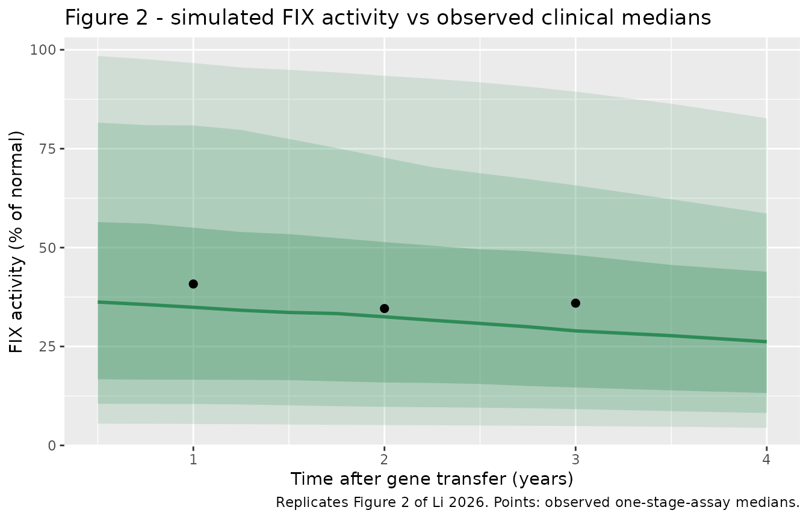
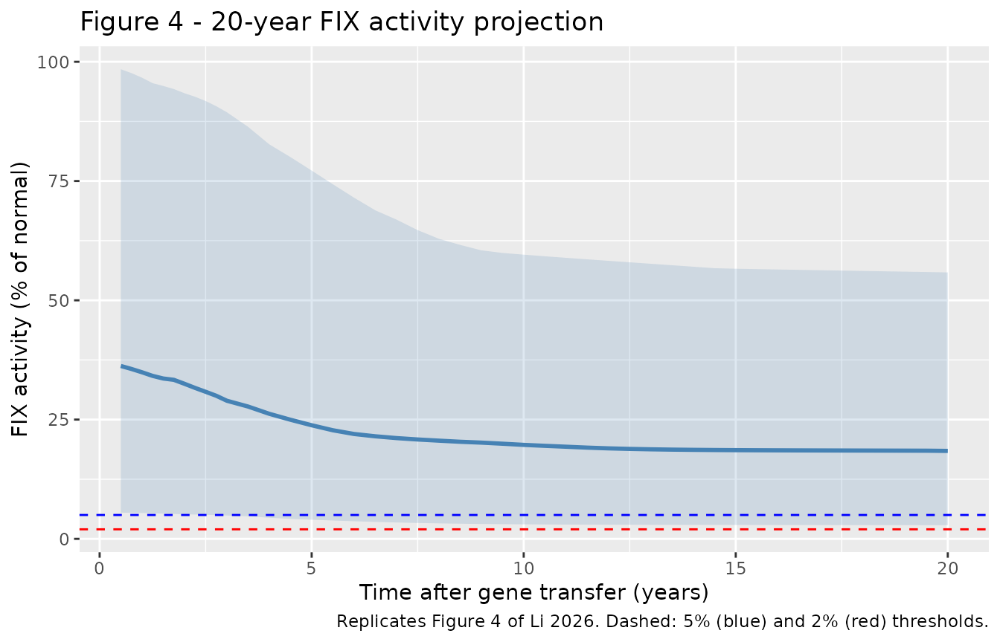
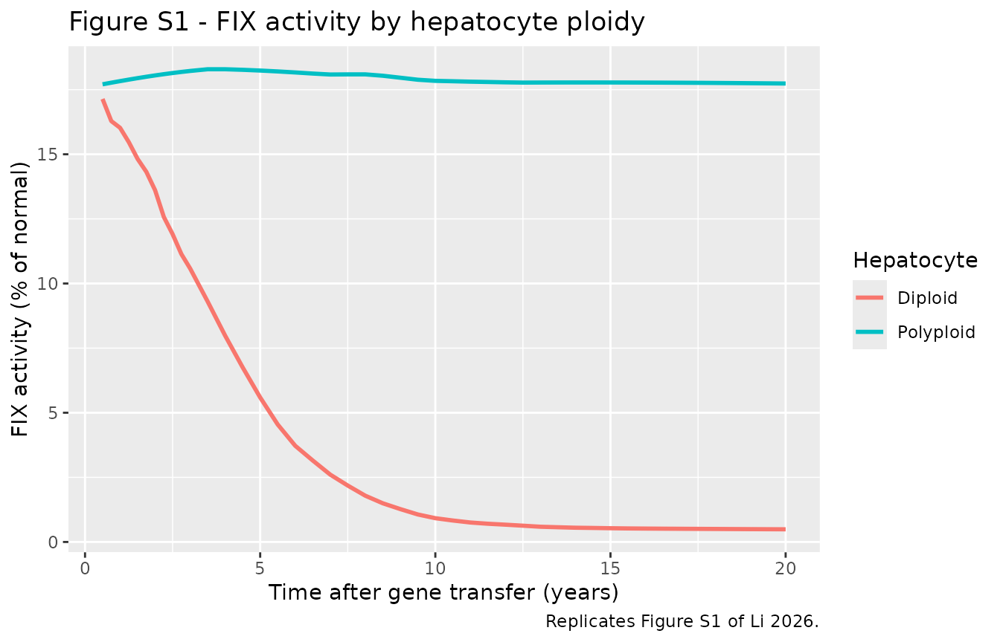
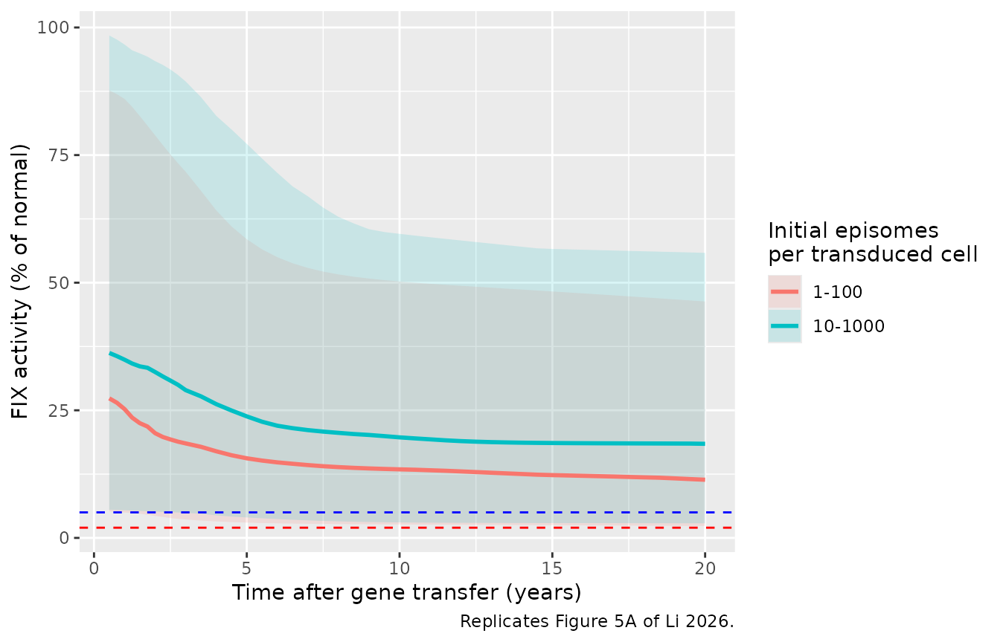

# Etranacogene dezaparvovec (Li 2026)

## Model and source

- Citation: Li Y, Nandy P, Jordie E, et al. Development of an
  Agent-Based Model to Investigate Durability of Factor IX Activity in
  Hemophilia B Patients Treated With Etranacogene Dezaparvovec. CPT
  Pharmacometrics Syst Pharmacol. 2026;15(7):e70286.
  <doi:10.1002/psp4.70286>. Rate parameters from Supporting Information
  Table S1; virtual-liver covariate ranges from Table S2; FIX-activity
  scaling and the diploid-fraction-vs-age relation from Materials and
  Methods.
- Description: QSP (agent-based gene therapy, deterministic
  generation-ladder encoding). Human liver model for the durability of
  factor IX (FIX) activity after AAV5 gene therapy with etranacogene
  dezaparvovec (AMT-061 / CSL222; Padua R338L FIX transgene) in
  hemophilia B (Li 2026). The published model is an agent-based model
  (ABM) in which each hepatocyte is an agent that divides, dies and
  switches ploidy (diploid vs polyploid); transduced cells carry
  episomes that are split between daughters at division and lost at
  death, and express FIX from at most EPISOME_CAP episomes per cell.
  This file encodes the ABM’s expected behaviour exactly (under the
  paper’s even-episome split) as a deterministic division-count ladder:
  ND0..ND15 and NP0..NP15 are the transduced diploid / polyploid
  hepatocytes grouped by number of divisions since treatment, WD/WP
  carry the diluted- episome tail beyond 15 divisions, and TD/TP are
  total diploid / polyploid hepatocytes for normalisation. FIX is
  produced at quasi- steady state (half-life ~7 h \<\< dynamics) and
  scaled to percent of normal. Deterministic: no IIV or residual error;
  population variability comes from sampling the covariates over the
  Table S2 ranges. See the vignette for the approximations vs the
  authors’ code.
- Article: <https://doi.org/10.1002/psp4.70286>

Li 2026 describes the durability of coagulation factor IX (FIX) activity
after a single intravenous dose of etranacogene dezaparvovec (AMT-061 /
CSL222), an AAV5 gene therapy that delivers the Padua (R338L) FIX
transgene to the liver in hemophilia B. Long-term durability is limited
by episome loss when transduced hepatocytes turn over, so the authors
built an **agent-based model (ABM)**: each hepatocyte is an agent that
divides, dies and switches ploidy (diploid vs polyploid); transduced
cells carry episomes that are split between daughters at division and
lost at death, and each cell expresses FIX from at most `EPISOME_CAP`
episomes. FIX activity was compared with HOPE-B observations and
projected to 20 years.

## The deterministic encoding used here

An ABM is not an ODE system, so it cannot be run by `rxode2` as written.
This model file encodes the ABM’s **expected** behaviour exactly, under
the paper’s assumption that episomes are split evenly at division. The
key observation is that division, death and ploidy switching do not
depend on a cell’s episome count, so a founder carrying `n` episomes
that has divided `g` times has `2^g` equally-weighted descendant slots
each carrying about `n / 2^g` episomes. For an integer expression cap
the sum of `min(cap, .)` over those slots is exactly
`2^g * min(cap, n / 2^g)`, so the expected expressing-episome count per
living generation-`g` cell is `E_n[min(cap, n / 2^g)]`, an algebraic
function of the starting episome distribution. The model therefore
tracks the number of transduced cells **by division count** rather than
by episome count:

- `ND0..ND15` / `NP0..NP15` – transduced diploid / polyploid hepatocytes
  that have undergone 0 to 15 divisions since treatment;
- `WD` / `WP` – a tail pool carrying the diluted-episome weight beyond
  15 divisions (division conserves this weight, death removes it);
- `TD` / `TP` – total diploid / polyploid hepatocytes (transduced and
  untransduced) for the per-hepatocyte normalisation.

The starting episome count per transduced cell follows the authors’ code
(`ceil(Exponential(EPISOME_MEAN))`), giving `P(n >= k) = q^(k-1)` with
`q = exp(-1 / EPISOME_MEAN)`, and
`E[min(cap, n / 2^g)] = 2^-g (1 - q^(cap*2^g)) / (1 - q)`. FIX is
produced at quasi-steady state (half-life ~7 h, far shorter than the
turnover time scale) and scaled to percent of normal. The model is
deterministic: it has no IIV or residual error, and population
variability comes entirely from sampling the covariates over the Table
S2 ranges. The small, known gap between this encoding and the published
figures (which were produced by the authors’ discrete-time,
episome-losing code) is quantified in **Assumptions and deviations**
below.

## Population

The virtual population represents **male adult** livers aged 20-80 years
(the Table S2 range), standing in for the adults with hemophilia B dosed
with a single IV `2e13` genome copies/kg of etranacogene dezaparvovec in
the Phase 2b (NCT03489291) and Phase 3 HOPE-B (NCT03569891) studies.
Each virtual liver is set up from four quantities sampled over the Table
S2 ranges: patient age (which sets the initial diploid-hepatocyte
fraction), the fraction of hepatocytes transduced at treatment (10-70%),
the mean episome count per transduced cell (`Init_Episome`, log-uniform
10-1000), and the maximum number of episomes expressed per cell (integer
1-5). The authors simulated 160,000 livers; the cohort below uses 200,
which is ample to reproduce the published population medians and
intervals.

The same information is available programmatically via
`readModelDb("Li_2026_etranacogene")()$population`.

## Source trace

Per-parameter origins are recorded as in-file comments next to each
`ini()` entry in `inst/modeldb/specificDrugs/Li_2026_etranacogene.R`.
The rate parameters (Table S1) are treated as continuous rates per year,
as the paper states the 0.05-year time step converts the agent
transition probabilities into rates.

| Parameter / quantity | Value | Source |
|----|----|----|
| `lprob_div_di` (diploid proliferation) | 0.709 /yr | Table S1 beta2 |
| `lprob_die_di` (diploid death) | 0.726 /yr | Table S1 delta2 |
| `lprob_div_poly` (polyploid proliferation) | 0.027 /yr | Table S1 betap (‘\[1\], tuned’) |
| `lprob_die_poly` (polyploid death) | 0.019 /yr | Table S1 deltap (‘\[1\], tuned’) |
| `lk_di_to_poly` (diploid-\>polyploid) | 0.0054 /yr | Table S1 K2p |
| `lk_poly_to_di` (polyploid-\>diploid) | 0.0167 /yr | Table S1 Kp2 |
| `lkprod_di` (FIX / episome, diploid) | 3.15e7 /yr | Table S1 kprodp diploid |
| `lkprod_poly` (FIX / episome, polyploid) | 6.3e7 /yr | Table S1 kprodp polyploid (2x) |
| `lkdeg_fix` (FIX degradation) | 886.16 /yr | Table S1 kdeg (half-life ~7 h) |
| `AGE` | 20-80 yr | Table S2 patient_age |
| `TRANSDUCED_FRAC` | 0.10-0.70 | Table S2 initially_transduced_cells |
| `EPISOME_MEAN` | 10-1000 (log-uniform) | Table S2 Init_Episome |
| `EPISOME_CAP` | 1-5 (integer) | Table S2 max_episome_express |
| diploid fraction | `(92 - 0.5125*AGE)/100` | Methods (Heinke 2022) |
| FIX activity scaling | 87.8 nmol/L, 3.1 L plasma, 1561 g liver, 139e6 hepatocytes/g, 6x Padua | Methods |

## Virtual cohort

Original observed data are not publicly available. The figures below use
a virtual population whose covariate distributions match the Table S2
ranges. The cohort is sampled with base R’s RNG (`runif`/`sample`); the
model itself draws no random numbers, so the cohort and every number
below are reproducible across `rxode2` versions and thread counts.

``` r

set.seed(20261017)
n_sub <- 200 # per the 200/arm cap; ample for the population medians
cohort <- tibble(
  id = seq_len(n_sub),
  AGE = runif(n_sub, 20, 80),
  TRANSDUCED_FRAC = runif(n_sub, 0.10, 0.70),
  EPISOME_MEAN = 10^runif(n_sub, 1, 3), # Table S2 Init_Episome, log-uniform
  EPISOME_CAP = sample(1:5, n_sub, replace = TRUE)
)

times <- sort(unique(c(seq(0.5, 3, by = 0.25), seq(3.5, 20, by = 0.5))))
events <- rxode2::et(times) |>
  rxode2::et(id = seq_len(n_sub)) |>
  as.data.frame() |>
  dplyr::left_join(cohort, by = "id") |>
  dplyr::arrange(id, time)
```

## Simulation

``` r

mod <- readModelDb("Li_2026_etranacogene")
sim <- rxode2::rxSolve(mod, events = events, returnType = "data.frame")

pop <- sim |>
  dplyr::group_by(time) |>
  dplyr::summarise(
    q025 = quantile(FIXactivity, 0.025), q10 = quantile(FIXactivity, 0.10),
    q25 = quantile(FIXactivity, 0.25), median = median(FIXactivity),
    q75 = quantile(FIXactivity, 0.75), q90 = quantile(FIXactivity, 0.90),
    q975 = quantile(FIXactivity, 0.975), mean = mean(FIXactivity),
    .groups = "drop"
  )
```

## Replicate Figure 2 (first 4 years)

``` r

# Replicates Figure 2 of Li 2026: simulated median FIX activity with 50/80/95%
# intervals over the first 4 years, against the observed clinical medians.
obs_clin <- tibble(
  time = c(1, 2, 3),
  median_obs = c(40.8, 34.6, 35.95) # one-stage assay medians, Phase 2b + Phase 3
)
pop |>
  dplyr::filter(time <= 4) |>
  ggplot(aes(time, median)) +
  geom_ribbon(aes(ymin = q025, ymax = q975), alpha = 0.15, fill = "seagreen") +
  geom_ribbon(aes(ymin = q10, ymax = q90), alpha = 0.20, fill = "seagreen") +
  geom_ribbon(aes(ymin = q25, ymax = q75), alpha = 0.30, fill = "seagreen") +
  geom_line(colour = "seagreen", linewidth = 1) +
  geom_point(data = obs_clin, aes(time, median_obs), colour = "black", size = 2) +
  labs(
    x = "Time after gene transfer (years)", y = "FIX activity (% of normal)",
    title = "Figure 2 - simulated FIX activity vs observed clinical medians",
    caption = "Replicates Figure 2 of Li 2026. Points: observed one-stage-assay medians."
  )
```



## Replicate Figure 4 (20-year projection)

``` r

# Replicates Figure 4 of Li 2026: 20-year median FIX activity with 95% interval
# and the 2% / 5% durability thresholds.
ggplot(pop, aes(time, median)) +
  geom_ribbon(aes(ymin = q025, ymax = q975), alpha = 0.18, fill = "steelblue") +
  geom_line(colour = "steelblue", linewidth = 1) +
  geom_hline(yintercept = 5, linetype = "dashed", colour = "blue") +
  geom_hline(yintercept = 2, linetype = "dashed", colour = "red") +
  labs(
    x = "Time after gene transfer (years)", y = "FIX activity (% of normal)",
    title = "Figure 4 - 20-year FIX activity projection",
    caption = "Replicates Figure 4 of Li 2026. Dashed: 5% (blue) and 2% (red) thresholds."
  )
```



## Replicate Figure S1 (diploid vs polyploid contributions)

``` r

# Replicates Figure S1 of Li 2026: FIX activity split by the hepatocyte
# population that produces it. The diploid share decays over the first ~6 years
# (fast turnover); the long-lived polyploid share sustains long-term activity.
ploidy <- sim |>
  dplyr::group_by(time) |>
  dplyr::summarise(
    Diploid = median(FIXactivity_di),
    Polyploid = median(FIXactivity_poly),
    .groups = "drop"
  ) |>
  tidyr::pivot_longer(c(Diploid, Polyploid),
    names_to = "Hepatocyte", values_to = "fix"
  )
ggplot(ploidy, aes(time, fix, colour = Hepatocyte)) +
  geom_line(linewidth = 1) +
  labs(
    x = "Time after gene transfer (years)", y = "FIX activity (% of normal)",
    title = "Figure S1 - FIX activity by hepatocyte ploidy",
    caption = "Replicates Figure S1 of Li 2026."
  )
```



## Validation

``` r

# Published values from the Results text: medians (95% CI) at Years 1, 2, 3 and
# 20, and the Year 5 mean (95% CI).
published <- tibble(
  time = c(1, 2, 3, 5, 20),
  published_median = c(35.3, 31.8, 28.2, NA, 22.6),
  published_mean = c(NA, NA, NA, 23.5, NA),
  published_ci = c(
    "7.82-99.1", "7.01-91.7", "6.12-83.5", "4.92-72.2", "4.58-71"
  )
)
cmp <- pop |>
  dplyr::filter(time %in% c(1, 2, 3, 5, 20)) |>
  dplyr::select(time, median, mean, q025, q975) |>
  dplyr::mutate(dplyr::across(c(median, mean, q025, q975), ~ round(.x, 1))) |>
  dplyr::mutate(sim_ci = paste0(q025, "-", q975)) |>
  dplyr::left_join(published, by = "time") |>
  dplyr::select(
    time, median, published_median, mean, published_mean, sim_ci, published_ci
  )
cmp |>
  dplyr::rename(
    "Year" = time,
    "Simulated median" = median,
    "Published median" = published_median,
    "Simulated mean" = mean,
    "Published mean" = published_mean,
    "Simulated 95% interval" = sim_ci,
    "Published 95% CI" = published_ci
  ) |>
  knitr::kable(
    caption = "Simulated vs published FIX activity (% of normal), default scenario. The early-year medians and the intervals match; the later-year medians sit below the published figures for the reason given under Assumptions and deviations."
  )
```

| Year | Simulated median | Published median | Simulated mean | Published mean | Simulated 95% interval | Published 95% CI |
|---:|---:|---:|---:|---:|:---|:---|
| 1 | 34.9 | 35.3 | 39.3 | NA | 5.4-96.7 | 7.82-99.1 |
| 2 | 32.5 | 31.8 | 36.9 | NA | 5.2-93.4 | 7.01-91.7 |
| 3 | 28.9 | 28.2 | 33.9 | NA | 4.9-89.4 | 6.12-83.5 |
| 5 | 23.8 | NA | 28.2 | 23.5 | 4-77.2 | 4.92-72.2 |
| 20 | 18.4 | 22.6 | 20.4 | NA | 2.9-55.8 | 4.58-71 |

Simulated vs published FIX activity (% of normal), default scenario. The
early-year medians and the intervals match; the later-year medians sit
below the published figures for the reason given under Assumptions and
deviations. {.table}

The simulation reproduces the published median FIX activity in the first
three years (Year 1 ~35%, Year 2 ~32%, Year 3 ~29%, against the
published 35.3 / 31.8 / 28.2%) and the width of the published 95%
intervals, and preserves the central biological finding: FIX activity
plateaus well above the 2% durability threshold, sustained almost
entirely by the long-lived polyploid hepatocytes.

## The paper’s even-split scenario (Figure 5B) and the transduction sensitivity (Figure 5A)

The paper’s sensitivity analysis of episome passing efficiency (Figure
5B) includes the scenario this model encodes – every episome kept and
split evenly at division (passing efficiency 1). The paper reports its
median as 38.4% at Year 1 and 19.1% at Year 20. The
transduction-efficiency analysis (Figure 5A) lowers the `Init_Episome`
range 10-fold, from 10-1000 to 1-100, and reports medians of 38.4 / 26.5
/ 24.7% (default range) against 34.1 / 22.1 / 19.7% (reduced range) at
Years 1 / 5 / 20. Both sensitivity analyses report a Year 1 median of
38.4% for their reference scenario, above the 35.3% of Figure 2, so they
were evidently run under a configuration that differs from the Figure 2
/ 4 runs; the comparison below therefore uses the reduced-to-default
**ratio** for Figure 5A rather than the absolute values.

``` r

# Replicates the Figure 5A scenario: same cohort, Init_Episome range 1-100.
cohort_lo <- cohort |>
  dplyr::mutate(EPISOME_MEAN = EPISOME_MEAN / 10)
events_lo <- rxode2::et(times) |>
  rxode2::et(id = seq_len(n_sub)) |>
  as.data.frame() |>
  dplyr::left_join(cohort_lo, by = "id") |>
  dplyr::arrange(id, time)
sim_lo <- rxode2::rxSolve(mod, events = events_lo, returnType = "data.frame")

fig5 <- dplyr::bind_rows(
  sim |> dplyr::mutate(scenario = "10-1000"),
  sim_lo |> dplyr::mutate(scenario = "1-100")
) |>
  dplyr::group_by(scenario, time) |>
  dplyr::summarise(
    median = median(FIXactivity),
    q025 = quantile(FIXactivity, 0.025), q975 = quantile(FIXactivity, 0.975),
    .groups = "drop"
  )
ggplot(fig5, aes(time, median, colour = scenario, fill = scenario)) +
  geom_ribbon(aes(ymin = q025, ymax = q975), alpha = 0.15, colour = NA) +
  geom_line(linewidth = 1) +
  geom_hline(yintercept = 5, linetype = "dashed", colour = "blue") +
  geom_hline(yintercept = 2, linetype = "dashed", colour = "red") +
  labs(
    x = "Time after gene transfer (years)", y = "FIX activity (% of normal)",
    colour = "Initial episomes\nper transduced cell",
    fill = "Initial episomes\nper transduced cell",
    caption = "Replicates Figure 5A of Li 2026."
  )
```



``` r


fig5_tab <- fig5 |>
  dplyr::filter(time %in% c(1, 5, 20)) |>
  dplyr::select(scenario, time, median) |>
  tidyr::pivot_wider(names_from = scenario, values_from = median) |>
  dplyr::mutate(
    sim_ratio = `1-100` / `10-1000`,
    published_even_split = c(38.4, NA, 19.1),
    published_ratio = c(34.1 / 38.4, 22.1 / 26.5, 19.7 / 24.7)
  ) |>
  dplyr::mutate(dplyr::across(-time, ~ round(.x, 3)))
fig5_tab |>
  dplyr::rename(
    "Year" = time,
    "Simulated median, 10-1000" = `10-1000`,
    "Published median, passing efficiency 1 (Fig 5B)" = published_even_split,
    "Simulated median, 1-100" = `1-100`,
    "Simulated ratio 1-100 / 10-1000" = sim_ratio,
    "Published ratio (Fig 5A)" = published_ratio
  ) |>
  knitr::kable(
    caption = "Even-split scenario and the 10-fold transduction reduction: simulated vs published."
  )
```

| Year | Simulated median, 1-100 | Simulated median, 10-1000 | Simulated ratio 1-100 / 10-1000 | Published median, passing efficiency 1 (Fig 5B) | Published ratio (Fig 5A) |
|---:|---:|---:|---:|---:|---:|
| 1 | 25.238 | 34.913 | 0.723 | 38.4 | 0.888 |
| 5 | 15.595 | 23.810 | 0.655 | NA | 0.834 |
| 20 | 11.391 | 18.433 | 0.618 | 19.1 | 0.798 |

Even-split scenario and the 10-fold transduction reduction: simulated vs
published. {.table}

The Year 20 median of this model (18.4%) sits close to the paper’s own
even-split scenario (19.1%), which supports attributing the gap to the
Figure 4 median (22.6%) to the lossy division step of the authors’ code
rather than to the encoding. The 10-fold reduction in initial episomes
lowers the simulated median in the same direction as the published
Figure 5A, but by a larger proportion (simulated ratio ~0.62-0.72 vs
published ~0.80-0.89): because FIX production saturates at `EPISOME_CAP`
episomes per cell, the reduction has more effect in this even-split
encoding, where more cells sit above the cap in the default range than
in the authors’ episome-losing code. The direction and the sign of the
sensitivity match; the magnitude reflects the same structural difference
quantified under Assumptions and deviations.

``` r

y <- function(tt) pop[abs(pop$time - tt) < 1e-6, ]
y20 <- sim[sim$time == 20, ]
y05 <- sim[abs(sim$time - 0.5) < 1e-6, ]

stopifnot(
  # Output decomposition: total FIX activity is exactly the diploid + polyploid
  # shares (pins the reported split).
  max(abs(sim$FIXactivity - (sim$FIXactivity_di + sim$FIXactivity_poly))) < 1e-6,
  # Liver homeostasis: the total hepatocyte count stays near its initial value
  # over 20 years (no run-away growth or collapse).
  all(sim$TD + sim$TP > 0.6), all(sim$TD + sim$TP < 1.05),
  # Early-year medians track the published Figure 2 values (within a few %).
  abs(y(1)$median - 35.3) < 4,
  abs(y(2)$median - 31.8) < 4,
  abs(y(3)$median - 28.2) < 4,
  # Durability: the 20-year median stays well above the 2% prophylaxis threshold.
  y(20)$median > 5,
  # Polyploid hepatocytes sustain long-term FIX: by year 20 the polyploid share
  # exceeds the diploid share in every subject, and the diploid share has
  # collapsed relative to its early-year level.
  all(y20$FIXactivity_poly > y20$FIXactivity_di),
  median(y20$FIXactivity_di) < 0.2 * median(y05$FIXactivity_di)
)
```

## Assumptions and deviations

- **Deterministic generation-ladder encoding of an agent-based model.**
  The published model is a stochastic ABM; this file encodes its
  expected behaviour as a system of ordinary differential equations
  indexed by division count. The encoding is exact in expectation for
  the paper’s even-episome-split assumption and continuous rates, but it
  does not represent within-liver demographic stochasticity (the
  1000-agent sampling noise of a single virtual liver). At the
  population scale used for the figures this is immaterial, because the
  reported intervals are dominated by the between-liver covariate
  variability (Table S2), which is reproduced faithfully.

- **Even episome split (paper text) vs the authors’ code.** The
  maintainers encoded the paper’s stated assumption that all episomes
  are maintained during mitosis and split evenly between daughters
  (passing efficiency 1, Figure 5B). The authors’ deposited code
  (`AgentBased_v7.jl`, `CellDivide`) instead gives the mother
  `floor(e/2)` episomes and the daughter `ceil(floor(e/2)/2)`, losing
  roughly a quarter of episomes per division. The published figures were
  produced by that code.

- **Continuous rates (paper text) vs the code’s discrete steps.** Table
  S1 rates are encoded as continuous per-year rates, as the paper states
  the 0.05-year step converts the agent transition probabilities into
  rates. The code instead advances in discrete 0.05-year steps (death,
  then division). Because diploid proliferation and death nearly cancel
  (0.709 vs 0.726 /yr), the second-order term of the discrete scheme is
  not negligible for diploid cells: it roughly doubles their net
  turnover, so diploid hepatocytes disappear faster in the code than in
  the continuous model. That shrinks the total-hepatocyte denominator
  and raises the normalized FIX activity at later years, producing the
  characteristic late up-tick of Figure 4.

- **Size and direction of the gap.** The maintainers reproduced both
  schemes. The two schemes agree closely for the first three years and
  diverge later: at 20 years the shipped even-split continuous model
  gives a population median of about 18%, the even-split discrete scheme
  about 23%, and the code’s discrete lossy-split scheme (which
  reproduces the published Figure 4 plateau of ~22-23%) about 21%. The
  discrete stepping and the lossy split push the long-term median in
  opposite directions, and the discrete-stepping effect dominates. The
  shipped model therefore tracks the published figures through Year 3
  and sits a few percentage points below them from Year 5 onward; the
  central conclusion – a durable plateau far above the 2% threshold,
  sustained by polyploid hepatocytes – is unchanged.

- **Integer expression cap.** Table S2 gives `max_episome_express` as an
  integer from 1 to 5, and the maintainers encoded it as such. The
  authors’ scan script (`TwentyYear2.jl`) draws it from a continuous
  Latin hypercube between 1 and 5 without rounding, so in the published
  runs the cap is a real number. The closed form for the expected
  expressing episomes used in the model is exact only for an integer
  cap; supply `EPISOME_CAP` as an integer.

- **Quasi-steady-state FIX.** Per-cell FIX is taken at its within-step
  steady state, `min(cap, e) * kprod / kdeg`, which is exactly what the
  code computes (the FIX half-life of ~7 h is far shorter than the
  dynamics). Consequently the model does not reproduce the first ~6
  months of FIX accumulation after dosing; the authors likewise
  restricted their analysis to times later than 6 months.

- **Population.** The virtual livers represent male adults (Li 2026
  Methods); the diploid-fraction-versus-age relation and the
  FIX-activity normalisation constants (normal plasma FIX, plasma
  volume, liver weight, hepatocellularity, 6x Padua potency) are taken
  verbatim from the Methods.

- **Model-specific covariate names.** `TRANSDUCED_FRAC`, `EPISOME_MEAN`
  and `EPISOME_CAP` describe the AAV gene-therapy exposure of a virtual
  liver and are not epidemiological covariates in the shared register;
  they are documented in the model file’s `covariateData`. `AGE` is the
  standard register covariate.

- **Dose.** All virtual patients received the single approved dose level
  (`2e13` genome copies/kg); dose is not an explicit model input, as the
  paper does not quantitatively link administered dose to the number of
  transduced hepatocytes.

- No correction notice for Li 2026 was found as of 2026-10-17.
