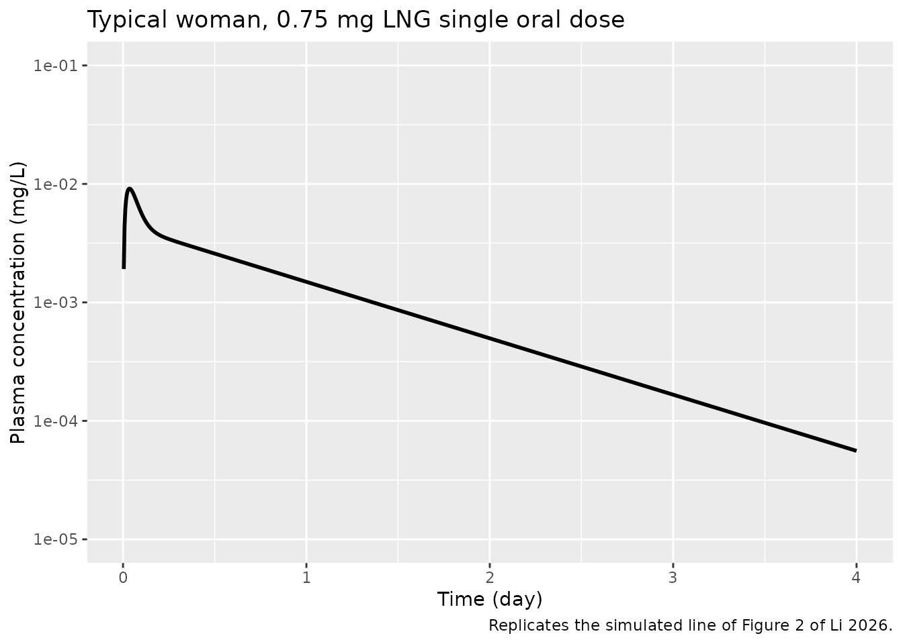
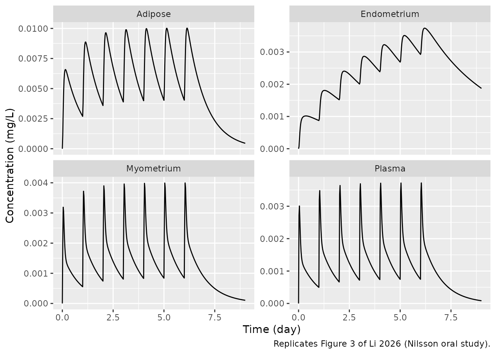
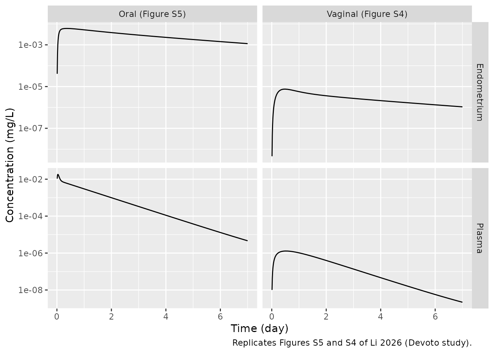
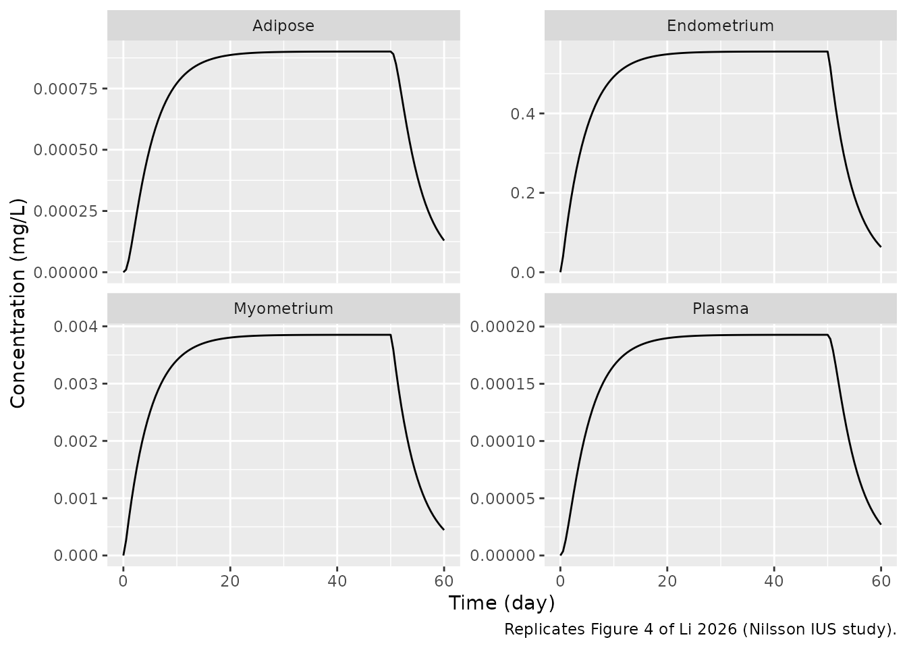
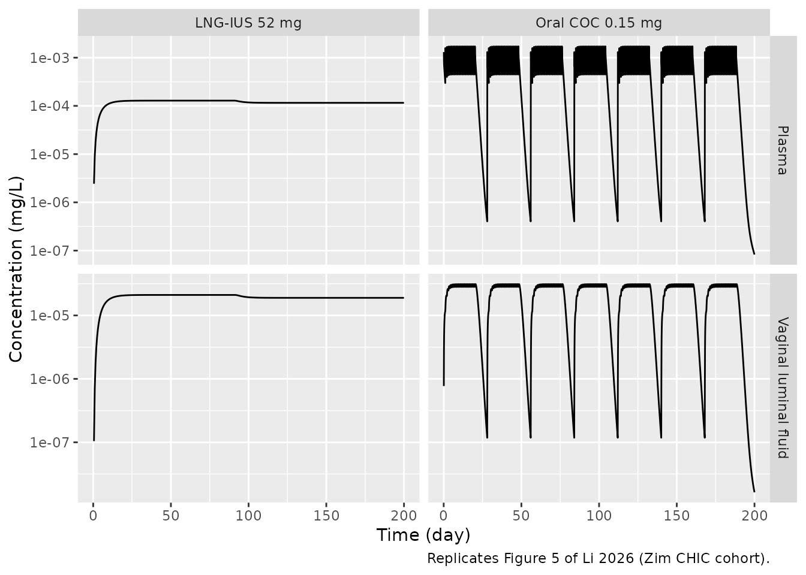
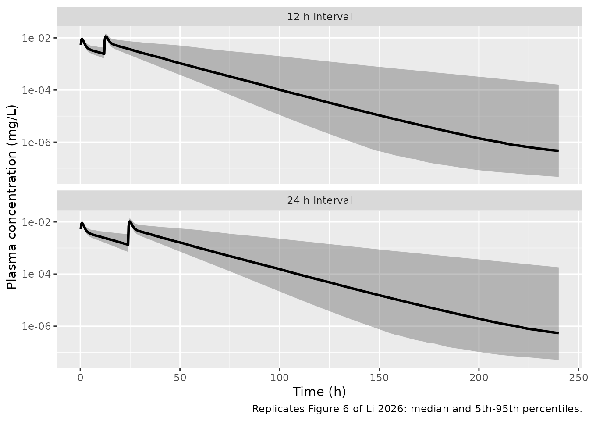
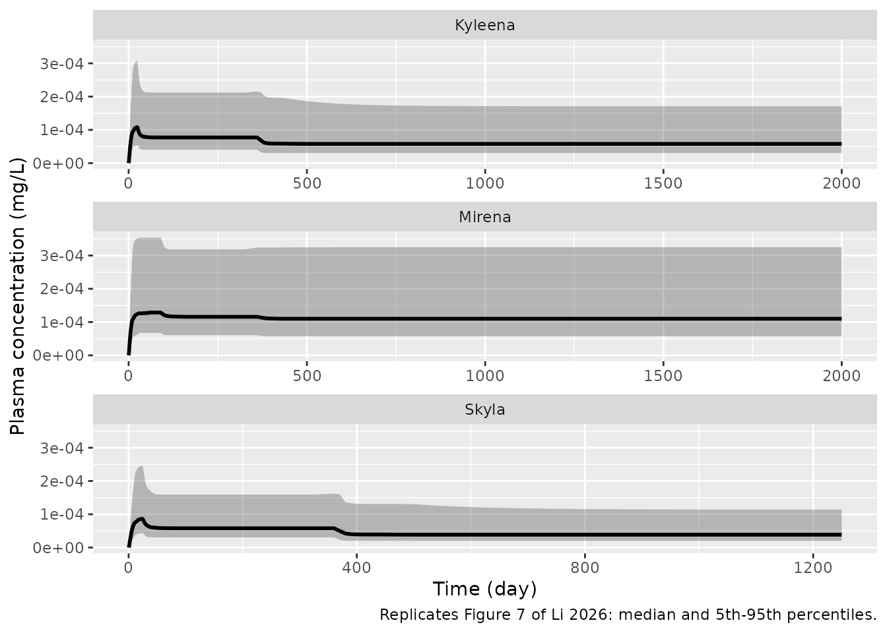

# Levonorgestrel female-reproductive-tract PBPK (Li 2026)

``` r

library(nlmixr2lib)
library(rxode2)
library(PKNCA)
library(dplyr)
library(tidyr)
library(ggplot2)
```

## Model and source

Li et al. (2026, *J Clin Pharmacol* 66(2):e70159,
[doi:10.1002/jcph.70159](https://doi.org/10.1002/jcph.70159), PMCID
PMC12910638) extended the vaginal physiologically-based pharmacokinetic
(PBPK) model of Kay et al. 2018 (`Kay_2018_dapivirine_pbpk` in this
package) into a whole-body PBPK model with an explicit **female
reproductive tract (FRT)**, and calibrated it with levonorgestrel (LNG)
given by three routes: oral tablets, vaginal tablets and intrauterine
systems (IUS).

The main body has venous and arterial blood, lungs, liver, kidneys,
adipose, GI tract, spleen and a lumped rest of body, all
perfusion-limited. The pelvic sub-model gives each of the vagina, cervix
and uterus a luminal fluid layer, an outer tissue layer (vaginal
epithelium, cervical epithelium, uterine endometrium) and an inner
tissue layer (vaginal stroma, cervical stroma, uterine myometrium). The
inner layers exchange with a shared pelvic blood supply, and
neighbouring layers exchange by first-order passive permeation. The
vaginal lumen also carries a solubility switch that sends released drug
to a suspended pool once the luminal concentration passes the aqueous
solubility.

The authors published the ODEs (Supplemental Information S1), the full
mrgsolve code (S2) and the parameter tables (Supplemental Tables S1, S3
and S7), so the model is reproduced end to end from the paper.

``` r

mod <- readModelDb("Li_2026_levonorgestrel_pbpk")
ui <- rxode2::rxode(mod)
ui$state
#>  [1] "depot"                "depot_vaginal"        "vaginal_lumen"       
#>  [4] "vaginal_lumen_precip" "vaginal_epithelium"   "vaginal_stroma"      
#>  [7] "pelvic_blood"         "cervical_fluid"       "cervical_epithelium" 
#> [10] "cervical_stroma"      "uterine_fluid"        "uterine_endometrium" 
#> [13] "uterine_myometrium"   "venous"               "lung"                
#> [16] "arterial"             "liver"                "kidney"              
#> [19] "adipose"              "gut"                  "spleen"              
#> [22] "other"
```

The model holds **amounts** (mg) in every state, whereas the source
writes the ODEs in concentrations. The two forms are the same: every
flux in the mrgsolve code is `k * C * V` (mg/h), and S1 divides by the
compartment volume. Amount states let each route take ordinary dose
records in mg:

| Route | Dose record | Release |
|----|----|----|
| Oral tablet | bolus into `depot` | first order, `ka`, into the GI tract |
| Vaginal tablet | bolus into `depot_vaginal` | first order, `ka`, into the vaginal lumen (split by the solubility switch) |
| Intrauterine system | zero-order infusion (`rate`) into `uterine_fluid` | the paper’s zero-order dosing function |

## Population

The model was not fitted to individual data. The physiology describes a
58 kg reference woman (Supplemental Table S1), and the model was
calibrated against published mean profiles from 11 sources (Supplemental
Table S6): Nilsson 1982 (oral 0.25 mg daily and a 63 mg IUS; plasma,
endometrium, myometrium and adipose), Devoto 2005 (1.5 mg oral and
vaginal; plasma and endometrium), single 0.75 mg oral doses from
Landgren 1986, He 1990, Kook 2002 and Tremblay 2001, and the Zim CHIC
cohort (oral combined contraceptive and LNG-IUS; plasma and vaginal
fluid). External validation used Tremblay 2001 and Johansson 2002 (two
0.75 mg doses 12 or 24 h apart) and the FDA clinical-pharmacology
reviews of Skyla, Kyleena and Mirena. Uterine volume and uterine artery
flow were measured by ultrasound in 12 women (Supplemental Table S2) and
the uterine and cervical permeation rate constants by ex vivo permeation
of excised tissue (Supplemental Table S4).

## Source trace

| Model element | Source location | Value |
|----|----|----|
| Whole-body ODEs (venous, arterial, lung, liver, kidney, adipose, rest of body) | Main-text Eqs. 1-5; S1; S2 `$ODE` | – |
| GI tract and spleen draining to liver | Main-text Eq. 3; S2 Flux39-43 | – |
| FRT permeation fluxes | Main-text Eq. 6; S1; S2 Flux1-3, 19-30 | – |
| Vaginal lumen solution / suspension | Main-text Eqs. 7-9; S1 | – |
| Vaginal epithelium (active transport term) | Main-text Eq. 11; S1 | `k_ve_vs_active = 0` |
| Dosing functions | Main-text Eqs. 12-13 | first order / zero order |
| `q_cardiac` | Table S1 | 294 L/h |
| `qfrac_liver`, `qfrac_kidney`, `qfrac_adipose`, `qfrac_gut`, `qfrac_spleen` | Table S1 | 0.10, 0.15, 0.11, 0.14, 0.03 |
| `q_pelvic` | Table S1 | 2.44 L/h |
| Rest-of-body flow | Table S1 formula | `QCO - QH - QR - QS - QAD - QGI - QVS` |
| `bwfrac_*` (16 tissue mass fractions) | Table S1; S2 `$PARAM` | see model file |
| Endometrium : myometrium volume split | Table S1 | 0.6/1.6 : 1.0/1.6 of uterus |
| Cervical epithelium volume | Table S1 | 1/2.2 of cervix |
| Adipose density | Main text, Model Parameterization; S2 | 0.916 kg/L |
| `fu` | Table S3 | 0.015 |
| `bpr` | Table S3 | 1.07 |
| `funi_lumen`, `funi_tissue` | Table S3 | 1, 1 (LNG neutral) |
| `sol_lumen` | Table S3 | 2.05 mg/L |
| `hill_sol` | Main text after Eq. 9; S2 | 5 |
| `lcl` (CL_H) | Table S3 | 7.06 L/h |
| `lcl_lumen` (CL_L) | Table S3 | 2.5e-5 L/h |
| `lkp_liver`, `lkp_kidney`, `lkp_lung`, `lkp_adipose`, `lkp_gut`, `lkp_other` | Table S3 | 2.1, 1.9, 2.5, 5, 4.0, 0.6 |
| `lkp_spleen` | S2 `$PARAM` `P_S` | 1.1 |
| `lkp_vaginal_stroma`, `lkp_cervical_stroma`, `lkp_uterine_myometrium` | Table S3 | 0.01 each |
| 32 permeation rate constants `k_<from>_<to>` | Table S3 | see model file |
| `lka` | S2 `$PARAM` `TVka` | 1.5 1/h |
| `lfdepot` | S2 `$PARAM` `F` | 1 |
| Population variability | Table S7 | truncated normals; 30% log-normal on IUS rates |
| IUS release phases | Figure 7 caption | Skyla, Kyleena, Mirena rates |

## Helpers

``` r

# Observation rows name an ODE state; rxode2 returns every algebraic output
# (Cc, Cendometrium, ...) as a column regardless.
obs_rows <- function(times, id = 1L) {
  data.frame(id = id, time = times, evid = 0L, amt = 0, rate = 0, cmt = "venous")
}

oral_doses <- function(amt, times, id = 1L) {
  data.frame(id = id, time = times, evid = 1L, amt = amt, rate = 0, cmt = "depot")
}

# Piecewise zero-order IUS release: one infusion record per phase, rates in
# ug/day converted to mg/h.
ius_doses <- function(rates_ug_day, starts_day, ends_day, id = 1L) {
  rate_mg_h <- rates_ug_day / 1000 / 24
  dur_h <- (ends_day - starts_day) * 24
  data.frame(
    id = id, time = starts_day * 24, evid = 1L,
    amt = rate_mg_h * dur_h, rate = rate_mg_h, cmt = "uterine_fluid"
  )
}

# Truncated normal by inverse CDF (Table S7: mean, SD, min, max).
rtruncnorm <- function(n, mean, sd, lo, hi) {
  u <- runif(n, pnorm(lo, mean, sd), pnorm(hi, mean, sd))
  qnorm(u, mean, sd)
}

solve_typical <- function(events, wt = 58) {
  events$WT <- wt
  as.data.frame(rxode2::rxSolve(mod, events = events, returnType = "data.frame"))
}
```

## Development: single 0.75 mg oral dose (Figure 2)

``` r

ev_sd <- bind_rows(
  oral_doses(0.75, 0),
  obs_rows(sort(unique(c(seq(0, 6, by = 0.1), seq(6, 96, by = 1)))))
) |> arrange(time, desc(evid))
sim_sd <- solve_typical(ev_sd)

ggplot(filter(sim_sd, time > 0), aes(time / 24, Cc)) +
  geom_line(linewidth = 1) +
  scale_y_log10(limits = c(1e-5, 1e-1)) +
  labs(
    x = "Time (day)", y = "Plasma concentration (mg/L)",
    title = "Typical woman, 0.75 mg LNG single oral dose",
    caption = "Replicates the simulated line of Figure 2 of Li 2026."
  )
```



The simulated peak is 0.00912 mg/L at 0.9 h. The Figure 2 line peaks
near 0.009 mg/L at about 1-1.5 h and reads about 1.3e-3 mg/L at day 1,
against 0.00149 mg/L here. The terminal phase declines faster here than
in Figure 2 (see *Errata*): the model’s terminal half-life is about 15
h, which agrees with Figure 3 and with the median of Figure 6 but not
with the slower tail drawn in Figure 2.

``` r

# Deterministic typical-woman peak; Figure 2 digitised as ~0.0085-0.0095 mg/L.
stopifnot(abs(max(sim_sd$Cc) / 0.009 - 1) < 0.15)
```

## Development: Nilsson 0.25 mg oral daily (Figure 3)

``` r

ev_nil_oral <- bind_rows(
  oral_doses(0.25, seq(0, 6 * 24, by = 24)),
  obs_rows(seq(0, 9 * 24, by = 0.5))
) |> arrange(time, desc(evid))
sim_nil_oral <- solve_typical(ev_nil_oral)

sim_nil_oral |>
  select(time, Plasma = Cc, Endometrium = Cendometrium, Myometrium = Cmyometrium, Adipose = Cadipose) |>
  pivot_longer(-time) |>
  ggplot(aes(time / 24, value)) +
  geom_line() +
  facet_wrap(~name, scales = "free_y") +
  labs(
    x = "Time (day)", y = "Concentration (mg/L)",
    caption = "Replicates Figure 3 of Li 2026 (Nilsson oral study)."
  )
```



The endometrium, myometrium and adipose profiles follow Figure 3; the
plasma peaks are about 30% higher than drawn in Figure 3a (0.0037
against about 0.0028 mg/L) with lower troughs. The paper optimised
release rates study by study without reporting them, and the model
carries only the single dosing rate constant of the published code (see
*Errata*).

## Development: Devoto 1.5 mg oral and vaginal (Figures S5 and S4)

Devoto 2005 gave 1.5 mg LNG (two 0.75 mg tablets) by mouth or into the
vagina and measured plasma and endometrial concentrations.

``` r

obs_devoto <- obs_rows(sort(unique(c(seq(0, 12, by = 0.25), seq(12, 168, by = 2)))))
sim_devoto_oral <- solve_typical(
  bind_rows(oral_doses(1.5, 0), obs_devoto) |> arrange(time, desc(evid))
) |> mutate(route = "Oral (Figure S5)")
sim_devoto_vag <- solve_typical(
  bind_rows(
    data.frame(id = 1L, time = 0, evid = 1L, amt = 1.5, rate = 0, cmt = "depot_vaginal"),
    obs_devoto
  ) |> arrange(time, desc(evid))
) |> mutate(route = "Vaginal (Figure S4)")

bind_rows(sim_devoto_oral, sim_devoto_vag) |>
  select(route, time, Plasma = Cc, Endometrium = Cendometrium) |>
  pivot_longer(c(Plasma, Endometrium)) |>
  filter(time > 0) |>
  ggplot(aes(time / 24, value)) +
  geom_line() +
  scale_y_log10() +
  facet_grid(name ~ route, scales = "free_y") +
  labs(
    x = "Time (day)", y = "Concentration (mg/L)",
    caption = "Replicates Figures S5 and S4 of Li 2026 (Devoto study)."
  )
```



``` r


devoto_tab <- tibble(
  Route = c("Oral", "Oral", "Vaginal", "Vaginal"),
  Output = c("Plasma Cmax", "Endometrium Cmax", "Plasma Cmax", "Endometrium Cmax"),
  sim = c(
    max(sim_devoto_oral$Cc), max(sim_devoto_oral$Cendometrium),
    max(sim_devoto_vag$Cc), max(sim_devoto_vag$Cendometrium)
  ),
  # Peaks of the simulated lines in Figures S5 and S4, digitised.
  paper = c(0.019, 0.0062, 0.0035, 0.022)
)
devoto_tab |>
  rename("Model (mg/L)" = sim, "Paper's simulation (mg/L)" = paper) |>
  knitr::kable(digits = 7)
```

| Route   | Output           | Model (mg/L) | Paper’s simulation (mg/L) |
|:--------|:-----------------|-------------:|--------------------------:|
| Oral    | Plasma Cmax      |    0.0181335 |                    0.0190 |
| Oral    | Endometrium Cmax |    0.0061003 |                    0.0062 |
| Vaginal | Plasma Cmax      |    0.0000013 |                    0.0035 |
| Vaginal | Endometrium Cmax |    0.0000075 |                    0.0220 |

``` r

# Oral route: deterministic, digitisation error only.
stopifnot(all(abs(devoto_tab$sim[1:2] / devoto_tab$paper[1:2] - 1) < 0.2))
# Vaginal route: the printed equations put a 1.5 mg tablet almost entirely
# into suspension, so systemic exposure is three orders of magnitude below the
# paper's own Figure S4 simulation. Pinned so a change to the vaginal
# structure is noticed.
stopifnot(devoto_tab$sim[3] < devoto_tab$paper[3] / 100)
```

The oral route reproduces the simulated peaks of Figure S5. **The
vaginal route does not reproduce Figure S4.** A 1.5 mg tablet in 0.5 mL
of luminal fluid is about 3000 mg/L against an aqueous solubility of
2.05 mg/L, so the solubility switch of Eqs. 7-9 sends nearly all
released drug to the suspended pool. The printed equations give
suspended drug no route back into solution, only loss by fluid turnover,
so almost nothing is absorbed. The paper’s text says that suspended drug
redissolves when the dissolved concentration falls below the solubility,
and its Figure S4 simulation (plasma peak near 3.5e-3 mg/L at about 12
h) needs such a step, but neither S1 nor the mrgsolve code gives its
equation or rate, and the vaginal release rate is not reported either.
The model follows the printed equations; use the vaginal route for
structure only, not for predicting exposure (see *Errata*).

## Development: Nilsson 63 mg IUS, tissue-to-plasma ratios (Figure 4)

The Nilsson IUS release rate is not reported. Because the model is
linear in dose, the **steady-state tissue-to-plasma ratios** in Figure 4
do not depend on it, and they test the partition coefficients and the
pelvic permeation network directly. The plot uses 30 ug/day, the rate at
which this model reproduces the digitised plasma plateau of Figure 4a
(about 1.95e-4 mg/L); that rate is used only for the plot.

``` r

ev_nil_ius <- bind_rows(
  ius_doses(30, 0, 50),
  obs_rows(seq(0, 60 * 24, by = 12))
) |> arrange(time, desc(evid))
sim_nil_ius <- solve_typical(ev_nil_ius)

sim_nil_ius |>
  select(time, Plasma = Cc, Endometrium = Cendometrium, Myometrium = Cmyometrium, Adipose = Cadipose) |>
  pivot_longer(-time) |>
  ggplot(aes(time / 24, value)) +
  geom_line() +
  facet_wrap(~name, scales = "free_y") +
  labs(
    x = "Time (day)", y = "Concentration (mg/L)",
    caption = "Replicates Figure 4 of Li 2026 (Nilsson IUS study)."
  )
```



``` r


plateau <- sim_nil_ius |> filter(time == 40 * 24)
ratio_tab <- tibble(
  Tissue = c("Endometrium", "Myometrium", "Adipose"),
  sim = c(plateau$Cendometrium, plateau$Cmyometrium, plateau$Cadipose) / plateau$Cc,
  # Figure 4 plateaus digitised: plasma 1.95e-4, endometrium 0.56,
  # myometrium 0.00385, adipose 9.0e-4 mg/L.
  paper = c(0.56, 0.00385, 9.0e-4) / 1.95e-4
) |>
  mutate(pct_diff = 100 * (sim / paper - 1))
ratio_tab |>
  rename(
    "Tissue:plasma (model)" = sim,
    "Tissue:plasma (Figure 4)" = paper,
    "Difference (%)" = pct_diff
  ) |>
  knitr::kable(digits = 2)
```

| Tissue      | Tissue:plasma (model) | Tissue:plasma (Figure 4) | Difference (%) |
|:------------|----------------------:|-------------------------:|---------------:|
| Endometrium |               2883.45 |                  2871.79 |           0.41 |
| Myometrium  |                 19.98 |                    19.74 |           1.21 |
| Adipose     |                  4.67 |                     4.62 |           1.25 |

``` r

# Deterministic ratios; the only error is the digitisation of Figure 4
# (a few percent). A wrong partition coefficient or rate constant moves a
# ratio by tens of percent.
stopifnot(all(abs(ratio_tab$pct_diff) < 8))
```

## Development: Zim CHIC cohort (Figure 5)

The combined oral contraceptive gives 0.15 mg LNG daily for 21 days
followed by 7 placebo days; the LNG-IUS arm is a 52 mg system, simulated
here with the Mirena release phases of Figure 7.

``` r

coc_days <- unlist(lapply(0:6, function(cyc) cyc * 28 + 0:20))
ev_coc <- bind_rows(
  oral_doses(0.15, coc_days * 24),
  obs_rows(seq(0, 200 * 24, by = 2))
) |> arrange(time, desc(evid))
sim_coc <- solve_typical(ev_coc) |> mutate(arm = "Oral COC 0.15 mg")

ev_chic_ius <- bind_rows(
  ius_doses(c(20, 18), c(0, 91), c(91, 200)),
  obs_rows(seq(0, 200 * 24, by = 12))
) |> arrange(time, desc(evid))
sim_chic_ius <- solve_typical(ev_chic_ius) |> mutate(arm = "LNG-IUS 52 mg")

bind_rows(sim_coc, sim_chic_ius) |>
  select(arm, time, Plasma = Cc, `Vaginal luminal fluid` = Cvaginal_fluid) |>
  pivot_longer(c(Plasma, `Vaginal luminal fluid`)) |>
  filter(value > 0) |>
  ggplot(aes(time / 24, value)) +
  geom_line() +
  scale_y_log10() +
  facet_grid(name ~ arm, scales = "free_y") +
  labs(
    x = "Time (day)", y = "Concentration (mg/L)",
    caption = "Replicates Figure 5 of Li 2026 (Zim CHIC cohort)."
  )
```



Figure 5 shows steady-state plasma peaks near 2e-3 mg/L and
vaginal-fluid plateaus near 2.5e-5 mg/L for the oral arm, and plateaus
of about 1.3e-4 (plasma) and 1.8e-5 mg/L (vaginal fluid) for the IUS
arm. The simulated IUS-arm values at day 180 are 0.000116 (plasma) and
1.89e-05 mg/L (vaginal fluid).

## Analytical check: IUS steady state

With the vaginal-lumen turnover clearance negligible (2.5e-5 L/h), all
drug released by an IUS at rate `R` is cleared by the liver. Gut and
spleen drain into the liver, so at steady state the hepatic inflow is
`(QH + QGI + QS) * C_A` and the well-stirred balance gives

`C_ss = R * (Q_hep + CL_H) / (Q_hep * CL_H)`, with `Q_hep = 0.27 * QCO`.

``` r

q_hep <- 0.27 * 294
r_mg_h <- 20 / 1000 / 24
css_closed <- r_mg_h * (q_hep + 7.06) / (q_hep * 7.06)
css_sim <- sim_chic_ius$Cc[sim_chic_ius$time == 90 * 24]
c(closed_form = css_closed, simulated = css_sim)
#>  closed_form    simulated 
#> 0.0001285339 0.0001285338
# Same parameters on both sides; the residual is the vaginal-lumen clearance
# and incomplete approach to steady state, both well below 1%.
stopifnot(abs(css_sim / css_closed - 1) < 0.01)
```

## Population predictions (Table S7)

The paper’s population predictions sample body weight, hepatic and
luminal clearance, pelvic blood flow, uterine mass fraction and four
uterine permeation rate constants from truncated normal distributions
(Table S7), and the IUS input rates from a log-normal distribution with
a 30% CV. The other parameters stay at their typical values.

``` r

rxode2::rxSetSeed(20260217)
n_sub <- 200

draw_cohort <- function(n) {
  tibble(
    id = seq_len(n),
    WT = rtruncnorm(n, 58, 8.6, 35, 100),
    lcl = log(rtruncnorm(n, 7.06, 2.69, 0.1, 67.62)),
    lcl_lumen = log(rtruncnorm(n, 2.5e-5, 1e-5, 1e-6, 0.01)),
    q_pelvic = rtruncnorm(n, 2.44, 1.37, 1, 50),
    bwfrac_uterus = rtruncnorm(n, 0.00168, 0.000612, 0.000325, 0.021),
    k_ue_uf = rtruncnorm(n, 0.148, 0.0624, 0.001, 0.556),
    k_ue_um = rtruncnorm(n, 0.076, 0.0475, 0.001, 0.266),
    k_um_ue = rtruncnorm(n, 0.097, 0.0531, 0.001, 0.412),
    k_um_pb = rtruncnorm(n, 0.076, 0.0412, 0.001, 0.313),
    rate_mult = exp(rnorm(n, 0, sqrt(log(1 + 0.3^2))))
  )
}
cohort <- draw_cohort(n_sub)
params_of <- function(coh) select(coh, -WT, -rate_mult)

solve_cohort <- function(events, coh) {
  events <- left_join(events, select(coh, id, WT), by = "id")
  as.data.frame(rxode2::rxSolve(mod, params = params_of(coh), events = events, returnType = "data.frame"))
}
```

### External validation: two 0.75 mg oral doses (Figure 6)

``` r

fig6_events <- function(gap_h, coh) {
  bind_rows(lapply(coh$id, function(i) {
    bind_rows(
      oral_doses(0.75, c(0, gap_h), id = i),
      obs_rows(sort(unique(c(seq(0, 30, by = 0.25), seq(30, 240, by = 2)))), id = i)
    )
  })) |>
    arrange(id, time, desc(evid))
}
sim_fig6 <- bind_rows(
  solve_cohort(fig6_events(24, cohort), cohort) |> mutate(regimen = "24 h interval"),
  solve_cohort(fig6_events(12, cohort), cohort) |> mutate(regimen = "12 h interval")
)

sim_fig6 |>
  group_by(regimen, time) |>
  summarise(
    med = median(Cc), lo = quantile(Cc, 0.05), hi = quantile(Cc, 0.95),
    .groups = "drop"
  ) |>
  filter(time > 0) |>
  ggplot(aes(time, med)) +
  geom_ribbon(aes(ymin = lo, ymax = hi), alpha = 0.3) +
  geom_line(linewidth = 1) +
  scale_y_log10() +
  facet_wrap(~regimen, ncol = 1) +
  labs(
    x = "Time (h)", y = "Plasma concentration (mg/L)",
    caption = "Replicates Figure 6 of Li 2026: median and 5th-95th percentiles."
  )
```



### External validation: Skyla, Kyleena and Mirena (Figure 7)

Three zero-order release phases per product (Figure 7 caption), each
scaled by the subject’s log-normal input-rate multiplier. 100 virtual
women per product keep the multi-year solves fast.

``` r

products <- list(
  Skyla = list(rates = c(14, 9, 6), starts = c(0, 24, 365), end = 1250),
  Kyleena = list(rates = c(17.5, 12, 9), starts = c(0, 24, 365), end = 2000),
  Mirena = list(rates = c(20, 18, 17.1), starts = c(0, 91, 365), end = 2000)
)
coh_ius <- cohort |> slice_head(n = 100)

sim_fig7 <- bind_rows(lapply(names(products), function(p) {
  pr <- products[[p]]
  ends <- c(pr$starts[-1], pr$end)
  ev <- bind_rows(lapply(coh_ius$id, function(i) {
    mult <- coh_ius$rate_mult[coh_ius$id == i]
    bind_rows(
      ius_doses(pr$rates * mult, pr$starts, ends, id = i),
      obs_rows(sort(unique(c(0:60, seq(60, pr$end, by = 10)))) * 24, id = i)
    )
  })) |>
    arrange(id, time, desc(evid))
  solve_cohort(ev, coh_ius) |> mutate(product = p)
}))

fig7_summary <- sim_fig7 |>
  group_by(product, time) |>
  summarise(
    med = median(Cc), lo = quantile(Cc, 0.05), hi = quantile(Cc, 0.95),
    .groups = "drop"
  )

ggplot(fig7_summary, aes(time / 24, med)) +
  geom_ribbon(aes(ymin = lo, ymax = hi), alpha = 0.3) +
  geom_line(linewidth = 1) +
  facet_wrap(~product, ncol = 1, scales = "free_x") +
  labs(
    x = "Time (day)", y = "Plasma concentration (mg/L)",
    caption = "Replicates Figure 7 of Li 2026: median and 5th-95th percentiles."
  )
```



``` r

# Median plateaus digitised from Figure 7 (mg/L).
fig7_ref <- tribble(
  ~product, ~day, ~paper,
  "Skyla", 200, 6.0e-5,
  "Skyla", 800, 4.0e-5,
  "Kyleena", 200, 7.5e-5,
  "Kyleena", 1000, 5.5e-5,
  "Mirena", 200, 1.2e-4,
  "Mirena", 1000, 1.15e-4
)
fig7_cmp <- fig7_ref |>
  left_join(fig7_summary |> mutate(day = time / 24), by = c("product", "day")) |>
  mutate(pct_diff = 100 * (med / paper - 1))
fig7_cmp |>
  select(product, day, paper, med, pct_diff) |>
  rename(
    "Product" = product, "Day" = day, "Figure 7 median (mg/L)" = paper,
    "Simulated median (mg/L)" = med, "Difference (%)" = pct_diff
  ) |>
  knitr::kable(digits = c(0, 0, 7, 7, 1))
```

| Product |  Day | Figure 7 median (mg/L) | Simulated median (mg/L) | Difference (%) |
|:--------|-----:|-----------------------:|------------------------:|---------------:|
| Skyla   |  200 |               0.000060 |               0.0000579 |           -3.5 |
| Skyla   |  800 |               0.000040 |               0.0000386 |           -3.5 |
| Kyleena |  200 |               0.000075 |               0.0000772 |            2.9 |
| Kyleena | 1000 |               0.000055 |               0.0000579 |            5.3 |
| Mirena  |  200 |               0.000120 |               0.0001158 |           -3.5 |
| Mirena  | 1000 |               0.000115 |               0.0001100 |           -4.4 |

``` r


# Centre of the cohort only (see the note on cohort assertions in the package
# notes): a mis-transcribed release rate or clearance moves every median by
# tens of percent, while which subjects land in the tails does not.
stopifnot(abs(median(fig7_cmp$pct_diff)) < 15, max(abs(fig7_cmp$pct_diff)) < 30)
```

## PKNCA validation

Non-compartmental analysis of the simulated single 0.75 mg oral dose for
the typical woman, and of the first dose of each Figure 6 regimen across
the virtual cohort.

``` r

nca_conc <- bind_rows(
  sim_sd |> mutate(id = 1L, treatment = "Typical, single 0.75 mg"),
  sim_fig6 |>
    mutate(treatment = paste("Cohort, first dose,", regimen))
) |>
  filter(!is.na(Cc)) |>
  select(id, treatment, time, Cc)

nca_dose <- nca_conc |>
  distinct(id, treatment) |>
  mutate(time = 0, amt = 0.75)

conc_obj <- PKNCAconc(nca_conc, Cc ~ time | treatment + id)
dose_obj <- PKNCAdose(nca_dose, amt ~ time | treatment + id)
intervals <- bind_rows(
  data.frame(
    treatment = "Typical, single 0.75 mg", start = 0, end = Inf,
    cmax = TRUE, tmax = TRUE, aucinf.obs = TRUE, half.life = TRUE
  ),
  data.frame(
    treatment = paste("Cohort, first dose,", c("24 h interval", "12 h interval")),
    start = 0, end = 12, cmax = TRUE, tmax = TRUE, auclast = TRUE
  )
) |>
  mutate(across(c(cmax, tmax, aucinf.obs, half.life, auclast), ~ coalesce(.x, FALSE)))
nca_res <- suppressMessages(pk.nca(PKNCAdata(conc_obj, dose_obj, intervals = intervals)))
summary(nca_res)
#>  start end                         treatment   N       auclast           cmax
#>      0 Inf           Typical, single 0.75 mg   1             .        0.00912
#>      0  12 Cohort, first dose, 24 h interval 200 0.0493 [18.5] 0.00903 [10.8]
#>      0  12 Cohort, first dose, 12 h interval 200 0.0493 [18.5] 0.00903 [10.8]
#>                 tmax half.life aucinf.obs
#>                0.900      15.1      0.106
#>  0.750 [0.750, 1.00]         .          .
#>  0.750 [0.750, 1.00]         .          .
#> 
#> Caption: auclast, cmax, aucinf.obs: geometric mean and geometric coefficient of variation; tmax: median and range; half.life: arithmetic mean and standard deviation; N: number of subjects
```

``` r

nca_typ <- as.data.frame(nca_res) |>
  filter(treatment == "Typical, single 0.75 mg")
thalf <- nca_typ$PPORRES[nca_typ$PPTESTCD == "half.life"]
thalf
#> [1] 15.09369
# Terminal half-life of the published parameter set (Vss of roughly 135 L at
# a hepatic clearance of 7.06 L/h); a mis-transcribed adipose volume,
# partition coefficient or clearance moves it by hours.
stopifnot(thalf > 12, thalf < 18)
```

The paper reports no NCA parameters of its own. Its Table S5 gives only
the predicted-to-observed AUC0-t ratios against the observed studies
(0.65-1.2 for the single oral doses, 0.69-1.27 for the double doses,
0.53-0.81 for the IUS products), which cannot be recomputed without the
observed data.

## Errata and assumptions

- **Rest-of-body blood flow.** Table S1 prints `QB = 125.8 L/h` beside
  the formula `QCO - QH - QR - QS - QAD - QGI - QVS`, which evaluates to
  135.74 L/h with the Table S1 flows. The model uses the formula: 125.8
  L/h would leave the arterial outflows about 10 L/h short of cardiac
  output. (In the published mrgsolve code `Q_B` is computed before
  `Q_R`, `Q_AD`, `Q_G` and `Q_S` are assigned, so its value there
  depends on mrgsolve’s handling of the hoisted variables.)
- **Fraction unbound.** Table S3 gives `funbound = 0.015` (cited to
  Reinecke 2018); the mrgsolve code carries 0.02 under a comment that
  its values came from the earlier dapivirine model. The model uses the
  Table S3 value. It enters only the luminal-fluid fluxes, so it does
  not affect oral plasma exposure.
- **Values only in the code.** The spleen partition coefficient (1.1),
  the first-order dosing rate constant `ka = 1.5 1/h` and `F = 1` appear
  only in the mrgsolve code (S2), not in the tables. The GI-tract mass
  fraction is 0.0165 in the code and the rounded 0.017 in Table S1; the
  model uses the code value.
- **Study-specific release rates.** The paper optimised release rates
  per study but reports only the IUS phase rates (Figure 7). The model
  applies the code’s single `ka` to both the oral and the vaginal depot.
  The vaginal tablet release of the Devoto study (Figure S4) and the
  Nilsson IUS rate are therefore not reproduced; the Nilsson comparison
  above uses tissue-to-plasma ratios, which do not depend on the rate.
- **Plasma peak in Figure 3, terminal phase in Figure 2.** With the
  published parameters the simulated Nilsson oral plasma peaks are about
  30% above Figure 3a, and the single-dose terminal half-life is about
  15 h, shorter than the roughly 24 h tail drawn in Figure 2. The 15 h
  half-life agrees with the day-9 values in Figure 3 and with the median
  of Figure 6, which falls to about 1e-6 mg/L by 240 h. Figure 2 was
  probably drawn with a parameter set that the paper does not report;
  the model was not tuned.
- **S1 typographical slips.** In the cervical-epithelium equation S1
  multiplies two cervical-epithelium back-fluxes by the
  vaginal-epithelium volume; the code and mass balance use the
  cervical-epithelium volume, as here. Main-text Eq. 5 prints `1/2 QR`
  for the renal outflow from arterial blood; S1 and the code use `QR`.
- **Vaginal route: no redissolution of suspended drug.** The text says
  suspended drug redissolves when the dissolved concentration falls
  below the solubility, but neither S1 nor the code has a
  suspension-to-solution flux, and the mrgsolve code has no vaginal
  dosing at all. The model follows the printed equations, under which a
  vaginal dose above the luminal solubility is almost entirely lost to
  fluid turnover; systemic exposure after the 1.5 mg Devoto tablet is
  about three orders of magnitude below the paper’s own Figure S4. The
  vaginal route is therefore not usable for exposure prediction until
  the redissolution step and the vaginal release rate are known.
- **Ionisation.** LNG is neutral (Table S3: pKa not applicable,
  `funi = funibo = 1`), so the un-ionised fractions are fixed at 1
  rather than computed from pH and pKa, and the active-transport terms
  are zero.
- **Renal clearance.** The code carries `CL_R = 0`; Table S3 has no
  renal clearance. The kidney is a distribution-only tissue here.
- **Plasma versus blood.** Tissue outflow is written `Q * BP * C / Kp`,
  so the venous state is strictly a blood concentration; the paper plots
  it as the plasma concentration and so does this model (`Cc`). Dividing
  by `bpr = 1.07` would lower it by 7%.
- **Population variability.** For three of the uterine rate constants
  the Table S7 CV column (20.4%, 26.6%, 27.8%) disagrees with SD / mean
  (42%, 55%, 54%); the cohort uses the printed means and SDs, the
  parameterisation the Methods describe. Table S7 centres the uterine
  mass fraction at 0.00168 (the Table S2 ultrasound mean, 97.65 mL / 58
  kg), whereas the typical model uses the Table S1 value 1.38e-3; the
  cohort follows Table S7. One log-normal input-rate multiplier per
  woman is applied to all three phases of an IUS; the paper does not say
  whether the phases vary independently.
- **Dosing records.** IUS release is a zero-order infusion directly into
  the uterine luminal fluid, which is the paper’s zero-order dosing
  function. The three release phases are three consecutive infusion
  records.
