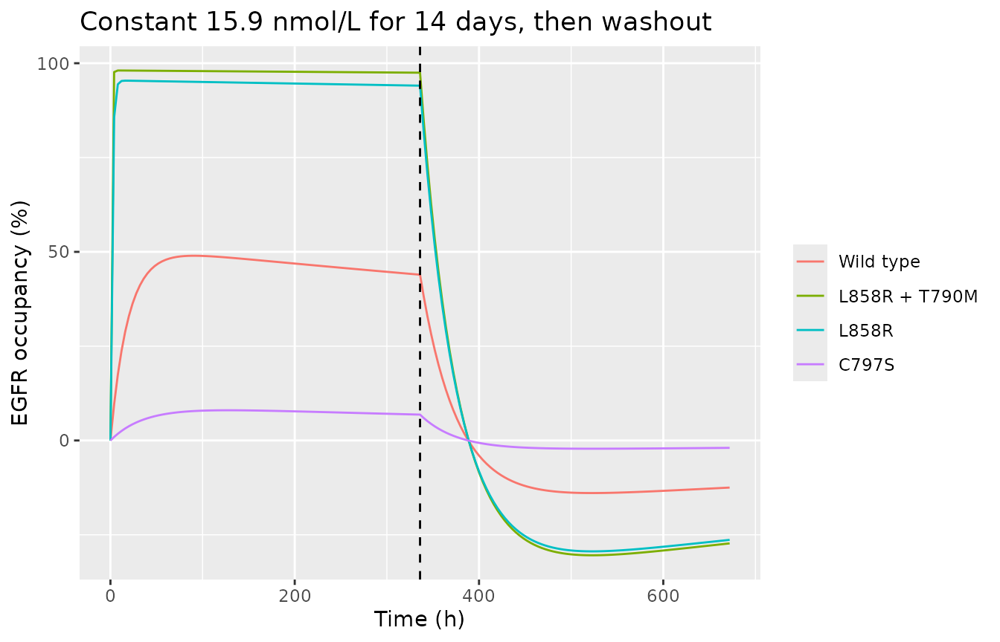
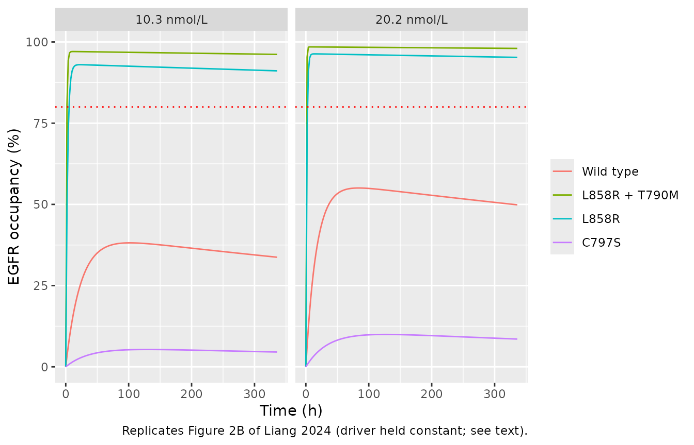
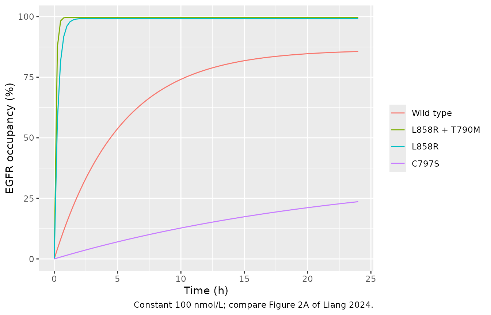

# Osimertinib intracranial EGFR occupancy QSP (Liang 2024b)

## Model and source

- Citation: Liang F, Zhang Y, Xue Q, Zhang X. (2024). Integrated PBPK-EO
  modeling of osimertinib to predict plasma concentrations and
  intracranial EGFR engagement in patients with brain metastases. *Sci
  Rep* 14:12736.
- Article: <https://doi.org/10.1038/s41598-024-63743-z>
- PMC record (open access):
  <https://www.ncbi.nlm.nih.gov/pmc/articles/PMC11148161/>

This is a different paper from the same group’s lung-tissue analysis,
`Liang_2024_osimertinib_qsp` (Front Pharmacol 2024, PMC10946252). The
present paper moves the target-engagement layer into brain tumour (BRT),
changes the equations and the rate constants, and adds two EGFR variants
(wild type and C797S). Hence the `2024b` year letter.

``` r

mod <- readModelDb("Liang_2024b_osimertinib_qsp")
mod
#> function() {
#>   description <- paste(
#>     "QSP. Intracranial EGFR-occupancy (EO) model for osimertinib (OSI,",
#>     "AZD9291) in NSCLC patients with brain metastases: covalent binding of",
#>     "osimertinib to four EGFR variants (wild type, L858R+T790M, L858R and",
#>     "C797S) with re-synthesis of free EGFR, as in Liang 2024 Eqs 3-5. Four",
#>     "independent free-EGFR / osimertinib-EGFR-complex pairs share one driver.",
#>     "The driver is the free osimertinib concentration in brain tumour (BRT,",
#>     "the interstitial sub-compartment of the PK-Sim brain), supplied per",
#>     "record as the time-varying covariate CEFFECT in umol/L; it is already",
#>     "unbound, so no fraction-unbound factor is applied. The whole-body PK-Sim",
#>     "11.2 PBPK layer that generates that concentration is a platform model",
#>     "and is NOT extracted. Deterministic mechanism model with no IIV and no",
#>     "residual error. IMPORTANT DEVIATION -- the association rate constants",
#>     "are encoded in 1/(umol/L)/min (x60 into hours), not the 1/(umol/L)/s",
#>     "printed in Table 1. As printed, the model predicts about 77% C797S",
#>     "occupancy at the paper's own intracranial concentrations, contradicting",
#>     "Figure 2B (about 10%) and the paper's C797S-resistance conclusion; the",
#>     "per-minute reading (PK-Sim's base unit for a second-order rate",
#>     "constant) reproduces Figure 2B semi-quantitatively. This is an inferred",
#>     "unit correction; the numeric values are the paper's. See the vignette",
#>     "'Assumptions and deviations' section.",
#>     sep = " "
#>   )
#>   reference <- paste(
#>     "Liang F, Zhang Y, Xue Q, Zhang X. (2024). Integrated PBPK-EO modeling of",
#>     "osimertinib to predict plasma concentrations and intracranial EGFR",
#>     "engagement in patients with brain metastases. Sci Rep 14:12736.",
#>     "doi:10.1038/s41598-024-63743-z. PMC11148161.",
#>     "EGFR-occupancy equations from Methods Eqs 3-5; parameters from Table 1",
#>     "('EGFR occupancy' block).",
#>     sep = " "
#>   )
#>   vignette <- "Liang_2024b_osimertinib"
#> 
#>   units <- list(
#>     time = "h",
#>     dosing = "(not applicable; the free brain-tumour osimertinib concentration is supplied as the time-varying covariate CEFFECT)",
#>     concentration = "umol/L"
#>   )
#> 
#>   # The four EGFR variants are point mutants (or the wild type), not
#>   # anatomical locations, so the canonical `target` / `complex` TMDD names
#>   # carry a variant suffix and are declared here.
#>   paper_specific_compartments <- c(
#>     "target_wt",
#>     "complex_wt",
#>     "target_l858r_t790m",
#>     "complex_l858r_t790m",
#>     "target_l858r",
#>     "complex_l858r",
#>     "target_c797s",
#>     "complex_c797s"
#>   )
#> 
#>   # Liang 2024 works in molar concentrations (EGFR T0 = 0.299 umol/L), so the
#>   # states are concentrations rather than amounts. The occupancy is simulated
#>   # in brain tumour (Methods: 'the occupancy of T790M and L858R mutations in
#>   # BRT'), hence specimen "tissue".
#>   compartmentData <- list(
#>     target_wt = list(
#>       analyte = "wild-type EGFR (free, unbound) in brain tumour",
#>       units = "umol/L",
#>       specimen = "tissue",
#>       verified = TRUE
#>     ),
#>     complex_wt = list(
#>       analyte = "osimertinib-wild-type EGFR complex in brain tumour",
#>       units = "umol/L",
#>       specimen = "tissue",
#>       verified = TRUE
#>     ),
#>     target_l858r_t790m = list(
#>       analyte = "EGFR L858R+T790M double mutant (free, unbound) in brain tumour",
#>       units = "umol/L",
#>       specimen = "tissue",
#>       verified = TRUE
#>     ),
#>     complex_l858r_t790m = list(
#>       analyte = "osimertinib-EGFR L858R+T790M complex in brain tumour",
#>       units = "umol/L",
#>       specimen = "tissue",
#>       verified = TRUE
#>     ),
#>     target_l858r = list(
#>       analyte = "EGFR L858R mutant (free, unbound) in brain tumour",
#>       units = "umol/L",
#>       specimen = "tissue",
#>       verified = TRUE
#>     ),
#>     complex_l858r = list(
#>       analyte = "osimertinib-EGFR L858R complex in brain tumour",
#>       units = "umol/L",
#>       specimen = "tissue",
#>       verified = TRUE
#>     ),
#>     target_c797s = list(
#>       analyte = "EGFR C797S mutant (free, unbound) in brain tumour",
#>       units = "umol/L",
#>       specimen = "tissue",
#>       verified = TRUE
#>     ),
#>     complex_c797s = list(
#>       analyte = "osimertinib-EGFR C797S complex in brain tumour",
#>       units = "umol/L",
#>       specimen = "tissue",
#>       verified = TRUE
#>     )
#>   )
#> 
#>   covariateData <- list(
#>     CEFFECT = list(
#>       description = "Time-varying FREE osimertinib concentration in brain tumour (umol/L) driving EGFR occupancy",
#>       units = "umol/L",
#>       type = "continuous",
#>       reference_category = NULL,
#>       notes = paste(
#>         "For this model CEFFECT is Liang 2024's C_OSI,BRT, 'the free OSI",
#>         "concentration in BRT' (Eqs 3-4), which the paper takes from the",
#>         "free concentration in the interstitial sub-compartment of the",
#>         "PK-Sim brain. It is already unbound: do NOT multiply by a fraction",
#>         "unbound. Supply 0 for the drug-free state.",
#>         "In the source study CEFFECT comes from a whole-body PK-Sim 11.2",
#>         "PBPK model (brain-tumour-to-plasma partition coefficient KBRT,p =",
#>         "2.89, Table 1) that is not extracted. Published anchors for 80 mg",
#>         "once daily (Liang 2024 Table 3, predicted intracranial free",
#>         "concentration across five brain-metastasis studies): Cmax 12.7-20.2",
#>         "nmol/L and Ctrough 10.3-15.9 nmol/L, i.e. 0.0127-0.0202 and",
#>         "0.0103-0.0159 umol/L; observed CSF Ctrough 4.1-19.5 nmol/L.",
#>         "Users may supply CEFFECT from any osimertinib PK model; Liang 2024",
#>         "did not couple this layer to a published popPK model."
#>       ),
#>       source_name = "C_OSI,BRT (computed by the PK-Sim PBPK model; not a dataset column)"
#>     )
#>   )
#> 
#>   population <- list(
#>     species = "human (in silico; PK-Sim virtual populations)",
#>     n_subjects = NA_integer_,
#>     n_studies = 10L,
#>     age_range = "31-84 years across the simulated clinical studies (Liang 2024 Table 2)",
#>     sex_female_pct = NA_real_,
#>     race_ethnicity = c(Japanese = NA_real_, Chinese = NA_real_, White = NA_real_),
#>     disease_state = "non-small cell lung cancer (NSCLC) with brain metastases; EGFR wild type, L858R+T790M, L858R and C797S variants",
#>     dose_range = "osimertinib 20-240 mg once daily or 20-120 mg twice daily (Liang 2024 Figure 4); 80 mg once daily for 14 days in the Figure 2B occupancy simulation",
#>     regions = "simulated Japanese, Chinese and White populations",
#>     notes = paste(
#>       "Liang 2024 is a PBPK-EO simulation study: the virtual populations'",
#>       "race, dose, subject numbers, age, proportion female, BMI and albumin",
#>       "were taken from the clinical studies in Table 2 (Planchard, Zhao,",
#>       "Harvey, Grande for plasma PK; Goldstein, Yamaguchi, Leeuw, Fukuhara,",
#>       "Ekman for intracranial PK; 4-49 patients each). Dosing-regimen",
#>       "simulations used 100 virtual patients with Planchard demographics",
#>       "(Japanese NSCLC, 75% female, median age 62.5 y); DDI simulations used",
#>       "10. Disease-state physiology: hematocrit 0.33 and albumin 0.31 g/dL",
#>       "as printed in Table 1 (the Methods text gives 0.31 g/dL for patients",
#>       "and 0.45 g/dL for healthy subjects). These enter the PBPK layer only;",
#>       "the EO parameters extracted here are shared by every scenario, so",
#>       "population enters this model solely through CEFFECT."
#>     )
#>   )
#> 
#>   ini({
#>     # ---- Association rate constants, one per EGFR variant ----------------
#>     # Liang 2024 Table 1 'kon EGFR (uM-1 s-1)', calculated as kinact/Ki.
#>     # Encoded as 1/(umol/L)/min, x60 into the hourly time base -- an inferred
#>     # unit correction of the printed 's-1' label (see description and the
#>     # vignette). Fixed: literature-derived, not estimated by Liang 2024.
#>     lkon_wt <- fixed(log(0.028 * 60))
#>     label("Log association rate constant of osimertinib to wild-type EGFR (1/(umol/L)/h)")
#>     # Table 1 kon wild type = 0.028, read per min: 1.68 /uM/h.
#> 
#>     lkon_l858r_t790m <- fixed(log(1.40 * 60))
#>     label("Log association rate constant of osimertinib to EGFR L858R+T790M (1/(umol/L)/h)")
#>     # Table 1 kon L858R + T790M = 1.40, read per min: 84 /uM/h.
#> 
#>     lkon_l858r <- fixed(log(0.57 * 60))
#>     label("Log association rate constant of osimertinib to EGFR L858R (1/(umol/L)/h)")
#>     # Table 1 kon L858R = 0.57, read per min: 34.2 /uM/h.
#> 
#>     lkon_c797s <- fixed(log(0.0026 * 60))
#>     label("Log association rate constant of osimertinib to EGFR C797S (1/(umol/L)/h)")
#>     # Table 1 kon C797S = 0.0026, read per min: 0.156 /uM/h.
#> 
#>     # ---- Dissociation rate constant --------------------------------------
#>     lkoff <- fixed(log(0.001))
#>     label("Log dissociation rate constant of the osimertinib-EGFR complex (1/h)")
#>     # Table 1 koff EGFR = 0.001 h-1; Methods: 'a small finite value at 0.001 h-1 is assigned to koff'.
#> 
#>     # ---- EGFR turnover ----------------------------------------------------
#>     lkdeg <- fixed(log(0.025))
#>     label("Log degradation (and re-synthesis) rate constant of free EGFR (1/h)")
#>     # Table 1 kdeg EGFR = 0.025 h-1 (half-life 27.5 h in cell experiments).
#> 
#>     # ---- Baseline EGFR concentration -------------------------------------
#>     lrbase <- fixed(log(0.299))
#>     label("Log baseline (initial) EGFR concentration EGFR0 (umol/L)")
#>     # Table 1 EGFR T0 = 0.299 uM.
#>   })
#> 
#>   model({
#>     # 1. Back-transform the fixed structural parameters.
#>     kon_wt <- exp(lkon_wt)
#>     kon_l858r_t790m <- exp(lkon_l858r_t790m)
#>     kon_l858r <- exp(lkon_l858r)
#>     kon_c797s <- exp(lkon_c797s)
#>     koff <- exp(lkoff)
#>     kdeg <- exp(lkdeg)
#>     rbase <- exp(lrbase)
#> 
#>     # 2. Liang 2024 Eqs 3-4, transcribed as printed, one pair per variant:
#>     #      dEO/dt       = kon * C_OSI,BRT * EGFRfree - koff * EO
#>     #      dEGFRfree/dt = (EGFR0 - EGFRfree) * kdeg
#>     #                     - kon * C_OSI,BRT * EGFRfree + koff * EO
#>     #    CEFFECT is C_OSI,BRT, already the free concentration. The complex
#>     #    has no degradation term in the paper, so total EGFR (free + complex)
#>     #    rises above EGFR0 under exposure; that is the printed structure.
#>     d/dt(target_wt) <- (rbase - target_wt) * kdeg -
#>       kon_wt * CEFFECT * target_wt + koff * complex_wt
#>     d/dt(complex_wt) <- kon_wt * CEFFECT * target_wt - koff * complex_wt
#> 
#>     d/dt(target_l858r_t790m) <- (rbase - target_l858r_t790m) * kdeg -
#>       kon_l858r_t790m * CEFFECT * target_l858r_t790m +
#>       koff * complex_l858r_t790m
#>     d/dt(complex_l858r_t790m) <- kon_l858r_t790m * CEFFECT * target_l858r_t790m -
#>       koff * complex_l858r_t790m
#> 
#>     d/dt(target_l858r) <- (rbase - target_l858r) * kdeg -
#>       kon_l858r * CEFFECT * target_l858r + koff * complex_l858r
#>     d/dt(complex_l858r) <- kon_l858r * CEFFECT * target_l858r -
#>       koff * complex_l858r
#> 
#>     d/dt(target_c797s) <- (rbase - target_c797s) * kdeg -
#>       kon_c797s * CEFFECT * target_c797s + koff * complex_c797s
#>     d/dt(complex_c797s) <- kon_c797s * CEFFECT * target_c797s -
#>       koff * complex_c797s
#> 
#>     # 3. Drug-free start: all EGFR free at EGFR0, no complex.
#>     target_wt(0) <- rbase
#>     target_l858r_t790m(0) <- rbase
#>     target_l858r(0) <- rbase
#>     target_c797s(0) <- rbase
#> 
#>     # 4. EGFR occupancy (%), Liang 2024 Eq 5:
#>     #      occupancy = (EGFR0 - EGFRfree) / EGFR0 * 100
#>     #    i.e. depletion of free EGFR relative to baseline, not the bound
#>     #    fraction of total EGFR.
#>     ro_wt <- (rbase - target_wt) / rbase * 100
#>     ro_l858r_t790m <- (rbase - target_l858r_t790m) / rbase * 100
#>     ro_l858r <- (rbase - target_l858r) / rbase * 100
#>     ro_c797s <- (rbase - target_c797s) / rbase * 100
#>   })
#> }
#> <environment: 0x55fe04560370>
```

## What is extracted, and what is not

| Layer | Content | Extracted? | Why |
|----|----|----|----|
| 1 | Whole-body PBPK for osimertinib (PK-Sim 11.2; Rodgers-Rowland partitioning with a Kp scale of 1.5; six CYP intrinsic clearances; ABCB1 / BCRP efflux at the blood-brain barrier; Weibull dissolution) | **No** | A platform model. Its organ physiology, blood flows and permeability calculations are PK-Sim’s internal defaults and are not printed. The deposited `.pksim5` project is a software artifact, and its binding block does not match Table 1 (see Assumptions). |
| 2 | EGFR occupancy (EO) in brain tumour for four EGFR variants, driven by the free osimertinib concentration in BRT | **Yes** | Eqs 3-5 are printed in full, and Table 1 gives every rate constant. |

The osimertinib concentration that drives layer 2 is supplied by the
user through the canonical time-varying covariate `CEFFECT`. In the
paper this is `C_OSI,BRT`, “the free OSI concentration in BRT”, taken
from the interstitial sub-compartment of the PK-Sim brain. It is already
unbound, so the model does not multiply it by a fraction unbound.

## Population

``` r

str(rxode2::rxode(mod)$population)
#> List of 10
#>  $ species       : chr "human (in silico; PK-Sim virtual populations)"
#>  $ n_subjects    : int NA
#>  $ n_studies     : int 10
#>  $ age_range     : chr "31-84 years across the simulated clinical studies (Liang 2024 Table 2)"
#>  $ sex_female_pct: num NA
#>  $ race_ethnicity: Named num [1:3] NA NA NA
#>   ..- attr(*, "names")= chr [1:3] "Japanese" "Chinese" "White"
#>  $ disease_state : chr "non-small cell lung cancer (NSCLC) with brain metastases; EGFR wild type, L858R+T790M, L858R and C797S variants"
#>  $ dose_range    : chr "osimertinib 20-240 mg once daily or 20-120 mg twice daily (Liang 2024 Figure 4); 80 mg once daily for 14 days i"| __truncated__
#>  $ regions       : chr "simulated Japanese, Chinese and White populations"
#>  $ notes         : chr "Liang 2024 is a PBPK-EO simulation study: the virtual populations' race, dose, subject numbers, age, proportion"| __truncated__
```

Liang 2024 is a simulation study. The virtual populations took race,
dose, subject numbers, age, proportion female, BMI and albumin from the
clinical studies in Table 2 (four plasma-PK and five intracranial-PK
studies of NSCLC patients, 4-49 patients each, aged 31-84 years). The
dosing-regimen simulations used 100 virtual patients with the
demographics of Planchard et al. (Japanese NSCLC, 75% female, median age
62.5 years). Population differences act only in the PBPK layer; the EO
parameters are shared by every scenario, so population enters this model
only through `CEFFECT`.

## Source trace

| Quantity | Paper value | Model value | Source location |
|:---|:---|:---|:---|
| kon, wild type | 0.028 | 0.028 x 60 = 1.68 /uM/h | Table 1, ‘kon EGFR (uM-1 s-1)’ (kinact/Ki) |
| kon, L858R + T790M | 1.40 | 1.40 x 60 = 84 /uM/h | Table 1 |
| kon, L858R | 0.57 | 0.57 x 60 = 34.2 /uM/h | Table 1 |
| kon, C797S | 0.0026 | 0.0026 x 60 = 0.156 /uM/h | Table 1 |
| koff | 0.001 /h | 0.001 /h | Table 1; Methods text after Eq 5 |
| kdeg | 0.025 /h | 0.025 /h | Table 1 (half-life 27.5 h) |
| EGFR0 (EGFR T0) | 0.299 uM | 0.299 umol/L | Table 1 |
| dEO/dt | Eq 3 | d/dt(complex\_\*) | Methods, Eq 3 |
| dEGFRfree/dt | Eq 4 | d/dt(target\_\*) | Methods, Eq 4 |
| EGFR occupancy (%) | Eq 5 | ro\_\* | Methods, Eq 5 |
| Driver C_OSI,BRT | free conc. in BRT | CEFFECT (umol/L) | Methods, text after Eq 5 |

Every equation and parameter, with its location in Liang 2024. {.table}

The printed equations, with one free-EGFR / complex pair per variant:

    (3)  dEO/dt       = kon * C_OSI,BRT * EGFRfree - koff * EO
    (4)  dEGFRfree/dt = (EGFR0 - EGFRfree) * kdeg - kon * C_OSI,BRT * EGFRfree + koff * EO
    (5)  EGFR occupancy (%) = (EGFR0 - EGFRfree) / EGFR0 * 100

### Units

Each ODE term must be in `umol/L per h`:

- `(rbase - target) * kdeg` = `umol/L * 1/h`. OK
- `kon * CEFFECT * target` = `1/(umol/L)/h * umol/L * umol/L`. OK
- `koff * complex` = `1/h * umol/L`. OK

The occupancy is a ratio of two `umol/L` quantities, reported as a
percentage. The only conversion in the file is `kon` x 60 (see
Assumptions, item 1).

### Parameter table: paper against model file

``` r

ini_tbl <- as.data.frame(rxode2::rxode(mod)$iniDf)[, c("name", "est", "fix")]
paper <- c(
  lkon_wt = log(0.028 * 60),
  lkon_l858r_t790m = log(1.40 * 60),
  lkon_l858r = log(0.57 * 60),
  lkon_c797s = log(0.0026 * 60),
  lkoff = log(0.001),
  lkdeg = log(0.025),
  lrbase = log(0.299)
)
ini_tbl |>
  mutate(
    `Back-transformed` = signif(exp(est), 4),
    Matches = ifelse(abs(est - paper[name]) < 1e-12, "yes", "NO")
  ) |>
  rename(Parameter = name, `File value (log)` = est, Fixed = fix) |>
  knitr::kable(caption = "Every ini() value against Table 1. All are fixed literature values.")
```

| Parameter        | File value (log) | Fixed | Back-transformed | Matches |
|:-----------------|-----------------:|:------|-----------------:|:--------|
| lkon_wt          |        0.5187938 | TRUE  |            1.680 | yes     |
| lkon_l858r_t790m |        4.4308168 | TRUE  |           84.000 | yes     |
| lkon_l858r       |        3.5322256 | TRUE  |           34.200 | yes     |
| lkon_c797s       |       -1.8578993 | TRUE  |            0.156 | yes     |
| lkoff            |       -6.9077553 | TRUE  |            0.001 | yes     |
| lkdeg            |       -3.6888795 | TRUE  |            0.025 | yes     |
| lrbase           |       -1.2073117 | TRUE  |            0.299 | yes     |

Every ini() value against Table 1. All are fixed literature values.
{.table}

``` r


stopifnot(
  setequal(ini_tbl$name, names(paper)),
  all(abs(ini_tbl$est - paper[ini_tbl$name]) < 1e-12),
  all(ini_tbl$fix)
)
```

## Validation

The model is deterministic, has no dose and no residual error, so NCA
does not apply. The checks follow the mechanistic pattern: baseline
hold, an exact closed-form solution, and washout recovery. Each solve
uses an observation grid on the `target_wt` state; rxode2 returns every
state and every `ro_*` output at those rows.

``` r

variants <- c(
  ro_wt = "Wild type",
  ro_l858r_t790m = "L858R + T790M",
  ro_l858r = "L858R",
  ro_c797s = "C797S"
)

# Observation grid with a constant (or piecewise-constant) driver.
make_events <- function(times, ceffect) {
  data.frame(
    id = 1L,
    time = times,
    evid = 0L,
    cmt = "target_wt",
    CEFFECT = ceffect
  )
}

solve_df <- function(model, events, ...) {
  as.data.frame(rxode2::rxSolve(model, events = events, ...))
}

to_long <- function(sim) {
  sim |>
    select(time, all_of(names(variants))) |>
    pivot_longer(-time, names_to = "output", values_to = "occupancy") |>
    mutate(variant = factor(variants[output], levels = variants))
}
```

### 1. Baseline hold (zero exposure)

With no drug every free EGFR pool must stay at `EGFR0` and occupancy at
0.

``` r

sim0 <- solve_df(mod, make_events(seq(0, 336, by = 24), 0))
stopifnot(
  max(abs(sim0$target_wt - 0.299)) < 1e-10,
  max(abs(sim0$target_c797s - 0.299)) < 1e-10,
  max(abs(as.matrix(sim0[, names(variants)]))) < 1e-8
)
knitr::kable(head(sim0[, c("time", "target_wt", names(variants))], 3), digits = 6)
```

| time | target_wt | ro_wt | ro_l858r_t790m | ro_l858r | ro_c797s |
|-----:|----------:|------:|---------------:|---------:|---------:|
|    0 |     0.299 |     0 |              0 |        0 |        0 |
|   24 |     0.299 |     0 |              0 |        0 |        0 |
|   48 |     0.299 |     0 |              0 |        0 |        0 |

### 2. Exact solution at a constant concentration

At constant `C`, Eqs 3-4 are a linear system `x' = A x + b` in
`x = (EGFRfree, EO)` with

    A = [ -(kdeg + kon*C)   koff ]      b = [ kdeg * EGFR0 ]
        [   kon*C          -koff ]          [ 0            ]

so `x(t) = x* + expm(A t) (x0 - x*)` with `x* = -A^-1 b`. The ODE solve
must match that closed form to integrator precision for every variant.

``` r

closed_form <- function(kon, conc, times, koff = 0.001, kdeg = 0.025, r0 = 0.299) {
  A <- matrix(c(-(kdeg + kon * conc), kon * conc, koff, -koff), 2, 2)
  b <- c(kdeg * r0, 0)
  xstar <- -solve(A, b)
  e <- eigen(A)
  coef <- solve(e$vectors, c(r0, 0) - xstar)
  free <- vapply(times, function(t) {
    Re(xstar[1] + sum(e$vectors[1, ] * coef * exp(e$values * t)))
  }, numeric(1))
  (r0 - free) / r0 * 100
}

kon_h <- c(
  ro_wt = 0.028, ro_l858r_t790m = 1.40, ro_l858r = 0.57, ro_c797s = 0.0026
) * 60
conc_cf <- 0.0159
times_cf <- seq(0, 336, by = 2)
sim_cf <- solve_df(mod, make_events(times_cf, conc_cf), rtol = 1e-10, atol = 1e-12)

cf_err <- vapply(names(kon_h), function(o) {
  max(abs(sim_cf[[o]] - closed_form(kon_h[[o]], conc_cf, times_cf)))
}, numeric(1))
knitr::kable(
  data.frame(variant = variants[names(cf_err)],
             max_abs_err_pct_points = formatC(cf_err, format = "e", digits = 2)),
  row.names = FALSE,
  caption = "Largest absolute difference (percentage points) between the ODE solve and the closed form, 0-336 h at 15.9 nmol/L."
)
```

| variant       | max_abs_err_pct_points |
|:--------------|:-----------------------|
| Wild type     | 1.20e-08               |
| L858R + T790M | 1.51e-09               |
| L858R         | 3.19e-10               |
| C797S         | 6.89e-09               |

Largest absolute difference (percentage points) between the ODE solve
and the closed form, 0-336 h at 15.9 nmol/L. {.table}

``` r

# Measured about 1e-7 percentage points at these tolerances.
stopifnot(all(cf_err < 1e-4))
```

The closed form also gives the long-run behaviour of the printed system:
its fixed point is `EGFRfree = EGFR0`, so occupancy as defined by Eq 5
returns to zero over a time scale of `1/koff` = 1000 h even under
sustained exposure, while the complex accumulates. Within the paper’s
14-day horizon this decay is small (a few percentage points for the two
sensitive mutants).

### 3. Washout recovery

Stopping the drug after 14 days lets free EGFR re-synthesise at rate
`kdeg`. Because the printed Eq 3 gives the complex no degradation, the
complex accumulated during dosing (several times `EGFR0` after 14 days)
keeps releasing free EGFR at `koff * EO` after washout. Free EGFR
therefore overshoots `EGFR0` and settles near the quasi-steady value
`EGFR0 + koff * EO / kdeg`, and the Eq 5 occupancy turns negative. That
is a property of the published equations, and the check below confirms
the model reproduces it.

``` r

times_w <- seq(0, 672, by = 4)
sim_w <- solve_df(
  mod,
  make_events(times_w, ifelse(times_w < 336, 0.0159, 0)),
  rtol = 1e-10, atol = 1e-12
)
ro_end <- sim_w$ro_l858r_t790m[sim_w$time == 336]
ro_24h <- sim_w$ro_l858r_t790m[sim_w$time == 360]
last <- sim_w[sim_w$time == 672, ]
quasi_free <- 0.299 + 0.001 * last$complex_l858r_t790m / 0.025
knitr::kable(
  data.frame(
    quantity = c("complex at 336 h (umol/L)", "free EGFR at 672 h (umol/L)",
                 "EGFR0 + koff*EO/kdeg at 672 h (umol/L)", "occupancy at 672 h (%)"),
    value = c(sim_w$complex_l858r_t790m[sim_w$time == 336],
              last$target_l858r_t790m, quasi_free, last$ro_l858r_t790m)
  ),
  digits = 4, caption = "L858R + T790M pool after 14 days at 15.9 nmol/L and 14 days of washout."
)
```

| quantity                                |    value |
|:----------------------------------------|---------:|
| complex at 336 h (umol/L)               |   2.7422 |
| free EGFR at 672 h (umol/L)             |   0.3806 |
| EGFR0 + koff\*EO/kdeg at 672 h (umol/L) |   0.3774 |
| occupancy at 672 h (%)                  | -27.2780 |

L858R + T790M pool after 14 days at 15.9 nmol/L and 14 days of washout.
{.table}

``` r

stopifnot(
  ro_24h < ro_end,
  last$target_l858r_t790m > 0.299,
  # The complex drifts slowly (1/koff = 1000 h), so the quasi-steady value
  # holds to about 1%, not exactly.
  abs(last$target_l858r_t790m / quasi_free - 1) < 0.03
)
to_long(sim_w) |>
  ggplot(aes(time, occupancy, colour = variant)) +
  geom_line() +
  geom_vline(xintercept = 336, linetype = 2) +
  labs(x = "Time (h)", y = "EGFR occupancy (%)", colour = NULL,
       title = "Constant 15.9 nmol/L for 14 days, then washout")
```



## Replication of Figure 2B: four EGFR variants over 14 days

Figure 2B shows occupancy in BRT for the four variants over 14 days of
80 mg once daily. Its driver is the PBPK model’s free BRT concentration,
which is not reproducible here. Liang 2024 Table 3 brackets that
concentration at steady state: predicted intracranial Ctrough 10.3-15.9
nmol/L and Cmax 12.7-20.2 nmol/L across the five brain-metastasis
studies. The model is therefore run at constant concentrations spanning
that range: 10.3 nmol/L (lowest predicted trough) and 20.2 nmol/L
(highest predicted peak).

``` r

times_b <- seq(0, 336, by = 2)
brackets <- c(`10.3 nmol/L` = 0.0103, `20.2 nmol/L` = 0.0202)
sim_b <- bind_rows(lapply(names(brackets), function(nm) {
  to_long(solve_df(mod, make_events(times_b, brackets[[nm]]))) |>
    mutate(driver = nm)
}))

ggplot(sim_b, aes(time, occupancy, colour = variant)) +
  geom_line() +
  geom_hline(yintercept = 80, linetype = 3, colour = "red") +
  facet_wrap(~driver) +
  labs(x = "Time (h)", y = "EGFR occupancy (%)", colour = NULL,
       caption = "Replicates Figure 2B of Liang 2024 (driver held constant; see text).")
```



``` r

# Day-14 values read off Figure 2B by the maintainers (trough to peak of the
# last dosing interval). The Results text gives "approximately 10%" for C797S
# and above 80% for L858R + T790M and L858R.
fig2b <- tibble(
  variant = factor(variants, levels = variants),
  `Figure 2B, day 14 (%)` = c("46-49", "88-92", "85-89", "8-9")
)
day14 <- sim_b |>
  filter(time == 336) |>
  select(variant, driver, occupancy) |>
  pivot_wider(names_from = driver, values_from = occupancy)

day14 |>
  left_join(fig2b, by = "variant") |>
  rename(Variant = variant,
         `Model, 10.3 nmol/L (%)` = `10.3 nmol/L`,
         `Model, 20.2 nmol/L (%)` = `20.2 nmol/L`) |>
  knitr::kable(digits = 1, caption = "Occupancy at 336 h.")
```

| Variant | Model, 10.3 nmol/L (%) | Model, 20.2 nmol/L (%) | Figure 2B, day 14 (%) |
|:---|---:|---:|:---|
| Wild type | 33.7 | 49.9 | 46-49 |
| L858R + T790M | 96.2 | 98.0 | 88-92 |
| L858R | 91.1 | 95.3 | 85-89 |
| C797S | 4.6 | 8.5 | 8-9 |

Occupancy at 336 h. {.table}

``` r


lo <- setNames(day14$`10.3 nmol/L`, as.character(day14$variant))
hi <- setNames(day14$`20.2 nmol/L`, as.character(day14$variant))
stopifnot(
  # Paper's efficacy statement: both sensitive mutants above 80% in BRT.
  lo[["L858R + T790M"]] > 80, lo[["L858R"]] > 80,
  # Paper's resistance statement: C797S about 10%.
  hi[["C797S"]] < 15,
  # Rank order of Figure 2B.
  all(lo[["L858R + T790M"]] > lo[["L858R"]], lo[["L858R"]] > lo[["Wild type"]],
      lo[["Wild type"]] > lo[["C797S"]])
)
```

The day-14 occupancies agree with Figure 2B semi-quantitatively: the two
sensitive mutants sit above the 80% efficacy line (the model is 2-10
points higher), wild type sits at 34-50% against about 48%, and C797S at
5-9% against about 8-10%. What the constant driver cannot reproduce is
the slow climb over the first week in Figure 2B. That climb follows the
accumulation of the PBPK brain concentration towards steady state, which
is a property of layer 1.

### The printed kon unit

The same simulation with `kon` taken literally as `uM^-1 s^-1` (x3600
into hours) shows why the model file reads the Table 1 values as per
minute:

``` r

mod_printed <- mod |>
  rxode2::ini(
    lkon_wt = log(0.028 * 3600),
    lkon_l858r_t790m = log(1.40 * 3600),
    lkon_l858r = log(0.57 * 3600),
    lkon_c797s = log(0.0026 * 3600)
  )
#> ℹ change initial estimate of `lkon_wt` to `4.61313835563727`
#> ℹ change initial estimate of `lkon_l858r_t790m` to `8.52516136106541`
#> ℹ change initial estimate of `lkon_l858r` to `7.62657020629066`
#> ℹ change initial estimate of `lkon_c797s` to `2.2364452904895`
sim_p <- bind_rows(lapply(names(brackets), function(nm) {
  to_long(solve_df(mod_printed, make_events(times_b, brackets[[nm]]))) |>
    mutate(driver = nm)
}))
day14_p <- sim_p |>
  filter(time == 336) |>
  select(variant, driver, occupancy) |>
  pivot_wider(names_from = driver, values_from = occupancy)
day14_p |>
  left_join(fig2b, by = "variant") |>
  rename(Variant = variant,
         `Printed unit, 10.3 nmol/L (%)` = `10.3 nmol/L`,
         `Printed unit, 20.2 nmol/L (%)` = `20.2 nmol/L`) |>
  knitr::kable(digits = 1, caption = "Occupancy at 336 h with kon read as printed (per second).")
```

| Variant | Printed unit, 10.3 nmol/L (%) | Printed unit, 20.2 nmol/L (%) | Figure 2B, day 14 (%) |
|:---|---:|---:|:---|
| Wild type | 96.8 | 98.3 | 46-49 |
| L858R + T790M | 99.9 | 100.0 | 88-92 |
| L858R | 99.8 | 99.9 | 85-89 |
| C797S | 73.8 | 84.6 | 8-9 |

Occupancy at 336 h with kon read as printed (per second). {.table}

``` r


c797s_printed <- day14_p$`10.3 nmol/L`[day14_p$variant == "C797S"]
stopifnot(c797s_printed > 50)
```

Read per second, C797S occupancy at the paper’s own lowest intracranial
concentration is about 74%, and wild type is near saturation. That
reverses the paper’s central conclusion that low C797S occupancy
explains on-target resistance, and contradicts Figure 2B.

## Figure 2A: the in-vitro comparison

Figure 2A compares the model with T790M/L858R inhibition measured in NCI
cells at 100 nmol/L, where the observed inhibition sits at about 80-84%
over 24 h and the paper’s simulated curve peaks near 82%. A constant 100
nmol/L driver in this model gives near-complete occupancy of the double
mutant within hours:

``` r

sim_a <- solve_df(mod, make_events(seq(0, 24, by = 0.25), 0.1))
to_long(sim_a) |>
  ggplot(aes(time, occupancy, colour = variant)) +
  geom_line() +
  labs(x = "Time (h)", y = "EGFR occupancy (%)", colour = NULL,
       caption = "Constant 100 nmol/L; compare Figure 2A of Liang 2024.")
```



``` r

knitr::kable(sim_a[sim_a$time %in% c(6, 24), c("time", names(variants))], digits = 1)
```

|     | time | ro_wt | ro_l858r_t790m | ro_l858r | ro_c797s |
|:----|-----:|------:|---------------:|---------:|---------:|
| 25  |    6 |  59.6 |           99.7 |     99.2 |      8.3 |
| 97  |   24 |  85.6 |           99.7 |     99.2 |     23.6 |

Figure 2A is not reproduced under either `kon` reading. The curve the
paper shows there is driven by a PK profile (dotted line, peak about 115
nmol/L) and by binding inside the PBPK model, where target-mediated
depletion and the intracellular sub-compartment both act; the panel
caption does not say which concentration drove it. This is recorded as a
limitation, not adjusted for.

## Assumptions and deviations

1.  **`kon` is read as `uM^-1 min^-1`, not the printed `uM^-1 s^-1`.**
    This is an inferred unit correction, chosen by the maintainers
    because the printed unit makes the model contradict the paper’s own
    Figure 2B and its C797S conclusion (see the section above), while
    the per-minute reading reproduces both. Per-minute is PK-Sim’s base
    unit for a second-order rate constant, so values entered in base
    units and labelled per second in the table is a plausible mechanism.
    Supplementary Table S3 also supports a near-saturated double mutant:
    the sensitivity coefficient of EO trough to `kon` is only -0.1 /
    0.07. The numeric values are Table 1’s; only the time unit changed.
    To recover the literal reading, multiply each `kon` by 60, as in the
    `mod_printed` chunk.

2.  **The deposited PK-Sim project was not used as a parameter source.**
    The `.pksim5` file (supplement 1) holds a single binding process
    whose constants differ from Table 1 on every value (`koff` 0.001 per
    minute rather than per hour; `Kd` 0.12 nmol/L, implying `kon` = 8.33
    uM^-1 min^-1; target half-life 0.6 min rather than 27.5 h). Table 1
    is the published statement of the model and is what is encoded.

3.  **The PBPK layer is not extracted;** `CEFFECT` stands in for it. Two
    consequences follow. (a) With an external driver, occupancy is
    independent of `EGFR0` (Eqs 3-5 are linear in the EGFR states), so
    Figure 3G-H, where a higher EGFR T0 lowers occupancy, cannot be
    reproduced; that effect comes from target-mediated depletion of drug
    inside the PBPK. (b) Figure 2A and the first-week shape of Figure 2B
    depend on the PBPK driver.

4.  **The driver is the interstitial free concentration.** The Methods
    state that `C_OSI,BRT` is the free concentration in the interstitial
    sub-compartment of the brain; Supplementary Figure S1 says the
    occupancy is simulated “within the intracellular compartment”. The
    model follows the Methods. Either way the user supplies the
    concentration.

5.  **Eqs 3-5 are encoded as printed.** The complex has no degradation
    term, so total EGFR rises above `EGFR0` under exposure (to about
    nine times `EGFR0` after 14 days at 15.9 nmol/L for the double
    mutant), the Eq 5 occupancy (depletion of free EGFR relative to
    baseline) relaxes to zero over about `1/koff` = 1000 h of sustained
    exposure, and after washout free EGFR overshoots `EGFR0` so the
    occupancy turns negative (Validation, section 3). This is the
    published structure and was not changed; it matters only for
    simulations much longer than the paper’s 14 days or that stop
    dosing.

6.  **Wild type and C797S are separate single-variant pools.** The paper
    labels the fourth variant “C797S” without giving its background
    (clinically it arises on L858R/T790M); it is encoded as its own pool
    with the Table 1 `kon`.

7.  **No IIV and no residual error are encoded.** Liang 2024 generated
    variability by sampling PK-Sim virtual populations in the PBPK layer
    and fitted no random effects on the EO layer.

8.  **Constant-concentration validation.** The Figure 2B comparison
    holds the driver constant at the Table 3 bounds rather than
    reconstructing a daily profile, because the within-day brain
    concentration profile is not published.
