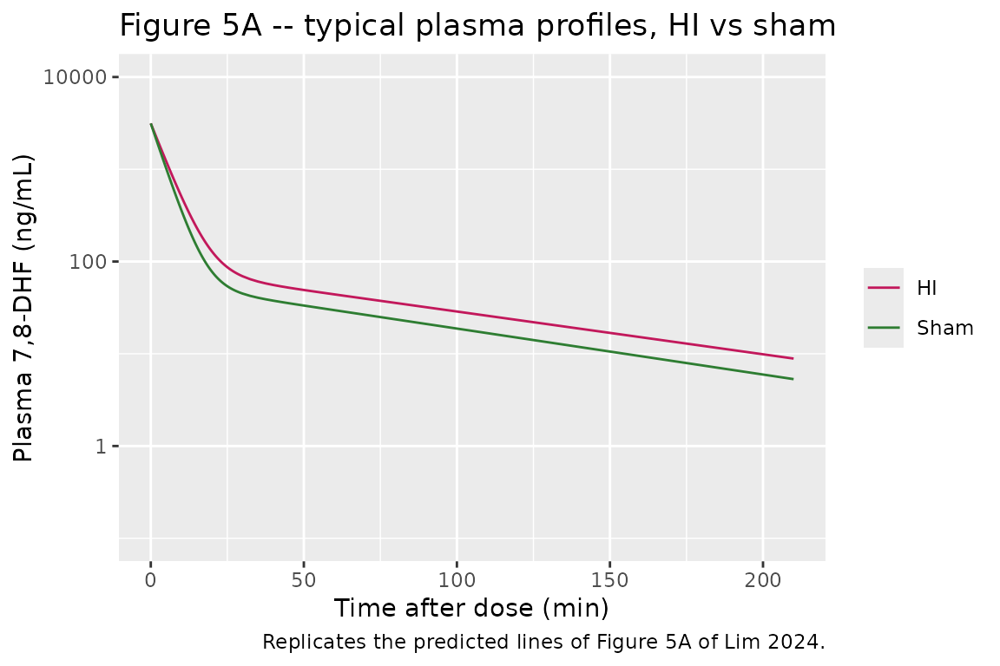
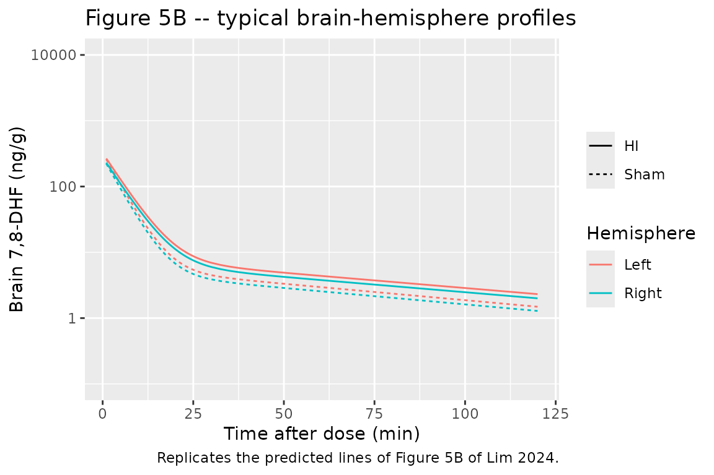
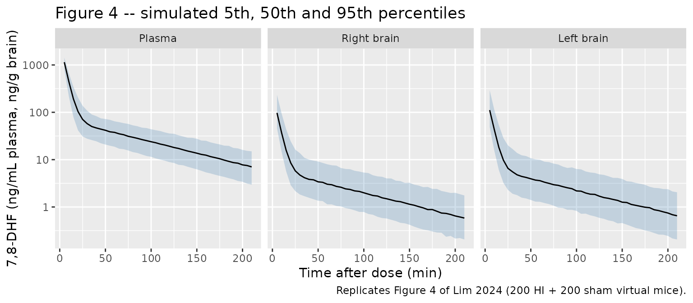

# 7,8-Dihydroxyflavone in neonatal mice (Lim 2024)

## Model and source

- Citation: Lim SY, Scarlett C, Yapici S, Ferrazzano P, Cengiz P.
  Pharmacokinetics of 7,8-dihydroxyflavone in neonatal mice with
  hypoxia-ischemia related brain injury. Front Pharmacol.
  2024;15:1508696. <doi:10.3389/fphar.2024.1508696>. Final parameter
  estimates from Table 1; model equations from Section 2.4; base-model
  and covariate-search tables from Supplementary Tables S2-S3.
- Description: Preclinical (mouse). Two-compartment plasma
  pharmacokinetic model for 7,8-dihydroxyflavone (7,8-DHF, tropoflavin)
  in postnatal day 9 C57BL/6 mice after a single 5 mg/kg intraperitoneal
  injection given 10 min after an experimentally induced unilateral
  (left-sided) hypoxic-ischemic (HI) brain injury or a sham operation,
  with the intraperitoneal dose treated as an immediate
  (intravenous-like) input. HI injury lowers clearance (CL = theta1 \*
  exp(theta2 \* HIE_POST), a 21% reduction); sex was tested and not
  retained. Right and left brain-hemisphere concentrations follow a
  sequentially fitted perfusion-limited distribution model driven by the
  plasma concentration, with the left-hemisphere partition coefficient
  expressed as the right-hemisphere Kp times a left-to-right ratio (Lim
  2024). All parameters are apparent and weight-normalised (per kg body
  weight) because intraperitoneal bioavailability is unknown.
- Article: <https://doi.org/10.3389/fphar.2024.1508696> (open access,
  with a Supplementary Material document holding the base model, the
  covariate search and a residual-error sensitivity analysis)

7,8-Dihydroxyflavone (7,8-DHF, also known as tropoflavin) is a
small-molecule TrkB agonist studied as a neuroprotectant after neonatal
hypoxia-ischemia (HI). The model has two layers, fitted sequentially by
the authors in Phoenix NLME:

1.  a two-compartment plasma model with the intraperitoneal dose treated
    as an immediate input, inter-individual variability on clearance,
    and a multiplicative HI effect on clearance; and
2.  a perfusion-limited brain model in which the individual plasma
    concentration drives the right and left brain hemispheres, each with
    its own brain-to-plasma partition coefficient (`Kp,L = Kp,R * Rkp`).

## Population

Postnatal day 9 C57BL/6 mice (Lim 2024, Section 2.2) had a left-sided HI
injury (left common carotid artery electro-cauterisation, then 50 min in
10% oxygen at 36 degC) or a sham operation, and received a single 5
mg/kg intraperitoneal dose of 7,8-DHF 10 min after hypoxia. Each mouse
gave one plasma sample plus the right and left brain hemispheres at
sacrifice, at 10, 30, 60 or 180 min after dosing, with 5 female and 5
male HI mice and 5 female and 5 male sham mice per time point – 80 mice
in total, 50% female (Section 2.2.1). Body weights were not reported;
every parameter is weight-normalised. Sex was tested on CL, Kp,R and Rkp
and not retained; the HI indicator (`HIE_POST`) was retained on CL.

The same information is available programmatically via
`readModelDb("Lim_2024_dihydroxyflavone_mouse")()$population`.

## Source trace

| Equation / parameter | Value | Source location |
|----|----|----|
| `lcl` (theta1, sham CL) | log(270.1 mL/min/kg) | Table 1, ‘theta1’ |
| `e_hie_post_cl` (theta2) | -0.236 | Table 1, ‘theta2’; footnote b (HI CL = 213.3 mL/min/kg) |
| `lvc` (V1) | log(1591 mL/kg) | Table 1, ‘V1’ |
| `lq` (CLd) | log(90.50 mL/min/kg) | Table 1, ‘CLd’ |
| `lvp` (V2) | log(5802 mL/kg) | Table 1, ‘V2’ |
| `etalcl` | 0.04039 (20.3% CV) | Table 1, ‘IIV CL’ |
| `propSd` (plasma) | 0.05, held constant | Table 1; Section 2.4 (QC variability) |
| `lv_brain_hemi` | log(25 mL/kg), held constant | Table 1, ‘Vb,R and Vb,L’ (2.5% of body weight) |
| `lqspec_brain` | log(0.54 mL/min/g), held constant | Table 1, ‘Qb,R and Qb,L’ (54 mL/min/100 g brain) |
| `lkp_brain_right` (Kp,R) | log(0.086) | Table 1, ‘Kp,R’ |
| `lrkp` (Rkp) | log(1.158) | Table 1, ‘Rkp’; footnote c (Kp,L = 0.099) |
| `etalkp_brain_right` | 0.19271 (46.1% CV) | Table 1, ‘IIV Kp,R’ |
| `etalrkp` | 0.04685 (21.9% CV) | Table 1, ‘IIV Rkp’ |
| `propSd_Cbrain_right`, `propSd_Cbrain_left` | 0.10, held constant | Table 1; Section 2.4 |
| `CL = theta1 * exp(theta2 * HI)` | n/a | Table 1 footnote b |
| Plasma ODEs `V1 dC1/dt = input - CLd (C1 - C2) - CL C1`, `V2 dC2/dt = CLd (C1 - C2)` | n/a | Section 2.4, first two equations |
| Brain ODEs `Vb dCb/dt = Qb (C1 - Cb / Kp)`, `Kp,L = Kp,R * Rkp` | n/a | Section 2.4, brain-model equations; Figure 1 |

## Typical-value profiles

``` r

mod <- rxode2::rxode2(readModelDb("Lim_2024_dihydroxyflavone_mouse"))
#> ℹ parameter labels from comments will be replaced by 'label()'
dose <- 5 # mg/kg

# The distribution phase has a half-life of about 3 min, so the first 30 min
# are sampled every 0.25 min to keep trapezoidal AUC error well below 0.1%.
grid <- sort(unique(c(seq(0, 30, by = 0.25), seq(30, 720, by = 2.5), 60, 180)))
make_events <- function(id, hie_post) {
  dplyr::bind_rows(
    data.frame(time = 0, amt = dose, evid = 1L, dvid = NA_integer_),
    data.frame(time = grid, amt = 0, evid = 0L, dvid = 1L)
  ) |>
    dplyr::mutate(id = id, cmt = "central", HIE_POST = hie_post)
}
ev_typ <- dplyr::bind_rows(make_events(1L, 0), make_events(2L, 1)) |>
  dplyr::mutate(treatment = ifelse(HIE_POST == 1, "HI", "Sham"))

sim_typ <- rxode2::rxSolve(
  rxode2::zeroRe(mod), events = ev_typ, keep = "treatment",
  rtol = 1e-10, atol = 1e-12
) |>
  as.data.frame()
#> ℹ omega/sigma items treated as zero: 'etalcl', 'etalkp_brain_right', 'etalrkp'
#> Warning: multi-subject simulation without without 'omega'
```

``` r

# Replicates the prediction lines of Figure 5A of Lim 2024.
sim_typ |>
  dplyr::filter(time <= 210) |>
  ggplot(aes(time, Cc, colour = treatment)) +
  geom_line() +
  scale_y_log10(limits = c(0.1, 1e4)) +
  scale_colour_manual(values = c(HI = "#C2185B", Sham = "#2E7D32")) +
  labs(
    x = "Time after dose (min)", y = "Plasma 7,8-DHF (ng/mL)", colour = NULL,
    title = "Figure 5A -- typical plasma profiles, HI vs sham",
    caption = "Replicates the predicted lines of Figure 5A of Lim 2024."
  )
```



``` r

# Replicates the prediction lines of Figure 5B of Lim 2024. Brain concentrations
# depend on HI only through the plasma driver, so both arms are shown.
sim_typ |>
  dplyr::filter(time >= 1, time <= 120) |>
  tidyr::pivot_longer(
    c(Cbrain_right, Cbrain_left),
    names_to = "hemisphere", values_to = "Cbrain"
  ) |>
  dplyr::mutate(hemisphere = ifelse(hemisphere == "Cbrain_right", "Right", "Left")) |>
  ggplot(aes(time, Cbrain, colour = hemisphere, linetype = treatment)) +
  geom_line() +
  scale_y_log10(limits = c(0.1, 1e4)) +
  labs(
    x = "Time after dose (min)", y = "Brain 7,8-DHF (ng/g)",
    colour = "Hemisphere", linetype = NULL,
    title = "Figure 5B -- typical brain-hemisphere profiles",
    caption = "Replicates the predicted lines of Figure 5B of Lim 2024."
  )
```



The paper’s predicted lines start at about 3000 ng/mL (dose / V1 = 3143
ng/mL), fall below 100 ng/mL by 30 min and reach roughly 12 (HI) and 8
(sham) ng/mL at 180 min; brain concentrations track plasma at about one
tenth of its level.

### Closed-form and published-value checks

``` r

th <- rxode2::rxode2(mod)$theta
cl_sham <- exp(th[["lcl"]])
cl_hi <- cl_sham * exp(th[["e_hie_post_cl"]])
vc <- exp(th[["lvc"]])
q <- exp(th[["lq"]])
vp <- exp(th[["lvp"]])

terminal_half_life <- function(cl) {
  k10 <- cl / vc
  k12 <- q / vc
  k21 <- q / vp
  s <- k10 + k12 + k21
  beta <- (s - sqrt(s^2 - 4 * k10 * k21)) / 2
  log(2) / beta
}

auc_trap <- function(t, y) sum(diff(t) * (head(y, -1) + tail(y, -1)) / 2)
typ_summary <- sim_typ |>
  dplyr::group_by(treatment) |>
  dplyr::summarise(
    auc_0_180 = auc_trap(time[time <= 180], Cc[time <= 180]),
    auc_0_720 = auc_trap(time, Cc),
    c0 = Cc[time == 0],
    ratio_left_right_60 = Cbrain_left[time == 60] / Cbrain_right[time == 60],
    ratio_right_plasma_60 = Cbrain_right[time == 60] / Cc[time == 60],
    .groups = "drop"
  ) |>
  dplyr::mutate(
    cl = ifelse(treatment == "HI", cl_hi, cl_sham),
    auc_inf_closed = 1e6 * dose / cl,
    half_life = terminal_half_life(cl)
  )

typ_summary |>
  dplyr::transmute(
    treatment,
    "CL (mL/min/kg)" = round(cl, 1),
    "AUC0-inf = dose/CL (ng min/mL)" = round(auc_inf_closed),
    "AUC0-180 (ng min/mL)" = round(auc_0_180),
    "Terminal t1/2 (min)" = round(half_life, 1),
    "Left/right brain at 60 min" = round(ratio_left_right_60, 3),
    "Right brain/plasma at 60 min" = round(ratio_right_plasma_60, 4)
  ) |>
  knitr::kable(caption = "Typical-value summaries by arm.")
```

| treatment | CL (mL/min/kg) | AUC0-inf = dose/CL (ng min/mL) | AUC0-180 (ng min/mL) | Terminal t1/2 (min) | Left/right brain at 60 min | Right brain/plasma at 60 min |
|:---|---:|---:|---:|---:|---:|---:|
| HI | 213.3 | 23439 | 22299 | 64.9 | 1.158 | 0.0861 |
| Sham | 270.1 | 18512 | 17863 | 60.4 | 1.158 | 0.0862 |

Typical-value summaries by arm. {.table}

``` r


# Pooled means over the two equally sized arms, as reported in Section 3.2:
# AUC0-3h = 20.4 and AUC0-inf = 21.0 (printed as mg min/mL; the arithmetic
# dose / CL = 5 mg/kg / 270.1 mL/min/kg = 0.0185 mg min/mL shows the unit is
# ug min/mL, i.e. 20400 and 21000 ng min/mL).
pooled_auc_inf <- mean(typ_summary$auc_inf_closed)
pooled_auc_0_180 <- mean(typ_summary$auc_0_180)

stopifnot(
  # Closed-form identities on a tightly integrated typical solve.
  all(abs(typ_summary$c0 / (1e6 * dose / vc) - 1) < 1e-6),
  all(abs(typ_summary$auc_0_720 / typ_summary$auc_inf_closed - 1) < 0.01),
  # Table 1 footnote b: HI CL = 213.3 mL/min/kg (21% lower than sham).
  abs(cl_hi - 213.3) < 0.1,
  # Section 3.2: terminal half-life of 1 h.
  all(abs(typ_summary$half_life / 60 - 1) < 0.10),
  # Section 3.2: mean AUC0-inf 21.0 and AUC0-3h 20.4 ug min/mL.
  abs(pooled_auc_inf / 21000 - 1) < 0.02,
  abs(pooled_auc_0_180 / 20400 - 1) < 0.02,
  # Table 1 footnote c: Kp,L / Kp,R = Rkp = 1.158 (Kp,L = 0.099).
  all(abs(typ_summary$ratio_left_right_60 / 1.158 - 1) < 0.001),
  # Perfusion-limited equilibrium: brain/plasma close to Kp,R = 0.086.
  all(abs(typ_summary$ratio_right_plasma_60 / 0.086 - 1) < 0.02)
)
```

The typical-value model reproduces Table 1 footnote b (HI clearance
213.3 mL/min/kg), the reported terminal half-life of about 1 h, the
pooled AUC0-3h (2.0081^{4} vs 20400 ng min/mL) and AUC0-inf (2.0975^{4}
vs 21000 ng min/mL), and the left-to-right partition ratio of 1.158.
Because cerebral blood flow per gram of brain (0.54 mL/min/g) divided by
Kp,R gives a brain equilibration rate constant of about 6 /min, far
faster than the plasma terminal rate (about 0.0115 /min), the
brain-to-plasma ratio sits at Kp within a fraction of a percent after
the first few minutes.

## Virtual cohort and VPC

``` r

rxode2::rxSetSeed(20241025)
set.seed(20241025)
n_per_arm <- 200L
vpc_times <- sort(unique(c(seq(0, 210, by = 5), 10, 30, 60, 180)))
make_cohort <- function(n, hie_post, id_offset) {
  ids <- id_offset + seq_len(n)
  dplyr::bind_rows(
    data.frame(id = ids, time = 0, amt = dose, evid = 1L, dvid = NA_integer_),
    tidyr::expand_grid(id = ids, time = vpc_times) |>
      dplyr::mutate(amt = 0, evid = 0L, dvid = 1L)
  ) |>
    dplyr::mutate(cmt = "central", HIE_POST = hie_post) |>
    dplyr::arrange(id, time, dplyr::desc(evid))
}
events <- dplyr::bind_rows(
  make_cohort(n_per_arm, 1, 0L),
  make_cohort(n_per_arm, 0, n_per_arm)
) |>
  dplyr::mutate(treatment = ifelse(HIE_POST == 1, "HI", "Sham"))
stopifnot(!anyDuplicated(events[, c("id", "time", "evid")]))
```

``` r

sim <- rxode2::rxSolve(mod, events = events, keep = "treatment") |>
  as.data.frame()

# The forward solve returns individual predictions for all three outputs on the
# one observation grid; add the paper's proportional residual error (5% plasma,
# 10% brain) so the percentiles are comparable to the observed-data VPC.
sim_vpc <- sim |>
  dplyr::filter(time >= 1) |>
  dplyr::mutate(
    Plasma = Cc * (1 + 0.05 * rnorm(dplyr::n())),
    `Right brain` = Cbrain_right * (1 + 0.10 * rnorm(dplyr::n())),
    `Left brain` = Cbrain_left * (1 + 0.10 * rnorm(dplyr::n()))
  ) |>
  tidyr::pivot_longer(
    c(Plasma, `Right brain`, `Left brain`),
    names_to = "output", values_to = "conc"
  ) |>
  dplyr::mutate(output = factor(output, c("Plasma", "Right brain", "Left brain")))
```

``` r

# Replicates Figure 4 of Lim 2024: VPC of plasma and right / left brain
# hemisphere concentrations (HI and sham pooled, as in the paper).
sim_vpc |>
  dplyr::group_by(output, time) |>
  dplyr::summarise(
    Q05 = quantile(conc, 0.05),
    Q50 = quantile(conc, 0.50),
    Q95 = quantile(conc, 0.95),
    .groups = "drop"
  ) |>
  ggplot(aes(time, Q50)) +
  geom_ribbon(aes(ymin = Q05, ymax = Q95), alpha = 0.25, fill = "steelblue") +
  geom_line() +
  facet_wrap(~output) +
  scale_y_log10() +
  labs(
    x = "Time after dose (min)", y = "7,8-DHF (ng/mL plasma, ng/g brain)",
    title = "Figure 4 -- simulated 5th, 50th and 95th percentiles",
    caption = "Replicates Figure 4 of Lim 2024 (200 HI + 200 sham virtual mice)."
  )
```



``` r

# Structural check on the cohort centre: the median of each arm's simulated
# plasma concentration at the 180 min sampling time sits on the typical value
# (IIV is log-normal on CL only, so the median is the typical prediction).
med_180 <- sim |>
  dplyr::filter(time == 180) |>
  dplyr::group_by(treatment) |>
  dplyr::summarise(med = median(Cc), .groups = "drop") |>
  dplyr::left_join(
    sim_typ |> dplyr::filter(time == 180) |> dplyr::select(treatment, typ = Cc),
    by = "treatment"
  )
med_180
#> # A tibble: 2 × 3
#>   treatment   med   typ
#>   <chr>     <dbl> <dbl>
#> 1 HI        12.5  12.2 
#> 2 Sham       7.75  7.49
stopifnot(all(abs(med_180$med / med_180$typ - 1) < 0.10))
```

## PKNCA validation

The paper reports the pooled mean AUC0-3h and AUC0-inf and the terminal
half-life (Section 3.2). NCA is run per subject on the stochastic
cohort, by arm, on a dense grid out to 720 min so the terminal phase is
resolved.

``` r

# Same fine sampling over the distribution phase, 5-min steps afterwards.
grid_nca <- c(seq(0, 30, by = 0.25), seq(35, 720, by = 5))
nca_events <- dplyr::bind_rows(
  make_cohort(n_per_arm, 1, 0L),
  make_cohort(n_per_arm, 0, n_per_arm)
) |>
  dplyr::filter(evid == 1) |>
  dplyr::bind_rows(
    tidyr::expand_grid(id = seq_len(2L * n_per_arm), time = grid_nca) |>
      dplyr::mutate(
        amt = 0, evid = 0L, dvid = 1L, cmt = "central",
        HIE_POST = ifelse(id <= n_per_arm, 1, 0)
      )
  ) |>
  dplyr::mutate(treatment = ifelse(HIE_POST == 1, "HI", "Sham")) |>
  dplyr::arrange(id, time, dplyr::desc(evid))

sim_nca <- rxode2::rxSolve(mod, events = nca_events, keep = "treatment") |>
  as.data.frame() |>
  dplyr::filter(!is.na(Cc)) |>
  dplyr::select(id, time, Cc, treatment)

# The dose is an immediate input to central, so the time-zero concentration is
# dose / V1 (already on the grid); keep one row per id and time.
sim_nca <- sim_nca |>
  dplyr::distinct(id, treatment, time, .keep_all = TRUE) |>
  dplyr::arrange(id, time)

conc_obj <- PKNCA::PKNCAconc(sim_nca, Cc ~ time | treatment + id)
dose_df <- nca_events |>
  dplyr::filter(evid == 1) |>
  dplyr::select(id, time, amt, treatment)
dose_obj <- PKNCA::PKNCAdose(dose_df, amt ~ time | treatment + id, route = "intravascular")

intervals <- data.frame(
  start = c(0, 0),
  end = c(180, Inf),
  auclast = c(TRUE, FALSE),
  aucinf.obs = c(FALSE, TRUE),
  half.life = c(FALSE, TRUE)
)
nca_data <- PKNCA::PKNCAdata(
  conc_obj, dose_obj,
  intervals = intervals, options = list(progress = FALSE)
)
nca_res <- PKNCA::pk.nca(nca_data)
nca_tbl <- as.data.frame(nca_res$result)
```

``` r

# Section 3.2 reports pooled MEANS over all mice, so the simulated side is
# pre-aggregated to the mean over both arms before the comparison.
sim_mean <- nca_tbl |>
  dplyr::filter(PPTESTCD %in% c("auclast", "aucinf.obs", "half.life")) |>
  dplyr::group_by(PPTESTCD) |>
  dplyr::summarise(PPORRES = mean(PPORRES, na.rm = TRUE), .groups = "drop")

published <- data.frame(auclast = 20400, aucinf.obs = 21000, half.life = 60)

cmp <- nlmixr2lib::ncaComparisonTable(
  simulated = sim_mean,
  reference = published,
  units = c(auclast = "ng min/mL", aucinf.obs = "ng min/mL", half.life = "min"),
  tolerance_pct = 20
)
knitr::kable(
  cmp,
  caption = paste(
    "Simulated (mean of 200 HI + 200 sham virtual mice) vs published pooled",
    "values. AUClast is AUC0-180 min; published AUC values converted from",
    "ug min/mL. * differs from reference by >20%."
  )
)
```

| NCA parameter            | Reference | Simulated | % diff |
|:-------------------------|:----------|:----------|:-------|
| AUC0-∞ (obs) (ng min/mL) | 21000     | 21500     | +2.5%  |
| AUClast (ng min/mL)      | 20400     | 20500     | +0.6%  |
| t½ (min)                 | 60        | 63        | +4.9%  |

Simulated (mean of 200 HI + 200 sham virtual mice) vs published pooled
values. AUClast is AUC0-180 min; published AUC values converted from ug
min/mL. \* differs from reference by \>20%. {.table}

``` r


nca_tbl |>
  dplyr::filter(PPTESTCD %in% c("auclast", "aucinf.obs", "half.life")) |>
  dplyr::group_by(treatment, PPTESTCD) |>
  dplyr::summarise(median = signif(median(PPORRES, na.rm = TRUE), 4), .groups = "drop") |>
  tidyr::pivot_wider(names_from = PPTESTCD, values_from = median) |>
  dplyr::rename(
    "Arm" = treatment,
    "AUC0-180 (ng min/mL)" = auclast,
    "AUC0-inf (ng min/mL)" = aucinf.obs,
    "t1/2 (min)" = half.life
  ) |>
  knitr::kable(caption = "Per-arm medians of the simulated NCA parameters.")
```

| Arm  | AUC0-inf (ng min/mL) | AUC0-180 (ng min/mL) | t1/2 (min) |
|:-----|---------------------:|---------------------:|-----------:|
| HI   |                23860 |                22670 |      65.12 |
| Sham |                18790 |                18120 |      60.38 |

Per-arm medians of the simulated NCA parameters. {.table}

``` r


stopifnot(
  # Centre of the pooled cohort against Section 3.2. IIV on CL (20% CV) raises
  # the mean AUC above the typical value by about exp(omega^2 / 2) = 2%.
  abs(sim_mean$PPORRES[sim_mean$PPTESTCD == "aucinf.obs"] / 21000 - 1) < 0.10,
  abs(sim_mean$PPORRES[sim_mean$PPTESTCD == "auclast"] / 20400 - 1) < 0.10,
  abs(sim_mean$PPORRES[sim_mean$PPTESTCD == "half.life"] / 60 - 1) < 0.15
)
```

## Assumptions and deviations

- **Unit typo in the published AUC.** Section 3.2 prints the mean
  AUC0-3h and AUC0-inf as 20.4 and 21.0 “mg min/mL”. With dose / CL = 5
  mg/kg / 270.1 mL/min/kg = 0.0185 mg min/mL (sham) and 0.0234 mg min/mL
  (HI), the pooled mean of 0.0210 mg min/mL shows the intended unit is
  ug min/mL (21000 ng min/mL). The comparison above uses that reading.
- **IIV scale.** Table 1 reports IIV as a percentage for the exponential
  (log-normal) model. The maintainers converted each value with omega^2
  = log(1 + CV^2) (20.3% -\> 0.0404, 46.1% -\> 0.1927, 21.9% -\>
  0.0469). Reading the percentages as sqrt(omega^2) instead gives
  0.0412, 0.2125 and 0.0480; the difference matters only for the tails
  of the brain partition-coefficient distribution.
- **Brain-hemisphere volume.** Table 1 lists “Vb,R and Vb,L = 2.5% of
  body weight”; the model uses 25 mL/kg for each hemisphere (tissue
  density 1 g/mL). Because cerebral blood flow is specified per gram of
  brain (54 mL/min/100 g), Qb / Vb = 0.54 /min whatever hemisphere
  volume is assumed, so the brain concentrations do not depend on this
  choice; only the per-kg brain amounts do.
- **Sequential brain model.** The authors fitted the brain model after
  the plasma model, driving it with the individual plasma prediction.
  The model therefore does not subtract brain uptake from the central
  compartment, which matches the published equations (the plasma ODEs
  carry no brain terms). Brain uptake at 2 x 13.5 mL/min/kg of blood
  flow is small next to the 270 mL/min/kg clearance.
- **Intraperitoneal input.** The authors modelled the intraperitoneal
  injection as an immediate input (“resembling an intravenous
  injection”); all parameters are apparent because intraperitoneal
  bioavailability is unknown. Dose the model into `central`.
- **Residual error.** Both residual errors were held at the
  bioanalytical QC variability (5% plasma, 10% brain). The Supplementary
  Material (Table S4) shows that fixing the plasma residual at 10-25%
  changes CL by up to 22% and V1 by up to 100%; the packaged model
  carries the authors’ final 5% fit.
- **Censoring and metabolites.** Values below the LLOQ (0.75 ng/mL
  plasma, 2.25 ng/g brain) were censored in the fit; that is a property
  of the estimation, not of the model. The two O-methylated metabolites
  (8H7M- and 7H8M-flavone) were only summarised descriptively (Section
  2.5) and have no model.
- **Virtual cohort.** Body weight is not needed because every parameter
  is per kg; the VPC uses 200 HI and 200 sham virtual mice sampled on a
  5-min grid rather than the paper’s 4 destructive sampling times. Sex
  has no effect in the final model.
- No correction notice for this article was found as of 2026-11-02.
