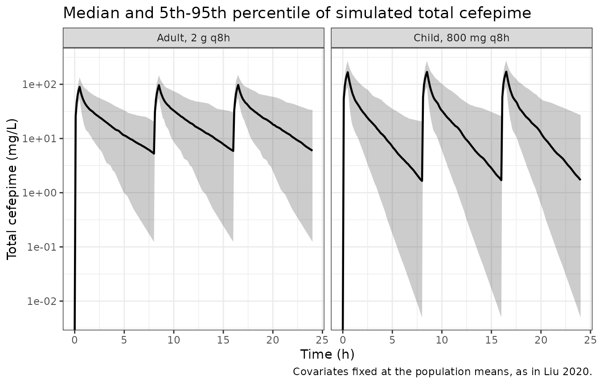
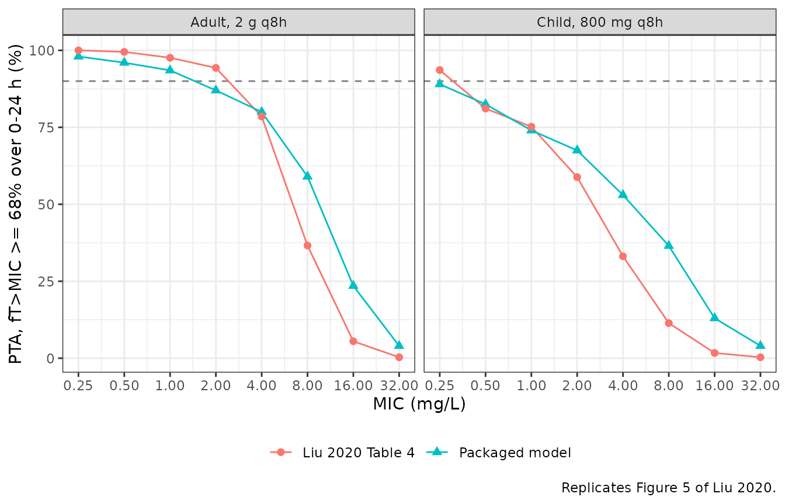

# Cefepime (Liu 2020)

## Model and source

- Citation: Liu J, Neely M, Lipman J, Sime F, Roberts JA, Kiel PJ,
  Avedissian SN, Rhodes NJ, Scheetz MH. Development of Population and
  Bayesian Models for Applied Use in Patients Receiving Cefepime. Clin
  Pharmacokinet. 2020;59(8):1027-1036. <doi:10.1007/s40262-020-00873-3>.
  PMID 32140940; PMC7222999. Preliminary results presented as IDWeek
  2019 abstract 1573, Open Forum Infect Dis. 2019;6(Suppl 2):S575
  (PMC6810068).
- Description: Two-compartment population PK model for intravenous
  cefepime fitted jointly to adults (febrile neutropenia with
  haematological malignancy, and critical illness) and hospitalised
  children aged 2 months to 16 years. Central volume scales linearly
  with total body weight standardised to 70 kg. The elimination rate
  constant is an additive non-renal intercept plus a renal component
  proportional to raw Cockcroft-Gault creatinine clearance standardised
  to 120 mL/min, the whole sum multiplied by an allometric (WT/70)^-0.25
  scaler. Inter-compartmental distribution is parameterised directly as
  the micro-constants KCP and KPC. Estimated with the Pmetrics
  non-parametric adaptive grid (NPAG); typical values are the medians of
  the non-parametric joint density and the diagonal omegas are
  log-normal reconstructions from the published per-parameter CV% (see
  the vignette Assumptions and deviations). Liu 2020, n = 70 subjects
  (34 adults, 36 children), 683 plasma concentrations.
- Article: <https://doi.org/10.1007/s40262-020-00873-3> (open access,
  PMC7222999)
- Electronic supplementary material (differential equations, Table S1):
  <https://europepmc.org/article/PMC/PMC7222999#supplementary-material>

Liu 2020 builds one population PK model for intravenous cefepime that
covers both adults and children, with the explicit aim of serving as a
Bayesian prior for precision dosing. The structural model is
two-compartment, written with rate constants rather than clearances.
Body weight scales the central volume linearly and the elimination rate
constant allometrically, and Cockcroft-Gault creatinine clearance drives
a renal arm of the elimination rate constant on top of a non-renal
intercept:

``` math
V_c = V_0 \cdot \frac{WT}{70}, \qquad
K_e = \left(K_eIntcpt + \frac{CrCL}{120} \cdot K_e0\right) \cdot \left(\frac{WT}{70}\right)^{-0.25}
```

The paper first appeared as IDWeek 2019 abstract 1573 (PMC6810068); the
abstract prints no parameter values, so the full publication is the
source.

## Population

Seventy subjects contributed 683 plasma cefepime concentrations from
four studies: adults with febrile neutropenia and a haematological
malignancy (Sime, n = 12; Whited, n = 9), critically ill adults from the
DALI study (Roberts, n = 13), and hospitalised children treated with
intravenous cefepime monotherapy (Reed 1997, n = 36). The 34 adults were
22-82 years old (mean 55.4) with mean \[SD\] weight 82.7 \[21.5\] kg and
Cockcroft-Gault creatinine clearance 106.7 \[58.4\] mL/min. The 36
children were about 2 months to 16 years old (mean 3.9) with weight 16.0
\[16.1\] kg and creatinine clearance 195.6 \[40.5\] mL/min (Results,
“Demographics”). The Cockcroft-Gault formula was applied to the children
too, which is why their raw creatinine clearance is higher than the
adults’.

The model was built on 9 adults (Whited) and 24 randomly selected
children (Reed), and evaluated on the remaining 12 children and both
other adult studies (Figure 1). Sex and race were not reported.

``` r

pop <- rxode2::rxode(readModelDb("Liu_2020_cefepime"))$population
#> ℹ parameter labels from comments will be replaced by 'label()'
str(pop, max.level = 1)
#> List of 14
#>  $ species        : chr "human"
#>  $ n_subjects     : int 70
#>  $ n_studies      : int 4
#>  $ n_samples      : int 683
#>  $ age_range      : chr "Adults 22-82 years (mean 55.4); children approximately 2 months to 16 years (mean 3.9) (Results, 'Demographics')"
#>  $ weight_mean_sd : chr "Adults 82.7 [21.5] kg; children 16.0 [16.1] kg (mean [SD]; Results, 'Demographics')"
#>  $ crcl_mean_sd   : chr "Adults 106.7 [58.4] mL/min; children 195.6 [40.5] mL/min, raw Cockcroft-Gault (mean [SD]; Results, 'Demographics')"
#>  $ sex_female_pct : num NA
#>  $ race_ethnicity : chr "Not reported."
#>  $ disease_state  : chr "Adults: febrile neutropenia with haematological malignancy after chemotherapy and/or stem cell transplant (Sime"| __truncated__
#>  $ dose_range     : chr "Maximum labelled dosing in the adult febrile-neutropenia studies; the paediatric study used intravenous cefepim"| __truncated__
#>  $ regions        : chr "United States and Australia (pooled studies; Sime and Roberts DALI are Australian-led, Whited and Reed are US)."
#>  $ protein_binding: chr "Not fitted. The model outputs TOTAL plasma cefepime as Cc; the paper applies a literature protein binding of 20"| __truncated__
#>  $ notes          : chr "Model-building set: 9 adults (Whited) and 24 randomly selected children (Reed), 428 observations, 0.5-249.7 ug/"| __truncated__
```

## Source trace

Per-parameter origin is recorded as an in-file comment next to each
`ini()` entry in `inst/modeldb/specificDrugs/Liu_2020_cefepime.R`. The
table below collects them in one place.

| Equation / parameter | Value | Source location |
|----|----|----|
| `lvc` (V0) | 11.172 L (95% CI 9.40, 12.50) | Table 2, row `V0 (L)` |
| `lkel_nonren` (KeIntcpt) | 0.506 1/h (95% CI 0.33, 0.71) | Table 2, row `KeIntcpt` |
| `lkel_renal` (Ke0) | 0.236 1/h (95% CI 0.11, 0.40) | Table 2, row `Ke0` |
| `lk12` (KCP) | 1.716 1/h (95% CI 1.02, 3.11) | Table 2, row `KCP`; direction from the ESM definitions |
| `lk21` (KPC) | 1.502 1/h (95% CI 1.35, 1.90) | Table 2, row `KPC`; direction from the ESM definitions |
| `e_wt_vc` | 1 (structural constant) | ESM equation 3; Table 1 final row `V0 * (WT/70)` |
| `e_wt_kel` | -0.25 (structural constant) | ESM equation 4; Methods, “Pharmacokinetic Models” (“raised to the negative 0.25th power”) |
| `etalvc`, `etalkel_nonren`, `etalkel_renal`, `etalk12`, `etalk21` | 0.0501, 0.301, 1.028, 0.388, 0.313 | Table 2 `CV (%)` column (22.66, 59.24, 133.95, 68.82, 60.63) via `log(CV^2 + 1)` |
| `addSd`, `propSd` | 0.5 mg/L, 0.15 | Methods, “Pharmacokinetic Models” (`SD = C0 + C1 * Y`, C0 = 0.5, C1 = 0.15) |
| Two-compartment ODEs | n/a | ESM equations 1-2 |
| `Vc = V0 * (WT/70)` | n/a | ESM equation 3; Table 1 final row |
| `Ke = (KeIntcpt + (CrCL/120) * Ke0) * (WT/70)^-0.25` | n/a | ESM equation 4; Table 1 final row |
| Reference WT 70 kg, CrCL 120 mL/min | n/a | Methods, “Pharmacokinetic Models” |
| Unbound fraction 0.80 | n/a | Methods, “Simulations and Probability of Target Attainment”; applied outside the model |

### Consistency of Table 2 with Table 3

Table 2 gives each parameter’s CV% and Table 3 the variance of the
non-parametric distribution on the linear scale. Their ratio recovers
the distribution’s mean, which sits close to the Table 2 median for the
near-symmetric V0 and well above it for the strongly right-skewed Ke0,
as a non-parametric fit allows. The CV% is therefore the CV about the
mean, which is what `log(CV^2 + 1)` assumes.

``` r

tab <- tibble::tibble(
  parameter = c("V0", "KeIntcpt", "Ke0", "KCP", "KPC"),
  median = c(11.172, 0.506, 0.236, 1.716, 1.502),
  cv_pct = c(22.66, 59.24, 133.95, 68.82, 60.63),
  variance = c(6.366, 0.085, 0.499, 2.354, 1.414)
) |>
  dplyr::mutate(
    implied_mean = sqrt(variance) / (cv_pct / 100),
    omega2 = log((cv_pct / 100)^2 + 1)
  )

th <- rxode2::rxode(readModelDb("Liu_2020_cefepime"))$theta
#> ℹ parameter labels from comments will be replaced by 'label()'
om <- diag(rxode2::rxode(readModelDb("Liu_2020_cefepime"))$omega)
#> ℹ parameter labels from comments will be replaced by 'label()'
stopifnot(
  # The packaged typical values are the Table 2 medians.
  all(abs(exp(th[c("lvc", "lkel_nonren", "lkel_renal", "lk12", "lk21")]) -
    tab$median) < 1e-9),
  # The packaged omegas are log(CV^2 + 1) of the Table 2 CV%.
  all(abs(om[c("etalvc", "etalkel_nonren", "etalkel_renal", "etalk12", "etalk21")] -
    tab$omega2) < 1e-6)
)

tab |>
  dplyr::rename(
    "Parameter" = parameter, "Table 2 median" = median,
    "Table 2 CV (%)" = cv_pct, "Table 3 variance" = variance,
    "Implied mean, SD / CV" = implied_mean, "Packaged omega^2" = omega2
  ) |>
  knitr::kable(digits = 4)
```

| Parameter | Table 2 median | Table 2 CV (%) | Table 3 variance | Implied mean, SD / CV | Packaged omega^2 |
|:---|---:|---:|---:|---:|---:|
| V0 | 11.172 | 22.66 | 6.366 | 11.1346 | 0.0501 |
| KeIntcpt | 0.506 | 59.24 | 0.085 | 0.4921 | 0.3008 |
| Ke0 | 0.236 | 133.95 | 0.499 | 0.5274 | 1.0276 |
| KCP | 1.716 | 68.82 | 2.354 | 2.2294 | 0.3877 |
| KPC | 1.502 | 60.63 | 1.414 | 1.9613 | 0.3131 |

## Virtual cohort

The paper’s Monte Carlo simulations fixed each population’s covariates
at the arithmetic means (Methods, “Simulations and Probability of Target
Attainment”), so the virtual cohort does the same: one adult arm at 82.7
kg and 106.7 mL/min, one paediatric arm at 16.0 kg and 195.6 mL/min.
Between- subject variability comes from the random effects only. Each
arm receives the paper’s maximum regimen for three doses (the first 24
h), each infused over 0.5 h: 2 g every 8 h for adults and 50 mg/kg every
8 h, 800 mg at 16 kg, for children. Concentrations are predicted every
0.1 h, the paper’s grid.

``` r

rxode2::rxSetSeed(20200306)
n_per_arm <- 200L

arms <- tibble::tibble(
  treatment = c("Adult, 2 g q8h", "Child, 800 mg q8h"),
  WT = c(82.7, 16.0),
  CRCL = c(106.7, 195.6),
  dose_mg = c(2000, 800),
  id_offset = c(0L, n_per_arm)
)

subjects <- arms |>
  dplyr::rowwise() |>
  dplyr::reframe(
    id = id_offset + seq_len(n_per_arm),
    treatment = treatment, WT = WT, CRCL = CRCL, dose_mg = dose_mg
  )

dose_rows <- subjects |>
  tidyr::crossing(time = c(0, 8, 16)) |>
  dplyr::mutate(amt = dose_mg, dur = 0.5, evid = 1L, cmt = "central")
obs_rows <- subjects |>
  tidyr::crossing(time = round(seq(0, 24, by = 0.1), 1)) |>
  dplyr::mutate(amt = NA_real_, dur = NA_real_, evid = 0L, cmt = "central")

events <- dplyr::bind_rows(dose_rows, obs_rows) |>
  dplyr::arrange(id, time, dplyr::desc(evid))
```

## Simulation

``` r

mod <- readModelDb("Liu_2020_cefepime")
sim <- rxode2::rxSolve(
  mod,
  events = events,
  keep = c("treatment", "dose_mg"),
  rtol = 1e-10, atol = 1e-12
) |>
  as.data.frame()
#> ℹ parameter labels from comments will be replaced by 'label()'

stopifnot(
  length(unique(sim$id)) == 2L * n_per_arm,
  !any(is.na(sim$Cc)),
  all(sim$Cc >= -1e-6 * max(sim$Cc))
)
```

``` r

# Concentration-time percentiles over the first 24 h, the window of the
# paper's target-attainment analysis (Figure 5 and Table 4).
sim |>
  dplyr::group_by(treatment, time) |>
  dplyr::summarise(
    Q05 = quantile(Cc, 0.05), Q50 = median(Cc), Q95 = quantile(Cc, 0.95),
    .groups = "drop"
  ) |>
  ggplot(aes(time, Q50)) +
  geom_ribbon(aes(ymin = Q05, ymax = Q95), alpha = 0.25) +
  geom_line(linewidth = 0.8) +
  facet_wrap(~treatment) +
  scale_y_log10() +
  labs(
    x = "Time (h)", y = "Total cefepime (mg/L)",
    title = "Median and 5th-95th percentile of simulated total cefepime",
    caption = "Covariates fixed at the population means, as in Liu 2020."
  ) +
  theme_bw()
#> Warning in scale_y_log10(): log-10 transformation introduced infinite values.
#> log-10 transformation introduced infinite values.
#> log-10 transformation introduced infinite values.
#> log-10 transformation introduced infinite values.
```



## PKNCA validation

NCA is run on the first dosing interval of each subject. Two checks
follow.

1.  **Structural identity.** For a linear model given one intravenous
    dose, `AUC(0-inf) = Dose / CL` with `CL = kel * Vc`. Both sides use
    the same per-subject parameters, so the residual is only trapezoid
    and extrapolation error.
2.  **Comparison with the paper’s noncompartmental results.** The
    Discussion reports NCA of the observed model-development data:
    clearance 7.59 L/h and half-life 2.98 h in adults, and means of 3.1
    L/h and 3.0 h in children.

``` r

# Only `!is.na(Cc)`: a `time > 0` or `Cc > 0` filter would drop the
# time-zero row PKNCA needs to anchor AUC(0-*). The numerical undershoot
# below zero is floored as in the known-failure-pattern guidance.
sim_nca <- sim |>
  dplyr::filter(!is.na(Cc), time <= 8) |>
  dplyr::mutate(Cc = pmax(Cc, 0)) |>
  dplyr::select(id, time, Cc, treatment)

conc_obj <- PKNCA::PKNCAconc(sim_nca, Cc ~ time | treatment + id,
  concu = "mg/L", timeu = "h"
)
dose_obj <- PKNCA::PKNCAdose(
  dose_rows |> dplyr::filter(time == 0) |>
    dplyr::select(id, time, amt, treatment),
  amt ~ time | treatment + id,
  doseu = "mg"
)
intervals <- data.frame(
  start = 0, end = 8,
  cmax = TRUE, tmax = TRUE, auclast = TRUE,
  aucinf.obs = TRUE, cl.obs = TRUE, half.life = TRUE
)
nca_res <- PKNCA::pk.nca(PKNCA::PKNCAdata(conc_obj, dose_obj,
  intervals = intervals
))

nca_wide <- as.data.frame(nca_res$result) |>
  dplyr::select(id, treatment, PPTESTCD, PPORRES) |>
  tidyr::pivot_wider(names_from = PPTESTCD, values_from = PPORRES)
stopifnot(nrow(nca_wide) == 2L * n_per_arm)
```

``` r

indiv <- sim |>
  dplyr::filter(time == 0) |>
  dplyr::distinct(id, kel, vc, dose_mg)

check <- nca_wide |>
  dplyr::inner_join(indiv, by = "id") |>
  dplyr::mutate(
    auc_theory = dose_mg / (kel * vc),
    auc_err_pct = 100 * (aucinf.obs - auc_theory) / auc_theory
  )
stopifnot(nrow(check) == 2L * n_per_arm)

# Same parameters on both sides, so the difference is numerical. The bound
# is on the centre and a robust quantile, not the maximum, because the
# extrapolated tail of the slowest-equilibrating subjects carries the
# largest trapezoid error.
stopifnot(
  abs(median(check$auc_err_pct)) < 1,
  quantile(abs(check$auc_err_pct), 0.9) < 3
)

check |>
  dplyr::group_by(treatment) |>
  dplyr::summarise(
    n = dplyr::n(),
    median_err = median(auc_err_pct),
    p90_abs_err = quantile(abs(auc_err_pct), 0.9),
    .groups = "drop"
  ) |>
  dplyr::rename(
    "Group" = treatment, "N" = n,
    "Median AUC error (%)" = median_err,
    "90th percentile of |AUC error| (%)" = p90_abs_err
  ) |>
  knitr::kable(digits = 3, caption = paste(
    "Per-subject identity AUC(0-inf) = Dose / (kel * Vc) after the first dose."
  ))
```

| Group | N | Median AUC error (%) | 90th percentile of \|AUC error\| (%) |
|:---|---:|---:|---:|
| Adult, 2 g q8h | 200 | -0.100 | 0.224 |
| Child, 800 mg q8h | 200 | -0.131 | 0.278 |

Per-subject identity AUC(0-inf) = Dose / (kel \* Vc) after the first
dose. {.table}

``` r

# Liu 2020 Discussion: "The noncompartmental analysis conducted (in the
# model development adult population) in our study produced similar results
# (CL, 7.59 L/h; elimination half-life, 2.98 h)" and "In our pediatric
# population, means of CL and elimination half-life were 3.1 L/h and
# 3.0 h, respectively."
published_nca <- data.frame(
  treatment = c("Adult, 2 g q8h", "Child, 800 mg q8h"),
  cl.obs = c(7.59, 3.1),
  half.life = c(2.98, 3.0)
)

# The simulated side is summarised by the MEDIAN (the function's default),
# not the mean. The reconstructed eta on the renal arm has omega^2 = 1.03,
# so its log-normal mean is exp(1.03 / 2) = 1.67 times its median and the
# arithmetic-mean clearance is dominated by the upper tail of a parametric
# approximation (simulated mean CL is about 20% above the median in adults
# and about 30% above it in children).
cmp <- nlmixr2lib::ncaComparisonTable(
  simulated = as.data.frame(nca_res$result) |>
    dplyr::filter(PPTESTCD %in% c("cl.obs", "half.life")),
  reference = published_nca,
  by = "treatment",
  units = c(cl.obs = "L/h", half.life = "h")
)
knitr::kable(cmp, caption = attr(cmp, "footnote"))
```

| NCA parameter | treatment         | Reference | Simulated | % diff   |
|:--------------|:------------------|:----------|:----------|:---------|
| t½ (h)        | Adult, 2 g q8h    | 2.98      | 2.55      | -14.3%   |
| t½ (h)        | Child, 800 mg q8h | 3         | 1.34      | -55.3%\* |
| CL/F (L/h)    | Adult, 2 g q8h    | 7.59      | 9.75      | +28.5%\* |
| CL/F (L/h)    | Child, 800 mg q8h | 3.1       | 3.45      | +11.2%   |

\* differs from reference by more than ±20%. {.table}

The comparator is loose. The published values are NCA of the observed
model-development data: 9 adults from one febrile-neutropenia study and
24 children, whose covariates the paper does not report separately. The
simulation fixes covariates at the means of all 34 adults and all 36
children. The structural gate is therefore placed on the typical-value
clearance at those means, which is deterministic. A mis-transcribed rate
constant, volume, covariate reference or allometric exponent moves it by
far more than the bound. The Discussion also cites an adult clearance of
8.6 L/h from Sime et al., whose 12 adults are in the evaluation set;
that value is included.

``` r

typical_cl <- function(wt, crcl) {
  vc <- exp(th[["lvc"]]) * (wt / 70)^th[["e_wt_vc"]]
  kel <- (exp(th[["lkel_nonren"]]) + exp(th[["lkel_renal"]]) * crcl / 120) *
    (wt / 70)^th[["e_wt_kel"]]
  kel * vc
}
cl_check <- tibble::tibble(
  comparison = c(
    "Adults, NCA of model-development data",
    "Adults, Sime et al. (Discussion)",
    "Children, NCA of model-development data"
  ),
  published = c(7.59, 8.6, 3.1),
  typical = c(
    typical_cl(82.7, 106.7), typical_cl(82.7, 106.7),
    typical_cl(16.0, 195.6)
  )
) |>
  dplyr::mutate(diff_pct = 100 * (typical / published - 1))

stopifnot(all(abs(cl_check$diff_pct) < 25))

cl_check |>
  dplyr::rename(
    "Comparison" = comparison, "Published CL (L/h)" = published,
    "Model typical CL at the mean covariates (L/h)" = typical,
    "Difference (%)" = diff_pct
  ) |>
  knitr::kable(digits = 2)
```

| Comparison | Published CL (L/h) | Model typical CL at the mean covariates (L/h) | Difference (%) |
|:---|---:|---:|---:|
| Adults, NCA of model-development data | 7.59 | 9.06 | 19.40 |
| Adults, Sime et al. (Discussion) | 8.60 | 9.06 | 5.38 |
| Children, NCA of model-development data | 3.10 | 3.29 | 6.11 |

``` r

nca_wide |>
  dplyr::group_by(treatment) |>
  dplyr::summarise(
    dplyr::across(c(cmax, tmax, auclast, half.life, cl.obs), median),
    .groups = "drop"
  ) |>
  dplyr::rename(
    "Group" = treatment, "Cmax (mg/L)" = cmax, "Tmax (h)" = tmax,
    "AUC0-8 (mg*h/L)" = auclast, "Terminal t1/2 (h)" = half.life,
    "CL (L/h)" = cl.obs
  ) |>
  knitr::kable(digits = 2, caption = "Median simulated NCA, first dose.")
```

| Group | Cmax (mg/L) | Tmax (h) | AUC0-8 (mg\*h/L) | Terminal t1/2 (h) | CL (L/h) |
|:---|---:|---:|---:|---:|---:|
| Adult, 2 g q8h | 89.71 | 0.5 | 174.31 | 2.55 | 9.75 |
| Child, 800 mg q8h | 167.16 | 0.5 | 214.18 | 1.34 | 3.45 |

Median simulated NCA, first dose. {.table style="width:100%;"}

``` r

# Typical steady-state volume Vss = Vc * (1 + k12 / k21) at the mean weights,
# against the volume the published NCA pair implies, CL * t1/2 / ln(2).
vss <- function(wt) {
  exp(th[["lvc"]]) * (wt / 70)^th[["e_wt_vc"]] *
    (1 + exp(th[["lk12"]]) / exp(th[["lk21"]]))
}
tibble::tibble(
  group = c("Adults (82.7 kg)", "Children (16.0 kg)"),
  vss_model = c(vss(82.7), vss(16.0)),
  vz_published = c(7.59 * 2.98, 3.1 * 3.0) / log(2)
) |>
  dplyr::mutate(
    vss_model_per_kg = vss_model / c(82.7, 16.0),
    vz_published_per_kg = vz_published / c(82.7, 16.0)
  ) |>
  dplyr::rename(
    "Group" = group, "Model Vss (L)" = vss_model,
    "Published CL x t1/2 / ln 2 (L)" = vz_published,
    "Model Vss (L/kg)" = vss_model_per_kg,
    "Published (L/kg)" = vz_published_per_kg
  ) |>
  knitr::kable(digits = 2)
```

| Group | Model Vss (L) | Published CL x t1/2 / ln 2 (L) | Model Vss (L/kg) | Published (L/kg) |
|:---|---:|---:|---:|---:|
| Adults (82.7 kg) | 28.28 | 32.63 | 0.34 | 0.39 |
| Children (16.0 kg) | 5.47 | 13.42 | 0.34 | 0.84 |

In children, the simulated median clearance is within 20% of the
published NCA mean. In adults it is 28% above the published mean of the
9 adults in the model-development set, which is starred above. Their
covariates are not reported, and the typical-value clearance at the mean
covariates of all 34 adults is 19% above that value and 5% above the 8.6
L/h the Discussion quotes for Sime et al. Half-life agrees in adults but
not in children: the simulated paediatric terminal half-life is well
under half the published 3.0 h. PKNCA is fitting the terminal phase
here. The typical terminal half-life, computed from the eigenvalues of
the two-compartment system, is 2.4 h in adults and 1.4 h in children,
matching the simulated medians.

The volume arithmetic above isolates the cause. The published adult pair
implies a volume close to the model’s adult Vss. The published
paediatric pair implies a volume per kilogram more than twice the
model’s. The model scales central volume linearly with weight (ESM
equation 3, Table 1 final row) and carries no weight effect on KCP or
KPC, so its Vss per kilogram is the same at every weight. The published
paediatric NCA means therefore cannot be reproduced by any child at the
mean weight. They come from 24 children whose individual weights span
about 2 months to 16 years of age, and a mean of per-subject half-lives
weights the slow-eliminating subjects heavily. The paper does not report
enough to resolve this further. Parameters were not adjusted.

## Replicating Table 4 and Figure 5: probability of target attainment

The target is unbound cefepime above the MIC for at least 68% of the
first 24 h, with an unbound fraction of 0.80. The paper sampled from the
non-parametric support points with a smoothing covariance; this model
samples log-normal random effects reconstructed from the marginal CV%,
so agreement is expected in the centre of the curve rather than cell by
cell.

``` r

unbound_fraction <- 0.80 # 20% protein binding (Methods)
mics <- c(0.25, 0.5, 1, 2, 4, 8, 16, 32)

ft <- sim |>
  dplyr::mutate(Cfree = unbound_fraction * Cc) |>
  tidyr::crossing(mic = mics) |>
  dplyr::group_by(treatment, id, mic) |>
  dplyr::summarise(ft_pct = 100 * mean(Cfree > mic), .groups = "drop")

pta <- ft |>
  dplyr::group_by(treatment, mic) |>
  dplyr::summarise(pta_sim = 100 * mean(ft_pct >= 68), .groups = "drop")

# Liu 2020 Table 4.
published_pta <- tibble::tibble(
  treatment = rep(c("Adult, 2 g q8h", "Child, 800 mg q8h"), each = 8),
  mic = rep(mics, 2),
  pta_pub = c(
    100, 99.5, 97.6, 94.3, 78.5, 36.6, 5.5, 0.3,
    93.6, 81.1, 75.2, 58.8, 33.1, 11.4, 1.7, 0.3
  )
)

pta_cmp <- dplyr::inner_join(pta, published_pta, by = c("treatment", "mic")) |>
  dplyr::mutate(diff = pta_sim - pta_pub)
stopifnot(nrow(pta_cmp) == 16L)

pta_cmp |>
  dplyr::rename(
    "Group" = treatment, "MIC (mg/L)" = mic,
    "Simulated PTA (%)" = pta_sim, "Liu 2020 Table 4 (%)" = pta_pub,
    "Difference (percentage points)" = diff
  ) |>
  knitr::kable(digits = c(0, 2, 1, 1, 1))
```

| Group | MIC (mg/L) | Simulated PTA (%) | Liu 2020 Table 4 (%) | Difference (percentage points) |
|:---|---:|---:|---:|---:|
| Adult, 2 g q8h | 0.25 | 98.0 | 100.0 | -2.0 |
| Adult, 2 g q8h | 0.50 | 96.0 | 99.5 | -3.5 |
| Adult, 2 g q8h | 1.00 | 93.5 | 97.6 | -4.1 |
| Adult, 2 g q8h | 2.00 | 87.0 | 94.3 | -7.3 |
| Adult, 2 g q8h | 4.00 | 80.0 | 78.5 | 1.5 |
| Adult, 2 g q8h | 8.00 | 59.0 | 36.6 | 22.4 |
| Adult, 2 g q8h | 16.00 | 23.5 | 5.5 | 18.0 |
| Adult, 2 g q8h | 32.00 | 4.0 | 0.3 | 3.7 |
| Child, 800 mg q8h | 0.25 | 89.0 | 93.6 | -4.6 |
| Child, 800 mg q8h | 0.50 | 82.5 | 81.1 | 1.4 |
| Child, 800 mg q8h | 1.00 | 74.0 | 75.2 | -1.2 |
| Child, 800 mg q8h | 2.00 | 67.5 | 58.8 | 8.7 |
| Child, 800 mg q8h | 4.00 | 53.0 | 33.1 | 19.9 |
| Child, 800 mg q8h | 8.00 | 36.5 | 11.4 | 25.1 |
| Child, 800 mg q8h | 16.00 | 13.0 | 1.7 | 11.3 |
| Child, 800 mg q8h | 32.00 | 4.0 | 0.3 | 3.7 |

``` r

# Replicates Figure 5 of Liu 2020.
pta_cmp |>
  tidyr::pivot_longer(c(pta_sim, pta_pub), names_to = "source", values_to = "pta") |>
  dplyr::mutate(source = dplyr::recode(source,
    pta_sim = "Packaged model", pta_pub = "Liu 2020 Table 4"
  )) |>
  ggplot(aes(mic, pta, colour = source, shape = source)) +
  geom_hline(yintercept = 90, linetype = "dashed", colour = "grey50") +
  geom_line() +
  geom_point(size = 2) +
  facet_wrap(~treatment) +
  scale_x_continuous(trans = "log2", breaks = mics) +
  labs(
    x = "MIC (mg/L)", y = "PTA, fT>MIC >= 68% over 0-24 h (%)",
    colour = NULL, shape = NULL,
    caption = "Replicates Figure 5 of Liu 2020."
  ) +
  theme_bw() +
  theme(legend.position = "bottom")
```



``` r

# Centre-of-curve gates, per the repository's guidance on Monte Carlo
# assertions. With 200 subjects a single PTA cell has a binomial SE of at most
# 3.5 percentage points (about 3.1 at the 75% PTA of the paediatric MIC of
# 1 mg/L).
#  - Low MICs (0.25-1 mg/L) are attained by the bulk of each cohort and are
#    governed by the typical subject, so they are compared cell by cell. The
#    12-point bound sits more than 3 cell SEs beyond every observed
#    difference (tightest: the paediatric MIC of 0.25 mg/L, -4.6 points at
#    PTA 89%, SE 2.2).
#  - The median absolute difference over all eight MICs summarises the curve.
#  - The paper's qualitative conclusion: the paediatric maximum dose attains
#    less than the adult dose at every MIC from 0.25 to 8 mg/L (the smallest
#    simulated gap is 9 points at 0.25 mg/L, about 3.7 SE of the difference).
low_mic <- pta_cmp |> dplyr::filter(mic <= 1)
pta_summary <- pta_cmp |>
  dplyr::group_by(treatment) |>
  dplyr::summarise(
    max_abs_diff_low_mic = max(abs(diff[mic <= 1])),
    median_abs_diff = median(abs(diff)),
    .groups = "drop"
  )
adult_vs_child <- pta |>
  dplyr::filter(mic <= 8) |>
  tidyr::pivot_wider(names_from = treatment, values_from = pta_sim)

knitr::kable(pta_summary |>
  dplyr::rename(
    "Group" = treatment,
    "Max |PTA difference|, MIC 0.25-1 mg/L (points)" = max_abs_diff_low_mic,
    "Median |PTA difference|, all MICs (points)" = median_abs_diff
  ), digits = 1)
```

| Group | Max \|PTA difference\|, MIC 0.25-1 mg/L (points) | Median \|PTA difference\|, all MICs (points) |
|:---|---:|---:|
| Adult, 2 g q8h | 4.1 | 3.9 |
| Child, 800 mg q8h | 4.6 | 6.6 |

``` r


stopifnot(
  nrow(low_mic) == 6L,
  all(abs(low_mic$diff) < 12),
  all(pta_summary$median_abs_diff < 15),
  nrow(adult_vs_child) == 6L,
  all(adult_vs_child[["Adult, 2 g q8h"]] > adult_vs_child[["Child, 800 mg q8h"]])
)
```

The packaged model reproduces Table 4 closely from 0.25 to 4 mg/L in
adults and from 0.25 to 2 mg/L in children, and reproduces the paper’s
conclusion that the maximum labelled paediatric dose attains less than
the adult dose across the clinically relevant MIC range. At higher MICs
the model’s curve is flatter than the paper’s: it keeps a larger
minority of subjects above 68% *f*T\>MIC at 8 and 16 mg/L. That is the
direction expected from the two approximations listed below. A
log-normal with the published CV% has a longer upper tail than the
non-parametric support points in a slow-elimination direction. Dropping
the negative KeIntcpt-Ke0 correlation also widens the spread of the
total elimination rate constant. The 90% PTA crossings also shift
slightly lower: the adult regimen drops below 90% between 1 and 2 mg/L
in the model, against between 2 and 4 mg/L in Table 4, and the
paediatric regimen is just under 90% already at 0.25 mg/L, against
between 0.25 and 0.5 mg/L.

## Assumptions and deviations

- **Between-subject variability is a log-normal reconstruction.**
  Pmetrics NPAG estimates a discrete non-parametric joint density. Table
  2 reports each marginal’s CV%, carried as `omega^2 = log(CV^2 + 1)` on
  the log scale. The typical values are the Table 2 medians. The
  non-parametric marginals are not log-normal; Ke0 in particular is
  strongly right-skewed (mean about 0.53 vs median 0.236 1/h), so tails
  of simulated distributions will differ from the paper’s. This is why
  the Table 4 comparison is asserted on the centre of the curve and not
  cell by cell.
- **Table 3 correlations are not encoded.** Table 3 is the covariance
  matrix on the linear scale. Converting it to the log scale with
  `sigma_ij = log(1 + Cov_ij / (m_i * m_j))` gives a 5 x 5 matrix with
  one negative eigenvalue (about -0.33), which is not a valid covariance
  matrix and would fail rxode2’s Cholesky sampler. The block is
  therefore diagonal. The largest omitted correlation is between
  KeIntcpt and Ke0 (about -0.74 on the linear scale), so simulated total
  elimination is somewhat more variable than in the paper.
- **The residual error is the assay-error floor.** Pmetrics multiplies
  the assay polynomial `SD = 0.5 + 0.15 * Y` by gamma, which was
  “initially set at 4”; its final value is not reported. The polynomial
  is carried unscaled (gamma = 1) with `combined1()`, the form in which
  the two SD terms add linearly as in Pmetrics, and both terms are
  `fixed()`.
- **Allometric scaler placement.** The Table 2 footnote says “V0 and
  KeIntcpt are standardized to weight”, but ESM equation 4 and the Table
  1 final row apply `(WT/70)^-0.25` to the whole bracket, including the
  renal arm. The equation is encoded.
- **Covariates at the population means.** The virtual cohort fixes
  weight and creatinine clearance at the reported means, as the paper
  does for its simulations. The 2 g adult dose and the 800 mg paediatric
  dose come from Table 4.
- **Sample count.** The Results report 683 concentrations; the Abstract
  reports 604. The model metadata records 683.
- **Canonical names.** The paper’s `KeIntcpt` and `Ke0` are encoded as
  `lkel_nonren` and `lkel_renal`, registered with this model. The paper
  symbol `Ke0` is not carried over because `lke0` is the registered name
  for the effect-compartment equilibration rate constant, an unrelated
  quantity.
