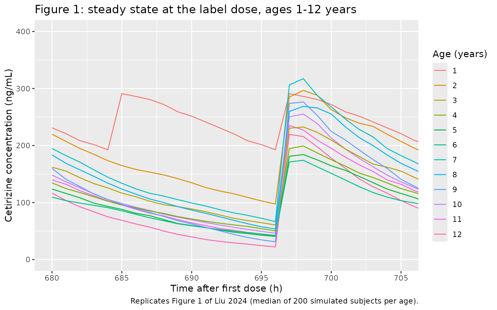
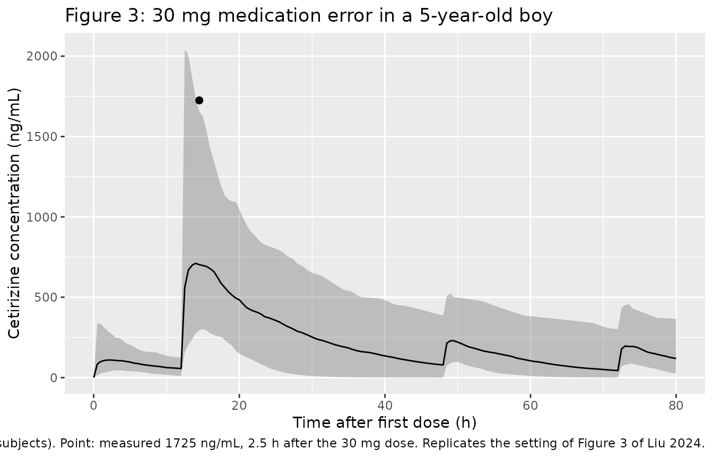

# Cetirizine (Liu 2024)

## Model and source

- Citation: Liu W, Tan Z, Yang P, Yu Z, Yao X, Zhou P, Liu L, Zhou W.
  Model-based exploration of the rationality of off-label use of
  cetirizine in Chinese pediatric patients: a prospective cohort study.
  Front Pharmacol. 2024;15:1322788. <doi:10.3389/fphar.2024.1322788>.
  Final parameter estimates are Supplementary Table S1. The covariate
  equations are not printed in Liu 2024 and are taken from the base
  model it re-fitted: Pitsiu M, Hussein Z, Majid O, Aarons L, de
  Longueville M, Stockis A. Retrospective population pharmacokinetic
  analysis of cetirizine in children aged 6 months to 12 years. Br J
  Clin Pharmacol. 2004;57(4):402-411.
  <doi:10.1046/j.1365-2125.2003.02017.x> (Table 4).
- Description: One-compartment population PK model with first-order
  absorption and first-order elimination for oral cetirizine in Chinese
  children (about 0.5-12 years) with allergic diseases (Liu 2024). The
  structure is the Pitsiu 2004 paediatric cetirizine model re-fitted to
  sparse real-world Chinese data: CL/F is linear in age with
  sex-specific intercepts (CL/F = 0.28 \* AGE + 0.771 \[male\] or 0.592
  \[female\] L/h), V/F is linear in age (V/F = 23.1 + 1.42 \* AGE L),
  and ka = theta_ka + CL/V guards against flip-flop. The age slope on
  CL/F, the V/F intercept, the IIV on CL/F and V/F and the proportional
  residual error were re-estimated; the sex intercepts, the V/F age
  slope, theta_ka and its IIV were held fixed at the Pitsiu 2004 values.
- Article: <https://doi.org/10.3389/fphar.2024.1322788> (open access;
  the parameter table is Supplementary Table S1)
- Structural source: Pitsiu et al. 2004,
  <https://doi.org/10.1046/j.1365-2125.2003.02017.x> (free full text in
  PubMed Central, PMC1884474)

Liu 2024 did not build a new structural model. Its sparse real-world
data (up to three samples per child, few in the absorption phase) were
used to re-fit the Pitsiu 2004 paediatric cetirizine model. After an
external evaluation showed misspecification across the exposure range,
the age slope on CL/F, the V/F intercept, the IIV on CL/F and V/F and
the proportional residual error were re-estimated. All absorption
parameters, both sex-specific CL/F intercepts and the V/F age slope
stayed fixed at the Pitsiu 2004 values. Liu 2024 describes the covariate
relationships in prose only. The equations below are the ones printed in
Pitsiu 2004 Table 4, and the parameter names in Liu’s Supplementary
Table S1 (`CL_AGE`, `CL_SEX on Male`, `CL_SEX on Female`, `V`, `V_AGE`,
`Ka`) map onto them one to one:

- CL/F (L/h) = `CL_AGE` x AGE + `CL_SEX,M` x (1 - SEXF) + `CL_SEX,F` x
  SEXF
- V/F (L) = `V` + `V_AGE` x AGE
- ka (1/h) = theta_ka + CL/V

## Population

Liu 2024 ran a prospective cohort study at Peking University Third
Hospital (April 2020 to April 2021) in 63 Chinese children with allergic
diseases (38 male, 25 female). They were aged 6.34 +/- 3.7 years,
weighed 26.4 +/- 15.7 kg and were 120.1 +/- 27.7 cm tall (Results 3.1).
Thirty-nine children received label doses and 24 received off-label
doses of up to twice the label dose (Table 1); five of those exceeded
0.25 mg/kg per administration (Table 3). Children with abnormal liver or
kidney function were excluded. Each child gave up to three plasma
samples, measured by HPLC-MS/MS.

The same information is available programmatically:

``` r

str(readModelDb("Liu_2024_cetirizine")()$population)
#> List of 15
#>  $ species       : chr "human"
#>  $ n_subjects    : int 63
#>  $ n_studies     : int 1
#>  $ age_range     : chr "Under 14 years at enrolment; Table 1 age groups 0.5-2, 2-6 and 6-12 years"
#>  $ age_mean      : chr "6.34 +/- 3.7 years"
#>  $ weight_mean   : chr "26.4 +/- 15.7 kg"
#>  $ height_mean   : chr "120.1 +/- 27.7 cm"
#>  $ sex_female_pct: num 39.7
#>  $ race_ethnicity: chr "Chinese (100%)"
#>  $ disease_state : chr "Children with allergic diseases (allergic rhinitis, urticaria, asthma and others) prescribed oral cetirizine; n"| __truncated__
#>  $ dose_range    : chr "Label doses 2.5 mg bid (0.5-6 years) or 5 mg bid (6-12 years); 24 of 63 children received off-label doses up to"| __truncated__
#>  $ regions       : chr "China (Peking University Third Hospital, Beijing)"
#>  $ samples       : chr "Up to three plasma samples per child; 85 concentrations in the NPDE evaluation (Supplementary Figure S4). Plasm"| __truncated__
#>  $ estimation    : chr "NONMEM 7.4.4, FOCE-I"
#>  $ notes         : chr "Prospective cohort study, April 2020 - April 2021: 38 male and 25 female children, 39 at label doses and 24 at "| __truncated__
```

## Source trace

| Equation / parameter | Value | Source location |
|----|----|----|
| `lcl` (CL/F intercept, male) | `fixed(log(0.771))` L/h | Liu 2024 Table S1 ‘CL_SEX on Male’ 0.771 FIXED; Pitsiu 2004 Table 4 |
| `lcl_female` (CL/F intercept, female) | `fixed(log(0.592))` L/h | Liu 2024 Table S1 ‘CL_SEX on Female’ 0.592 FIXED; Pitsiu 2004 Table 4 |
| `e_age_cl` | 0.28 L/h/year | Liu 2024 Table S1 ‘CL_AGE’ (RSE 17%); Discussion 4.1 ‘0.28 in our results’ |
| `lvc` (V/F intercept) | `log(23.1)` L | Liu 2024 Table S1 ‘V’ (RSE 40%) |
| `e_age_vc` | `fixed(1.42)` L/year | Liu 2024 Table S1 ‘V_AGE’ 1.42 FIXED; Pitsiu 2004 Table 4 |
| `lka` (theta_ka) | `fixed(log(2.14))` 1/h | Liu 2024 Table S1 ‘Ka’ 2.14 FIXED; Pitsiu 2004 Table 4 |
| `etalcl` | 0.378 | Liu 2024 Table S1 ‘IIV_CL/F’ (RSE 34%, shrinkage 21.2%) |
| `etalvc` | 0.445 | Liu 2024 Table S1 ‘IIV_V/F’ (RSE 41%, shrinkage 47.1%) |
| `etalka` | `fixed(2.1)` | Liu 2024 Table S1 ‘IIV_Ka’ 2.1 FIXED (Pitsiu 2004: 145% CV, 1.45^2 = 2.10) |
| `propSd` | 0.36 | Liu 2024 Table S1 ‘Proportional error’ (RSE 16%); ‘Sigma’ 1 FIXED |
| CL/F, V/F equations | n/a | Pitsiu 2004 Table 4; Liu 2024 Methods 2.4.2 (prose) |
| ka = theta_ka + CL/V | n/a | Pitsiu 2004 Table 4 footnote; Liu 2024 Methods 2.4.2 |
| One compartment, first-order absorption | n/a | Liu 2024 Methods 2.4.2 |
| `Cc = central / vc * 1000` (ng/mL) | n/a | Unit conversion: dose in mg, V/F in L |

## Typical CL/F and V/F by age: Liu 2024 vs Pitsiu 2004

Re-estimating the age slope on CL/F (0.12 to 0.28 L/h/year) and the V/F
intercept (4.00 to 23.1 L) gives Chinese children a higher clearance and
a much larger apparent volume than the Pitsiu 2004 European children of
the same age. The table sets the typical values of both models against
each other, with the Pitsiu values from Pitsiu 2004 Table 5.

``` r

mod <- readModelDb("Liu_2024_cetirizine")
th <- rxode2::rxode(mod)$theta
#> ℹ parameter labels from comments will be replaced by 'label()'
ages <- c(0.5, 2, 6, 7, 12)
typical <- tibble(AGE = ages) |>
  mutate(
    liu_cl_m = th[["e_age_cl"]] * AGE + exp(th[["lcl"]]),
    liu_cl_f = th[["e_age_cl"]] * AGE + exp(th[["lcl_female"]]),
    liu_v = exp(th[["lvc"]]) + th[["e_age_vc"]] * AGE,
    pitsiu_cl_m = c(0.83, 1.01, 1.49, 1.61, 2.21),
    pitsiu_cl_f = c(0.65, 0.83, 1.31, 1.43, 2.03),
    pitsiu_v = c(4.71, 6.84, 12.5, 13.9, 21.0)
  )
typical |>
  dplyr::rename(
    "Age (years)" = AGE,
    "Liu CL/F male (L/h)" = liu_cl_m,
    "Liu CL/F female (L/h)" = liu_cl_f,
    "Liu V/F (L)" = liu_v,
    "Pitsiu CL/F male (L/h)" = pitsiu_cl_m,
    "Pitsiu CL/F female (L/h)" = pitsiu_cl_f,
    "Pitsiu V/F (L)" = pitsiu_v
  ) |>
  knitr::kable(digits = 2, caption = "Typical apparent clearance and volume by age.")
```

| Age (years) | Liu CL/F male (L/h) | Liu CL/F female (L/h) | Liu V/F (L) | Pitsiu CL/F male (L/h) | Pitsiu CL/F female (L/h) | Pitsiu V/F (L) |
|---:|---:|---:|---:|---:|---:|---:|
| 0.5 | 0.91 | 0.73 | 23.81 | 0.83 | 0.65 | 4.71 |
| 2.0 | 1.33 | 1.15 | 25.94 | 1.01 | 0.83 | 6.84 |
| 6.0 | 2.45 | 2.27 | 31.62 | 1.49 | 1.31 | 12.50 |
| 7.0 | 2.73 | 2.55 | 33.04 | 1.61 | 1.43 | 13.90 |
| 12.0 | 4.13 | 3.95 | 40.14 | 2.21 | 2.03 | 21.00 |

Typical apparent clearance and volume by age. {.table}

The model reproduces Pitsiu’s Table 5 exactly when Pitsiu’s own
estimates (0.12 L/h/year and 4.00 L) replace Liu’s. That confirms the
equations encoded here are the ones Pitsiu printed:

``` r

pitsiu_check <- typical |>
  mutate(
    cl_m = 0.12 * AGE + exp(th[["lcl"]]),
    cl_f = 0.12 * AGE + exp(th[["lcl_female"]]),
    v = 4.00 + th[["e_age_vc"]] * AGE
  )
# Pitsiu Table 5 is printed to 2-3 significant figures.
stopifnot(
  max(abs(pitsiu_check$cl_m - pitsiu_check$pitsiu_cl_m)) < 0.011,
  max(abs(pitsiu_check$cl_f - pitsiu_check$pitsiu_cl_f)) < 0.011,
  max(abs(pitsiu_check$v - pitsiu_check$pitsiu_v)) < 0.06
)
```

## Virtual cohort: the twelve label-dose patients of Table 2

Liu 2024 Table 2 lists twelve virtual girls aged 1 to 12 years, each at
the maximum label dose, and reports the median steady-state Cmax and
Cmin over 1,000 simulations. Body weight and height are listed in that
table but are not model covariates. Each patient is simulated here with
200 subjects (the package’s per-arm cap), dosed for 30 days. The last 24
hours, 696 to 720 h, are the steady-state window; Figure 1 of the paper
covers the same window.

``` r

table2 <- tibble::tribble(
  ~pid, ~regimen, ~amt, ~ii, ~AGE, ~SEXF, ~cmax_pub, ~cmin_pub,
  1, "2.5 mg bid", 2.5, 12, 1, 1, 232.27, 156.48,
  2, "5 mg qd", 5, 24, 2, 1, 243.06, 86.27,
  3, "5 mg qd", 5, 24, 3, 1, 225.75, 71.94,
  4, "5 mg qd", 5, 24, 4, 1, 204.98, 47.53,
  5, "5 mg qd", 5, 24, 5, 1, 186.70, 48.09,
  6, "5 mg qd", 5, 24, 6, 1, 160.15, 31.70,
  7, "10 mg qd", 10, 24, 7, 1, 306.93, 55.57,
  8, "10 mg qd", 10, 24, 8, 1, 270.42, 38.28,
  9, "10 mg qd", 10, 24, 9, 1, 259.97, 32.19,
  10, "10 mg qd", 10, 24, 10, 1, 227.78, 37.98,
  11, "10 mg qd", 10, 24, 11, 1, 234.20, 28.80,
  12, "10 mg qd", 10, 24, 12, 1, 209.28, 18.94
) |>
  mutate(patient = sprintf("Age %d y, %s", AGE, regimen))

n_per_patient <- 200
t_end <- 720
t_ss <- t_end - 24

make_patient <- function(row, id_offset) {
  ids <- id_offset + seq_len(n_per_patient)
  dose_times <- seq(0, t_end - row$ii, by = row$ii)
  obs_times <- seq(t_ss - 16, t_end, by = 0.25)
  doses <- tidyr::expand_grid(id = ids, time = dose_times) |>
    mutate(amt = row$amt, evid = 1L, cmt = "depot")
  obs <- tidyr::expand_grid(id = ids, time = obs_times) |>
    mutate(amt = 0, evid = 0L, cmt = "central")
  bind_rows(doses, obs) |>
    mutate(AGE = row$AGE, SEXF = row$SEXF, patient = row$patient)
}

events <- bind_rows(lapply(seq_len(nrow(table2)), function(i) {
  make_patient(table2[i, ], id_offset = (i - 1L) * n_per_patient)
})) |>
  arrange(id, time, desc(evid))
stopifnot(!anyDuplicated(unique(events[, c("id", "time", "evid")])))
```

## Simulation

``` r

rxode2::rxSetSeed(20240314)
sim <- rxode2::rxSolve(mod, events = events, keep = c("patient")) |>
  as.data.frame()
#> ℹ parameter labels from comments will be replaced by 'label()'
```

## Replicate Figure 1

Figure 1 of Liu 2024 plots one curve per age over the steady-state
window. The paper does not say whether that curve is the typical value
or the median of the simulations. The median curve is plotted here, on
the paper’s hourly grid.

``` r

median_curve <- sim |>
  filter(abs(time - round(time)) < 1e-9) |>
  group_by(patient, time) |>
  summarise(Cc = median(Cc), .groups = "drop") |>
  left_join(table2 |> select(patient, AGE), by = "patient")

ggplot(median_curve, aes(time, Cc, colour = factor(AGE), group = patient)) +
  geom_line() +
  coord_cartesian(xlim = c(680, 705), ylim = c(0, 400)) +
  labs(
    x = "Time after first dose (h)", y = "Cetirizine concentration (ng/mL)",
    colour = "Age (years)",
    title = "Figure 1: steady state at the label dose, ages 1-12 years",
    caption = "Replicates Figure 1 of Liu 2024 (median of 200 simulated subjects per age)."
  )
```



## PKNCA validation against Table 2

PKNCA computes Cmax and Cmin per subject over the steady-state window.
The median across the 200 subjects of each patient is compared with
Table 2.

``` r

sim_nca <- sim |>
  dplyr::filter(!is.na(Cc), time >= t_ss) |>
  dplyr::select(id, time, Cc, patient)

dose_df <- events |>
  dplyr::filter(evid == 1, time >= t_ss) |>
  dplyr::select(id, time, amt, patient)

conc_obj <- PKNCA::PKNCAconc(sim_nca, Cc ~ time | patient + id)
dose_obj <- PKNCA::PKNCAdose(dose_df, amt ~ time | patient + id)
intervals <- data.frame(start = t_ss, end = t_end, cmax = TRUE, cmin = TRUE, tmax = TRUE)
nca_res <- PKNCA::pk.nca(PKNCA::PKNCAdata(conc_obj, dose_obj, intervals = intervals))

published <- table2 |>
  select(patient, cmax = cmax_pub, cmin = cmin_pub)

cmp <- nlmixr2lib::ncaComparisonTable(
  simulated = nca_res,
  reference = published,
  by = "patient",
  units = c(cmax = "ng/mL", cmin = "ng/mL"),
  tolerance_pct = 20
)
knitr::kable(
  cmp,
  caption = "Median simulated vs. published (Table 2) steady-state Cmax and Cmin. * differs from reference by >20%."
)
```

| NCA parameter | patient             | Reference | Simulated | % diff   |
|:--------------|:--------------------|:----------|:----------|:---------|
| Cmax (ng/mL)  | Age 1 y, 2.5 mg bid | 232       | 297       | +28.0%\* |
| Cmax (ng/mL)  | Age 2 y, 5 mg qd    | 243       | 310       | +27.7%\* |
| Cmax (ng/mL)  | Age 3 y, 5 mg qd    | 226       | 250       | +10.9%   |
| Cmax (ng/mL)  | Age 4 y, 5 mg qd    | 205       | 216       | +5.2%    |
| Cmax (ng/mL)  | Age 5 y, 5 mg qd    | 187       | 204       | +9.0%    |
| Cmax (ng/mL)  | Age 6 y, 5 mg qd    | 160       | 188       | +17.6%   |
| Cmax (ng/mL)  | Age 7 y, 10 mg qd   | 307       | 347       | +12.9%   |
| Cmax (ng/mL)  | Age 8 y, 10 mg qd   | 270       | 292       | +7.9%    |
| Cmax (ng/mL)  | Age 9 y, 10 mg qd   | 260       | 307       | +17.9%   |
| Cmax (ng/mL)  | Age 10 y, 10 mg qd  | 228       | 281       | +23.5%\* |
| Cmax (ng/mL)  | Age 11 y, 10 mg qd  | 234       | 259       | +10.6%   |
| Cmax (ng/mL)  | Age 12 y, 10 mg qd  | 209       | 246       | +17.5%   |
| Cmin (ng/mL)  | Age 1 y, 2.5 mg bid | 156       | 193       | +23.1%\* |
| Cmin (ng/mL)  | Age 2 y, 5 mg qd    | 86.3      | 97.6      | +13.1%   |
| Cmin (ng/mL)  | Age 3 y, 5 mg qd    | 71.9      | 60.8      | -15.6%   |
| Cmin (ng/mL)  | Age 4 y, 5 mg qd    | 47.5      | 50.2      | +5.6%    |
| Cmin (ng/mL)  | Age 5 y, 5 mg qd    | 48.1      | 40.8      | -15.2%   |
| Cmin (ng/mL)  | Age 6 y, 5 mg qd    | 31.7      | 42.3      | +33.4%\* |
| Cmin (ng/mL)  | Age 7 y, 10 mg qd   | 55.6      | 66.6      | +19.9%   |
| Cmin (ng/mL)  | Age 8 y, 10 mg qd   | 38.3      | 53.7      | +40.3%\* |
| Cmin (ng/mL)  | Age 9 y, 10 mg qd   | 32.2      | 31.3      | -2.8%    |
| Cmin (ng/mL)  | Age 10 y, 10 mg qd  | 38        | 46.3      | +21.9%\* |
| Cmin (ng/mL)  | Age 11 y, 10 mg qd  | 28.8      | 41.1      | +42.9%\* |
| Cmin (ng/mL)  | Age 12 y, 10 mg qd  | 18.9      | 22.2      | +17.4%   |

Median simulated vs. published (Table 2) steady-state Cmax and Cmin. \*
differs from reference by \>20%. {.table}

The simulated troughs scatter on both sides of Table 2. Most are within
about 25%; the misses run both high and low, which looks like
Monte-Carlo noise in a 200-subject median of a highly variable trough
rather than a bias. The per-subject median Cmax is consistently above
Table 2, by roughly 5-30%. That is what you would expect if the paper
read Cmax off the median concentration-time curve on an hourly grid (the
curve of its Figure 1), not as the median of per-subject maxima: with an
absorption rate constant as variable as this one (fixed IIV variance
2.1), subjects peak at different times, so the median of the individual
peaks sits above the peak of the median curve. The same metric taken
from the median curve agrees more closely:

``` r

curve_metric <- median_curve |>
  filter(time >= t_ss) |>
  group_by(patient) |>
  summarise(cmax_sim = max(Cc), cmin_sim = min(Cc), .groups = "drop") |>
  left_join(table2 |> select(pid, patient, cmax_pub, cmin_pub), by = "patient") |>
  arrange(pid) |>
  mutate(
    cmax_pct = 100 * (cmax_sim / cmax_pub - 1),
    cmin_pct = 100 * (cmin_sim / cmin_pub - 1)
  )

curve_metric |>
  select(patient, cmax_sim, cmax_pub, cmax_pct, cmin_sim, cmin_pub, cmin_pct) |>
  dplyr::rename(
    "Patient" = patient,
    "Cmax,ss sim (ng/mL)" = cmax_sim,
    "Cmax,ss Table 2" = cmax_pub,
    "Cmax diff (%)" = cmax_pct,
    "Cmin,ss sim (ng/mL)" = cmin_sim,
    "Cmin,ss Table 2" = cmin_pub,
    "Cmin diff (%)" = cmin_pct
  ) |>
  knitr::kable(digits = 1, caption = "Peak and trough of the median curve (hourly grid) vs. Table 2.")
```

| Patient | Cmax,ss sim (ng/mL) | Cmax,ss Table 2 | Cmax diff (%) | Cmin,ss sim (ng/mL) | Cmin,ss Table 2 | Cmin diff (%) |
|:---|---:|---:|---:|---:|---:|---:|
| Age 1 y, 2.5 mg bid | 291.0 | 232.3 | 25.3 | 192.6 | 156.5 | 23.1 |
| Age 2 y, 5 mg qd | 296.7 | 243.1 | 22.1 | 97.6 | 86.3 | 13.1 |
| Age 3 y, 5 mg qd | 232.6 | 225.8 | 3.0 | 60.8 | 71.9 | -15.6 |
| Age 4 y, 5 mg qd | 199.3 | 205.0 | -2.8 | 50.2 | 47.5 | 5.6 |
| Age 5 y, 5 mg qd | 184.2 | 186.7 | -1.3 | 40.8 | 48.1 | -15.2 |
| Age 6 y, 5 mg qd | 174.2 | 160.2 | 8.8 | 42.3 | 31.7 | 33.4 |
| Age 7 y, 10 mg qd | 317.3 | 306.9 | 3.4 | 66.6 | 55.6 | 19.9 |
| Age 8 y, 10 mg qd | 268.8 | 270.4 | -0.6 | 53.7 | 38.3 | 40.3 |
| Age 9 y, 10 mg qd | 276.4 | 260.0 | 6.3 | 31.3 | 32.2 | -2.8 |
| Age 10 y, 10 mg qd | 255.3 | 227.8 | 12.1 | 46.3 | 38.0 | 21.9 |
| Age 11 y, 10 mg qd | 235.3 | 234.2 | 0.5 | 41.1 | 28.8 | 42.9 |
| Age 12 y, 10 mg qd | 219.6 | 209.3 | 4.9 | 22.2 | 18.9 | 17.4 |

Peak and trough of the median curve (hourly grid) vs. Table 2. {.table}

``` r


# Structural check on the centre of the twelve patients. A mis-transcribed
# clearance slope (0.12 vs 0.28 L/h/year) or volume intercept (4.0 vs 23.1 L)
# moves these medians by far more than 25%; the per-patient values carry the
# Monte-Carlo noise of 200 subjects and the unknown details of the paper's
# summary, so no per-patient bound is asserted. Across draws the medians
# were about +4% to +9% (Cmax) and +8% to +19% (Cmin); the trough of a
# 200-subject cohort is the noisier of the two, hence its wider bound.
stopifnot(
  abs(median(curve_metric$cmax_pct)) < 20,
  abs(median(curve_metric$cmin_pct)) < 35
)
```

For ages 3 to 12 the median-curve peak is within about 15% of Table 2.
The youngest patients (1 year on 2.5 mg bid and 2 years on 5 mg qd) come
out about 10-25% higher than Table 2; the source does not report enough
about its simulation to explain the difference.

The paper’s main finding is reproduced by the typical-value (no IIV)
curves. Among the label doses the 7-year-old has the highest
steady-state peak (the first age at 10 mg qd) and the 6-year-old the
lowest (the oldest age at 5 mg qd), because the label dose steps up with
age while CL/F and V/F rise continuously:

``` r

sim_tv <- rxode2::rxSolve(
  rxode2::zeroRe(mod),
  events = events |> filter(id %% n_per_patient == 1),
  keep = c("patient")
) |>
  as.data.frame()
#> ℹ parameter labels from comments will be replaced by 'label()'
#> ℹ omega/sigma items treated as zero: 'etalcl', 'etalvc', 'etalka'
#> Warning: multi-subject simulation without without 'omega'

tv_peaks <- sim_tv |>
  filter(time >= t_ss) |>
  group_by(patient) |>
  summarise(cmax_typical = max(Cc), .groups = "drop") |>
  left_join(table2 |> select(pid, patient, AGE), by = "patient") |>
  arrange(pid)
knitr::kable(
  tv_peaks |> select(patient, cmax_typical) |>
    dplyr::rename("Patient" = patient, "Typical Cmax,ss (ng/mL)" = cmax_typical),
  digits = 1
)
```

| Patient             | Typical Cmax,ss (ng/mL) |
|:--------------------|------------------------:|
| Age 1 y, 2.5 mg bid |                   278.9 |
| Age 2 y, 5 mg qd    |                   273.4 |
| Age 3 y, 5 mg qd    |                   235.0 |
| Age 4 y, 5 mg qd    |                   208.3 |
| Age 5 y, 5 mg qd    |                   188.3 |
| Age 6 y, 5 mg qd    |                   172.6 |
| Age 7 y, 10 mg qd   |                   319.9 |
| Age 8 y, 10 mg qd   |                   298.7 |
| Age 9 y, 10 mg qd   |                   280.6 |
| Age 10 y, 10 mg qd  |                   265.0 |
| Age 11 y, 10 mg qd  |                   251.3 |
| Age 12 y, 10 mg qd  |                   239.1 |

``` r


# Typical-value solve: no random draws, so the ordering is deterministic.
stopifnot(
  tv_peaks$AGE[which.max(tv_peaks$cmax_typical)] == 7,
  tv_peaks$AGE[which.min(tv_peaks$cmax_typical)] == 6
)
```

## Off-label and overdose scenarios

### Table 3 patients (doses above 0.25 mg/kg)

Liu 2024 Table 3 reports Bayesian (POSTHOC) simulations of five children
who received more than 0.25 mg/kg per dose. Those values use each
child’s individual random effects, which are not published. The
population-level prediction for the same age, sex and regimen is shown
for context only and is not expected to match.

``` r

table3 <- tibble::tribble(
  ~patient_id, ~amt, ~AGE, ~SEXF, ~cmax_pub, ~cmin_pub,
  "6", 6.43, 4.08, 0, 417.67, 237.31,
  "45", 5, 6, 1, 236.64, 100.48,
  "54", 5, 5.7, 0, 266.31, 135.87,
  "58", 5, 5, 0, 277.34, 150.08,
  "66", 9, 4, 0, 580.68, 325.40
)

ev_t3 <- bind_rows(lapply(seq_len(nrow(table3)), function(i) {
  r <- table3[i, ]
  ids <- (i - 1L) * n_per_patient + seq_len(n_per_patient)
  bind_rows(
    tidyr::expand_grid(id = ids, time = seq(0, 216 - 12, by = 12)) |>
      mutate(amt = r$amt, evid = 1L, cmt = "depot"),
    tidyr::expand_grid(id = ids, time = seq(192, 216, by = 1)) |>
      mutate(amt = 0, evid = 0L, cmt = "central")
  ) |>
    mutate(AGE = r$AGE, SEXF = r$SEXF, patient_id = r$patient_id)
})) |>
  arrange(id, time, desc(evid))

sim_t3 <- rxode2::rxSolve(mod, events = ev_t3, keep = c("patient_id")) |>
  as.data.frame()

sim_t3 |>
  filter(time >= 204) |>
  group_by(patient_id, time) |>
  summarise(Cc = median(Cc), .groups = "drop") |>
  group_by(patient_id) |>
  summarise(cmax_sim = max(Cc), cmin_sim = min(Cc), .groups = "drop") |>
  left_join(table3, by = "patient_id") |>
  arrange(as.integer(patient_id)) |>
  select(patient_id, amt, AGE, cmax_sim, cmax_pub, cmin_sim, cmin_pub) |>
  dplyr::rename(
    "Patient" = patient_id,
    "Dose bid (mg)" = amt,
    "Age (years)" = AGE,
    "Cmax,ss population (ng/mL)" = cmax_sim,
    "Cmax,ss Table 3 POSTHOC" = cmax_pub,
    "Cmin,ss population (ng/mL)" = cmin_sim,
    "Cmin,ss Table 3 POSTHOC" = cmin_pub
  ) |>
  knitr::kable(digits = 1, caption = "Population predictions for the Table 3 regimens (context only).")
```

| Patient | Dose bid (mg) | Age (years) | Cmax,ss population (ng/mL) | Cmax,ss Table 3 POSTHOC | Cmin,ss population (ng/mL) | Cmin,ss Table 3 POSTHOC |
|:---|---:|---:|---:|---:|---:|---:|
| 6 | 6.4 | 4.1 | 379.9 | 417.7 | 199.5 | 237.3 |
| 45 | 5.0 | 6.0 | 246.5 | 236.6 | 123.1 | 100.5 |
| 54 | 5.0 | 5.7 | 242.0 | 266.3 | 116.4 | 135.9 |
| 58 | 5.0 | 5.0 | 258.4 | 277.3 | 109.0 | 150.1 |
| 66 | 9.0 | 4.0 | 554.6 | 580.7 | 258.4 | 325.4 |

Population predictions for the Table 3 regimens (context only). {.table}

### Figure 3: the 30 mg medication error

A 5-year-old boy prescribed 5 mg bid was given a single 30 mg dose 12 h
after his first 5 mg dose. A sample taken 2.5 h after the error measured
1725 ng/mL. Dosing restarted later. The curve in Figure 3 of the paper
doses again at about 48 and 72 h, which is the schedule simulated here.
Figure 3 is the boy’s individual POSTHOC curve, which needs his
unpublished random effects. The population prediction interval below is
shown with the measured concentration for orientation.

``` r

ids_od <- seq_len(n_per_patient)
ev_od <- bind_rows(
  tidyr::expand_grid(id = ids_od, tibble(time = c(0, 12, 48, 72), amt = c(5, 30, 5, 5))) |>
    mutate(evid = 1L, cmt = "depot"),
  tidyr::expand_grid(id = ids_od, time = seq(0, 80, by = 0.5)) |>
    mutate(amt = 0, evid = 0L, cmt = "central")
) |>
  mutate(AGE = 5, SEXF = 0) |>
  arrange(id, time, desc(evid))

sim_od <- rxode2::rxSolve(mod, events = ev_od) |> as.data.frame()

od_summary <- sim_od |>
  group_by(time) |>
  summarise(
    Q05 = quantile(Cc, 0.05), Q50 = median(Cc), Q95 = quantile(Cc, 0.95),
    .groups = "drop"
  )

ggplot(od_summary, aes(time, Q50)) +
  geom_ribbon(aes(ymin = Q05, ymax = Q95), alpha = 0.25) +
  geom_line() +
  geom_point(data = data.frame(time = 14.5, Q50 = 1725), colour = "black", size = 2) +
  labs(
    x = "Time after first dose (h)", y = "Cetirizine concentration (ng/mL)",
    title = "Figure 3: 30 mg medication error in a 5-year-old boy",
    caption = paste(
      "Population median and 90% interval (200 subjects). Point: measured",
      "1725 ng/mL, 2.5 h after the 30 mg dose. Replicates the setting of Figure 3 of Liu 2024."
    )
  )
```



``` r


od_summary |>
  filter(time == 14.5) |>
  dplyr::rename(
    "Time (h)" = time, "5th percentile" = Q05, "Median" = Q50, "95th percentile" = Q95
  ) |>
  knitr::kable(digits = 1, caption = "Population prediction 2.5 h after the 30 mg dose (ng/mL).")
```

| Time (h) | 5th percentile | Median | 95th percentile |
|---------:|---------------:|-------:|----------------:|
|     14.5 |          293.9 |  702.7 |          1655.8 |

Population prediction 2.5 h after the 30 mg dose (ng/mL). {.table}

The measured 1725 ng/mL lies well above the population median, in the
upper tail of the interval. The paper’s individual fit, which uses the
boy’s own random effects, passes a peak of about 1,780 ng/mL through it.

## Assumptions and deviations

- **Equations from Pitsiu 2004.** Liu 2024 names the covariate effects
  (`CL_AGE`, `CL_SEX`, `V`, `V_AGE`) but does not print the equations.
  They were taken from Pitsiu 2004 Table 4, the model Liu re-fitted. The
  Pitsiu typical-value check above reproduces Pitsiu’s Table 5 from
  those equations.
- **Concentration units.** Liu 2024 Tables 2 and 3 and the Results text
  label concentrations as ug/mL, but the axes of Figures 1-3 read ng/mL,
  Pitsiu 2004 modelled ng/mL from doses in ug, and 10 mg into a V/F of
  about 30 L can only give hundreds of ng/mL. The model reports ng/mL,
  and the ug/mL labels in the paper are treated as a typographical
  error.
- **IIV values are variances.** Liu’s Table S1 IIV column is read as the
  NONMEM OMEGA variance. The fixed ka entry, 2.1, is exactly the square
  of the 145% CV Pitsiu reported (1.45^2 = 2.10), which identifies the
  scale.
- **Residual error.** Table S1 lists a ‘Proportional error’ of 0.36
  alongside ‘Sigma 1 FIXED’. This is the THETA-scaled residual form, so
  0.36 is the proportional SD.
- **No bioavailability term.** CL/F and V/F are apparent parameters and
  the oral dose enters the depot with F = 1, as in Pitsiu 2004.
- **Sex coding.** Pitsiu coded SEX = 1 for female, which is the
  canonical `SEXF` directly.
- **Cohort size.** Table 2 summarises 1,000 simulations per patient.
  This vignette uses 200 per patient, so the per-patient medians carry
  more Monte-Carlo noise than the paper’s.
- **Steady-state window.** The paper does not state how long it dosed
  before reading steady state. Figure 1’s axis (680-705 h) and the doses
  at 684 and 696 h suggest about 30 days, which is what is simulated
  here.
- **Cohort size reported inconsistently.** The modelling text gives 63
  children, but Table 1 adds up to 65 across age groups and the safety
  section refers to 66 patients. The population metadata uses 63.
- No correction notice for Liu 2024 or Pitsiu 2004 was found in Europe
  PMC as of 2026-10-29.
