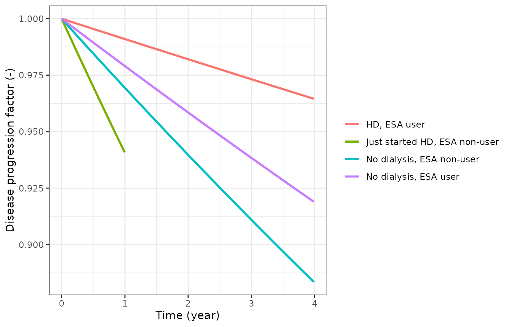
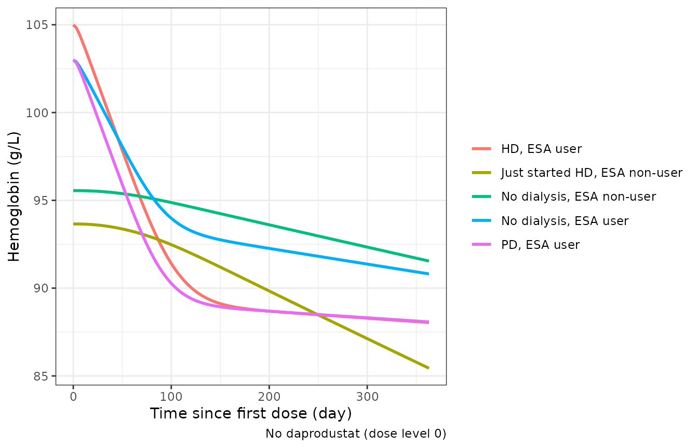
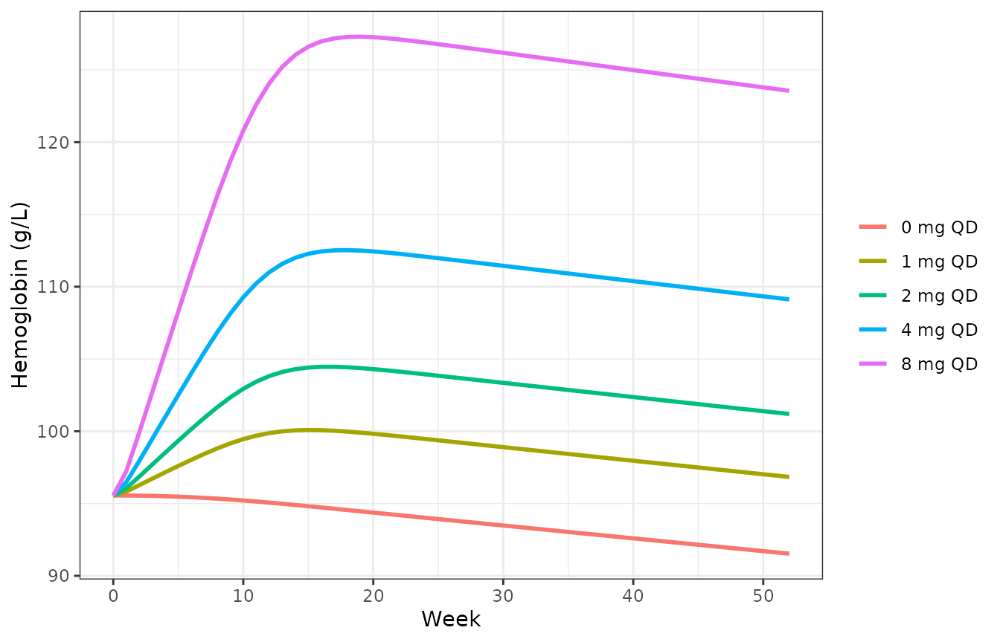
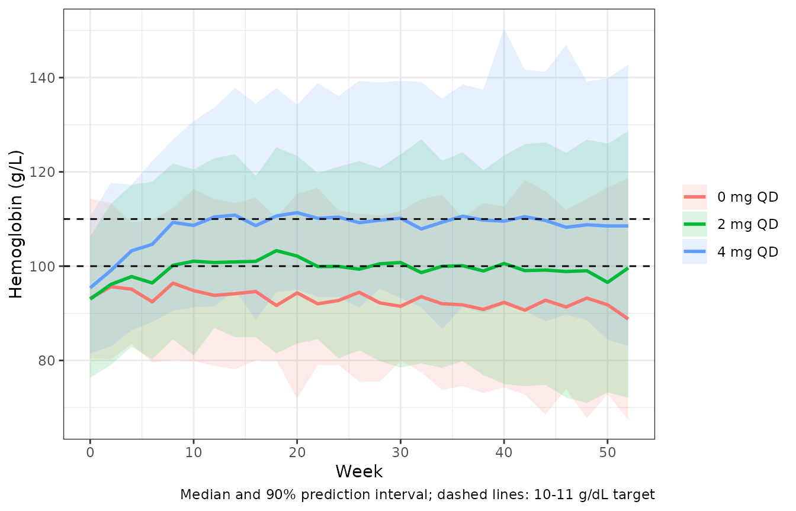

# Daprodustat dose-hemoglobin response in anemia of CKD (Mahar 2025)

## Model and source

``` r

mod <- readModelDb("Mahar_2025_daprodustat")
ui <- rxode2::rxode(mod)
#> ℹ parameter labels from comments will be replaced by 'label()'
#> Warning: some etas defaulted to non-mu referenced, possible parsing error: etarbase, etarbase_true, etabvv_kprog_1, etabvv_kprog_2, etabvv_kprog_3
#> as a work-around try putting the mu-referenced expression on a simple line
```

- Citation: Mahar KM, Yang S, Visser S, van Noort M, van den Berg P,
  Post TM. Integrated Longitudinal Population Dose-Hemoglobin Response
  of Daprodustat Following Dose Titration in Patients With Anemia in
  Chronic Kidney Disease. Clin Pharmacol Ther. 2025;117(3):846-855.
  <doi:10.1002/cpt.3544>
- Description: Longitudinal dose-hemoglobin model of daprodustat in
  adults with anemia of chronic kidney disease, fitted to five global
  phase III studies (Mahar 2025, Dose-Hgb Model 3). The current
  daprodustat dose level, allometrically scaled by baseline body weight,
  stimulates the production rate of a precursor-cell compartment through
  a power function (1 + SLOPE \* dose^GAMMA, with GAMMA proportional to
  SLOPE). Precursors (mean transit t 3.19 days, fixed) mature into
  twelve red-cell age compartments whose transit times sum to the
  red-cell lifespan (82.8 days, fixed, with covariate effects), and
  total hemoglobin is the sum of the twelve age compartments. Hemoglobin
  production declines exponentially toward a (possibly negative) floor
  with a disease progression rate that depends on dialysis status and
  prior ESA use and has year-specific random effects for the first,
  second and later years. Prior ESA users start at an ESA-elevated
  apparent baseline and wash out to a separately estimated true
  baseline. Patient-group-specific baselines (non-dialysis,
  hemodialysis, peritoneal dialysis, starting dialysis) with CKD stage,
  body weight, baseline hepcidin, race, prior ESA dose and ESA
  hyporesponder effects; study-specific additive residual error on
  hemoglobin (g/L).
- Article: <https://doi.org/10.1002/cpt.3544>
- PubMed Central (with the supplementary NONMEM control stream):
  <https://www.ncbi.nlm.nih.gov/pmc/articles/PMC11835430/>

Daprodustat is an oral hypoxia-inducible factor prolyl hydroxylase
inhibitor. Mahar 2025 recalibrates GSK’s earlier dose-hemoglobin
(Dose-Hgb) models on the five global phase III studies (“Dose-Hgb Model
3”). The model is driven by the **dose level**, not by concentrations:
the paper notes that the red-cell lifespan (~82 days) is far longer than
the daprodustat half-life (1-4 h), and that oral clearance was no better
a predictor of response than dose. The current dose level, divided by
`(WT / 73.3)^0.75`, stimulates precursor production through
`1 + SLOPE * dose^GAMMA`; precursors mature through twelve red-cell age
compartments, and hemoglobin is their sum.

Because the dose enters as a time-varying covariate
(`DOSE_DAPRODUSTAT_MG`), a simulation needs no dosing events: every row
carries the dose level in force at that time.

## Population

The analysis data set A contained 2,770 adults with anemia of chronic
kidney disease (CKD) and 53,535 hemoglobin observations from five phase
III studies (Mahar 2025 Table 1, Table S4, Table S7):

| Study | Population | Regimen | N (data set A) |
|----|----|----|----|
| 205270 | non-dialysis (ND), ESA non-users | QD, placebo-controlled | 205 |
| 204837 | hemodialysis (HD), ESA users | three times weekly (t.i.w.) | 180 |
| 201410 | starting HD (83) or PD (22), ESA non-users | QD | 105 |
| 200807 | HD (877) or PD (111), ESA users | QD | 988 |
| 200808 | ND, ESA non-users (683) and users (609) | QD | 1292 |

Median age was 63 years (range 17-96) and median body weight 73 kg
(36-194); 54% were not on dialysis. Treatment lasted from 28 weeks to
about 4 years, with the dose titrated to a hemoglobin target of 10-11
g/dL (11-12 g/dL in study 205270). Table S7 lists 1,484 males (50%) and
1,701 non-dialysis subjects (57%), neither of which matches its own
per-study counts (1,396 males; 205 + 1,292 = 1,497 non-dialysis), so the
per-study counts are used here.

``` r

str(mod()$population)
#> Warning: some etas defaulted to non-mu referenced, possible parsing error: etarbase, etarbase_true, etabvv_kprog_1, etabvv_kprog_2, etabvv_kprog_3
#> as a work-around try putting the mu-referenced expression on a simple line
#> List of 15
#>  $ species       : chr "human"
#>  $ n_subjects    : int 2770
#>  $ n_studies     : int 5
#>  $ n_observations: int 53535
#>  $ age_range     : chr "17-96 years"
#>  $ age_median    : chr "63 years"
#>  $ weight_range  : chr "36-194 kg"
#>  $ weight_median : chr "73 kg"
#>  $ sex_female_pct: num 50
#>  $ race_ethnicity: chr "White 62%, Asian 18%, Black 13%, American Indian / Alaska Native 4% (Table S7 percentages as printed)"
#>  $ disease_state : chr "Adults with anemia of chronic kidney disease: non-dialysis (ND) ESA non-users (studies 205270, 200808) and ESA "| __truncated__
#>  $ renal_function: chr "Non-dialysis 1497 (54%; CKD stages 2-5), hemodialysis 1140 (41%), peritoneal dialysis 133 (5%)"
#>  $ dose_range    : chr "Daprodustat titrated to a hemoglobin target (10-11 g/dL; 11-12 g/dL in study 205270): once daily 1-24 mg, or th"| __truncated__
#>  $ regions       : chr "Global (five pivotal phase III studies)"
#>  $ notes         : chr "Table S7 sex and race counts do not add up to N; the printed percentages are used. Analysis data set A: a rando"| __truncated__
```

## Source trace

Every value comes from Mahar 2025 Table 2 (final model) and every
equation from the NONMEM control stream printed in the Supplementary
Methods (“NONMEM Code for Final Dose-Hgb Model”).

| Equation / parameter | Value | Source location |
|----|----|----|
| `rbase_nd_esanaive`, `rbase_nd_esa`, `rbase_hd_esa`, `rbase_pd_esa` | 93.3, 103, 105, 103 g/L | Table 2; control stream THETA(1)-THETA(4) |
| `rbase_hd_start`, `rbase_pd_start` | 95.5, 101 g/L | Table 2; THETA(5)-THETA(6) |
| `rbase_true_nd_esa`, `rbase_true_dial_esa` | 95.3, 94.9 g/L | Table 2; THETA(7)-THETA(8) |
| `e_esad_rbase_true` | -0.00797 | Table 2; `PEPL = EXP((THETA(9)/1000) * PEPOD2)` |
| `e_esa_hyporesponder_rbase` | -0.0307 | Table 2; `BLHYP = 1 + THETA(10)` |
| `e_chronic_kidney_disease_stage_rbase`, `e_wt_rbase`, `e_hepcidin_bl_rbase` | -0.107, 0.0520, -0.0170 | Table 2; BLSTAG, BLWT, BLHEP with medians 5, 73.3 kg, 121.356 ng/mL |
| `e_race_asian_rbase_true`, `e_race_black_rbase` | -0.0467, -0.0376 | Table 2; RACE_TBSL, RACE_BBSL |
| `lmtt`, `lmtt_rbc` | log(3.19), log(82.819), both fixed | Table 2 (Fixed); THETA(16), THETA(17) |
| `e_esa_mtt_rbc`, `e_wt_mtt_rbc`, `e_hd_mtt_rbc`, `e_study_201410_mtt_rbc` | 0.100, 0.271, 0.138, 0.309 | Table 2; EPO_TRBC, WTBL_TRBC, POP_TRBC |
| `lslope`, `gamma_slope_ratio`, `e_race_black_slope` | log(0.0580), 14.9, -0.128 | Table 2; `SLOPE`, `GAMMA = corGAMMA * SLOPE`, RACE_SLP |
| `e_wt_dose` | 0.75 (fixed) | Table 2; `WTSL = (WTBL/medWtbl)**THETA(25)` |
| `e_study_204837_slope` | 0.422 | Table 2; `TIW = THETA(26)` for study 204837 |
| `e_conmed_clopidogrel_dose` | -0.102 | Table 2; `CLOP_DOSE` |
| `kprog`, `kin_min` | -0.0851 per 1000 days, -0.678 g/L/day | Table 2; THETA(28), THETA(29) |
| `e_esa_kprog`, `e_dial_kprog`, `e_study_201410_kprog` | -0.318, -0.573, 0.968 | Table 2; EPO_DISPR, POP_DISPR |
| `e_study_205270_etarbase`, `e_study_201410_etarbase` | 0.729, 1.13 | Table 2; OM1F |
| `etarbase + etarbase_true` | 50.1, 40.3, 131 | Table 2 (variance, covariance, variance) |
| `etalslope`, `etalmtt_rbc` | 0.0280, 0.206 | Table 2 |
| `etabvv_kprog_1..3` block | 0.0504; 0.0212, 0.0178; 0.0121, 0.0108, 0.0104 | Table 2 |
| `addSd`, `addSd_205270`, `addSd_204837`, `addSd_201410`, `addSd_200808` | 7.27, 5.72, 6.28, 7.24, 6.39 g/L | Table 2 (study 200807 is the reference) |
| Precursor and 12 red-cell age compartments | n/a | Supplementary Methods Equations 1, 4-7; control stream \$DES |
| Production with disease progression | n/a | Main text Equation 1; Supplementary Equation 2; `PROD = (KIN-MINKIN)*EXP(DISPR*T) + MINKIN`, floored at 0 |
| Drug effect | n/a | Supplementary Equation 3; `EFF = 1 + SLOPE * (DDR**GAMMA) * TIW` |
| Initial conditions | n/a | Supplementary Methods (“Steady state without drug”); control stream A_0 |

## Typical subjects

The helper below builds one row per observation time for a typical
subject of each patient group. Unless stated otherwise, covariates sit
at the model’s reference values (weight 73.3 kg, hepcidin 121.356
ng/mL), non-dialysis subjects are CKD stage 4 and dialysis subjects
stage 6 (the paper’s dialysis stage), and ESA users carry the Table S8
reference prior ESA dose of 5,275 IU/week.

``` r

mod_typ <- rxode2::zeroRe(mod)
#> ℹ parameter labels from comments will be replaced by 'label()'
#> Warning: some etas defaulted to non-mu referenced, possible parsing error: etarbase, etarbase_true, etabvv_kprog_1, etabvv_kprog_2, etabvv_kprog_3
#> as a work-around try putting the mu-referenced expression on a simple line
#> Warning: No sigma parameters in the model
#> Warning: some etas defaulted to non-mu referenced, possible parsing error: etarbase, etarbase_true, etabvv_kprog_1, etabvv_kprog_2, etabvv_kprog_3
#> as a work-around try putting the mu-referenced expression on a simple line

groups <- tibble::tribble(
  ~group,                                 ~RRT_HEMODIAL_STATUS, ~PERIT_DIAL, ~ESAD, ~CHRONIC_KIDNEY_DISEASE_STAGE, ~STUDY_201410, ~STUDY_200808,
  "No dialysis, ESA non-user",            0,                    0,           0,     4,          0,             1,
  "No dialysis, ESA user",                0,                    0,           5275,  4,          0,             1,
  "HD, ESA user",                         1,                    0,           5275,  6,          0,             0,
  "PD, ESA user",                         0,                    1,           5275,  6,          0,             0,
  "Just started HD, ESA non-user",        1,                    0,           0,     6,          1,             0
) |>
  mutate(
    id = row_number(), WT = 73.3, HEPCIDIN_BL = 121.356, ESA_HYPORESPONDER = 0,
    RACE_BLACK = 0, RACE_ASIAN = 0, CONMED_CLOPIDOGREL = 0,
    STUDY_205270 = 0, STUDY_204837 = 0
  )

make_events <- function(subjects, times, dose = 0) {
  tidyr::expand_grid(id = subjects$id, time = times) |>
    left_join(subjects, by = "id") |>
    mutate(evid = 0, cmt = "hb1", DOSE_DAPRODUSTAT_MG = dose)
}
```

## Disease progression (Figure 4)

Without treatment, precursor production declines as
`(kin - kin_min) * exp(dispr * t) + kin_min`. Figure 4 of Mahar 2025
plots the factor `exp(dispr * t)` for the typical subject of each group.
The model returns `dispr` (per day) for every subject, so the figure
follows directly from the simulation.

``` r

sim_dp <- rxode2::rxSolve(mod_typ, make_events(groups, seq(0, 4 * 365.25, by = 7)),
  returnType = "data.frame", keep = "group"
) |>
  mutate(dp_factor = exp(dispr * time), year = time / 365.25) |>
  filter(group != "PD, ESA user", !(group == "Just started HD, ESA non-user" & year > 1))
#> ℹ omega/sigma items treated as zero: 'etarbase', 'etarbase_true', 'etalslope', 'etalmtt_rbc', 'etabvv_kprog_1', 'etabvv_kprog_2', 'etabvv_kprog_3'
#> Warning: multi-subject simulation without without 'omega'

ggplot(sim_dp, aes(year, dp_factor, colour = group)) +
  geom_line(linewidth = 1) +
  labs(x = "Time (year)", y = "Disease progression factor (-)", colour = NULL) +
  theme_bw()
```



*Replicates Figure 4 of Mahar 2025.* The values at the end of each
curve, read from the published figure, agree with the model:

``` r

fig4 <- tibble::tribble(
  ~group,                          ~year, ~published,
  "No dialysis, ESA non-user",     4,     0.883,
  "No dialysis, ESA user",         4,     0.919,
  "HD, ESA user",                  4,     0.964,
  "Just started HD, ESA non-user", 1,     0.941
)
fig4_check <- fig4 |>
  rowwise() |>
  mutate(model = exp(sim_dp$dispr[sim_dp$group == group][1] * year * 365.25)) |>
  ungroup()
fig4_check |>
  dplyr::rename("Group" = group, "Year" = year, "Figure 4 (read)" = published, "Model" = model) |>
  knitr::kable(digits = 3)
```

| Group                         | Year | Figure 4 (read) | Model |
|:------------------------------|-----:|----------------:|------:|
| No dialysis, ESA non-user     |    4 |           0.883 | 0.883 |
| No dialysis, ESA user         |    4 |           0.919 | 0.919 |
| HD, ESA user                  |    4 |           0.964 | 0.964 |
| Just started HD, ESA non-user |    1 |           0.941 | 0.941 |

``` r

# Typical-value curves with no random draw: the only gap is the reading of
# the published figure (axis ticks every 0.025).
stopifnot(all(abs(fig4_check$model - fig4_check$published) < 0.005))
```

## Effect of disease progression on hemoglobin (Table S9)

Table S9 reports the reduction in steady-state hemoglobin after one year
without daprodustat, for a typical subject starting at 10 g/dL (100
g/L). At steady state hemoglobin equals production times lifespan, so
the reduction is `100 * (prod(365) / kin - 1)` with
`kin = 100 / lifespan`.

``` r

theta <- ui$theta
s9 <- sim_dp |>
  filter(time == 0, group != "PD, ESA user") |>
  select(group, dispr, mtt_rbc)
s9 <- s9 |>
  mutate(
    kin_ref = 100 / exp(theta[["lmtt_rbc"]]),
    delta_ref = 100 * (((kin_ref - theta[["kin_min"]]) * exp(dispr * 365) + theta[["kin_min"]]) / kin_ref - 1),
    kin_cov = 100 / mtt_rbc,
    delta_cov = 100 * (((kin_cov - theta[["kin_min"]]) * exp(dispr * 365) + theta[["kin_min"]]) / kin_cov - 1),
    published = c(-4.8, -3.3, -1.4, -9.3)
  )
s9 |>
  select(group, published, delta_ref, delta_cov) |>
  dplyr::rename(
    "Group" = group, "Table S9 (g/L/year)" = published,
    "Model, lifespan 82.8 days" = delta_ref,
    "Model, covariate-adjusted lifespan" = delta_cov
  ) |>
  knitr::kable(digits = 2)
```

| Group | Table S9 (g/L/year) | Model, lifespan 82.8 days | Model, covariate-adjusted lifespan |
|:---|---:|---:|---:|
| No dialysis, ESA non-user | -4.8 | -4.78 | -4.78 |
| No dialysis, ESA user | -3.3 | -3.27 | -3.39 |
| HD, ESA user | -1.4 | -1.41 | -1.53 |
| Just started HD, ESA non-user | -9.3 | -9.26 | -10.29 |

``` r

# Same closed form on both sides; the tolerance covers Table S9's rounding
# to 0.1 g/L.
stopifnot(all(abs(s9$delta_ref - s9$published) < 0.06))
```

The table is reproduced exactly when every group uses the reference
red-cell lifespan of 82.8 days. With the covariate-adjusted lifespan
(+13.8% for HD, +30.9% for subjects starting dialysis, +10% for ESA
users) the HD and starting-dialysis rows become -1.5 and -10.3 g/L.
Table S9 was therefore computed with the reference lifespan, which the
paper does not state.

## ESA washout

ESA users enter at an apparent, ESA-elevated baseline (105 g/L for a
typical HD ESA user) and, once the ESA is replaced by daprodustat at the
first dose, drift to their true baseline over roughly one red-cell
lifespan. Without daprodustat the typical HD ESA user settles near the
true baseline:

``` r

sim_wash <- rxode2::rxSolve(mod_typ, make_events(groups, seq(0, 365, by = 3)),
  returnType = "data.frame", keep = "group"
)
#> ℹ omega/sigma items treated as zero: 'etarbase', 'etarbase_true', 'etalslope', 'etalmtt_rbc', 'etabvv_kprog_1', 'etabvv_kprog_2', 'etabvv_kprog_3'
#> Warning: multi-subject simulation without without 'omega'

ggplot(sim_wash, aes(time, hb, colour = group)) +
  geom_line(linewidth = 1) +
  labs(x = "Time since first dose (day)", y = "Hemoglobin (g/L)", colour = NULL,
       caption = "No daprodustat (dose level 0)") +
  theme_bw()
```



``` r


hd <- sim_wash[sim_wash$group == "HD, ESA user", ]
stopifnot(
  abs(hd$hb[hd$time == 0] - theta[["rbase_hd_esa"]]) < 1e-6,
  # After ~2 lifespans the chain has turned over; only the slow disease
  # progression (about 1.4 g/L per year) separates hb from the true baseline.
  abs(hd$hb[hd$time == 183] - hd$rbase_true[1]) < 2
)
```

## Dose response and the t.i.w. factor

Typical non-dialysis ESA non-users held at a fixed daprodustat dose for
one year (the studies titrated the dose; this only shows the shape of
the dose response):

``` r

nd <- groups[groups$group == "No dialysis, ESA non-user", ]
doses <- c(0, 1, 2, 4, 8)
sim_dr <- bind_rows(lapply(seq_along(doses), function(i) {
  ev <- make_events(mutate(nd, id = i), seq(0, 364, by = 7), dose = doses[i])
  rxode2::rxSolve(mod_typ, ev, returnType = "data.frame") |>
    mutate(dose = factor(paste(doses[i], "mg QD"), levels = paste(doses, "mg QD")))
}))
#> ℹ omega/sigma items treated as zero: 'etarbase', 'etarbase_true', 'etalslope', 'etalmtt_rbc', 'etabvv_kprog_1', 'etabvv_kprog_2', 'etabvv_kprog_3'
#> ℹ omega/sigma items treated as zero: 'etarbase', 'etarbase_true', 'etalslope', 'etalmtt_rbc', 'etabvv_kprog_1', 'etabvv_kprog_2', 'etabvv_kprog_3'
#> ℹ omega/sigma items treated as zero: 'etarbase', 'etarbase_true', 'etalslope', 'etalmtt_rbc', 'etabvv_kprog_1', 'etabvv_kprog_2', 'etabvv_kprog_3'
#> ℹ omega/sigma items treated as zero: 'etarbase', 'etarbase_true', 'etalslope', 'etalmtt_rbc', 'etabvv_kprog_1', 'etabvv_kprog_2', 'etabvv_kprog_3'
#> ℹ omega/sigma items treated as zero: 'etarbase', 'etarbase_true', 'etalslope', 'etalmtt_rbc', 'etabvv_kprog_1', 'etabvv_kprog_2', 'etabvv_kprog_3'

ggplot(sim_dr, aes(time / 7, hb, colour = dose)) +
  geom_line(linewidth = 1) +
  labs(x = "Week", y = "Hemoglobin (g/L)", colour = NULL) +
  theme_bw()
```



In study 204837 daprodustat was given three times weekly and the dose
level is the per-administration dose. The estimated factor on the
effect, 0.422, is close to 3/7 = 0.429, the value expected if the
response follows the average daily dose with a linear dose term. Because
GAMMA is below 1 (0.864 for a typical subject), a weekly-dose-matched
t.i.w. regimen (7/3 times the QD dose) gives a slightly smaller effect
than QD:

``` r

hd_esa <- groups[groups$group == "HD, ESA user", ]
ev_tiw <- bind_rows(
  make_events(mutate(hd_esa, id = 1), c(1, 182), dose = 4),
  make_events(mutate(hd_esa, id = 2, STUDY_204837 = 1), c(1, 182), dose = 4 * 7 / 3)
)
sim_tiw <- rxode2::rxSolve(mod_typ, ev_tiw, returnType = "data.frame")
#> ℹ omega/sigma items treated as zero: 'etarbase', 'etarbase_true', 'etalslope', 'etalmtt_rbc', 'etabvv_kprog_1', 'etabvv_kprog_2', 'etabvv_kprog_3'
#> Warning: multi-subject simulation without without 'omega'
eff_ratio <- (sim_tiw$eff[sim_tiw$id == 2][1] - 1) / (sim_tiw$eff[sim_tiw$id == 1][1] - 1)
gamma_typ <- theta[["gamma_slope_ratio"]] * exp(theta[["lslope"]])
eff_ratio
#> [1] 0.8776432
stopifnot(abs(eff_ratio - theta[["e_study_204837_slope"]] * (7 / 3)^gamma_typ) < 1e-6)
sim_tiw |> filter(time == 182) |> select(id, hb)
#>   id       hb
#> 1  1 105.8044
#> 2  2 103.7224
```

## Stochastic simulation

A virtual cohort of 100 non-dialysis ESA non-users per arm (study 200808
residual error, CKD stage 3-5, body weight log-normal around 73 kg),
treated with a fixed 0, 2 or 4 mg QD for one year:

``` r

set.seed(2025)
n_per_arm <- 100
arms <- c(0, 2, 4)
cohort <- bind_rows(lapply(seq_along(arms), function(i) {
  tibble(
    id = (i - 1) * n_per_arm + seq_len(n_per_arm),
    arm = paste(arms[i], "mg QD"),
    DOSE_DAPRODUSTAT_MG = arms[i],
    WT = pmin(pmax(exp(rnorm(n_per_arm, log(73), 0.22)), 40), 160),
    CHRONIC_KIDNEY_DISEASE_STAGE = sample(3:5, n_per_arm, replace = TRUE, prob = c(0.2, 0.5, 0.3)),
    HEPCIDIN_BL = exp(rnorm(n_per_arm, log(121), 0.6)),
    RACE_BLACK = rbinom(n_per_arm, 1, 0.13),
    RACE_ASIAN = 0
  )
})) |>
  mutate(
    RACE_ASIAN = ifelse(RACE_BLACK == 0, rbinom(n(), 1, 0.2), 0),
    ESAD = 0, ESA_HYPORESPONDER = 0, RRT_HEMODIAL_STATUS = 0, PERIT_DIAL = 0,
    CONMED_CLOPIDOGREL = 0, STUDY_205270 = 0, STUDY_204837 = 0,
    STUDY_201410 = 0, STUDY_200808 = 1
  )
events <- tidyr::expand_grid(id = cohort$id, time = seq(0, 364, by = 14)) |>
  left_join(cohort, by = "id") |>
  mutate(evid = 0, cmt = "hb1")

rxode2::rxSetSeed(2025)
sim <- rxode2::rxSolve(mod, events, returnType = "data.frame", keep = "arm")
#> ℹ parameter labels from comments will be replaced by 'label()'
#> Warning: some etas defaulted to non-mu referenced, possible parsing error: etarbase, etarbase_true, etabvv_kprog_1, etabvv_kprog_2, etabvv_kprog_3
#> as a work-around try putting the mu-referenced expression on a simple line

sim_sum <- sim |>
  group_by(arm, time) |>
  summarise(
    q05 = quantile(sim, 0.05), q50 = median(sim), q95 = quantile(sim, 0.95),
    .groups = "drop"
  )
ggplot(sim_sum, aes(time / 7, q50, colour = arm, fill = arm)) +
  geom_ribbon(aes(ymin = q05, ymax = q95), alpha = 0.15, colour = NA) +
  geom_line(linewidth = 1) +
  geom_hline(yintercept = c(100, 110), linetype = 2) +
  labs(x = "Week", y = "Hemoglobin (g/L)", colour = NULL, fill = NULL,
       caption = "Median and 90% prediction interval; dashed lines: 10-11 g/dL target") +
  theme_bw()
```



``` r

base_med <- median(sim$sim[sim$time == 0])
wk52 <- sim |>
  filter(time == max(time)) |>
  group_by(arm) |>
  summarise(median_hb = median(sim))
wk52
#> # A tibble: 3 × 2
#>   arm     median_hb
#>   <chr>       <dbl>
#> 1 0 mg QD      88.8
#> 2 2 mg QD      99.6
#> 3 4 mg QD     109.
stopifnot(
  # Centre of the cohort baseline near the typical ND ESA non-user value
  # (93.3 g/L, modulated by CKD stage and hepcidin).
  abs(base_med - 95) < 4,
  # A 4 mg QD dose raises the cohort median by well over the residual SD.
  wk52$median_hb[wk52$arm == "4 mg QD"] - wk52$median_hb[wk52$arm == "0 mg QD"] > 8
)
```

## PKNCA

The model has no drug concentrations: it is driven directly by the dose
level, so there is no exposure to summarise by non-compartmental
analysis and no published NCA to compare with. PKNCA is therefore not
used.

## Assumptions and deviations

- **Time origin.** Time is days since the first daprodustat dose. The
  control stream used the study day (day 1 = first dose) for the switch
  from the apparent to the true baseline and for the disease-progression
  exponent; the one-day shift is negligible against a red-cell lifespan
  of 83 days and a progression rate of 0.0000851 per day. The
  year-specific random effects switch at 367 and 732 days after the
  first dose, as coded (`RTFD` 8808 h and 17568 h).
- **ESA-user flag.** The control stream carries a separate prior-ESA
  category (EPO: none, historic, recent); historic and recent users were
  modelled identically. Here `ESAD > 0` marks an ESA user, and the flag
  is forced to 0 in studies 205270 and 201410 as in the control stream.
  ESA users with an unrecorded prior dose should carry the control
  stream’s imputed value, 71.299 IU/kg/week times body weight.
- **Starting dialysis and t.i.w. dosing are study indicators.** The
  control stream assigns the “just started / starting dialysis”
  population by study (`IF(STUDYID.EQ.201410) POP = 4`) and the t.i.w.
  factor by study (`IF(STUDYID.EQ.204837) TIW = THETA(26)`); the model
  keeps those study indicators, which also select the study-specific
  residual SD and apparent-baseline variability.
- **The t.i.w. factor multiplies the effect.** Table 2 calls it a
  “factor on CDOSE”, but the control stream applies it to the effect
  term (`EFF = 1 + SLOPE * (DDR**GAMMA) * TIW`); the control stream is
  followed.
- **Undefined patient groups.** No baseline was estimated for chronic
  dialysis ESA non-users or for ESA users starting dialysis, because no
  such subjects were studied; the model gives a typical apparent
  baseline of 0 for them and should not be used there.
- **Black race on the apparent baseline.** Table 2 lists the Black-race
  effect on the “true and apparent baseline”; in the control stream it
  reaches the apparent baseline only for ESA non-users (whose apparent
  and true baselines coincide) and the true baseline of ESA users. The
  control stream is followed.
- **Lifespans.** The red-cell lifespan is fixed at 82.819 days, the
  control stream value that Table 2 rounds to 82.8.
- **Titration not reproduced.** The paper’s visual predictive checks
  (Figures 2 and 3, Table 3) titrate each simulated subject’s dose by
  the study algorithms of Table S3. The available dose steps are not
  listed in the paper, so the titration VPCs are not reproduced; the
  simulations above use fixed doses.
- **Table S9** reproduces only with the reference red-cell lifespan for
  every group, as shown above.
- **Virtual-cohort covariates.** The hepcidin, CKD-stage and race
  distributions of the stochastic cohort are approximations; Table S7
  gives only means and percentages, and some of its counts do not add
  up.
