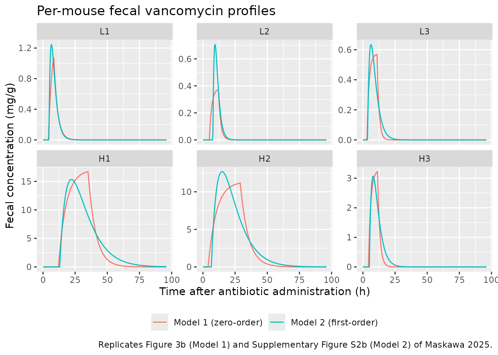
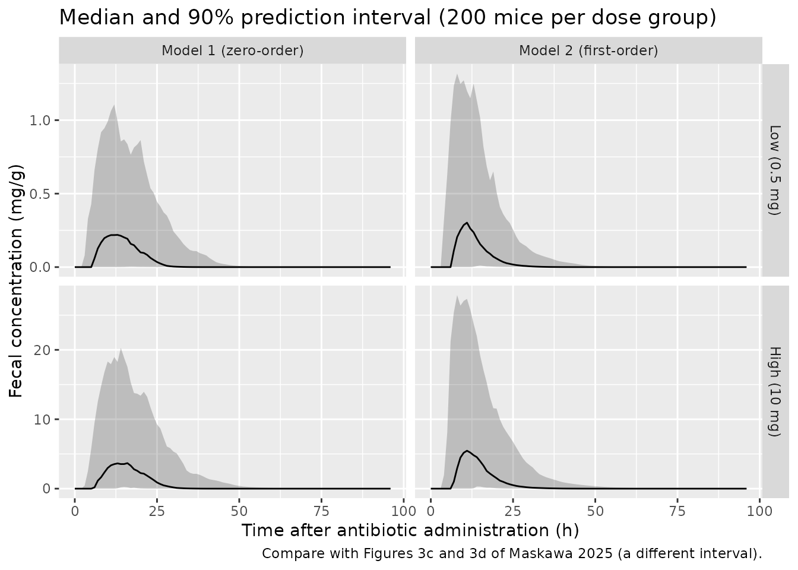

# Oral vancomycin fecal pharmacokinetics in mice (Maskawa 2025)

## Model and source

- Citation: Maskawa R, Takayasu L, Takayasu H, Watanabe K, Takemine S,
  Kakimoto T, Takeshita K, Narushima S, Suda W, Takayasu M.
  High-resolution fecal pharmacokinetic modeling in mice with orally
  administered antibiotics. Sci Rep. 2025;15:24441.
  <doi:10.1038/s41598-025-10293-7>.
- Description (main, zero-order gastric emptying, Model 1): Preclinical
  (mouse). Gastrointestinal transit model for fecal concentrations of
  orally administered, non-absorbed vancomycin in male C57BL/6N mice
  (the paper’s zero-order Model 1). The dose empties from the stomach
  into the cecum at a constant rate over a duration t_in, is eliminated
  from the cecum by first-order transit (k_e), and the fecal
  concentration is the cecal amount divided by the mass of cecal
  contents A. The stomach-to-cecum and cecum-to-feces transit delays are
  only identifiable as their sum t_tot, which is applied as a lag on the
  cecal input, so the cecum state holds the cecal amount shifted forward
  to the time it appears in feces. Doses go into cecum with rate = -2 so
  that dur(cecum) supplies the emptying duration. Fitted per mouse by
  penalised least squares; typical values are the arithmetic means over
  the six treated mice and the between-mouse variances are derived from
  the reported coefficients of variation.
- Description (supplementary, first-order gastric emptying, Model 2):
  Preclinical (mouse). Gastrointestinal transit model for fecal
  concentrations of orally administered, non-absorbed vancomycin in male
  C57BL/6N mice, with first-order gastric emptying (the paper’s
  supplementary Model 2, the alternative to the zero-order main model
  Maskawa_2025_vancomycin_mouse). The dose empties from the stomach into
  the cecum with rate constant k_a, is eliminated from the cecum by
  first-order transit (k_e), and the fecal concentration is the cecal
  amount divided by the mass of cecal contents A. The stomach-to-cecum
  and cecum-to-feces transit delays are only identifiable as their sum
  t_tot, applied as a lag on the oral dose into stomach. Fitted per
  mouse by penalised least squares; typical values are the arithmetic
  means over the six treated mice and the between-mouse variances are
  derived from the reported coefficients of variation.
- Article: <https://doi.org/10.1038/s41598-025-10293-7> (open access;
  the Supplementary Information holds Model 2 and Tables S1-S2)

Maskawa et al. sampled feces from mice every 4 hours after a single oral
dose of vancomycin, which is essentially not absorbed from the gut, and
described the fecal concentration-time course with a minimal
gastrointestinal transit model. The stomach is a retention compartment
and the cecum a mixing compartment. In the main model (Model 1) the
stomach empties into the cecum at a constant rate `q / t_in` for a
duration `t_in`. The cecum empties into the feces by first-order transit
at rate constant `k_e`. The fecal concentration is the cecal amount
divided by the mass of cecal contents `A`. Two transit delays, stomach
to cecum (`dt_SC`) and cecum to feces (`dt_CF`), are identifiable only
as their sum `t_tot`. Methods Eq. 7 gives the closed-form fecal
concentration:

    C(t) = 0                                                     for t - t_tot <= 0
    C(t) = q / (t_in A k_e) (1 - exp(-k_e (t - t_tot)))          for 0 < t - t_tot <= t_in
    C(t) = q / (t_in A k_e) (exp(-k_e (t - t_tot - t_in))
                             - exp(-k_e (t - t_tot)))            for t - t_tot > t_in

The supplementary Model 2 replaces the zero-order emptying with
first-order emptying at rate constant `k_a`. The authors found the two
models comparably good, with Model 1 slightly better by RMSE (Table S2).
Both are packaged:

| Model file | Gastric emptying | Source |
|----|----|----|
| `Maskawa_2025_vancomycin_mouse` | zero-order over `t_in` | Main text, Table 2 |
| `Maskawa_2025_vancomycin_mouse_firstorder` | first-order at `k_a` | Supplementary Information section 2, Table S1 |

### Encoding in rxode2

The model has no plasma compartment. Its observation `Ccecum` is the
fecal concentration (mg vancomycin per g wet feces).

- **Model 1.** The gastric emptying flux `q / t_in` is a zero-order
  infusion into `cecum`, so doses go into `cecum` with `rate = -2` and
  `dur(cecum) <- d1` supplies `t_in`. `alag(cecum) <- tlag` supplies
  `t_tot`. The lag shifts the whole cecal mass curve forward by `t_tot`,
  not just by the stomach-to-cecum delay. The `cecum` state is therefore
  the cecal amount at the moment it is expelled, and `cecum / v_cecum`
  is exactly the paper’s `C(t) = M_b(t - dt_CF) / A`.
- **Model 2.** Doses go into `stomach` as a bolus with
  `alag(stomach) <- tlag`. The stomach empties first-order into `cecum`.

## Population

Six male, 8-week-old conventional C57BL/6N mice were each given 0.5 mL
of vancomycin hydrochloride solution by mouth at 12:00 on day 0. Three
mice (L1-L3) received 1 mg/mL (`q = 0.5 mg`) and three (H1-H3) received
20 mg/mL (`q = 10 mg`). Three water-only control mice were not part of
the model fit. Food and water were available ad libitum. Feces were
collected every 4 h from day -3 to day 3, then less often until day 36.
Vancomycin was quantified by solid-phase extraction and LC-MS/MS and
divided by the fecal wet weight (Methods, “Mice and fecal sample
collection” and “Quantification of antibiotics”; Fig. 1). Body weight
was not reported.

The same information is available programmatically via
`readModelDb("Maskawa_2025_vancomycin_mouse")()$population`.

## Source trace

Each mouse was fitted on its own (basinhopping minimisation of a
squared-error loss with a derivative penalty, `lambda = 0.9`, Methods
Eq. 8). The packaged typical values are the paper’s `Mean (CV%)` row
over the six mice. The between-mouse variances are
`omega^2 = log(1 + CV^2)` from the same row.

| Parameter (model) | Value | Source location |
|----|----|----|
| Model 1 `ltlag` (`t_tot`) | log(5.4 h) | Table 2, Mean row |
| Model 1 `ld1` (`t_in`) | log(12 h) | Table 2, Mean row |
| Model 1 `lkfec` (`k_e`) | log(0.41 1/h) | Table 2, Mean row |
| Model 1 `lv_cecum` (`A`) | log(0.31 g) | Table 2, Mean row |
| Model 1 `etaltlag`, `etald1`, `etalkfec`, `etalv_cecum` | 0.2559, 0.3708, 0.2073, 0.3524 | Table 2, CV 54 / 67 / 48 / 65 % |
| Model 1 `addSd_Ccecum` | 0.21 mg/g | Table S2, Model1 RMSE, column ‘All’ |
| Model 2 `ltlag` (`t_tot`) | log(6.7 h) | Table S1, Mean row |
| Model 2 `lkst` (`k_a`) | log(0.32 1/h) | Table S1, Mean row |
| Model 2 `lkfec` (`k_e`) | log(0.36 1/h) | Table S1, Mean row |
| Model 2 `lv_cecum` (`A`) | log(0.40 g) | Table S1, Mean row |
| Model 2 `etaltlag`, `etalkst`, `etalkfec`, `etalv_cecum` | 0.1919, 0.2476, 0.2813, 0.6033 | Table S1, CV 46 / 53 / 57 / 91 % |
| Model 2 `addSd_Ccecum` | 0.60 mg/g | Table S2, Model2 RMSE, column ‘All’ |
| Model 1 `d/dt(cecum)`, `dur(cecum)` | n/a | Methods Eq. 2-3 |
| Model 2 `d/dt(stomach)`, `d/dt(cecum)` | n/a | Supplementary Information section 2 |
| `alag()` = `t_tot = dt_SC + dt_CF` | n/a | Methods Eq. 6-7; Supplement section 2 |
| `Ccecum <- cecum / v_cecum` | n/a | Methods Eq. 5-7 |

The per-mouse estimates used below are transcribed from Table 2
(Model 1) and Table S1 (Model 2). The observed NCA values come from
Table 1.

``` r

mice <- tibble::tribble(
  ~mouse, ~dose_group,      ~q,
  "L1",   "Low (0.5 mg)",   0.5,
  "L2",   "Low (0.5 mg)",   0.5,
  "L3",   "Low (0.5 mg)",   0.5,
  "H1",   "High (10 mg)",   10,
  "H2",   "High (10 mg)",   10,
  "H3",   "High (10 mg)",   10
) |>
  mutate(id = seq_len(n()))

# Table 2: zero-order Model 1
par_m1 <- tibble::tribble(
  ~mouse, ~t_tot, ~t_in, ~k_e, ~A,
  "L1",   4.2,    4.2,   0.35, 0.24,
  "L2",   5.0,    7.0,   0.57, 0.33,
  "L3",   3.2,    7.8,   0.66, 0.17,
  "H1",   12,     23,    0.17, 0.15,
  "H2",   4.0,    25,    0.16, 0.22,
  "H3",   4.3,    7.1,   0.58, 0.74
)

# Table S1: first-order Model 2
par_m2 <- tibble::tribble(
  ~mouse, ~t_tot, ~k_a, ~k_e, ~A,
  "L1",   4.6,    0.42, 0.62, 0.12,
  "L2",   7.7,    0.60, 0.60, 0.26,
  "L3",   3.6,    0.37, 0.37, 0.29,
  "H1",   13,     0.11, 0.11, 0.24,
  "H2",   6.5,    0.12, 0.12, 0.29,
  "H3",   5.0,    0.34, 0.34, 1.2
)

# Table 1: observed (data-derived) fecal NCA. AUC is the trapezoidal area over
# the detection window; k_e is a log-linear regression from t_max to t_elim.
obs_nca <- tibble::tribble(
  ~mouse, ~cmax, ~aucinf.obs, ~lambda.z, ~tmax,
  "L1",   1.0,   5.6,         0.35,      8,
  "L2",   0.39,  2.9,         0.68,      12,
  "L3",   0.53,  4.4,         0.21,      8,
  "H1",   14,    370,         0.16,      36,
  "H2",   11,    250,         0.12,      20,
  "H3",   3.9,   24,          0.11,      8
)

# The per-mouse rows reproduce the printed 'Mean' rows, i.e. the packaged
# typical values, to within the two-significant-figure printing (largest
# gap: t_in, 12.35 printed as 12).
means <- c(
  m1_t_tot = mean(par_m1$t_tot) / 5.4,
  m1_t_in = mean(par_m1$t_in) / 12,
  m1_k_e = mean(par_m1$k_e) / 0.41,
  m1_A = mean(par_m1$A) / 0.31,
  m2_t_tot = mean(par_m2$t_tot) / 6.7,
  m2_k_a = mean(par_m2$k_a) / 0.32,
  m2_k_e = mean(par_m2$k_e) / 0.36,
  m2_A = mean(par_m2$A) / 0.40
)
stopifnot(all(abs(means - 1) < 0.03))
```

The Table S1 mean of `k_a` computes to 0.327 1/h, which the supplement
prints as 0.32 (truncation rather than rounding). The packaged value
follows the printed 0.32.

## Per-mouse replication (Figure 3b and Supplementary Figure S2b)

Each mouse is simulated with its own Table 2 (Model 1) or Table S1
(Model 2) estimates. Random effects are zeroed and the structural
parameters are overridden through `params`.

``` r

mod1 <- readModelDb("Maskawa_2025_vancomycin_mouse")
mod2 <- readModelDb("Maskawa_2025_vancomycin_mouse_firstorder")
mod1_typ <- rxode2::zeroRe(mod1)
#> ℹ parameter labels from comments will be replaced by 'label()'
mod2_typ <- rxode2::zeroRe(mod2)
#> ℹ parameter labels from comments will be replaced by 'label()'

obs_times <- seq(0, 168, by = 0.25)

# Model 1 doses enter cecum as a zero-order infusion with modelled duration.
make_events <- function(mice, cmt, rate) {
  doses <- mice |>
    transmute(id, time = 0, amt = q, rate = rate, cmt = cmt, evid = 1L)
  obs <- tidyr::crossing(id = mice$id, time = obs_times) |>
    mutate(amt = 0, rate = 0, cmt = "cecum", evid = 0L)
  bind_rows(doses, obs) |>
    left_join(select(mice, id, mouse, dose_group), by = "id") |>
    arrange(id, time, desc(evid))
}
ev1 <- make_events(mice, cmt = "cecum", rate = -2)
ev2 <- make_events(mice, cmt = "stomach", rate = 0)

p1 <- mice |>
  left_join(par_m1, by = "mouse") |>
  transmute(
    id,
    ltlag = log(t_tot), ld1 = log(t_in),
    lkfec = log(k_e), lv_cecum = log(A)
  )
p2 <- mice |>
  left_join(par_m2, by = "mouse") |>
  transmute(
    id,
    ltlag = log(t_tot), lkst = log(k_a),
    lkfec = log(k_e), lv_cecum = log(A)
  )

sim1 <- rxode2::rxSolve(
  mod1_typ,
  events = ev1, params = p1, keep = c("mouse", "dose_group"),
  rtol = 1e-10, atol = 1e-12, maxsteps = 1e6
) |>
  as.data.frame() |>
  mutate(model = "Model 1 (zero-order)")
#> ℹ omega/sigma items treated as zero: 'etaltlag', 'etald1', 'etalkfec', 'etalv_cecum'
#> Warning: multi-subject simulation without without 'omega'
sim2 <- rxode2::rxSolve(
  mod2_typ,
  events = ev2, params = p2, keep = c("mouse", "dose_group"),
  rtol = 1e-10, atol = 1e-12, maxsteps = 1e6
) |>
  as.data.frame() |>
  mutate(model = "Model 2 (first-order)")
#> ℹ omega/sigma items treated as zero: 'etaltlag', 'etalkst', 'etalkfec', 'etalv_cecum'
#> Warning: multi-subject simulation without without 'omega'
sim_ind <- bind_rows(sim1, sim2) |>
  mutate(mouse = factor(mouse, levels = mice$mouse))
```

``` r

sim_ind |>
  filter(time <= 96) |>
  ggplot(aes(time, Ccecum, colour = model)) +
  geom_line() +
  facet_wrap(~mouse, scales = "free_y") +
  labs(
    x = "Time after antibiotic administration (h)",
    y = "Fecal concentration (mg/g)",
    colour = NULL,
    title = "Per-mouse fecal vancomycin profiles",
    caption = paste(
      "Replicates Figure 3b (Model 1) and Supplementary Figure S2b",
      "(Model 2) of Maskawa 2025."
    )
  ) +
  theme(legend.position = "bottom")
```



The Model 1 curves reproduce the fitted red curves of Figure 3b. In
Model 1 the peak always falls at the end of gastric emptying,
`t = t_tot + t_in`. The chunk below compares the simulated peaks with
the peaks of the Figure 3b fitted curves, which the maintainers read off
the published figure.

``` r

fig3b_peak <- tibble::tribble(
  ~mouse, ~fig_peak,
  "L1",   1.05,
  "L2",   0.385,
  "L3",   0.55,
  "H1",   17.3,
  "H2",   11.2,
  "H3",   3.25
)
peak_check <- sim1 |>
  group_by(mouse) |>
  summarise(sim_peak = max(Ccecum), t_peak = time[which.max(Ccecum)], .groups = "drop") |>
  left_join(fig3b_peak, by = "mouse") |>
  left_join(par_m1, by = "mouse") |>
  mutate(pct_diff = 100 * (sim_peak / fig_peak - 1))
peak_check |>
  select(mouse, fig_peak, sim_peak, pct_diff, t_peak, t_tot, t_in) |>
  rename(
    "Figure 3b peak (mg/g)" = fig_peak,
    "Simulated peak (mg/g)" = sim_peak,
    "% diff" = pct_diff,
    "Simulated t_max (h)" = t_peak,
    "t_tot (h)" = t_tot,
    "t_in (h)" = t_in
  ) |>
  knitr::kable(digits = 3, caption = "Model 1 per-mouse peaks vs. Figure 3b.")
```

| mouse | Figure 3b peak (mg/g) | Simulated peak (mg/g) | % diff | Simulated t_max (h) | t_tot (h) | t_in (h) |
|:---|---:|---:|---:|---:|---:|---:|
| H1 | 17.300 | 16.709 | -3.418 | 35.00 | 12.0 | 23.0 |
| H2 | 11.200 | 11.156 | -0.397 | 29.00 | 4.0 | 25.0 |
| H3 | 3.250 | 3.223 | -0.821 | 11.25 | 4.3 | 7.1 |
| L1 | 1.050 | 1.074 | 2.268 | 8.25 | 4.2 | 4.2 |
| L2 | 0.385 | 0.373 | -3.192 | 12.00 | 5.0 | 7.0 |
| L3 | 0.550 | 0.568 | 3.273 | 11.00 | 3.2 | 7.8 |

Model 1 per-mouse peaks vs. Figure 3b. {.table style="width:100%;"}

``` r

# Figure reading is good to a few percent; measured |% diff| <= 5%.
stopifnot(
  max(abs(peak_check$pct_diff)) < 10,
  max(abs(peak_check$t_peak - (peak_check$t_tot + peak_check$t_in))) <= 0.25
)
```

The Model 2 curves are checked the same way against the fitted curves of
Supplementary Figure S2b. In Model 2 the peak falls at
`t_tot + log(k_a / k_e) / (k_a - k_e)`, which is `t_tot + 1 / k` when
the two constants are equal.

``` r

figs2b_peak <- tibble::tribble(
  ~mouse, ~fig_peak,
  "L1",   1.23,
  "L2",   0.72,
  "L3",   0.63,
  "H1",   15.2,
  "H2",   12.7,
  "H3",   3.05
)
peak_check2 <- sim2 |>
  group_by(mouse) |>
  summarise(sim_peak = max(Ccecum), .groups = "drop") |>
  left_join(figs2b_peak, by = "mouse") |>
  mutate(pct_diff = 100 * (sim_peak / fig_peak - 1))
peak_check2 |>
  rename(
    "Figure S2b peak (mg/g)" = fig_peak,
    "Simulated peak (mg/g)" = sim_peak,
    "% diff" = pct_diff
  ) |>
  knitr::kable(digits = 3, caption = "Model 2 per-mouse peaks vs. Supplementary Figure S2b.")
```

| mouse | Simulated peak (mg/g) | Figure S2b peak (mg/g) | % diff |
|:------|----------------------:|-----------------------:|-------:|
| H1    |                15.328 |                  15.20 |  0.839 |
| H2    |                12.685 |                  12.70 | -0.119 |
| H3    |                 3.065 |                   3.05 |  0.494 |
| L1    |                 1.245 |                   1.23 |  1.254 |
| L2    |                 0.706 |                   0.72 | -1.994 |
| L3    |                 0.634 |                   0.63 |  0.659 |

Model 2 per-mouse peaks vs. Supplementary Figure S2b. {.table}

``` r

stopifnot(max(abs(peak_check2$pct_diff)) < 10)
```

### Check against the closed-form solutions

Methods Eq. 7 gives the Model 1 solution in closed form. The Model 2
solution is the Bateman function shifted by `t_tot` (Supplementary
Information section 2). In five of the six Table S1 fits `k_a` equals
`k_e`, which makes the printed `k_a q / (A (k_e - k_a))` form singular.
The comparison therefore uses its limit, `q k t' exp(-k t') / A`, when
the two constants are equal.

``` r

cf_model1 <- function(t, q, t_tot, t_in, k_e, A) {
  s <- t - t_tot
  amp <- q / (t_in * A * k_e)
  ifelse(
    s <= 0, 0,
    ifelse(
      s <= t_in,
      amp * (1 - exp(-k_e * s)),
      amp * (exp(-k_e * (s - t_in)) - exp(-k_e * s))
    )
  )
}
cf_model2 <- function(t, q, t_tot, k_a, k_e, A) {
  s <- pmax(t - t_tot, 0)
  if (isTRUE(all.equal(k_a, k_e))) {
    q * k_a * s * exp(-k_a * s) / A
  } else {
    k_a * q / (A * (k_e - k_a)) * (exp(-k_a * s) - exp(-k_e * s))
  }
}

cf1 <- sim1 |>
  left_join(par_m1, by = "mouse") |>
  left_join(select(mice, mouse, q), by = "mouse") |>
  group_by(mouse) |>
  mutate(
    cf = cf_model1(time, q[1], t_tot[1], t_in[1], k_e[1], A[1]),
    err = abs(Ccecum - cf) / max(cf)
  ) |>
  summarise(max_rel_err = max(err), .groups = "drop") |>
  mutate(model = "Model 1")
cf2 <- sim2 |>
  left_join(par_m2, by = "mouse") |>
  left_join(select(mice, mouse, q), by = "mouse") |>
  group_by(mouse) |>
  mutate(
    cf = cf_model2(time, q[1], t_tot[1], k_a[1], k_e[1], A[1]),
    err = abs(Ccecum - cf) / max(cf)
  ) |>
  summarise(max_rel_err = max(err), .groups = "drop") |>
  mutate(model = "Model 2")
cf_tab <- bind_rows(cf1, cf2)
knitr::kable(
  cf_tab |> select(model, mouse, max_rel_err),
  digits = 12,
  caption = paste(
    "Largest ODE vs closed-form difference, relative to the",
    "mouse's peak concentration."
  )
)
```

| model   | mouse | max_rel_err |
|:--------|:------|------------:|
| Model 1 | H1    |     2.4e-11 |
| Model 1 | H2    |     1.7e-11 |
| Model 1 | H3    |     5.2e-11 |
| Model 1 | L1    |     5.5e-11 |
| Model 1 | L2    |     9.0e-11 |
| Model 1 | L3    |     7.0e-11 |
| Model 2 | H1    |     6.0e-12 |
| Model 2 | H2    |     6.0e-12 |
| Model 2 | H3    |     6.4e-11 |
| Model 2 | L1    |     7.1e-11 |
| Model 2 | L2    |     4.3e-11 |
| Model 2 | L3    |     3.0e-11 |

Largest ODE vs closed-form difference, relative to the mouse’s peak
concentration. {.table}

``` r

# Same parameters on both sides, so the difference is integration error only.
stopifnot(max(cf_tab$max_rel_err) < 1e-6)
```

### Mass balance: AUC = q / (A k_e)

Vancomycin is not absorbed, so the whole dose leaves through the cecum.
The area under the fecal concentration curve is therefore `q / (A k_e)`
in both models. PKNCA on the per-mouse simulations recovers it.

``` r

nca_input <- function(sim) {
  # Floor the integrator's sub-atol undershoot and drop the numerically-zero
  # tail after the peak so that lambda.z follows the true terminal slope.
  stopifnot(all(sim$Ccecum >= -1e-6 * max(sim$Ccecum, na.rm = TRUE), na.rm = TRUE))
  sim |>
    filter(!is.na(Ccecum)) |>
    mutate(Ccecum = pmax(Ccecum, 0)) |>
    group_by(mouse) |>
    filter(time <= time[which.max(Ccecum)] | Ccecum >= 1e-6 * max(Ccecum)) |>
    ungroup() |>
    select(mouse, dose_group, time, Ccecum) |>
    mutate(mouse = as.character(mouse))
}
run_nca <- function(sim, events) {
  conc <- nca_input(sim)
  dose <- events |>
    filter(evid == 1) |>
    select(mouse, dose_group, time, amt)
  dat <- PKNCA::PKNCAdata(
    PKNCA::PKNCAconc(conc, Ccecum ~ time | dose_group + mouse),
    PKNCA::PKNCAdose(dose, amt ~ time | dose_group + mouse),
    intervals = data.frame(
      start = 0, end = Inf,
      cmax = TRUE, tmax = TRUE, aucinf.obs = TRUE, lambda.z = TRUE
    )
  )
  PKNCA::pk.nca(dat)
}
nca1 <- run_nca(sim1, ev1)
nca2 <- run_nca(sim2, ev2)

auc_check <- bind_rows(
  as.data.frame(nca1) |> mutate(model = "Model 1"),
  as.data.frame(nca2) |> mutate(model = "Model 2")
) |>
  filter(PPTESTCD == "aucinf.obs") |>
  left_join(
    bind_rows(
      par_m1 |> mutate(model = "Model 1"),
      par_m2 |> mutate(model = "Model 2")
    ),
    by = c("model", "mouse")
  ) |>
  left_join(select(mice, mouse, q), by = "mouse") |>
  mutate(
    auc_theory = q / (A * k_e),
    pct_diff = 100 * (PPORRES / auc_theory - 1)
  )
auc_check |>
  select(model, mouse, PPORRES, auc_theory, pct_diff) |>
  rename(
    "PKNCA AUCinf (mg*h/g)" = PPORRES,
    "q / (A k_e) (mg*h/g)" = auc_theory,
    "% diff" = pct_diff
  ) |>
  knitr::kable(digits = 3, caption = "Mass-balance check of the fecal AUC.")
```

| model   | mouse | PKNCA AUCinf (mg\*h/g) | q / (A k_e) (mg\*h/g) | % diff |
|:--------|:------|-----------------------:|----------------------:|-------:|
| Model 1 | H1    |                392.142 |               392.157 | -0.004 |
| Model 1 | H2    |                284.082 |               284.091 | -0.003 |
| Model 1 | H3    |                 23.285 |                23.299 | -0.062 |
| Model 1 | L1    |                  5.949 |                 5.952 | -0.053 |
| Model 1 | L2    |                  2.657 |                 2.658 | -0.042 |
| Model 1 | L3    |                  4.456 |                 4.456 | -0.001 |
| Model 2 | H1    |                378.759 |               378.788 | -0.008 |
| Model 2 | H2    |                287.330 |               287.356 | -0.009 |
| Model 2 | H3    |                 24.492 |                24.510 | -0.073 |
| Model 2 | L1    |                  6.722 |                 6.720 |  0.029 |
| Model 2 | L2    |                  3.204 |                 3.205 | -0.043 |
| Model 2 | L3    |                  4.661 |                 4.660 |  0.015 |

Mass-balance check of the fecal AUC. {.table}

``` r

# Trapezoidal error on a 0.25-h grid is well under 1%.
stopifnot(max(abs(auc_check$pct_diff)) < 1)
```

### Comparison against the observed NCA (Table 1)

Table 1 holds NCA values computed by the authors from the measured fecal
data. The simulations use each mouse’s fitted parameters, so the
comparison shows how closely each individual fit reproduces its own
data. It is not an independent prediction.

``` r

nca_units <- c(
  cmax = "mg/g", tmax = "h", aucinf.obs = "mg*h/g", lambda.z = "1/h"
)
cmp1 <- nlmixr2lib::ncaComparisonTable(
  simulated = nca1,
  reference = obs_nca,
  by = "mouse",
  units = nca_units,
  tolerance_pct = 20
)
knitr::kable(
  cmp1,
  caption = paste(
    "Model 1 (Table 2 per-mouse fits) vs. observed Table 1 NCA.",
    "* differs from the reference by >20%."
  )
)
```

| NCA parameter          | mouse | Reference | Simulated | % diff    |
|:-----------------------|:------|:----------|:----------|:----------|
| Cmax (mg/g)            | L1    | 1         | 1.07      | +7.4%     |
| Cmax (mg/g)            | L2    | 0.39      | 0.373     | -4.4%     |
| Cmax (mg/g)            | L3    | 0.53      | 0.568     | +7.2%     |
| Cmax (mg/g)            | H1    | 14        | 16.7      | +19.3%    |
| Cmax (mg/g)            | H2    | 11        | 11.2      | +1.4%     |
| Cmax (mg/g)            | H3    | 3.9       | 3.22      | -17.4%    |
| Tmax (h)               | L1    | 8         | 8.25      | +3.1%     |
| Tmax (h)               | L2    | 12        | 12        | +0.0%     |
| Tmax (h)               | L3    | 8         | 11        | +37.5%\*  |
| Tmax (h)               | H1    | 36        | 35        | -2.8%     |
| Tmax (h)               | H2    | 20        | 29        | +45.0%\*  |
| Tmax (h)               | H3    | 8         | 11.2      | +40.6%\*  |
| AUC0-∞ (obs) (mg\*h/g) | L1    | 5.6       | 5.95      | +6.2%     |
| AUC0-∞ (obs) (mg\*h/g) | L2    | 2.9       | 2.66      | -8.4%     |
| AUC0-∞ (obs) (mg\*h/g) | L3    | 4.4       | 4.46      | +1.3%     |
| AUC0-∞ (obs) (mg\*h/g) | H1    | 370       | 392       | +6.0%     |
| AUC0-∞ (obs) (mg\*h/g) | H2    | 250       | 284       | +13.6%    |
| AUC0-∞ (obs) (mg\*h/g) | H3    | 24        | 23.3      | -3.0%     |
| λz (1/h)               | L1    | 0.35      | 0.35      | -0.0%     |
| λz (1/h)               | L2    | 0.68      | 0.57      | -16.2%    |
| λz (1/h)               | L3    | 0.21      | 0.66      | +214.3%\* |
| λz (1/h)               | H1    | 0.16      | 0.17      | +6.3%     |
| λz (1/h)               | H2    | 0.12      | 0.16      | +33.3%\*  |
| λz (1/h)               | H3    | 0.11      | 0.58      | +427.3%\* |

Model 1 (Table 2 per-mouse fits) vs. observed Table 1 NCA. \* differs
from the reference by \>20%. {.table}

``` r

cmp2 <- nlmixr2lib::ncaComparisonTable(
  simulated = nca2,
  reference = obs_nca,
  by = "mouse",
  units = nca_units,
  tolerance_pct = 20
)
knitr::kable(
  cmp2,
  caption = paste(
    "Model 2 (Table S1 per-mouse fits) vs. observed Table 1 NCA.",
    "* differs from the reference by >20%."
  )
)
```

| NCA parameter          | mouse | Reference | Simulated | % diff    |
|:-----------------------|:------|:----------|:----------|:----------|
| Cmax (mg/g)            | L1    | 1         | 1.25      | +24.5%\*  |
| Cmax (mg/g)            | L2    | 0.39      | 0.706     | +80.9%\*  |
| Cmax (mg/g)            | L3    | 0.53      | 0.634     | +19.7%    |
| Cmax (mg/g)            | H1    | 14        | 15.3      | +9.5%     |
| Cmax (mg/g)            | H2    | 11        | 12.7      | +15.3%    |
| Cmax (mg/g)            | H3    | 3.9       | 3.07      | -21.4%\*  |
| Tmax (h)               | L1    | 8         | 6.5       | -18.8%    |
| Tmax (h)               | L2    | 12        | 9.25      | -22.9%\*  |
| Tmax (h)               | L3    | 8         | 6.25      | -21.9%\*  |
| Tmax (h)               | H1    | 36        | 22        | -38.9%\*  |
| Tmax (h)               | H2    | 20        | 14.8      | -26.2%\*  |
| Tmax (h)               | H3    | 8         | 8         | +0.0%     |
| AUC0-∞ (obs) (mg\*h/g) | L1    | 5.6       | 6.72      | +20.0%\*  |
| AUC0-∞ (obs) (mg\*h/g) | L2    | 2.9       | 3.2       | +10.5%    |
| AUC0-∞ (obs) (mg\*h/g) | L3    | 4.4       | 4.66      | +5.9%     |
| AUC0-∞ (obs) (mg\*h/g) | H1    | 370       | 379       | +2.4%     |
| AUC0-∞ (obs) (mg\*h/g) | H2    | 250       | 287       | +14.9%    |
| AUC0-∞ (obs) (mg\*h/g) | H3    | 24        | 24.5      | +2.0%     |
| λz (1/h)               | L1    | 0.35      | 0.414     | +18.4%    |
| λz (1/h)               | L2    | 0.68      | 0.551     | -19.0%    |
| λz (1/h)               | L3    | 0.21      | 0.34      | +61.7%\*  |
| λz (1/h)               | H1    | 0.16      | 0.101     | -37.1%\*  |
| λz (1/h)               | H2    | 0.12      | 0.11      | -8.2%     |
| λz (1/h)               | H3    | 0.11      | 0.312     | +183.7%\* |

Model 2 (Table S1 per-mouse fits) vs. observed Table 1 NCA. \* differs
from the reference by \>20%. {.table}

``` r

auc_vs_obs <- auc_check |>
  left_join(select(obs_nca, mouse, auc_obs = aucinf.obs), by = "mouse") |>
  mutate(pct_obs = 100 * (PPORRES / auc_obs - 1))
# Deterministic per-mouse solves: measured |% diff| is at most 14% (Model 1,
# H2) and 20% (Model 2, L1). A wrong dose, A or k_e shifts AUC by far more.
stopifnot(
  max(abs(auc_vs_obs$pct_obs[auc_vs_obs$model == "Model 1"])) < 18,
  max(abs(auc_vs_obs$pct_obs[auc_vs_obs$model == "Model 2"])) < 25
)
```

Reading the starred rows:

- **AUC** agrees to within about 15% for Model 1 and 20% for Model 2.
  The largest Model 1 difference is H2 (+14%), where the fitted plateau
  sits slightly above the 20-28 h observations (Figure 3b).
- **C_max** agrees to within 20% for every mouse under Model 1. H1 is
  highest (+19%) because the long zero-order emptying (`t_in` = 23 h)
  builds a plateau above the scattered high-dose samples. H3 is low
  (-17%) against the Table 1 value of 3.9 mg/g. Figures 2 and 3b,
  however, show the highest H3 sample at about 2.9 mg/g, so Table 1
  probably misprints it. Against 2.9 the model is 11% high.
- **t_max** in Table 1 is the time of the highest observed sample, on a
  4-h grid. The Model 1 peak is at `t_tot + t_in`, which usually falls
  between samples. For L3, H2 and H3 it falls after the sample that
  happened to be highest.
- **Model 2** reproduces AUC equally well but is a looser fit for the
  peak. It overshoots C_max for L1 and L2 and puts t_max earlier for
  most mice. This matches Table S2, where Model 2’s RMSE is higher than
  Model 1’s for every mouse except L1.
- **lambda.z** (the Table 1 `k_e` column) is not expected to match. The
  paper notes that its Table 1 `k_e` comes from a log-linear regression
  between `t_max` and `t_elim`. The model `k_e` comes from fitting on
  the original scale, and the two “differ from those listed in Table 1”
  (Results, “Gastrointestinal transit model”). The simulated terminal
  slope equals the model `k_e`, by construction.

## Between-mouse variability (Figures 3c and 3d)

Figures 3c and 3d show bootstrap confidence bands, built by refitting
pooled-by-dose-group data on 80% of the time points. That procedure
cannot be rerun without the data. The chunk below shows instead what the
packaged between-mouse variability implies: 200 virtual mice per dose
group, with the 90% prediction interval of the individual fecal
concentration. Residual error is excluded.

``` r

set.seed(2025)
rxode2::rxSetSeed(2025)
n_per_arm <- 200
vpc_times <- seq(0, 96, by = 1)
make_vpc_events <- function(cmt, rate) {
  bind_rows(
    tibble(dose_group = "Low (0.5 mg)", q = 0.5, id = seq_len(n_per_arm)),
    tibble(dose_group = "High (10 mg)", q = 10, id = n_per_arm + seq_len(n_per_arm))
  ) |>
    (\(d) {
      bind_rows(
        d |> transmute(id, dose_group, time = 0, amt = q, rate = rate, cmt = cmt, evid = 1L),
        tidyr::crossing(d |> select(id, dose_group), time = vpc_times) |>
          mutate(amt = 0, rate = 0, cmt = "cecum", evid = 0L)
      )
    })() |>
    arrange(id, time, desc(evid))
}
ev_vpc1 <- make_vpc_events("cecum", -2)
ev_vpc2 <- make_vpc_events("stomach", 0)
stopifnot(!anyDuplicated(unique(ev_vpc1[, c("id", "time", "evid")])))

vpc <- bind_rows(
  rxode2::rxSolve(mod1, events = ev_vpc1, keep = "dose_group") |>
    as.data.frame() |>
    mutate(model = "Model 1 (zero-order)"),
  rxode2::rxSolve(mod2, events = ev_vpc2, keep = "dose_group") |>
    as.data.frame() |>
    mutate(model = "Model 2 (first-order)")
) |>
  mutate(dose_group = factor(dose_group, levels = c("Low (0.5 mg)", "High (10 mg)")))
#> ℹ parameter labels from comments will be replaced by 'label()'
#> ℹ parameter labels from comments will be replaced by 'label()'

vpc |>
  group_by(model, dose_group, time) |>
  summarise(
    Q05 = quantile(Ccecum, 0.05),
    Q50 = quantile(Ccecum, 0.50),
    Q95 = quantile(Ccecum, 0.95),
    .groups = "drop"
  ) |>
  ggplot(aes(time, Q50)) +
  geom_ribbon(aes(ymin = Q05, ymax = Q95), alpha = 0.25) +
  geom_line() +
  facet_grid(dose_group ~ model, scales = "free_y") +
  labs(
    x = "Time after antibiotic administration (h)",
    y = "Fecal concentration (mg/g)",
    title = "Median and 90% prediction interval (200 mice per dose group)",
    caption = "Compare with Figures 3c and 3d of Maskawa 2025 (a different interval)."
  )
```



``` r

# Dose linearity: with no dose effect in the model, the dose-normalised
# median peak is the same in both arms up to Monte-Carlo error.
peaks <- vpc |>
  filter(model == "Model 1 (zero-order)") |>
  group_by(dose_group, id) |>
  summarise(cmax = max(Ccecum), .groups = "drop") |>
  mutate(cmax_dn = cmax / ifelse(dose_group == "High (10 mg)", 10, 0.5)) |>
  group_by(dose_group) |>
  summarise(med = median(cmax_dn), .groups = "drop")
ratio <- peaks$med[peaks$dose_group == "High (10 mg)"] /
  peaks$med[peaks$dose_group == "Low (0.5 mg)"]
# Median of 200 draws: about 6% Monte-Carlo SE per arm, so the ratio sits
# within 0.75-1.33 with wide margin; a dose mis-scaling gives 20x or 0.05x.
stopifnot(ratio > 0.75, ratio < 1.33)
```

## Assumptions and deviations

- **Typical values are arithmetic means of individual fits.** The
  authors fitted each mouse separately and did not fit a population
  model. The packaged typical values are the paper’s `Mean (CV%)` rows
  in Table 2 and Table S1. The log-normal between-mouse variances are
  derived from those CVs as `log(1 + CV^2)`. That means the typical
  value sits near the mean, not the median, of the log-normal
  distribution. The CVs pool both dose groups, so they include the
  longer emptying (`t_in`) and slower cecal transit (`k_e`) seen in two
  of the three high-dose mice. The paper treats this as a possible
  dose-dependent change in gastrointestinal motility that it could not
  establish with three mice per group. The model carries no dose effect.
- **Residual error.** The loss function is unweighted squared error plus
  a derivative penalty (Methods Eq. 8), so the residual error is
  additive. Its SD is the pooled RMSE across the six mice (Table S2,
  column ‘All’: 0.21 mg/g for Model 1 and 0.60 mg/g for Model 2). The
  pooled RMSE is dominated by the high-dose mice. The per-mouse RMSE of
  the low-dose fits is about 0.004-0.016 mg/g, so simulating low-dose
  observations with the pooled SD overstates their noise.
- **Transit delays.** Only `t_tot = dt_SC + dt_CF` is identifiable and
  reported. The model applies it as a single lag on the cecal (Model 1)
  or gastric (Model 2) input. The paper’s Model 1 stomach mass
  `M_a(t) = q (1 - t / t_in)` is not carried as a state, because the
  zero-order infusion reproduces its outflow exactly. Doses into `cecum`
  must use `rate = -2` for `dur(cecum)` to take effect.
- **Minor text-table differences.** The Results text gives the low-dose
  `t_in` range as 4.1-7.8 h and the H3 cecal content mass as 0.76 g.
  Table 2 lists L1 `t_in` = 4.2 h and H3 `A` = 0.74 g. The table values
  are used here. The Table 2 means are the same either way. Table 1
  lists the H3 observed C_max as 3.9 mg/g, but the highest H3 sample in
  Figures 2 and 3b is about 2.9 mg/g. The comparison table keeps the
  printed 3.9. The observed NCA values are used only for comparison, not
  in the model.
- **Units.** Doses are in mg (0.5 mL of 1 or 20 mg/mL), `A` is in g of
  cecal contents, and concentrations are mg per g of wet feces, as in
  Table 1 and Figure 3.
- **Figure-derived values.** The peak concentrations of the fitted
  curves in Figure 3b and Supplementary Figure S2b, used in the
  per-mouse peak checks, were read off the published figures by the
  maintainers, to about +/-3%. They are used only for validation; every
  model parameter comes from Table 2, Table S1 or Table S2.
- No erratum or correction notice was found for this article as of
  2026-11-05.
