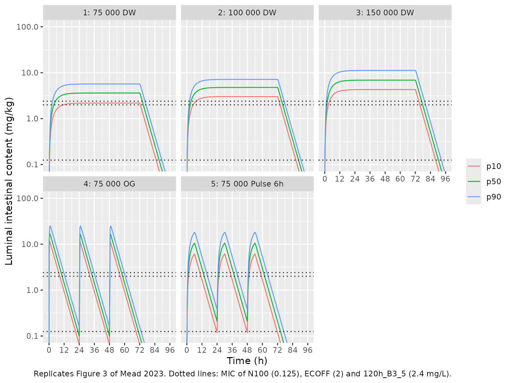

# Colistin in broiler chicken intestine (Mead 2023)

## Model and source

- Citation: Mead A, Toutain PL, Richez P, Pelligand L. Targeted dosing
  for susceptible heteroresistant subpopulations may improve rational
  dosage regimen prediction for colistin in broiler chickens. Sci
  Rep. 2023;13:12822. <doi:10.1038/s41598-023-39727-w>
- Description: Preclinical (chicken). One-compartment population PK
  model of colistin in the small-intestine (jejunum + ileum) luminal
  content of Ross 308 broiler chickens: first-order transit from the
  crop (depot) into the intestinal lumen (central) and first-order
  intestinal outflow towards the colon, with between-bird variability on
  the intestinal clearance only and a multiplicative residual error.
  Doses by oral gavage (bolus into the crop) or via drinking water
  (zero-order over 24 h); colistin is not absorbed, so the observation
  Cc is the luminal content concentration, not a plasma concentration
  (Mead 2023)
- Article: <https://doi.org/10.1038/s41598-023-39727-w> (open access;
  PMC10406827)

Colistin is not absorbed from the chicken gut, so the paper models the
drug where it acts: in the luminal content of the small intestine
(jejunum and ileum). The dose is deposited in the crop (`depot`),
transits into the small-intestine content (`central`) at the first-order
rate `ka`, and leaves towards the colon at an intestinal “clearance”
that is really a flow of intestinal content. Volume and clearance are
expressed in grams of intestinal content per kg body weight, and the
observation `Cc` is mg colistin per kg of intestinal content.

The paper also couples this PK model to the heteroresistance
pharmacodynamic (time-kill) model of Mead et al. 2022 (Antimicrob Agents
Chemother 66:e00793-22) to derive the PK/PD targets of its Table 4. That
pharmacodynamic model was estimated in the earlier paper, which is
extracted separately; this article covers the PK model estimated in Mead
2023 and the paper’s Monte Carlo AUC and
probability-of-target-attainment results, which use the PK model
together with the scalar PK/PD targets of Table 4.

## Population

148 Ross 308 broiler chickens were allocated to five treated groups at
13 days of age: colistin sulphate via drinking water at nominal 75,000,
100,000 and 150,000 IU/kg BW/day for 3 days (n = 38 per group), or a
single oral gavage of 75,000 or 150,000 IU/kg into the crop (n = 17 per
group); 27 further birds were untreated controls. Bird weights during
dosing were 156-180 g (Supplementary Table S1). Sampling was destructive
– one luminal-content sample per bird – at 0-96 h (drinking water) or
0-24 h (gavage). Colistin was measured by UHPLC-MS/MS with an LOQ of 1.1
mg/kg, and BLQ values were handled with the M3 method in Phoenix NLME
8.3. The birds were healthy; no E. coli challenge was given.

The same information is available programmatically via
`readModelDb("Mead_2023_colistin_chicken")()$population`.

## Source trace

| Equation / parameter | Value | Source location |
|----|----|----|
| `lka` | log(0.221) 1/h | Table 1, ka |
| `lvc` | log(5.14) g content/kg BW | Table 1, V |
| `lcl` | log(29.1) g content/kg BW/h | Table 1, Cl (see Assumptions on the 0.291 in the Results text) |
| `lfdepot` | fixed(log(1)) | Results text after Eq. 1: F = 100% for the gut compartment |
| `etalcl` | 0.1519 (40.5% CV) | Table 1, Cl BSV 40.5%; omega^2 = log(1 + CV^2) per the Methods CV equation |
| `propSd` | 0.362 | Table 1, multiplicative residual error 36.2% |
| `d/dt(depot)`, `d/dt(central)` | n/a | Figure 1 and Methods “Pharmacokinetic modelling”: crop dosing compartment, one well-mixed intestinal compartment, first-order entry ka and clearance |
| `Cc <- 1000 * central / vc` | n/a | Methods: content concentration in mg colistin/kg intestinal content; V in g/kg BW |
| Dose unit (mg colistin base) | 30,000 IU/mg | Results “Back-calculation of dose administered” and Methods “Colistin” |

## Typical-value check against the reported observations

The paper reports a few observed geometric means in the text (Results,
“Pharmacokinetics of colistin in chickens”; Figure 2). With one sample
per bird and 2-4 birds per time, these are noisy; the table is a
plausibility check, not a gate. The drinking-water simulations use the
actual daily doses back-calculated from water consumption (Supplementary
Table S1).

``` r

mod <- readModelDb("Mead_2023_colistin_chicken")
mod_typ <- rxode2::zeroRe(mod)
#> ℹ parameter labels from comments will be replaced by 'label()'
iu_per_mg <- 30000

actual_dw <- tibble::tribble(
  ~group, ~day, ~iu,
  "75,000 IU/kg/day DW", 1, 70698,
  "75,000 IU/kg/day DW", 2, 84545,
  "75,000 IU/kg/day DW", 3, 78824,
  "100,000 IU/kg/day DW", 1, 80264,
  "100,000 IU/kg/day DW", 2, 121173,
  "100,000 IU/kg/day DW", 3, 91563,
  "150,000 IU/kg/day DW", 1, 131367,
  "150,000 IU/kg/day DW", 2, 139104,
  "150,000 IU/kg/day DW", 3, 153511
)
obs_groups <- c(unique(actual_dw$group), "75,000 IU/kg OG", "150,000 IU/kg OG")

ev_obs <- dplyr::bind_rows(
  actual_dw |>
    dplyr::mutate(
      id = match(group, obs_groups), time = 24 * (day - 1), evid = 1L,
      amt = iu / iu_per_mg, dur = 24
    ),
  tibble::tibble(
    group = c("75,000 IU/kg OG", "150,000 IU/kg OG"), id = 4:5, time = 0,
    evid = 1L, amt = c(75000, 150000) / iu_per_mg, dur = 0
  )
) |>
  dplyr::mutate(cmt = "depot") |>
  dplyr::select(id, time, evid, amt, cmt, dur)
ev_obs <- dplyr::bind_rows(
  ev_obs,
  tidyr::expand_grid(id = 1:5, time = c(1, 3, 54)) |>
    dplyr::mutate(evid = 0L, amt = 0, cmt = "central", dur = 0)
) |>
  dplyr::arrange(id, time, dplyr::desc(evid))

typ_obs <- rxode2::rxSolve(mod_typ, events = ev_obs) |>
  as.data.frame() |>
  dplyr::mutate(group = obs_groups[id])
#> ℹ omega/sigma items treated as zero: 'etalcl'
#> Warning: multi-subject simulation without without 'omega'

reported <- tibble::tribble(
  ~group, ~time, ~observed_gm,
  "75,000 IU/kg/day DW", 54, 4.89,
  "100,000 IU/kg/day DW", 54, 6.66,
  "150,000 IU/kg/day DW", 54, 8.60,
  "75,000 IU/kg OG", 1, 21.25,
  "150,000 IU/kg OG", 3, 45.55
)
reported |>
  dplyr::left_join(typ_obs |> dplyr::select(group, time, Cc), by = c("group", "time")) |>
  dplyr::mutate(ratio = Cc / observed_gm) |>
  dplyr::rename(
    "Group" = group, "Time (h)" = time,
    "Observed GM (mg/kg)" = observed_gm,
    "Typical prediction (mg/kg)" = Cc, "Prediction / observed" = ratio
  ) |>
  knitr::kable(digits = 2, caption = "Typical-value Cc against the observed geometric means quoted in the Results text.")
```

| Group | Time (h) | Observed GM (mg/kg) | Typical prediction (mg/kg) | Prediction / observed |
|:---|---:|---:|---:|---:|
| 75,000 IU/kg/day DW | 54 | 4.89 | 3.84 | 0.78 |
| 100,000 IU/kg/day DW | 54 | 6.66 | 4.76 | 0.71 |
| 150,000 IU/kg/day DW | 54 | 8.60 | 7.14 | 0.83 |
| 75,000 IU/kg OG | 1 | 21.25 | 15.77 | 0.74 |
| 150,000 IU/kg OG | 3 | 45.55 | 20.36 | 0.45 |

Typical-value Cc against the observed geometric means quoted in the
Results text. {.table}

The typical predictions sit at 0.45-0.83 times the observed geometric
means, the lowest being the 150,000 IU/kg gavage peak at 3 h. With a 40%
CV on clearance, a 36% residual error and two to four destructively
sampled birds per time, this spread is within what the model allows, and
the paper’s own VPC (Supplementary Figure S4) covers these points. The
comparison is reported, not gated.

## Monte Carlo regimens (Figure 3 and Table 3)

The paper simulates five regimens for 3 days (Methods, “Monte Carlo
simulation”): 75,000, 100,000 and 150,000 IU/kg/day in drinking water (a
zero-order input over each 24 h), 75,000 IU/kg/day by oral gavage (one
bolus each day) and 75,000 IU/kg/day as a 6-h pulse in drinking water.
Figure 3 confirms the gavage arm is one bolus on each of the 3 days.

``` r

regimens <- tibble::tribble(
  ~regimen, ~iu, ~dur,
  "1: 75 000 DW", 75000, 24,
  "2: 100 000 DW", 100000, 24,
  "3: 150 000 DW", 150000, 24,
  "4: 75 000 OG", 75000, 0,
  "5: 75 000 Pulse 6h", 75000, 6
)

# One subject per (regimen, id): three daily doses into the crop plus an
# observation grid on the intestinal-content state.
make_regimen <- function(i, n, id_offset, obs_times) {
  r <- regimens[i, ]
  ids <- id_offset + seq_len(n)
  dose <- tidyr::expand_grid(id = ids, time = c(0, 24, 48)) |>
    dplyr::mutate(evid = 1L, amt = r$iu / iu_per_mg, cmt = "depot", dur = r$dur)
  obs <- tidyr::expand_grid(id = ids, time = obs_times) |>
    dplyr::mutate(evid = 0L, amt = 0, cmt = "central", dur = 0)
  dplyr::bind_rows(dose, obs) |>
    dplyr::mutate(regimen = r$regimen) |>
    dplyr::arrange(id, time, dplyr::desc(evid))
}
```

### Deterministic AUC percentiles

Clearance is the only parameter with between-bird variability, so each
bird’s intestinal AUC is a monotone decreasing function of its clearance
eta. The 10th percentile of AUC therefore sits exactly at
`eta = qnorm(0.9) * omega`, and the median at `eta = 0` – no Monte Carlo
draw is needed to compute what Table 3 reports. The paper divides the
individual AUC(0-72 h) by 3 to obtain AUC24h (Methods, “Probability of
target attainment”).

Because the content leaving the intestine is `cl * Cc`, mass balance
gives the AUC exactly from the states at 72 h:
`AUC(0-72) = 1000 * (dose given - depot(72) - central(72)) / cl`.

``` r

omega_cl <- sqrt(rxode2::rxode2(mod)$omega[["etalcl", "etalcl"]])
#> ℹ parameter labels from comments will be replaced by 'label()'
lcl_typ <- rxode2::rxode2(mod)$theta[["lcl"]]
#> ℹ parameter labels from comments will be replaced by 'label()'
eta_levels <- c(median = 0, p10 = qnorm(0.9) * omega_cl)

ev_det <- dplyr::bind_rows(lapply(seq_len(nrow(regimens)), function(i) {
  make_regimen(i, n = 2, id_offset = 2L * (i - 1L), obs_times = c(0, 72))
}))
params_det <- tibble::tibble(
  id = seq_len(2L * nrow(regimens)),
  level = rep(names(eta_levels), times = nrow(regimens)),
  lcl = lcl_typ + rep(eta_levels, times = nrow(regimens))
)

sim_det <- rxode2::rxSolve(
  mod_typ,
  params = params_det |> dplyr::select(lcl),
  events = ev_det, keep = "regimen",
  rtol = 1e-10, atol = 1e-12
) |>
  as.data.frame()
#> ℹ omega/sigma items treated as zero: 'etalcl'
#> Warning: multi-subject simulation without without 'omega'

dose_total <- ev_det |>
  dplyr::filter(evid == 1) |>
  dplyr::group_by(id) |>
  dplyr::summarise(dose = sum(amt), .groups = "drop")

auc_det <- sim_det |>
  dplyr::filter(time == 72) |>
  dplyr::select(id, regimen, depot, central) |>
  dplyr::left_join(dose_total, by = "id") |>
  dplyr::left_join(params_det, by = "id") |>
  dplyr::mutate(
    cl = exp(lcl),
    auc0_72 = 1000 * (dose - depot - central) / cl,
    auc24 = auc0_72 / 3
  )
```

``` r

# Table 3 of Mead 2023, AUC24h/MIC (h) at the 10th and 50th percentiles of 500
# simulated birds, and the median average luminal concentration (mg/kg).
table3 <- tibble::tribble(
  ~regimen, ~mic, ~p10, ~median,
  "1: 75 000 DW", 2.4, 20.1, 33.7,
  "2: 100 000 DW", 2.4, 27.5, 44.2,
  "3: 150 000 DW", 2.4, 42.0, 67.0,
  "4: 75 000 OG", 2.4, 21.5, 34.7,
  "5: 75 000 Pulse 6h", 2.4, 21.7, 36.8,
  "1: 75 000 DW", 2, 24.1, 40.4,
  "2: 100 000 DW", 2, 33.0, 53.0,
  "3: 150 000 DW", 2, 50.4, 80.4,
  "4: 75 000 OG", 2, 25.8, 41.7,
  "5: 75 000 Pulse 6h", 2, 26.1, 44.1,
  "1: 75 000 DW", 0.125, 385.1, 646.6,
  "2: 100 000 DW", 0.125, 527.9, 848.0,
  "3: 150 000 DW", 0.125, 806.3, 1286.2,
  "4: 75 000 OG", 0.125, 412.9, 666.8,
  "5: 75 000 Pulse 6h", 0.125, 417.4, 706.2
) |>
  tidyr::pivot_longer(c(p10, median), names_to = "level", values_to = "published")

cmp3 <- table3 |>
  dplyr::left_join(auc_det |> dplyr::select(regimen, level, auc24), by = c("regimen", "level")) |>
  dplyr::mutate(model = auc24 / mic, pct_diff = 100 * (model / published - 1))
stopifnot(nrow(cmp3) == 30L, !anyNA(cmp3$model))

cmp3 |>
  dplyr::select(regimen, mic, level, published, model, pct_diff) |>
  dplyr::rename(
    "Regimen" = regimen, "MIC (mg/L)" = mic, "Percentile" = level,
    "Table 3 AUC24h/MIC (h)" = published, "Model AUC24h/MIC (h)" = model,
    "Difference (%)" = pct_diff
  ) |>
  knitr::kable(digits = c(0, 3, 0, 1, 1, 1), caption = "Replicates Table 3 of Mead 2023: AUC24h/MIC percentiles (model values are exact percentiles; the paper's are from 500 simulated birds).")
```

| Regimen | MIC (mg/L) | Percentile | Table 3 AUC24h/MIC (h) | Model AUC24h/MIC (h) | Difference (%) |
|:---|---:|:---|---:|---:|---:|
| 1: 75 000 DW | 2.400 | p10 | 20.1 | 20.3 | 1.1 |
| 1: 75 000 DW | 2.400 | median | 33.7 | 33.5 | -0.7 |
| 2: 100 000 DW | 2.400 | p10 | 27.5 | 27.1 | -1.5 |
| 2: 100 000 DW | 2.400 | median | 44.2 | 44.6 | 0.9 |
| 3: 150 000 DW | 2.400 | p10 | 42.0 | 40.7 | -3.2 |
| 3: 150 000 DW | 2.400 | median | 67.0 | 66.9 | -0.1 |
| 4: 75 000 OG | 2.400 | p10 | 21.5 | 21.7 | 0.9 |
| 4: 75 000 OG | 2.400 | median | 34.7 | 35.7 | 3.0 |
| 5: 75 000 Pulse 6h | 2.400 | p10 | 21.7 | 21.6 | -0.3 |
| 5: 75 000 Pulse 6h | 2.400 | median | 36.8 | 35.7 | -3.1 |
| 1: 75 000 DW | 2.000 | p10 | 24.1 | 24.4 | 1.2 |
| 1: 75 000 DW | 2.000 | median | 40.4 | 40.2 | -0.6 |
| 2: 100 000 DW | 2.000 | p10 | 33.0 | 32.5 | -1.5 |
| 2: 100 000 DW | 2.000 | median | 53.0 | 53.5 | 1.0 |
| 3: 150 000 DW | 2.000 | p10 | 50.4 | 48.8 | -3.2 |
| 3: 150 000 DW | 2.000 | median | 80.4 | 80.3 | -0.1 |
| 4: 75 000 OG | 2.000 | p10 | 25.8 | 26.0 | 0.9 |
| 4: 75 000 OG | 2.000 | median | 41.7 | 42.9 | 2.8 |
| 5: 75 000 Pulse 6h | 2.000 | p10 | 26.1 | 26.0 | -0.5 |
| 5: 75 000 Pulse 6h | 2.000 | median | 44.1 | 42.8 | -2.9 |
| 1: 75 000 DW | 0.125 | p10 | 385.1 | 390.2 | 1.3 |
| 1: 75 000 DW | 0.125 | median | 646.6 | 642.4 | -0.6 |
| 2: 100 000 DW | 0.125 | p10 | 527.9 | 520.3 | -1.4 |
| 2: 100 000 DW | 0.125 | median | 848.0 | 856.5 | 1.0 |
| 3: 150 000 DW | 0.125 | p10 | 806.3 | 780.5 | -3.2 |
| 3: 150 000 DW | 0.125 | median | 1286.2 | 1284.8 | -0.1 |
| 4: 75 000 OG | 0.125 | p10 | 412.9 | 416.4 | 0.8 |
| 4: 75 000 OG | 0.125 | median | 666.8 | 686.1 | 2.9 |
| 5: 75 000 Pulse 6h | 0.125 | p10 | 417.4 | 415.6 | -0.4 |
| 5: 75 000 Pulse 6h | 0.125 | median | 706.2 | 684.8 | -3.0 |

Replicates Table 3 of Mead 2023: AUC24h/MIC percentiles (model values
are exact percentiles; the paper’s are from 500 simulated birds).
{.table}

The model percentiles are exact; the published ones carry Monte Carlo
error from 500 birds (the standard error of a sample median of a
log-normal with a 40% CV is about 2.2%, and of a 10th percentile about
3%). Every cell agrees within 3.2%.

``` r

# Deterministic on the model side, so the bound is not exposed to rxode2's RNG.
# 6% is about two to three Monte Carlo standard errors of the published values;
# a mis-transcribed clearance, ka or dose unit moves every cell by tens of
# percent.
stopifnot(max(abs(cmp3$pct_diff)) < 6)
```

The bottom block of Table 3 – the median “colistin concentration in the
luminal intestinal content” of 3.4, 4.4, 6.7, 3.5 and 3.7 mg/kg – is the
average concentration AUC24h / 24 h:

``` r

conc_tab <- tibble::tibble(
  regimen = regimens$regimen,
  published = c(3.4, 4.4, 6.7, 3.5, 3.7)
) |>
  dplyr::left_join(
    auc_det |> dplyr::filter(level == "median") |> dplyr::transmute(regimen, model = auc24 / 24),
    by = "regimen"
  )
stopifnot(nrow(conc_tab) == 5L, all(abs(conc_tab$model / conc_tab$published - 1) < 0.06))
knitr::kable(
  conc_tab |> dplyr::rename("Regimen" = regimen, "Table 3 median (mg/kg)" = published, "Model AUC24h/24 (mg/kg)" = model),
  digits = 2
)
```

| Regimen            | Table 3 median (mg/kg) | Model AUC24h/24 (mg/kg) |
|:-------------------|-----------------------:|------------------------:|
| 1: 75 000 DW       |                    3.4 |                    3.35 |
| 2: 100 000 DW      |                    4.4 |                    4.46 |
| 3: 150 000 DW      |                    6.7 |                    6.69 |
| 4: 75 000 OG       |                    3.5 |                    3.57 |
| 5: 75 000 Pulse 6h |                    3.7 |                    3.57 |

### Table 2: daily colistin transit

Table 2 converts the median luminal concentration into a daily amount
passing through the small intestine with Eq. 1,
`transit (IU/kg BW/day) = Cl (kg content/kg BW/h) x median concentration x 24 h x 30,000 IU/mg`.
The median concentrations it uses are the Table 3 values above, so the
model reproduces Table 2 from the typical clearance and the typical
AUC24h:

``` r

table2 <- tibble::tibble(
  regimen = regimens$regimen[1:3],
  published = c(70534, 91627, 139935)
) |>
  dplyr::left_join(
    auc_det |>
      dplyr::filter(level == "median") |>
      dplyr::transmute(regimen, model = (cl / 1000) * auc24 * iu_per_mg),
    by = "regimen"
  ) |>
  dplyr::mutate(pct_diff = 100 * (model / published - 1))
stopifnot(nrow(table2) == 3L, all(abs(table2$pct_diff) < 5))
table2 |>
  dplyr::rename(
    "Regimen" = regimen, "Table 2 transit (IU/kg BW/day)" = published,
    "Model transit (IU/kg BW/day)" = model, "Difference (%)" = pct_diff
  ) |>
  knitr::kable(digits = c(0, 0, 0, 1))
```

| Regimen | Table 2 transit (IU/kg BW/day) | Model transit (IU/kg BW/day) | Difference (%) |
|:---|---:|---:|---:|
| 1: 75 000 DW | 70534 | 70103 | -0.6 |
| 2: 100 000 DW | 91627 | 93470 | 2.0 |
| 3: 150 000 DW | 139935 | 140205 | 0.2 |

The transit falls short of the nominal dose by the colistin still in the
crop and gut at 72 h; it is not a bioavailability loss (F = 1).

### Probability of target attainment (Table 5)

The PTA is the fraction of birds whose AUC24h/MIC reaches the PK/PD
target (PDT) of Table 4. With AUC proportional to `exp(-eta)`, this has
a closed form: `PTA = pnorm(log(AUC24_typical / (MIC * PDT)) / omega)`.
The proportionality neglects the dependence of `central(72)` on eta,
which is checked against the exact solves at the 10th percentile below.

``` r

typ_auc <- auc_det |> dplyr::filter(level == "median") |> dplyr::select(regimen, auc24_typ = auc24)
approx_p10 <- auc_det |>
  dplyr::filter(level == "p10") |>
  dplyr::left_join(typ_auc, by = "regimen") |>
  dplyr::mutate(rel_err = (auc24_typ * exp(-eta_levels[["p10"]])) / auc24 - 1)
# Measured below 0.2%: central(72) is at most a few hundredths of a mg/kg.
stopifnot(nrow(approx_p10) == 5L, max(abs(approx_p10$rel_err)) < 0.005)
```

``` r

# Table 5 of Mead 2023 (PTA %, 500 birds per regimen). PDT in h (Table 4/5).
pdt <- tibble::tribble(
  ~strain, ~mic, ~target, ~pdt,
  "N100 (mcr-negative)", 0.125, "Total", 26.20,
  "N100 (mcr-negative)", 0.125, "S1", 8.39,
  "N100 (mcr-negative)", 0.125, "S2", 38.10,
  "ECOFF (mcr-negative)", 2, "Total", 26.20,
  "ECOFF (mcr-negative)", 2, "S1", 8.39,
  "ECOFF (mcr-negative)", 2, "S2", 38.10,
  "120h_B3_5 (mcr-1-positive)", 2.4, "Total", 27.63,
  "120h_B3_5 (mcr-1-positive)", 2.4, "S1", 18.66,
  "120h_B3_5 (mcr-1-positive)", 2.4, "S2", 37.89,
  "ECOFF (mcr-1-positive)", 2, "Total", 27.63,
  "ECOFF (mcr-1-positive)", 2, "S1", 18.66,
  "ECOFF (mcr-1-positive)", 2, "S2", 37.89
)
pta_regs <- regimens$regimen[c(1, 2, 3, 5)]
table5 <- tibble::tibble(
  strain = rep(unique(pdt$strain), each = 12),
  regimen = rep(rep(pta_regs, each = 3), times = 4),
  target = rep(c("Total", "S1", "S2"), times = 16),
  published = c(
    100, 100, 100, 100, 100, 100, 100, 100, 100, 100, 100, 100,
    73.2, 100, 54.4, 96.6, 100, 82.6, 100, 100, 97.8, 90, 100, 64.4,
    68, 92.6, 37.2, 89.8, 99, 66.6, 99.4, 100, 93, 75.2, 95, 46.8,
    82.2, 96.8, 55.2, 96, 99.8, 83, 100, 100, 97.8, 87.6, 98.2, 64.8
  )
)

pta <- table5 |>
  dplyr::left_join(pdt, by = c("strain", "target")) |>
  dplyr::left_join(typ_auc, by = "regimen") |>
  dplyr::mutate(
    model = 100 * pnorm(log(auc24_typ / (mic * pdt)) / omega_cl),
    diff_pp = model - published
  )
stopifnot(nrow(pta) == 48L, !anyNA(pta$model))

pta |>
  dplyr::select(strain, regimen, target, pdt, published, model, diff_pp) |>
  dplyr::rename(
    "Strain" = strain, "Regimen" = regimen, "Target population" = target,
    "PDT (h)" = pdt, "Table 5 PTA (%)" = published, "Model PTA (%)" = model,
    "Difference (pp)" = diff_pp
  ) |>
  knitr::kable(digits = 1, caption = "Replicates Table 5 of Mead 2023 (model PTA is exact; the paper's is from 500 simulated birds).")
```

| Strain | Regimen | Target population | PDT (h) | Table 5 PTA (%) | Model PTA (%) | Difference (pp) |
|:---|:---|:---|---:|---:|---:|---:|
| N100 (mcr-negative) | 1: 75 000 DW | Total | 26.2 | 100.0 | 100.0 | 0.0 |
| N100 (mcr-negative) | 1: 75 000 DW | S1 | 8.4 | 100.0 | 100.0 | 0.0 |
| N100 (mcr-negative) | 1: 75 000 DW | S2 | 38.1 | 100.0 | 100.0 | 0.0 |
| N100 (mcr-negative) | 2: 100 000 DW | Total | 26.2 | 100.0 | 100.0 | 0.0 |
| N100 (mcr-negative) | 2: 100 000 DW | S1 | 8.4 | 100.0 | 100.0 | 0.0 |
| N100 (mcr-negative) | 2: 100 000 DW | S2 | 38.1 | 100.0 | 100.0 | 0.0 |
| N100 (mcr-negative) | 3: 150 000 DW | Total | 26.2 | 100.0 | 100.0 | 0.0 |
| N100 (mcr-negative) | 3: 150 000 DW | S1 | 8.4 | 100.0 | 100.0 | 0.0 |
| N100 (mcr-negative) | 3: 150 000 DW | S2 | 38.1 | 100.0 | 100.0 | 0.0 |
| N100 (mcr-negative) | 5: 75 000 Pulse 6h | Total | 26.2 | 100.0 | 100.0 | 0.0 |
| N100 (mcr-negative) | 5: 75 000 Pulse 6h | S1 | 8.4 | 100.0 | 100.0 | 0.0 |
| N100 (mcr-negative) | 5: 75 000 Pulse 6h | S2 | 38.1 | 100.0 | 100.0 | 0.0 |
| ECOFF (mcr-negative) | 1: 75 000 DW | Total | 26.2 | 73.2 | 86.3 | 13.1 |
| ECOFF (mcr-negative) | 1: 75 000 DW | S1 | 8.4 | 100.0 | 100.0 | 0.0 |
| ECOFF (mcr-negative) | 1: 75 000 DW | S2 | 38.1 | 54.4 | 55.3 | 0.9 |
| ECOFF (mcr-negative) | 2: 100 000 DW | Total | 26.2 | 96.6 | 96.7 | 0.1 |
| ECOFF (mcr-negative) | 2: 100 000 DW | S1 | 8.4 | 100.0 | 100.0 | 0.0 |
| ECOFF (mcr-negative) | 2: 100 000 DW | S2 | 38.1 | 82.6 | 80.9 | -1.7 |
| ECOFF (mcr-negative) | 3: 150 000 DW | Total | 26.2 | 100.0 | 99.8 | -0.2 |
| ECOFF (mcr-negative) | 3: 150 000 DW | S1 | 8.4 | 100.0 | 100.0 | 0.0 |
| ECOFF (mcr-negative) | 3: 150 000 DW | S2 | 38.1 | 97.8 | 97.2 | -0.6 |
| ECOFF (mcr-negative) | 5: 75 000 Pulse 6h | Total | 26.2 | 90.0 | 89.6 | -0.4 |
| ECOFF (mcr-negative) | 5: 75 000 Pulse 6h | S1 | 8.4 | 100.0 | 100.0 | 0.0 |
| ECOFF (mcr-negative) | 5: 75 000 Pulse 6h | S2 | 38.1 | 64.4 | 61.7 | -2.7 |
| 120h_B3_5 (mcr-1-positive) | 1: 75 000 DW | Total | 27.6 | 68.0 | 68.8 | 0.8 |
| 120h_B3_5 (mcr-1-positive) | 1: 75 000 DW | S1 | 18.7 | 92.6 | 93.3 | 0.7 |
| 120h_B3_5 (mcr-1-positive) | 1: 75 000 DW | S2 | 37.9 | 37.2 | 37.5 | 0.3 |
| 120h_B3_5 (mcr-1-positive) | 2: 100 000 DW | Total | 27.6 | 89.8 | 89.1 | -0.7 |
| 120h_B3_5 (mcr-1-positive) | 2: 100 000 DW | S1 | 18.7 | 99.0 | 98.7 | -0.3 |
| 120h_B3_5 (mcr-1-positive) | 2: 100 000 DW | S2 | 37.9 | 66.6 | 66.2 | -0.4 |
| 120h_B3_5 (mcr-1-positive) | 3: 150 000 DW | Total | 27.6 | 99.4 | 98.8 | -0.6 |
| 120h_B3_5 (mcr-1-positive) | 3: 150 000 DW | S1 | 18.7 | 100.0 | 99.9 | -0.1 |
| 120h_B3_5 (mcr-1-positive) | 3: 150 000 DW | S2 | 37.9 | 93.0 | 92.8 | -0.2 |
| 120h_B3_5 (mcr-1-positive) | 5: 75 000 Pulse 6h | Total | 27.6 | 75.2 | 74.4 | -0.8 |
| 120h_B3_5 (mcr-1-positive) | 5: 75 000 Pulse 6h | S1 | 18.7 | 95.0 | 95.2 | 0.2 |
| 120h_B3_5 (mcr-1-positive) | 5: 75 000 Pulse 6h | S2 | 37.9 | 46.8 | 43.8 | -3.0 |
| ECOFF (mcr-1-positive) | 1: 75 000 DW | Total | 27.6 | 82.2 | 83.1 | 0.9 |
| ECOFF (mcr-1-positive) | 1: 75 000 DW | S1 | 18.7 | 96.8 | 97.5 | 0.7 |
| ECOFF (mcr-1-positive) | 1: 75 000 DW | S2 | 37.9 | 55.2 | 55.9 | 0.7 |
| ECOFF (mcr-1-positive) | 2: 100 000 DW | Total | 27.6 | 96.0 | 95.5 | -0.5 |
| ECOFF (mcr-1-positive) | 2: 100 000 DW | S1 | 18.7 | 99.8 | 99.7 | -0.1 |
| ECOFF (mcr-1-positive) | 2: 100 000 DW | S2 | 37.9 | 83.0 | 81.2 | -1.8 |
| ECOFF (mcr-1-positive) | 3: 150 000 DW | Total | 27.6 | 100.0 | 99.7 | -0.3 |
| ECOFF (mcr-1-positive) | 3: 150 000 DW | S1 | 18.7 | 100.0 | 100.0 | 0.0 |
| ECOFF (mcr-1-positive) | 3: 150 000 DW | S2 | 37.9 | 97.8 | 97.3 | -0.5 |
| ECOFF (mcr-1-positive) | 5: 75 000 Pulse 6h | Total | 27.6 | 87.6 | 86.9 | -0.7 |
| ECOFF (mcr-1-positive) | 5: 75 000 Pulse 6h | S1 | 18.7 | 98.2 | 98.3 | 0.1 |
| ECOFF (mcr-1-positive) | 5: 75 000 Pulse 6h | S2 | 37.9 | 64.8 | 62.3 | -2.5 |

Replicates Table 5 of Mead 2023 (model PTA is exact; the paper’s is from
500 simulated birds). {.table}

``` r

# The published PTAs carry binomial error from 500 birds (about 2 percentage
# points at PTA = 80%); 6 points is three standard errors. One cell is excluded
# as a known deviation (see Assumptions and deviations).
outlier <- pta$strain == "ECOFF (mcr-negative)" & pta$regimen == "1: 75 000 DW" & pta$target == "Total"
stopifnot(sum(outlier) == 1L, max(abs(pta$diff_pp[!outlier])) < 6)
```

All but one of the 48 cells agree within 3.0 percentage points. The
exception is the mcr-negative isolate at the ECOFF (MIC 2 mg/L, PDT 26.2
h) under 75,000 IU/kg/day in drinking water: Table 5 prints 73.2% while
the model gives 86.3%. Table 3’s own percentiles for that regimen and
MIC (10th 24.1 h, median 40.4 h) place the 26.2 h target between the
10th and 50th percentiles, closer to the 10th, which also implies a PTA
of roughly 85-88%, not 73%. Either way, the paper’s conclusion – that
75,000 IU/kg/day misses the 90% PTA for the total population of an
mcr-negative isolate at the ECOFF – holds.

### Stochastic simulation (Figure 3) and PKNCA

A Monte Carlo cohort of 200 birds per regimen reproduces the percentile
bands of Figure 3.

``` r

rxode2::rxSetSeed(12822)
n_per_reg <- 200L
obs_grid <- sort(unique(c(seq(0, 96, by = 0.5), seq(0, 6, by = 0.125))))
events <- dplyr::bind_rows(lapply(seq_len(nrow(regimens)), function(i) {
  make_regimen(i, n = n_per_reg, id_offset = n_per_reg * (i - 1L), obs_times = obs_grid)
}))
stopifnot(!anyDuplicated(events[, c("id", "time", "evid")]))

# Figure 3 shows the intestinal content without residual error.
sim <- rxode2::rxSolve(mod, events = events, keep = "regimen") |>
  as.data.frame()
#> ℹ parameter labels from comments will be replaced by 'label()'
```

``` r

sim |>
  dplyr::group_by(regimen, time) |>
  dplyr::summarise(
    p10 = quantile(Cc, 0.1), p50 = median(Cc), p90 = quantile(Cc, 0.9),
    .groups = "drop"
  ) |>
  tidyr::pivot_longer(c(p10, p50, p90), names_to = "percentile", values_to = "Cc") |>
  ggplot(aes(time, Cc, colour = percentile)) +
  geom_line() +
  geom_hline(yintercept = c(0.125, 2, 2.4), linetype = "dotted") +
  facet_wrap(~regimen) +
  scale_y_log10() +
  coord_cartesian(ylim = c(0.1, 100)) +
  scale_x_continuous(breaks = seq(0, 96, 12)) +
  labs(
    x = "Time (h)", y = "Luminal intestinal content (mg/kg)", colour = NULL,
    caption = "Replicates Figure 3 of Mead 2023. Dotted lines: MIC of N100 (0.125), ECOFF (2) and 120h_B3_5 (2.4 mg/L)."
  )
#> Warning in scale_y_log10(): log-10 transformation introduced infinite values.
```



PKNCA computes each bird’s AUC(0-72 h) from the simulated profiles. The
published reference for the comparison is the Table 3 median AUC24h/MIC
at MIC = 2 mg/L converted back to AUC(0-72 h) (x 2 mg/L x 3 days).

``` r

sim_nca <- sim |>
  dplyr::filter(!is.na(Cc)) |>
  dplyr::select(id, time, Cc, regimen)
stopifnot(all(sim_nca$time[!duplicated(sim_nca$id)] == 0))

conc_obj <- PKNCA::PKNCAconc(sim_nca, Cc ~ time | regimen + id)
dose_df <- events |>
  dplyr::filter(evid == 1) |>
  dplyr::select(id, time, amt, regimen)
dose_obj <- PKNCA::PKNCAdose(dose_df, amt ~ time | regimen + id)
intervals <- data.frame(start = 0, end = 72, auclast = TRUE, cmax = TRUE, tmax = TRUE)
nca_res <- PKNCA::pk.nca(PKNCA::PKNCAdata(conc_obj, dose_obj, intervals = intervals))

published_nca <- tibble::tibble(
  regimen = regimens$regimen,
  auclast = c(40.4, 53.0, 80.4, 41.7, 44.1) * 2 * 3
)
nca_cmp <- nlmixr2lib::ncaComparisonTable(
  simulated = nca_res,
  reference = published_nca,
  by = "regimen",
  params = "auclast",
  units = c(auclast = "mg*h/kg"),
  tolerance_pct = 20
)
knitr::kable(nca_cmp, caption = "Simulated (PKNCA, median of 200 birds) vs. published AUC(0-72 h). * differs by >20%.")
```

| NCA parameter      | regimen            | Reference | Simulated | % diff |
|:-------------------|:-------------------|:----------|:----------|:-------|
| AUClast (mg\*h/kg) | 1: 75 000 DW       | 242       | 243       | +0.4%  |
| AUClast (mg\*h/kg) | 2: 100 000 DW      | 318       | 322       | +1.3%  |
| AUClast (mg\*h/kg) | 3: 150 000 DW      | 482       | 464       | -3.7%  |
| AUClast (mg\*h/kg) | 4: 75 000 OG       | 250       | 256       | +2.3%  |
| AUClast (mg\*h/kg) | 5: 75 000 Pulse 6h | 265       | 261       | -1.5%  |

Simulated (PKNCA, median of 200 birds) vs. published AUC(0-72 h). \*
differs by \>20%. {.table}

``` r

nca_med <- as.data.frame(nca_res) |>
  dplyr::filter(PPTESTCD == "auclast") |>
  dplyr::group_by(regimen) |>
  dplyr::summarise(auc = median(PPORRES), .groups = "drop") |>
  dplyr::left_join(published_nca, by = "regimen") |>
  dplyr::mutate(pct_diff = 100 * (auc / auclast - 1))
# Median of 200 birds: Monte Carlo SE about 3.5%; the published medians carry
# about 2.2%. 15% is more than three combined SEs and still catches any
# transcription error in Cl or the dose unit.
stopifnot(nrow(nca_med) == 5L, all(abs(nca_med$pct_diff) < 15))
```

## Assumptions and deviations

- **Clearance units.** The Results text states the intestinal clearance
  as “0.291 kg content/kg BW/h, i.e. 29.1 g intestinal content per kg BW
  per hour”. The two halves disagree by a factor of 10. Table 1 (29.1
  g/kg BW/h), the model-derived transit of Table 2 and the AUC
  percentiles of Table 3 all require 29.1 g/kg BW/h (0.0291 kg/kg BW/h);
  0.291 would put every predicted concentration about 10-fold lower,
  below the LOQ. The model uses 29.1 g/kg BW/h.
- **Dose unit.** Doses are mg colistin base per kg body weight,
  converted from IU at the paper’s 30,000 IU/mg (75,000 IU/kg = 2.5
  mg/kg).
- **Residual error.** Phoenix’s “multiplicative” error, `C * (1 + eps)`,
  is encoded as a proportional error with SD 0.362. BLQ handling (M3) is
  an estimation feature and is not part of the model.
- **IIV.** The 40.5% CV was converted with the paper’s own relationship
  `CV = sqrt(exp(omega^2) - 1)`, giving omega^2 = 0.1519. The paper
  reports an eta shrinkage of 48.5%.
- **Monte Carlo regimens.** The paper does not give the simulated event
  schedule. Nominal doses were used (not the back-calculated actual
  doses), given as three daily 24-h zero-order inputs (drinking water),
  three daily 6-h inputs (pulse) or three daily boluses (gavage); Figure
  3 shows these shapes, and Tables 2 and 3 are reproduced with them.
- **Table 5 outlier.** One PTA cell (mcr-negative at the ECOFF, 75,000
  IU/kg/day drinking water, total population: printed 73.2%) is
  inconsistent with the same paper’s Table 3 percentiles and with the
  model (about 86%); it is reported above and excluded from the gate.
- **Pharmacodynamics.** The heteroresistance time-kill model and the
  dose-fractionation Imax fits that produced the Table 4 PK/PD targets
  come from Mead et al. 2022 and from in-silico simulations with a
  hypothetical 1-h half-life PK model; they are not part of this model
  file. The Table 4 targets enter this article only as the scalar PDT
  values of the PTA check.
- **Covariates.** None were tested or retained; all parameters are
  already normalised to body weight.
- No correction notice for the article was found on Europe PMC as of
  2026-10-27.
