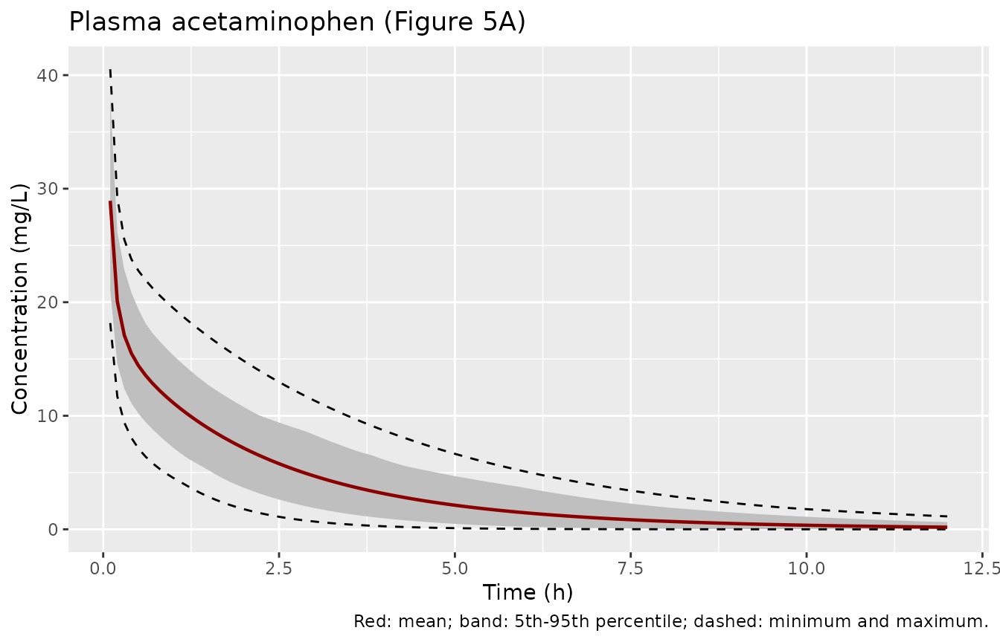
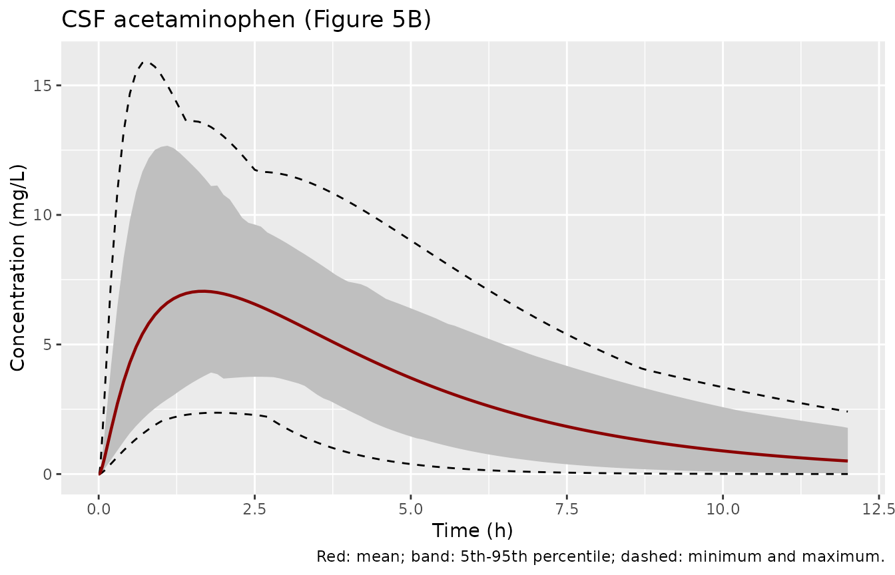
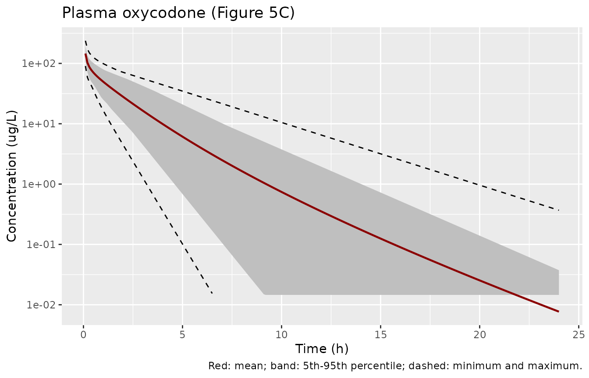
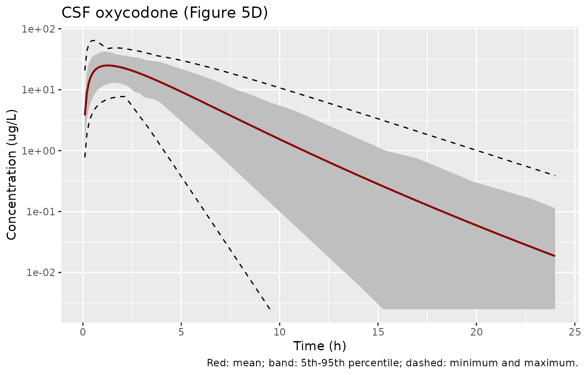
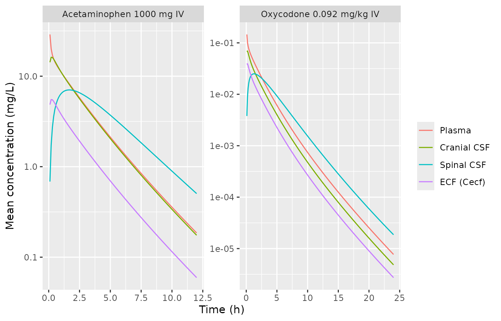

# Acetaminophen and oxycodone brain PBPK (Mehta 2024)

## Model and source

- Citation: Mehta P, Soliman A, Rodriguez-Vera L, Schmidt S, Muniz P,
  Rodriguez M, Forcadell M, Gonzalez-Perez E, Vozmediano V. Interspecies
  brain PBPK modeling platform to predict passive transport through the
  blood-brain barrier and assess target site disposition. Pharmaceutics.
  2024;16(2):226. <doi:10.3390/pharmaceutics16020226>.
- Article: <https://doi.org/10.3390/pharmaceutics16020226> (open access)
- Supplementary material: “Supplementary_Model Code - Rats & Humans”
  (the Pumas 2.2.0 `@model` blocks for rat and human, with the Rodgers
  and Rowland, Poulin and Theil and Berezhkovskiy partition-coefficient
  functions and the human virtual-population equations) and
  “Supplementary figures and tables” (Tables S1-S3).
- Model files:
  - `Mehta_2024_acetaminophen_brain_pbpk`: PBPK (whole-body,
    permeability-limited 4-compartment brain, Pumas 2.2.0).
    Acetaminophen in adults after IV dosing (Mehta et al. 2024, the
    human acetaminophen instantiation of an interspecies brain PBPK
    platform). Thirteen perfusion-limited body compartments (venous and
    arterial blood, lung, adipose, bone, heart, kidney, muscle, skin,
    spleen, gut, liver, rest of body) with Rodgers and Rowland tissue
    partition coefficients computed from adult tissue composition, plus
    the Verscheijden 2019 brain model (brain blood, brain mass, cranial
    CSF, spinal CSF) with passive blood-brain and blood-CSF barrier
    permeability. The blood-brain barrier permeability was optimised on
    rat neuropharmacokinetic data and scaled to humans by BBB surface
    area. Organ volumes and blood flows are age-, sex-, weight- and
    height-dependent adult equations. Total plasma clearance acts on
    venous blood. Forward-simulation model: all parameters are fixed;
    IIV is on clearance and the CSF flows; no residual error was
    reported.
  - `Mehta_2024_oxycodone_brain_pbpk`: PBPK (whole-body,
    permeability-limited 4-compartment brain, Pumas 2.2.0). Oxycodone in
    adults after IV dosing (Mehta et al. 2024, the human oxycodone
    instantiation of an interspecies brain PBPK platform). Thirteen
    perfusion-limited body compartments (venous and arterial blood,
    lung, adipose, bone, heart, kidney, muscle, skin, spleen, gut,
    liver, rest of body) with Poulin and Theil tissue partition
    coefficients computed from adult tissue composition, plus the
    Verscheijden 2019 brain model (brain blood, brain mass, cranial CSF,
    spinal CSF) with passive blood-brain and blood-CSF barrier
    permeability. The blood-brain barrier permeability was optimised on
    rat neuropharmacokinetic data and scaled to humans by BBB surface
    area. Organ volumes and blood flows are age-, sex-, weight- and
    height-dependent adult equations. Total plasma clearance acts on
    venous blood. Forward-simulation model: all parameters are fixed;
    IIV is on clearance and the CSF flows; no residual error was
    reported. With the published Poulin and Theil inputs the terminal
    half-life is about 1.3 h, shorter than the about 3 h of the paper’s
    Figure 5C (see the vignette).

Mehta et al. qualified a whole-body physiologically based
pharmacokinetic (PBPK) platform with a four-compartment,
permeability-limited brain (brain blood, brain mass, cranial CSF, spinal
CSF; the Verscheijden 2019 framework) for drugs that cross the
blood-brain barrier (BBB) by passive diffusion. For each of five drugs
(acetaminophen, oxycodone, lacosamide, ibuprofen, levetiracetam) the BBB
permeability was optimised on rat neuropharmacokinetic data and scaled
to humans through the BBB surface area (Equation 1, Table 3). The human
model then predicted plasma and CSF concentrations without further
fitting (Table 4, Figure 5).

Two of the ten drug-species instantiations are fully reported: human
acetaminophen and human oxycodone, both given intravenously. These are
the two model files here. Each one carries the paper’s headline result
on its own, because the rat-optimised permeability enters the human
model as the tabulated human PSB (Table 3), not as a rat model output.
The other instantiations cannot be rebuilt from the published material
(see “Instantiations not reproduced” below).

## Model structure

     venous blood --> lung --> arterial blood --> 10 perfused tissues --> venous blood
          |  CL x C_plasma             |                (spleen, gut -> liver)
          v                            +--> brain blood <--PSb--> brain mass
       eliminated                             ^   PSc        PSe  |  bulk flow
                                              +--> cranial CSF <--+
                                                        ^ |
                                             spinal CSF -+ +- sink flows to blood

- 17 amount states (`venous`, `arterial`, `lung`, `adipose`, `bone`,
  `heart`, `kidney`, `muscle`, `skin`, `spleen`, `other`, `gut`,
  `liver`, `brain_vascular`, `brain`, `brain_csf_sas_cranial`,
  `brain_csf_sas_spinal`). The supplementary code writes the same
  equations in concentrations; here each is multiplied through by its
  volume.
- IV doses go into `venous` (Methods 2.3.1).
- Tissue:plasma partition coefficients are computed inside `model()`
  from the adult tissue composition of Table S2: Rodgers and Rowland for
  acetaminophen (monoprotic acid) and Poulin and Theil for oxycodone
  (monoprotic base), as in Table S3 and Methods 2.4. The rest-of-body Kp
  is the mean of the ten tissue values (code `Kprest_human`).
- Outputs: `Cc` (plasma), `Ccsf` (cranial CSF), `Ccsf_spinal` (spinal
  CSF; the code’s `Cspinal_csf`) and `Cecf` (the code’s ECF
  approximation, `Cbm x Vecf / Vbm` with `Vecf = 0.29 L`).

## Population

The human verification studies (Table 1) were:

- Acetaminophen: Singla et al., 1000 mg IV, n = 50, 19-73 y, plasma and
  CSF.
- Oxycodone: Kokki et al., 0.092 mg/kg IV, n = 11, 26-60 y, plasma and
  CSF.

No human parameter was estimated. The human data served only to check
the predictions. The supplementary code builds male and female virtual
subjects from the age-to-height and height-to-weight equations of Table
S2, with log-normal variability. The number of virtual subjects and the
sex ratio are placeholders (`N = ___`, `NF = ___`) in the code.

``` r

str(readModelDb("Mehta_2024_acetaminophen_brain_pbpk")()$population)
#> List of 10
#>  $ species       : chr "human"
#>  $ n_subjects    : int 50
#>  $ n_studies     : int 1
#>  $ age_range     : chr "19-73 years (Singla 2012, Table 1)"
#>  $ weight_range  : chr "not reported; generated from age and height in the virtual population"
#>  $ sex_female_pct: num NA
#>  $ disease_state : chr "Adults with plasma and CSF sampling after a single IV acetaminophen dose (Singla et al. 2012, used for verification only)."
#>  $ dose_range    : chr "1000 mg IV, single dose"
#>  $ regions       : chr NA
#>  $ notes         : chr "Forward-simulation PBPK: no human parameter was estimated. Clearance and binding come from the literature (Tabl"| __truncated__
str(readModelDb("Mehta_2024_oxycodone_brain_pbpk")()$population)
#> List of 10
#>  $ species       : chr "human"
#>  $ n_subjects    : int 11
#>  $ n_studies     : int 1
#>  $ age_range     : chr "26-60 years (Kokki et al., Table 1)"
#>  $ weight_range  : chr "not reported; generated from age and height in the virtual population"
#>  $ sex_female_pct: num NA
#>  $ disease_state : chr "Adults with plasma and CSF sampling after a single IV oxycodone dose (Kokki et al., used for verification only)."
#>  $ dose_range    : chr "0.092 mg/kg IV, single dose"
#>  $ regions       : chr NA
#>  $ notes         : chr "Forward-simulation PBPK: no human parameter was estimated. Clearance and binding come from the literature (Tabl"| __truncated__
```

## Source trace

| Model element | Acetaminophen | Oxycodone | Source |
|----|----|----|----|
| Plasma CL (L/h) | 22.8 | 49.2 x 0.8 = 39.36 | Table S3, ‘CL - Human’ and ‘CL-scalar’ |
| IIV on CL (CV) | 35.4% | 30% | Table S3; Methods 2.4 |
| log P / pKa | 0.46 / 9.38 (acid) | 1.2 / 8.53 (base) | Table S3 |
| Blood:plasma ratio | 1.09 | 1.3 | Table S3, BP Humans |
| fu plasma / brain mass / cranial CSF | 0.855 / 0.747 / 1 | 0.59 / 0.45 / 1 | Table S3 |
| Kp method | Rodgers and Rowland | Poulin and Theil | Table S3; Methods 2.4 |
| PSB (L/h) | 5.98 | 14.47 | Table 3, PSB in Humans |
| PSC | 0.1 x PSB | 0.1 x PSB | Table S3 footnote beta; Methods 2.3.2 |
| PSE (L/h) | 300 | 300 | Table S3 |
| CSF production (L/h), CV | 0.021, 10% | same | Table S2 |
| Bulk, spinal sink, spinal outflow | 0.25 Qprod (CV 8%), 0.38 (0.75 Qprod + Qbulk) (CV 30%), 0.9 Qssink (CV 100%) | same | Table S2; code |
| Cranial / spinal CSF volume | Vbrain x 0.105 (male) or 0.092 (female) x 0.8 / 0.2 | same | Table S2 |
| Organ volumes, cardiac output, tissue flows | adult equations | same | Table S2; code, human section |
| Tissue composition | Rodgers and Rowland column | Poulin and Theil column | Table S2 |
| Kp equations | `calcKp_RR`, acid branch | `calcKp_PT` | code, human section |
| ODEs and outputs | `@dynamics`, `@derived` | same | code, human section |
| Vecf | 0.29 L | 0.29 L | code (`Vecf = 0.29`) |
| Virtual-population height, weight, BSA | Table S2 equations | same | Table S2; code |

## Virtual cohorts

Height and weight are drawn with the sex-specific equations of Table S2
(as coded in the supplement): height = (175.32 + 0.1113 age - 0.0025
age^2) x exp(N(0, 0.039)) for men and (161.66 + 0.1319 age - 0.0027
age^2) x exp(N(0, 0.039)) for women; weight = exp(2.643 + 0.0099 height)
x exp(N(0, 0.15)) for men and exp(2.7383 + 0.0091 height) x exp(N(0,
0.188)) for women. Age is uniform over the study’s range (the code draws
`rand(Uniform(...))`). Each arm has 100 subjects, half of them women.

``` r

make_cohort <- function(n, age_lo, age_hi, drug, id0 = 0) {
  female <- rep(c(0, 1), length.out = n)
  age <- runif(n, age_lo, age_hi)
  ht_typ <- ifelse(
    female == 1,
    161.66 + 0.1319 * age - 0.0027 * age^2,
    175.32 + 0.1113 * age - 0.0025 * age^2
  )
  ht <- ht_typ * exp(rnorm(n, 0, 0.039))
  wt_typ <- ifelse(female == 1, exp(2.7383 + 0.0091 * ht), exp(2.643 + 0.0099 * ht))
  wt <- wt_typ * exp(rnorm(n, 0, ifelse(female == 1, 0.188, 0.15)))
  data.frame(id = id0 + seq_len(n), drug = drug, AGE = age, WT = wt, HT = ht, SEXF = female)
}

# One IV bolus into venous blood per subject plus an observation grid on the
# venous state. The grid is fine over the first 0.1 h, where the bolus spike
# in the 2-3 L venous compartment decays, so that the trapezoidal AUC is
# accurate; after that it follows the code's 0.1-h step (obstimes = 0:0.1:24).
make_events <- function(cohort, dose_mg, t_end) {
  obs_times <- sort(unique(c(seq(0, 0.1, by = 0.0025), seq(0.1, t_end, by = 0.1))))
  dose <- cohort |>
    mutate(time = 0, amt = dose_mg, evid = 1L, cmt = "venous")
  obs <- tidyr::crossing(cohort, time = obs_times) |>
    mutate(amt = 0, evid = 0L, cmt = "venous")
  bind_rows(dose, obs) |> arrange(id, time, desc(evid))
}
```

``` r

rxode2::rxSetSeed(20240226)
set.seed(20240226)
n_arm <- 100
coh_apap <- make_cohort(n_arm, 19, 73, "Acetaminophen 1000 mg IV")
coh_oxy <- make_cohort(n_arm, 26, 60, "Oxycodone 0.092 mg/kg IV", id0 = 1000)

ev_apap <- make_events(coh_apap, 1000, 12)
ev_oxy <- make_events(coh_oxy, 0.092 * coh_oxy$WT, 24)

bind_rows(coh_apap, coh_oxy) |>
  group_by(drug) |>
  summarise(
    n = n(), `female (%)` = 100 * mean(SEXF),
    `age (y)` = sprintf("%.1f (%.1f-%.1f)", median(AGE), min(AGE), max(AGE)),
    `weight (kg)` = sprintf("%.1f (%.1f-%.1f)", median(WT), min(WT), max(WT)),
    `height (cm)` = sprintf("%.0f (%.0f-%.0f)", median(HT), min(HT), max(HT)),
    .groups = "drop"
  ) |>
  knitr::kable(caption = "Virtual cohorts: median (range).")
```

| drug | n | female (%) | age (y) | weight (kg) | height (cm) |
|:---|---:|---:|:---|:---|:---|
| Acetaminophen 1000 mg IV | 100 | 50 | 48.0 (19.2-72.7) | 75.5 (41.4-116.8) | 168 (143-193) |
| Oxycodone 0.092 mg/kg IV | 100 | 50 | 44.3 (26.4-59.2) | 75.8 (37.2-125.9) | 169 (150-189) |

Virtual cohorts: median (range). {.table}

## Simulation

``` r

mod_apap <- readModelDb("Mehta_2024_acetaminophen_brain_pbpk")
mod_oxy <- readModelDb("Mehta_2024_oxycodone_brain_pbpk")
out_cols <- c("Cc", "Ccsf", "Ccsf_spinal", "Cecf")

sim <- bind_rows(
  rxode2::rxSolve(mod_apap, ev_apap, keep = "drug", returnType = "data.frame") |>
    select(id, time, drug, all_of(out_cols), cl),
  rxode2::rxSolve(mod_oxy, ev_oxy, keep = "drug", returnType = "data.frame") |>
    select(id, time, drug, all_of(out_cols), cl)
)
#> ℹ parameter labels from comments will be replaced by 'label()'
#> ℹ parameter labels from comments will be replaced by 'label()'
stopifnot(!anyNA(sim$Cc), !anyNA(sim$Ccsf_spinal))

# The paper plots the simulated mean, the 5th-95th percentile band and the
# minimum and maximum (Figure 5 caption).
summ <- sim |>
  pivot_longer(all_of(out_cols), names_to = "output", values_to = "conc") |>
  group_by(drug, output, time) |>
  summarise(
    mean = mean(conc), lo = quantile(conc, 0.05), hi = quantile(conc, 0.95),
    min = min(conc), max = max(conc),
    .groups = "drop"
  )

plot_fig5 <- function(d, title, ylab, log_y = FALSE) {
  p <- ggplot(d, aes(time, mean)) +
    geom_ribbon(aes(ymin = lo, ymax = hi), fill = "grey75") +
    geom_line(aes(y = min), linetype = "dashed") +
    geom_line(aes(y = max), linetype = "dashed") +
    geom_line(colour = "darkred", linewidth = 0.8) +
    labs(
      x = "Time (h)", y = ylab, title = title,
      caption = "Red: mean; band: 5th-95th percentile; dashed: minimum and maximum."
    )
  if (log_y) p <- p + scale_y_log10()
  p
}

# Log-scale panels: the integrator can return a value a few atol below zero
# in the far tail of the fastest-clearing subject. Values more than four
# decades below the peak mean are left out of the plot (a gap in the line).
floor_for_log <- function(d) {
  stopifnot(all(d$min >= -1e-6 * max(d$max)))
  cut <- 1e-4 * max(d$mean)
  mutate(d, min = ifelse(min > cut, min, NA_real_), lo = pmax(lo, cut))
}
```

## Replicate published figures

The plots start at the first grid point after the bolus (0.1 h), as the
venous concentration at time zero is the dose spread over venous blood
only.

### Figure 5A-B – acetaminophen 1000 mg IV

``` r

summ |>
  filter(drug == "Acetaminophen 1000 mg IV", output == "Cc", time >= 0.1) |>
  plot_fig5("Plasma acetaminophen (Figure 5A)", "Concentration (mg/L)")
```



``` r

summ |>
  filter(drug == "Acetaminophen 1000 mg IV", output == "Ccsf_spinal") |>
  plot_fig5("CSF acetaminophen (Figure 5B)", "Concentration (mg/L)")
```



Replicates Figure 5A-B of Mehta 2024. The CSF panel is the spinal CSF
compartment, the code’s `Cspinal_csf` output; the clinical samples were
lumbar CSF.

### Figure 5C-D – oxycodone 0.092 mg/kg IV

``` r

summ |>
  filter(drug == "Oxycodone 0.092 mg/kg IV", output == "Cc", time >= 0.1) |>
  mutate(across(c(mean, lo, hi, min, max), ~ .x * 1000)) |>
  floor_for_log() |>
  plot_fig5("Plasma oxycodone (Figure 5C)", "Concentration (ug/L)", log_y = TRUE)
#> Warning: Removed 175 rows containing missing values or values outside the scale range
#> (`geom_line()`).
```



``` r

summ |>
  filter(drug == "Oxycodone 0.092 mg/kg IV", output == "Ccsf_spinal", time >= 0.1) |>
  mutate(across(c(mean, lo, hi, min, max), ~ .x * 1000)) |>
  floor_for_log() |>
  plot_fig5("CSF oxycodone (Figure 5D)", "Concentration (ug/L)", log_y = TRUE)
#> Warning: Removed 145 rows containing missing values or values outside the scale range
#> (`geom_line()`).
```



Replicates Figure 5C-D of Mehta 2024 (log scale, as published). The
early part of both panels agrees with the publication, but the simulated
concentrations fall faster after about 4 h. At 24 h the published mean
is about 0.3 ug/L in plasma and in CSF (read from Figure 5C-D by the
maintainers), and the mean here is one to two decades lower. The section
“Volume of distribution and terminal phase” below gives the reason.

### CNS compartments

``` r

summ |>
  filter(output %in% c("Cc", "Ccsf", "Ccsf_spinal", "Cecf"), time >= 0.1) |>
  mutate(output = factor(output,
    levels = c("Cc", "Ccsf", "Ccsf_spinal", "Cecf"),
    labels = c("Plasma", "Cranial CSF", "Spinal CSF", "ECF (Cecf)")
  )) |>
  ggplot(aes(time, mean, colour = output)) +
  geom_line() +
  facet_wrap(~drug, scales = "free") +
  scale_y_log10() +
  labs(x = "Time (h)", y = "Mean concentration (mg/L)", colour = NULL)
```



The cranial CSF follows plasma closely because the brain mass and the
cranial CSF exchange freely (PSE = 300 L/h) and the brain mass
equilibrates with brain blood through the BBB. The spinal CSF lags
behind, as it is fed only by the CSF shuttle flow from the cranial CSF.
`Cecf` is the code’s ECF approximation and is lower than the unbound
brain-mass concentration by the factor `Vecf / Vbm / fu_br`.

## Deterministic checks

### Partition coefficients

The paper does not print the Kp values. The table lists those of a
typical man (40 y, 175 cm, 75 kg) so a reader can compare them with
other implementations of the same methods.

``` r

typ <- data.frame(id = 1, AGE = 40, WT = 75, HT = 175, SEXF = 0)
ev_typ <- make_events(typ, 1, 1)
tissues <- c("adipose", "bone", "gut", "heart", "kidney", "liver", "lung", "muscle", "skin", "spleen", "other")
kp_row <- function(mod) {
  s <- rxode2::rxSolve(rxode2::zeroRe(mod), ev_typ, returnType = "data.frame")
  unlist(s[1, paste0("kp_", tissues)])
}
kp_tab <- data.frame(
  tissue = tissues,
  acetaminophen = kp_row(mod_apap),
  oxycodone = kp_row(mod_oxy)
)
#> ℹ parameter labels from comments will be replaced by 'label()'
#> ℹ omega/sigma items treated as zero: 'etalcl', 'etalq_csf_prod', 'etalf_bulk', 'etalf_ssink', 'etalf_sout'
#> ℹ parameter labels from comments will be replaced by 'label()'
#> ℹ omega/sigma items treated as zero: 'etalcl', 'etalq_csf_prod', 'etalf_bulk', 'etalf_ssink', 'etalf_sout'
knitr::kable(kp_tab, digits = 3, row.names = FALSE,
  caption = "Tissue:plasma partition coefficients of the typical man.")
```

| tissue  | acetaminophen | oxycodone |
|:--------|--------------:|----------:|
| adipose |         0.257 |     0.127 |
| bone    |         0.569 |     1.270 |
| gut     |         0.773 |     1.239 |
| heart   |         0.717 |     0.809 |
| kidney  |         0.756 |     0.941 |
| liver   |         0.769 |     1.130 |
| lung    |         0.738 |     0.712 |
| muscle  |         0.718 |     0.923 |
| skin    |         0.734 |     0.964 |
| spleen  |         0.758 |     0.952 |
| other   |         0.679 |     0.907 |

Tissue:plasma partition coefficients of the typical man. {.table}

``` r

stopifnot(all(kp_tab$acetaminophen > 0), all(kp_tab$oxycodone > 0))
```

### Mass balance

Clearance removes `CL x C_plasma` from venous blood. Over the simulation
window the dose must equal the cleared mass plus what remains in the 17
states. A 1-h infusion keeps the venous concentration smooth enough for
trapezoidal integration of the cleared mass.

``` r

states <- c("venous", "arterial", "lung", "adipose", "bone", "heart", "kidney", "muscle",
            "skin", "spleen", "other", "gut", "liver", "brain_vascular", "brain",
            "brain_csf_sas_cranial", "brain_csf_sas_spinal")
trap <- function(t, y) sum(diff(t) * (head(y, -1) + tail(y, -1)) / 2)
mass_balance <- function(mod, dose) {
  ev <- rxode2::et(amt = dose, cmt = "venous", dur = 1) |>
    rxode2::et(seq(0, 24, by = 0.01), cmt = "venous") |>
    as.data.frame() |>
    mutate(AGE = typ$AGE, WT = typ$WT, HT = typ$HT, SEXF = typ$SEXF)
  s <- rxode2::rxSolve(rxode2::zeroRe(mod), ev, rtol = 1e-10, atol = 1e-12, returnType = "data.frame")
  cleared <- trap(s$time, s$cl * s$Cc)
  left <- sum(unlist(s[nrow(s), states]))
  (cleared + left) / dose
}
mb <- c(acetaminophen = mass_balance(mod_apap, 1000), oxycodone = mass_balance(mod_oxy, 0.092 * 75))
#> ℹ parameter labels from comments will be replaced by 'label()'
#> ℹ omega/sigma items treated as zero: 'etalcl', 'etalq_csf_prod', 'etalf_bulk', 'etalf_ssink', 'etalf_sout'
#> ℹ parameter labels from comments will be replaced by 'label()'
#> ℹ omega/sigma items treated as zero: 'etalcl', 'etalq_csf_prod', 'etalf_bulk', 'etalf_ssink', 'etalf_sout'
mb
#> acetaminophen     oxycodone 
#>             1             1
stopifnot(all(abs(mb - 1) < 0.002))
```

### Volume of distribution and terminal phase

The steady-state volume of distribution of the typical man is the sum of
the tissue volumes times their Kp values plus the blood volume times the
blood:plasma ratio (the small brain compartments are left out). With the
clearance it sets the terminal half-life.

``` r

vss_row <- function(mod, bp, label) {
  s <- rxode2::rxSolve(rxode2::zeroRe(mod), make_events(typ, 1, 24), returnType = "data.frame")
  r <- s[1, ]
  tis <- c("lung", "adipose", "bone", "heart", "kidney", "muscle", "skin", "spleen", "gut", "liver", "other")
  vss <- sum(unlist(r[paste0("v_", tis)]) * unlist(r[paste0("kp_", tis)])) + (r$v_venous + r$v_arterial) * bp
  late <- s[s$time >= 12, ]
  k <- -unname(coef(lm(log(Cc) ~ time, data = late))[2])
  data.frame(drug = label, `Vss (L)` = vss, `Vss (L/kg)` = vss / typ$WT, `CL (L/h)` = r$cl,
             `terminal t1/2 (h)` = log(2) / k, check.names = FALSE)
}
vss_tab <- bind_rows(
  vss_row(mod_apap, 1.09, "Acetaminophen"),
  vss_row(mod_oxy, 1.3, "Oxycodone")
)
#> ℹ parameter labels from comments will be replaced by 'label()'
#> ℹ omega/sigma items treated as zero: 'etalcl', 'etalq_csf_prod', 'etalf_bulk', 'etalf_ssink', 'etalf_sout'
#> ℹ parameter labels from comments will be replaced by 'label()'
#> ℹ omega/sigma items treated as zero: 'etalcl', 'etalq_csf_prod', 'etalf_bulk', 'etalf_ssink', 'etalf_sout'
knitr::kable(vss_tab, digits = 2, caption = "Typical man (40 y, 175 cm, 75 kg).")
```

| drug          | Vss (L) | Vss (L/kg) | CL (L/h) | terminal t1/2 (h) |
|:--------------|--------:|-----------:|---------:|------------------:|
| Acetaminophen |   46.81 |       0.62 |    22.80 |              1.65 |
| Oxycodone     |   58.45 |       0.78 |    39.36 |              1.25 |

Typical man (40 y, 175 cm, 75 kg). {.table}

``` r

stopifnot(all(vss_tab$`Vss (L)` > 30), all(vss_tab$`Vss (L)` < 90))
```

For acetaminophen the simulated profile follows Figure 5A over the whole
12 h. For oxycodone the Poulin and Theil Kp values, computed from the
Table S2 composition with the printed `calcKp_PT` function, are all
close to 1 except adipose. That gives a Vss of about 0.8 L/kg and a
terminal half-life of about 1.3 h. The mean line of Figure 5C falls from
about 50 ug/L just after the dose to about 0.3 ug/L at 24 h, a terminal
half-life of about 3 h. With the same clearance that needs a Vss of
roughly 2.3 L/kg, about three times larger. The supplementary code reads
the human tissue composition for this method from a file named
`human_PT_Edited.csv`, which is not part of the supplement. Its contents
may differ from Table S2. The model here uses the published values
unchanged. It therefore reproduces the Table 4 AUC and the CSF peak,
which are dominated by the first hours, but not the late oxycodone
concentrations.

## PKNCA validation

Two NCA runs per drug. Per-subject NCA of plasma confirms that the
plasma clearance from NCA equals the model clearance (both sides use the
same drawn parameters, so this check is tight). NCA of the cohort-mean
profile is then compared with the predicted values of Table 4, which the
paper computed from its simulated profiles (Methods 2.6; AUClast over
the study window, 12 h for acetaminophen and 24 h for oxycodone, the
time axes of Figure 5).

``` r

conc_subj <- sim |>
  filter(!is.na(Cc)) |>
  transmute(id, drug, time, conc = Cc)
dose_subj <- bind_rows(ev_apap, ev_oxy) |>
  filter(evid == 1) |>
  select(id, drug, time, amt)
o_conc <- PKNCA::PKNCAconc(conc_subj, conc ~ time | drug + id)
o_dose <- PKNCA::PKNCAdose(dose_subj, amt ~ time | drug + id, route = "intravascular")
nca_subj <- PKNCA::pk.nca(PKNCA::PKNCAdata(o_conc, o_dose,
  intervals = data.frame(start = 0, end = Inf, aucinf.obs = TRUE, cl.obs = TRUE, half.life = TRUE)
))
cl_chk <- as.data.frame(nca_subj) |>
  filter(PPTESTCD == "cl.obs") |>
  select(id, drug, cl_nca = PPORRES) |>
  inner_join(distinct(sim, id, cl), by = "id") |>
  mutate(ratio = cl_nca / cl)
cl_chk |>
  group_by(drug) |>
  summarise(`median NCA CL / model CL` = median(ratio), `max abs deviation` = max(abs(ratio - 1)), .groups = "drop") |>
  knitr::kable(digits = 4)
```

| drug                     | median NCA CL / model CL | max abs deviation |
|:-------------------------|-------------------------:|------------------:|
| Acetaminophen 1000 mg IV |                   0.9978 |            0.0044 |
| Oxycodone 0.092 mg/kg IV |                   0.9974 |            0.0047 |

``` r

stopifnot(abs(median(cl_chk$ratio) - 1) < 0.02, quantile(abs(cl_chk$ratio - 1), 0.9) < 0.04)
```

``` r

mean_prof <- summ |>
  filter(output %in% c("Cc", "Ccsf_spinal")) |>
  mutate(
    matrix = ifelse(output == "Cc", "Plasma", "CSF"),
    # Table 4 units: mg/L for acetaminophen, ug/L for oxycodone
    conc = ifelse(grepl("Oxycodone", drug), mean * 1000, mean),
    treatment = paste(drug, matrix, sep = ", ")
  ) |>
  select(treatment, drug, matrix, time, conc) |>
  filter(!is.na(conc))
dose_mean <- distinct(mean_prof, treatment, drug, matrix) |>
  mutate(time = 0, amt = 1)
t_end <- c("Acetaminophen 1000 mg IV" = 12, "Oxycodone 0.092 mg/kg IV" = 24)
o_conc_m <- PKNCA::PKNCAconc(mean_prof, conc ~ time | treatment)
o_dose_m <- PKNCA::PKNCAdose(dose_mean, amt ~ time | treatment, route = "intravascular")
# AUC from time zero; Cmax from the first post-bolus grid point (0.1 h), as
# the time-zero venous value is the undistributed bolus.
intervals_m <- bind_rows(
  distinct(mean_prof, treatment, drug) |>
    mutate(start = 0, end = t_end[drug], auclast = TRUE, cmax = FALSE),
  distinct(mean_prof, treatment, drug) |>
    mutate(start = 0.1, end = t_end[drug], auclast = FALSE, cmax = TRUE)
) |>
  select(-drug)
nca_mean <- PKNCA::pk.nca(PKNCA::PKNCAdata(o_conc_m, o_dose_m, intervals = intervals_m))

sim_wide <- as.data.frame(nca_mean) |>
  filter(PPTESTCD %in% c("auclast", "cmax")) |>
  select(treatment, PPTESTCD, PPORRES)
ref_tab4 <- data.frame(
  treatment = c(
    "Acetaminophen 1000 mg IV, Plasma", "Acetaminophen 1000 mg IV, CSF",
    "Oxycodone 0.092 mg/kg IV, Plasma", "Oxycodone 0.092 mg/kg IV, CSF"
  ),
  auclast = c(37.81, 40.59, 201.14, 137.77),
  cmax = c(18.44, 6.72, 96.24, 22.35)
)
cmp <- nlmixr2lib::ncaComparisonTable(
  sim_wide, ref_tab4,
  by = "treatment",
  tolerance_pct = 20,
  units = c(auclast = "h x mg/L or h x ug/L", cmax = "mg/L or ug/L")
)
knitr::kable(cmp, caption = paste(
  "Cohort-mean NCA versus the predicted values of Table 4 (acetaminophen in",
  "mg and L, oxycodone in ug and L).", attr(cmp, "footnote")
))
```

| NCA parameter | treatment | Reference | Simulated | % diff |
|:---|:---|:---|:---|:---|
| Cmax (mg/L or ug/L) | Acetaminophen 1000 mg IV, Plasma | 18.4 | 28.9 | +56.9%\* |
| Cmax (mg/L or ug/L) | Acetaminophen 1000 mg IV, CSF | 6.72 | 7.05 | +5.0% |
| Cmax (mg/L or ug/L) | Oxycodone 0.092 mg/kg IV, Plasma | 96.2 | 146 | +51.4%\* |
| Cmax (mg/L or ug/L) | Oxycodone 0.092 mg/kg IV, CSF | 22.4 | 25 | +11.9% |
| AUClast (h x mg/L or h x ug/L) | Acetaminophen 1000 mg IV, Plasma | 37.8 | 46.5 | +23.0%\* |
| AUClast (h x mg/L or h x ug/L) | Acetaminophen 1000 mg IV, CSF | 40.6 | 38.2 | -5.8% |
| AUClast (h x mg/L or h x ug/L) | Oxycodone 0.092 mg/kg IV, Plasma | 201 | 194 | -3.7% |
| AUClast (h x mg/L or h x ug/L) | Oxycodone 0.092 mg/kg IV, CSF | 138 | 114 | -17.4% |

Cohort-mean NCA versus the predicted values of Table 4 (acetaminophen in
mg and L, oxycodone in ug and L). \* differs from reference by more than
±20%. {.table}

``` r

pct <- sim_wide |>
  inner_join(pivot_longer(ref_tab4, -treatment, names_to = "PPTESTCD", values_to = "ref"),
             by = c("treatment", "PPTESTCD")) |>
  mutate(pct_diff = 100 * (PPORRES / ref - 1))
stopifnot(nrow(pct) == 8L)
row_of <- function(trt, code) {
  r <- pct[pct$treatment == trt & pct$PPTESTCD == code, ]
  if (nrow(r) != 1L) stop("no unique row for ", trt, " / ", code)
  r
}
# CNS AUC and Cmax and oxycodone plasma AUC against the Table 4 predictions.
# AUC is set by dose / CL (plasma) and by the BBB and CSF parameters (CSF);
# a mis-transcribed clearance, PSB, unbound fraction or CSF volume moves it
# by well over 35%. Realised over four cohort seeds: oxycodone CSF AUC -17
# to -25%, every other gated row within 13%.
gated <- bind_rows(
  row_of("Acetaminophen 1000 mg IV, CSF", "auclast"),
  row_of("Acetaminophen 1000 mg IV, CSF", "cmax"),
  row_of("Oxycodone 0.092 mg/kg IV, CSF", "auclast"),
  row_of("Oxycodone 0.092 mg/kg IV, CSF", "cmax"),
  row_of("Oxycodone 0.092 mg/kg IV, Plasma", "auclast")
)
stopifnot(all(abs(gated$pct_diff) < 35))
# Acetaminophen plasma AUC: Table 4's predicted 37.81 mg*h/L is below the
# dose / CL of the paper's own clearance (1000 / 22.8 = 43.9 mg*h/L), so it
# is compared with the observed Table 4 value (45.58 mg*h/L) instead.
apap_auc <- row_of("Acetaminophen 1000 mg IV, Plasma", "auclast")$PPORRES
stopifnot(abs(apap_auc / 45.58 - 1) < 0.2)
```

The table compares the virtual cohort with the paper’s own predictions
in Table 4. The CNS values (CSF AUC and Cmax for both drugs) and the
oxycodone plasma AUC agree within about 25%; the oxycodone CSF AUC is
the lowest of them (about 20% below the prediction, depending on the
cohort draw). Two rows differ more:

- **Acetaminophen plasma AUC** (+23%). After an IV dose the plasma AUC
  to infinity is dose / CL. For the paper’s clearance of 22.8 L/h that
  is 43.9 mg\*h/L for a typical subject, and more for the cohort mean,
  because the mean of dose / CL over log-normal clearance exceeds dose
  over the typical CL. The 12-h AUC here (46.5 mg\*h/L) is close to the
  observed 45.58 mg\*h/L of Table 4. The predicted 37.81 mg\*h/L implies
  either a shorter AUC window or a different clearance from the one in
  Table S3. The source does not say which.
- **Plasma Cmax** (both drugs). It depends on the dose administration
  and the sampling grid, and the code leaves both as placeholders
  (`DosageRegimen(...)`). A bolus into the 2-3 L venous compartment
  gives a high first grid point. The paper’s acetaminophen plasma Cmax
  (18.44 mg/L) matches the bolus profile 0.2-0.25 h after dosing. Plasma
  Cmax is shown without a pass/fail check.

## Instantiations not reproduced

The supplementary code leaves every drug-specific input as a placeholder
(`___`); Table S3 fills them for the human IV drugs. The other eight
instantiations need values that no published table or text gives:

- **Human lacosamide, ibuprofen and levetiracetam** (oral): the
  absorption rate constant `tvKa`, the bioavailability `tvfa`, the lag
  time `tvlag` and their variances. Table S3 has no absorption row, and
  the text says only that the variability on Ka “was based on existing
  studies”.
- **All five rat models**: the rat clearance `tvCL` was estimated by a
  naive-pooled fit and is not printed (Table S3 lists human CL only).
  The rat intraperitoneal (ibuprofen, levetiracetam) and oral
  (lacosamide) absorption parameters are not given, nor is the value or
  form of the BBB efflux term the Discussion says was added to the rat
  lacosamide model.

## Assumptions and deviations

- **Oxycodone terminal phase.** The published inputs give a terminal
  half-life of about 1.3 h, while Figure 5C-D implies about 3 h (see
  “Volume of distribution and terminal phase”). The Kp inputs were not
  adjusted to close the gap. Use the oxycodone model for the first hours
  after a dose, the window its Table 4 metrics cover. Treat later
  concentrations with caution.
- **Oxycodone CL-scalar.** Table S3 lists a ‘CL-scalar’ of 0.8
  (optimised) for oxycodone, while the code has only `Kp_scalar = 1`.
  The scalar is applied to clearance (49.2 x 0.8 = 39.36 L/h). After an
  IV dose the plasma AUC is dose / CL whatever the Kp values, so only a
  clearance scalar can move it. With 39.36 L/h a typical 70-80 kg adult
  has a 0-24 h plasma AUC of 165-189 ug\*h/L against Table 4’s predicted
  201.14 ug\*h/L; with 49.2 L/h it is 133-152 ug\*h/L.
- **IIV on CL.** Table S3 gives a CV; the variance is log(1 + CV^2). The
  CSF-flow variabilities are the standard deviations of the code’s
  `exp(rand(Normal(0, SD)))` draws, used as variances SD^2.
- **Bulk-flow variability.** In the code the bulk flow that carries drug
  from brain mass to cranial CSF is `0.25 x Qproduction` without the 8%
  variability. The varied bulk flow enters only the spinal-sink and
  cranial-sink flows. The model keeps this split.
- **Independent virtual-population draws.** The code resets
  `Random.seed!(123)` before each variability draw, so within one sex
  the height, weight and CSF-flow deviations share the same
  standard-normal vector. That is a side effect of re-seeding, not a
  stated correlation. The draws here are independent.
- **Haematocrit.** Table S2 lists haematocrit (0.43 male, 0.38 female),
  and the code’s Rodgers and Rowland function fixes `HCT = 0.45`.
  Haematocrit enters only the base branch of Rodgers and Rowland, which
  neither model uses (acetaminophen is an acid; oxycodone uses Poulin
  and Theil). The blood:plasma ratio is the fixed Table S3 value.
- **Rest-of-body Kp.** The code takes the mean of the ten tissue Kp
  values. The Poulin and Theil function also returns a pancreas Kp of 0,
  which the model does not use.
- **Unused inputs.** The spinal-CSF unbound fraction (`Fuscsf = 1`) is
  declared in the code but enters no equation; the model has one CSF
  unbound fraction, for the cranial CSF.
- **ECF output.** `Cecf = Cbm x Vecf / Vbm` is encoded as printed
  (Methods 2.3.2: “the ECF concentrations are approximated based on the
  volume of ECF”).
- **Dose administration.** The code’s dosing regimen is a placeholder.
  Doses are simulated as an IV bolus into venous blood (Methods 2.3.1),
  and oxycodone is dosed per kg of the virtual subject’s weight.
- **Sex ratio and cohort size.** Not reported; 50% women and 100
  subjects per arm are used.
- **Observed data.** The observed points of Figure 5 were not digitised.
  The comparison is with the paper’s predicted values in Table 4.
- **Residual error.** None was reported. `propSd` is fixed to 0.
