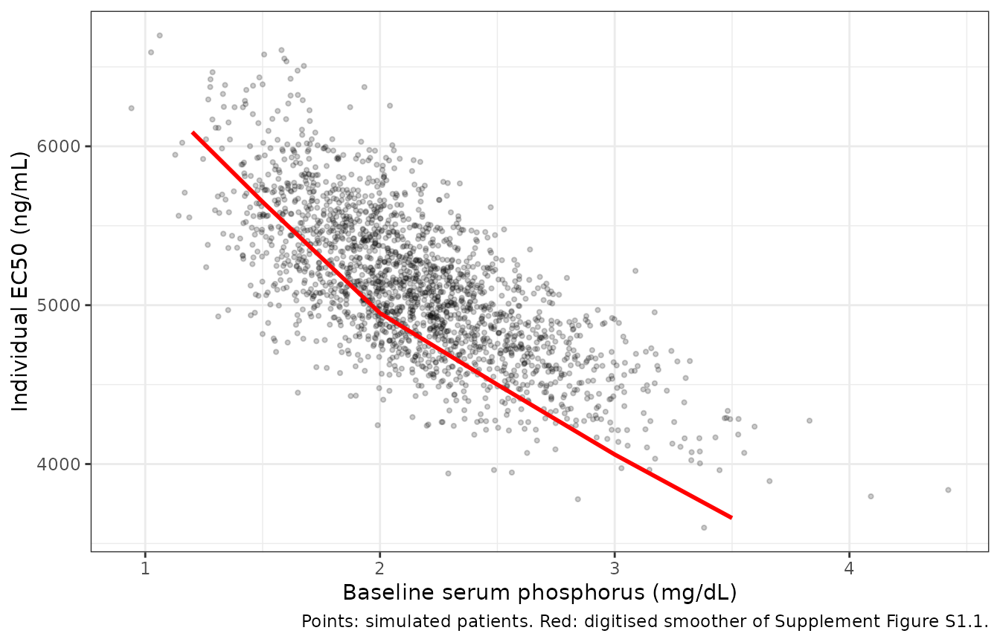
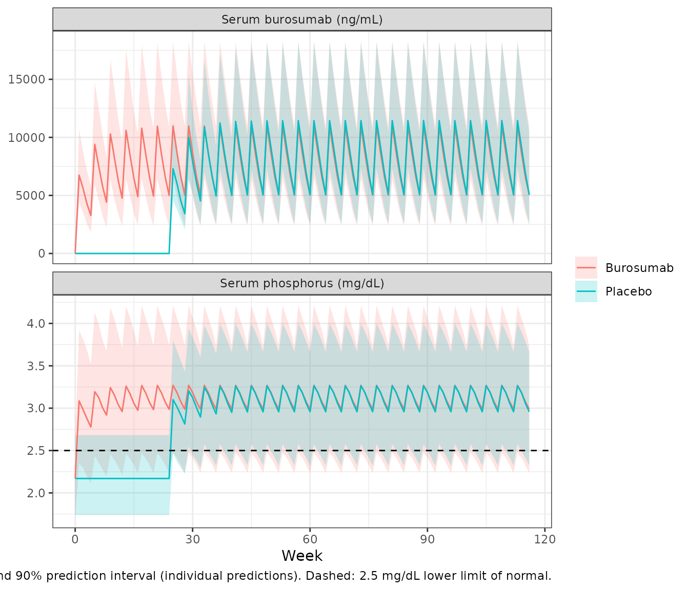
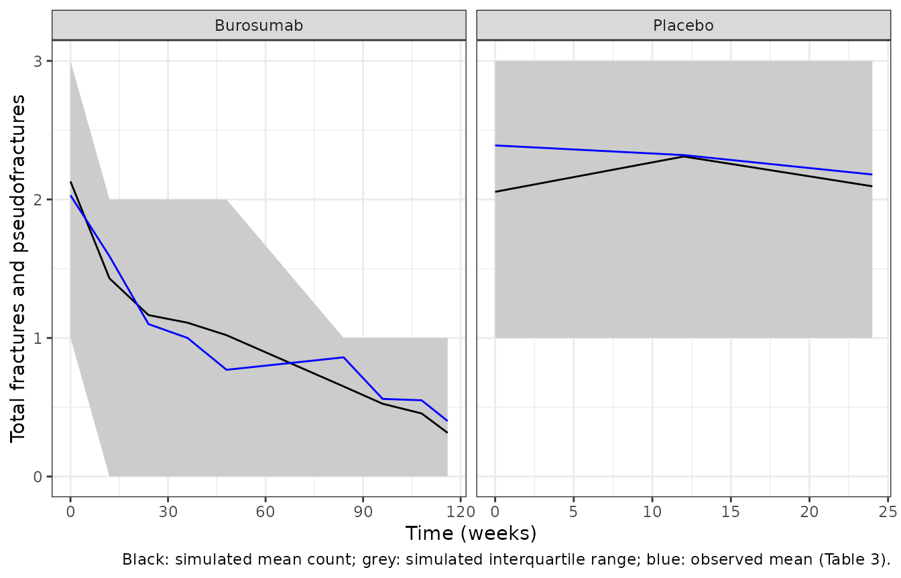
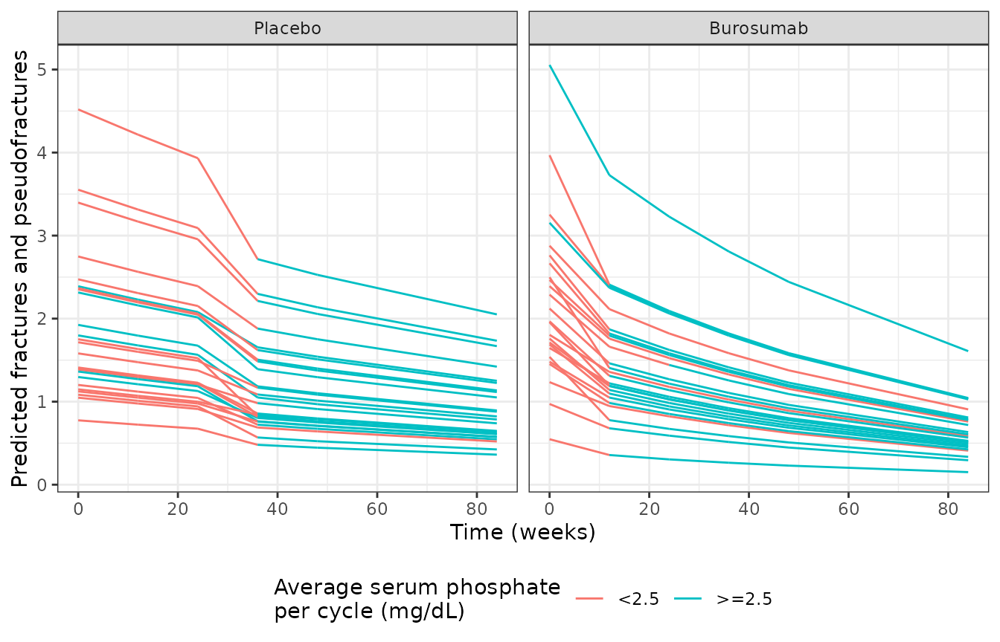

# Burosumab (Mehta 2025)

## Model and source

- Citation: Mehta K, Storopoli J, Ramwani N, Quattrocchi E, Gobburu J,
  Weber T, Hruska MW, Marsteller D. Pharmacodynamic Exposure-Response
  Analysis of Fracture Count Data Following Treatment with Burosumab in
  Patients with XLH. J Clin Pharmacol. 2025;65(2):253.
  <doi:10.1002/jcph.6140>
- Article: <https://doi.org/10.1002/jcph.6140> (open access)
- `Mehta_2025_burosumab`: One-compartment population PK model with
  first-order absorption and linear elimination for subcutaneous
  burosumab (a human anti-FGF23 IgG1 monoclonal antibody) in pediatric
  and adult patients with X-linked hypophosphatemia, coupled to a direct
  Emax model for absolute serum phosphorus. CL/F and V/F carry estimated
  allometric exponents on body weight (70 kg reference), and EC50 is a
  power function of each patient’s own baseline serum phosphorus. This
  model generates the per-cycle average serum phosphorus that drives the
  companion fracture count model Mehta_2025_burosumab_fracture.
- `Mehta_2025_burosumab_fracture`: Poisson exposure-response model for
  the count of active fractures plus pseudofractures on skeletal survey
  in adults with X-linked hypophosphatemia treated with burosumab or
  placebo (UX023-CL303). The Poisson mean is a baseline count with
  log-normal IIV, multiplied by a log-linear time effect, an additional
  log-linear time effect in patients randomised to burosumab, and a
  log-linear effect of the model-predicted average serum phosphorus per
  4-week dosing cycle centred at 2.5 mg/dL. The serum phosphorus input
  comes from the companion PK/PD model Mehta_2025_burosumab.

Mehta 2025 fits two models one after the other. First, it updates the
population PK and PK/PD models of burosumab in X-linked hypophosphatemia
(XLH) from Lee 2022 (packaged as `Lee_2022_burosumab`). The update pools
nine studies and makes EC50 depend on baseline serum phosphorus. Second,
it averages the PK/PD model’s individual serum phosphorus predictions
over each 4-week dosing cycle. These averages, together with time and
the randomised arm, drive a Poisson model of the number of fractures
plus pseudofractures in the adult phase 3 study UX023-CL303.

The two models are packaged as two files, as the authors built them. The
PK/PD model runs in hours. The fracture model runs in weeks and takes
the per-cycle average serum phosphorus as the input column `CAV_PHOS`
(mmol/L). This vignette chains them: it simulates the PK/PD model,
averages its output per cycle, and passes the averages to the fracture
model.

## Population

The PK/PD dataset contains 278 pediatric and adult patients with XLH
from nine studies (phase 1 KRN23-US-02, KRN23-INT-001 and KRN23-INT-002;
phase 2 UX023-CL201, UX023-CL205 and UX023-CL203; phase 3 UX023-CL303,
UX023-CL301 and UX023-CL304). They received 0.05 to 1.2 mg/kg
subcutaneously, as a single dose or every 2 or 4 weeks (Methods;
Supplement S1). The paper does not tabulate their demographics.

The fracture dataset comes from UX023-CL303 (Table 1). In this study,
134 adults aged 18 to 65 years with a confirmed PHEX mutation were
randomised 1:1 to one of two arms:

- burosumab 1.0 mg/kg every 4 weeks (rounded to the nearest 10 mg,
  maximum 90 mg);
- placebo for 24 weeks, then open-label burosumab.

The 70 patients with at least one active fracture or pseudofracture at
baseline (32 burosumab, 38 placebo) were analysed. Skeletal surveys were
done at weeks 0, 12, 24, 36, 48, 84, 96, 108 and 116 (Table 3).

## Source trace

| Quantity | Value | Source |
|----|----|----|
| `lka` (Ka) | 0.016 1/h | Table 2 |
| `lcl` (CL/F at 70 kg) | 0.012 L/h | Table 2 |
| `lvc` (V/F at 70 kg) | 7.45 L | Table 2 |
| `e_wt_cl`, `e_wt_vc` | 0.87, 0.96 | Table 2 ‘CLWT’, ‘VcWT’ |
| `etalcl`, `etalvc` | CV 32.1%, 30.3%; correlation 0.46 | Table 2 |
| `addSd` | 39.32 ng/mL | Table 2 (unit printed ‘ng/L’) |
| `propSd` | 23.3% | Table 2 |
| `le0` (BSL) | 2.14 mg/dL | Table 2 |
| `lec50` | 8270 ng/mL | Table 2 |
| `lemax` | 1.55 mg/dL | Table 2 |
| `e_e0_ec50` (dEC50dBPHOS) | -0.64 | Table 2; form from Supplement Figure S1.1 (below) |
| `etale0`, `etalemax` | CV 14.0%, 32.6% | Table 2 |
| `propSd_serum_phosphorus` | 13.3% | Table 2 |
| Emax equation | `Phosphate = Phosphate(0) + Emax * C / (EC50 + C)` | Supplement S1 equation |
| `lbase` (tvbase) | 1.87 counts | Table 4 |
| `e_time_base` (tv-alpha) | -0.0058 per week | Table 4 |
| `e_trt_time_base` (tv-beta) | -0.0058 per week | Table 4 |
| `e_cavphos_base` (tvdPhos) | -0.26 per mg/dL | Table 4 |
| `etalbase` (IIV-base) | CV 45.15% | Table 4 |
| Poisson model | `Y ~ Poisson(lambda)`, `lambda = base * e^time * e^covariate` | Equations 1-2 |
| Centre of the serum phosphorus effect | 2.5 mg/dL (lower limit of normal) | Abstract; Discussion |
| Reference weight | 70 kg | not printed; Lee 2022 |

The CV% values are converted to log-normal variances with
`omega^2 = log(CV^2 + 1)`.

## Typical-value checks against the text

``` r

pk <- rxode2::rxode(readModelDb("Mehta_2025_burosumab"))
#> ℹ parameter labels from comments will be replaced by 'label()'
fx <- rxode2::rxode(readModelDb("Mehta_2025_burosumab_fracture"))
#> ℹ parameter labels from comments will be replaced by 'label()'
th <- c(pk$theta, fx$theta)

text_chk <- tibble::tibble(
  quantity = c(
    "Fracture count change per week, time effect alone",
    "Additional change per week on burosumab",
    "Fracture count change per +1 mg/dL serum phosphorus",
    "Typical EC50 at BSL = 2.14 mg/dL (ng/mL)",
    "Typical elimination half-life at 70 kg (day)"
  ),
  model = c(
    100 * (exp(th[["e_time_base"]]) - 1),
    100 * (exp(th[["e_trt_time_base"]]) - 1),
    100 * (exp(th[["e_cavphos_base"]]) - 1),
    exp(th[["lec50"]]) * exp(th[["le0"]])^th[["e_e0_ec50"]],
    log(2) * exp(th[["lvc"]]) / exp(th[["lcl"]]) / 24
  ),
  paper = c("-1% (Abstract)", "-1% (Abstract)", "-23% (Abstract)", "not printed", "not printed")
)
text_chk |>
  dplyr::rename("Quantity" = quantity, "Model" = model, "Paper" = paper) |>
  knitr::kable(digits = 2, caption = "Model quantities against the paper's text.")
```

| Quantity | Model | Paper |
|:---|---:|:---|
| Fracture count change per week, time effect alone | -0.58 | -1% (Abstract) |
| Additional change per week on burosumab | -0.58 | -1% (Abstract) |
| Fracture count change per +1 mg/dL serum phosphorus | -22.89 | -23% (Abstract) |
| Typical EC50 at BSL = 2.14 mg/dL (ng/mL) | 5082.07 | not printed |
| Typical elimination half-life at 70 kg (day) | 17.93 | not printed |

Model quantities against the paper’s text. {.table}

``` r


stopifnot(abs(100 * (exp(th[["e_cavphos_base"]]) - 1) - (-23)) < 0.5)
```

The serum phosphorus effect gives the 23% reduction per mg/dL that the
Abstract states. The Abstract also says the count falls by “1% each
week”, plus another 1% on burosumab. The Table 4 estimates give 0.58%
per week for each term, or 1.15% per week for the two together.

## EC50 and baseline serum phosphorus (Supplement Figure S1.1)

Table 2 reports `dEC50dBPHOS = -0.64` but not the equation it enters.
The maintainers digitised the smoother of Supplement Figure S1.1
(individual EC50 against baseline serum phosphorus). The smoother falls
by about 40% from 1.2 to 3.5 mg/dL and lies near 5000 ng/mL at the
typical baseline. Only an uncentred power form fits this:
`EC50 = 8270 * BSL_i^-0.64`. A form centred at 2.14 mg/dL would put the
curve at 8270 ng/mL at the typical baseline, well above the figure.

The figure scatters vertically at any one observed baseline, yet EC50
has no IIV. So the covariate is each patient’s model baseline (`e0`,
with 14% IIV), not the observed baseline. The chunk below simulates
individual EC50 against a noisy “observed” baseline. The noise is the
13.3% serum phosphorus residual error. It then bins the result the way
the figure’s smoother does.

``` r

set.seed(2025)
n_mc <- 20000
e0_i <- exp(th[["le0"]] + rnorm(n_mc, 0, sqrt(log(0.14^2 + 1))))
obs_bl <- e0_i * (1 + th[["propSd_serum_phosphorus"]] * rnorm(n_mc))
ec50_i <- exp(th[["lec50"]]) * e0_i^th[["e_e0_ec50"]]

# Smoother of Supplement Figure S1.1, digitised by the maintainers.
s11 <- data.frame(
  bl = c(1.2, 1.5, 2.0, 2.5, 3.0, 3.5),
  ec50_fig = c(6090, 5650, 4950, 4500, 4060, 3660)
)
s11$ec50_model <- vapply(
  s11$bl,
  function(x) mean(ec50_i[abs(obs_bl - x) < 0.1]),
  numeric(1)
)
s11$ec50_power_observed_bl <- exp(th[["lec50"]]) * s11$bl^th[["e_e0_ec50"]]

s11 |>
  dplyr::rename(
    "Baseline serum phosphorus (mg/dL)" = bl,
    "Figure S1.1 smoother (ng/mL)" = ec50_fig,
    "Model, binned on observed baseline (ng/mL)" = ec50_model,
    "8270 * baseline^-0.64 (ng/mL)" = ec50_power_observed_bl
  ) |>
  knitr::kable(digits = c(1, 0, 0, 0), caption = "Replicates Supplement Figure S1.1 of Mehta 2025 (smoother only).")
```

| Baseline serum phosphorus (mg/dL) | Figure S1.1 smoother (ng/mL) | Model, binned on observed baseline (ng/mL) | 8270 \* baseline^-0.64 (ng/mL) |
|---:|---:|---:|---:|
| 1.2 | 6090 | 5896 | 7359 |
| 1.5 | 5650 | 5629 | 6380 |
| 2.0 | 4950 | 5213 | 5307 |
| 2.5 | 4500 | 4833 | 4601 |
| 3.0 | 4060 | 4492 | 4094 |
| 3.5 | 3660 | 4251 | 3709 |

Replicates Supplement Figure S1.1 of Mehta 2025 (smoother only).
{.table}

``` r


ggplot(data.frame(bl = obs_bl[1:2000], ec50 = ec50_i[1:2000]), aes(bl, ec50)) +
  geom_point(alpha = 0.2, size = 0.8) +
  geom_line(data = s11, aes(bl, ec50_fig), colour = "red", linewidth = 1) +
  labs(
    x = "Baseline serum phosphorus (mg/dL)", y = "Individual EC50 (ng/mL)",
    caption = "Points: simulated patients. Red: digitised smoother of Supplement Figure S1.1."
  ) +
  theme_bw()
```



``` r


# Shape check: both sides fall monotonically and agree within 20% everywhere.
stopifnot(
  all(diff(s11$ec50_model) < 0),
  max(abs(s11$ec50_model / s11$ec50_fig - 1)) < 0.2
)
```

## Virtual cohort: UX023-CL303

The cohort follows UX023-CL303, with 200 virtual adults per arm. Body
weight is log-normal around a median of 72 kg (log-scale SD 0.22),
because the paper does not report weights. The dose is 1.0 mg/kg rounded
to the nearest 10 mg, with a 90 mg cap, every 4 weeks. The burosumab arm
doses from week 0 to week 112. The placebo arm starts open-label
burosumab at week 24. Each subject is followed to week 116 on a daily
grid.

``` r

rxode2::rxSetSeed(20250101)
n_arm <- 200
cohort <- data.frame(
  id = seq_len(2 * n_arm),
  arm = rep(c("Burosumab", "Placebo"), each = n_arm),
  WT = exp(rnorm(2 * n_arm, log(72), 0.22))
) |>
  dplyr::mutate(
    dose_mg = pmin(90, round(WT / 10) * 10),
    TRT_BUROSUMAB = as.integer(arm == "Burosumab")
  )

wk <- 168
dose_rows <- cohort |>
  dplyr::cross_join(data.frame(dose_wk = seq(0, 112, by = 4))) |>
  dplyr::filter(arm == "Burosumab" | dose_wk >= 24) |>
  dplyr::transmute(id, time = dose_wk * wk, evid = 1L, amt = dose_mg, cmt = "depot", dvid = NA_integer_, WT, arm)
obs_rows <- cohort |>
  dplyr::cross_join(data.frame(time = seq(0, 116 * wk, by = 24))) |>
  # Two endpoints (Cc, serum_phosphorus): observation rows are tagged with
  # dvid = 1 (Cc); serum_phosphorus is returned on the same rows.
  dplyr::transmute(id, time, evid = 0L, amt = 0, cmt = NA_character_, dvid = 1L, WT, arm)
events <- dplyr::bind_rows(dose_rows, obs_rows) |>
  dplyr::arrange(id, time, dplyr::desc(evid))

cohort |>
  dplyr::group_by(arm) |>
  dplyr::summarise(
    N = dplyr::n(),
    `Median WT (kg)` = median(WT),
    `Median dose (mg)` = median(dose_mg),
    `Capped at 90 mg (%)` = 100 * mean(dose_mg == 90)
  ) |>
  knitr::kable(digits = 1, caption = "Virtual cohort.")
```

| arm       |   N | Median WT (kg) | Median dose (mg) | Capped at 90 mg (%) |
|:----------|----:|---------------:|-----------------:|--------------------:|
| Burosumab | 200 |           72.0 |               70 |                21.5 |
| Placebo   | 200 |           72.8 |               70 |                24.5 |

Virtual cohort. {.table}

``` r

sim <- rxode2::rxSolve(pk, events, keep = "arm", returnType = "data.frame") |>
  dplyr::mutate(week = time / wk)
```

## Serum burosumab and serum phosphorus

``` r

prof <- sim |>
  dplyr::filter(week %% 1 == 0) |>
  dplyr::select(id, arm, week, Cc, serum_phosphorus) |>
  tidyr::pivot_longer(c(Cc, serum_phosphorus), names_to = "output") |>
  dplyr::mutate(output = dplyr::recode(output,
    Cc = "Serum burosumab (ng/mL)",
    serum_phosphorus = "Serum phosphorus (mg/dL)"
  )) |>
  dplyr::group_by(arm, output, week) |>
  dplyr::summarise(
    med = median(value), lo = quantile(value, 0.05), hi = quantile(value, 0.95),
    .groups = "drop"
  )

ggplot(prof, aes(week, med, colour = arm, fill = arm)) +
  geom_ribbon(aes(ymin = lo, ymax = hi), alpha = 0.2, colour = NA) +
  geom_line() +
  geom_hline(
    data = data.frame(output = "Serum phosphorus (mg/dL)", y = 2.5),
    aes(yintercept = y), linetype = "dashed"
  ) +
  facet_wrap(~output, ncol = 1, scales = "free_y") +
  labs(
    x = "Week", y = NULL, colour = NULL, fill = NULL,
    caption = "Median and 90% prediction interval (individual predictions). Dashed: 2.5 mg/dL lower limit of normal."
  ) +
  theme_bw()
```



## PKNCA: first dose and steady state

Mehta 2025 reports no NCA. The check therefore compares two things. The
first is the simulated AUC over a 4-week interval at steady state. The
second is the closed form `dose / CL_i` for each subject. The closed
form uses the same drawn parameters, so it isolates the solver and the
unit handling (mg, L, h, ng/mL).

``` r

iv_start <- c(first = 0, steady = 108 * wk)
nca_conc <- sim |>
  dplyr::filter(arm == "Burosumab", !is.na(Cc)) |>
  dplyr::select(id, arm, time, Cc)
nca_dose <- dose_rows |>
  dplyr::filter(arm == "Burosumab") |>
  dplyr::select(id, arm, time, amt)

conc_obj <- PKNCA::PKNCAconc(nca_conc, Cc ~ time | arm + id)
dose_obj <- PKNCA::PKNCAdose(nca_dose, amt ~ time | arm + id)
intervals <- data.frame(
  start = iv_start, end = iv_start + 4 * wk,
  cmax = TRUE, tmax = TRUE, auclast = TRUE, cav = TRUE
)
nca_res <- as.data.frame(PKNCA::pk.nca(PKNCA::PKNCAdata(conc_obj, dose_obj, intervals = intervals)))

nca_res |>
  dplyr::mutate(interval = ifelse(start == 0, "Dose 1 (weeks 0-4)", "Steady state (weeks 108-112)")) |>
  dplyr::group_by(interval, PPTESTCD) |>
  dplyr::summarise(median = median(PPORRES), .groups = "drop") |>
  tidyr::pivot_wider(names_from = PPTESTCD, values_from = median) |>
  dplyr::rename(
    "Interval" = interval, "Cmax (ng/mL)" = cmax, "Tmax (h)" = tmax,
    "AUC0-672h (ng*h/mL)" = auclast, "Cav (ng/mL)" = cav
  ) |>
  knitr::kable(digits = 0, caption = "Median NCA parameters, burosumab arm.")
```

| Interval | AUC0-672h (ng\*h/mL) | Cav (ng/mL) | Cmax (ng/mL) | Tmax (h) |
|:---|---:|---:|---:|---:|
| Dose 1 (weeks 0-4) | 3381836 | 5032 | 6778 | 168 |
| Steady state (weeks 108-112) | 5563839 | 8280 | 11158 | 120 |

Median NCA parameters, burosumab arm. {.table}

``` r


ss_chk <- nca_res |>
  dplyr::filter(start == iv_start[["steady"]], PPTESTCD == "auclast") |>
  dplyr::select(id, auc_nca = PPORRES) |>
  dplyr::left_join(
    sim |> dplyr::distinct(id, cl) |>
      dplyr::left_join(dplyr::select(cohort, id, dose_mg), by = "id"),
    by = "id"
  ) |>
  dplyr::mutate(
    auc_closed = 1000 * dose_mg / cl,
    pct_diff = 100 * (auc_nca / auc_closed - 1)
  )

# Same drawn parameters on both sides. The remaining gap is the linear
# trapezoid on a daily grid plus residual accumulation (t1/2 ~ 18 days, so
# after 27 doses steady state is complete to well under 1%).
stopifnot(
  nrow(ss_chk) == n_arm,
  abs(median(ss_chk$pct_diff)) < 2,
  quantile(abs(ss_chk$pct_diff), 0.9) < 3
)
```

The median steady-state AUC differs from `dose / CL` by -0.13%.

## Per-cycle average serum phosphorus

The authors calculated the “average … serum phosphate concentrations per
dosing cycle” from the individual PK/PD predictions and matched them in
time to the fracture surveys. Here, each survey at week `v > 0` takes
the mean serum phosphorus over the 4-week cycle that ends at `v`,
`[v - 4, v)`. The week-0 survey is before the first dose, so it takes
the patient’s baseline `e0`. The paper does not state which cycle was
matched to each survey.

``` r

visits <- c(0, 12, 24, 36, 48, 84, 96, 108, 116)
cav <- sim |>
  dplyr::select(id, arm, week, serum_phosphorus) |>
  dplyr::cross_join(data.frame(visit = visits)) |>
  dplyr::filter(
    (visit == 0 & week == 0) | (visit > 0 & week >= visit - 4 & week < visit)
  ) |>
  dplyr::group_by(id, arm, visit) |>
  dplyr::summarise(cav_mgdl = mean(serum_phosphorus), .groups = "drop")

cav |>
  dplyr::group_by(arm, visit) |>
  dplyr::summarise(
    median = median(cav_mgdl),
    pct_ge_2.5 = 100 * mean(cav_mgdl >= 2.5),
    .groups = "drop"
  ) |>
  tidyr::pivot_wider(names_from = arm, values_from = c(median, pct_ge_2.5)) |>
  dplyr::rename(
    "Week" = visit,
    "Median Cavg, burosumab (mg/dL)" = median_Burosumab,
    "Median Cavg, placebo (mg/dL)" = median_Placebo,
    "Cavg >= 2.5, burosumab (%)" = pct_ge_2.5_Burosumab,
    "Cavg >= 2.5, placebo (%)" = pct_ge_2.5_Placebo
  ) |>
  knitr::kable(digits = 2, caption = "Per-cycle average serum phosphorus at each fracture survey.")
```

| Week | Median Cavg, burosumab (mg/dL) | Median Cavg, placebo (mg/dL) | Cavg \>= 2.5, burosumab (%) | Cavg \>= 2.5, placebo (%) |
|---:|---:|---:|---:|---:|
| 0 | 2.17 | 2.17 | 12.5 | 16 |
| 12 | 3.11 | 2.17 | 90.0 | 16 |
| 24 | 3.14 | 2.17 | 91.0 | 16 |
| 36 | 3.14 | 3.12 | 91.5 | 93 |
| 48 | 3.14 | 3.14 | 91.5 | 93 |
| 84 | 3.14 | 3.15 | 91.5 | 93 |
| 96 | 3.14 | 3.15 | 91.5 | 93 |
| 108 | 3.14 | 3.15 | 91.5 | 93 |
| 116 | 3.14 | 3.15 | 91.5 | 93 |

Per-cycle average serum phosphorus at each fracture survey. {.table}

## Fracture and pseudofracture counts

The cycle averages, converted to mmol/L, are passed to the fracture
model with the randomised-arm indicator. The model output
`fracture_count` is the Poisson mean, and counts are drawn from it with
[`rpois()`](https://rdrr.io/r/stats/Poisson.html).

``` r

fx_events <- cav |>
  dplyr::left_join(dplyr::select(cohort, id, TRT_BUROSUMAB), by = "id") |>
  dplyr::transmute(
    id, time = visit, evid = 0L, amt = 0, arm,
    CAV_PHOS = cav_mgdl / 3.0975, TRT_BUROSUMAB
  ) |>
  dplyr::arrange(id, time)

fx_sim <- rxode2::rxSolve(fx, fx_events, keep = "arm", returnType = "data.frame") |>
  dplyr::select(-dplyr::any_of("CAV_PHOS")) |>
  dplyr::left_join(dplyr::select(fx_events, id, time, CAV_PHOS), by = c("id", "time"))
set.seed(116)
fx_sim$count <- rpois(nrow(fx_sim), fx_sim$fracture_count)
```

### Means by arm and visit (Table 3)

Table 3 gives the observed mean count by arm and visit. The comparison
below puts the simulated mean count next to it, and both counts relative
to week 0. The relative scale removes the base-rate offset between arms.

``` r

tab3 <- data.frame(
  visit = rep(visits, 2),
  arm = rep(c("Burosumab", "Placebo"), each = length(visits)),
  obs = c(
    2.03, 1.59, 1.10, 1.00, 0.77, 0.86, 0.56, 0.55, 0.40,
    2.39, 2.32, 2.18, 1.82, 1.24, 1.20, 0.94, 0.93, 0.73
  )
)
cmp3 <- fx_sim |>
  dplyr::group_by(arm, visit = time) |>
  dplyr::summarise(pred = mean(fracture_count), .groups = "drop") |>
  dplyr::left_join(tab3, by = c("arm", "visit")) |>
  dplyr::group_by(arm) |>
  dplyr::mutate(
    pred_rel = pred / pred[visit == 0],
    obs_rel = obs / obs[visit == 0]
  ) |>
  dplyr::ungroup()

cmp3 |>
  dplyr::select(arm, visit, obs, pred, obs_rel, pred_rel) |>
  dplyr::rename(
    "Arm" = arm, "Week" = visit, "Observed mean (Table 3)" = obs,
    "Simulated mean" = pred, "Observed / week 0" = obs_rel, "Simulated / week 0" = pred_rel
  ) |>
  knitr::kable(digits = 2, caption = "Simulated against observed mean counts (Table 3 of Mehta 2025).")
```

| Arm | Week | Observed mean (Table 3) | Simulated mean | Observed / week 0 | Simulated / week 0 |
|:---|---:|---:|---:|---:|---:|
| Burosumab | 0 | 2.03 | 2.13 | 1.00 | 1.00 |
| Burosumab | 12 | 1.59 | 1.44 | 0.78 | 0.68 |
| Burosumab | 24 | 1.10 | 1.25 | 0.54 | 0.59 |
| Burosumab | 36 | 1.00 | 1.08 | 0.49 | 0.51 |
| Burosumab | 48 | 0.77 | 0.94 | 0.38 | 0.44 |
| Burosumab | 84 | 0.86 | 0.62 | 0.42 | 0.29 |
| Burosumab | 96 | 0.56 | 0.54 | 0.28 | 0.25 |
| Burosumab | 108 | 0.55 | 0.47 | 0.27 | 0.22 |
| Burosumab | 116 | 0.40 | 0.43 | 0.20 | 0.20 |
| Placebo | 0 | 2.39 | 2.17 | 1.00 | 1.00 |
| Placebo | 12 | 2.32 | 2.02 | 0.97 | 0.93 |
| Placebo | 24 | 2.18 | 1.89 | 0.91 | 0.87 |
| Placebo | 36 | 1.82 | 1.38 | 0.76 | 0.64 |
| Placebo | 48 | 1.24 | 1.28 | 0.52 | 0.59 |
| Placebo | 84 | 1.20 | 1.04 | 0.50 | 0.48 |
| Placebo | 96 | 0.94 | 0.97 | 0.39 | 0.45 |
| Placebo | 108 | 0.93 | 0.91 | 0.39 | 0.42 |
| Placebo | 116 | 0.73 | 0.86 | 0.31 | 0.40 |

Simulated against observed mean counts (Table 3 of Mehta 2025). {.table}

``` r


rel <- function(a, v) cmp3$pred_rel[cmp3$arm == a & cmp3$visit == v] / cmp3$obs_rel[cmp3$arm == a & cmp3$visit == v]
# Arm-level means of 200 subjects; the relative change is driven by the
# fixed-effect time and phosphorus terms, so a mis-transcribed slope or a
# unit slip in CAV_PHOS shifts it by far more than 30%.
stopifnot(
  abs(log(rel("Burosumab", 116))) < log(1.3),
  abs(log(rel("Placebo", 24))) < log(1.3)
)
```

In the burosumab arm, the simulated change from week 0 follows the
observed means to week 116 (0.20 of baseline on both sides). The placebo
arm crossed over at week 24. From then on, the static randomised-arm
coding gives it the phosphorus benefit but not the extra burosumab time
effect. Its simulated count drops more steeply than observed just after
crossover (week 36). By week 116 it sits above the observed mean (about
0.40 against 0.31 of baseline).

### Visual predictive check (Figure 1)

``` r

vpc <- fx_sim |>
  dplyr::filter(arm == "Burosumab" | time <= 24) |>
  dplyr::group_by(arm, time) |>
  dplyr::summarise(
    mean = mean(count),
    lo = quantile(count, 0.25), hi = quantile(count, 0.75),
    .groups = "drop"
  )

ggplot(vpc, aes(time, mean)) +
  geom_ribbon(aes(ymin = lo, ymax = hi), fill = "grey80") +
  geom_line() +
  geom_line(
    data = dplyr::filter(tab3, arm == "Burosumab" | visit <= 24),
    aes(visit, obs), colour = "blue"
  ) +
  facet_wrap(~arm, scales = "free_x") +
  labs(
    x = "Time (weeks)", y = "Total fractures and pseudofractures",
    caption = "Black: simulated mean count; grey: simulated interquartile range; blue: observed mean (Table 3)."
  ) +
  theme_bw()
```



Replicates Figure 1 of Mehta 2025. The figure shows the placebo arm only
during the double-blind period, as the paper does. The paper plots
medians and a 95% interval of the simulated median. Only means are
printed (Table 3), so this version plots means.

### Individual predictions by serum phosphorus group (Figure 2)

``` r

set.seed(2)
show_ids <- c(
  sample(cohort$id[cohort$arm == "Burosumab"], 25),
  sample(cohort$id[cohort$arm == "Placebo"], 25)
)
fig2 <- fx_sim |>
  dplyr::filter(id %in% show_ids, time <= 84) |>
  dplyr::mutate(group = ifelse(CAV_PHOS * 3.0975 >= 2.5, ">=2.5", "<2.5"))

ggplot(fig2, aes(time, fracture_count, group = id)) +
  geom_line(aes(colour = group)) +
  facet_wrap(~ factor(arm, levels = c("Placebo", "Burosumab"))) +
  labs(
    x = "Time (weeks)", y = "Predicted fractures and pseudofractures",
    colour = "Average serum phosphate\nper cycle (mg/dL)"
  ) +
  theme_bw() +
  theme(legend.position = "bottom")
```



Replicates Figure 2 of Mehta 2025: individual predicted mean counts,
coloured by the cycle-average serum phosphorus at each survey. The
colour is drawn per point, so a line can change colour between surveys.
The published week-0 predictions are whole numbers, which suggests the
published figure shows each patient’s observed baseline count at week 0.
Here, week 0 shows the model prediction.

### Discussion scenarios: 24 weeks at 2.5 or 3.5 mg/dL

The Discussion states that 24 weeks of burosumab with the average serum
phosphorus held at about 2.5 or 3.5 mg/dL reduces the fracture count
from baseline by about 48% and 74%. The Table 4 estimates give the
following:

``` r

bl_cav <- exp(th[["le0"]])
scen <- data.frame(cav = c(2.5, 3.5)) |>
  dplyr::mutate(
    from_bsl = 100 * (1 - exp(
      (th[["e_time_base"]] + th[["e_trt_time_base"]]) * 24 +
        th[["e_cavphos_base"]] * (cav - bl_cav)
    )),
    from_llnorm = 100 * (1 - exp(
      (th[["e_time_base"]] + th[["e_trt_time_base"]]) * 24 +
        th[["e_cavphos_base"]] * (cav - 2.5)
    )),
    paper = c(48, 74)
  )
scen |>
  dplyr::rename(
    "Cavg held at (mg/dL)" = cav,
    "Reduction vs baseline at BSL 2.14 mg/dL (%)" = from_bsl,
    "Reduction vs baseline at 2.5 mg/dL (%)" = from_llnorm,
    "Discussion (%)" = paper
  ) |>
  knitr::kable(digits = c(1, 0, 0, 0), caption = "Week-24 reduction from baseline under the Table 4 estimates.")
```

| Cavg held at (mg/dL) | Reduction vs baseline at BSL 2.14 mg/dL (%) | Reduction vs baseline at 2.5 mg/dL (%) | Discussion (%) |
|---:|---:|---:|---:|
| 2.5 | 31 | 24 | 48 |
| 3.5 | 47 | 42 | 74 |

Week-24 reduction from baseline under the Table 4 estimates. {.table}

Neither reading of the baseline reproduces the 48% and 74% in the
Discussion. The model is not tuned to them. The gap is listed under
Assumptions and deviations.

## Assumptions and deviations

- **Form of `dEC50dBPHOS`.** The paper does not print it. The
  maintainers adopted `EC50 = 8270 * e0_i^-0.64`, an uncentred power
  function of the model’s individual baseline. This is the only form
  among those tried that reproduces the level and slope of Supplement
  Figure S1.1 and the figure’s vertical scatter, since EC50 carries no
  IIV.
- **Reference weight.** Not printed. 70 kg is used, as in Lee 2022,
  whose dataset this analysis extends.
- **Additive PK error unit.** Table 2 prints ‘ng/L’ for the additive
  error of 39.32. It is read as ng/mL, the assay unit (LLOQ 36-50
  ng/mL).
- **Combined residual error form.** Not printed. The Pumas convention
  `SD = sqrt(add^2 + (prop * Cc)^2)` (`combined2`) is used.
- **CV to variance.** The IIV percentages in Tables 2 and 4 are read as
  CVs of log-normal parameters, `omega^2 = log(CV^2 + 1)`. The Results
  text gives the IIV on the fracture base rate as “approximately 40%”,
  against 45.15% in Table 4. The table value is used.
- **Identical alpha and beta rows.** Table 4 prints the same estimate,
  RSE and bootstrap CI for tv-alpha and tv-beta (-0.0058; CI -0.0078 to
  0.0039). Both are used as printed. The Abstract describes each as
  about 1% per week, while -0.0058 is 0.58% per week.
- **Discussion scenarios.** The 48% and 74% reductions in the Discussion
  do not follow from Table 4 under either baseline reading (see above).
- **Treatment indicator after crossover.** The paper does not state how
  the indicator was coded once the placebo arm crossed over at week 24.
  The maintainers adopted the static randomised arm (`TRT_BUROSUMAB = 0`
  throughout for placebo-randomised patients). Their post-crossover
  benefit therefore enters only through serum phosphorus.
- **Cycle matching.** Each survey uses the average over the 4-week cycle
  ending at the survey, and the baseline survey uses the model baseline
  `e0`. The paper says only that the cycle averages were “merged with
  individual time-matched fracture and pseudofracture count data”.
- **Centre of the phosphorus effect.** 2.5 mg/dL, from the Abstract and
  Discussion. Table 4 does not print the centre.
- **Cohort.** Body weight is assumed log-normal with a median of 72 kg.
  The simulated cohort uses 200 patients per arm and includes no
  dropouts. The analysed patients all had at least one fracture at
  baseline, and that selection is reflected only through the fitted base
  rate.
- **Erratum check.** On 2026-11-02 a Europe PMC search found no
  correction notice for this article.
