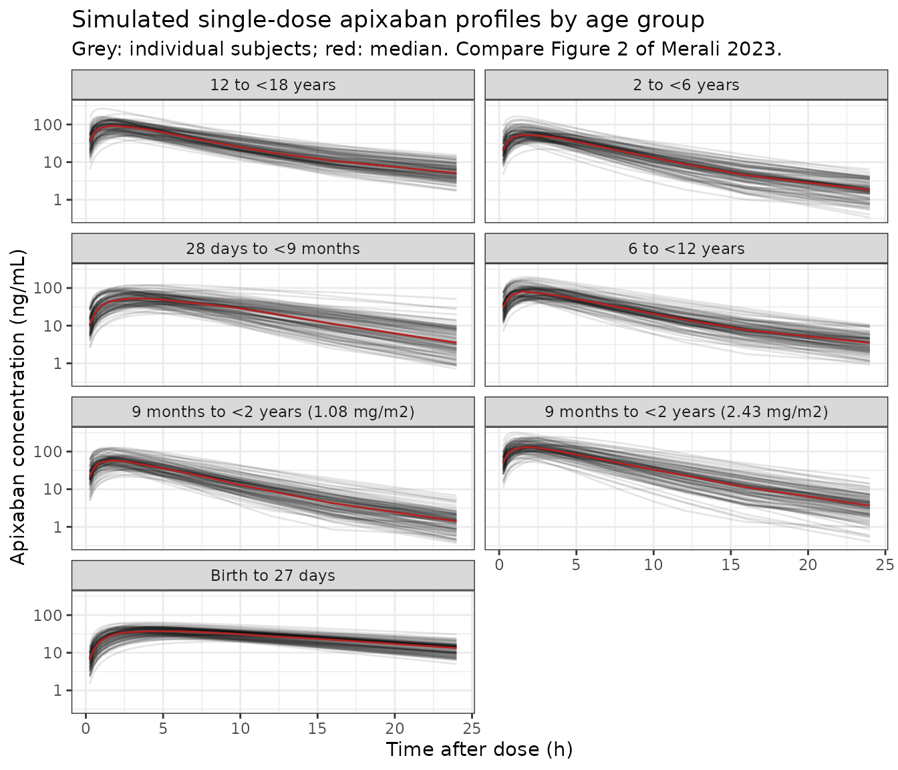
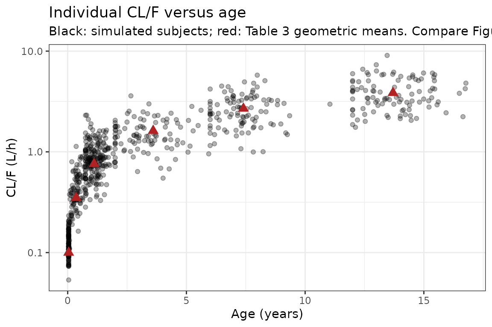
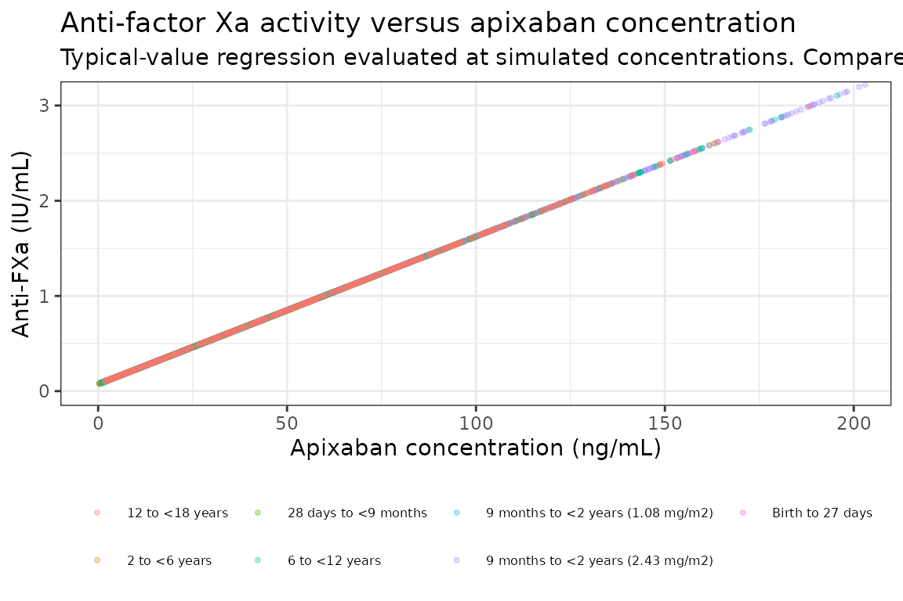

# Apixaban in children (Merali 2023)

``` r

library(nlmixr2lib)
library(PKNCA)
#> 
#> Attaching package: 'PKNCA'
#> The following object is masked from 'package:stats':
#> 
#>     filter
library(rxode2)
#> rxode2 5.1.8 using 2 threads (see ?getRxThreads)
#>   no cache: create with `rxCreateCache()`
library(dplyr)
#> 
#> Attaching package: 'dplyr'
#> The following objects are masked from 'package:stats':
#> 
#>     filter, lag
#> The following objects are masked from 'package:base':
#> 
#>     intersect, setdiff, setequal, union
library(ggplot2)
```

## The paper

Merali et al. (2023) report the phase I study NCT01707394 (CV185118), in
which 49 children from birth to \<18 years at risk of venous or arterial
thrombosis received a single oral dose of apixaban (0.1 mg sprinkle
capsule in the neonate; 0.4 mg/mL oral solution otherwise; 1.08 to 2.43
mg/m^2). A population PK model was fitted to these data pooled with
eight adult phase I studies and a second paediatric phase I study (Table
S2): 254 subjects and 5,220 concentrations.

The final model (Table 2 and the displayed equations of the Methods) is
two-compartment with first-order absorption and elimination. CL/F and
Vc/F scale with baseline body weight (power exponents 0.71 and 0.879,
reference 67.4 kg), CL/F carries a fixed CYP3A4 maturation function of
age taken from Bouillon-Pichault 2011, Q/F is a power function of age
(reference 25 years), ka is 142% higher between 9 months and 18 years,
relative bioavailability falls with dose above 2.5 mg, and the neonatal
capsule has a fixed relative bioavailability of 1.1. The paper also
reports a linear relationship between plasma anti-factor Xa activity and
apixaban concentration (Figure 4), which the model file carries as the
algebraic output `antiFXa`.

``` r

mod <- rxode2::rxode2(nlmixr2lib::modellib("Merali_2023_apixaban"))
modTyp <- rxode2::zeroRe(mod)
mod$state
#> [1] "depot"       "central"     "peripheral1"
```

## Population

From Table 1 (the 49 dosed paediatric subjects of CV185118; mean (SD)):

| Age group | n | Age | Weight (kg) | BSA (m^2) | Dose |
|----|----|----|----|----|----|
| Birth to 27 days | 1 | 9 days at enrolment, 15 days at dosing | 3.1 | 0.2 | 0.1 mg capsule |
| 28 days to \<9 months | 11 | 126.9 (67.2) days | 4.9 (1.7) | 0.3 (0.1) | 1.08 mg/m^2 |
| 9 months to \<2 years | 9 | 13.3 (4.2) months | 8.3 (2.4) | 0.4 (0.1) | 1.08 (n = 6) or 2.43 (n = 3) mg/m^2 |
| 2 to \<6 years | 8 | 3.6 (1.2) years | 15.9 (4.7) | 0.7 (0.1) | 1.17 mg/m^2 |
| 6 to \<12 years | 10 | 7.4 (1.2) years | 29.8 (11.1) | 1.0 (0.2) | 1.80 mg/m^2 |
| 12 to \<18 years | 10 | 13.7 (1.4) years | 49.9 (17.1) | 1.5 (0.3) | 2.19 mg/m^2 |

57% were female, 86% White, 10% Black and 4% other race. One
6-to-\<12-year-old who vomited within 45 minutes of dosing was excluded
from the PK analysis (n = 48). The pooled adult studies enrolled healthy
volunteers (mean ages 26.7 to 42.0 years, mean weights 63.1 to 95.6 kg)
dosed 2.5 to 50 mg (Table S2).

## Source trace

| Quantity | Source |
|----|----|
| Two-compartment, first-order absorption and elimination | Methods “Population PK analysis”; Results “PK results” |
| Covariate equations for ka, CL/F, Vc/F, Vp/F, Q/F, TVF1 and F1 | Methods, displayed equations |
| PED9M definition (1 for 9 months to \<18 years, else 0) | Methods, text after the equations |
| `lka`, `lcl`, `lvc`, `lq`, `lvp` | Table 2, theta1 to theta5 |
| `lgamma` (theta6), `logitifdepot50` (theta7) | Table 2 |
| `e_wt_vc` (theta8), `e_wt_cl` (theta9), `e_age_q` (theta10), `e_ped9m_ka` (theta11) | Table 2 |
| `cyp3a4_hill` (theta12), `cyp3a4_t50` (theta13), `cyp3a4_birth` (theta15), all FIXED | Table 2; maturation from Bouillon-Pichault 2011 (reference 10) |
| `fdepot_capsule` (theta14, FIXED) | Table 2; Methods text “equal to 1.1 for subjects receiving neonatal formulation” |
| `etalka`, block `etalcl` / `etalvc` / `etalvp` / `etalq` | Table 2 random effects (variances and covariances) |
| `expSd` | Table 2 residual ‘Exponential’ sigma = 0.0844 (variance); SD = sqrt(0.0844) |
| `lslope_antiFXa` | Discussion: “overall slope estimate of 0.0155 IU/ng” |
| `lrbase_antiFXa` | Digitised from the regression line of Figure 4 (see below) |

## Deterministic checks

These checks use typical values only
([`zeroRe()`](https://nlmixr2.github.io/rxode2/reference/zeroRe.html)),
so both sides of every comparison share the same parameters and no
cohort is involved.

``` r

# One subject per row of `cov`; dose into depot at time 0 and observations of
# the central compartment at `obsTimes`.
mkEvents <- function(cov, amt, obsTimes) {
  do.call(rbind, lapply(seq_len(nrow(cov)), function(i) {
    covRow <- cov[i, , drop = FALSE]
    dose <- data.frame(id = i, time = 0, amt = amt[i], evid = 1, cmt = "depot")
    obs <- data.frame(
      id = i, time = obsTimes, amt = 0, evid = 0, cmt = "central"
    )
    ev <- rbind(dose, obs)
    cbind(ev, covRow[rep(1, nrow(ev)), , drop = FALSE], row.names = NULL)
  }))
}
```

### Relative bioavailability and maturation

``` r

grid <- data.frame(
  WT = 67.4,
  AGE = c(0, 0.244, 25, 25, 25, 25),
  DOSE_APIXABAN_MG = c(2.5, 2.5, 2.5, 50, 10, 2.5),
  FORM_CAPSULE = c(0, 0, 0, 0, 0, 1)
)
gridSim <- rxode2::rxSolve(
  modTyp, mkEvents(grid, amt = grid$DOSE_APIXABAN_MG, obsTimes = 1),
  returnType = "data.frame"
)
#> ℹ omega/sigma items treated as zero: 'etalka', 'etalcl', 'etalvc', 'etalvp', 'etalq'
#> Warning: multi-subject simulation without without 'omega'
gridRes <- cbind(grid, gridSim[, c("fmat", "frel", "fform")])
knitr::kable(
  gridRes |>
    dplyr::rename(
      "Weight (kg)" = WT, "Age (y)" = AGE, "Dose (mg)" = DOSE_APIXABAN_MG,
      "Neonatal capsule" = FORM_CAPSULE, "Maturation fraction" = fmat,
      "Dose F1" = frel, "Formulation F1" = fform
    ),
  digits = 4
)
```

| Weight (kg) | Age (y) | Dose (mg) | Neonatal capsule | Maturation fraction | Dose F1 | Formulation F1 |
|---:|---:|---:|---:|---:|---:|---:|
| 67.4 | 0.000 | 2.5 | 0 | 0.0500 | 1.0000 | 1.0 |
| 67.4 | 0.244 | 2.5 | 0 | 0.5250 | 1.0000 | 1.0 |
| 67.4 | 25.000 | 2.5 | 0 | 0.9801 | 1.0000 | 1.0 |
| 67.4 | 25.000 | 50.0 | 0 | 0.9801 | 0.6142 | 1.0 |
| 67.4 | 25.000 | 10.0 | 0 | 0.9801 | 0.9245 | 1.0 |
| 67.4 | 25.000 | 2.5 | 1 | 0.9801 | 1.0000 | 1.1 |

``` r


# Exact identities of the printed equations:
#   maturation fraction = FBIRTH (0.05) at birth and (1 + 0.05) / 2 at the
#   age of half-maturation, 0.244 y;
#   TVF1 = 1 at 2.5 mg and 1 - expit(-0.465) at the 50 mg maximum dose;
#   F1 for the neonatal formulation = 1.1.
stopifnot(
  abs(gridRes$fmat[1] - 0.05) < 1e-10,
  abs(gridRes$fmat[2] - 0.525) < 1e-10,
  abs(gridRes$frel[3] - 1) < 1e-10,
  abs(gridRes$frel[4] - (1 - 1 / (1 + exp(0.465)))) < 1e-10,
  abs(gridRes$fform[6] - 1.1) < 1e-10
)
```

The maturation function is still below 1 in adults (0.980 at 25 years),
so `exp(lcl)` = 4.7 L/h is the CL/F of a hypothetical fully mature
67.4-kg subject; the typical 25-year-old 67.4-kg adult has CL/F 4.6 L/h.
At the paediatric doses (0.1 to about 3.2 mg) the dose term is inert
below 2.5 mg and reduces F1 by under 2% at the adolescent mean dose of
3.22 mg.

### Typical parameters by age group against Table 3

Table 3 gives the geometric means of the individual (post hoc) ka, CL/F
and Vc/F by age group. The model’s typical values at each group’s mean
age and weight (Table 1) should land near them. This is a structural
check: the individual estimates carry random effects and the covariates
vary within a group, so agreement is expected to tens of percent, not
exactly, but a mis-transcribed exponent, reference weight or maturation
constant moves the young groups by a factor of two or more.

``` r

groups <- tibble::tribble(
  ~group, ~AGE, ~WT, ~ka_pub, ~cl_pub, ~vc_pub,
  "Birth to 27 days", 15 / 365.25, 3.1, 0.55, 0.10, 1.82,
  "28 days to <9 months", 126.9 / 365.25, 4.9, 0.72, 0.35, 2.69,
  "9 months to <2 years", 13.3 / 12, 8.3, 1.34, 0.76, 4.61,
  "2 to <6 years", 3.6, 15.9, 1.03, 1.62, 8.97,
  "6 to <12 years", 7.4, 29.8, 1.15, 2.69, 15.4,
  "12 to <18 years", 13.7, 49.9, 1.14, 3.85, 23.6
)
groupCov <- groups |>
  dplyr::transmute(
    AGE, WT,
    DOSE_APIXABAN_MG = 1,
    FORM_CAPSULE = as.integer(group == "Birth to 27 days")
  ) |>
  as.data.frame()
typSim <- rxode2::rxSolve(
  modTyp, mkEvents(groupCov, amt = rep(1, nrow(groupCov)), obsTimes = 1),
  returnType = "data.frame"
)
#> ℹ omega/sigma items treated as zero: 'etalka', 'etalcl', 'etalvc', 'etalvp', 'etalq'
#> Warning: multi-subject simulation without without 'omega'
typRes <- groups |>
  dplyr::mutate(
    ka_mod = typSim$ka, cl_mod = typSim$cl, vc_mod = typSim$vc,
    ka_pct = 100 * (ka_mod / ka_pub - 1),
    cl_pct = 100 * (cl_mod / cl_pub - 1),
    vc_pct = 100 * (vc_mod / vc_pub - 1)
  )
knitr::kable(
  typRes |>
    dplyr::select(group, ka_mod, ka_pub, cl_mod, cl_pub, cl_pct, vc_mod, vc_pub, vc_pct) |>
    dplyr::rename(
      "Age group" = group,
      "ka typical (1/h)" = ka_mod, "ka Table 3" = ka_pub,
      "CL/F typical (L/h)" = cl_mod, "CL/F Table 3" = cl_pub, "CL/F %" = cl_pct,
      "Vc/F typical (L)" = vc_mod, "Vc/F Table 3" = vc_pub, "Vc/F %" = vc_pct
    ),
  digits = 2,
  caption = "Typical ka, CL/F and Vc/F at each age group's mean age and weight against the Table 3 geometric means of the individual estimates."
)
```

| Age group | ka typical (1/h) | ka Table 3 | CL/F typical (L/h) | CL/F Table 3 | CL/F % | Vc/F typical (L) | Vc/F Table 3 | Vc/F % |
|:---|---:|---:|---:|---:|---:|---:|---:|---:|
| Birth to 27 days | 0.50 | 0.55 | 0.12 | 0.10 | 19.48 | 2.09 | 1.82 | 14.81 |
| 28 days to \<9 months | 0.50 | 0.72 | 0.43 | 0.35 | 24.06 | 3.12 | 2.69 | 16.17 |
| 9 months to \<2 years | 1.21 | 1.34 | 0.84 | 0.76 | 10.36 | 4.97 | 4.61 | 7.73 |
| 2 to \<6 years | 1.21 | 1.03 | 1.53 | 1.62 | -5.52 | 8.79 | 8.97 | -1.96 |
| 6 to \<12 years | 1.21 | 1.15 | 2.49 | 2.69 | -7.29 | 15.28 | 15.40 | -0.81 |
| 12 to \<18 years | 1.21 | 1.14 | 3.67 | 3.85 | -4.58 | 24.03 | 23.60 | 1.83 |

Typical ka, CL/F and Vc/F at each age group’s mean age and weight
against the Table 3 geometric means of the individual estimates.
{.table}

``` r

# Deterministic, but the published side is a geometric mean of individual
# estimates over a covariate range, not a typical value at the mean. Realised
# CL/F differences run from -7% to +24% and Vc/F from -2% to +16%. A wrong
# weight exponent, reference weight or maturation constant moves the youngest
# groups by 2- to 10-fold, so a 35% envelope still goes red for them.
stopifnot(
  nrow(typRes) == 6L,
  max(abs(typRes$cl_pct)) < 35,
  max(abs(typRes$vc_pct)) < 35,
  # ka is a step at 9 months: 0.502 below it, 0.502 * 2.42 above it.
  all(abs(typRes$ka_mod[1:2] - 0.502) < 1e-8),
  all(abs(typRes$ka_mod[3:6] - 0.502 * 2.42) < 1e-8)
)
```

The Table 3 ka geometric mean of the 28-day-to-\<9-month group (0.72
1/h) lies between the two typical values because its upper age bound
sits at the 9-month step and the individual estimates carry 54% CV of
IIV on ka.

### Anti-factor Xa activity

The Discussion gives the slope (0.0155 IU/ng, i.e. IU/mL per ng/mL) but
no intercept. The maintainers digitised the regression line drawn in
Figure 4 (23 points along the line, axes calibrated from the tick marks)
and fitted a straight line to them: slope 0.01549 IU/mL per ng/mL, which
reproduces the printed slope and confirms the line is the reported
regression, and intercept 0.074 IU/mL, which is used in the model.

``` r

pdCov <- data.frame(WT = 67.4, AGE = 25, DOSE_APIXABAN_MG = 2.5, FORM_CAPSULE = 0)
pdSim <- rxode2::rxSolve(
  modTyp, mkEvents(pdCov, amt = 2.5, obsTimes = seq(0, 24, by = 0.5)),
  returnType = "data.frame"
)
#> ℹ omega/sigma items treated as zero: 'etalka', 'etalcl', 'etalvc', 'etalvp', 'etalq'
fit <- stats::lm(antiFXa ~ Cc, data = pdSim)
stats::coef(fit)
#> (Intercept)          Cc 
#>      0.0740      0.0155
stopifnot(
  abs(stats::coef(fit)[["Cc"]] - 0.0155) < 1e-10,
  abs(stats::coef(fit)[["(Intercept)"]] - 0.074) < 1e-10
)
```

## Virtual paediatric cohort

One arm per age group, with the 9-month-to-\<2-year group split by its
two dose levels as in Table 3. Ages and weights are drawn independently
from normal distributions with the Table 1 mean and SD of each group,
truncated to the group’s age bounds and to a plausible weight range; the
single neonate is represented by subjects at the neonate’s age (15 days)
and weight (3.1 kg). Every subject in an arm receives the arm’s mean
absolute dose: the per-group means printed in the Methods (0.1, 0.29,
0.71, 1.82 and 3.22 mg), and for the two 9-month-to-\<2-year dose levels
the dose per m^2 times the group’s mean BSA of 0.4 m^2 (0.43 and 0.97
mg).

``` r

rxode2::rxSetSeed(20230403)
set.seed(20230403)
nPerArm <- 100L

arms <- tibble::tribble(
  ~arm, ~ageMean, ~ageSd, ~ageLo, ~ageHi, ~wtMean, ~wtSd, ~dose, ~capsule,
  "Birth to 27 days", 15 / 365.25, 0, 15 / 365.25, 15 / 365.25, 3.1, 0, 0.1, 1L,
  "28 days to <9 months", 126.9 / 365.25, 67.2 / 365.25, 28 / 365.25, 0.749, 4.9, 1.7, 0.29, 0L,
  "9 months to <2 years (1.08 mg/m2)", 13.3 / 12, 4.2 / 12, 0.75, 1.999, 8.3, 2.4, 1.08 * 0.4, 0L,
  "9 months to <2 years (2.43 mg/m2)", 13.3 / 12, 4.2 / 12, 0.75, 1.999, 8.3, 2.4, 2.43 * 0.4, 0L,
  "2 to <6 years", 3.6, 1.2, 2, 5.999, 15.9, 4.7, 0.71, 0L,
  "6 to <12 years", 7.4, 1.2, 6, 11.999, 29.8, 11.1, 1.82, 0L,
  "12 to <18 years", 13.7, 1.4, 12, 17.999, 49.9, 17.1, 3.22, 0L
)

cohort <- do.call(rbind, lapply(seq_len(nrow(arms)), function(i) {
  a <- arms[i, ]
  data.frame(
    arm = a$arm,
    AGE = pmin(pmax(rnorm(nPerArm, a$ageMean, a$ageSd), a$ageLo), a$ageHi),
    WT = pmin(pmax(rnorm(nPerArm, a$wtMean, a$wtSd), 0.5 * a$wtMean), 2 * a$wtMean),
    DOSE_APIXABAN_MG = a$dose,
    FORM_CAPSULE = a$capsule
  )
}))
cohort$id <- seq_len(nrow(cohort))
stopifnot(nrow(cohort) == nrow(arms) * nPerArm, max(table(cohort$arm)) <= 200)

obsTimes <- c(0, 0.25, 0.5, 0.75, 1, 1.5, 2, 2.5, 3, 4, 5, 6, 8, 10, 12, 16, 24, 36, 48, 72)
events <- mkEvents(
  cohort[, c("AGE", "WT", "DOSE_APIXABAN_MG", "FORM_CAPSULE")],
  amt = cohort$DOSE_APIXABAN_MG, obsTimes = obsTimes
)
sim <- rxode2::rxSolve(mod, events, returnType = "data.frame") |>
  dplyr::mutate(id = as.integer(as.character(id))) |>
  dplyr::left_join(cohort[, c("id", "arm")], by = "id")
stopifnot(nrow(sim) == nrow(cohort) * length(obsTimes), all(is.finite(sim$Cc)))
```

``` r

# Replicates the layout of Figure 2 (concentration-time by age group, semilog).
ggplot(dplyr::filter(sim, time > 0, time <= 26), aes(time, Cc, group = id)) +
  geom_line(alpha = 0.1) +
  stat_summary(aes(group = arm), fun = median, geom = "line", colour = "firebrick") +
  facet_wrap(~arm, ncol = 2) +
  scale_y_log10() +
  labs(
    x = "Time after dose (h)", y = "Apixaban concentration (ng/mL)",
    title = "Simulated single-dose apixaban profiles by age group",
    subtitle = "Grey: individual subjects; red: median. Compare Figure 2 of Merali 2023."
  ) +
  theme_bw()
```



``` r

# Replicates Figure 3: individual CL/F versus age, with the Table 3 geometric
# means at each group's mean age for comparison.
indiv <- sim |>
  dplyr::filter(time == 1) |>
  dplyr::select(id, arm, AGE, cl)
ggplot(indiv, aes(AGE, cl)) +
  geom_point(alpha = 0.3) +
  geom_point(
    data = groups, aes(AGE, cl_pub), colour = "firebrick", size = 3, shape = 17
  ) +
  scale_y_log10() +
  labs(
    x = "Age (years)", y = "CL/F (L/h)",
    title = "Individual CL/F versus age",
    subtitle = "Black: simulated subjects; red: Table 3 geometric means. Compare Figure 3."
  ) +
  theme_bw()
```



## PKNCA validation

``` r

concData <- sim |>
  dplyr::filter(!is.na(Cc)) |>
  dplyr::select(id, time, Cc, arm)
stopifnot(sum(concData$time == 0) == nrow(cohort))

doseData <- cohort |>
  dplyr::transmute(id, time = 0, amt = DOSE_APIXABAN_MG, arm)

concObj <- PKNCA::PKNCAconc(concData, Cc ~ time | arm + id, concu = "ng/mL", timeu = "h")
doseObj <- PKNCA::PKNCAdose(doseData, amt ~ time | arm + id, route = "extravascular", doseu = "mg")
intervals <- data.frame(start = 0, end = Inf, cmax = TRUE, tmax = TRUE, aucinf.obs = TRUE)
ncaRes <- PKNCA::pk.nca(PKNCA::PKNCAdata(concObj, doseObj, intervals = intervals))
```

### Comparison against Table 3

Table 3 reports geometric means of the post hoc Cmax and AUCinf and the
median Tmax per age group.
[`ncaComparisonTable()`](https://nlmixr2.github.io/nlmixr2lib/reference/ncaComparisonTable.md)
summarises the simulated subjects by their median, which for these
log-normally distributed exposures estimates the same quantity as a
geometric mean.

``` r

published <- tibble::tribble(
  ~arm, ~cmax, ~tmax, ~aucinf.obs,
  "Birth to 27 days", 45.9, 4.54, 1120,
  "28 days to <9 months", 64, 2.32, 806,
  "9 months to <2 years (1.08 mg/m2)", 59.1, 1.60, 501,
  "9 months to <2 years (2.43 mg/m2)", 148, 1.67, 1260,
  "2 to <6 years", 49.9, 1.91, 423,
  "6 to <12 years", 80, 1.71, 662,
  "12 to <18 years", 96.5, 1.95, 815
)

cmp <- nlmixr2lib::ncaComparisonTable(
  simulated = ncaRes,
  reference = published,
  by = "arm",
  units = c(cmax = "ng/mL", tmax = "h", aucinf.obs = "ng*h/mL"),
  tolerance_pct = 30
)
knitr::kable(
  cmp,
  caption = "Simulated (median) vs. Table 3 (geometric mean; Tmax median). * differs by more than 30%."
)
```

| NCA parameter | arm | Reference | Simulated | % diff |
|:---|:---|:---|:---|:---|
| Cmax (ng/mL) | Birth to 27 days | 45.9 | 38.5 | -16.1% |
| Cmax (ng/mL) | 28 days to \<9 months | 64 | 55.3 | -13.6% |
| Cmax (ng/mL) | 9 months to \<2 years (1.08 mg/m2) | 59.1 | 59.3 | +0.4% |
| Cmax (ng/mL) | 9 months to \<2 years (2.43 mg/m2) | 148 | 134 | -9.7% |
| Cmax (ng/mL) | 2 to \<6 years | 49.9 | 54.7 | +9.7% |
| Cmax (ng/mL) | 6 to \<12 years | 80 | 83.4 | +4.2% |
| Cmax (ng/mL) | 12 to \<18 years | 96.5 | 95.3 | -1.3% |
| Tmax (h) | Birth to 27 days | 4.54 | 5 | +10.1% |
| Tmax (h) | 28 days to \<9 months | 2.32 | 4 | +72.4%\* |
| Tmax (h) | 9 months to \<2 years (1.08 mg/m2) | 1.6 | 1.5 | -6.3% |
| Tmax (h) | 9 months to \<2 years (2.43 mg/m2) | 1.67 | 2 | +19.8% |
| Tmax (h) | 2 to \<6 years | 1.91 | 1.5 | -21.5% |
| Tmax (h) | 6 to \<12 years | 1.71 | 2 | +17.0% |
| Tmax (h) | 12 to \<18 years | 1.95 | 2 | +2.6% |
| AUC0-∞ (obs) (ng\*h/mL) | Birth to 27 days | 1120 | 834 | -25.5% |
| AUC0-∞ (obs) (ng\*h/mL) | 28 days to \<9 months | 806 | 652 | -19.1% |
| AUC0-∞ (obs) (ng\*h/mL) | 9 months to \<2 years (1.08 mg/m2) | 501 | 493 | -1.6% |
| AUC0-∞ (obs) (ng\*h/mL) | 9 months to \<2 years (2.43 mg/m2) | 1260 | 1160 | -8.1% |
| AUC0-∞ (obs) (ng\*h/mL) | 2 to \<6 years | 423 | 497 | +17.4% |
| AUC0-∞ (obs) (ng\*h/mL) | 6 to \<12 years | 662 | 726 | +9.6% |
| AUC0-∞ (obs) (ng\*h/mL) | 12 to \<18 years | 815 | 899 | +10.3% |

Simulated (median) vs. Table 3 (geometric mean; Tmax median). \* differs
by more than 30%. {.table}

``` r

simGm <- as.data.frame(ncaRes) |>
  dplyr::filter(PPTESTCD %in% c("cmax", "aucinf.obs")) |>
  dplyr::group_by(arm, PPTESTCD) |>
  dplyr::summarise(sim = exp(mean(log(PPORRES))), .groups = "drop") |>
  dplyr::left_join(
    tidyr::pivot_longer(published, c(cmax, aucinf.obs), names_to = "PPTESTCD", values_to = "pub") |>
      dplyr::select(arm, PPTESTCD, pub),
    by = c("arm", "PPTESTCD")
  ) |>
  dplyr::mutate(pct = 100 * (sim / pub - 1))
simGm
#> # A tibble: 14 × 5
#>    arm                               PPTESTCD      sim    pub    pct
#>    <chr>                             <chr>       <dbl>  <dbl>  <dbl>
#>  1 12 to <18 years                   aucinf.obs  864.   815     6.07
#>  2 12 to <18 years                   cmax         91.0   96.5  -5.65
#>  3 2 to <6 years                     aucinf.obs  491.   423    16.0 
#>  4 2 to <6 years                     cmax         56.6   49.9  13.5 
#>  5 28 days to <9 months              aucinf.obs  662.   806   -17.9 
#>  6 28 days to <9 months              cmax         55.1   64   -13.9 
#>  7 6 to <12 years                    aucinf.obs  723.   662     9.19
#>  8 6 to <12 years                    cmax         81.3   80     1.67
#>  9 9 months to <2 years (1.08 mg/m2) aucinf.obs  489.   501    -2.40
#> 10 9 months to <2 years (1.08 mg/m2) cmax         58.2   59.1  -1.52
#> 11 9 months to <2 years (2.43 mg/m2) aucinf.obs 1152.  1260    -8.59
#> 12 9 months to <2 years (2.43 mg/m2) cmax        135.   148    -8.90
#> 13 Birth to 27 days                  aucinf.obs  790.  1120   -29.5 
#> 14 Birth to 27 days                  cmax         37.8   45.9 -17.7

# Cohort-derived geometric means against geometric means of 1 to 11 real
# subjects per group, with ages, weights and doses only matched in their
# group means. Realised: median -5%, 75th percentile of the absolute
# difference 16%, largest -30% (the neonate AUC, discussed below). The centre
# of the seven-arm comparison is gated tightly and the envelope loosely: a
# mis-transcribed clearance, weight exponent, maturation constant or unit
# shifts every arm (or all the young arms) by tens of percent to several-fold.
stopifnot(
  nrow(simGm) == 14L,
  all(is.finite(simGm$pct)),
  abs(stats::median(simGm$pct)) < 20,
  stats::quantile(abs(simGm$pct), 0.75) < 35
)
```

Tmax is read off the simulation grid (1.5, 2, 2.5, 3, 4, 5 h), so its
comparison is coarse. The 28-day-to-\<9-month arm is the one starred
row: below 9 months the typical ka is the adult 0.502 1/h, giving a
simulated median Tmax of about 4 h against the paper’s 2.32 h (range
1.46 to 9.42 h), and the Table 3 ka geometric mean for that group (0.72
1/h) indicates that the individual estimates sat above the typical
value.

The paper does not compute AUCinf by NCA: it defines it as
`Dose / (CL/F)` with the individual post hoc CL/F. In the youngest
children the unscaled peripheral volume (18 L) and the very small
age-scaled Q/F produce a slow return phase that a 72-hour profile cannot
extrapolate, so the PKNCA AUCinf above underestimates the neonate’s
exposure. The paper’s own definition, evaluated with each simulated
subject’s CL/F and relative bioavailability, reads it directly:

``` r

aucDef <- sim |>
  dplyr::filter(time == 1) |>
  dplyr::mutate(auc = 1000 * DOSE_APIXABAN_MG * frel * fform / cl) |>
  dplyr::group_by(arm) |>
  dplyr::summarise(auc_sim = exp(mean(log(auc))), .groups = "drop") |>
  dplyr::left_join(published[, c("arm", "aucinf.obs")], by = "arm") |>
  dplyr::mutate(pct = 100 * (auc_sim / aucinf.obs - 1))
knitr::kable(
  aucDef |>
    dplyr::rename(
      "Arm" = arm, "Dose / (CL/F), simulated (ng*h/mL)" = auc_sim,
      "Table 3 AUCinf (ng*h/mL)" = aucinf.obs, "% diff" = pct
    ),
  digits = 1,
  caption = "Geometric mean of Dose * F1 / (CL/F) per arm against Table 3 AUCinf."
)
```

| Arm | Dose / (CL/F), simulated (ng\*h/mL) | Table 3 AUCinf (ng\*h/mL) | % diff |
|:---|---:|---:|---:|
| 12 to \<18 years | 863.7 | 815 | 6.0 |
| 2 to \<6 years | 494.0 | 423 | 16.8 |
| 28 days to \<9 months | 748.1 | 806 | -7.2 |
| 6 to \<12 years | 723.2 | 662 | 9.2 |
| 9 months to \<2 years (1.08 mg/m2) | 505.1 | 501 | 0.8 |
| 9 months to \<2 years (2.43 mg/m2) | 1192.7 | 1260 | -5.3 |
| Birth to 27 days | 927.4 | 1120 | -17.2 |

Geometric mean of Dose \* F1 / (CL/F) per arm against Table 3 AUCinf.
{.table}

``` r

# Same cohort caveats as the NCA gate above. Realised -17% (the neonate) to
# +17%, median +1%.
stopifnot(
  nrow(aucDef) == 7L,
  abs(stats::median(aucDef$pct)) < 20,
  max(abs(aucDef$pct)) < 40
)
```

### Anti-factor Xa versus concentration (Figure 4)

``` r

ggplot(dplyr::filter(sim, time %in% c(0.5, 1, 2, 4, 6, 12, 24)), aes(Cc, antiFXa)) +
  geom_point(aes(colour = arm), alpha = 0.3, size = 0.8) +
  coord_cartesian(xlim = c(0, 200), ylim = c(0, 3.1)) +
  labs(
    x = "Apixaban concentration (ng/mL)", y = "Anti-FXa (IU/mL)", colour = NULL,
    title = "Anti-factor Xa activity versus apixaban concentration",
    subtitle = "Typical-value regression evaluated at simulated concentrations. Compare Figure 4."
  ) +
  theme_bw() +
  theme(legend.position = "bottom", legend.text = element_text(size = 6))
```



## Assumptions and deviations

- **Printed CL/F equation.** In the published typesetting of the CL/F
  equation the bracket of the maturation term encloses
  `1 - theta15 * Age^theta12`, which taken literally makes the
  maturation fraction negative above about 37 years (the adults in the
  dataset). The model uses the standard form of the cited
  Bouillon-Pichault 2011 function,
  `theta15 + (1 - theta15) * Age^theta12 / (Age^theta12 + theta13^theta12)`,
  with theta15 named FBIRTH in Table 2. This form reproduces the Table 3
  CL/F geometric means (see the typical-value check above).
- **Anti-factor Xa intercept digitised.** The paper reports only the
  slope of the paediatric anti-FXa regression. The intercept, 0.074
  IU/mL, was digitised by the maintainers from the regression line drawn
  in Figure 4; the slope digitised from the same line (0.01549)
  reproduces the printed 0.0155. The linear mixed-effects regression’s
  random effects and residual error are not reported, so `antiFXa` is a
  typical-value relationship with no error model. The assay was
  heparin-calibrated (STA Liquid Anti-Xa Heparin or Rotachrom), so
  `antiFXa` is in IU/mL, not drug-equivalent ng/mL.
- **IIV covariance block.** The printed variances and covariances of the
  CL/F, Vc/F, Vp/F and Q/F block reproduce the r^2 values in the Table 2
  footnote, but at their printed precision the 4 x 4 block is very
  slightly indefinite (smallest eigenvalue -2.4e-5), so it cannot be
  sampled. The off-diagonal covariances are scaled by 0.99 (each
  correlation reduced by 1%); the variances are as printed.
- **Residual error.** Table 2 reports a single “Exponential” residual
  variance (0.0844, SD 0.29) and a negative minimum objective function
  value (-5805.653), consistent with log-transformed concentrations; the
  model uses `lnorm(expSd)` with `expSd = sqrt(0.0844) = 0.2905`.
- **PED9M.** Derived from `AGE` inside the model (`AGE >= 0.75` and
  `AGE < 18`, with 9 months taken as 0.75 years), so no separate column
  is needed. Adults and infants under 9 months share the reference ka.
- **Age and weight.** `AGE` is postnatal age in years; the paper does
  not use gestational or postmenstrual age. `WT` is baseline weight. The
  Q/F age effect makes Q/F very small in infants (0.08 L/h at 4 months),
  so the disposition is effectively one-compartment in the youngest
  children.
- **Virtual cohort.** Ages and weights are drawn independently within
  each age group from the Table 1 means and SDs, and each arm receives
  the group’s mean absolute dose rather than a per-subject BSA-based
  dose (subject heights are not reported). Table 3 is built from
  individual post hoc estimates in 1 to 11 subjects per group, so the
  comparison is a centre-of-distribution check, not a reproduction of
  each group’s individuals.
- **Not extracted.** The adult phase I studies’ individual data and
  Figure S1 (VPC) are not reproduced; the paper’s push-pull sampling
  comparison is not a model.
- **No erratum found.** No correction notice for
  <doi:10.1002/psp4.12935> was found on Europe PMC as of 2026-10-26.
