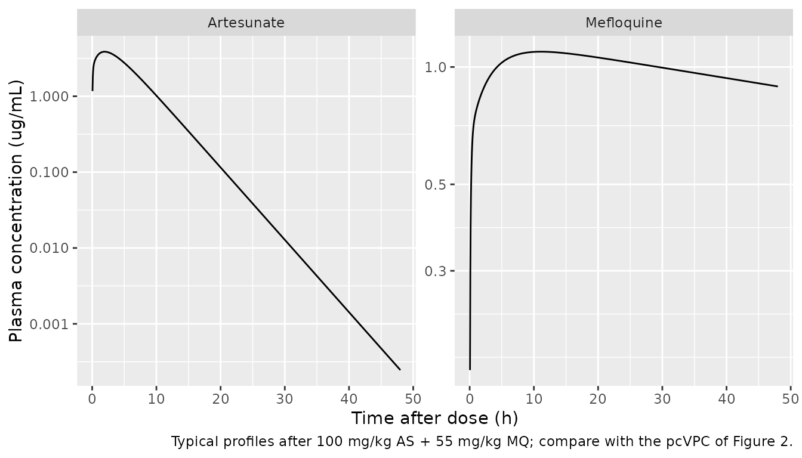
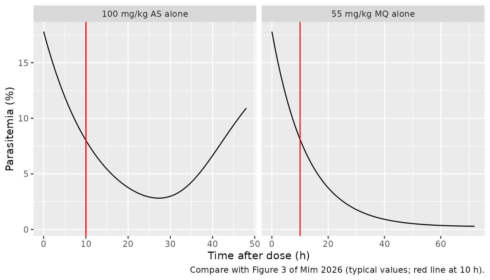
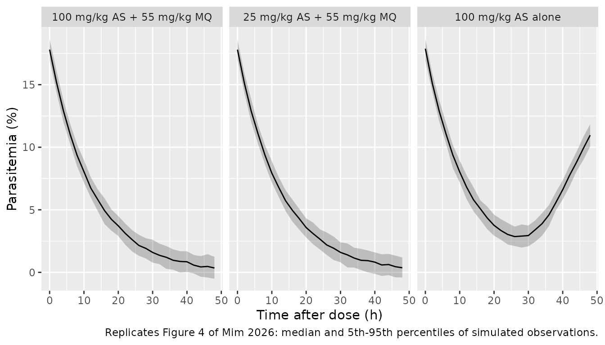

# Artesunate + mefloquine in Plasmodium berghei-infected mice (Mim 2026)

## Model and source

Mim 2026 gave *Plasmodium berghei*-infected Swiss mice a single oral
dose of artesunate (AS) 100 mg/kg plus mefloquine (MQ) 55 mg/kg and
fitted, in Monolix 2024R1:

1.  a two-compartment PK model with first-order absorption for each drug
    (Tables 1 and 2), fitted separately;
2.  a turnover model of percent parasitemia in which the plasma
    concentration of each drug inhibits parasite production, the two
    inhibitions adding (Equation 1, Table 3).

Both parts are packaged in one model,
`Mim_2026_mefloquine_artesunate_mouse`, with every mefloquine quantity
suffixed `_mefloquine` and every artesunate quantity `_artesunate`.
Artesunate monotherapy is simulated by giving no mefloquine dose.

- Citation: Mim SR, Vieira Santos V, Pereira LC, Pica K, Miranda ALLdS,
  Quadros HC, Moreira DRM, Azeredo FJ. (2026). Pharmacokinetic and
  pharmacodynamic modeling of anti-plasmodial drugs mefloquine plus
  artesunate: insights on translational application. Antimicrob Agents
  Chemother 70(3):e01717-25. <doi:10.1128/aac.01717-25>.
- Description: Preclinical (mouse, Plasmodium berghei-infected).
  Population PK/PD model of oral artesunate plus mefloquine (ASMQ) given
  as a single gavage dose. Each drug has its own two-compartment PK
  model with first-order absorption and linear elimination, fitted
  separately in Monolix (Mim 2026 Tables 1 and 2). The plasma
  concentrations of both drugs drive one turnover model of percent
  parasitemia in which each drug inhibits parasite production with an
  Imax = 1, Hill = 1 function and the two inhibitions add (Equation 1,
  Table 3). The additive sum is capped at 1 so that production cannot
  become negative; with the cap the model reproduces the published
  combination simulations (Figure 4a), whereas the uncapped Equation 1
  drives parasitemia below zero within 10 h. Between-animal variability
  was fixed to a negligible value (sparse destructive sampling) and is
  carried as fixed etas. Set the mefloquine dose to zero for artesunate
  monotherapy.
- Article: <https://doi.org/10.1128/aac.01717-25>

## Population

Male and female Swiss mice (6-8 weeks, 18-22 g) were inoculated
intraperitoneally with 1e6 erythrocytes parasitised by *P. berghei* ANKA
gfp/luc. Once parasitemia reached 5% or more, the PK animals received
the 100/55 mg/kg combination by gavage and were sampled destructively,
four per time point, at 0.083-48 h (Methods). The data set held 59
mefloquine and 34 artesunate plasma samples measured by HPLC-DAD.
Parasitemia was read by flow cytometry; the treated-group means are in
Table S1.

``` r

str(readModelDb("Mim_2026_mefloquine_artesunate_mouse")()$population)
#> List of 9
#>  $ species      : chr "mouse (Swiss, Plasmodium berghei ANKA gfp/luc-infected)"
#>  $ n_subjects   : int 44
#>  $ n_studies    : int 1
#>  $ age_range    : chr "6-8 weeks"
#>  $ weight_range : chr "18-22 g"
#>  $ disease_state: chr "Plasmodium berghei blood-stage malaria after intraperitoneal inoculation of 1e6 parasitized erythrocytes; PK an"| __truncated__
#>  $ dose_range   : chr "Single oral (gavage) dose of artesunate 100 mg/kg plus mefloquine 55 mg/kg"
#>  $ regions      : chr "Brazil (Instituto Goncalo Moniz, Fiocruz, Salvador)"
#>  $ notes        : chr "Male and female Swiss mice (proportions not reported). PK by destructive sampling, n = 4 per time point at 0.08"| __truncated__
```

## Source trace

| Parameter / equation | Value | Source location |
|----|----|----|
| Two-compartment PK, first-order absorption, each drug | n/a | Results, Pharmacokinetic model; Figure 5 |
| `lka_mefloquine` | 0.28 1/h | Table 1, Ka |
| `lcl_mefloquine` | 286.01 mL/h/kg | Table 1, CL |
| `lvc_mefloquine` | 4039.63 mL/kg | Table 1, V1 |
| `lvp_mefloquine` | 41817.36 mL/kg | Table 1, second volume row (V2) |
| `lq_mefloquine` | 20636.48 mL/h/kg | Table 1, Q |
| `propSd_mefloquine` | 0.71 | Table 1, proportional error model |
| `lka_artesunate` | 0.6 1/h (fixed) | Table 2, Ka; Methods |
| `lcl_artesunate` | 3285.52 mL/h/kg | Table 2, CL |
| `lvc_artesunate` | 1921.4 mL/kg | Table 2, V1 |
| `lvp_artesunate` | 11342.3 mL/kg (fixed) | Table 2, second volume row (V2) |
| `lq_artesunate` | 19210.83 mL/h/kg | Table 2, Q |
| `propSd_artesunate` | 0.52 | Table 2, proportional error model |
| Turnover ODE, additive inhibition, `kin = R0 * kout` | n/a | Equation 1 and its legend |
| `lrbase` | 17.8 % (fixed) | Table 3, R0 |
| `lkout` | 0.08 1/h (fixed) | Table 3, Kout |
| `lic50_mefloquine` | 0.011 ug/mL | Table 3, IC50 (MQ) |
| `lic50_artesunate` | 0.0044 ug/mL | Table 3, IC50 (AS) |
| `addSd_parasites` | 0.52 % | Table 3, constant error model |
| All etas | variance 1e-6 (fixed) | Results (“IIV fixed to a minimal value of 0.001”); Methods |
| Cap of the summed inhibition at 1 | n/a | Not in Equation 1; inferred from Figure 4a (see below) |

Table 3 gives each IC50 in ug/mL and in nM. The molar values follow from
the mass values and the free-base molecular weights (mefloquine 378.3
g/mol, artesunate 384.4 g/mol):

``` r

ic50_nm <- c(
  mefloquine = 0.011 / 378.3 * 1e6,
  artesunate = 0.0044 / 384.4 * 1e6
)
round(ic50_nm, 2)
#> mefloquine artesunate 
#>      29.08      11.45
# Mefloquine reproduces the printed 29.1 nM; artesunate gives 11.4 nM against
# the printed 10.93 nM, a 5% difference consistent with the ug/mL value being
# rounded to two significant figures.
stopifnot(
  abs(ic50_nm[["mefloquine"]] / 29.1 - 1) < 0.01,
  abs(ic50_nm[["artesunate"]] / 10.93 - 1) < 0.06
)
```

## Simulation set-up

``` r

mod <- readModelDb("Mim_2026_mefloquine_artesunate_mouse")
mod_typ <- rxode2::zeroRe(mod)
#> ℹ parameter labels from comments will be replaced by 'label()'

obs_times <- sort(unique(c(seq(0, 2, by = 0.05), seq(2.25, 72, by = 0.25))))

regimens <- tibble::tribble(
  ~regimen,                    ~dose_as, ~dose_mq,
  "100 mg/kg AS + 55 mg/kg MQ",     100,       55,
  "25 mg/kg AS + 55 mg/kg MQ",       25,       55,
  "100 mg/kg AS alone",             100,        0,
  "55 mg/kg MQ alone",                0,       55
)

make_events <- function(i, n, obs_cmt = "parasites") {
  r <- regimens[i, ]
  ids <- (i - 1) * n + seq_len(n)
  dose <- dplyr::bind_rows(
    if (r$dose_mq > 0) tibble::tibble(id = ids, time = 0, amt = r$dose_mq, evid = 1, cmt = "depot_mefloquine"),
    if (r$dose_as > 0) tibble::tibble(id = ids, time = 0, amt = r$dose_as, evid = 1, cmt = "depot_artesunate")
  )
  obs <- tidyr::expand_grid(id = ids, time = obs_times) |>
    dplyr::mutate(amt = 0, evid = 0, cmt = obs_cmt)
  dplyr::bind_rows(dose, obs) |>
    dplyr::mutate(regimen = r$regimen) |>
    dplyr::arrange(id, time, dplyr::desc(evid))
}

# One typical-value solve per regimen: a multi-subject solve of a zeroRe()
# model warns that no omega is available.
solve_typical <- function(i) {
  rxode2::rxSolve(mod_typ, events = make_events(i, n = 1), keep = "regimen") |>
    as.data.frame()
}
sim_typ <- dplyr::bind_rows(lapply(seq_len(nrow(regimens)), solve_typical)) |>
  dplyr::mutate(regimen = factor(regimen, levels = regimens$regimen))
#> ℹ omega/sigma items treated as zero: 'etalka_mefloquine', 'etalcl_mefloquine', 'etalvc_mefloquine', 'etalvp_mefloquine', 'etalq_mefloquine', 'etalka_artesunate', 'etalcl_artesunate', 'etalvc_artesunate', 'etalvp_artesunate', 'etalq_artesunate', 'etalrbase', 'etalkout', 'etalic50_mefloquine', 'etalic50_artesunate'
#> ℹ omega/sigma items treated as zero: 'etalka_mefloquine', 'etalcl_mefloquine', 'etalvc_mefloquine', 'etalvp_mefloquine', 'etalq_mefloquine', 'etalka_artesunate', 'etalcl_artesunate', 'etalvc_artesunate', 'etalvp_artesunate', 'etalq_artesunate', 'etalrbase', 'etalkout', 'etalic50_mefloquine', 'etalic50_artesunate'
#> ℹ omega/sigma items treated as zero: 'etalka_mefloquine', 'etalcl_mefloquine', 'etalvc_mefloquine', 'etalvp_mefloquine', 'etalq_mefloquine', 'etalka_artesunate', 'etalcl_artesunate', 'etalvc_artesunate', 'etalvp_artesunate', 'etalq_artesunate', 'etalrbase', 'etalkout', 'etalic50_mefloquine', 'etalic50_artesunate'
#> ℹ omega/sigma items treated as zero: 'etalka_mefloquine', 'etalcl_mefloquine', 'etalvc_mefloquine', 'etalvp_mefloquine', 'etalq_mefloquine', 'etalka_artesunate', 'etalcl_artesunate', 'etalvc_artesunate', 'etalvp_artesunate', 'etalq_artesunate', 'etalrbase', 'etalkout', 'etalic50_mefloquine', 'etalic50_artesunate'
```

## Pharmacokinetics

### Typical plasma profiles (Figure 2)

``` r

sim_typ |>
  dplyr::filter(regimen == "100 mg/kg AS + 55 mg/kg MQ", time > 0, time <= 48) |>
  dplyr::select(time, Mefloquine = Cc_mefloquine, Artesunate = Cc_artesunate) |>
  tidyr::pivot_longer(-time, names_to = "drug", values_to = "conc") |>
  ggplot(aes(time, conc)) +
  geom_line() +
  facet_wrap(~drug, scales = "free_y") +
  scale_y_log10() +
  labs(
    x = "Time after dose (h)", y = "Plasma concentration (ug/mL)",
    caption = "Typical profiles after 100 mg/kg AS + 55 mg/kg MQ; compare with the pcVPC of Figure 2."
  )
```



### PKNCA

The paper reports no NCA table for the mice. The Discussion quotes an
observed artesunate Cmax of “approximately 6,500 ng/mL” (6.5 ug/mL),
which is the only published exposure value to compare with.

``` r

pk_typ <- sim_typ |>
  dplyr::filter(regimen == "100 mg/kg AS + 55 mg/kg MQ") |>
  dplyr::select(time, Mefloquine = Cc_mefloquine, Artesunate = Cc_artesunate) |>
  tidyr::pivot_longer(-time, names_to = "drug", values_to = "Cc") |>
  dplyr::mutate(id = 1L, treatment = "100 mg/kg AS + 55 mg/kg MQ") |>
  dplyr::filter(!is.na(Cc))
dose_typ <- tibble::tibble(
  id = 1L, time = 0, treatment = "100 mg/kg AS + 55 mg/kg MQ",
  drug = c("Mefloquine", "Artesunate"), amt = c(55, 100)
)

nca_typ <- PKNCA::pk.nca(PKNCA::PKNCAdata(
  PKNCA::PKNCAconc(pk_typ, Cc ~ time | treatment + drug + id),
  PKNCA::PKNCAdose(dose_typ, amt ~ time | treatment + drug + id, route = "extravascular"),
  intervals = data.frame(
    start = 0, end = 72, cmax = TRUE, tmax = TRUE, auclast = TRUE, half.life = TRUE
  )
))
nca_df <- as.data.frame(nca_typ)
nca_df |>
  dplyr::filter(PPTESTCD %in% c("cmax", "tmax", "auclast", "half.life")) |>
  dplyr::select(drug, PPTESTCD, PPORRES) |>
  tidyr::pivot_wider(names_from = PPTESTCD, values_from = PPORRES) |>
  dplyr::rename(
    "Drug" = drug, "Cmax (ug/mL)" = cmax, "Tmax (h)" = tmax,
    "AUC0-72 (ug*h/mL)" = auclast, "Terminal t1/2 (h)" = half.life
  ) |>
  knitr::kable(digits = 3, caption = "NCA of the typical profiles after 100 mg/kg AS + 55 mg/kg MQ.")
```

| Drug       | AUC0-72 (ug\*h/mL) | Cmax (ug/mL) | Tmax (h) | Terminal t1/2 (h) |
|:-----------|-------------------:|-------------:|---------:|------------------:|
| Artesunate |             30.427 |        3.868 |     1.95 |             3.170 |
| Mefloquine |             67.601 |        1.095 |    11.00 |           113.208 |

NCA of the typical profiles after 100 mg/kg AS + 55 mg/kg MQ. {.table}

``` r


cmp <- nlmixr2lib::ncaComparisonTable(
  simulated = PKNCA::pk.nca(PKNCA::PKNCAdata(
    PKNCA::PKNCAconc(dplyr::filter(pk_typ, drug == "Artesunate"), Cc ~ time | treatment + id),
    PKNCA::PKNCAdose(dplyr::filter(dose_typ, drug == "Artesunate"), amt ~ time | treatment + id,
                     route = "extravascular"),
    intervals = data.frame(start = 0, end = 72, cmax = TRUE)
  )),
  reference = tibble::tibble(treatment = "100 mg/kg AS + 55 mg/kg MQ", cmax = 6.5),
  by = "treatment",
  units = c(cmax = "ug/mL"),
  tolerance_pct = 20
)
knitr::kable(cmp, caption = "Typical artesunate Cmax vs. the observed value quoted in the Discussion. * differs by >20%.")
```

| NCA parameter | treatment                  | Reference | Simulated | % diff   |
|:--------------|:---------------------------|:----------|:----------|:---------|
| Cmax (ug/mL)  | 100 mg/kg AS + 55 mg/kg MQ | 6.5       | 3.87      | -40.5%\* |

Typical artesunate Cmax vs. the observed value quoted in the Discussion.
\* differs by \>20%. {.table style="width:100%;"}

``` r


cmax_as <- nca_df$PPORRES[nca_df$drug == "Artesunate" & nca_df$PPTESTCD == "cmax"]
cmax_mq <- nca_df$PPORRES[nca_df$drug == "Mefloquine" & nca_df$PPTESTCD == "cmax"]
stopifnot(
  # The typical artesunate peak (about 3.9 ug/mL at 2 h) is below the observed
  # 6.5 ug/mL; see Assumptions. It must still be within a factor of two, which
  # a unit slip (1000-fold) or a swapped V1/V2 would not be.
  cmax_as > 6.5 / 2, cmax_as < 6.5,
  # Mefloquine stays in the 0.75-24 ug/mL calibrated range of the assay.
  cmax_mq > 0.75, cmax_mq < 24
)
```

The typical artesunate Cmax (3.87 ug/mL) is about 40% below the
“approximately 6,500 ng/mL” quoted in the Discussion. That figure is an
observed peak from four destructively sampled animals per time point,
and the artesunate residual error is large (proportional SD 0.52), so a
typical-value prediction below the highest observed mean is expected
rather than a sign of a transcription error.

## Pharmacodynamics

### Equation 1 as printed, and the cap

Both drugs are far above their IC50 within minutes of the dose
(mefloquine about 1 ug/mL against 0.011 ug/mL, artesunate about 3 ug/mL
against 0.0044 ug/mL), so each inhibition term is close to 1 and their
printed sum is close to 2. Equation 1 then makes parasite production
negative and drives parasitemia below zero within about 9 h. The
packaged model caps the summed inhibition at 1; the comparison below
shows that only the capped form reproduces Figure 4a.

``` r

mod_uncapped <- mod_typ |>
  rxode2::model(inh_total <- inh_mefloquine + inh_artesunate)
ev_combo <- make_events(1, n = 1)
sim_uncapped <- rxode2::rxSolve(mod_uncapped, events = ev_combo) |> as.data.frame()
#> ℹ omega/sigma items treated as zero: 'etalka_mefloquine', 'etalcl_mefloquine', 'etalvc_mefloquine', 'etalvp_mefloquine', 'etalq_mefloquine', 'etalka_artesunate', 'etalcl_artesunate', 'etalvc_artesunate', 'etalvp_artesunate', 'etalq_artesunate', 'etalrbase', 'etalkout', 'etalic50_mefloquine', 'etalic50_artesunate'

fig4a <- tibble::tribble(
  ~time, ~figure,
      8,     9.5,
     24,     2.7,
     36,     1.0,
     48,     0.5
)
chk4a <- sim_typ |>
  dplyr::filter(regimen == "100 mg/kg AS + 55 mg/kg MQ", time %in% fig4a$time) |>
  dplyr::select(time, capped = parasites) |>
  dplyr::left_join(
    sim_uncapped |> dplyr::filter(time %in% fig4a$time) |> dplyr::select(time, uncapped = parasites),
    by = "time"
  ) |>
  dplyr::left_join(fig4a, by = "time")
chk4a |>
  dplyr::rename(
    "Time (h)" = time, "Capped (packaged)" = capped,
    "Equation 1 as printed" = uncapped, "Figure 4a median" = figure
  ) |>
  knitr::kable(digits = 2, caption = "Typical parasitemia (%) after 100 mg/kg AS + 55 mg/kg MQ.")
```

| Time (h) | Capped (packaged) | Equation 1 as printed | Figure 4a median |
|---------:|------------------:|----------------------:|-----------------:|
|        8 |              9.39 |                  1.09 |              9.5 |
|       24 |              2.61 |                -12.00 |              2.7 |
|       36 |              1.00 |                -11.96 |              1.0 |
|       48 |              0.38 |                 -6.30 |              0.5 |

Typical parasitemia (%) after 100 mg/kg AS + 55 mg/kg MQ. {.table}

``` r


stopifnot(
  # Deterministic solve against a hand-digitised figure (about +/-0.3 points).
  all(abs(chk4a$capped - chk4a$figure) < 0.6),
  # The printed equation goes negative, which Figure 4a does not.
  min(sim_uncapped$parasites) < -5
)
```

### Figure 3 – each drug’s contribution

``` r

sim_typ |>
  dplyr::filter(regimen %in% c("55 mg/kg MQ alone", "100 mg/kg AS alone")) |>
  dplyr::filter((regimen == "55 mg/kg MQ alone" & time <= 72) |
                  (regimen == "100 mg/kg AS alone" & time <= 48)) |>
  ggplot(aes(time, parasites)) +
  geom_line() +
  geom_vline(xintercept = 10, colour = "red") +
  facet_wrap(~regimen, scales = "free_x") +
  labs(
    x = "Time after dose (h)", y = "Parasitemia (%)",
    caption = "Compare with Figure 3 of Mim 2026 (typical values; red line at 10 h)."
  )
```



``` r


r10 <- sim_typ |>
  dplyr::filter(time == 10, regimen %in% c("55 mg/kg MQ alone", "100 mg/kg AS alone")) |>
  dplyr::select(regimen, parasites)
r10 |>
  dplyr::rename("Regimen" = regimen, "Parasitemia at 10 h (%)" = parasites) |>
  knitr::kable(digits = 2, caption = "Typical parasitemia (%) 10 h after each drug alone.")
```

| Regimen            | Parasitemia at 10 h (%) |
|:-------------------|------------------------:|
| 100 mg/kg AS alone |                    8.02 |
| 55 mg/kg MQ alone  |                    8.11 |

Typical parasitemia (%) 10 h after each drug alone. {.table}

``` r


as_alone <- dplyr::filter(sim_typ, regimen == "100 mg/kg AS alone", time <= 48)
stopifnot(
  # Results: artesunate reduces parasitemia to about 8% at 10 h.
  abs(r10$parasites[r10$regimen == "100 mg/kg AS alone"] - 8) < 0.5,
  # Artesunate alone reaches a minimum and rebounds before 48 h.
  as_alone$parasites[as_alone$time == 48] > min(as_alone$parasites) + 2
)
```

The artesunate panel matches Figure 3 (right) at 10 h. The simulated
minimum, about 2.8% at 27.25 h, is earlier and higher than the roughly
1.7% at 35 h in the figure. The mefloquine panel does not match Figure 3
(left): the figure falls to about 11.6% at 10 h and 1% at 72 h, a
decline at roughly half of Kout, whereas with Kout = 0.08 1/h and
mefloquine far above its IC50 the model gives about 8.1% at 10 h. No
parameter set in Tables 1-3 produces the slower curve; see Assumptions.

### Figure 4 – dosing regimens

Figure 4 shows 1,000 simulated animals per regimen. With all IIV fixed
to a negligible value the band comes from the residual error alone; 200
animals per regimen are simulated here.

``` r

rxode2::rxSetSeed(20260212)
ev_vpc <- dplyr::bind_rows(lapply(1:3, make_events, n = 200)) |>
  dplyr::filter(evid == 1 | time %in% seq(0, 48, by = 2))
sim_vpc <- rxode2::rxSolve(mod, events = ev_vpc, keep = "regimen") |>
  as.data.frame() |>
  dplyr::mutate(regimen = factor(regimen, levels = regimens$regimen[1:3]))
#> ℹ parameter labels from comments will be replaced by 'label()'

vpc_sum <- sim_vpc |>
  dplyr::group_by(regimen, time) |>
  dplyr::summarise(
    Q05 = quantile(sim, 0.05), Q50 = median(sim), Q95 = quantile(sim, 0.95),
    .groups = "drop"
  )
ggplot(vpc_sum, aes(time, Q50)) +
  geom_ribbon(aes(ymin = Q05, ymax = Q95), alpha = 0.25) +
  geom_line() +
  facet_wrap(~regimen) +
  labs(
    x = "Time after dose (h)", y = "Parasitemia (%)",
    caption = "Replicates Figure 4 of Mim 2026: median and 5th-95th percentiles of simulated observations."
  )
```



``` r


med24 <- vpc_sum |> dplyr::filter(time == 24)
stopifnot(
  # Results: both combination regimens give the same profile.
  abs(med24$Q50[med24$regimen == "100 mg/kg AS + 55 mg/kg MQ"] -
        med24$Q50[med24$regimen == "25 mg/kg AS + 55 mg/kg MQ"]) < 0.5,
  # Residual-only band: the 90% interval is 2 * 1.645 * 0.52 = 1.7 points
  # wide. Asserted on the median over time points, since each width is a
  # quantile estimate from 200 draws.
  abs(median((vpc_sum$Q95 - vpc_sum$Q05) / (2 * 1.645 * 0.52)) - 1) < 0.1
)
```

Figure 4b (artesunate alone) starts at about 22.5%, not 17.8%; the paper
does not say which baseline that panel used. Expressed as a fraction of
the starting value, the figure and the typical simulation agree:

``` r

fig4b <- tibble::tribble(
  ~time, ~figure,
      0,    22.5,
      8,    12.0,
     24,     4.0,
     36,     6.5,
     48,    14.0
) |>
  dplyr::mutate(figure_frac = figure / 22.5)
chk4b <- sim_typ |>
  dplyr::filter(regimen == "100 mg/kg AS alone", time %in% fig4b$time) |>
  dplyr::transmute(time, model_frac = parasites / 17.8) |>
  dplyr::left_join(fig4b, by = "time")
chk4b |>
  dplyr::select(time, figure_frac, model_frac) |>
  dplyr::rename(
    "Time (h)" = time, "Figure 4b / 22.5%" = figure_frac, "Model / 17.8%" = model_frac
  ) |>
  knitr::kable(digits = 3, caption = "Artesunate monotherapy, parasitemia relative to its starting value.")
```

| Time (h) | Figure 4b / 22.5% | Model / 17.8% |
|---------:|------------------:|--------------:|
|        0 |             1.000 |         1.000 |
|        8 |             0.533 |         0.528 |
|       24 |             0.178 |         0.170 |
|       36 |             0.289 |         0.262 |
|       48 |             0.622 |         0.613 |

Artesunate monotherapy, parasitemia relative to its starting value.
{.table}

``` r

stopifnot(all(abs(chk4b$model_frac - chk4b$figure_frac) < 0.06))
```

The Results text quotes a 78% decline at 24 h and a rebound to about 50%
of baseline at 48 h; the model gives 83% and 61%, which is also what
Figure 4b shows (82% and 62%).

### Observed parasitemia (Table S1)

Table S1, experiment 2, lists the mean parasitemia of the treated groups
after the same doses. The paper does not say which parasitemia data the
PD model was fitted to, and the model does not track these means
closely: the observed means stay near baseline for 24 h (14.5% for the
combination) and fall only by 36-48 h, whereas the typical model is
already at 2.6% by 24 h. Both reach about 1% by 48 h with the
combination, and both show artesunate monotherapy leaving parasitemia
well above the combination at 48 h.

``` r

s1 <- tibble::tribble(
  ~regimen,                     ~time, ~observed,
  "100 mg/kg AS + 55 mg/kg MQ",     0,    17.4,
  "100 mg/kg AS + 55 mg/kg MQ",     8,    15.3,
  "100 mg/kg AS + 55 mg/kg MQ",    24,    14.5,
  "100 mg/kg AS + 55 mg/kg MQ",    36,     4.0,
  "100 mg/kg AS + 55 mg/kg MQ",    48,     1.12,
  "100 mg/kg AS alone",             0,    20,
  "100 mg/kg AS alone",             8,    15.6,
  "100 mg/kg AS alone",            24,    14.2,
  "100 mg/kg AS alone",            36,     7.6,
  "100 mg/kg AS alone",            48,     8.2
)
sim_typ |>
  dplyr::filter(time %in% s1$time, regimen %in% s1$regimen) |>
  dplyr::transmute(regimen = as.character(regimen), time, typical = parasites) |>
  dplyr::inner_join(s1, by = c("regimen", "time")) |>
  dplyr::rename(
    "Regimen" = regimen, "Time (h)" = time,
    "Typical model (%)" = typical, "Table S1 mean (%)" = observed
  ) |>
  knitr::kable(digits = 2, caption = "Typical model vs. Table S1 (experiment 2) mean parasitemia.")
```

| Regimen                    | Time (h) | Typical model (%) | Table S1 mean (%) |
|:---------------------------|---------:|------------------:|------------------:|
| 100 mg/kg AS + 55 mg/kg MQ |        0 |             17.80 |             17.40 |
| 100 mg/kg AS + 55 mg/kg MQ |        8 |              9.39 |             15.30 |
| 100 mg/kg AS + 55 mg/kg MQ |       24 |              2.61 |             14.50 |
| 100 mg/kg AS + 55 mg/kg MQ |       36 |              1.00 |              4.00 |
| 100 mg/kg AS + 55 mg/kg MQ |       48 |              0.38 |              1.12 |
| 100 mg/kg AS alone         |        0 |             17.80 |             20.00 |
| 100 mg/kg AS alone         |        8 |              9.40 |             15.60 |
| 100 mg/kg AS alone         |       24 |              3.03 |             14.20 |
| 100 mg/kg AS alone         |       36 |              4.66 |              7.60 |
| 100 mg/kg AS alone         |       48 |             10.92 |              8.20 |

Typical model vs. Table S1 (experiment 2) mean parasitemia. {.table}

## Assumptions and deviations

- **Cap on the summed inhibition.** Equation 1 adds the two Imax = 1
  inhibition terms. Because both drugs are far above their IC50 after
  the dose, the sum approaches 2, parasite production becomes negative
  and parasitemia falls below zero within about 9 h. The published
  combination simulations (Figure 4a) instead fall exactly as
  exp(-Kout t) from 17.8%, which is what production fully switched off –
  a total inhibition of 1 – gives. The model therefore uses
  `min(1, I_MQ + I_AS)`. A Bliss-independence form,
  `1 - (1 - I_MQ)(1 - I_AS)`, gives the same predictions to within 0.1
  percentage points here, since one drug alone already saturates; the
  cap was chosen because it keeps the printed additive form wherever the
  sum is below 1.
- **Figure 3 (left).** The mefloquine-only curve in Figure 3 declines at
  about half of Kout (about 11.6% at 10 h, 1% at 72 h). The model with
  Table 3 parameters cannot produce that slope while mefloquine is above
  its IC50; the model was not altered to match it.
- **Figure 4b baseline.** The artesunate-alone panel starts at about
  22.5%; the comparison above uses the fraction of the starting value.
- **Mefloquine Ka.** Methods says the absorption rate constants were
  “fixed at 0.31 h-1 for mefloquine and 0.6 h-1 for artesunate”. Table 1
  reports the mefloquine Ka as 0.28 1/h with an RSE of 24.4% and a
  confidence interval, and the Discussion quotes 0.28 1/h as the
  estimate, so the model uses 0.28 as an estimated value; 0.31 is read
  as the initial value.
- **Units.** Table 1 and Table 2 give volumes in mL/kg and clearances in
  mL/h/kg; the model uses L/kg and L/h/kg with doses in mg/kg, so
  concentrations are mg/L = ug/mL, the unit of the Table 3 IC50 values.
- **Volume labels.** Both tables label the second volume “Volume of
  central compartment, V2”; it is the peripheral volume.
- **Between-animal variability.** The Results state IIV was “fixed to a
  minimal value of 0.001”. Monolix parameterises omega as a standard
  deviation, so each eta is given a fixed variance of 1e-6. The paper
  does not name the parameters that carry it; every parameter has one,
  the Monolix default. Reading 0.001 as a variance instead changes
  nothing visible.
- **Residual error on parasitemia.** Table 3 labels the PD residual a
  “constant error model” of 0.52 and the Results text says additive; it
  is taken as an additive SD of 0.52 percentage points.
- **Sequential fit.** The PD model took the individual PK parameters as
  fixed inputs; with negligible IIV these are the typical values in the
  model.
- **Not reproduced.** The prediction-corrected VPCs of Figure 2 need the
  observed concentrations, which are not published.
- No erratum or correction notice was found for this article (checked
  2026-11-12).
