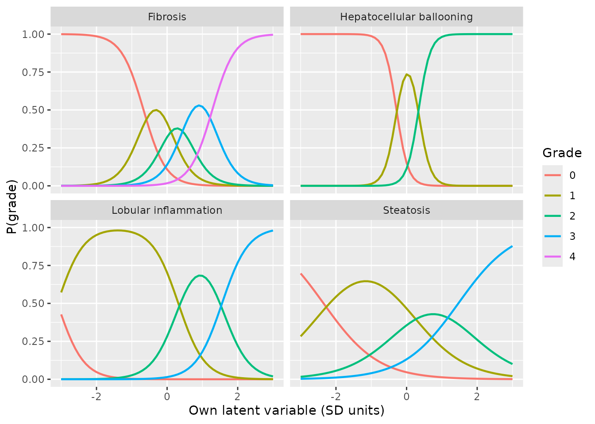
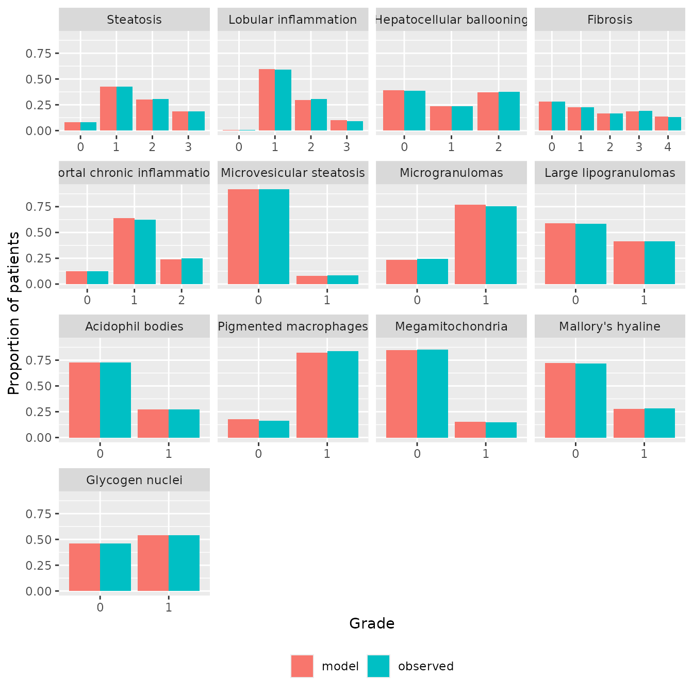
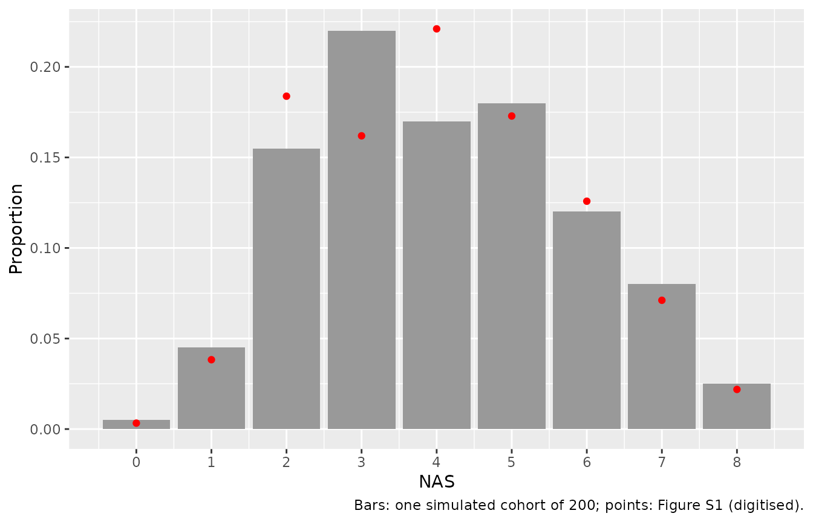

# NAFLD liver-histology scores: item response theory model (Minichmayr 2025)

## Model and source

Minichmayr et al. (2025) built a multidimensional item response theory
(IRT) model of the liver-biopsy histology of 914 adults with
nonalcoholic fatty liver disease (NAFLD) from the NASH Clinical Research
Network (NASH CRN). All 13 features of the NASH CRN scoring system are
modelled jointly as outcomes (“items”) of five correlated latent disease
facets:

- LV1 steatosis, LV2 lobular inflammation, LV3 hepatocellular ballooning
  and LV4 fibrosis each drive one cardinal score and nothing else among
  the cardinal scores;
- LV5 drives only the nine residual features;
- the nine residual features (portal chronic inflammation and eight
  present/absent findings) load on all five latent variables.

The five ordered scores are graded-response items and the eight binary
features are two-parameter logistic items (mirt slope-intercept form):

``` math
\mathrm{logit}\,P(Y_j \ge k \mid \theta) = \sum_{m=1}^{5} a_{m,j}\,\theta_m + d_{k,j}, \qquad \theta \sim N(0, R)
```

with unit latent variances and the correlation matrix `R` of Figure 3.
The model is cross-sectional: one biopsy per patient, no time, no drug
and no covariates. It is the measurement model a drug-effect or
disease-progression layer can be built on, because a treatment that
shifts a latent variable moves every score linked to it.

- Citation: Minichmayr IK, Plan EL, Weber B, Ueckert S. A Model-Based
  Evaluation of Noninvasive Biomarkers to Reflect Histological
  Nonalcoholic Fatty Liver Disease Scores. Pharm Res. 2025;42(1):123.
  <doi:10.1007/s11095-024-03791-2>.
- Article: <https://doi.org/10.1007/s11095-024-03791-2> (open access;
  PMC11785690)

``` r

mod <- rxode2::rxode(readModelDb("Minichmayr_2025_nafld_histology"))
#> Warning: some etas defaulted to non-mu referenced, possible parsing error: etalv1, etalv2, etalv3, etalv4, etalv5
#> as a work-around try putting the mu-referenced expression on a simple line

# The latent values are drawn in base R and passed as parameters to a solve
# with the random effects removed, so the cohort does not depend on the rxode2
# build. That solve warns that the model has no residual-error parameter (the
# endpoints are ordinal), which is expected and muffled here.
solve_quiet <- function(ui, ...) {
  withCallingHandlers(
    rxode2::rxSolve(ui, ...),
    warning = function(w) {
      if (grepl("No sigma parameters", conditionMessage(w))) {
        invokeRestart("muffleWarning")
      }
    }
  )
}

# Endpoint name -> token used in the model's p<k>_<token> probabilities.
items <- c(
  steatosis = "steatosis",
  inflammation = "inflammation",
  ballooning = "ballooning",
  fibrosis = "fibrosis",
  portal_inflammation = "portinfl",
  microvesicular_steatosis = "microsteat",
  microgranulomas = "microgran",
  lipogranulomas = "lipogran",
  acidophil_bodies = "acidophil",
  pigmented_macrophages = "pigmac",
  megamitochondria = "megamito",
  mallory_hyaline = "mallory",
  glycogen_nuclei = "glycogen"
)
item_label <- c(
  steatosis = "Steatosis",
  inflammation = "Lobular inflammation",
  ballooning = "Hepatocellular ballooning",
  fibrosis = "Fibrosis",
  portal_inflammation = "Portal chronic inflammation",
  microvesicular_steatosis = "Microvesicular steatosis",
  microgranulomas = "Microgranulomas",
  lipogranulomas = "Large lipogranulomas",
  acidophil_bodies = "Acidophil bodies",
  pigmented_macrophages = "Pigmented macrophages",
  megamitochondria = "Megamitochondria",
  mallory_hyaline = "Mallory's hyaline",
  glycogen_nuclei = "Glycogen nuclei"
)

# Per-grade probability matrix (one row per patient, columns grade 0, 1, ...).
grade_probs <- function(sim, item) {
  cols <- grep(sprintf("^p[0-9]_%s$", items[[item]]), names(sim), value = TRUE)
  cols <- cols[order(as.integer(substr(cols, 2, 2)))]
  as.matrix(sim[, cols, drop = FALSE])
}
```

## Population

The NASH CRN observational NAFLD Database study enrolled adults with
histologically proven or suspected NAFLD at nine US centres between 2004
and 2009. The analysis used 914 patients with one biopsy each (the one
closest in time to the liver-panel laboratory tests), read centrally by
the NASH CRN Pathology Committee. Median age was 51.3 years (2.5th to
97.5th percentile 23.5 to 69.0), 35.8% were male, 10.1% Hispanic or
Latino, median weight 95.0 kg and median BMI 33.7 kg/m^2; 38.1% had
diabetes and 73.4% the metabolic syndrome (Table I). The cohort spans
fibrosis stages 0 to 4 and NAFLD activity scores (NAS) 0 to 8; 52.3% had
a definite and 26.8% a definite negative diagnosis of NASH. Fibrosis
sub-stages 1a, 1b and 1c were pooled as stage 1.

``` r

str(mod$population)
#> List of 11
#>  $ species       : chr "human"
#>  $ n_subjects    : int 914
#>  $ n_studies     : int 1
#>  $ age_range     : chr "median 51.3 years; 2.5th-97.5th percentile 23.5-69.0 years (Minichmayr 2025 Table I)"
#>  $ weight_range  : chr "median 95.0 kg; 2.5th-97.5th percentile 63-139 kg (Minichmayr 2025 Table I)"
#>  $ sex_female_pct: num 64.2
#>  $ race_ethnicity: chr "10.1% Hispanic/Latino; race not reported (Minichmayr 2025 Table I)"
#>  $ disease_state : chr "Adults with histologically proven or suspected nonalcoholic fatty liver disease (NAFLD); the cohort spans fibro"| __truncated__
#>  $ dose_range    : chr "(none; untreated natural-history cohort)"
#>  $ regions       : chr "United States (nine NASH CRN medical centres)"
#>  $ notes         : chr "Observational NAFLD Database study of the NASH Clinical Research Network (NIDDK NAFLD Adult Database), enrolled"| __truncated__
```

## Source trace

Every item parameter is from Online Resource Table SI; the
latent-variable correlations are printed in Figure 3; the unit latent
variances are stated in the Table SI footnote.

| Quantity | Model names | Value(s) | Source |
|----|----|----|----|
| Item model, graded and binary | `pge<k>_<item>`, `p1_<binary item>` | `logit P = sum(a * LV) + d` | Methods, Histological Liver Score Model; Table SI footnotes |
| Steatosis | `a1_steatosis`; `d1`-`d3_steatosis` | 1.287; 3.026, -0.051, -1.887 | Table SI |
| Lobular inflammation | `a2_inflammation`; `d1`-`d3_inflammation` | 2.707; 8.413, -0.863, -4.212 | Table SI |
| Ballooning | `a3_ballooning`; `d1`-`d2_ballooning` | 6.031; 1.721, -2.057 | Table SI |
| Fibrosis | `a4_fibrosis`; `d1`-`d4_fibrosis` | 3.161; 2.108, -0.090, -1.686, -4.046 | Table SI |
| Portal chronic inflammation | `a1`-`a5_portinfl`; `d1`-`d2_portinfl` | -0.537, 0.668, -0.870, 2.104, 0.526; 3.039, -1.817 | Table SI |
| Microvesicular steatosis | `a1`-`a5_microsteat`; `d_microsteat` | 3.839, -2.268, -0.411, 3.316, 0.435; -5.031 | Table SI |
| Microgranulomas | `a1`-`a5_microgran`; `d_microgran` | 1.201, 7.752, -2.456, -2.463, 3.009; 5.922 | Table SI |
| Large lipogranulomas | `a1`-`a5_lipogran`; `d_lipogran` | -0.004, 0.113, -0.346, 0.826, 0.698; -0.411 | Table SI |
| Acidophil bodies | `a1`-`a5_acidophil`; `d_acidophil` | -0.180, 1.156, 0.037, 0.051, 0.544; -1.264 | Table SI |
| Pigmented macrophages | `a1`-`a5_pigmac`; `d_pigmac` | 0.142, 3.076, -1.238, -1.098, 2.892; 4.402 | Table SI |
| Megamitochondria | `a1`-`a5_megamito`; `d_megamito` | 1.258, -1.063, 0.305, 1.274, 0.297; -2.208 | Table SI |
| Mallory’s hyaline | `a1`-`a5_mallory`; `d_mallory` | -0.881, 1.379, 5.754, 0.621, -0.403; -4.300 | Table SI |
| Glycogen nuclei | `a1`-`a5_glycogen`; `d_glycogen` | 0.098, -0.201, 0.350, -0.321, 0.029; 0.167 | Table SI |
| Latent variances | diagonal of `etalv1`-`etalv5` | 1 | Table SI footnote a |
| Latent correlations | off-diagonals of `etalv1`-`etalv5` | see the check below | Figure 3 |

``` r

# Figure 3, read row by row (LV2-LV1, LV3-LV1, LV3-LV2, ...).
fig3 <- c(0.60, 0.22, 0.62, -0.17, 0.36, 0.69, 0.09, 0.15, 0.23, 0.02)
model_cor <- stats::cov2cor(mod$omega)
# t(R)[upper.tri(R)] lists the lower triangle of R row by row.
stopifnot(
  all(abs(diag(mod$omega) - 1) < 1e-12),
  all(abs(t(model_cor)[upper.tri(model_cor)] - fig3) < 1e-12),
  # The matrix must be a valid correlation matrix to be sampled.
  all(eigen(model_cor)$values > 0)
)
round(model_cor, 2)
#>        etalv1 etalv2 etalv3 etalv4 etalv5
#> etalv1   1.00   0.60   0.22  -0.17   0.09
#> etalv2   0.60   1.00   0.62   0.36   0.15
#> etalv3   0.22   0.62   1.00   0.69   0.23
#> etalv4  -0.17   0.36   0.69   1.00   0.02
#> etalv5   0.09   0.15   0.23   0.02   1.00
```

## Virtual cohort

The latent values of 200 patients are drawn in base R from `N(0, R)`,
using a Latin hypercube over 100 patients plus their mirror images (the
antithetic draws keep the cohort mean exactly at zero). Stratifying the
draws matters for the comparisons below: the marginal grade distribution
of a model with a slope as steep as ballooning’s (6.0) moves several
percentage points between unstratified samples of 200.

``` r

n_half <- 100
set.seed(2025)
u <- sapply(seq_len(5), function(j) (sample(n_half) - runif(n_half)) / n_half)
z <- qnorm(u) %*% chol(mod$omega)
latent <- rbind(z, -z)
colnames(latent) <- rownames(mod$omega)
cohort_params <- data.frame(id = seq_len(nrow(latent)), latent)

cohort_events <- data.frame(id = cohort_params$id, time = 0, evid = 0)
sim <- as.data.frame(solve_quiet(rxode2::zeroRe(mod), events = cohort_events, params = cohort_params))
#> Warning: some etas defaulted to non-mu referenced, possible parsing error: etalv1, etalv2, etalv3, etalv4, etalv5
#> as a work-around try putting the mu-referenced expression on a simple line
stopifnot(nrow(sim) == nrow(latent), all(abs(sim$lv1 - latent[, "etalv1"]) < 1e-12))
```

### Structure check against the closed form

The per-grade probabilities from the solve must equal the inverse-logit
expressions of Table SI evaluated on the same latent values. This checks
the item-to-latent-variable mapping, the sign convention of the
intercepts and the grade indexing in one step; both sides use the same
numbers, so the bound is tight.

``` r

table_si <- list(
  steatosis = list(a = c(1.287, 0, 0, 0, 0), d = c(3.026, -0.051, -1.887)),
  inflammation = list(a = c(0, 2.707, 0, 0, 0), d = c(8.413, -0.863, -4.212)),
  ballooning = list(a = c(0, 0, 6.031, 0, 0), d = c(1.721, -2.057)),
  fibrosis = list(a = c(0, 0, 0, 3.161, 0), d = c(2.108, -0.090, -1.686, -4.046)),
  portal_inflammation = list(a = c(-0.537, 0.668, -0.870, 2.104, 0.526), d = c(3.039, -1.817)),
  microvesicular_steatosis = list(a = c(3.839, -2.268, -0.411, 3.316, 0.435), d = -5.031),
  microgranulomas = list(a = c(1.201, 7.752, -2.456, -2.463, 3.009), d = 5.922),
  lipogranulomas = list(a = c(-0.004, 0.113, -0.346, 0.826, 0.698), d = -0.411),
  acidophil_bodies = list(a = c(-0.180, 1.156, 0.037, 0.051, 0.544), d = -1.264),
  pigmented_macrophages = list(a = c(0.142, 3.076, -1.238, -1.098, 2.892), d = 4.402),
  megamitochondria = list(a = c(1.258, -1.063, 0.305, 1.274, 0.297), d = -2.208),
  mallory_hyaline = list(a = c(-0.881, 1.379, 5.754, 0.621, -0.403), d = -4.300),
  glycogen_nuclei = list(a = c(0.098, -0.201, 0.350, -0.321, 0.029), d = 0.167)
)

closed_form <- function(item) {
  lp <- drop(latent %*% table_si[[item]]$a)
  pge <- cbind(1, sapply(table_si[[item]]$d, function(d) plogis(lp + d)), 0)
  pge[, -ncol(pge), drop = FALSE] - pge[, -1, drop = FALSE]
}
max_err <- vapply(names(items), function(i) max(abs(grade_probs(sim, i) - closed_form(i))), numeric(1))
stopifnot(max(max_err) < 1e-10)
signif(max_err, 2)
#>                steatosis             inflammation               ballooning 
#>                  0.0e+00                  0.0e+00                  0.0e+00 
#>                 fibrosis      portal_inflammation microvesicular_steatosis 
#>                  0.0e+00                  3.3e-16                  3.3e-16 
#>          microgranulomas           lipogranulomas         acidophil_bodies 
#>                  4.4e-16                  2.2e-16                  2.2e-16 
#>    pigmented_macrophages         megamitochondria          mallory_hyaline 
#>                  3.3e-16                  2.2e-16                  2.2e-16 
#>          glycogen_nuclei 
#>                  1.1e-16
```

## Item characteristic curves

The four cardinal scores against their own latent variable, with the
other latent variables at zero (they have no effect on these scores).
The steep ballooning curves are the paper’s finding that ballooning
“best differentiated between low and high disease intensity” (Results).

``` r

grid_lv <- seq(-3, 3, by = 0.1)
icc <- bind_rows(lapply(c("steatosis", "inflammation", "ballooning", "fibrosis"), function(item) {
  lv <- c(steatosis = "etalv1", inflammation = "etalv2", ballooning = "etalv3", fibrosis = "etalv4")[[item]]
  p <- data.frame(id = seq_along(grid_lv), etalv1 = 0, etalv2 = 0, etalv3 = 0, etalv4 = 0, etalv5 = 0)
  p[[lv]] <- grid_lv
  s <- as.data.frame(solve_quiet(rxode2::zeroRe(mod), events = data.frame(id = p$id, time = 0, evid = 0), params = p))
  pr <- grade_probs(s, item)
  data.frame(item = item_label[[item]], latent = rep(grid_lv, ncol(pr)), grade = factor(rep(seq_len(ncol(pr)) - 1, each = nrow(pr))), prob = as.vector(pr))
}))
#> Warning: some etas defaulted to non-mu referenced, possible parsing error: etalv1, etalv2, etalv3, etalv4, etalv5
#> as a work-around try putting the mu-referenced expression on a simple line
#> Warning: some etas defaulted to non-mu referenced, possible parsing error: etalv1, etalv2, etalv3, etalv4, etalv5
#> as a work-around try putting the mu-referenced expression on a simple line
#> Warning: some etas defaulted to non-mu referenced, possible parsing error: etalv1, etalv2, etalv3, etalv4, etalv5
#> as a work-around try putting the mu-referenced expression on a simple line
#> Warning: some etas defaulted to non-mu referenced, possible parsing error: etalv1, etalv2, etalv3, etalv4, etalv5
#> as a work-around try putting the mu-referenced expression on a simple line
ggplot(icc, aes(latent, prob, colour = grade)) +
  geom_line(linewidth = 0.8) +
  facet_wrap(~item) +
  labs(x = "Own latent variable (SD units)", y = "P(grade)", colour = "Grade")
```



## Replicating the observed grade distributions (Figure S1)

The marginal grade distribution implied by the model is the mean of the
per-patient grade probabilities over the cohort. The observed counts
were digitised by the maintainers from Online Resource Figure S1 (bar
heights, about +/- 5 patients).

``` r

fig_s1 <- list(
  steatosis = c(75, 385, 275, 170),
  inflammation = c(6, 540, 280, 85),
  ballooning = c(355, 215, 345),
  fibrosis = c(255, 205, 150, 175, 120),
  portal_inflammation = c(115, 570, 225),
  microvesicular_steatosis = c(835, 75),
  microgranulomas = c(225, 690),
  lipogranulomas = c(535, 380),
  acidophil_bodies = c(660, 250),
  pigmented_macrophages = c(150, 760),
  megamitochondria = c(775, 135),
  mallory_hyaline = c(655, 255),
  glycogen_nuclei = c(420, 490)
)
marginals <- bind_rows(lapply(names(items), function(item) {
  obs <- fig_s1[[item]]
  data.frame(
    item = item_label[[item]],
    grade = seq_along(obs) - 1,
    observed = obs / sum(obs),
    model = colMeans(grade_probs(sim, item))
  )
}))
marginals |>
  mutate(across(c(observed, model), function(x) sprintf("%.1f%%", 100 * x))) |>
  rename("Feature" = item, "Grade" = grade, "Observed (Fig. S1)" = observed, "Model" = model) |>
  knitr::kable(caption = "Grade distribution of each histology feature: digitised Figure S1 against the model.")
```

|                 | Feature                     | Grade | Observed (Fig. S1) | Model |
|:----------------|:----------------------------|------:|:-------------------|:------|
| p0_steatosis    | Steatosis                   |     0 | 8.3%               | 8.1%  |
| p1_steatosis    | Steatosis                   |     1 | 42.5%              | 42.8% |
| p2_steatosis    | Steatosis                   |     2 | 30.4%              | 30.3% |
| p3_steatosis    | Steatosis                   |     3 | 18.8%              | 18.8% |
| p0_inflammation | Lobular inflammation        |     0 | 0.7%               | 0.5%  |
| p1_inflammation | Lobular inflammation        |     1 | 59.3%              | 59.8% |
| p2_inflammation | Lobular inflammation        |     2 | 30.7%              | 29.5% |
| p3_inflammation | Lobular inflammation        |     3 | 9.3%               | 10.2% |
| p0_ballooning   | Hepatocellular ballooning   |     0 | 38.8%              | 39.3% |
| p1_ballooning   | Hepatocellular ballooning   |     1 | 23.5%              | 23.5% |
| p2_ballooning   | Hepatocellular ballooning   |     2 | 37.7%              | 37.2% |
| p0_fibrosis     | Fibrosis                    |     0 | 28.2%              | 28.3% |
| p1_fibrosis     | Fibrosis                    |     1 | 22.7%              | 22.7% |
| p2_fibrosis     | Fibrosis                    |     2 | 16.6%              | 16.8% |
| p3_fibrosis     | Fibrosis                    |     3 | 19.3%              | 18.6% |
| p4_fibrosis     | Fibrosis                    |     4 | 13.3%              | 13.6% |
| p0_portinfl     | Portal chronic inflammation |     0 | 12.6%              | 12.2% |
| p1_portinfl     | Portal chronic inflammation |     1 | 62.6%              | 63.8% |
| p2_portinfl     | Portal chronic inflammation |     2 | 24.7%              | 24.0% |
| p0_microsteat   | Microvesicular steatosis    |     0 | 91.8%              | 92.0% |
| p1_microsteat   | Microvesicular steatosis    |     1 | 8.2%               | 8.0%  |
| p0_microgran    | Microgranulomas             |     0 | 24.6%              | 23.2% |
| p1_microgran    | Microgranulomas             |     1 | 75.4%              | 76.8% |
| p0_lipogran     | Large lipogranulomas        |     0 | 58.5%              | 58.8% |
| p1_lipogran     | Large lipogranulomas        |     1 | 41.5%              | 41.2% |
| p0_acidophil    | Acidophil bodies            |     0 | 72.5%              | 72.5% |
| p1_acidophil    | Acidophil bodies            |     1 | 27.5%              | 27.5% |
| p0_pigmac       | Pigmented macrophages       |     0 | 16.5%              | 17.9% |
| p1_pigmac       | Pigmented macrophages       |     1 | 83.5%              | 82.1% |
| p0_megamito     | Megamitochondria            |     0 | 85.2%              | 84.9% |
| p1_megamito     | Megamitochondria            |     1 | 14.8%              | 15.1% |
| p0_mallory      | Mallory’s hyaline           |     0 | 72.0%              | 72.3% |
| p1_mallory      | Mallory’s hyaline           |     1 | 28.0%              | 27.7% |
| p0_glycogen     | Glycogen nuclei             |     0 | 46.2%              | 45.9% |
| p1_glycogen     | Glycogen nuclei             |     1 | 53.8%              | 54.1% |

Grade distribution of each histology feature: digitised Figure S1
against the model. {.table style="width:100%;"}

``` r

abs_diff <- abs(marginals$model - marginals$observed)
stopifnot(
  # A mis-transcribed intercept or a slope on the wrong latent variable moves
  # a grade by tens of percentage points.
  median(abs_diff) < 0.015,
  max(abs_diff) < 0.05,
  # The paper's own statement: only 0.7% had grade 0 lobular inflammation.
  abs(marginals$model[marginals$item == "Lobular inflammation" & marginals$grade == 0] - 0.007) < 0.005
)
```

``` r

marginals |>
  mutate(item = factor(item, levels = item_label)) |>
  pivot_longer(c(observed, model), names_to = "source", values_to = "prop") |>
  ggplot(aes(factor(grade), prop, fill = source)) +
  geom_col(position = "dodge") +
  facet_wrap(~item, scales = "free_x", ncol = 4) +
  labs(x = "Grade", y = "Proportion of patients", fill = NULL) +
  theme(legend.position = "bottom")
```



The bars replicate Figure S1 of Minichmayr 2025.

### NAFLD activity score

The NAS is the sum of the steatosis, lobular inflammation and ballooning
grades. The three scores are independent given the latent variables, so
each patient’s NAS distribution is the convolution of the three
per-patient grade distributions.

``` r

convolve_pmf <- function(p, q) {
  out <- numeric(length(p) + length(q) - 1)
  for (i in seq_along(p)) {
    idx <- i - 1 + seq_along(q)
    out[idx] <- out[idx] + p[i] * q
  }
  out
}
ps <- grade_probs(sim, "steatosis")
pin <- grade_probs(sim, "inflammation")
pb <- grade_probs(sim, "ballooning")
nas_pmf <- t(vapply(seq_len(nrow(sim)), function(i) {
  convolve_pmf(convolve_pmf(ps[i, ], pin[i, ]), pb[i, ])
}, numeric(9)))

# Figure S1, NAS panel (digitised).
nas_obs <- c(3, 35, 168, 148, 202, 158, 115, 65, 20)
nas <- data.frame(
  NAS = 0:8,
  observed = nas_obs / sum(nas_obs),
  model = colMeans(nas_pmf)
)
nas_mean <- c(observed = sum(nas$NAS * nas$observed), model = mean(sim$escore_nas))
stopifnot(
  abs(sum(nas$NAS * nas$model) - nas_mean[["model"]]) < 1e-10,
  abs(nas_mean[["model"]] - nas_mean[["observed"]]) < 0.15,
  max(abs(nas$model - nas$observed)) < 0.05
)
nas |>
  mutate(across(c(observed, model), function(x) sprintf("%.1f%%", 100 * x))) |>
  rename("Observed (Fig. S1)" = observed, "Model" = model) |>
  knitr::kable(caption = "NAS distribution: digitised Figure S1 against the model.")
```

| NAS | Observed (Fig. S1) | Model |
|----:|:-------------------|:------|
|   0 | 0.3%               | 0.1%  |
|   1 | 3.8%               | 3.5%  |
|   2 | 18.4%              | 17.6% |
|   3 | 16.2%              | 19.6% |
|   4 | 22.1%              | 20.3% |
|   5 | 17.3%              | 17.0% |
|   6 | 12.6%              | 12.5% |
|   7 | 7.1%               | 7.1%  |
|   8 | 2.2%               | 2.3%  |

NAS distribution: digitised Figure S1 against the model. {.table}

``` r

round(nas_mean, 2)
#> observed    model 
#>     4.07     4.07
```

## Correlations between the cardinal scores (Figure 4)

Figure 4 compares the observed Pearson correlation between each pair of
cardinal scores with its distribution over 500 simulated data sets. The
model-implied correlation follows from the law of total covariance:
given the latent variables the scores are independent, so their
covariance is the covariance of the per-patient expected scores, and
each variance adds the mean within-patient variance.

``` r

cond_moments <- function(item) {
  pr <- grade_probs(sim, item)
  g <- seq_len(ncol(pr)) - 1
  list(mean = drop(pr %*% g), var = drop(pr %*% g^2) - drop(pr %*% g)^2)
}
item_cor <- function(a, b) {
  ma <- cond_moments(a)
  mb <- cond_moments(b)
  cov_ab <- mean((ma$mean - mean(ma$mean)) * (mb$mean - mean(mb$mean)))
  var_a <- mean(ma$var) + mean((ma$mean - mean(ma$mean))^2)
  var_b <- mean(mb$var) + mean((mb$mean - mean(mb$mean))^2)
  cov_ab / sqrt(var_a * var_b)
}

# Figure 4, digitised by the maintainers: observed correlation (red line) and
# the mode of the simulated distribution (green histogram).
fig4 <- data.frame(
  a = c("ballooning", "ballooning", "fibrosis", "fibrosis", "fibrosis", "inflammation"),
  b = c("inflammation", "steatosis", "ballooning", "inflammation", "steatosis", "steatosis"),
  observed = c(0.36, 0.12, 0.50, 0.20, -0.11, 0.27),
  simulated_mode = c(0.37, 0.10, 0.48, 0.20, -0.07, 0.24)
)
fig4$model <- mapply(item_cor, fig4$a, fig4$b)

stopifnot(
  median(abs(fig4$model - fig4$simulated_mode)) < 0.04,
  max(abs(fig4$model - fig4$observed)) < 0.10
)
fig4 |>
  mutate(pair = paste(item_label[a], "-", item_label[b])) |>
  select(pair, observed, simulated_mode, model) |>
  mutate(across(where(is.numeric), function(x) sprintf("%.2f", x))) |>
  rename("Score pair" = pair, "Observed (Fig. 4)" = observed, "Simulated mode (Fig. 4)" = simulated_mode, "Model" = model) |>
  knitr::kable(caption = "Correlation between cardinal histology scores.")
```

| Score pair | Observed (Fig. 4) | Simulated mode (Fig. 4) | Model |
|:---|:---|:---|:---|
| Hepatocellular ballooning - Lobular inflammation | 0.36 | 0.37 | 0.37 |
| Hepatocellular ballooning - Steatosis | 0.12 | 0.10 | 0.10 |
| Fibrosis - Hepatocellular ballooning | 0.50 | 0.48 | 0.51 |
| Fibrosis - Lobular inflammation | 0.20 | 0.20 | 0.23 |
| Fibrosis - Steatosis | -0.11 | -0.07 | -0.06 |
| Lobular inflammation - Steatosis | 0.27 | 0.24 | 0.24 |

Correlation between cardinal histology scores. {.table}

The strongest correlation, ballooning with fibrosis, mirrors the 0.69
correlation of their latent variables, attenuated by the discreteness of
the scores; steatosis and fibrosis are weakly negatively correlated, as
in the paper.

## Stochastic simulation of biopsy readings

For simulation, rxode2 draws the latent variables from the model’s
`omega` and then a grade for each endpoint requested in the event table
(`cmt` = endpoint name). The ordinal endpoints return categories 1, 2,
…, so the grade is the simulated category minus 1, for the binary
features as well.

``` r

biopsy_events <- expand.grid(cmt = names(items), id = seq_len(200), stringsAsFactors = FALSE)
biopsy_events$time <- 0
biopsy_events$evid <- 0
rxode2::rxSetSeed(2025)
biopsies <- as.data.frame(rxode2::rxSolve(mod, events = biopsy_events[, c("id", "time", "evid", "cmt")]))
biopsies$item <- names(items)[biopsies$CMT]
biopsies$grade <- biopsies$sim - 1
max_grade <- vapply(fig_s1, length, numeric(1)) - 1
stopifnot(
  nrow(biopsies) == nrow(biopsy_events),
  all(biopsies$grade >= 0),
  all(biopsies$grade <= max_grade[biopsies$item])
)
biopsies |>
  filter(item %in% c("steatosis", "inflammation", "ballooning")) |>
  select(id, item, grade) |>
  pivot_wider(names_from = item, values_from = grade) |>
  mutate(NAS = steatosis + inflammation + ballooning) |>
  ggplot(aes(NAS)) +
  geom_bar(aes(y = after_stat(prop)), fill = "grey60") +
  geom_point(data = nas, aes(NAS, observed), colour = "red") +
  scale_x_continuous(breaks = 0:8) +
  labs(x = "NAS", y = "Proportion", caption = "Bars: one simulated cohort of 200; points: Figure S1 (digitised).")
```



## Assumptions and deviations

- **Noninvasive biomarker analysis not included.** The paper’s second
  step relates 69 noninvasive biomarkers (Table I) to the five latent
  variables with a full random effects model fitted in NONMEM 7.4. Only
  its consequences are published, as expected scores at the 2.5th and
  97.5th percentile of each biomarker (Figure 5, Figures S4 and S5); the
  estimated biomarker-latent and biomarker-biomarker correlation matrix
  is not reported. The biomarker layer therefore cannot be reconstructed
  and the model has no covariates.
- **Latent variances.** The variances of the five latent variables are 1
  by the IRT identification constraint (Table SI footnote a). They sit
  on the diagonal of the `etalv1`-`etalv5` block, which is not wrapped
  in `fixed()` because the correlations in the same block were estimated
  and rxode2 cannot fix only the diagonal of a block. A re-fit should
  hold the diagonal at 1.
- **Correlations to two decimals.** Figure 3 prints the latent
  correlations to two decimals, so the model carries them at that
  precision.
- **Structural zero loadings.** Table SI prints `a = 0` for the latent
  variables that do not load on a cardinal score; these zeros are the
  model structure (Figure 2) and are omitted from the model rather than
  carried as fixed parameters.
- **Observation encoding.** Every item is an rxode2 ordinal endpoint
  (`<endpoint> ~ c(p0, ...)`), including the eight binary features, so a
  simulated category `k` is grade `k - 1` throughout. The four cardinal
  endpoints use the registered NASH CRN output names `steatosis`,
  `inflammation`, `ballooning` and `fibrosis`; the nine residual
  features use descriptive names specific to this model.
- **Estimation software.** The model was fitted with the R package mirt
  (Metropolis-Hastings Robbins-Monro). The rxode2 encoding is for
  simulation; a re-fit in nlmixr2 would need a likelihood-based method
  that supports ordinal endpoints.
- **Figure 5 reference lines.** The dashed mean-score lines of Figure 5
  come from the biomarker model and are not used as validation targets
  here.
