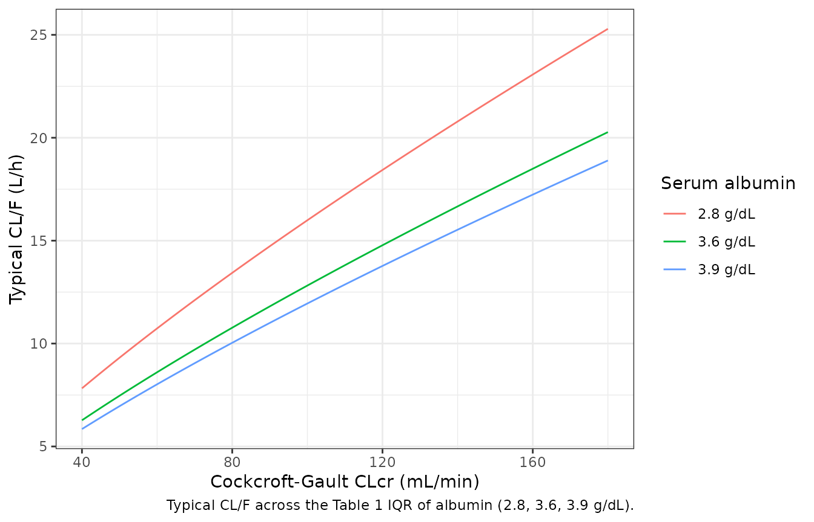
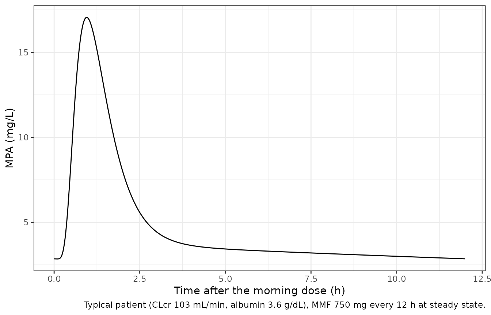
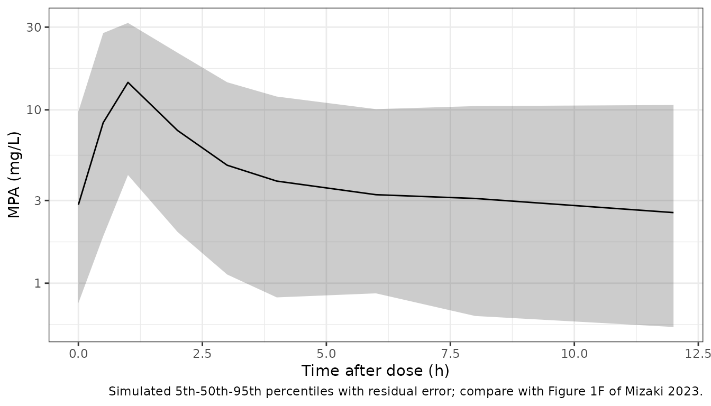

# Mycophenolic acid (Mizaki 2023)

## Model and source

- Citation: Mizaki T, Nobata H, Banno S, Yamaguchi M, Kinashi H,
  Iwagaitsu S, Ishimoto T, Kuru Y, Ohnishi M, Sako K, Ito Y. (2023).
  Population pharmacokinetics and limited sampling strategy for
  therapeutic drug monitoring of mycophenolate mofetil in Japanese
  patients with lupus nephritis. J Pharm Health Care Sci 9:1.
  <doi:10.1186/s40780-022-00271-w>
- Description: Two-compartment population PK model for mycophenolic acid
  (MPA) after oral mycophenolate mofetil (MMF) twice daily in adult
  Japanese patients with lupus nephritis (Mizaki 2023). Absorption
  through a chain of six transit compartments (Savic form, ktr = (6 + 1)
  / MTT) into an absorption compartment drained by first-order ka;
  first-order elimination from the central compartment; no enterohepatic
  circulation term. Cockcroft-Gault creatinine clearance and serum
  albumin act on CL/F as power functions centred on the cohort medians
  (6.2 L/h and 3.6 g/dL). Doses are mg of MMF (no molecular-weight
  conversion; parameters are apparent with respect to the MMF dose) and
  Cc is MPA in mg/L. IIV is exponential on V1/F, CL/F and MTT; residual
  error is proportional (34.09%).
- Article: <https://doi.org/10.1186/s40780-022-00271-w> (open access)

Mizaki 2023 developed the first population PK model of mycophenolic acid
(MPA) for Japanese patients with lupus nephritis, from a single 12-h
steady-state profile per patient, and used it for maximum a posteriori
Bayesian limited-sampling strategies. The final model, fitted in Phoenix
NLME, is two-compartment with a six-compartment transit absorption chain
and first-order elimination; Cockcroft-Gault creatinine clearance (CLcr)
and serum albumin are covariates on CL/F. An enterohepatic-circulation
model and a lag time were tested and did not improve the fit.

## Population

Thirty-four adult Japanese patients (6 male, 28 female) receiving
mycophenolate mofetil (MMF, CellCept) 250-1000 mg every 12 h for lupus
nephritis at Aichi Medical University Hospital (March 2015 - June 2022)
were studied retrospectively. Table 1 (median, IQR): age 39.0 years
(26.3-51.8), body weight 54.7 kg (47.2-58.6), serum albumin 3.6 g/dL
(2.8-3.9), Cockcroft-Gault CLcr 103.6 mL/min (71.1-125.0), MMF 1500
mg/day (1500-1688). All patients received prednisolone; 8 received
tacrolimus, 22 a proton-pump inhibitor and 5 iron/magnesium oxide.
Samples were taken at steady state before the dose and 0.5, 1, 2, 3, 4,
6, 8 and 12 h after it (302 concentrations; 33 full profiles), and
measured by enzyme immunoassay (LLOQ 0.40 ug/mL).

The same information is available programmatically via
`rxode2::rxode(readModelDb("Mizaki_2023_mycophenolic_acid"))$population`.

## Source trace

| Equation / parameter | Value | Source location |
|----|----|----|
| Two-compartment, transit absorption, first-order elimination, no EHC, no lag | – | Results ‘PPK model development and validation’; Fig. 3 |
| Six transit compartments, `ktr = (n + 1) / MTT` | n = 6 (fixed) | Fig. 3 caption; Results; Discussion ‘fixed 6 transit compartments’ |
| `lvc` (V1/F) | 22.95 L | Table 2 |
| `lcl` (CL/F at the covariate medians) | 13.15 L/h | Table 2 |
| `lka` (ka) | 2.98 1/h | Table 2 |
| `lvp` (V2/F) | 336.03 L | Table 2 |
| `lq` (Q/F) | 26.44 L/h | Table 2 |
| `lmtt` (MTT) | 0.45 h | Table 2 |
| `e_crcl_cl` | 0.78 | Table 2 ‘Effect CLcr on CL’ |
| `e_alb_cl` | -0.88 | Table 2 ‘Effect Alb on CL’ |
| Power covariate form with medians CLcr 6.2 L/h, Alb 3.6 g/dL | – | Additional file 2 footnote |
| IIV V1, CL, MTT | 86.96%, 32.23%, 58.50% CV | Table 2; omega^2 = log(1 + CV^2) |
| `propSd` | 0.3409 | Table 2 ‘Proportional error (CV%)’ 34.09 |
| Dose units (mg MMF, no molecular-weight conversion) | – | Methods (V1/F, CL/F reported as V1, CL) |

## Typical-value checks

``` r

mod <- rxode2::rxode(readModelDb("Mizaki_2023_mycophenolic_acid"))
#> ℹ parameter labels from comments will be replaced by 'label()'
stopifnot(identical(
  mod$state,
  c("depot", paste0("transit", 1:7), "central", "peripheral1")
))
th <- setNames(mod$iniDf$est, mod$iniDf$name)

tau <- 12
# Day-15 morning interval: doses at 0, 12, ..., 336 h, sampling 336-348 h.
# The terminal half-life is about 27 h, so 28 prior doses reach steady state.
n_dose <- 29
t_ss <- (n_dose - 1) * tau
samp <- c(0, 0.5, 1, 2, 3, 4, 6, 8, 12)

make_events <- function(ids, dose, obs_times, n_doses = n_dose) {
  one_id <- function(i, amt) {
    dplyr::bind_rows(
      data.frame(
        id = i, time = seq(0, by = tau, length.out = n_doses),
        amt = amt, evid = 1L, cmt = "depot"
      ),
      data.frame(id = i, time = obs_times, amt = 0, evid = 0L, cmt = "central")
    )
  }
  dose <- rep_len(dose, length(ids))
  dplyr::bind_rows(Map(one_id, ids, dose)) |>
    # Observation before dose at a shared time, so the pre-dose sample is a trough.
    dplyr::arrange(id, time, dplyr::desc(evid == 0L))
}

typ <- function(dose, obs_times, CRCL = 6.2 * 1000 / 60, ALB = 36, n_doses = n_dose) {
  ev <- make_events(1L, dose, obs_times, n_doses)
  ev$CRCL <- CRCL
  ev$ALB <- ALB
  rxode2::rxSolve(mod, ev,
    omega = NA, sigma = NA, returnType = "data.frame",
    rtol = 1e-10, atol = 1e-12, maxsteps = 1e6
  )
}
```

### Covariate effects on CL/F

``` r

cl_fun <- function(crcl_mlmin, alb_gdl) {
  exp(th[["lcl"]]) * (crcl_mlmin * 0.06 / 6.2)^th[["e_crcl_cl"]] *
    (alb_gdl / 3.6)^th[["e_alb_cl"]]
}
stopifnot(abs(cl_fun(6.2 / 0.06, 3.6) / 13.15 - 1) < 1e-12)

cl_grid <- tidyr::expand_grid(
  crcl = seq(40, 180, by = 2),
  alb = c(2.8, 3.6, 3.9)
) |>
  dplyr::mutate(cl = cl_fun(crcl, alb), alb = factor(paste(alb, "g/dL")))
ggplot(cl_grid, aes(crcl, cl, colour = alb)) +
  geom_line() +
  labs(
    x = "Cockcroft-Gault CLcr (mL/min)", y = "Typical CL/F (L/h)",
    colour = "Serum albumin",
    caption = "Typical CL/F across the Table 1 IQR of albumin (2.8, 3.6, 3.9 g/dL)."
  ) +
  theme_bw()
```



Over the Table 1 interquartile ranges, CL/F runs from about 9 L/h (CLcr
71 mL/min, albumin 3.9 g/dL) to about 19 L/h (CLcr 125 mL/min, albumin
2.8 g/dL): lower renal function raises exposure and hypoalbuminaemia
lowers it, the directions the paper’s dose-normalised AUC comparisons
(Fig. 2A, B) show.

### Steady-state AUC equals dose / CL

For a linear model the AUC over one steady-state interval equals dose /
(CL/F) regardless of the absorption and distribution parameters.

``` r

trap <- function(x, y) sum(diff(x) * (head(y, -1) + tail(y, -1)) / 2)
ss_check <- dplyr::bind_rows(lapply(
  list(c(103.33, 3.6), c(71.1, 3.9), c(125, 2.8)),
  function(cv) {
    s <- typ(750, t_ss + seq(0, tau, by = 0.005), CRCL = cv[1], ALB = cv[2] * 10, n_doses = 61)
    data.frame(
      crcl = cv[1], alb_gdl = cv[2], auc_tau = trap(s$time, s$Cc),
      dose_over_cl = 750 / cl_fun(cv[1], cv[2])
    )
  }
)) |>
  dplyr::mutate(rel_diff = auc_tau / dose_over_cl - 1)
knitr::kable(ss_check, digits = 4)
```

|   crcl | alb_gdl | auc_tau | dose_over_cl | rel_diff |
|-------:|--------:|--------:|-------------:|---------:|
| 103.33 |     3.6 | 57.0298 |      57.0357 |   -1e-04 |
|  71.10 |     3.9 | 81.8456 |      81.9173 |   -9e-04 |
| 125.00 |     2.8 | 39.4096 |      39.4100 |    0e+00 |

``` r

# 61 doses (30 days) leave < 1e-4 of steady state unreached, and trapezoid
# error on a 0.005-h grid is ~1e-5; a wrong CL, covariate form or dose unit
# moves this by tens of percent.
stopifnot(all(abs(ss_check$rel_diff) < 2e-3))
```

### Typical steady-state profile

``` r

prof <- typ(750, t_ss + seq(0, 12, by = 0.02))
tmax_typ <- prof$time[which.max(prof$Cc)] - t_ss
ggplot(prof, aes(time - t_ss, Cc)) +
  geom_line() +
  labs(
    x = "Time after the morning dose (h)", y = "MPA (mg/L)",
    caption = "Typical patient (CLcr 103 mL/min, albumin 3.6 g/dL), MMF 750 mg every 12 h at steady state."
  ) +
  theme_bw()
```



``` r

tmax_typ
#> [1] 0.96
# Mean arrival into the absorption compartment is MTT = 0.45 h, then ka = 2.98
# 1/h; the observed median Tmax is 1.0 h (IQR 1.0-1.0).
stopifnot(tmax_typ > 0.5, tmax_typ < 1.5)
```

The typical profile has a single peak. In 32 of the 33 full profiles the
patients showed a second peak at a median 8 h (median 3.3 ug/mL), which
the paper attributes to enterohepatic circulation; the published final
model has no EHC term, so neither does this one.

## Virtual cohort and NCA against the observed medians

Two hundred virtual patients. CLcr and albumin are drawn from
piecewise-uniform distributions that reproduce the Table 1 quartiles
exactly (the minimum and maximum, which the paper does not report, are
set by the maintainers to 40 and 180 mL/min and 1.8 and 4.6 g/dL). The
MMF dose is 500, 750 or 1000 mg every 12 h with probabilities 0.10, 0.65
and 0.25, which reproduces the Table 1 median of 1500 mg/day with an
upper quartile between 1500 and 2000 mg/day. The paper’s nine-point
schedule is simulated with residual error, and AUC0-12 uses the linear
trapezoidal rule as in the paper’s NCA.

``` r

set.seed(20230109)
n_sub <- 200
r_quartiles <- function(n, q) {
  # q = c(min, Q1, median, Q3, max); each quartile band gets 25% of draws.
  band <- sample.int(4, n, replace = TRUE)
  stats::runif(n, q[band], q[band + 1])
}
cohort <- data.frame(
  id = seq_len(n_sub),
  CRCL = r_quartiles(n_sub, c(40, 71.1, 103.6, 125.0, 180)),
  ALB = 10 * r_quartiles(n_sub, c(1.8, 2.8, 3.6, 3.9, 4.6)),
  dose = sample(c(500, 750, 1000), n_sub, replace = TRUE, prob = c(0.10, 0.65, 0.25))
)
ev_cohort <- make_events(cohort$id, cohort$dose, t_ss + samp) |>
  dplyr::left_join(dplyr::select(cohort, id, CRCL, ALB), by = "id")

rxode2::rxSetSeed(20230109)
sim <- rxode2::rxSolve(mod, ev_cohort, returnType = "data.frame", maxsteps = 1e6) |>
  dplyr::select(-dplyr::any_of(c("CRCL", "ALB"))) |>
  dplyr::left_join(cohort, by = "id") |>
  dplyr::mutate(treatment = "MMF bid, steady state", tad = time - t_ss)
stopifnot(!anyNA(sim$sim), nrow(sim) == n_sub * length(samp))
```

``` r

sim |>
  dplyr::group_by(tad) |>
  dplyr::summarise(
    p05 = quantile(sim, 0.05), p50 = median(sim), p95 = quantile(sim, 0.95),
    .groups = "drop"
  ) |>
  ggplot(aes(tad, p50)) +
  geom_ribbon(aes(ymin = p05, ymax = p95), alpha = 0.25) +
  geom_line() +
  scale_y_log10() +
  labs(
    x = "Time after dose (h)", y = "MPA (mg/L)",
    caption = "Simulated 5th-50th-95th percentiles with residual error; compare with Figure 1F of Mizaki 2023."
  ) +
  theme_bw()
```



``` r

conc_df <- sim |>
  dplyr::transmute(id, treatment, time = tad, conc = sim) |>
  dplyr::filter(!is.na(conc))
# A normal proportional error makes Cc * (1 + eps) negative when eps < -1
# (P = 0.0017 for sd 0.34). Such samples would read as below the assay limit,
# so they enter the NCA as zero.
stopifnot(mean(conc_df$conc < 0) < 0.02)
conc_df$conc <- pmax(conc_df$conc, 0)
dose_df <- cohort |>
  dplyr::mutate(treatment = "MMF bid, steady state", time = 0) |>
  dplyr::select(id, treatment, time, dose)

intervals <- data.frame(
  start = 0, end = 12, cmax = TRUE, tmax = TRUE, auclast = TRUE
)
o_conc <- PKNCA::PKNCAconc(conc_df, conc ~ time | treatment + id)
o_dose <- PKNCA::PKNCAdose(dose_df, dose ~ time | treatment + id)
o_data <- PKNCA::PKNCAdata(o_conc, o_dose,
  intervals = intervals,
  options = list(auc.method = "linear")
)
nca_res <- PKNCA::pk.nca(o_data)
nca_df <- as.data.frame(nca_res)

# The paper reports medians (Results 'Pharmacokinetic analysis'); C0 is the
# pre-dose sample, which at steady state is the trough PKNCA reads at time 0.
c0 <- conc_df |>
  dplyr::filter(time == 0) |>
  dplyr::summarise(PPORRES = median(conc)) |>
  dplyr::mutate(treatment = "MMF bid, steady state", PPTESTCD = "c0")
sim_median <- nca_df |>
  dplyr::filter(PPTESTCD %in% c("cmax", "tmax", "auclast")) |>
  dplyr::group_by(treatment, PPTESTCD) |>
  dplyr::summarise(PPORRES = median(PPORRES), .groups = "drop")

published <- data.frame(
  treatment = "MMF bid, steady state",
  cmax = 16.7, tmax = 1.0, auclast = 51.1
)
cmp <- nlmixr2lib::ncaComparisonTable(
  simulated = sim_median,
  reference = published,
  by = "treatment",
  units = c(cmax = "mg/L", tmax = "h", auclast = "mg*h/L"),
  tolerance_pct = 20
)
knitr::kable(cmp,
  caption = paste(
    "Simulated (median of 200 virtual patients) vs the observed medians of",
    "Mizaki 2023 (Results). * differs from the reference by more than 20%."
  )
)
```

| NCA parameter     | treatment             | Reference | Simulated | % diff |
|:------------------|:----------------------|:----------|:----------|:-------|
| Cmax (mg/L)       | MMF bid, steady state | 16.7      | 17.2      | +3.3%  |
| Tmax (h)          | MMF bid, steady state | 1         | 1         | +0.0%  |
| AUClast (mg\*h/L) | MMF bid, steady state | 51.1      | 57.3      | +12.1% |

Simulated (median of 200 virtual patients) vs the observed medians of
Mizaki 2023 (Results). \* differs from the reference by more than 20%.
{.table}

``` r

attr(cmp, "footnote")
#> NULL

data.frame(
  quantity = "C0 (pre-dose) median, mg/L",
  simulated = round(c0$PPORRES, 2),
  published = 1.8
) |>
  dplyr::rename("Quantity" = quantity, "Simulated" = simulated, "Published" = published) |>
  knitr::kable()
```

| Quantity                   | Simulated | Published |
|:---------------------------|----------:|----------:|
| C0 (pre-dose) median, mg/L |      2.84 |       1.8 |

``` r

get_sim <- function(p) {
  v <- sim_median$PPORRES[sim_median$PPTESTCD == p]
  if (length(v) != 1L) stop("no unique simulated value for ", p)
  v
}
auc_pct <- 100 * (get_sim("auclast") / 51.1 - 1)
cmax_pct <- 100 * (get_sim("cmax") / 16.7 - 1)
auc_pct
#> [1] 12.12803
cmax_pct
#> [1] 3.291451
stopifnot(
  # AUC0-12 is dose / CL-dominated: a wrong clearance, covariate centre or
  # dose unit moves it by tens of percent. The cohort's dose and covariate
  # mix is approximate (+12% on one 2-thread run), and the median of 200
  # subjects has a Monte Carlo SE of about 3.5%, so 25 leaves ~3.5 SE of
  # headroom.
  abs(auc_pct) < 25,
  # Cmax depends on MTT, ka and V1 (CV 87%), so the band is wider.
  abs(cmax_pct) < 35,
  # Observed median Tmax 1.0 h on the 0.5 / 1 / 2 h grid; a median over an
  # even count can fall between two grid points.
  get_sim("tmax") >= 0.5, get_sim("tmax") <= 2
)
```

The simulated median Cmax and Tmax match the observed medians, and
AUC0-12 is about 12% above the observed 51.1 mg h/L, within what the
approximate dose and covariate mix of the virtual cohort allows (the
typical patient on 750 mg every 12 h has AUC0-12 = 750 / 13.15 = 57.0 mg
h/L).

The pre-dose (trough) concentration is the one quantity the model does
not reproduce: the simulated median is roughly 50% above the observed
1.8 mg/L. This is a property of the published model rather than of the
transcription, and the paper itself shows it. In Table 3 the Bayesian
strategy that uses only the C0 sample is the one single-sample strategy
whose mean prediction error excludes zero (-11.86%, 95% CI -18.23 to
-5.48): a model that predicts a higher trough for a given AUC than
patients actually have will underestimate AUC from an observed trough.
The final model has no enterohepatic-circulation term, so the
late-interval concentrations are carried by a large, slowly
equilibrating peripheral compartment (V2/F 336 L, terminal half-life
about 27 h), which is one plausible reason for the elevated trough. The
trough is therefore reported here but not gated.

## Assumptions and deviations

- **Covariate form and centring.** The main text reports only the
  exponents (Table 2). The power form and the centring values, CLcr 6.2
  L/h and albumin 3.6 g/dL, are printed under the parameter table of the
  four-covariate candidate model in Additional file 2. The final model
  is that model without the PPI and iron/magnesium oxide terms on V1,
  fitted to the same data, so the same form and medians are applied
  here. Table 1 gives the median CLcr as 103.6 mL/min (6.22 L/h); the
  model uses the printed 6.2 L/h (103.3 mL/min).
- **CLcr units.** The model was fitted with CLcr in L/h. The canonical
  `CRCL` column is the raw (not BSA-normalised) Cockcroft-Gault value in
  mL/min and is converted to L/h inside the model.
- **Albumin units.** The canonical `ALB` column is in g/L; the model
  converts to g/dL so the published exponent applies unchanged.
- **Transit chain.** Fig. 3 draws six boxes (a1-a6) with the dose
  entering a1, while its caption defines `ktr = (n + 1) / MTT` with n =
  6 transit compartments. The maintainers followed the equation: the
  Savic form that Phoenix NLME’s transit statement implements has a dose
  compartment plus n transit compartments draining at ktr, so the mean
  arrival time into the absorption compartment equals MTT. The model
  encodes this as `depot` (dose) plus `transit1`-`transit6`, with
  `transit7` as the absorption compartment emptying into `central` at
  ka. Reading the drawing literally (six ktr steps) would shorten the
  mean absorption delay from 0.45 to 0.39 h.
- **IIV.** Table 2 reports IIV as CV% without saying how it was computed
  from the Phoenix omega estimates; the variances here are omega^2 =
  log(1 + CV^2). Nothing in the paper separates this from the
  alternative reading CV% = 100 x omega, which matters mainly for V1/F
  (0.563 here versus 0.756) and little for CL/F (0.099 versus 0.104). No
  covariances are reported.
- **No enterohepatic circulation.** The published final model has none,
  so the second peak observed in 32 of 33 profiles is not reproduced,
  and the simulated trough runs about 50% above the observed median (see
  the NCA section; the paper’s own Table 3 C0-only Bayesian bias points
  the same way).
- **Virtual cohort.** Covariate extremes and the dose mix are
  maintainers’ choices made to match the Table 1 quartiles; the paper
  does not report them.
- **Errata.** No correction notice was found in Europe PMC or Crossref
  as of 2026-10-10.
