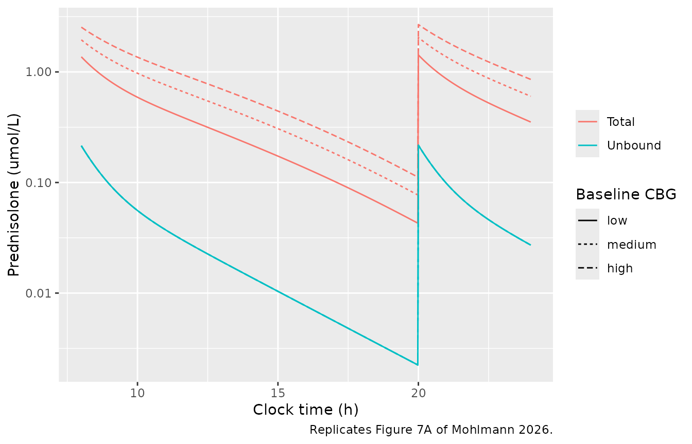
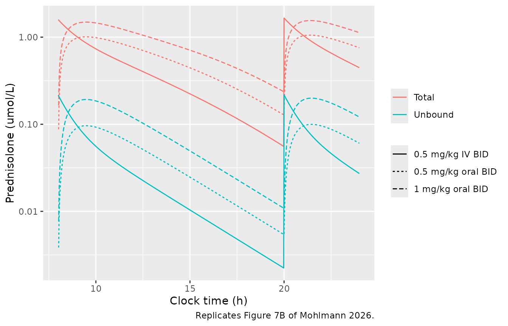
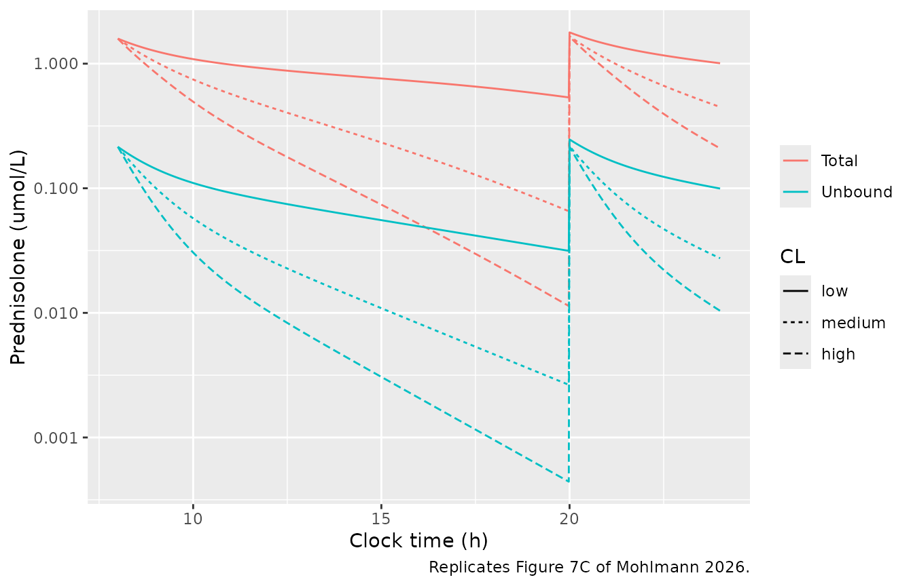
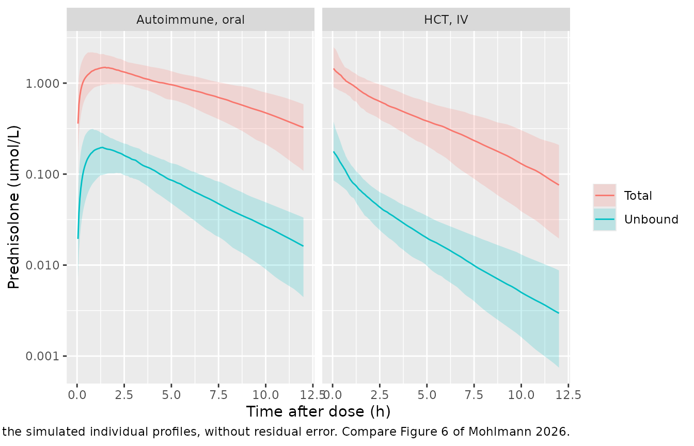

# Prednisolone (Mohlmann 2026)

## Model and source

    #> ℹ parameter labels from comments will be replaced by 'label()'

- Citation: Mohlmann JE, Lindemans CA, Jansen MHA, van Luin M, Punt AM,
  Ezzafzafi S, Nierkens S, Huitema ADR, de Vries Schultink AHM.
  Population Pharmacokinetics of Total and Protein-Unbound Prednisolone
  in Children with Immune-Mediated and Systemic Inflammatory Diseases.
  Clin Pharmacokinet. 2026;65(3):277-292.
  <doi:10.1007/s40262-025-01601-5>

- Description: Two-compartment population PK model for total and
  protein-unbound prednisolone in children with immune-mediated and
  systemic inflammatory diseases, oral or IV (Mohlmann 2026).
  First-order absorption with F fixed to 1; the disposition is
  parameterised on UNBOUND prednisolone with allometric scaling to 70 kg
  (exponents fixed at 0.75 and 1). Total prednisolone is recovered
  algebraically from linear binding to albumin plus saturable binding to
  corticosteroid-binding globulin (transcortin), the latter supplied as
  a time-varying covariate that follows its circadian rhythm. Clearance
  differs by cohort (HCT prophylaxis, HCT GvHD therapy, autoimmune
  disease as reference).

- Article: <https://doi.org/10.1007/s40262-025-01601-5> (open access,
  <https://europepmc.org/article/PMC/PMC12881105>)

- Online Resource 3 of the electronic supplementary material prints the
  final NONMEM control stream. Every parameter value in the model comes
  from that control stream; Table 2 of the article prints the same
  estimates, rounded.

## Population

Sixty children and young adults from two prospective studies at the
University Medical Centre Utrecht (Methods 2.1-2.2, Table 1, Table S1):
44 after allogeneic haematopoietic cell transplantation (HCT, PIKACHU
study), receiving prednisolone either as GvHD prophylaxis (1 mg/kg/day
IV in two doses after a cord-blood transplant) or as therapy of GvHD or
engraftment syndrome (2 mg/kg/day), and 16 with autoimmune or systemic
inflammatory disease (SLE, uveitis, IBD and others; CARPE DIEM study)
taking oral prednisolone, usually once daily. Median age 10 years (range
0.2-19), median weight 36.5 kg (5.0-109), 43% female. The PK dose was a
median 0.5 mg/kg (0.25-1); 66% of the 68 PK occasions were IV. Median
albumin was 31.1 g/L and median measured corticosteroid-binding globulin
(CBG) 1.09 umol/L. In total 305 total and 304 unbound (equilibrium
dialysis) serum prednisolone concentrations were measured.

## Model structure

The disposition is a two-compartment model with first-order absorption,
and both ODE states hold **unbound** prednisolone: CL and Q act on the
unbound pool, and the control stream reads the unbound concentration
directly off the central compartment (`CPU = A(2)/S2`). The total
concentration is an output transformation (Eqs 1-2; control stream
`CP`):

``` math
C_{tot} = C_u + \frac{C_u \cdot C_{CBG}}{K_{CBG} + C_u} + \frac{C_u \cdot C_{alb}}{K_{alb}}
```

with all concentrations in umol/L. Binding moves no mass and never feeds
back on the disposition. Following the library convention, `Cc` is the
central-pool (unbound) concentration and `Ctot` the total.

Three unit conversions come straight from the control stream:
prednisolone mg/L to umol/L by 2.77 (`S2 = V2/2.77`, MW 360.4), albumin
g/L to umol/L by dividing by 0.0665 (`ALBX = ALBM/0.0665`), and CBG mg/L
to umol/L by dividing by 52 (52 kDa, Discussion 4.3).

**CBG is a time-varying covariate.** CBG was measured once per occasion;
the authors then used the circadian model of Melin et al. (Eqs 7-8) to
estimate each child’s full 24-h CBG curve and supplied it to NONMEM as a
data column. The model therefore reads `TRANSCORTIN` (mg/L) at every
record rather than computing the rhythm itself. The helper below
rebuilds the curve from a baseline value with Eqs 7-8; `TIME` there is
hours after 3 PM.

``` r

# Eqs 7-8: CBGt = CBGb * (1 + Circ), with
# Circ = AMP24 cos(2 pi (TIME - SHIFT24) / 24) + AMP12 cos(2 pi (TIME - SHIFT12) / 12)
# AMP24 0.055, SHIFT24 1.8 h, AMP12 0.029, SHIFT12 15.7 h; TIME in h after 3 PM.
cbg_curve_um <- function(clock_h, cbg_base_um) {
  t_3pm <- (clock_h - 15) %% 24
  circ <- 0.055 * cos(2 * pi * (t_3pm - 1.8) / 24) +
    0.029 * cos(2 * pi * (t_3pm - 15.7) / 12)
  cbg_base_um * (1 + circ)
}
mw_cbg_kda <- 52 # converts umol/L to mg/L
```

The cohort covariate on CL has three levels (control-stream `PorT`): HCT
prophylaxis (x 1.10), HCT GvHD therapy (x 0.975) and autoimmune disease
(the reference). It is encoded with two indicators, `TX_HCT` (1 for both
HCT levels) and `AGVHD_ANY` (1 for the GvHD-therapy level), so that
`hct_proph = TX_HCT * (1 - AGVHD_ANY)` and
`hct_ther = TX_HCT * AGVHD_ANY` reproduce `THETA(8)**PP * THETA(9)**PT`.

## Source trace

| Quantity | Value | Source |
|----|----|----|
| ka | 0.68 1/h | Online Resource 3 THETA(1); Table 2 |
| CL (70 kg, autoimmune) | 155 L/h | THETA(2); Table 2 |
| Vc (70 kg) | 338 L | THETA(3); Table 2 |
| Q (70 kg) | 105 L/h | THETA(4); Table 2 |
| Vp (70 kg) | 170 L | THETA(5); Table 2 |
| Kalb | 200 umol/L | THETA(6); Table 2 |
| KCBG | 0.0476 umol/L | THETA(7); Results 3.4 (Table 2 rounds to 0.048) |
| HCT-prophylaxis on CL | 1.1 | THETA(8); Table 2 1.10 |
| HCT-therapy on CL | 0.975 | THETA(9); Table 2 0.97 |
| Allometric exponents | 0.75 (CL, Q), 1 (Vc, Vp), fixed | Methods 2.4.1; `$PK`; Results 3.3 |
| F | 1, fixed | Results 3.3; no F in `$PK` |
| IIV CL, Vc, Vp (block) | 0.0993, 0.365, 0.153; cov 0.097 (CL-Vc), -0.14 (Vc-Vp), 0 (CL-Vp) | `$OMEGA BLOCK(3)`; Table 2 |
| IIV ka | 0.268 | `$OMEGA`; Table 2 |
| Proportional error, unbound | variance 0.114 | `$SIGMA`; Table 2 33.8% |
| Proportional error, total | variance 0.0703 | `$SIGMA`; Table 2 26.5% |
| Binding equation | Eqs 1-2 | Methods 2.4.1; `$ERROR` `CP` |
| Unit conversions 2.77, 0.0665, 52 | – | `$PK` `S2`, `ALBX`; Discussion 4.3 |
| CBG circadian curve | Eqs 7-8 | Methods 2.4.3 |

### Omega and sigma scale

The control stream carries variances and Table 2 prints the square root
as a percentage. Recomputing every Table 2 entry from the variances
confirms the scale:

``` r

om <- c(cl = 0.0993, vc = 0.365, vp = 0.153, ka = 0.268)
check <- data.frame(
  Quantity = c("IIV CL", "IIV Vc", "IIV Vp", "IIV ka", "Corr CL-Vc", "Corr Vc-Vp",
               "Prop. error unbound", "Prop. error total"),
  Recomputed = 100 * c(
    sqrt(om), 0.097 / sqrt(om[["cl"]] * om[["vc"]]),
    -0.14 / sqrt(om[["vc"]] * om[["vp"]]), sqrt(0.114), sqrt(0.0703)
  ),
  Table2 = c(31.5, 60.4, 39.1, 51.8, 51.0, -59.0, 33.8, 26.5)
)
check$Recomputed <- round(check$Recomputed, 1)
knitr::kable(check, caption = "Table 2 percentages recomputed from the control-stream variances.")
```

| Quantity            | Recomputed | Table2 |
|:--------------------|-----------:|-------:|
| IIV CL              |       31.5 |   31.5 |
| IIV Vc              |       60.4 |   60.4 |
| IIV Vp              |       39.1 |   39.1 |
| IIV ka              |       51.8 |   51.8 |
| Corr CL-Vc          |       51.0 |   51.0 |
| Corr Vc-Vp          |      -59.2 |  -59.0 |
| Prop. error unbound |       33.8 |   33.8 |
| Prop. error total   |       26.5 |   26.5 |

Table 2 percentages recomputed from the control-stream variances.
{.table}

``` r

# The variances round to Table 2 exactly. The correlations differ by up to 0.2
# points because the control stream prints the covariances to two or three
# significant figures (0.097, -0.14); a variance-vs-SD mix-up would be off by
# tens of points.
stopifnot(all(abs(check$Recomputed - check$Table2) < 0.25))
```

## Typical-patient simulations (Figure 7)

Section 2.6 describes the simulated typical patient: 30 kg, prednisolone
0.5 mg/kg IV twice daily, baseline CBG 1.0 umol/L, albumin 35 g/L,
typical parameters. The IV dose is prednisolone sodium succinate, and
the data column `AMT` is the salt-corrected amount, so a 15 mg IV dose
enters the model as 15 x 0.75 = 11.25 mg of prednisolone. The paper does
not say when the doses were given; 8 AM and 8 PM are assumed here.
Unless stated otherwise the patient is in the autoimmune (reference)
cohort.

``` r

mod_typ <- rxode2::zeroRe(mod)

# One-subject typical-value solve. `clock0` is the clock hour at time 0, so the
# CBG curve is evaluated on the clock. Observation rows sit on the ODE state
# `central` with dvid = 1; rxSolve returns both Cc and Ctot as columns.
sim_typ <- function(dose_times, amt, cmt = "central", wt = 30, cbg_base = 1.0,
                    tx_hct = 0, agvhd = 0, t_end = 24, etalcl = 0, clock0 = 0) {
  obs_t <- seq(0, t_end, by = 0.02)
  ev <- dplyr::bind_rows(
    data.frame(time = dose_times, amt = amt, cmt = cmt, evid = 1L, dvid = NA_integer_),
    data.frame(time = obs_t, amt = NA_real_, cmt = "central", evid = 0L, dvid = 1L)
  ) |>
    dplyr::arrange(time, dplyr::desc(evid))
  ev$id <- 1L
  ev$WT <- wt
  ev$ALB <- 35
  ev$TX_HCT <- tx_hct
  ev$AGVHD_ANY <- agvhd
  ev$etalcl <- etalcl
  ev$TRANSCORTIN <- cbg_curve_um(ev$time + clock0, cbg_base) * mw_cbg_kda
  as.data.frame(rxode2::rxSolve(mod_typ, ev, returnType = "data.frame"))
}

# Typical-value curves are deterministic, so a trapezoid on a 0.02 h grid is
# only used for ratios of AUCs between these curves; the PKNCA section below
# does the NCA on the stochastic cohort.
trap <- function(t, y) sum(diff(t) * (head(y, -1) + tail(y, -1)) / 2)
auc_window <- function(s, col, lo = -Inf, hi = Inf) {
  x <- s[s$time >= lo & s$time <= hi, ]
  trap(x$time, x[[col]])
}
```

### Figure 7A: baseline CBG

``` r

cbg_levels <- c(low = 0.73, medium = 1.45, high = 2.18)
fig7a <- dplyr::bind_rows(lapply(names(cbg_levels), function(nm) {
  sim_typ(dose_times = c(8, 20), amt = 0.5 * 30 * 0.75, cbg_base = cbg_levels[[nm]]) |>
    dplyr::mutate(CBG = nm)
}))
#> ℹ omega/sigma items treated as zero: 'etalvp', 'etalvc', 'etalcl', 'etalka'
#> ℹ omega/sigma items treated as zero: 'etalvp', 'etalvc', 'etalcl', 'etalka'
#> ℹ omega/sigma items treated as zero: 'etalvp', 'etalvc', 'etalcl', 'etalka'
fig7a$CBG <- factor(fig7a$CBG, levels = names(cbg_levels))

fig7a |>
  tidyr::pivot_longer(c(Cc, Ctot), names_to = "analyte", values_to = "conc") |>
  dplyr::filter(conc > 0) |>
  dplyr::mutate(analyte = ifelse(analyte == "Cc", "Unbound", "Total")) |>
  ggplot(aes(time, conc, colour = analyte, linetype = CBG)) +
  geom_line() +
  scale_y_log10() +
  labs(x = "Clock time (h)", y = "Prednisolone (umol/L)", colour = NULL,
       linetype = "Baseline CBG",
       caption = "Replicates Figure 7A of Mohlmann 2026.")
```



``` r


fig7a_sum <- fig7a |>
  dplyr::group_by(CBG) |>
  dplyr::summarise(
    cmax_tot = max(Ctot),
    fb_at_cmax = 1 - Cc[which.max(Ctot)] / Ctot[which.max(Ctot)],
    auc_tot = trap(time, Ctot),
    .groups = "drop"
  ) |>
  dplyr::mutate(fb_paper = c(0.84, 0.89, 0.92))
knitr::kable(
  fig7a_sum |>
    dplyr::mutate(dplyr::across(where(is.numeric), \(x) signif(x, 3))) |>
    dplyr::rename(
      "Baseline CBG" = CBG, "Cmax total (umol/L)" = cmax_tot,
      "Fraction bound at Cmax" = fb_at_cmax, "AUC0-24 total (umol*h/L)" = auc_tot,
      "Fraction bound, paper" = fb_paper
    ),
  caption = "Figure 7A typical patient; the paper reports the fraction bound at the maximum total concentration (Results 3.7)."
)
```

| Baseline CBG | Cmax total (umol/L) | Fraction bound at Cmax | AUC0-24 total (umol\*h/L) | Fraction bound, paper |
|:---|---:|---:|---:|---:|
| low | 1.42 | 0.847 | 6.7 | 0.84 |
| medium | 2.05 | 0.894 | 10.9 | 0.89 |
| high | 2.68 | 0.919 | 15.1 | 0.92 |

Figure 7A typical patient; the paper reports the fraction bound at the
maximum total concentration (Results 3.7). {.table}

``` r


ratio <- function(x) x / x[1]
fig7a_ratio <- data.frame(
  Comparison = c("Cmax total, medium vs low", "Cmax total, high vs low",
                 "AUC total, medium vs low", "AUC total, high vs low"),
  Simulated = round(c(ratio(fig7a_sum$cmax_tot)[2:3], ratio(fig7a_sum$auc_tot)[2:3]), 2),
  Paper = c(1.4, 1.9, 1.6, 2.3)
)
knitr::kable(fig7a_ratio, caption = "Fold-changes reported in Results 3.7.")
```

| Comparison                | Simulated | Paper |
|:--------------------------|----------:|------:|
| Cmax total, medium vs low |      1.44 |   1.4 |
| Cmax total, high vs low   |      1.89 |   1.9 |
| AUC total, medium vs low  |      1.62 |   1.6 |
| AUC total, high vs low    |      2.26 |   2.3 |

Fold-changes reported in Results 3.7. {.table}

``` r


# Deterministic typical-value predictions: tight bounds. A wrong KCBG, Kalb, Vc
# or unit conversion moves the fraction bound by several hundredths and the
# ratios by tenths.
stopifnot(
  all(abs(fig7a_sum$fb_at_cmax - fig7a_sum$fb_paper) < 0.015),
  all(abs(fig7a_ratio$Simulated - fig7a_ratio$Paper) < 0.1)
)
```

The paper also reports that the morning dose accounts for about 51% of
the 24-h total AUC, a consequence of the circadian CBG rhythm. At steady
state (fourth day of twice-daily dosing):

``` r

ss <- sim_typ(dose_times = seq(8, 8 + 24 * 4, by = 12), amt = 0.5 * 30 * 0.75, t_end = 24 * 5)
#> ℹ omega/sigma items treated as zero: 'etalvp', 'etalvc', 'etalcl', 'etalka'
morning_share <- auc_window(ss, "Ctot", 80, 92) / auc_window(ss, "Ctot", 80, 104)
cat(sprintf("Morning share of the 24-h total AUC: %.1f%% (paper: about 51%%)\n", 100 * morning_share))
#> Morning share of the 24-h total AUC: 50.2% (paper: about 51%)
# Unbound PK is linear and CBG-independent, so the unbound split is exactly
# 50:50 at steady state.
stopifnot(
  abs(morning_share - 0.51) < 0.02,
  abs(auc_window(ss, "Cc", 80, 92) / auc_window(ss, "Cc", 80, 104) - 0.5) < 0.002
)
```

### Figure 7B: dosing regimen

``` r

regimens <- list(
  "0.5 mg/kg IV BID" = list(amt = 0.5 * 30 * 0.75, cmt = "central"),
  "0.5 mg/kg oral BID" = list(amt = 0.5 * 30, cmt = "depot"),
  "1 mg/kg oral BID" = list(amt = 1 * 30, cmt = "depot")
)
fig7b <- dplyr::bind_rows(lapply(names(regimens), function(nm) {
  r <- regimens[[nm]]
  sim_typ(dose_times = c(8, 20), amt = r$amt, cmt = r$cmt, t_end = 48) |>
    dplyr::mutate(regimen = nm)
}))
#> ℹ omega/sigma items treated as zero: 'etalvp', 'etalvc', 'etalcl', 'etalka'
#> ℹ omega/sigma items treated as zero: 'etalvp', 'etalvc', 'etalcl', 'etalka'
#> ℹ omega/sigma items treated as zero: 'etalvp', 'etalvc', 'etalcl', 'etalka'

fig7b |>
  dplyr::filter(time <= 24) |>
  tidyr::pivot_longer(c(Cc, Ctot), names_to = "analyte", values_to = "conc") |>
  dplyr::filter(conc > 0) |>
  dplyr::mutate(analyte = ifelse(analyte == "Cc", "Unbound", "Total")) |>
  ggplot(aes(time, conc, colour = analyte, linetype = regimen)) +
  geom_line() +
  scale_y_log10() +
  labs(x = "Clock time (h)", y = "Prednisolone (umol/L)", colour = NULL, linetype = NULL,
       caption = "Replicates Figure 7B of Mohlmann 2026.")
```



``` r


auc_reg <- fig7b |>
  dplyr::group_by(regimen) |>
  dplyr::summarise(auc_u = trap(time, Cc), auc_t = trap(time, Ctot),
                   tmax_after_dose = time[time <= 20][which.max(Ctot[time <= 20])] - 8,
                   .groups = "drop")
dbl_u <- auc_reg$auc_u[auc_reg$regimen == "1 mg/kg oral BID"] /
  auc_reg$auc_u[auc_reg$regimen == "0.5 mg/kg oral BID"]
dbl_t <- auc_reg$auc_t[auc_reg$regimen == "1 mg/kg oral BID"] /
  auc_reg$auc_t[auc_reg$regimen == "0.5 mg/kg oral BID"]
cat(sprintf("Doubling the oral dose: AUC unbound x %.2f (paper 2.0), AUC total x %.2f (paper 1.5)\n", dbl_u, dbl_t))
#> Doubling the oral dose: AUC unbound x 2.00 (paper 2.0), AUC total x 1.55 (paper 1.5)
cat(sprintf("Oral Tmax after the morning dose: %.1f h (paper: around 2 h)\n",
            auc_reg$tmax_after_dose[auc_reg$regimen == "0.5 mg/kg oral BID"]))
#> Oral Tmax after the morning dose: 1.5 h (paper: around 2 h)
stopifnot(
  # Unbound PK is linear, so the doubling is exact up to quadrature error.
  abs(dbl_u - 2) < 0.005,
  # Total is less than proportional because CBG saturates. The paper rounds
  # to one decimal, so anything in [1.45, 1.55] reads as 1.5.
  abs(dbl_t - 1.5) < 0.06
)
```

### Figure 7C: clearance

Figure 7C varies CL in a 70 kg patient (62, 185 and 309 L/h). It is
simulated here by shifting `etalcl`, with 0.5 mg/kg IV twice daily.

``` r

cl_levels <- c(low = 62, medium = 185, high = 309)
fig7c <- dplyr::bind_rows(lapply(names(cl_levels), function(nm) {
  sim_typ(dose_times = c(8, 20), amt = 0.5 * 70 * 0.75, wt = 70, t_end = 72,
          etalcl = log(cl_levels[[nm]] / 155)) |>
    dplyr::mutate(CL = nm)
}))
#> ℹ omega/sigma items treated as zero: 'etalvp', 'etalvc', 'etalcl', 'etalka'
#> ℹ omega/sigma items treated as zero: 'etalvp', 'etalvc', 'etalcl', 'etalka'
#> ℹ omega/sigma items treated as zero: 'etalvp', 'etalvc', 'etalcl', 'etalka'
fig7c$CL <- factor(fig7c$CL, levels = names(cl_levels))

fig7c |>
  dplyr::filter(time <= 24) |>
  tidyr::pivot_longer(c(Cc, Ctot), names_to = "analyte", values_to = "conc") |>
  dplyr::filter(conc > 0) |>
  dplyr::mutate(analyte = ifelse(analyte == "Cc", "Unbound", "Total")) |>
  ggplot(aes(time, conc, colour = analyte, linetype = CL)) +
  geom_line() +
  scale_y_log10() +
  labs(x = "Clock time (h)", y = "Prednisolone (umol/L)", colour = NULL, linetype = "CL",
       caption = "Replicates Figure 7C of Mohlmann 2026.")
```



``` r


auc_cl <- fig7c |>
  dplyr::group_by(CL) |>
  dplyr::summarise(auc_u = trap(time, Cc), auc_t = trap(time, Ctot), .groups = "drop")
# Terminal half-life of the typical two-compartment system at each CL.
t_half_terminal <- sapply(cl_levels, function(cl) {
  kel <- cl / 338; k12 <- 105 / 338; k21 <- 105 / 170
  a <- kel + k12 + k21
  log(2) / ((a - sqrt(a^2 - 4 * kel * k21)) / 2)
})
knitr::kable(
  data.frame(
    CL = names(cl_levels),
    "AUC unbound, fold vs low" = round(auc_cl$auc_u[1] / auc_cl$auc_u, 2),
    "AUC total, fold vs low" = round(auc_cl$auc_t[1] / auc_cl$auc_t, 2),
    "Paper AUC total fold" = c(1, 2.8, 4.8),
    "Terminal t1/2 (h)" = round(unname(t_half_terminal), 1),
    "Paper t1/2 (h)" = c(4.9, 1.6, 1.0),
    check.names = FALSE,
    row.names = NULL
  ),
  caption = "Figure 7C: fold-decrease in AUC (0-72 h) relative to the low-CL patient, and half-lives."
)
```

| CL | AUC unbound, fold vs low | AUC total, fold vs low | Paper AUC total fold | Terminal t1/2 (h) | Paper t1/2 (h) |
|:---|---:|---:|---:|---:|---:|
| low | 1.00 | 1.00 | 1.0 | 6.1 | 4.9 |
| medium | 2.97 | 2.74 | 2.8 | 2.4 | 1.6 |
| high | 4.94 | 4.57 | 4.8 | 1.8 | 1.0 |

Figure 7C: fold-decrease in AUC (0-72 h) relative to the low-CL patient,
and half-lives. {.table}

``` r

stopifnot(abs(auc_cl$auc_u[1] / auc_cl$auc_u[3] - 309 / 62) < 0.05)
```

The unbound AUC falls in proportion to CL. The simulated total AUC falls
2.7- and 4.6-fold where the paper prints 2.8- and 4.8-fold, and the
printed half-lives (4.9, 1.6 and 1.0 h) are shorter than the terminal
half-lives of the published parameters (6.1, 2.4, 1.8 h). The printed
half-lives scale approximately as 1/CL with an implied volume of 430-450
L (half-life x CL / ln 2), which does not correspond to Vc (338 L) or
Vc + Vp (508 L); the paper does not say how they were computed, so these
two comparisons are reported rather than asserted.

### Figure 7D: cohort

``` r

cohorts <- list(
  "Autoimmune (reference)" = c(tx_hct = 0, agvhd = 0),
  "HCT prophylaxis" = c(tx_hct = 1, agvhd = 0),
  "HCT therapy" = c(tx_hct = 1, agvhd = 1)
)
fig7d <- dplyr::bind_rows(lapply(names(cohorts), function(nm) {
  h <- cohorts[[nm]]
  sim_typ(dose_times = 8, amt = 1 * 30, cmt = "depot", t_end = 72,
          tx_hct = h[["tx_hct"]], agvhd = h[["agvhd"]]) |>
    dplyr::mutate(cohort = nm)
}))
#> ℹ omega/sigma items treated as zero: 'etalvp', 'etalvc', 'etalcl', 'etalka'
#> ℹ omega/sigma items treated as zero: 'etalvp', 'etalvc', 'etalcl', 'etalka'
#> ℹ omega/sigma items treated as zero: 'etalvp', 'etalvc', 'etalcl', 'etalka'
auc_coh <- fig7d |>
  dplyr::group_by(cohort) |>
  dplyr::summarise(auc_u = trap(time, Cc), auc_t = trap(time, Ctot), .groups = "drop")
ref <- auc_coh[auc_coh$cohort == "HCT prophylaxis", ]
others <- auc_coh[auc_coh$cohort != "HCT prophylaxis", ]
knitr::kable(
  data.frame(
    "Compared with" = others$cohort,
    "AUC unbound lower in HCT prophylaxis (%)" = round(100 * (1 - ref$auc_u / others$auc_u), 1),
    "AUC total lower in HCT prophylaxis (%)" = round(100 * (1 - ref$auc_t / others$auc_t), 1),
    check.names = FALSE
  ),
  caption = "Figure 7D, 1 mg/kg oral single dose. Paper (Results 3.7): 10.6-12.1% lower unbound and 9.1-10.3% lower total AUC."
)
```

| Compared with | AUC unbound lower in HCT prophylaxis (%) | AUC total lower in HCT prophylaxis (%) |
|:---|---:|---:|
| Autoimmune (reference) | 9.1 | 8.0 |
| HCT therapy | 11.4 | 10.1 |

Figure 7D, 1 mg/kg oral single dose. Paper (Results 3.7): 10.6-12.1%
lower unbound and 9.1-10.3% lower total AUC. {.table}

``` r

# Linear unbound PK: the unbound difference is exactly 1 - 1/1.1 against the
# reference cohort.
stopifnot(abs(100 * (1 - ref$auc_u / others$auc_u[others$cohort == "Autoimmune (reference)"]) -
                100 * (1 - 1 / 1.1)) < 0.1)
```

The simulated differences (9.1-11.4% unbound, 8.0-10.1% total) sit up to
about 1.5 percentage points below the paper’s ranges. Against the
autoimmune cohort the unbound difference can only be 1 - 1/1.1 = 9.1%
for linear unbound kinetics, so the paper’s lower bound of 10.6% is not
reproducible from the published parameters; the source of the difference
is not stated.

## Virtual cohort

Two arms of 150 children each: an autoimmune arm (ages 6-18 years, a
single oral 1 mg/kg dose at 8 AM) and an HCT arm (ages 0.5-18 years, a
single IV 0.5 mg/kg dose of the succinate salt at 8 AM, half on
prophylaxis and half on GvHD therapy). Weight is drawn around
approximate 50th-percentile weight-for-age values with a 15% CV, albumin
from a normal distribution matching Table 1, and baseline CBG
log-normally around the observed median 1.04 umol/L, both kept inside
the observed ranges by redrawing.

``` r

set.seed(20260101)
n_per_arm <- 150

# Approximate 50th-percentile weight-for-age (kg), both sexes.
wfa <- data.frame(
  age = c(0.5, 1, 2, 3, 4, 5, 6, 8, 10, 12, 14, 16, 18),
  wt = c(7.6, 9.6, 12.5, 14.3, 16.3, 18.4, 20.7, 25.8, 32.5, 40.5, 50, 58, 63)
)
# Reject-and-redraw keeps a draw inside its observed range without piling
# values up at the limits.
draw_in <- function(n, sampler, lo, hi) {
  out <- sampler(n)
  bad <- out < lo | out > hi
  while (any(bad)) {
    out[bad] <- sampler(sum(bad))
    bad <- out < lo | out > hi
  }
  out
}
draw_wt <- function(wt_med) {
  wt <- wt_med * exp(stats::rnorm(length(wt_med), 0, 0.15))
  bad <- wt < 5 | wt > 109
  while (any(bad)) {
    wt[bad] <- wt_med[bad] * exp(stats::rnorm(sum(bad), 0, 0.15))
    bad <- wt < 5 | wt > 109
  }
  wt
}
make_arm <- function(arm, age_lo) {
  age <- stats::runif(n_per_arm, age_lo, 18)
  data.frame(
    arm = arm,
    id = seq_len(n_per_arm),
    AGE = age,
    WT = draw_wt(stats::approx(wfa$age, wfa$wt, xout = age)$y),
    ALB = draw_in(n_per_arm, \(n) stats::rnorm(n, 31.1, 6), 13.9, 44.3),
    cbg_base = draw_in(n_per_arm, \(n) stats::rlnorm(n, log(1.04), 0.3), 0.60, 2.48)
  )
}
subjects <- dplyr::bind_rows(make_arm("Autoimmune, oral", 6), make_arm("HCT, IV", 0.5)) |>
  dplyr::mutate(
    TX_HCT = as.integer(arm == "HCT, IV"),
    AGVHD_ANY = as.integer(arm == "HCT, IV" & id > n_per_arm / 2),
    amt = ifelse(arm == "HCT, IV", 0.5 * WT * 0.75, 1 * WT),
    cmt = ifelse(arm == "HCT, IV", "central", "depot")
  )
stopifnot(abs(stats::median(subjects$ALB) - 31.1) < 2,
          abs(stats::median(subjects$cbg_base) - 1.04) < 0.1)
```

``` r

grid <- sort(unique(c(seq(0, 2, by = 0.05), seq(2, 8, by = 0.1), seq(8, 48, by = 0.25))))
cohort_events <- dplyr::bind_rows(lapply(seq_len(nrow(subjects)), function(i) {
  s <- subjects[i, ]
  ev <- rbind(
    data.frame(time = 0, amt = s$amt, cmt = s$cmt, evid = 1L, dvid = NA_integer_),
    data.frame(time = grid, amt = NA_real_, cmt = "central", evid = 0L, dvid = 1L)
  )
  ev <- ev[order(ev$time, -ev$evid), ]
  ev$id <- s$id; ev$arm <- s$arm
  ev$WT <- s$WT; ev$ALB <- s$ALB; ev$TX_HCT <- s$TX_HCT; ev$AGVHD_ANY <- s$AGVHD_ANY
  # Dose at 8 AM: time 0 is clock 8 h.
  ev$TRANSCORTIN <- cbg_curve_um(ev$time + 8, s$cbg_base) * mw_cbg_kda
  ev
}))
```

### Simulated profiles (compare Figure 6)

``` r

# Each arm is solved separately because the IDs are reused across arms.
sim_vpc <- dplyr::bind_rows(lapply(unique(subjects$arm), function(a) {
  rxode2::rxSolve(mod, dplyr::filter(cohort_events, arm == a),
                  keep = c("arm"), returnType = "data.frame") |>
    as.data.frame()
}))
sim_vpc |>
  dplyr::filter(time > 0, time <= 12) |>
  tidyr::pivot_longer(c(Cc, Ctot), names_to = "analyte", values_to = "conc") |>
  dplyr::mutate(analyte = ifelse(analyte == "Cc", "Unbound", "Total")) |>
  dplyr::group_by(arm, analyte, time) |>
  dplyr::summarise(p10 = stats::quantile(conc, 0.1), p50 = stats::median(conc),
                   p90 = stats::quantile(conc, 0.9), .groups = "drop") |>
  ggplot(aes(time, p50, colour = analyte, fill = analyte)) +
  geom_ribbon(aes(ymin = p10, ymax = p90), alpha = 0.2, colour = NA) +
  geom_line() +
  facet_wrap(~arm) +
  scale_y_log10() +
  labs(x = "Time after dose (h)", y = "Prednisolone (umol/L)", colour = NULL, fill = NULL,
       caption = "Median and 10th-90th percentiles of the simulated individual profiles, without residual error. Compare Figure 6 of Mohlmann 2026.")
```



## PKNCA validation

The paper reports no NCA table, so PKNCA is used to summarise the
simulated exposure and to check the model’s mass balance: because
elimination is linear in unbound prednisolone and the dose enters the
unbound pool with F = 1, each subject’s CL times unbound AUC to infinity
(converted to mg\*h/L by dividing by 2.77) must return the administered
dose.

``` r

# Between-subject variability on, residual error off: the mass-balance
# identity is a property of the ODE system, and residual noise would only blur
# AUC.
mod_nores <- rxode2::zeroRe(mod, which = "sigma")
sim_nca_raw <- dplyr::bind_rows(lapply(unique(subjects$arm), function(a) {
  rxode2::rxSolve(mod_nores, dplyr::filter(cohort_events, arm == a),
                  keep = c("arm"), returnType = "data.frame") |>
    as.data.frame()
}))
stopifnot(all(sim_nca_raw$Cc >= 0), all(sim_nca_raw$Ctot >= sim_nca_raw$Cc))
```

``` r

run_nca <- function(conc_col) {
  conc <- sim_nca_raw |>
    dplyr::filter(!is.na(.data[[conc_col]])) |>
    dplyr::select(id, time, arm, conc = dplyr::all_of(conc_col))
  # Guarantee a time = 0 record per subject; pre-dose prednisolone is 0.
  conc <- dplyr::bind_rows(conc, conc |> dplyr::distinct(id, arm) |> dplyr::mutate(time = 0, conc = 0)) |>
    dplyr::distinct(id, arm, time, .keep_all = TRUE) |>
    dplyr::arrange(arm, id, time)
  conc_obj <- PKNCA::PKNCAconc(conc, conc ~ time | arm + id, concu = "umol/L", timeu = "h")
  dose_obj <- PKNCA::PKNCAdose(
    subjects |> dplyr::mutate(time = 0) |> dplyr::select(id, arm, time, amt),
    amt ~ time | arm + id, doseu = "mg"
  )
  intervals <- data.frame(start = 0, end = Inf, cmax = TRUE, tmax = TRUE,
                          aucinf.obs = TRUE, half.life = TRUE)
  PKNCA::pk.nca(PKNCA::PKNCAdata(conc_obj, dose_obj, intervals = intervals)) |>
    as.data.frame() |>
    dplyr::select(arm, id, PPTESTCD, PPORRES) |>
    tidyr::pivot_wider(names_from = PPTESTCD, values_from = PPORRES)
}
nca_u <- run_nca("Cc")
nca_t <- run_nca("Ctot")
stopifnot(nrow(nca_u) == 2 * n_per_arm, !anyNA(nca_u$aucinf.obs), !anyNA(nca_t$aucinf.obs))

nca_tab <- dplyr::bind_rows(
  nca_u |> dplyr::mutate(analyte = "Unbound"),
  nca_t |> dplyr::mutate(analyte = "Total")
) |>
  dplyr::group_by(arm, analyte) |>
  dplyr::summarise(
    cmax = sprintf("%.3g (%.3g-%.3g)", stats::median(cmax), stats::quantile(cmax, 0.05), stats::quantile(cmax, 0.95)),
    tmax = sprintf("%.2g", stats::median(tmax)),
    auc = sprintf("%.3g (%.3g-%.3g)", stats::median(aucinf.obs), stats::quantile(aucinf.obs, 0.05), stats::quantile(aucinf.obs, 0.95)),
    thalf = sprintf("%.2g", stats::median(half.life)),
    .groups = "drop"
  ) |>
  dplyr::rename("Arm" = arm, "Analyte" = analyte, "Cmax (umol/L)" = cmax,
                "Tmax (h)" = tmax, "AUC0-inf (umol*h/L)" = auc, "t1/2 (h)" = thalf)
knitr::kable(nca_tab, caption = "Single-dose NCA, median (5th-95th percentile). Autoimmune: 1 mg/kg oral; HCT: 0.5 mg/kg IV succinate (0.375 mg/kg prednisolone).")
```

| Arm | Analyte | Cmax (umol/L) | Tmax (h) | AUC0-inf (umol\*h/L) | t1/2 (h) |
|:---|:---|:---|:---|:---|:---|
| Autoimmune, oral | Total | 1.45 (0.885-2.37) | 1.5 | 11.9 (6.69-20.1) | 2.7 |
| Autoimmune, oral | Unbound | 0.177 (0.0957-0.356) | 1.5 | 1.04 (0.607-1.65) | 2.6 |
| HCT, IV | Total | 1.67 (1-3.08) | 0 | 5.13 (2.75-10.1) | 2.5 |
| HCT, IV | Unbound | 0.226 (0.0815-0.597) | 0 | 0.371 (0.195-0.657) | 2.4 |

Single-dose NCA, median (5th-95th percentile). Autoimmune: 1 mg/kg oral;
HCT: 0.5 mg/kg IV succinate (0.375 mg/kg prednisolone). {.table
style="width:100%;"}

``` r

cl_per_id <- sim_nca_raw |>
  dplyr::group_by(arm, id) |>
  dplyr::summarise(cl = dplyr::first(cl), .groups = "drop")
mb <- nca_u |>
  dplyr::left_join(cl_per_id, by = c("arm", "id")) |>
  dplyr::left_join(subjects |> dplyr::select(arm, id, amt), by = c("arm", "id")) |>
  dplyr::mutate(pct_diff = 100 * (cl * aucinf.obs / 2.77 - amt) / amt)
knitr::kable(
  mb |>
    dplyr::group_by(arm) |>
    dplyr::summarise(median = round(stats::median(pct_diff), 3),
                     max_abs = round(max(abs(pct_diff)), 3), .groups = "drop") |>
    dplyr::rename("Arm" = arm, "Median CL*AUC/dose - 1 (%)" = median, "Max |diff| (%)" = max_abs),
  caption = "Mass balance on unbound prednisolone."
)
```

| Arm              | Median CL\*AUC/dose - 1 (%) | Max \|diff\| (%) |
|:-----------------|----------------------------:|-----------------:|
| Autoimmune, oral |                      -0.010 |            0.056 |
| HCT, IV          |                       0.005 |            0.023 |

Mass balance on unbound prednisolone. {.table}

``` r

# Both sides use the same drawn parameters, so the residual is quadrature and
# extrapolation error only; a tight bound is correct. It fails if the dose were
# scaled by an unwanted F or the mg/L-to-umol/L factor were wrong.
stopifnot(max(abs(mb$pct_diff)) < 1)
```

## Assumptions and deviations

- **Dose clock times.** The paper does not state when the Figure 7 doses
  were given; 8 AM and 8 PM are assumed. Only the circadian CBG term
  depends on this, and the 51% morning-AUC share is reproduced under
  that assumption.
- **CBG is a supplied covariate, not computed in the model.** Following
  the control stream, the model reads a time-varying CBG column
  (`TRANSCORTIN`, mg/L). The vignette rebuilds it with Eqs 7-8 from a
  baseline value. In the study the baseline itself was an empirical
  Bayes estimate from one measurement per occasion with the Melin et
  al. model.
- **IV doses are the salt-corrected amount.** The data column `AMT` is
  the prednisolone amount after correcting the sodium succinate salt by
  0.75; dose IV prednisolone as `0.75 x` the labelled salt dose into
  `central`. Results 3.7 states the 0.75 conversion factor, and the
  Figure 7A fraction-bound values are reproduced with it.
- **AUC bookkeeping states omitted.** The control stream integrates
  unbound and total AUC in two extra compartments (`AUCU`, `AUCT`) for
  its table output; they do not affect the PK and are not included.
  Compute AUC from `Cc` and `Ctot`.
- **The cohort covariate** is encoded with `TX_HCT` and `AGVHD_ANY`; the
  paper’s HCT-therapy level also includes engraftment syndrome treated
  with the same 2 mg/kg/day regimen.
- **Unreproduced numbers.** The Figure 7C half-lives and the lower end
  of the Figure 7D AUC differences do not follow from the published
  parameters (see above). They are reported, not asserted.
- **Virtual cohort.** Weight-for-age medians, albumin and CBG
  distributions are approximations matched to the Table 1 centre and
  range; the paper’s individual covariates are not available.
- **Screened covariates not in the model.** Sex, age, maturation
  (postmenstrual age), CYP3A4 inhibitors, cyclosporin A, antithymocyte
  globulin, liver function and oral formulation were tested and not
  retained (Results 3.4); IOV and an estimated F (1.17) were also
  rejected (Results 3.3).
