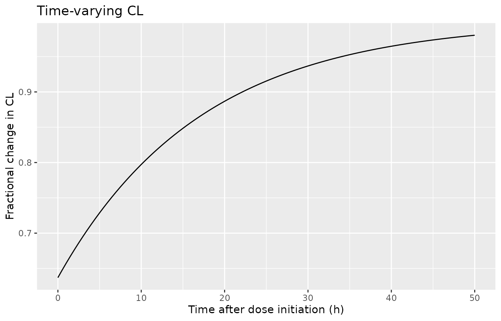
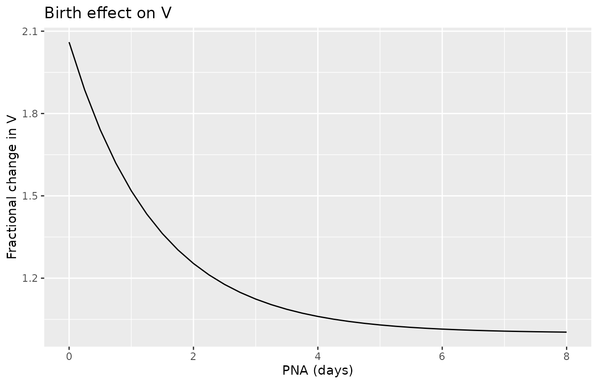
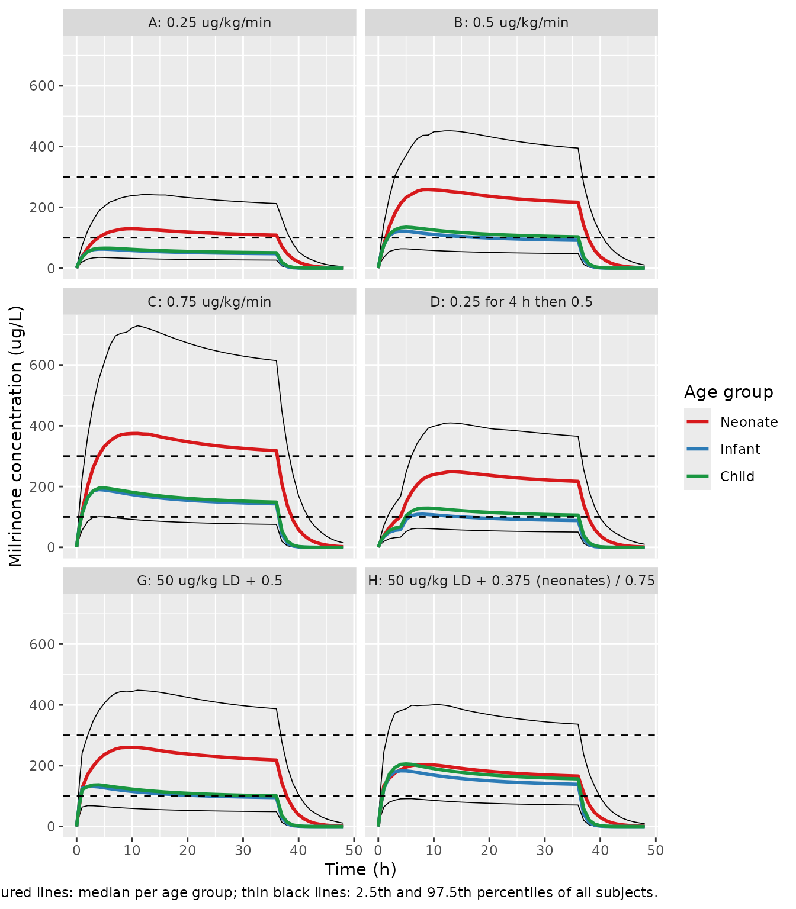

# Milrinone (O'Hanlon 2024)

## Model and source

- Citation: O’Hanlon CJ, Sumpter A, Anderson BJ, Hannam JA. Time-Varying
  Clearance in Milrinone Pharmacokinetics from Premature Neonates to
  Adolescents. Clin Pharmacokinet. 2024;63(5):695-706.
  <doi:10.1007/s40262-024-01372-5>
- Description: One-compartment population PK model of intravenous
  milrinone from premature neonates to adolescents (O’Hanlon 2024),
  pooling 50 children after cardiac surgery with cardiopulmonary bypass
  and 29 very premature neonates (Paradisis 2007). Clearance scales with
  fat-free mass (exponent 3/4), a sigmoid postmenstrual-age maturation
  function and relative renal function (eGFR / normal GFR), and rises
  over time on milrinone from 63.7% of its asymptote at infusion start
  (fractional deficit 0.363, half-time 11.9 h). Volume scales linearly
  with fat-free mass and is 2.06 times its mature value at birth,
  decaying toward it with a postnatal-age half-time of 0.969 days.
  Correlated log-normal IIV on CL and V; combined residual error
  estimated separately for two LC-MS bioanalytical batches and the
  HPLC-UV neonatal study, with a log-normal random effect on the
  residual SD.
- Article: <https://doi.org/10.1007/s40262-024-01372-5> (open access;
  PMC11106138)
- Supplement: electronic supplementary material 1 (Tables S1-S2, VPC and
  simulation figures) and 2 (the final-model NONMEM control stream),
  both linked from the article page.

No erratum or correction notice for this article was found on the
publisher page or in PubMed as of 2026-11-08.

## Population

O’Hanlon 2024 pooled two studies (Table 1). The Starship Children’s
Hospital study (Auckland, New Zealand, 2011-2012) enrolled 50 children
aged 4 days to 16 years (median postnatal age 0.656 years, median weight
8.05 kg, 3.44-80.9 kg; 60% male) who received a milrinone infusion of
0.25-1.25 ug/kg/min after cardiac surgery with cardiopulmonary bypass,
titrated to response. Plasma milrinone was measured by LC-MS (LLOQ 5
ug/L) in two analytical batches; 37 of 245 samples were below the LLOQ
and were handled with the M3 method. Paradisis et al. 2007 contributed
29 very premature neonates (postmenstrual age 23.7-27.3 weeks, postnatal
age 0.125-1.25 days, median weight 0.85 kg) given 0.25, 0.5 or 0.75
ug/kg/min for 3 h followed by 0.2 ug/kg/min to prevent low systemic
blood flow, with 124 serum samples measured by HPLC-UV (LLOQ 20 ug/L).
Altogether 369 concentrations from 79 patients were analysed in NONMEM
7.5.1.

The same information is available programmatically:

``` r

str(rxode2::rxode(readModelDb("OHanlon_2024_milrinone"))$population)
#> ℹ parameter labels from comments will be replaced by 'label()'
#> List of 15
#>  $ species       : chr "human"
#>  $ n_subjects    : int 79
#>  $ n_studies     : int 2
#>  $ n_observations: int 369
#>  $ age_range     : chr "Starship study: PNA 4 days to 16 years (PMA 39.1-769 weeks, 2.5th-97.5th percentile); Paradisis 2007: PNA 0.125"| __truncated__
#>  $ age_median    : chr "Starship study: PNA 0.656 years, PMA 73.8 weeks; Paradisis 2007: PNA 0.75 days, PMA 26.0 weeks"
#>  $ weight_range  : chr "Starship study: 3.44-80.9 kg; Paradisis 2007: 0.549-1.17 kg (2.5th-97.5th percentile)"
#>  $ weight_median : chr "Starship study: 8.05 kg; Paradisis 2007: 0.85 kg"
#>  $ ffm_median    : chr "Starship study: 5.80 kg (3.02-54.6); Paradisis 2007: 0.808 kg (0.522-1.11)"
#>  $ sex_female_pct: num 40.5
#>  $ disease_state : chr "Starship study: children after cardiac surgery supported by cardiopulmonary bypass, milrinone for prophylaxis o"| __truncated__
#>  $ dose_range    : chr "Starship study: IV infusion 0.25-1.25 ug/kg/min started after the end of bypass, titrated to response; Paradisi"| __truncated__
#>  $ renal_function: chr "Day-1 eGFR median 54.1 mL/min/1.73 m^2 (18.1-93.3) in the Starship study; RF assumed 1 in Paradisis 2007 neonates."
#>  $ regions       : chr "New Zealand (Starship Children's Hospital, Auckland) and Australia (Paradisis 2007)."
#>  $ notes         : chr "O'Hanlon 2024 Table 1 and Results. 245 Starship samples (LC-MS, LLOQ 5 ug/L, two analytical batches; 37 BLQ han"| __truncated__
```

## Source trace

Every `ini()` value carries an in-file comment pointing at its source.
All structural values appear in Table 2 and, identically, as the
`$THETA` of the published control stream (ESM 2), with the one exception
noted below.

| Equation / parameter | Value | Source location |
|----|----|----|
| `lcl` (asymptotic CL, 70 kg / 56.1 kg FFM) | `log(17.6)` L/h | Table 2 ‘CL’; ctl `POP_CL` |
| `lvc` (mature V, 70 kg / 56.1 kg FFM) | `log(20.8)` L | Table 2 ‘V’; ctl `POP_V` |
| `e_ffm_cl`, `e_ffm_vc` | 0.75, 1 (fixed) | Eq. 13-14; ctl `FSZ_CL_RF`, `FSZ_V` |
| NFM = FFM, NFMstd = 56.1 kg | Ffat = 0 (fixed) | Eq. 1-3; Table 2 ‘Ffat CL’, ‘Ffat V’ = 0 FIX |
| `ltmat50` | `log(49.8)` weeks PMA | Table 2 ‘TM50’; ctl `TM50_RF` |
| `lhill_mat` | `log(4.04)` | Table 2 ‘HILL’; ctl `HILL_RF` |
| Maturation `1 / (1 + (PMA / TM50)^-HILL)` | n/a | Eq. 4 |
| `RENALFUNC_REL` multiplies CL | n/a | Eq. 6, 13; ctl `FRF` (FCLR = 1 FIX) |
| `cl_exp_fdef` | 0.363 | Table 2 ‘FCL’; ctl `POP_CONCL` |
| `lcl_exp_kdes` | `log(log(2) / 11.9)` 1/h | Table 2 ‘TCL’ = 11.9 h; ctl `POP_TCL` |
| `cl(t) = cl * (1 - FCL * exp(-ln2 * t / TCL))`, inside the ODE | n/a | Eq. 9, 13; ctl `$DES` |
| `vc_pna_famp` | 1.06 | Table 2 ‘FV’; ctl `POP_CONV_PNA` |
| `lvc_pna_kdes` | `log(log(2) / 0.969)` 1/day | Table 2 ‘TVOL’ = 0.969 days; ctl `POP_TVOL_PNA` |
| `V = vc * (1 + FV * exp(-ln2 * PNA_days / TVOL))` | n/a | Eq. 5, 14; ctl `VAGE_PNA` |
| `etalcl + etalvc` | 0.129, 0.114, 0.115 | ctl `$OMEGA BLOCK(2)`; Table 2 PPV 0.359 / 0.339, r 0.936 |
| `etaRUV` | 0.0669 | ctl `PPV_RUVCP`; Table 2 ‘PPV RUV’ 0.259 |
| `propSd`, `addSd` (batch 1) | 0.382, 34.8 ug/L | Table 2 ‘CV / SD batch 1’; ctl `RUV_CVCP1`, `RUV_SDCP1` |
| `propSd_batch2`, `addSd_batch2` | 0.332, 7.86 ug/L | Table 2 ‘CV / SD batch 2’ (ctl `RUV_CVCP2` = 0.322) |
| `propSd_paradisis`, `addSd_paradisis` | 0 (fixed), 31.4 ug/L | Table 2 ‘CV / SD Paradisis’; ctl `RUV_CVCP3`, `RUV_SDCP3` |
| Combined error `sqrt((CP*CV)^2 + SD^2) * exp(etaRUV)` | n/a | Eq. 12; ctl `$ERROR` |

The PPVs reproduce from the OMEGA block: `sqrt(0.129) = 0.359`,
`sqrt(0.115) = 0.339`, and `0.114 / sqrt(0.129 * 0.115) = 0.936`.

## Time-varying clearance and the birth effect on volume (Figure 1)

Figure 1 of the paper shows the two empirical functions of the final
model. The chunk below evaluates them through the packaged model itself
(the model’s `cl_time` and `vc` outputs from a typical-value solve)
rather than from hand-written formulas.

``` r

mod <- readModelDb("OHanlon_2024_milrinone")
mod_typical <- rxode2::zeroRe(mod)
#> ℹ parameter labels from comments will be replaced by 'label()'
#> Warning: No sigma parameters in the model

# A 70 kg adult (FFM 56.1 kg, fully mature, normal renal function) per value
# of postnatal age in days; observation grid over 0-50 h.
pna_days <- seq(0, 8, by = 0.25)
fig1_ev <- tidyr::expand_grid(id = seq_along(pna_days), time = seq(0, 50, by = 0.5)) |>
  mutate(
    evid = 0, amt = 0, cmt = "central",
    PNA = pna_days[id] / 30.4375,
    FFM = 56.1, PAGE = 2000, RENALFUNC_REL = 1,
    ASSAY_BATCH2 = 0, STUDY_PARADISIS2007 = 0
  )
fig1 <- rxode2::rxSolve(mod_typical, events = fig1_ev) |>
  as.data.frame()
#> ℹ omega/sigma items treated as zero: 'etalcl', 'etalvc', 'etaRUV'
#> Warning: multi-subject simulation without without 'omega'

fcl <- fig1 |> filter(id == max(id))
fv <- fig1 |> filter(time == 0) |> mutate(pna_d = pna_days[id], fv = vc / 20.8)

stopifnot(
  # CL starts at 1 - 0.363 = 0.637 of its asymptote and has risen to 0.95
  # by 2.4 half-times (~29 h).
  abs(fcl$cl_time[fcl$time == 0] - 0.637) < 1e-9,
  abs(fcl$cl_time[fcl$time == 50] - (1 - 0.363 * 2^(-50 / 11.9))) < 1e-9,
  # V at birth is 1 + 1.06 = 2.06 times the mature value: 42.8 L / 70 kg.
  abs(fv$vc[fv$pna_d == 0] - 20.8 * 2.06) < 1e-9
)

p1 <- ggplot(fcl, aes(time, cl_time)) +
  geom_line() +
  labs(x = "Time after dose initiation (h)", y = "Fractional change in CL",
       title = "Time-varying CL")
p2 <- ggplot(fv, aes(pna_d, fv)) +
  geom_line() +
  labs(x = "PNA (days)", y = "Fractional change in V",
       title = "Birth effect on V")
print(p1)
```



``` r

print(p2)
```



*Replicates Figure 1 of O’Hanlon 2024: the left panel starts at 0.637
and approaches 1 by 50 h; the right panel starts at 2.06 and approaches
1 by PNA 6-8 days.*

The Discussion quotes the volume at birth as 42.6 L/70 kg and at 1 day
PNA as 31.2 L/70 kg. Those numbers use the bootstrap means (V 20.4 L, FV
1.07, TVOL 0.977 days); the final estimates packaged here give the
values below.

``` r

v_check <- tibble(
  `PNA (days)` = c(0, 1),
  `Packaged model (final estimates), L/70 kg` = signif(
    approx(fv$pna_d, fv$vc, xout = c(0, 1))$y, 3
  ),
  `Bootstrap means, L/70 kg` = signif(20.4 * (1 + 1.07 * 2^(-c(0, 1) / 0.977)), 3),
  `Paper text, L/70 kg` = c(42.6, 31.2)
)
knitr::kable(v_check)
```

| PNA (days) | Packaged model (final estimates), L/70 kg | Bootstrap means, L/70 kg | Paper text, L/70 kg |
|---:|---:|---:|---:|
| 0 | 42.8 | 42.2 | 42.6 |
| 1 | 31.6 | 31.1 | 31.2 |

## Steady-state check and PKNCA

With CL fully recovered (`t` much greater than TCL), the concentration
during a constant-rate infusion approaches `rate / CL`. A typical 70 kg
adult at 0.5 ug/kg/min (2100 ug/h) with CL = 17.6 L/h should therefore
average 119.3 ug/L over a late dosing interval. PKNCA computes the
average concentration over 168-192 h of a continuous infusion.

``` r

rate_adult <- 0.5 * 70 * 60 # ug/h
ss_ev <- bind_rows(
  tibble(id = 1L, time = 0, evid = 1, amt = rate_adult * 200, rate = rate_adult, cmt = "central"),
  tibble(id = 1L, time = c(0, seq(0.5, 200, by = 0.5)), evid = 0, amt = 0, rate = 0, cmt = "central")
) |>
  mutate(
    FFM = 56.1, PAGE = 2000, PNA = 360, RENALFUNC_REL = 1,
    ASSAY_BATCH2 = 0, STUDY_PARADISIS2007 = 0, treatment = "0.5 ug/kg/min, 70 kg"
  ) |>
  arrange(id, time, desc(evid))
ss_sim <- rxode2::rxSolve(mod_typical, events = ss_ev, keep = "treatment",
                          rtol = 1e-10, atol = 1e-12) |>
  as.data.frame()
#> ℹ omega/sigma items treated as zero: 'etalcl', 'etalvc', 'etaRUV'
if (is.null(ss_sim$id)) ss_sim$id <- 1L

conc_df <- ss_sim |>
  filter(!is.na(Cc)) |>
  select(id, time, Cc, treatment)
dose_df <- ss_ev |>
  filter(evid == 1) |>
  mutate(duration = amt / rate) |>
  select(id, time, amt, duration, treatment)

conc_obj <- PKNCA::PKNCAconc(conc_df, Cc ~ time | treatment + id)
dose_obj <- PKNCA::PKNCAdose(dose_df, amt ~ time | treatment + id,
                             route = "intravascular", duration = "duration")
intervals <- data.frame(start = 168, end = 192, cav = TRUE, cmax = TRUE, cmin = TRUE)
nca_res <- PKNCA::pk.nca(PKNCA::PKNCAdata(conc_obj, dose_obj, intervals = intervals))

nca_tab <- as.data.frame(nca_res$result) |>
  select(treatment, PPTESTCD, PPORRES) |>
  tidyr::pivot_wider(names_from = PPTESTCD, values_from = PPORRES) |>
  mutate(closed_form = rate_adult / 17.6)
knitr::kable(
  nca_tab |>
    rename(
      Regimen = treatment, `Cav 168-192 h (ug/L)` = cav,
      `Cmax (ug/L)` = cmax, `Cmin (ug/L)` = cmin,
      `AUClast 168-192 h (ug*h/L)` = auclast,
      `rate / CL (ug/L)` = closed_form
    ),
  digits = 2
)
```

| Regimen | AUClast 168-192 h (ug\*h/L) | Cmax (ug/L) | Cmin (ug/L) | Cav 168-192 h (ug/L) | rate / CL (ug/L) |
|:---|---:|---:|---:|---:|---:|
| 0.5 ug/kg/min, 70 kg | 2863.67 | 119.32 | 119.32 | 119.32 | 119.32 |

``` r

# Same drawn parameters on both sides, so the difference is integration error
# plus the residual exp(-ln2 * 168 / 11.9) = 6e-5 CL deficit.
stopifnot(abs(nca_tab$cav / nca_tab$closed_form - 1) < 1e-3)
```

## Virtual cohort

The simulations in Figure 3 sampled 1000 patients from the GAVamycin
paediatric covariate database, which is not public. The cohort below
approximates it with 200 subjects in each of the paper’s three age
groups (neonates \< 44 weeks PMA, infants \< 2 years, children 2-16
years). Fat-free mass is taken as a fixed fraction of body weight per
age group, and renal function is set to normal (`RENALFUNC_REL = 1`);
see Assumptions.

``` r

set.seed(20240413)
n_per_group <- 200

neonates <- tibble(
  ga = runif(n_per_group, 30, 40),
  pna_d = runif(n_per_group, 1, 28)
) |>
  mutate(
    PAGE = pmin(ga + pna_d / 7, 43.9),
    PNA = pna_d / 30.4375,
    WT = (0.20 * ga - 4.6) * exp(rnorm(n_per_group, 0, 0.12)),
    FFM = 0.88 * WT,
    group = "Neonate"
  )
infants <- tibble(pna_m = runif(n_per_group, 1, 24)) |>
  mutate(
    PNA = pna_m,
    PAGE = 40 + pna_m * 30.4375 / 7,
    WT = ifelse(pna_m < 6, 3.5 + 0.7 * pna_m, 7.7 + 0.25 * (pna_m - 6)) *
      exp(rnorm(n_per_group, 0, 0.12)),
    FFM = 0.75 * WT,
    group = "Infant"
  )
children <- tibble(age_y = runif(n_per_group, 2, 16)) |>
  mutate(
    PNA = age_y * 12,
    PAGE = 40 + age_y * 365.25 / 7,
    WT = ifelse(age_y <= 10, 8 + 2.4 * age_y, 32 + 4.5 * (age_y - 10)) *
      exp(rnorm(n_per_group, 0, 0.15)),
    FFM = 0.80 * WT,
    group = "Child"
  )
cohort <- bind_rows(neonates, infants, children) |>
  mutate(id = row_number(), RENALFUNC_REL = 1, ASSAY_BATCH2 = 0, STUDY_PARADISIS2007 = 0) |>
  select(id, group, WT, FFM, PAGE, PNA, RENALFUNC_REL, ASSAY_BATCH2, STUDY_PARADISIS2007)

cohort |>
  group_by(group) |>
  summarise(
    n = n(),
    `WT median (kg)` = signif(median(WT), 3),
    `FFM median (kg)` = signif(median(FFM), 3),
    `PMA median (weeks)` = signif(median(PAGE), 3),
    .groups = "drop"
  ) |>
  knitr::kable()
```

| group   |   n | WT median (kg) | FFM median (kg) | PMA median (weeks) |
|:--------|----:|---------------:|----------------:|-------------------:|
| Child   | 200 |          29.50 |           23.60 |              525.0 |
| Infant  | 200 |           9.01 |            6.76 |               91.4 |
| Neonate | 200 |           2.42 |            2.13 |               37.2 |

## Simulation of the dosing regimens (Figure 3)

Six of the eight Figure 3 regimens use a single weight-based rule for
every age; they run for 36 h and are followed to 48 h. A loading dose is
given over the first hour and the maintenance infusion then runs from 1
h to 36 h.

``` r

# Each regimen is a list of infusion segments (start h, end h, ug/kg/min) and
# an optional 1-h loading dose (ug/kg); `mdr_neonate` overrides the
# maintenance rate for neonates (regimen H).
regimens <- list(
  "A: 0.25 ug/kg/min" = list(seg = list(c(0, 36, 0.25))),
  "B: 0.5 ug/kg/min" = list(seg = list(c(0, 36, 0.5))),
  "C: 0.75 ug/kg/min" = list(seg = list(c(0, 36, 0.75))),
  "D: 0.25 for 4 h then 0.5" = list(seg = list(c(0, 4, 0.25), c(4, 36, 0.5))),
  "G: 50 ug/kg LD + 0.5" = list(ld = 50, seg = list(c(1, 36, 0.5))),
  "H: 50 ug/kg LD + 0.375 (neonates) / 0.75" = list(ld = 50, seg = list(c(1, 36, 0.75)), mdr_neonate = 0.375)
)

obs_times <- sort(unique(c(seq(0, 48, by = 1), 0.25, 0.5)))

make_regimen_events <- function(reg, label, cohort, id_offset) {
  doses <- lapply(seq_len(nrow(cohort)), function(i) {
    subj <- cohort[i, ]
    segs <- lapply(reg$seg, function(s) {
      ugkgmin <- if (!is.null(reg$mdr_neonate) && subj$group == "Neonate") reg$mdr_neonate else s[3]
      rate <- ugkgmin * subj$WT * 60 # ug/h
      tibble(time = s[1], amt = rate * (s[2] - s[1]), rate = rate)
    })
    if (!is.null(reg$ld)) {
      segs <- c(list(tibble(time = 0, amt = reg$ld * subj$WT, rate = reg$ld * subj$WT)), segs)
    }
    bind_rows(segs) |> mutate(id = subj$id, evid = 1)
  }) |> bind_rows()
  obs <- tidyr::expand_grid(id = cohort$id, time = obs_times) |>
    mutate(evid = 0, amt = 0, rate = 0)
  bind_rows(doses, obs) |>
    mutate(cmt = "central") |>
    left_join(cohort, by = "id") |>
    mutate(id = id + id_offset, regimen = label) |>
    arrange(id, time, desc(evid))
}

events <- bind_rows(lapply(seq_along(regimens), function(k) {
  make_regimen_events(regimens[[k]], names(regimens)[k], cohort,
                      id_offset = (k - 1L) * nrow(cohort))
}))
stopifnot(!anyDuplicated(events[events$evid == 0, c("id", "time")]))

sim <- rxode2::rxSolve(mod, events = events, keep = c("regimen", "group")) |>
  as.data.frame()
#> ℹ parameter labels from comments will be replaced by 'label()'
```

``` r

fig3 <- sim |>
  mutate(group = factor(group, levels = c("Neonate", "Infant", "Child"))) |>
  group_by(regimen, group, time) |>
  summarise(Q50 = median(Cc), .groups = "drop")
fig3_pi <- sim |>
  group_by(regimen, time) |>
  summarise(lo = quantile(Cc, 0.025), hi = quantile(Cc, 0.975), .groups = "drop")

ggplot() +
  geom_line(data = fig3_pi, aes(time, lo), linewidth = 0.3) +
  geom_line(data = fig3_pi, aes(time, hi), linewidth = 0.3) +
  geom_line(data = fig3, aes(time, Q50, colour = group), linewidth = 1) +
  geom_hline(yintercept = c(100, 300), linetype = "dashed") +
  facet_wrap(~regimen, ncol = 2) +
  scale_colour_manual(values = c(Neonate = "#d7191c", Infant = "#2c7bb6", Child = "#1a9641")) +
  labs(x = "Time (h)", y = "Milrinone concentration (ug/L)", colour = "Age group",
       caption = "Coloured lines: median per age group; thin black lines: 2.5th and 97.5th percentiles of all subjects.")
```



*Replicates Figure 3 (panels A-D, G and H) of O’Hanlon 2024.*

The medians below are compared with values digitised by the maintainers
from Figure 3 (read to about +/- 10 ug/L). Because the simulated cohort
only approximates the unpublished GAVamycin covariates, agreement within
roughly 25% is the expectation, not exact overlap.

``` r

fig3_digitised <- tibble::tribble(
  ~regimen,             ~group,    ~time, ~digitised,
  "A: 0.25 ug/kg/min",  "Neonate",     8,  135,
  "A: 0.25 ug/kg/min",  "Infant",      8,   60,
  "B: 0.5 ug/kg/min",   "Neonate",     8,  275,
  "B: 0.5 ug/kg/min",   "Neonate",    36,  245,
  "B: 0.5 ug/kg/min",   "Infant",      8,  125,
  "B: 0.5 ug/kg/min",   "Child",      36,  100,
  "C: 0.75 ug/kg/min",  "Neonate",     8,  410,
  "C: 0.75 ug/kg/min",  "Neonate",    36,  365,
  "C: 0.75 ug/kg/min",  "Infant",      4,  195,
  "C: 0.75 ug/kg/min",  "Child",      36,  150,
  "H: 50 ug/kg LD + 0.375 (neonates) / 0.75", "Neonate", 8, 215,
  "H: 50 ug/kg LD + 0.375 (neonates) / 0.75", "Infant",  4, 200,
  "H: 50 ug/kg LD + 0.375 (neonates) / 0.75", "Child",  36, 150
)
fig3_cmp <- fig3_digitised |>
  left_join(fig3 |> mutate(group = as.character(group)), by = c("regimen", "group", "time")) |>
  mutate(pct_diff = 100 * (Q50 / digitised - 1))
knitr::kable(
  fig3_cmp |>
    rename(Regimen = regimen, `Age group` = group, `Time (h)` = time,
           `Figure 3 median (ug/L)` = digitised, `Simulated median (ug/L)` = Q50,
           `Difference (%)` = pct_diff),
  digits = 0
)
```

| Regimen | Age group | Time (h) | Figure 3 median (ug/L) | Simulated median (ug/L) | Difference (%) |
|:---|:---|---:|---:|---:|---:|
| A: 0.25 ug/kg/min | Neonate | 8 | 135 | 128 | -5 |
| A: 0.25 ug/kg/min | Infant | 8 | 60 | 60 | -1 |
| B: 0.5 ug/kg/min | Neonate | 8 | 275 | 258 | -6 |
| B: 0.5 ug/kg/min | Neonate | 36 | 245 | 217 | -12 |
| B: 0.5 ug/kg/min | Infant | 8 | 125 | 115 | -8 |
| B: 0.5 ug/kg/min | Child | 36 | 100 | 103 | 3 |
| C: 0.75 ug/kg/min | Neonate | 8 | 410 | 371 | -10 |
| C: 0.75 ug/kg/min | Neonate | 36 | 365 | 318 | -13 |
| C: 0.75 ug/kg/min | Infant | 4 | 195 | 190 | -3 |
| C: 0.75 ug/kg/min | Child | 36 | 150 | 149 | -1 |
| H: 50 ug/kg LD + 0.375 (neonates) / 0.75 | Neonate | 8 | 215 | 203 | -5 |
| H: 50 ug/kg LD + 0.375 (neonates) / 0.75 | Infant | 4 | 200 | 183 | -8 |
| H: 50 ug/kg LD + 0.375 (neonates) / 0.75 | Child | 36 | 150 | 157 | 4 |

``` r

stopifnot(
  # Structural: a mis-scaled CL, V or dose moves every row together by tens
  # of percent.
  abs(median(fig3_cmp$pct_diff)) < 15,
  quantile(abs(fig3_cmp$pct_diff), 0.9) < 35
)
```

## Assumptions and deviations

- **Batch-2 proportional error.** Table 2 prints 0.332 and the published
  control stream `$THETA` prints 0.322; every other control-stream value
  equals its Table 2 estimate. The maintainers kept the Table 2 value
  (0.332). Batch 1 is the default whenever both residual-error
  indicators are 0, so simulations of new subjects are unaffected.
- **Size descriptor.** The paper’s normal fat mass reduces to fat-free
  mass because Ffat was fixed to 0 for both CL and V; total body mass
  therefore does not appear in the packaged model. FFM must come from
  the neonate-to-adult FFM model the authors used (O’Hanlon et
  al. 2023); the adult Janmahasatian formula is not appropriate for
  neonates and infants.
- **Renal function.** `RENALFUNC_REL` is the paper’s RF = eGFR / nGFR
  from the Day-1 post-surgical serum creatinine carried forward. FCLR
  (the fraction of CL explained by RF) was fixed to 1, so RF multiplies
  all of CL. The authors set RF = 1 for the Paradisis neonates (\< 2
  days old); do the same for any subject whose renal function is assumed
  normal for age.
- **Clock of the time-varying CL.** `t` in the model is the time since
  the first milrinone dose (control stream
  `TIME ; h time since first dose`), so an event table must start at the
  first milrinone dose. In the Starship study milrinone started at the
  end of bypass, so the curve also describes recovery after
  cardiopulmonary bypass.
- **Postnatal age units.** The canonical `PNA` column is in months; the
  model converts to days (`PNA * 30.4375`) for the birth effect on V,
  whose half-time is 0.969 days.
- **Residual-error indicators.** The Starship assay batches and the
  Paradisis study each have their own combined error, selected by
  `ASSAY_BATCH2` (batch 2) and `STUDY_PARADISIS2007`. The random effect
  `etaRUV` scales both components of the residual SD, as in the control
  stream. The M3 handling of BLQ samples applies to estimation only.
- **Names for the paper’s empirical functions.** FCL is encoded as
  `cl_exp_fdef`, a deficit below the asymptotic CL, so `lcl` keeps the
  paper’s asymptotic CL of 17.6 L/h; FV and TVOL are encoded as
  `vc_pna_famp` and `lvc_pna_kdes`. The half-times TCL and TVOL enter as
  rate constants, `ln(2) / half-time`. The maintainers ratified these
  names.
- **Virtual cohort.** The GAVamycin database used for Figure 3 is not
  public. The neonate, infant and child cohorts above use approximate
  growth curves, FFM fractions of body weight of 0.88, 0.75 and 0.80
  (the Starship median FFM/weight ratio was 0.72), and normal renal
  function. Real post-bypass patients usually have RF below 1, which
  would raise concentrations.
- **Loading-dose timing.** The paper does not say whether the
  maintenance infusion starts with or after the 1-h loading dose; the
  simulation starts it after. Regimens E and F (Vogt 2014 age-banded
  doses, Supplementary Table S1) are not replicated.
- **Figure 3 percentiles** are of individual predictions without
  residual error; the paper does not say whether its prediction
  intervals included residual error.
