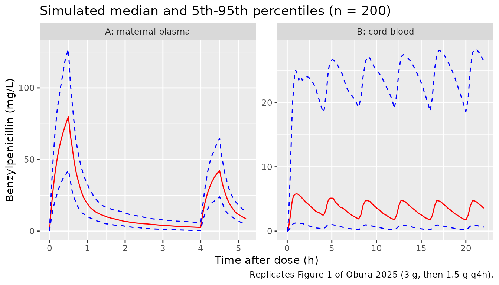
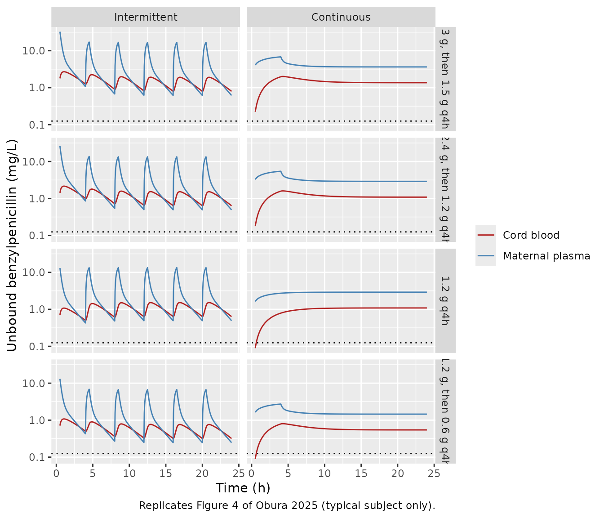

# Benzylpenicillin (Obura 2025)

## Model and source

- Citation: Obura B, Unsworth J, Jimenez-Valverde A, Waitt C, Das S,
  Hope W, Navaratnam K. Pharmacokinetics of Intrapartum
  Benzylpenicillin: Insights Into Candidate Regimens to Prevent Early
  Onset Neonatal Group B Streptococcus Disease. CPT Pharmacometrics Syst
  Pharmacol. 2025;14(9):1504-1514. <doi:10.1002/psp4.70072>.
  PMID: 40629558. PMCID: PMC12439288.
- Description: Two-compartment IV population PK model of intrapartum
  benzylpenicillin (penicillin G) in 12 labouring women at risk of
  early-onset neonatal Group B Streptococcus disease (Obura 2025), with
  a third, umbilical cord compartment linked to the maternal central
  compartment by first-order rate constants. Maternal plasma and
  umbilical cord blood concentrations are both observed. Pmetrics NPAG
  non-parametric fit; typical values are the weighted means of the joint
  density (Table 2) and inter-individual variability is a log-normal
  approximation built from the reported CV% and the CL-Vc correlation.
  No covariates were retained. Concentrations are total drug; the paper
  converts to unbound with a fixed 60% protein binding for target
  attainment.
- Article: <https://doi.org/10.1002/psp4.70072>

Obura 2025 characterises intrapartum benzylpenicillin (penicillin G)
given to women at risk of having a baby with early-onset Group B
Streptococcus (GBS) disease. A two-compartment maternal model is linked
to an umbilical cord compartment, so that both maternal plasma and cord
blood exposure can be simulated. The paper then uses Monte Carlo
simulation to compare the standard UK regimen (3 g, then 1.5 g every 4
h) with lower and continuous-infusion alternatives, against an
unbound-concentration target of 0.125 mg/L.

## Population

Twelve pregnant women were enrolled at Liverpool Women’s Hospital, UK,
between January 2022 and June 2023 (Obura 2025 Results, Table 1).
Indications were preterm labour (n = 5), a GBS-positive antenatal swab
(n = 4) and GBS bacteriuria (n = 3). Median (range) age was 30.5 (19-37)
years and weight 75 (52-132) kg; BMI was 30.7 +/- 10.45 kg/m^2 and serum
creatinine 0.56 +/- 0.12 mg/dL. Nine women were White and three Asian.
All received a 3 g loading dose over about 30 min at the onset of
labour, followed by 0 to 4 maintenance doses of 1.5 g every 4 h until
delivery. The dataset held 45 maternal plasma and 10 cord blood
concentrations.

Age, total body weight and Cockcroft-Gault creatinine clearance were
screened and none was retained, so the base model is the final model and
`covariateData` is empty; the screened covariates are documented in
`covariatesDataExcluded`.

``` r

pop <- rxode2::rxode(readModelDb("Obura_2025_benzylpenicillin"))$population
#> ℹ parameter labels from comments will be replaced by 'label()'
str(pop[c("species", "n_subjects", "age_median", "weight_median", "race_ethnicity")])
#> List of 5
#>  $ species       : chr "human"
#>  $ n_subjects    : int 12
#>  $ age_median    : chr "30.5 years"
#>  $ weight_median : chr "75 kg"
#>  $ race_ethnicity: Named num [1:2] 75 25
#>   ..- attr(*, "names")= chr [1:2] "White" "Asian"
```

## Source trace

| Equation / parameter | Value | Source location |
|----|----|----|
| `lvc` (Vc) | 16.55 L (mean) | Table 2; Abstract |
| `lcl` (CL) | 41.24 L/h (mean) | Table 2; Abstract |
| `lk12` (kcp) | 1.49 1/h (mean) | Table 2 |
| `lk21` (kpc) | 0.98 1/h (mean) | Table 2 |
| `lk_central_cord` (kcu) | 0.09 1/h (mean) | Table 2 |
| `lk_cord_central` (kuc) | 0.5 1/h (mean) | Table 2 |
| `lvcord` (Vu) | 7.96 L (mean) | Table 2 |
| `etalcl`, `etalvc` | log(1 + CV^2), CV 24.06% / 40.15%, correlation 0.67 | Table 2 CV (%) column and ‘CL ~ Vc correlation’ row |
| `etalk12`, `etalk21` | CV 89.35% / 52.72% | Table 2 |
| `etalk_central_cord`, `etalk_cord_central` | CV 89.89% / 70.16% | Table 2 |
| `etalvcord` | CV 51.92% | Table 2 |
| `addSd`, `addSd_Ccord` | 4.72 x 0.1 = 0.472 mg/L | Table 2 gamma; Methods ‘Structural Pharmacokinetic Model’ C0 = 0.1; Data S1 Text S2 |
| `propSd`, `propSd_Ccord` | 4.72 x 0.02 = 0.0944 | Table 2 gamma; Methods C1 = 0.02; Data S1 Text S2 |
| `combined1()` error | SD = gamma x (C0 + C1 x C) | Methods ‘Structural Pharmacokinetic Model’ |
| `kel <- cl / vc` | n/a | Data S1 Text S2, secondary variable Ke = Cl/Vc |
| `d/dt(central)`, `d/dt(peripheral1)`, `d/dt(cord)` | n/a | Equations 4-6; Figure 2; Text S2 |
| `Cc <- central / vc`, `Ccord <- cord / vcord` | n/a | Equations 7-8 |

The CV-to-variance conversion is checked to round-trip, and the encoded
correlation is checked against Table 2:

``` r

ui <- rxode2::rxode(readModelDb("Obura_2025_benzylpenicillin"))
#> ℹ parameter labels from comments will be replaced by 'label()'
om <- ui$omega
cv_recovered <- sqrt(exp(diag(om)) - 1) * 100
cv_table2 <- c(
  etalcl = 24.06, etalvc = 40.15, etalk12 = 89.35, etalk21 = 52.72,
  etalk_central_cord = 89.89, etalk_cord_central = 70.16, etalvcord = 51.92
)
stopifnot(all(abs(cv_recovered[names(cv_table2)] - cv_table2) < 1e-6))
stopifnot(abs(cov2cor(om)["etalcl", "etalvc"] - 0.67) < 1e-6)
round(cv_recovered, 2)
#>             etalcl             etalvc            etalk12            etalk21 
#>              24.06              40.15              89.35              52.72 
#> etalk_central_cord etalk_cord_central          etalvcord 
#>              89.89              70.16              51.92
```

## Which Table 2 column is the typical value

NPAG reports a discrete joint distribution, and Table 2 prints both its
weighted mean and its median. They differ materially for the cord
parameters (kcu 0.09 vs 0.07 1/h; Vc 16.55 vs 13.69 L). The model uses
the **means**, because the paper quotes them as its population estimates
and because they reproduce the paper’s own simulations. The check below
solves the typical subject under both parameter sets, without random
effects, and compares with Table S1 (mean unbound AUC over 20-24 h, with
the 60% protein binding the paper uses) and with the continuous-infusion
plateau of Figure 4 (right-hand panels, read off the plot by the
maintainers).

``` r

FU <- 0.4 # unbound fraction: Methods 'Protein binding of 60% was used'
MIC <- 0.125 # mg/L, Methods 'Target Attainment'

mod <- readModelDb("Obura_2025_benzylpenicillin")
mod_typ <- rxode2::zeroRe(mod)
#> ℹ parameter labels from comments will be replaced by 'label()'

# Same model with the Table 2 MEDIANS substituted, for comparison only.
mod_typ_median <- mod_typ |>
  rxode2::ini(
    lvc = log(13.69), lcl = log(40.55), lk12 = log(1.22), lk21 = log(1.02),
    lk_central_cord = log(0.07), lk_cord_central = log(0.48), lvcord = log(7.05)
  )
#> ℹ change initial estimate of `lvc` to `2.61666563930036`
#> ℹ change initial estimate of `lcl` to `3.70253578056142`
#> ℹ change initial estimate of `lk12` to `0.198850858745165`
#> ℹ change initial estimate of `lk21` to `0.0198026272961797`
#> ℹ change initial estimate of `lk_central_cord` to `-2.65926003693278`
#> ℹ change initial estimate of `lk_cord_central` to `-0.7339691750802`
#> ℹ change initial estimate of `lvcord` to `1.95302761682418`

regimens <- tibble::tribble(
  ~regimen,              ~load, ~maint,
  "3 g, then 1.5 g q4h",  3000,  1500,
  "2.4 g, then 1.2 g q4h", 2400,  1200,
  "1.2 g q4h",            1200,  1200,
  "1.2 g, then 0.6 g q4h", 1200,   600
)

# Intermittent: 0.5-h infusions at 0, 4, ..., 20 h. Continuous: each dose
# infused over its whole 4-h interval. Observation rows sit on the `central`
# state and carry dvid = 1: the model declares two endpoints, so each
# observation must name one, and every row still returns both `Cc` and
# `Ccord` (the individual predictions) as columns.
make_ev <- function(load, maint, dur, grid, n = 1) {
  ev <- rxode2::et(amt = load, time = 0, dur = dur, cmt = "central") |>
    rxode2::et(amt = maint, time = seq(4, 20, by = 4), dur = dur, cmt = "central") |>
    rxode2::et(grid, cmt = "central") |>
    rxode2::et(id = seq_len(n)) |>
    as.data.frame()
  ev$dvid <- ifelse(ev$evid == 0, 1L, NA_integer_)
  ev
}

trap <- function(t, y) sum(diff(t) * (head(y, -1) + tail(y, -1)) / 2)

grid_fine <- seq(0, 24, by = 0.01)
typ_auc <- list()
for (i in seq_len(nrow(regimens))) {
  for (mode in c("Intermittent", "Continuous")) {
    dur <- if (mode == "Intermittent") 0.5 else 4
    ev <- make_ev(regimens$load[i], regimens$maint[i], dur, grid_fine)
    for (column in c("mean", "median")) {
      m <- if (column == "mean") mod_typ else mod_typ_median
      s <- as.data.frame(rxode2::rxSolve(m, events = ev, useLinCmt = FALSE))
      w <- s$time >= 20 & s$time <= 24
      typ_auc[[length(typ_auc) + 1]] <- tibble::tibble(
        regimen = regimens$regimen[i], mode = mode, column = column,
        auc_plasma = FU * trap(s$time[w], s$Cc[w]),
        auc_cord = FU * trap(s$time[w], s$Ccord[w]),
        css_plasma = FU * s$Cc[s$time == 24],
        css_cord = FU * s$Ccord[s$time == 24]
      )
    }
  }
}
#> ℹ omega/sigma items treated as zero: 'etalcl', 'etalvc', 'etalk12', 'etalk21', 'etalk_central_cord', 'etalk_cord_central', 'etalvcord'
#> ℹ omega/sigma items treated as zero: 'etalcl', 'etalvc', 'etalk12', 'etalk21', 'etalk_central_cord', 'etalk_cord_central', 'etalvcord'
#> ℹ omega/sigma items treated as zero: 'etalcl', 'etalvc', 'etalk12', 'etalk21', 'etalk_central_cord', 'etalk_cord_central', 'etalvcord'
#> ℹ omega/sigma items treated as zero: 'etalcl', 'etalvc', 'etalk12', 'etalk21', 'etalk_central_cord', 'etalk_cord_central', 'etalvcord'
#> ℹ omega/sigma items treated as zero: 'etalcl', 'etalvc', 'etalk12', 'etalk21', 'etalk_central_cord', 'etalk_cord_central', 'etalvcord'
#> ℹ omega/sigma items treated as zero: 'etalcl', 'etalvc', 'etalk12', 'etalk21', 'etalk_central_cord', 'etalk_cord_central', 'etalvcord'
#> ℹ omega/sigma items treated as zero: 'etalcl', 'etalvc', 'etalk12', 'etalk21', 'etalk_central_cord', 'etalk_cord_central', 'etalvcord'
#> ℹ omega/sigma items treated as zero: 'etalcl', 'etalvc', 'etalk12', 'etalk21', 'etalk_central_cord', 'etalk_cord_central', 'etalvcord'
#> ℹ omega/sigma items treated as zero: 'etalcl', 'etalvc', 'etalk12', 'etalk21', 'etalk_central_cord', 'etalk_cord_central', 'etalvcord'
#> ℹ omega/sigma items treated as zero: 'etalcl', 'etalvc', 'etalk12', 'etalk21', 'etalk_central_cord', 'etalk_cord_central', 'etalvcord'
#> ℹ omega/sigma items treated as zero: 'etalcl', 'etalvc', 'etalk12', 'etalk21', 'etalk_central_cord', 'etalk_cord_central', 'etalvcord'
#> ℹ omega/sigma items treated as zero: 'etalcl', 'etalvc', 'etalk12', 'etalk21', 'etalk_central_cord', 'etalk_cord_central', 'etalvcord'
#> ℹ omega/sigma items treated as zero: 'etalcl', 'etalvc', 'etalk12', 'etalk21', 'etalk_central_cord', 'etalk_cord_central', 'etalvcord'
#> ℹ omega/sigma items treated as zero: 'etalcl', 'etalvc', 'etalk12', 'etalk21', 'etalk_central_cord', 'etalk_cord_central', 'etalvcord'
#> ℹ omega/sigma items treated as zero: 'etalcl', 'etalvc', 'etalk12', 'etalk21', 'etalk_central_cord', 'etalk_cord_central', 'etalvcord'
#> ℹ omega/sigma items treated as zero: 'etalcl', 'etalvc', 'etalk12', 'etalk21', 'etalk_central_cord', 'etalk_cord_central', 'etalvcord'
typ_auc <- dplyr::bind_rows(typ_auc)

tableS1 <- tibble::tribble(
  ~regimen,               ~mode,          ~ref_plasma, ~ref_cord,
  "3 g, then 1.5 g q4h",   "Intermittent", 14.91,       6.07,
  "3 g, then 1.5 g q4h",   "Continuous",   14.87,       6.08,
  "2.4 g, then 1.2 g q4h", "Intermittent", 11.93,       4.85,
  "2.4 g, then 1.2 g q4h", "Continuous",   11.89,       4.87,
  "1.2 g q4h",             "Intermittent", 11.90,       4.74,
  "1.2 g q4h",             "Continuous",   11.88,       5.57,
  "1.2 g, then 0.6 g q4h", "Intermittent", 5.99,        2.56,
  "1.2 g, then 0.6 g q4h", "Continuous",   5.94,        2.63
)

cmp_s1 <- typ_auc |>
  dplyr::inner_join(tableS1, by = c("regimen", "mode")) |>
  dplyr::mutate(
    pct_plasma = 100 * (auc_plasma - ref_plasma) / ref_plasma,
    pct_cord = 100 * (auc_cord - ref_cord) / ref_cord
  )

cmp_s1 |>
  dplyr::select(regimen, mode, column, ref_plasma, auc_plasma, pct_plasma, ref_cord, auc_cord, pct_cord) |>
  dplyr::rename(
    "Regimen" = regimen, "Infusion" = mode, "Table 2 column" = column,
    "Table S1 plasma fAUC" = ref_plasma, "Typical plasma fAUC" = auc_plasma,
    "Plasma diff (%)" = pct_plasma, "Table S1 cord fAUC" = ref_cord,
    "Typical cord fAUC" = auc_cord, "Cord diff (%)" = pct_cord
  ) |>
  knitr::kable(digits = 2, caption = "Unbound AUC20-24 (mg*h/L): typical subject vs Table S1.")
```

| Regimen | Infusion | Table 2 column | Table S1 plasma fAUC | Typical plasma fAUC | Plasma diff (%) | Table S1 cord fAUC | Typical cord fAUC | Cord diff (%) |
|:---|:---|:---|---:|---:|---:|---:|---:|---:|
| 3 g, then 1.5 g q4h | Intermittent | mean | 14.91 | 14.55 | -2.42 | 6.07 | 5.45 | -10.28 |
| 3 g, then 1.5 g q4h | Intermittent | median | 14.91 | 14.80 | -0.76 | 6.07 | 4.19 | -30.96 |
| 3 g, then 1.5 g q4h | Continuous | mean | 14.87 | 14.55 | -2.15 | 6.08 | 5.45 | -10.40 |
| 3 g, then 1.5 g q4h | Continuous | median | 14.87 | 14.80 | -0.49 | 6.08 | 4.19 | -31.06 |
| 2.4 g, then 1.2 g q4h | Intermittent | mean | 11.93 | 11.64 | -2.44 | 4.85 | 4.36 | -10.17 |
| 2.4 g, then 1.2 g q4h | Intermittent | median | 11.93 | 11.84 | -0.78 | 4.85 | 3.35 | -30.87 |
| 2.4 g, then 1.2 g q4h | Continuous | mean | 11.89 | 11.64 | -2.10 | 4.87 | 4.36 | -10.51 |
| 2.4 g, then 1.2 g q4h | Continuous | median | 11.89 | 11.84 | -0.44 | 4.87 | 3.35 | -31.14 |
| 1.2 g q4h | Intermittent | mean | 11.90 | 11.64 | -2.19 | 4.74 | 4.36 | -8.11 |
| 1.2 g q4h | Intermittent | median | 11.90 | 11.84 | -0.53 | 4.74 | 3.35 | -29.28 |
| 1.2 g q4h | Continuous | mean | 11.88 | 11.64 | -2.03 | 5.57 | 4.36 | -21.81 |
| 1.2 g q4h | Continuous | median | 11.88 | 11.84 | -0.36 | 5.57 | 3.35 | -39.82 |
| 1.2 g, then 0.6 g q4h | Intermittent | mean | 5.99 | 5.82 | -2.84 | 2.56 | 2.18 | -14.91 |
| 1.2 g, then 0.6 g q4h | Intermittent | median | 5.99 | 5.92 | -1.19 | 2.56 | 1.68 | -34.52 |
| 1.2 g, then 0.6 g q4h | Continuous | mean | 5.94 | 5.82 | -2.02 | 2.63 | 2.18 | -17.14 |
| 1.2 g, then 0.6 g q4h | Continuous | median | 5.94 | 5.92 | -0.36 | 2.63 | 1.68 | -36.25 |

Unbound AUC20-24 (mg\*h/L): typical subject vs Table S1. {.table}

``` r

col_summary <- cmp_s1 |>
  dplyr::group_by(column) |>
  dplyr::summarise(
    median_abs_pct_plasma = median(abs(pct_plasma)),
    median_abs_pct_cord = median(abs(pct_cord)),
    cord_to_plasma_ratio = median(auc_cord / auc_plasma),
    .groups = "drop"
  )

# Figure 4, right-hand panel A: unbound continuous-infusion plateau at 24 h,
# read off the log axis by the maintainers (plasma ~3.6, cord ~1.35 mg/L).
fig4_plateau <- typ_auc |>
  dplyr::filter(regimen == "3 g, then 1.5 g q4h", mode == "Continuous") |>
  dplyr::select(column, css_plasma, css_cord)

# The means must reproduce the paper's simulated exposures. The plasma side is
# fixed by CL (dose / CL), which barely differs between columns; the cord side
# is what discriminates.
means_row <- col_summary[col_summary$column == "mean", ]
stopifnot(
  means_row$median_abs_pct_plasma < 5,
  means_row$median_abs_pct_cord < 15,
  means_row$median_abs_pct_cord < col_summary$median_abs_pct_cord[col_summary$column == "median"]
)

dplyr::left_join(col_summary, fig4_plateau, by = "column") |>
  dplyr::rename(
    "Table 2 column" = column,
    "Median |diff| plasma (%)" = median_abs_pct_plasma,
    "Median |diff| cord (%)" = median_abs_pct_cord,
    "Cord:plasma AUC ratio (paper 0.41)" = cord_to_plasma_ratio,
    "Plasma fCss at 24 h (Fig 4 ~3.6)" = css_plasma,
    "Cord fCss at 24 h (Fig 4 ~1.35)" = css_cord
  ) |>
  knitr::kable(digits = 3, caption = "Means vs medians as the typical value.")
```

| Table 2 column | Median \|diff\| plasma (%) | Median \|diff\| cord (%) | Cord:plasma AUC ratio (paper 0.41) | Plasma fCss at 24 h (Fig 4 ~3.6) | Cord fCss at 24 h (Fig 4 ~1.35) |
|:---|---:|---:|---:|---:|---:|
| mean | 2.173 | 10.454 | 0.374 | 3.637 | 1.361 |
| median | 0.510 | 31.100 | 0.283 | 3.699 | 1.048 |

Means vs medians as the typical value. {.table style="width:100%;"}

The plasma exposure is set almost entirely by clearance, whose mean and
median are close, so both columns match Table S1. The cord exposure is
what separates them: with the means the typical cord AUC sits about 10%
under Table S1 and the cord plateau matches Figure 4, while the medians
fall about 30% short. The remaining cord gap is consistent with Table S1
being a mean over a simulated population rather than a typical-subject
value.

## Virtual cohort and simulation

The trial regimen is a 3 g loading dose followed by 1.5 g every 4 h,
each as a 0.5-h infusion. The Figure 1 visual predictive check plots
time after the first dose, with maternal sampling over the first 4 h and
one cord sample per woman at delivery (1-20 h). A cohort of 200 virtual
women is given the loading dose and five maintenance doses (to 20 h). No
covariates enter the model, so the cohort needs no covariate columns.

``` r

N_VPC <- 200
grid_vpc <- sort(unique(c(seq(0, 6, by = 0.05), seq(6, 22, by = 0.25))))
ev_vpc <- make_ev(3000, 1500, 0.5, grid_vpc, n = N_VPC)

rxode2::rxSetSeed(20250708)
sim_vpc <- rxode2::rxSolve(mod, events = ev_vpc, useLinCmt = FALSE) |>
  as.data.frame()
#> ℹ parameter labels from comments will be replaced by 'label()'

vpc <- sim_vpc |>
  dplyr::select(id, time, Cc, Ccord) |>
  tidyr::pivot_longer(c(Cc, Ccord), names_to = "matrix", values_to = "conc") |>
  dplyr::group_by(matrix, time) |>
  dplyr::summarise(
    p05 = quantile(conc, 0.05), p50 = median(conc), p95 = quantile(conc, 0.95),
    .groups = "drop"
  ) |>
  dplyr::mutate(
    matrix = dplyr::recode(matrix, Cc = "A: maternal plasma", Ccord = "B: cord blood")
  ) |>
  dplyr::filter(matrix == "B: cord blood" | time <= 5.2)

stopifnot(dplyr::n_distinct(sim_vpc$id) == N_VPC)
```

## Replicate published figures

### Figure 1 – visual predictive check

``` r

ggplot(vpc, aes(time)) +
  geom_line(aes(y = p50), colour = "red") +
  geom_line(aes(y = p05), colour = "blue", linetype = "dashed") +
  geom_line(aes(y = p95), colour = "blue", linetype = "dashed") +
  facet_wrap(~matrix, scales = "free") +
  labs(
    x = "Time after dose (h)", y = "Benzylpenicillin (mg/L)",
    title = "Simulated median and 5th-95th percentiles (n = 200)",
    caption = "Replicates Figure 1 of Obura 2025 (3 g, then 1.5 g q4h)."
  )
```



``` r

peak_time <- vpc |>
  dplyr::filter(matrix == "A: maternal plasma", time <= 1) |>
  dplyr::slice_max(p50, n = 1) |>
  dplyr::pull(time)
vpc |>
  dplyr::filter(
    matrix == "A: maternal plasma",
    sapply(time, function(t) any(abs(t - c(peak_time, 1, 2, 4)) < 1e-8))
  ) |>
  dplyr::select(time, p05, p50, p95) |>
  dplyr::rename(
    "Time after dose (h)" = time, "5th pctile (mg/L)" = p05,
    "Median (mg/L)" = p50, "95th pctile (mg/L)" = p95
  ) |>
  knitr::kable(digits = 2, caption = "Simulated maternal percentiles after the 3 g loading dose (first row: median peak). Figure 1A: median about 80 mg/L at the 0.5-h peak with 5th-95th about 45-120 mg/L, falling to about 20-25 mg/L at 1 h and about 2-3 mg/L at 4 h; observed peaks 31-112 mg/L.")
```

| Time after dose (h) | 5th pctile (mg/L) | Median (mg/L) | 95th pctile (mg/L) |
|--------------------:|------------------:|--------------:|-------------------:|
|                 0.5 |             42.73 |         79.91 |             127.14 |
|                 1.0 |             10.50 |         19.23 |              33.12 |
|                 2.0 |              3.42 |          6.76 |              12.69 |
|                 4.0 |              0.43 |          2.55 |               5.86 |

Simulated maternal percentiles after the 3 g loading dose (first row:
median peak). Figure 1A: median about 80 mg/L at the 0.5-h peak with
5th-95th about 45-120 mg/L, falling to about 20-25 mg/L at 1 h and about
2-3 mg/L at 4 h; observed peaks 31-112 mg/L. {.table
style="width:100%;"}

### Figure 4 – simulated unbound profiles under four regimens

Figure 4 plots unbound plasma and cord concentrations for the four
regimens, as intermittent (left) and continuous (right) infusions. The
typical-subject profiles below reproduce the panel shapes; the dotted
line is the 0.125 mg/L target.

``` r

grid_fig4 <- seq(0, 24, by = 0.05)
fig4 <- list()
for (i in seq_len(nrow(regimens))) {
  for (mode in c("Intermittent", "Continuous")) {
    dur <- if (mode == "Intermittent") 0.5 else 4
    s <- rxode2::rxSolve(
      mod_typ,
      events = make_ev(regimens$load[i], regimens$maint[i], dur, grid_fig4),
      useLinCmt = FALSE
    ) |>
      as.data.frame()
    fig4[[length(fig4) + 1]] <- tibble::tibble(
      regimen = regimens$regimen[i], mode = mode, time = s$time,
      `Maternal plasma` = FU * s$Cc, `Cord blood` = FU * s$Ccord
    )
  }
}
#> ℹ omega/sigma items treated as zero: 'etalcl', 'etalvc', 'etalk12', 'etalk21', 'etalk_central_cord', 'etalk_cord_central', 'etalvcord'
#> ℹ omega/sigma items treated as zero: 'etalcl', 'etalvc', 'etalk12', 'etalk21', 'etalk_central_cord', 'etalk_cord_central', 'etalvcord'
#> ℹ omega/sigma items treated as zero: 'etalcl', 'etalvc', 'etalk12', 'etalk21', 'etalk_central_cord', 'etalk_cord_central', 'etalvcord'
#> ℹ omega/sigma items treated as zero: 'etalcl', 'etalvc', 'etalk12', 'etalk21', 'etalk_central_cord', 'etalk_cord_central', 'etalvcord'
#> ℹ omega/sigma items treated as zero: 'etalcl', 'etalvc', 'etalk12', 'etalk21', 'etalk_central_cord', 'etalk_cord_central', 'etalvcord'
#> ℹ omega/sigma items treated as zero: 'etalcl', 'etalvc', 'etalk12', 'etalk21', 'etalk_central_cord', 'etalk_cord_central', 'etalvcord'
#> ℹ omega/sigma items treated as zero: 'etalcl', 'etalvc', 'etalk12', 'etalk21', 'etalk_central_cord', 'etalk_cord_central', 'etalvcord'
#> ℹ omega/sigma items treated as zero: 'etalcl', 'etalvc', 'etalk12', 'etalk21', 'etalk_central_cord', 'etalk_cord_central', 'etalvcord'
fig4 <- dplyr::bind_rows(fig4) |>
  tidyr::pivot_longer(c(`Maternal plasma`, `Cord blood`), names_to = "matrix", values_to = "fconc") |>
  dplyr::filter(time >= 0.5) |>
  dplyr::mutate(
    regimen = factor(regimen, levels = regimens$regimen),
    mode = factor(mode, levels = c("Intermittent", "Continuous"))
  )

ggplot(fig4, aes(time, fconc, colour = matrix)) +
  geom_hline(yintercept = MIC, linetype = "dotted") +
  geom_line() +
  facet_grid(regimen ~ mode) +
  scale_y_log10() +
  scale_colour_manual(values = c("Maternal plasma" = "steelblue", "Cord blood" = "firebrick")) +
  labs(
    x = "Time (h)", y = "Unbound benzylpenicillin (mg/L)", colour = NULL,
    caption = "Replicates Figure 4 of Obura 2025 (typical subject only)."
  )
```



## Target attainment (Table 3)

The paper’s endpoint is the proportion of simulated women whose unbound
concentration stays above 0.125 mg/L throughout the first 24 h, in
plasma and in cord blood. Here 200 women per regimen are simulated with
the packaged log-normal random effects, and the minimum unbound
concentration is taken from the end of the first 0.5-h window to 24 h
(Figure 4 also starts at 0.5 h).

``` r

N_PTA <- 200
grid_pta <- seq(0.5, 24, by = 0.1)
pta <- list()
rxode2::rxSetSeed(20250709)
for (i in seq_len(nrow(regimens))) {
  for (mode in c("Intermittent", "Continuous")) {
    dur <- if (mode == "Intermittent") 0.5 else 4
    ev <- make_ev(regimens$load[i], regimens$maint[i], dur, grid_pta, n = N_PTA)
    s <- as.data.frame(rxode2::rxSolve(mod, events = ev, useLinCmt = FALSE))
    per_id <- s |>
      dplyr::group_by(id) |>
      dplyr::summarise(fmin_plasma = FU * min(Cc), fmin_cord = FU * min(Ccord), .groups = "drop")
    pta[[length(pta) + 1]] <- tibble::tibble(
      regimen = regimens$regimen[i], mode = mode,
      pta_plasma = 100 * mean(per_id$fmin_plasma > MIC),
      pta_cord = 100 * mean(per_id$fmin_cord > MIC)
    )
  }
}
pta <- dplyr::bind_rows(pta)

table3 <- tibble::tribble(
  ~regimen,               ~mode,          ~ref_plasma, ~ref_cord,
  "3 g, then 1.5 g q4h",   "Intermittent", 95.82,       96.86,
  "2.4 g, then 1.2 g q4h", "Intermittent", 92.64,       93.92,
  "1.2 g q4h",             "Intermittent", 88.40,       83.5,
  "1.2 g, then 0.6 g q4h", "Intermittent", 69.16,       79.74,
  "3 g, then 1.5 g q4h",   "Continuous",   100,         74.8,
  "2.4 g, then 1.2 g q4h", "Continuous",   100,         68.44,
  "1.2 g q4h",             "Continuous",   100,         29.06,
  "1.2 g, then 0.6 g q4h", "Continuous",   100,         27.94
)

pta_cmp <- dplyr::inner_join(table3, pta, by = c("regimen", "mode"))

# Continuous infusion holds the unbound plasma concentration more than tenfold
# above the target for the typical woman under every regimen, so attainment is
# near-complete regardless of which subjects land in the tails.
stopifnot(all(pta_cmp$pta_plasma[pta_cmp$mode == "Continuous"] >= 95))

pta_cmp |>
  dplyr::select(regimen, mode, ref_plasma, pta_plasma, ref_cord, pta_cord) |>
  dplyr::rename(
    "Regimen" = regimen, "Infusion" = mode,
    "Table 3 plasma (%)" = ref_plasma, "Simulated plasma (%)" = pta_plasma,
    "Table 3 cord (%)" = ref_cord, "Simulated cord (%)" = pta_cord
  ) |>
  knitr::kable(digits = 1, caption = "Probability of unbound Cmin > 0.125 mg/L over the first 24 h.")
```

| Regimen | Infusion | Table 3 plasma (%) | Simulated plasma (%) | Table 3 cord (%) | Simulated cord (%) |
|:---|:---|---:|---:|---:|---:|
| 3 g, then 1.5 g q4h | Intermittent | 95.8 | 95.0 | 96.9 | 90.0 |
| 2.4 g, then 1.2 g q4h | Intermittent | 92.6 | 94.5 | 93.9 | 89.0 |
| 1.2 g q4h | Intermittent | 88.4 | 93.5 | 83.5 | 80.0 |
| 1.2 g, then 0.6 g q4h | Intermittent | 69.2 | 77.5 | 79.7 | 68.0 |
| 3 g, then 1.5 g q4h | Continuous | 100.0 | 100.0 | 74.8 | 65.0 |
| 2.4 g, then 1.2 g q4h | Continuous | 100.0 | 100.0 | 68.4 | 58.5 |
| 1.2 g q4h | Continuous | 100.0 | 100.0 | 29.1 | 38.5 |
| 1.2 g, then 0.6 g q4h | Continuous | 100.0 | 100.0 | 27.9 | 28.0 |

Probability of unbound Cmin \> 0.125 mg/L over the first 24 h. {.table}

The simulated attainment reproduces the paper’s main conclusions:
continuous infusion keeps plasma above target for essentially everyone,
and lowering the intermittent regimen erodes plasma attainment, most
sharply for 1.2 g then 0.6 g. It also reproduces the paper’s finding
that cord attainment is lower under continuous than under intermittent
infusion. Exact agreement with Table 3 is not expected. The paper
sampled the NPAG support points with Pmetrics, truncating each parameter
to between 0 and 3 times its observed maximum, and the timing window it
used for the minimum is not stated; this vignette uses a log-normal
approximation and a 0.5-24 h window. Cord attainment under continuous
infusion is the most sensitive to that window, because the cord
compartment fills slowly from zero.

## PKNCA validation

Obura 2025 reports noncompartmental results for the observed maternal
data after the first dose: peak 75.71 +/- 24.02 mg/L, AUC0-inf 87.88 +/-
27.41 mg\*h/L and elimination half-life 0.54 h. Those come from the
trial’s sampling schedule (before and 0.25, 0.5, 1, 2 and 4 h after the
dose; the first maintenance dose follows at 4 h). The comparison below
simulates 200 women given the 3 g loading dose as a single 0.5-h
infusion and runs PKNCA twice on the same profiles: once on the trial
schedule, which is the like-for-like comparison with the paper, and once
on a dense 0-12 h grid. Per-subject results are averaged with the
arithmetic mean, as the paper reports them.

``` r

N_NCA <- 200
TRIAL_TIMES <- c(0, 0.25, 0.5, 1, 2, 4)
grid_nca <- sort(unique(c(seq(0, 2, by = 0.05), seq(2, 12, by = 0.25), TRIAL_TIMES)))
ev_nca <- rxode2::et(amt = 3000, time = 0, dur = 0.5, cmt = "central") |>
  rxode2::et(grid_nca, cmt = "central") |>
  rxode2::et(id = seq_len(N_NCA)) |>
  as.data.frame()
ev_nca$dvid <- ifelse(ev_nca$evid == 0, 1L, NA_integer_)

rxode2::rxSetSeed(20250710)
sim_dense <- rxode2::rxSolve(mod, events = ev_nca, useLinCmt = FALSE) |>
  as.data.frame() |>
  dplyr::filter(!is.na(Cc)) |>
  dplyr::select(id, time, Cc)

# Time-zero anchor for AUC0-inf.
sim_dense <- dplyr::bind_rows(
  sim_dense,
  sim_dense |> dplyr::distinct(id) |> dplyr::mutate(time = 0, Cc = 0)
) |>
  dplyr::distinct(id, time, .keep_all = TRUE) |>
  dplyr::arrange(id, time)

sim_nca <- dplyr::bind_rows(
  sim_dense |> dplyr::mutate(sampling = "Dense 0-12 h"),
  sim_dense |>
    dplyr::filter(sapply(time, function(t) any(abs(t - TRIAL_TIMES) < 1e-8))) |>
    dplyr::mutate(sampling = "Trial schedule 0-4 h")
)
stopifnot(all(table(sim_nca$sampling[sim_nca$id == 1]) >= length(TRIAL_TIMES)))

dose_df <- sim_nca |>
  dplyr::distinct(id, sampling) |>
  dplyr::mutate(time = 0, amt = 3000)

conc_obj <- PKNCA::PKNCAconc(sim_nca, Cc ~ time | sampling + id)
dose_obj <- PKNCA::PKNCAdose(dose_df, amt ~ time | sampling + id)
intervals <- data.frame(
  start = 0, end = Inf, cmax = TRUE, tmax = TRUE, aucinf.obs = TRUE, half.life = TRUE
)
nca_res <- PKNCA::pk.nca(PKNCA::PKNCAdata(conc_obj, dose_obj, intervals = intervals))

nca_mean <- as.data.frame(nca_res$result) |>
  dplyr::filter(PPTESTCD %in% c("cmax", "aucinf.obs", "half.life")) |>
  dplyr::group_by(sampling, PPTESTCD) |>
  dplyr::summarise(PPORRES = mean(PPORRES, na.rm = TRUE), .groups = "drop")

reference <- data.frame(
  sampling = c("Trial schedule 0-4 h", "Dense 0-12 h"),
  cmax = 75.71, aucinf.obs = 87.88, half.life = 0.54
)

cmp_nca <- nlmixr2lib::ncaComparisonTable(
  simulated = nca_mean,
  reference = reference,
  by = "sampling",
  units = c(cmax = "mg/L", aucinf.obs = "mg*h/L", half.life = "h"),
  tolerance_pct = 20
)
knitr::kable(cmp_nca, caption = "Simulated mean NCA vs Obura 2025 Results (observed data, first dose).")
```

| NCA parameter          | sampling             | Reference | Simulated | % diff    |
|:-----------------------|:---------------------|:----------|:----------|:----------|
| Cmax (mg/L)            | Trial schedule 0-4 h | 75.7      | 78.7      | +3.9%     |
| Cmax (mg/L)            | Dense 0-12 h         | 75.7      | 78.7      | +3.9%     |
| AUC0-∞ (obs) (mg\*h/L) | Trial schedule 0-4 h | 87.9      | 73.4      | -16.5%    |
| AUC0-∞ (obs) (mg\*h/L) | Dense 0-12 h         | 87.9      | 74.3      | -15.4%    |
| t½ (h)                 | Trial schedule 0-4 h | 0.54      | 1.33      | +146.6%\* |
| t½ (h)                 | Dense 0-12 h         | 0.54      | 2.16      | +300.4%\* |

Simulated mean NCA vs Obura 2025 Results (observed data, first dose).
{.table}

``` r

# AUC0-inf of a linear model is dose / CL for every subject, whatever the
# distribution kinetics, so the dense-grid population mean is fixed by CL and
# its variance alone.
nca_val <- function(smp, code) {
  nca_mean$PPORRES[nca_mean$sampling == smp & nca_mean$PPTESTCD == code]
}
auc_typ <- 3000 / exp(ui$theta[["lcl"]])
auc_dense <- nca_val("Dense 0-12 h", "aucinf.obs")
stopifnot(abs(auc_dense / (auc_typ * exp(ui$omega["etalcl", "etalcl"] / 2)) - 1) < 0.1)

# Three-exponential disposition of the typical woman: the eigenvalues of the
# rate matrix of Equations 4-6.
th <- exp(ui$theta)
kmat <- with(as.list(th), matrix(c(
  -(lcl / lvc + lk12 + lk_central_cord), lk21, lk_cord_central,
  lk12, -lk21, 0,
  lk_central_cord, 0, -lk_cord_central
), nrow = 3, byrow = TRUE))
half_lives <- sort(log(2) / -eigen(kmat)$values)
tibble::tibble(
  quantity = c(
    "Typical dose / CL (mg*h/L)", "Dense-grid mean AUC0-inf (mg*h/L)",
    "Trial-schedule mean AUC0-inf (mg*h/L)",
    "Disposition half-lives of the typical woman (h)"
  ),
  value = c(
    sprintf("%.1f", auc_typ), sprintf("%.1f", auc_dense),
    sprintf("%.1f", nca_val("Trial schedule 0-4 h", "aucinf.obs")),
    paste(sprintf("%.2f", half_lives), collapse = ", ")
  )
) |>
  dplyr::rename("Quantity" = quantity, "Value" = value) |>
  knitr::kable(caption = "Closed-form checks behind the NCA comparison.")
```

| Quantity                                        | Value            |
|:------------------------------------------------|:-----------------|
| Typical dose / CL (mg\*h/L)                     | 72.7             |
| Dense-grid mean AUC0-inf (mg\*h/L)              | 74.3             |
| Trial-schedule mean AUC0-inf (mg\*h/L)          | 73.4             |
| Disposition half-lives of the typical woman (h) | 0.15, 1.15, 1.55 |

Closed-form checks behind the NCA comparison. {.table}

The simulated mean peak matches the paper’s NCA. The half-life does not,
on either grid, and it is a property of the sampling window rather than
of the encoding: the typical woman’s disposition has three phases
(half-lives above), the PKNCA lambda-z search on the trial schedule
spans 1-4 h and lands between the second and third, and a dense grid
reaching 12 h finds the slow terminal phase. The paper’s 0.54 h is
closer to the 1-2 h decline alone (the simulated median falls from about
19 to about 7 mg/L over that hour, a half-life of about 0.7 h), and the
paper does not state which samples it used. The simulated percentiles
track the Figure 1A visual predictive check at 1, 2 and 4 h (see the
Figure 1 table), which is the model’s own description of the same data.
AUC0-inf is fixed by the model’s mean clearance (dose / CL = 72.7 mg*h/L
for the typical woman), so the simulated mean lies below the observed
87.88 mg*h/L; that gap reflects the difference between the observed NCA
of 12 women and the NPAG clearance estimate, not an encoding error.

## Assumptions and deviations

- **Typical values are the Table 2 means.** NPAG’s joint distribution
  has both a weighted mean and a median; the means are the values quoted
  in the Abstract and the Results, and a typical-value solve with them
  reproduces Table S1 and the Figure 4 cord plateau much better than the
  medians do (see “Which Table 2 column is the typical value”).
- **Inter-individual variability is a log-normal approximation.** NPAG
  estimates a discrete distribution on 12 support points, whose shape is
  not published. Each parameter’s variance is `log(1 + CV^2)` from the
  Table 2 CV, and the Table 2 CL-Vc correlation of 0.67 (a correlation
  of the support points on the linear scale) is used as the correlation
  of `etalcl` and `etalvc`. No other correlations are reported, so the
  other etas are independent.
- **Residual error.** Pmetrics weights each observation by an assay SD
  polynomial, here `SD = 0.1 + 0.02 x C`, multiplied by the fitted gamma
  of 4.72. That is a linear sum of an additive and a proportional term,
  encoded as `combined1()` with `addSd = 0.472` mg/L and
  `propSd = 0.0944`. Pmetrics evaluates the polynomial at the observed
  concentration; nlmixr2 evaluates it at the prediction. Data S1 Text S2
  lists one gamma with the same polynomial for both outputs, so the cord
  residual error has the same values.
- **The cord compartment returns drug to the mother.** Equations 4-6
  make the cord compartment a reversible distribution space with no
  elimination of its own. It is named `cord`, following the umbilical
  cord compartment of `Nie_2025_sufentanil`, and declared through
  `paper_specific_compartments`.
- **Protein binding is not part of the model.** Concentrations are total
  drug. The 60% protein binding (unbound fraction 0.4) that the paper
  uses for target attainment is applied in this vignette only.
- **Continuous-infusion schedule.** The paper does not spell out how its
  continuous-infusion versions of the loading-plus-maintenance regimens
  were delivered. Each dose is infused over its whole 4-h interval here,
  which reproduces both Table S1 (continuous-infusion AUC equal to the
  intermittent AUC) and the shape of Figure 4.
- **Target-attainment window.** The minimum unbound concentration is
  taken over 0.5-24 h; the paper’s exact window is not stated.
- **Figure 4 plateau values** (plasma about 3.6 mg/L, cord about 1.35
  mg/L unbound) were read off the plot by the maintainers and are used
  only as a check; no model parameter is derived from them.
- **NCA half-life and AUC.** The paper’s observed-data NCA half-life
  (0.54 h) and mean AUC0-inf (87.88 mg\*h/L) are not reproduced: the
  simulated trial-schedule values are about 1.3 h and 15% lower (see
  “PKNCA validation”). The AUC is fixed by the Table 2 mean clearance
  and the half-life by the lambda-z window, which the paper does not
  report; no parameter was adjusted.
- **No erratum** for Obura 2025 was found on Europe PMC (checked
  2026-11-06).
