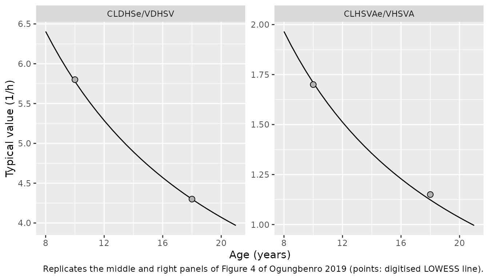
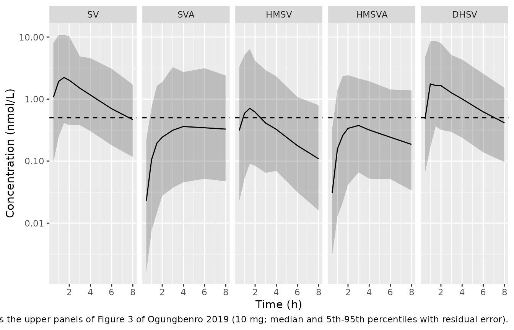
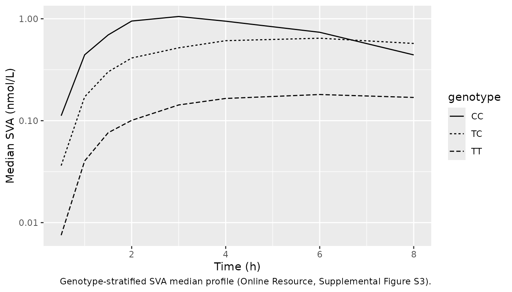

# Simvastatin and four metabolites in children and adolescents (Ogungbenro 2019)

## Model and source

- Citation: Ogungbenro K, Wagner JB, Abdel-Rahman S, Leeder JS,
  Galetin A. A population pharmacokinetic model for simvastatin and its
  metabolites in children and adolescents. Eur J Clin Pharmacol.
  2019;75(9):1227-1235. <doi:10.1007/s00228-019-02697-y>.
- Description: Joint one-compartment population PK model for oral
  simvastatin (lactone parent, SV) and four plasma metabolites –
  simvastatin acid (SVA), 6-hydroxymethyl simvastatin (HMSV),
  6-hydroxymethyl simvastatin acid (HMSVA) and 3,5-dihydrodiol
  simvastatin (DHSV) – in hyperlipidemic children and adolescents
  (Ogungbenro 2019). SV absorption is two parallel sequential zero- then
  first-order processes, the second lagged; each metabolite is a
  one-compartment species formed from its precursor’s concentration and
  described by apparent (CL/V) rate constants because metabolite volumes
  were not identifiable. HMSV elimination is a saturable sigmoid (Hill)
  process and HMSVA is formed from both SVA and HMSV. SLCO1B1 c.521T\>C
  (rs4149056, additive allele count) raises SVA formation and lowers its
  apparent volume; HMSVA and DHSV elimination decline with chronological
  age through a fractional Imax function. Doses in nmol and
  concentrations in nmol/L, matching the source. The Table 1 estimates
  are encoded as printed; they reproduce the paper’s covariate
  relationships but give exposures 2- to 10-fold below its own VPC
  (Figure 3) – see the vignette.
- Article (open access): <https://doi.org/10.1007/s00228-019-02697-y>

The model is one joint NONMEM fit of simvastatin (SV, the lactone
prodrug) and four plasma metabolites: simvastatin acid (SVA),
6-hydroxymethyl simvastatin (HMSV), 6-hydroxymethyl simvastatin acid
(HMSVA) and 3,5-dihydrodiol simvastatin (DHSV). Figure 1 of the paper
gives the structure:

- SV: one compartment, oral, with two parallel absorption processes,
  each a zero-order input followed by first-order absorption; the second
  process is lagged. The fractions are `F1 = 1/(1 + BA)` and
  `F2 = BA/(1 + BA)`.
- SVA, HMSV and DHSV are formed from SV; HMSVA is formed from both SVA
  and HMSV. Every metabolite has one compartment.
- Metabolite volumes are not identifiable, so the paper estimated only
  the ratios CL/V (1/h). The metabolite states in the packaged model
  therefore hold concentrations (nmol/L) directly.
- HMSV elimination is saturable (sigmoid, `gamma = 0.86`).

## Population

Ogungbenro 2019 re-analysed the single-centre, open-label,
genotype-stratified single-dose study of Wagner et al.: 32
hyperlipidemic children and adolescents aged 8.8-20.2 years (mean 14.1),
17 female and 15 male, mostly overweight for age (mean weight 79.4 kg,
range 30.2-149.2 kg; mean BMI 30.2 kg/m^2). Subjects aged 8-17 years
received 10 mg simvastatin (n = 28) and those aged 18 years or older 20
mg (n = 4). SLCO1B1 c.521T\>C genotypes were TT/TC/CC = 15/15/2, and 30
of the 32 subjects were Caucasian. Plasma was sampled at 0, 0.5, 1, 1.5,
2, 3, 4, 6 and 8 h; the LLOQ was 0.5 nmol/L for every analyte and BLQ
samples were handled with the M3 method (Supplemental Table S1 and
Methods).

The same information is available programmatically via
`readModelDb("Ogungbenro_2019_simvastatin")()$population`.

## Source trace

| Equation / parameter | Value | Source location |
|----|----|----|
| `lcl` (CLSLe/F) | log(1300 L/h) | Table 1 |
| `lvc` (VSL/F) | log(110 L) | Table 1 |
| `ld1`, `ld2` (D1, D2) | log(0.069 h), log(0.39 h) | Table 1 (unit printed as h-1; see Assumptions) |
| `lka_slow`, `lka_fast` (ka1, ka2) | log(0.030 1/h), log(0.41 1/h) | Table 1 |
| `logitfrel` (from BA) | -log(0.78) | Table 1 BA = 0.78 and footnote `F1 = 1/(1 + BA)` |
| `ltlag` (ALAG) | log(0.18 h) | Table 1 |
| `lkmet_acid`, `lkel_acid` | log(0.043), log(0.13) 1/h | Table 1; Eqs 1-2 |
| `e_slco1b1_521_vc_acid` | -0.37 | Table 1 theta561; Eqs 1-2 |
| `e_slco1b1_521_kmet_acid` | 0.93 | Table 1 theta562; Eq 1 |
| `lkmet_hmsv` | log(16.1 1/h) | Table 1 |
| `lvmax_hmsv`, `lkm_hmsv`, `hill_hmsv` | log(660 nmol/L/h), log(20 nmol/L), 0.86 | Table 1 |
| `lkmet_hmsva`, `lkmet_hmsva_hmsv` | log(0.48), log(0.55) 1/h | Table 1 |
| `lkel_hmsva`, `e_age_kel_hmsva`, `lage50_kel_hmsva` | log(4.91 1/h), 1 (fixed), log(5.34 y) | Table 1; Eq 3 |
| `lkmet_dhsv` | log(4.11 1/h) | Table 1 |
| `lkel_dhsv`, `e_age_kel_dhsv`, `lage50_kel_dhsv` | log(12.9 1/h), 0.90, log(6.3 y) | Table 1; Eq 4 |
| BSV (14 etas) | `log(1 + CV^2)` | Table 1, footnote b (CV) |
| `expSd*`, `mRes*` | `sqrt(variance)`, m | Table 1 residual rows, footnote c |
| SV ODE and parallel absorption | n/a | Methods; Fig 1 |
| Metabolite ODEs (concentration states) | n/a | Methods; Fig 1 |
| Double-exponential residual error | n/a | Table 1 footnote c; Supplementary Method |

## Covariate equations against the paper’s own numbers

Eqs 1-4 are the whole covariate model. The paper and its supplement
restate their consequences in prose, which gives exact checks of the
encoding. The typical-value derived rate constants are read straight
from a solve.

``` r

mod <- readModelDb("Ogungbenro_2019_simvastatin")
mw_sv <- 418.57 # simvastatin lactone, g/mol
dose_nmol <- function(mg) mg / mw_sv * 1e6

typical_rates <- function(age, het, hom) {
  ev <- data.frame(
    id = 1L, time = c(0, 0, 1), amt = c(dose_nmol(10), dose_nmol(10), 0),
    evid = c(1L, 1L, 0L), cmt = c("depot", "depot2", "central"),
    rate = c(-2, -2, 0), dvid = c(NA, NA, 1L),
    AGE = age, SNP_SLCO1B1_RS4149056_HET = het, SNP_SLCO1B1_RS4149056_HOM = hom
  )
  s <- rxode2::rxSolve(mod, ev, omega = NA, sigma = NA, returnType = "data.frame")
  s[1, c("kmet_acid", "kel_acid", "kel_hmsva", "kel_dhsv")]
}
tt <- typical_rates(14, 0, 0)
#> ℹ parameter labels from comments will be replaced by 'label()'
tc <- typical_rates(14, 1, 0)
cc <- typical_rates(14, 0, 1)
age4 <- typical_rates(4, 0, 0)
age18 <- typical_rates(18, 0, 0)

checks <- tibble::tribble(
  ~claim, ~published, ~model,
  "CLLA/VSVA, TC vs TT (% higher)", 206, 100 * (tc$kmet_acid / tt$kmet_acid - 1),
  "CLLA/VSVA, CC vs TT (% higher)", 1000, 100 * (cc$kmet_acid / tt$kmet_acid - 1),
  "CLHSVAe/VHSVA, age 4 to 18 y (% decrease)", 60, 100 * (1 - age18$kel_hmsva / age4$kel_hmsva),
  "CLDHSe/VDHSV, age 4 to 18 y (% decrease)", 49, 100 * (1 - age18$kel_dhsv / age4$kel_dhsv)
)
knitr::kable(checks, digits = 1, caption = "Supplementary Results and Results prose vs the packaged model.")
```

| claim                                     | published |  model |
|:------------------------------------------|----------:|-------:|
| CLLA/VSVA, TC vs TT (% higher)            |       206 |  206.3 |
| CLLA/VSVA, CC vs TT (% higher)            |      1000 | 1000.0 |
| CLHSVAe/VHSVA, age 4 to 18 y (% decrease) |        60 |   60.0 |
| CLDHSe/VDHSV, age 4 to 18 y (% decrease)  |        49 |   48.8 |

Supplementary Results and Results prose vs the packaged model. {.table}

``` r


# The published figures are rounded to the nearest percent, and the model
# reproduces each to within that rounding.
stopifnot(all(abs(checks$model - checks$published) < 1))
```

The VSVA and CLLA components separately are 37%/74% lower and 93%/186%
higher for TC/CC (Supplementary Results), which is `-0.37 * rs56` and
`0.93 * rs56` directly.

### Figure 4: elimination parameters against age

``` r

ages <- seq(8, 21, by = 0.5)
fig4 <- bind_rows(lapply(ages, function(a) cbind(AGE = a, typical_rates(a, 0, 0))))

# Digitised from the LOWESS lines of Figure 4 (middle and right panels).
fig4_pub <- tibble::tribble(
  ~AGE, ~param, ~value,
  10, "CLHSVAe/VHSVA", 1.7,
  18, "CLHSVAe/VHSVA", 1.15,
  10, "CLDHSe/VDHSV", 5.8,
  18, "CLDHSe/VDHSV", 4.3
)

fig4 |>
  select(AGE, `CLHSVAe/VHSVA` = kel_hmsva, `CLDHSe/VDHSV` = kel_dhsv) |>
  pivot_longer(-AGE, names_to = "param") |>
  ggplot(aes(AGE, value)) +
  geom_line() +
  geom_point(data = fig4_pub, shape = 21, size = 2.5, fill = "grey70") +
  facet_wrap(~param, scales = "free_y") +
  labs(
    x = "Age (years)", y = "Typical value (1/h)",
    caption = "Replicates the middle and right panels of Figure 4 of Ogungbenro 2019 (points: digitised LOWESS line)."
  )
```



``` r


fig4_chk <- fig4_pub |>
  mutate(model = ifelse(
    param == "CLHSVAe/VHSVA",
    fig4$kel_hmsva[match(AGE, fig4$AGE)],
    fig4$kel_dhsv[match(AGE, fig4$AGE)]
  ))
stopifnot(all(abs(fig4_chk$model / fig4_chk$value - 1) < 0.1))
```

The model curves are the typical values; the paper’s points are
individual empirical Bayes estimates, which scatter by the BSV around
them.

## Virtual cohort

The cohort mirrors Supplemental Table S1: a 10 mg arm aged 8.8-17.9
years with the 10 mg genotype mix (TT/TC/CC = 13/13/2), and a 20 mg arm
aged 17.8-20.2 years with the 20 mg mix (2/2/0). Age is drawn uniformly
over each arm’s range. Each subject has one observation row per analyte
per scheduled time (`dvid` 1-5 in the order `Cc`, `Cc_acid`, `Cc_hmsv`,
`Cc_hmsva`, `Cc_dhsv`), so the `sim` column carries the residual-error
draw for that analyte.

``` r

set.seed(2019)
rxode2::rxSetSeed(2019)

sample_times <- c(0.5, 1, 1.5, 2, 3, 4, 6, 8)
analytes <- c("Cc", "Cc_acid", "Cc_hmsv", "Cc_hmsva", "Cc_dhsv")

make_cohort <- function(n, dose_mg, age_range, geno_prob, id_offset = 0L) {
  geno <- sample(c("TT", "TC", "CC"), n, replace = TRUE, prob = geno_prob)
  subj <- tibble(
    id = id_offset + seq_len(n),
    AGE = runif(n, age_range[1], age_range[2]),
    SNP_SLCO1B1_RS4149056_HET = as.integer(geno == "TC"),
    SNP_SLCO1B1_RS4149056_HOM = as.integer(geno == "CC"),
    genotype = geno,
    treatment = paste(dose_mg, "mg")
  )
  doses <- tidyr::crossing(subj, cmt = c("depot", "depot2")) |>
    mutate(time = 0, amt = dose_nmol(dose_mg), evid = 1L, rate = -2, dvid = NA_integer_)
  obs <- tidyr::crossing(subj, time = c(0, sample_times), dvid = seq_along(analytes)) |>
    mutate(cmt = "central", amt = 0, evid = 0L, rate = 0, analyte_id = dvid)
  bind_rows(doses, obs) |>
    arrange(id, time, desc(evid), dvid)
}

events <- bind_rows(
  make_cohort(200, 10, c(8.8, 17.9), c(13, 13, 2), id_offset = 0L),
  make_cohort(100, 20, c(17.8, 20.2), c(2, 2, 0), id_offset = 200L)
)
stopifnot(!anyDuplicated(unique(events[, c("id", "time", "evid", "dvid", "cmt")])))
```

## Simulation

``` r

sim <- rxode2::rxSolve(
  mod, events = events,
  keep = c("treatment", "genotype", "analyte_id"),
  returnType = "data.frame"
)
sim <- sim |> mutate(analyte = analytes[analyte_id])
```

### Figure 3: VPC after a 10 mg dose

``` r

lloq <- 0.5
vpc <- sim |>
  filter(treatment == "10 mg", time %in% sample_times) |>
  group_by(analyte, time) |>
  summarise(
    Q05 = quantile(sim, 0.05), Q50 = quantile(sim, 0.50), Q95 = quantile(sim, 0.95),
    .groups = "drop"
  ) |>
  mutate(analyte = factor(analyte, analytes, c("SV", "SVA", "HMSV", "HMSVA", "DHSV")))

ggplot(vpc, aes(time, Q50)) +
  geom_ribbon(aes(ymin = Q05, ymax = Q95), alpha = 0.25) +
  geom_line() +
  geom_hline(yintercept = lloq, linetype = "dashed") +
  facet_wrap(~analyte, nrow = 1) +
  scale_y_log10() +
  labs(
    x = "Time (h)", y = "Concentration (nmol/L)",
    caption = "Replicates the upper panels of Figure 3 of Ogungbenro 2019 (10 mg; median and 5th-95th percentiles with residual error)."
  )
```



### Known discrepancy: the printed estimates do not reproduce Figure 3

The model reproduces every covariate relationship the paper states, but
its absolute exposures fall well below the paper’s own VPC. The table
compares the simulated medians with the medians digitised from Figure 3
(10 mg).

``` r

# Digitised from the median (50th percentile) lines of Figure 3, 10 mg.
fig3_pub <- tibble::tribble(
  ~analyte, ~time, ~published,
  "Cc", 1, 7.5, "Cc", 2, 7.0, "Cc", 4, 4.0, "Cc", 8, 1.2,
  "Cc_acid", 1, 0.8, "Cc_acid", 2, 1.2, "Cc_acid", 4, 1.45, "Cc_acid", 8, 1.25,
  "Cc_hmsv", 1, 10, "Cc_hmsv", 2, 10, "Cc_hmsv", 4, 4.0, "Cc_hmsv", 8, 0.9,
  "Cc_hmsva", 1, 2.5, "Cc_hmsva", 2, 3.5, "Cc_hmsva", 4, 2.8, "Cc_hmsva", 8, 0.95,
  "Cc_dhsv", 1, 4.5, "Cc_dhsv", 2, 5.3, "Cc_dhsv", 4, 3.0, "Cc_dhsv", 8, 0.85
)
fig3_cmp <- vpc |>
  mutate(analyte = analytes[as.integer(analyte)]) |>
  select(analyte, time, simulated = Q50) |>
  inner_join(fig3_pub, by = c("analyte", "time")) |>
  mutate(published_over_simulated = published / simulated)
knitr::kable(fig3_cmp, digits = 2, caption = "Median concentration (nmol/L): simulated vs Figure 3.")
```

| analyte  | time | simulated | published | published_over_simulated |
|:---------|-----:|----------:|----------:|-------------------------:|
| Cc       |    1 |      1.93 |      7.50 |                     3.89 |
| Cc       |    2 |      2.01 |      7.00 |                     3.47 |
| Cc       |    4 |      1.16 |      4.00 |                     3.44 |
| Cc       |    8 |      0.47 |      1.20 |                     2.57 |
| Cc_acid  |    1 |      0.11 |      0.80 |                     7.52 |
| Cc_acid  |    2 |      0.24 |      1.20 |                     4.95 |
| Cc_acid  |    4 |      0.36 |      1.45 |                     4.02 |
| Cc_acid  |    8 |      0.33 |      1.25 |                     3.81 |
| Cc_dhsv  |    1 |      1.76 |      4.50 |                     2.56 |
| Cc_dhsv  |    2 |      1.65 |      5.30 |                     3.21 |
| Cc_dhsv  |    4 |      1.00 |      3.00 |                     2.99 |
| Cc_dhsv  |    8 |      0.41 |      0.85 |                     2.05 |
| Cc_hmsv  |    1 |      0.59 |     10.00 |                    16.95 |
| Cc_hmsv  |    2 |      0.62 |     10.00 |                    16.22 |
| Cc_hmsv  |    4 |      0.33 |      4.00 |                    12.30 |
| Cc_hmsv  |    8 |      0.11 |      0.90 |                     8.26 |
| Cc_hmsva |    1 |      0.16 |      2.50 |                    15.87 |
| Cc_hmsva |    2 |      0.34 |      3.50 |                    10.38 |
| Cc_hmsva |    4 |      0.32 |      2.80 |                     8.81 |
| Cc_hmsva |    8 |      0.19 |      0.95 |                     5.11 |

Median concentration (nmol/L): simulated vs Figure 3. {.table}

The SV shortfall cannot be a matter of reading the figure. With
`CL/F = 1300 L/h` and `F1 + F2 = 1`, the AUC from zero to infinity of a
10 mg dose is at most `dose / (CL/F)`; the area under the Figure 3
median line over 0-8 h alone exceeds that bound.

``` r

auc_bound <- dose_nmol(10) / 1300
fig3_sv <- fig3_pub |>
  filter(analyte == "Cc") |>
  bind_rows(tibble::tibble(analyte = "Cc", time = 0, published = 0)) |>
  arrange(time)
auc_fig3_0_8 <- sum(diff(fig3_sv$time) * (head(fig3_sv$published, -1) + tail(fig3_sv$published, -1)) / 2)
c(auc_inf_bound_nM_h = auc_bound, fig3_median_auc_0_8_nM_h = auc_fig3_0_8)
#>       auc_inf_bound_nM_h fig3_median_auc_0_8_nM_h 
#>                 18.37759                 32.40000

# Typical-value check that the packaged model obeys the bound, so the
# shortfall against Figure 3 comes from the printed estimates, not the encoding.
ev_typ <- data.frame(
  id = 1L, time = c(0, 0, seq(0, 200, by = 0.25)),
  amt = c(dose_nmol(10), dose_nmol(10), rep(0, 801)),
  evid = c(1L, 1L, rep(0L, 801)), cmt = c("depot", "depot2", rep("central", 801)),
  rate = c(-2, -2, rep(0, 801)), dvid = c(NA, NA, rep(1L, 801)),
  AGE = 14, SNP_SLCO1B1_RS4149056_HET = 0, SNP_SLCO1B1_RS4149056_HOM = 0
)
typ <- rxode2::rxSolve(mod, ev_typ, omega = NA, sigma = NA, returnType = "data.frame")
auc_typ <- sum(diff(typ$time) * (head(typ$Cc, -1) + tail(typ$Cc, -1)) / 2)
stopifnot(abs(auc_typ / auc_bound - 1) < 0.02)
```

The covariate relationships therefore reproduce and the absolute levels
do not: SV and DHSV run about 2- to 4-fold below Figure 3, SVA about 4-
to 7-fold, and HMSV and HMSVA, downstream of the saturable HMSV
elimination, about 5- to 17-fold. No single misprinted value explains
both: lowering CL/F alone raises SV, SVA and DHSV toward the figure but
leaves HMSV and HMSVA several-fold low. The packaged model keeps the
estimates exactly as printed in Table 1; it is not tuned to the figure.

### Fraction below the LLOQ

Supplemental Table S1 reports, per analyte, the percentage of all
samples (both dose groups) below the LLOQ.

``` r

blq_pub <- tibble::tribble(
  ~analyte, ~published_pct,
  "Cc", 7, "Cc_acid", 38, "Cc_hmsv", 10, "Cc_hmsva", 19, "Cc_dhsv", 14
)
blq <- sim |>
  filter(time %in% sample_times) |>
  group_by(analyte) |>
  summarise(simulated_pct = 100 * mean(sim < lloq), .groups = "drop") |>
  left_join(blq_pub, by = "analyte")
knitr::kable(blq, digits = 1, caption = "Percentage of samples below the LLOQ (0.5 nmol/L).")
```

| analyte  | simulated_pct | published_pct |
|:---------|--------------:|--------------:|
| Cc       |          17.1 |             7 |
| Cc_acid  |          69.5 |            38 |
| Cc_dhsv  |          23.0 |            14 |
| Cc_hmsv  |          51.6 |            10 |
| Cc_hmsva |          64.5 |            19 |

Percentage of samples below the LLOQ (0.5 nmol/L). {.table}

The simulated BLQ fractions are two to five times the observed ones, for
the same reason as the Figure 3 shortfall above; the paper’s own VPC
(lower panels of Figure 3) tracks the observed fractions closely.

### SLCO1B1 c.521T\>C and SVA exposure

The Results state that the observed and simulated median SVA profiles
were up to 6.3-fold higher in c.521CC than in c.521TT subjects (VPC
stratified by genotype, Online Resource).

``` r

sva_geno <- sim |>
  filter(treatment == "10 mg", analyte == "Cc_acid", time %in% sample_times) |>
  group_by(genotype, time) |>
  summarise(median_ipred = median(Cc_acid), .groups = "drop") |>
  pivot_wider(names_from = genotype, values_from = median_ipred) |>
  mutate(ratio_CC_TT = CC / TT)
knitr::kable(sva_geno, digits = 3, caption = "Median SVA IPRED (nmol/L) by genotype, 10 mg arm.")
```

| time |    CC |    TC |    TT | ratio_CC_TT |
|-----:|------:|------:|------:|------------:|
|  0.5 | 0.112 | 0.036 | 0.008 |      14.851 |
|  1.0 | 0.443 | 0.172 | 0.040 |      10.989 |
|  1.5 | 0.694 | 0.301 | 0.076 |       9.104 |
|  2.0 | 0.950 | 0.412 | 0.101 |       9.425 |
|  3.0 | 1.053 | 0.518 | 0.143 |       7.377 |
|  4.0 | 0.946 | 0.609 | 0.165 |       5.727 |
|  6.0 | 0.737 | 0.644 | 0.181 |       4.079 |
|  8.0 | 0.442 | 0.572 | 0.169 |       2.615 |

Median SVA IPRED (nmol/L) by genotype, 10 mg arm. {.table}

``` r


ggplot(
  sim |> filter(treatment == "10 mg", analyte == "Cc_acid", time %in% sample_times) |>
    group_by(genotype, time) |> summarise(Q50 = median(Cc_acid), .groups = "drop"),
  aes(time, Q50, linetype = genotype)
) +
  geom_line() +
  scale_y_log10() +
  labs(x = "Time (h)", y = "Median SVA (nmol/L)",
       caption = "Genotype-stratified SVA median profile (Online Resource, Supplemental Figure S3).")
```



## PKNCA validation

The paper reports no NCA of its own; the noncompartmental analysis of
the same data (Wagner et al.) found each copy of the c.521C allele
raised SVA exposure about 2.5-fold (Introduction). Cmax, Tmax and AUC0-8
are computed per analyte and dose group from the individual predictions.

``` r

sim_nca <- sim |>
  filter(!is.na(Cc)) |>
  mutate(conc = case_when(
    analyte == "Cc" ~ Cc, analyte == "Cc_acid" ~ Cc_acid,
    analyte == "Cc_hmsv" ~ Cc_hmsv, analyte == "Cc_hmsva" ~ Cc_hmsva,
    analyte == "Cc_dhsv" ~ Cc_dhsv
  )) |>
  select(id, time, conc, treatment, analyte, genotype)

conc_obj <- PKNCA::PKNCAconc(sim_nca, conc ~ time | treatment + analyte + id)
dose_df <- events |>
  filter(evid == 1, cmt == "depot") |>
  select(id, time, amt, treatment)
dose_obj <- PKNCA::PKNCAdose(dose_df, amt ~ time | treatment + id)
intervals <- data.frame(start = 0, end = 8, cmax = TRUE, tmax = TRUE, auclast = TRUE)
nca_res <- PKNCA::pk.nca(PKNCA::PKNCAdata(conc_obj, dose_obj, intervals = intervals))

nca_tbl <- as.data.frame(nca_res$result) |>
  group_by(treatment, analyte, PPTESTCD) |>
  summarise(median = median(PPORRES), .groups = "drop") |>
  pivot_wider(names_from = PPTESTCD, values_from = median) |>
  mutate(analyte = factor(analyte, analytes, c("SV", "SVA", "HMSV", "HMSVA", "DHSV"))) |>
  arrange(treatment, analyte)
nca_tbl |>
  rename(
    "Dose" = treatment, "Analyte" = analyte, "Cmax (nmol/L)" = cmax,
    "Tmax (h)" = tmax, "AUC0-8 (nmol*h/L)" = auclast
  ) |>
  knitr::kable(digits = 2, caption = "Median simulated NCA parameters (individual predictions).")
```

| Dose  | Analyte | AUC0-8 (nmol\*h/L) | Cmax (nmol/L) | Tmax (h) |
|:------|:--------|-------------------:|--------------:|---------:|
| 10 mg | SV      |               9.52 |          2.76 |      1.0 |
| 10 mg | SVA     |               2.15 |          0.40 |      4.0 |
| 10 mg | HMSV    |               2.99 |          0.94 |      1.0 |
| 10 mg | HMSVA   |               2.18 |          0.42 |      3.0 |
| 10 mg | DHSV    |               8.35 |          2.10 |      1.5 |
| 20 mg | SV      |              18.16 |          5.25 |      1.5 |
| 20 mg | SVA     |               4.55 |          0.83 |      6.0 |
| 20 mg | HMSV    |               6.73 |          2.30 |      1.5 |
| 20 mg | HMSVA   |               5.77 |          1.18 |      3.0 |
| 20 mg | DHSV    |              17.81 |          4.63 |      1.5 |

Median simulated NCA parameters (individual predictions). {.table}

``` r


sva_auc <- as.data.frame(nca_res$result) |>
  filter(analyte == "Cc_acid", treatment == "10 mg", PPTESTCD == "auclast") |>
  left_join(distinct(sim_nca, id, genotype), by = "id") |>
  group_by(genotype) |>
  summarise(median_auc = median(PPORRES), .groups = "drop")
knitr::kable(sva_auc, digits = 2, caption = "Median SVA AUC0-8 (nmol*h/L) by c.521T>C genotype, 10 mg arm.")
```

| genotype | median_auc |
|:---------|-----------:|
| CC       |       5.68 |
| TC       |       4.13 |
| TT       |       1.08 |

Median SVA AUC0-8 (nmol\*h/L) by c.521T\>C genotype, 10 mg arm. {.table}

The genotype effect on SVA exposure has the published direction and
size: TC and CC raise the median SVA AUC0-8 several-fold over TT, in
line with the roughly 2.5-fold increase per c.521C allele of the
noncompartmental analysis. The ratio of genotype medians over time
(table above) peaks higher than the paper’s “up to 6.3-fold” at the
earliest times, where TT concentrations are far below the LLOQ and the
ratio is of two very small numbers. The absolute values in the NCA table
inherit the shortfall described under “Known discrepancy”, so no
published-value comparison table is given.

## Assumptions and deviations

- **Absolute exposure does not reproduce Figure 3** (see “Known
  discrepancy” above). The estimates are kept exactly as printed in
  Table 1. The maintainers have not adopted any back-solved value; a
  correction needs the authors’ control stream or an erratum.
- **Typical-value reference (Table 1 footnote a).** The footnote calls
  the tabulated values those of a typical 14-year-old, 80 kg, c.521CC
  subject. Eqs 1-4 multiply the tabulated values by the genotype and age
  factors, which makes them the TT (`rs56 = 0`) and `AGE = 0` values.
  The maintainers followed the equations: they reproduce every
  percentage the paper and supplement state (206% and 1000%; 60% and
  49%) and the Figure 4 age trends, whereas the footnote’s reading
  reproduces none of them.
- **D1 and D2 units.** Table 1 prints `(h-1)`; the Methods define D1 and
  D2 as durations of zero-order input, so they are encoded in hours.
- **Bioavailability split.** BA is encoded as `logitfrel = -log(BA)`,
  which makes `expit(logitfrel) = 1/(1 + BA) = F1` exactly. BA had no
  BSV. The split is applied to each depot’s first-order outflow rather
  than through `f()`, and each depot receives the full dose: in rxode2
  5.1.8, `f()` on two depots together with a lagged modelled duration is
  mis-solved in any model that has more than one residual-error
  endpoint. The central and metabolite profiles are identical between
  the two forms.
- **Residual error.** Table 1 footnote c gives the double-exponential
  model `ln(y) = ln(f + m) + f/(f + m) * eps1 + m/(f + m) * eps2`, with
  the variances of `eps1` and `eps2` tabulated; for SV, HMSV and DHSV,
  `eps1` has separate variances for 0-2 h and 2-8 h after the dose. The
  packaged model uses that log-scale SD exactly (`lnorm()` with
  `sqrt((f/(f+m))^2 var(eps1) + (m/(f+m))^2 var(eps2))`, switching at 2
  h after the dose), but centres the log-normal on `ln(f)` rather than
  `ln(f + m)`: nlmixr2’s `lnorm()` takes the prediction itself. The
  offset `m` is 0.0001 nmol/L (fixed) for HMSV, HMSVA and DHSV and 0.012
  nmol/L for SV, so only SVA (`m` = 0.22 nmol/L, below the 0.5 nmol/L
  LLOQ) is materially affected, and only at concentrations near or below
  the LLOQ.
- **Molecular weight.** Doses are converted to nmol with the simvastatin
  lactone molecular weight 418.57 g/mol, which the paper does not state.
- **Virtual cohort.** Age is drawn uniformly over each dose group’s
  range and genotype from each group’s observed frequencies
  (Supplemental Table S1); the observed ages and genotypes were not
  published per subject. Body weight was not retained in the model and
  is not simulated.
- **Errata.** No correction notice for this article was found on Europe
  PMC as of 2026-10-16.
