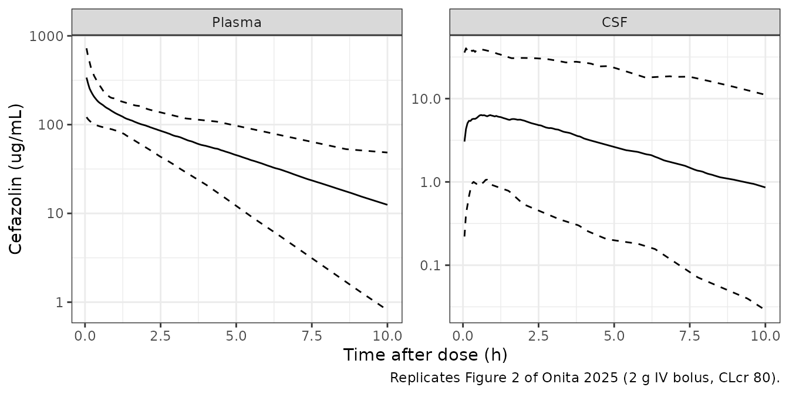
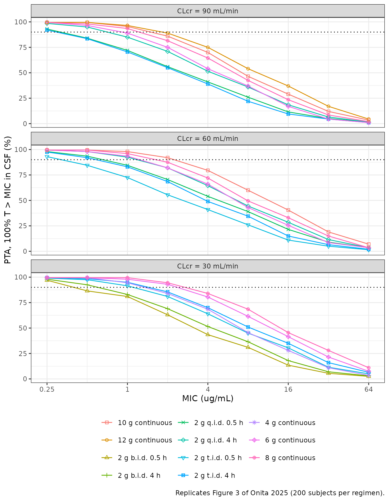

# Cefazolin in cerebrospinal fluid (Onita 2025)

## Model and source

- Citation: Onita T, Ikawa K, Ishihara N, Tamaki H, Yano T.
  Cerebrospinal pharmacokinetic modeling and pharmacodynamic simulation
  of high-dose cefazolin for meningitis caused by
  methicillin-susceptible Staphylococcus aureus. Antibiotics (Basel).
  2025;14(10):1008. <doi:10.3390/antibiotics14101008>. PMCID
  PMC12561440. All parameter values are from Table 2; the ODE system is
  the display equation set in Methods section 4.1. The plasma layer is
  Lanoiselee J et al. Sci Rep. 2021;11:19763
  (<doi:10.1038/s41598-021-99162-7>), also available in this package as
  Lanoiselee_2021_cefazolin.
- Description: Hybrid plasma-plus-cerebrospinal-fluid (CSF) population
  PK model for intravenous cefazolin in adults (Onita 2025). The plasma
  layer is the two-compartment Lanoiselee 2021 total-hip-arthroplasty
  model carried with every value fixed (clearance a power function of
  CKD-EPI creatinine clearance centred at 80 mL/min/1.73 m^2); a third
  CSF compartment is fed from the central concentration by the
  physiological CSF flow (0.021 L/h, fixed) and drains by the same flow
  divided by a CSF-to-plasma partition coefficient (0.0525, fixed from
  paired serum/CSF data in 8 adults with suspected meningitis), so
  steady-state CSF concentration is 0.0525 x plasma. Only the
  interindividual variances of the three CSF parameters were estimated,
  against the paired serum/CSF data. Used for a 100% T \> MIC
  probability-of-target-attainment analysis of high-dose regimens for
  methicillin-susceptible Staphylococcus aureus meningitis.
- Article: <https://doi.org/10.3390/antibiotics14101008> (open access,
  Antibiotics (Basel) 2025;14(10):1008)

The supplement (Tables S1-S3, Figure S1) was used. No correction notice
was found for this article (EuropePMC, checked 2026-11-10).

Onita et al. did not fit a full population PK model. They took the
published two-compartment plasma model of Lanoiselee 2021 (available in
this package as `Lanoiselee_2021_cefazolin`) with every value held
constant, attached a CSF compartment whose flow (0.021 L/h) and volume
(0.092 L) are physiological literature values, and set the CSF-to-plasma
partition coefficient to the mean paired CSF/serum ratio (0.0525) from 8
adults with suspected meningitis. Only the three CSF interindividual
variances were estimated, in NONMEM 7.4, against those paired data. The
model was then used for a 100% T \> MIC probability-of-target-attainment
(PTA) analysis of high-dose regimens for methicillin-susceptible
*Staphylococcus aureus* (MSSA) meningitis.

## Population

The model is assembled from three literature sources (Supplementary
Table S3):

- **Plasma PK** (Lanoiselee 2021): 100 adults undergoing total hip
  arthroplasty, 51 male and 49 female, mean age 67 years (24-91), mean
  weight 76 kg (48-123), CKD-EPI creatinine clearance 83 mL/min/1.73 m^2
  (17-129).
- **CSF flow and volume** (Cutler et al.): 12 children (8 male, 4
  female) aged 4-13 years with subacute sclerosing panencephalitis or
  pontine glioma.
- **CSF partition coefficient and its variability** (Ikuno et al.): 8
  adults (4 male, 4 female; mean age 47.9 years, 38-60) with suspected
  meningitis, given 1-3 g cefazolin, with 19 serum samples from 7
  patients and 24 CSF samples from 8 patients taken 1-9 h after the dose
  (Methods 4.2). CSF concentrations were measured by bioassay.

The authors state the model does not apply to children. The same
information is available programmatically via
`readModelDb("Onita_2025_cefazolin")()$population`.

## Source trace

| Equation / parameter | Value | Source location |
|----|----|----|
| `d/dt(central)`, `d/dt(peripheral1)` | two-compartment, IV infusion into central | Methods 4.1 display equations; Figure 4 |
| `d/dt(csf) <- qcsf * central / vc - qcsf * csf / vcsf / kp_csf` | n/a | Methods 4.1 third display equation |
| `cl = exp(lcl + etalcl) * (CRCL / 80)^e_crcl_cl` | n/a | Table 2 row ‘CL(L/h) = thetaCL x (CLcr/80)^thetaCLcr on CL’ |
| `lcl` | log(2.86) L/h, held constant | Table 2, thetaCL |
| `e_crcl_cl` | 0.79, held constant | Table 2, theta CLcr on CL |
| `lvc` | log(5.2) L, held constant | Table 2, thetaVc |
| `lq` | log(10.9) L/h, held constant | Table 2, thetaQ |
| `lvp` | log(4.56) L, held constant | Table 2, thetaVp |
| `lkp_csf` | log(0.0525), held constant | Table 2, thetaKPCSF; Methods 4.2 |
| `lqcsf` | log(0.021) L/h, held constant | Table 2, thetaQCSF (footnote c) |
| `lvcsf` | log(0.092) L, held constant | Table 2, thetaVCSF (footnote c) |
| `etalcl`, `etalvc`, `etalq`, `etalvp` | 0.102, 0.325, 0.437, 0.01 (variances), held constant | Table 2, etaCL / etaVcentral / etaQ / etaVperipheral |
| `etalkp_csf` | 1.39 (variance) | Table 2, etaKPCSF (RSE 203%) |
| `etalqcsf` | 1.22 (variance) | Table 2, etaQCSF (RSE 0.75%) |
| `etalvcsf` | 1.22 (variance) | Table 2, etaVCSF (RSE 0.38%) |
| `propSd`, `propSd_Ccsf` | sqrt(0.0144) = 0.12, held constant | Table 2, epsilon proportional |
| `CRCL` | CKD-EPI creatinine clearance | Methods 4.1; Table 1 (simulated at 90, 60, 30) |

The table’s eta and epsilon entries are variances (Table 2 footnote: eta
is ‘normally distributed with a mean of zero and variance’). The four
plasma-layer values are the squares of Lanoiselee 2021’s log-scale SDs
(0.32, 0.57, 0.66, 0.10), and 0.0144 is the square of its 12%
proportional error, which confirms that reading. The closed-form check
below confirms it for the CSF partition coefficient.

## Virtual cohort

The paper’s PTA analysis simulated 1000 subjects per regimen at a fixed
creatinine clearance (90, 60 or 30 mL/min). Here 200 virtual subjects
are drawn once, with base-R random numbers, and the same 200 are used
for every regimen and renal-function stratum. These are common random
numbers, so differences between regimens are not sampling noise, and the
cohort does not depend on the rxode2 build. The draws are passed to
`rxSolve()` as data columns named after the model’s etas, with
`omega = NA`.

``` r

N_SUBJ <- 200L
set.seed(20251011)
omega_diag <- c(
  etalcl = 0.102, etalvc = 0.325, etalq = 0.437, etalvp = 0.01,
  etalkp_csf = 1.39, etalqcsf = 1.22, etalvcsf = 1.22
)
etas <- as.data.frame(lapply(omega_diag, function(v) rnorm(N_SUBJ, 0, sqrt(v))))
etas$sid <- seq_len(N_SUBJ)

# Table 1 regimens (plus the 2 g t.i.d. 0.5 h regimen at CLcr 90 used for the
# Supplementary Table S1 comparison) and the Table 1 PK/PD breakpoints.
# Continuous infusion is coded as back-to-back 24 h infusions at steady state.
regimens <- tibble::tribble(
  ~crcl, ~regimen,                ~amt,  ~dur, ~tau, ~bp_paper,
  90,    "2 g q.i.d. 0.5 h",      2000,  0.5,  6,    0.25,
  90,    "2 g t.i.d. 4 h",        2000,  4,    8,    0.25,
  90,    "2 g q.i.d. 4 h",        2000,  4,    6,    0.5,
  90,    "6 g continuous",        6000,  24,   24,   0.5,
  90,    "8 g continuous",        8000,  24,   24,   1,
  90,    "10 g continuous",       10000, 24,   24,   1,
  90,    "12 g continuous",       12000, 24,   24,   1,
  60,    "2 g t.i.d. 0.5 h",      2000,  0.5,  8,    0.25,
  60,    "2 g q.i.d. 0.5 h",      2000,  0.5,  6,    0.5,
  60,    "2 g t.i.d. 4 h",        2000,  4,    8,    0.5,
  60,    "2 g q.i.d. 4 h",        2000,  4,    6,    1,
  60,    "6 g continuous",        6000,  24,   24,   1,
  60,    "8 g continuous",        8000,  24,   24,   1,
  60,    "10 g continuous",       10000, 24,   24,   2,
  30,    "2 g b.i.d. 0.5 h",      2000,  0.5,  12,   0.25,
  30,    "2 g t.i.d. 0.5 h",      2000,  0.5,  8,    1,
  30,    "2 g b.i.d. 4 h",        2000,  4,    12,   0.5,
  30,    "2 g t.i.d. 4 h",        2000,  4,    8,    2,
  30,    "4 g continuous",        4000,  24,   24,   1,
  30,    "6 g continuous",        6000,  24,   24,   2,
  30,    "8 g continuous",        8000,  24,   24,   2,
  90,    "2 g t.i.d. 0.5 h",      2000,  0.5,  8,    NA
) |>
  mutate(
    arm = row_number(),
    treatment = paste0("CLcr ", crcl, ": ", regimen),
    daily_g = amt / 1000 * 24 / tau
  )
knitr::kable(
  regimens |>
    select(crcl, regimen, daily_g, bp_paper) |>
    rename(
      "CLcr (mL/min)" = crcl, "Regimen" = regimen,
      "Daily dose (g)" = daily_g, "Table 1 breakpoint (ug/mL)" = bp_paper
    ),
  caption = "Simulated regimens. The last row is not in Table 1."
)
```

| CLcr (mL/min) | Regimen          | Daily dose (g) | Table 1 breakpoint (ug/mL) |
|--------------:|:-----------------|---------------:|---------------------------:|
|            90 | 2 g q.i.d. 0.5 h |              8 |                       0.25 |
|            90 | 2 g t.i.d. 4 h   |              6 |                       0.25 |
|            90 | 2 g q.i.d. 4 h   |              8 |                       0.50 |
|            90 | 6 g continuous   |              6 |                       0.50 |
|            90 | 8 g continuous   |              8 |                       1.00 |
|            90 | 10 g continuous  |             10 |                       1.00 |
|            90 | 12 g continuous  |             12 |                       1.00 |
|            60 | 2 g t.i.d. 0.5 h |              6 |                       0.25 |
|            60 | 2 g q.i.d. 0.5 h |              8 |                       0.50 |
|            60 | 2 g t.i.d. 4 h   |              6 |                       0.50 |
|            60 | 2 g q.i.d. 4 h   |              8 |                       1.00 |
|            60 | 6 g continuous   |              6 |                       1.00 |
|            60 | 8 g continuous   |              8 |                       1.00 |
|            60 | 10 g continuous  |             10 |                       2.00 |
|            30 | 2 g b.i.d. 0.5 h |              4 |                       0.25 |
|            30 | 2 g t.i.d. 0.5 h |              6 |                       1.00 |
|            30 | 2 g b.i.d. 4 h   |              4 |                       0.50 |
|            30 | 2 g t.i.d. 4 h   |              6 |                       2.00 |
|            30 | 4 g continuous   |              4 |                       1.00 |
|            30 | 6 g continuous   |              6 |                       2.00 |
|            30 | 8 g continuous   |              8 |                       2.00 |
|            90 | 2 g t.i.d. 0.5 h |              6 |                         NA |

Simulated regimens. The last row is not in Table 1. {.table}

## Simulation

Each regimen is one steady-state dose (`ss = 1`) at time 0, observed
over one dosing interval. For 100% T \> MIC, the minimum CSF
concentration over that interval must exceed the MIC. Observation rows
sit on the `central` ODE state with `dvid = 1`, because the model
declares two endpoints (`Cc`, `Ccsf`); both concentrations come back on
every row.

``` r

make_arm <- function(i) {
  r <- regimens[i, ]
  subj <- etas |>
    mutate(id = (i - 1L) * N_SUBJ + sid, arm = r$arm, CRCL = r$crcl)
  dose <- subj |>
    mutate(
      time = 0, amt = r$amt, evid = 1L, dur = r$dur, ii = r$tau, ss = 1L,
      cmt = "central", dvid = NA_integer_
    )
  grid_by <- if (r$dur == r$tau) 0.5 else 0.05
  obs <- subj |>
    tidyr::crossing(time = seq(0, r$tau, by = grid_by)) |>
    mutate(
      amt = NA_real_, evid = 0L, dur = NA_real_, ii = 0, ss = 0L,
      cmt = "central", dvid = 1L
    )
  bind_rows(dose, obs)
}
events <- bind_rows(lapply(seq_len(nrow(regimens)), make_arm)) |>
  arrange(id, time, desc(evid))
stopifnot(!anyDuplicated(unique(events[, c("id", "time", "evid")])))
```

``` r

mod <- readModelDb("Onita_2025_cefazolin")

solve_cohort <- function(ev, n_expected) {
  out <- rxode2::rxSolve(
    mod,
    events = ev, keep = "arm", omega = NA, sigma = NA,
    useLinCmt = FALSE, maxsteps = 500000L, returnType = "data.frame"
  )
  # A subject that fails to solve comes back NA and would silently drop out
  # of every PTA denominator.
  stopifnot(!anyNA(out$Cc), !anyNA(out$Ccsf), dplyr::n_distinct(out$id) == n_expected)
  out
}
sim <- solve_cohort(events, N_SUBJ * nrow(regimens)) |>
  left_join(regimens |> select(arm, crcl, regimen, treatment, tau), by = "arm")
#> ℹ parameter labels from comments will be replaced by 'label()'
```

## Closed-form checks

At steady state under continuous infusion the CSF equation gives
`Ccsf = kp_csf * Cc = kp_csf * R / CL`, with `R` the infusion rate. The
typical-value solve must reproduce it to numerical precision.

``` r

cl_typ <- function(crcl) 2.86 * (crcl / 80)^0.79
ci <- regimens |> filter(dur == tau)
typ_events <- bind_rows(lapply(seq_len(nrow(ci)), function(i) {
  bind_rows(
    data.frame(
      id = i, time = 0, amt = ci$amt[i], evid = 1L, dur = 24, ii = 24, ss = 1L,
      cmt = "central", dvid = NA_integer_, CRCL = ci$crcl[i]
    ),
    data.frame(
      id = i, time = 12, amt = NA_real_, evid = 0L, dur = NA_real_, ii = 0,
      ss = 0L, cmt = "central", dvid = 1L, CRCL = ci$crcl[i]
    )
  )
}))
typ <- rxode2::rxSolve(
  mod,
  events = typ_events, omega = NA, sigma = NA, useLinCmt = FALSE,
  returnType = "data.frame"
)
typ_chk <- ci |>
  mutate(
    closed_form = 0.0525 * (amt / 24) / cl_typ(crcl),
    simulated = typ$Ccsf
  )
stopifnot(all(abs(typ_chk$simulated / typ_chk$closed_form - 1) < 1e-4))
knitr::kable(
  typ_chk |>
    select(treatment, closed_form, simulated) |>
    rename(
      "Regimen" = treatment, "kp_csf x R / CL (mg/L)" = closed_form,
      "Typical-value solve (mg/L)" = simulated
    ),
  digits = 3, caption = "Typical-value steady-state CSF concentration, continuous infusion."
)
```

| Regimen                  | kp_csf x R / CL (mg/L) | Typical-value solve (mg/L) |
|:-------------------------|-----------------------:|---------------------------:|
| CLcr 90: 6 g continuous  |                  4.181 |                      4.181 |
| CLcr 90: 8 g continuous  |                  5.575 |                      5.575 |
| CLcr 90: 10 g continuous |                  6.969 |                      6.969 |
| CLcr 90: 12 g continuous |                  8.363 |                      8.363 |
| CLcr 60: 6 g continuous  |                  5.760 |                      5.760 |
| CLcr 60: 8 g continuous  |                  7.680 |                      7.680 |
| CLcr 60: 10 g continuous |                  9.600 |                      9.600 |
| CLcr 30: 4 g continuous  |                  6.640 |                      6.640 |
| CLcr 30: 6 g continuous  |                  9.960 |                      9.960 |
| CLcr 30: 8 g continuous  |                 13.280 |                     13.280 |

Typical-value steady-state CSF concentration, continuous infusion.
{.table style="width:100%;"}

For continuous infusion only `CL` and `kp_csf` vary between subjects at
steady state, so `log(Ccsf)` is normal with mean
`log(0.0525 R / CL_typ)` and variance `0.102 + 1.39`. That gives the
PTA, the Table 1 breakpoints and the Supplementary Table S2 exceedance
probabilities in closed form, with no simulation noise. This also tests
the reading of Table 2’s IIV entries as variances: with the entries read
as SDs, the 8 g/day interval would be about twice as wide on the log
scale.

``` r

mics <- 0.25 * 2^(0:8)
sd_ci <- sqrt(0.102 + 1.39)
ci_exact <- ci |>
  mutate(median_csf = 0.0525 * (amt / 24) / cl_typ(crcl)) |>
  tidyr::crossing(mic = mics) |>
  mutate(pta = pnorm((log(median_csf) - log(mic)) / sd_ci))
ci_bp <- ci_exact |>
  group_by(treatment, bp_paper) |>
  summarise(bp_exact = max(c(0, mic[pta >= 0.9])), .groups = "drop")
# Deterministic on the model side, so every breakpoint must match.
stopifnot(all(ci_bp$bp_exact == ci_bp$bp_paper))

# Discussion: 8 g continuous infusion at CLcr 90, median CSF 5.7 ug/mL,
# 95% CI 0.5-62.4 ug/mL.
med_8g <- 0.0525 * (8000 / 24) / cl_typ(90)
q_8g <- med_8g * exp(c(-1, 1) * qnorm(0.975) * sd_ci)
stopifnot(
  abs(med_8g / 5.7 - 1) < 0.05,
  abs(q_8g[1] / 0.5 - 1) < 0.10,
  abs(q_8g[2] / 62.4 - 1) < 0.10
)

# Supplementary Table S2: P(Cmin > 64 ug/mL) for the continuous infusions.
s2_ci <- tibble::tribble(
  ~treatment,                  ~p64_paper,
  "CLcr 90: 6 g continuous",   1.4,
  "CLcr 90: 8 g continuous",   2.5,
  "CLcr 90: 10 g continuous",  4.0,
  "CLcr 90: 12 g continuous",  5.0,
  "CLcr 60: 6 g continuous",   2.6,
  "CLcr 60: 8 g continuous",   4.3,
  "CLcr 60: 10 g continuous",  6.1,
  "CLcr 30: 4 g continuous",   3.5,
  "CLcr 30: 6 g continuous",   6.6,
  "CLcr 30: 8 g continuous",   9.9
)
s2_exact <- ci |>
  mutate(
    median_csf = 0.0525 * (amt / 24) / cl_typ(crcl),
    p64_exact = 100 * pnorm((log(median_csf) - log(64)) / sd_ci)
  ) |>
  inner_join(s2_ci, by = "treatment")
# The paper's values are 1000-subject Monte Carlo estimates (SE about 0.5-1
# percentage point at these probabilities).
stopifnot(all(abs(s2_exact$p64_exact - s2_exact$p64_paper) < 1.5))

knitr::kable(
  ci_bp |>
    left_join(s2_exact |> select(treatment, p64_exact, p64_paper), by = "treatment") |>
    rename(
      "Regimen" = treatment, "Table 1 breakpoint" = bp_paper,
      "Closed-form breakpoint" = bp_exact,
      "Table S2 P(Cmin > 64) (%)" = p64_paper,
      "Closed-form P(Cmin > 64) (%)" = p64_exact
    ),
  digits = 1,
  caption = "Continuous infusion: closed-form PTA breakpoints and neurotoxicity exceedance against Table 1 and Table S2."
)
```

| Regimen | Table 1 breakpoint | Closed-form breakpoint | Closed-form P(Cmin \> 64) (%) | Table S2 P(Cmin \> 64) (%) |
|:---|---:|---:|---:|---:|
| CLcr 30: 4 g continuous | 1.0 | 1.0 | 3.2 | 3.5 |
| CLcr 30: 6 g continuous | 2.0 | 2.0 | 6.4 | 6.6 |
| CLcr 30: 8 g continuous | 2.0 | 2.0 | 9.9 | 9.9 |
| CLcr 60: 10 g continuous | 2.0 | 2.0 | 6.0 | 6.1 |
| CLcr 60: 6 g continuous | 1.0 | 1.0 | 2.4 | 2.6 |
| CLcr 60: 8 g continuous | 1.0 | 1.0 | 4.1 | 4.3 |
| CLcr 90: 10 g continuous | 1.0 | 1.0 | 3.5 | 4.0 |
| CLcr 90: 12 g continuous | 1.0 | 1.0 | 4.8 | 5.0 |
| CLcr 90: 6 g continuous | 0.5 | 0.5 | 1.3 | 1.4 |
| CLcr 90: 8 g continuous | 1.0 | 1.0 | 2.3 | 2.5 |

Continuous infusion: closed-form PTA breakpoints and neurotoxicity
exceedance against Table 1 and Table S2. {.table}

The closed form gives a median of 5.58 ug/mL (95% interval 0.51-61.1)
for 8 g/day at CLcr 90 mL/min, against 5.7 (0.5-62.4) ug/mL in the
Discussion. All ten continuous-infusion breakpoints match Table 1.

## Replicate Figure 2 (dose-normalised profiles after 2 g)

Replicates Figure 2 of Onita 2025: plasma and CSF concentrations after a
2 g intravenous bolus, shown as the median and the 2.5th-97.5th
percentile band. The figure does not give the creatinine clearance; the
plasma model’s reference value of 80 mL/min/1.73 m^2 is used. Residual
error is not added.

``` r

ev_fig2 <- bind_rows(
  etas |>
    mutate(
      id = sid, time = 0, amt = 2000, evid = 1L, cmt = "central",
      dvid = NA_integer_, CRCL = 80
    ),
  etas |>
    mutate(id = sid, CRCL = 80) |>
    tidyr::crossing(time = seq(0.05, 10, by = 0.05)) |>
    mutate(amt = NA_real_, evid = 0L, cmt = "central", dvid = 1L)
) |>
  arrange(id, time, desc(evid)) |>
  mutate(arm = 1L)
sim_fig2 <- solve_cohort(ev_fig2, N_SUBJ)
fig2_sum <- sim_fig2 |>
  select(id, time, Plasma = Cc, CSF = Ccsf) |>
  pivot_longer(c(Plasma, CSF), names_to = "matrix", values_to = "conc") |>
  group_by(matrix, time) |>
  summarise(
    p50 = median(conc), p025 = quantile(conc, 0.025),
    p975 = quantile(conc, 0.975), .groups = "drop"
  ) |>
  mutate(matrix = factor(matrix, levels = c("Plasma", "CSF")))

ggplot(fig2_sum, aes(time)) +
  geom_line(aes(y = p50)) +
  geom_line(aes(y = p025), linetype = "dashed") +
  geom_line(aes(y = p975), linetype = "dashed") +
  scale_y_log10() +
  facet_wrap(~matrix, scales = "free_y") +
  labs(
    x = "Time after dose (h)", y = "Cefazolin (ug/mL)",
    caption = "Replicates Figure 2 of Onita 2025 (2 g IV bolus, CLcr 80)."
  ) +
  theme_bw()
```



In the published figure the plasma median falls from about 380 ug/mL at
time zero (2000 mg / 5.2 L) to about 8 ug/mL at 10 h, and the CSF median
from about 6 to about 0.5 ug/mL. The simulated medians at 10 h are 12
(plasma) and 0.86 ug/mL (CSF), which is higher than the figure. The
CSF-to-plasma ratio at 10 h is similar in both (about 0.07), so the
difference is in plasma clearance. The paper does not say what renal
function the VPC simulation assumed, and it does not report renal
function for the patients behind the observed points (Supplementary
Table S3, ‘NA’). At CLcr 80 the plasma model’s clearance is 2.86 L/h; a
simulated cohort with better renal function would clear the drug faster
and match the figure more closely. No parameter was adjusted.

## Replicate Figure 3 and Table 1 (probability of target attainment)

``` r

cmin_csf <- sim |>
  group_by(arm, treatment, crcl, regimen, id) |>
  summarise(cmin = min(Ccsf), .groups = "drop")
pta <- cmin_csf |>
  tidyr::crossing(mic = mics) |>
  group_by(arm, treatment, crcl, regimen, mic) |>
  summarise(pta = 100 * mean(cmin > mic), .groups = "drop")

ggplot(pta |> filter(arm %in% regimens$arm[!is.na(regimens$bp_paper)]),
       aes(mic, pta, shape = regimen, colour = regimen)) +
  geom_line() +
  geom_point() +
  geom_hline(yintercept = 90, linetype = "dotted") +
  scale_x_log10(breaks = c(0.25, 1, 4, 16, 64), labels = c(0.25, 1, 4, 16, 64)) +
  scale_shape_manual(values = 0:14) +
  facet_wrap(~ factor(paste0("CLcr = ", crcl, " mL/min"), levels = paste0("CLcr = ", c(90, 60, 30), " mL/min")), ncol = 1) +
  labs(
    x = "MIC (ug/mL)", y = "PTA, 100% T > MIC in CSF (%)",
    shape = NULL, colour = NULL,
    caption = "Replicates Figure 3 of Onita 2025 (200 subjects per regimen)."
  ) +
  theme_bw() +
  theme(legend.position = "bottom") +
  guides(shape = guide_legend(ncol = 3), colour = guide_legend(ncol = 3))
```



``` r

bp_sim <- pta |>
  group_by(arm) |>
  summarise(bp_sim = max(c(0, mic[pta >= 90])), .groups = "drop")
tab1 <- regimens |>
  filter(!is.na(bp_paper)) |>
  left_join(bp_sim, by = "arm")
n_exact <- sum(tab1$bp_sim == tab1$bp_paper)
# Common random numbers from base R make this deterministic; the paper's
# breakpoints come from its own 1000-subject Monte Carlo, so a regimen whose
# PTA sits near 90% at a breakpoint can land one dilution either side.
stopifnot(
  all(abs(log2(tab1$bp_sim / tab1$bp_paper)) <= 1),
  n_exact >= 18
)
knitr::kable(
  tab1 |>
    select(crcl, regimen, bp_paper, bp_sim) |>
    rename(
      "CLcr (mL/min)" = crcl, "Regimen" = regimen,
      "Table 1 breakpoint (ug/mL)" = bp_paper,
      "Simulated breakpoint (ug/mL)" = bp_sim
    ),
  caption = "PK/PD breakpoints (highest MIC with PTA of at least 90%), Table 1 of Onita 2025 against the simulation."
)
```

| CLcr (mL/min) | Regimen | Table 1 breakpoint (ug/mL) | Simulated breakpoint (ug/mL) |
|---:|:---|---:|---:|
| 90 | 2 g q.i.d. 0.5 h | 0.25 | 0.25 |
| 90 | 2 g t.i.d. 4 h | 0.25 | 0.25 |
| 90 | 2 g q.i.d. 4 h | 0.50 | 0.50 |
| 90 | 6 g continuous | 0.50 | 0.50 |
| 90 | 8 g continuous | 1.00 | 1.00 |
| 90 | 10 g continuous | 1.00 | 1.00 |
| 90 | 12 g continuous | 1.00 | 1.00 |
| 60 | 2 g t.i.d. 0.5 h | 0.25 | 0.25 |
| 60 | 2 g q.i.d. 0.5 h | 0.50 | 0.50 |
| 60 | 2 g t.i.d. 4 h | 0.50 | 0.50 |
| 60 | 2 g q.i.d. 4 h | 1.00 | 1.00 |
| 60 | 6 g continuous | 1.00 | 1.00 |
| 60 | 8 g continuous | 1.00 | 1.00 |
| 60 | 10 g continuous | 2.00 | 2.00 |
| 30 | 2 g b.i.d. 0.5 h | 0.25 | 0.25 |
| 30 | 2 g t.i.d. 0.5 h | 1.00 | 1.00 |
| 30 | 2 g b.i.d. 4 h | 0.50 | 0.50 |
| 30 | 2 g t.i.d. 4 h | 2.00 | 1.00 |
| 30 | 4 g continuous | 1.00 | 1.00 |
| 30 | 6 g continuous | 2.00 | 2.00 |
| 30 | 8 g continuous | 2.00 | 2.00 |

PK/PD breakpoints (highest MIC with PTA of at least 90%), Table 1 of
Onita 2025 against the simulation. {.table}

20 of 21 simulated breakpoints equal Table 1, and the rest are within
one doubling dilution.

## Replicate Supplementary Table S2 (neurotoxicity exceedance)

``` r

s2_paper <- tibble::tribble(
  ~treatment,                   ~p64_paper,
  "CLcr 90: 2 g q.i.d. 0.5 h",  1.1,
  "CLcr 90: 2 g t.i.d. 4 h",    0.8,
  "CLcr 90: 2 g q.i.d. 4 h",    1.8,
  "CLcr 60: 2 g t.i.d. 0.5 h",  1.0,
  "CLcr 60: 2 g q.i.d. 0.5 h",  2.3,
  "CLcr 60: 2 g t.i.d. 4 h",    1.6,
  "CLcr 60: 2 g q.i.d. 4 h",    3.0,
  "CLcr 30: 2 g b.i.d. 0.5 h",  1.1,
  "CLcr 30: 2 g t.i.d. 0.5 h",  3.7,
  "CLcr 30: 2 g b.i.d. 4 h",    1.8,
  "CLcr 30: 2 g t.i.d. 4 h",    9.0
) |>
  bind_rows(s2_ci)
s2_sim <- cmin_csf |>
  group_by(treatment) |>
  summarise(p64_sim = 100 * mean(cmin > 64), .groups = "drop") |>
  inner_join(s2_paper, by = "treatment")
stopifnot(
  nrow(s2_sim) == 21,
  median(abs(s2_sim$p64_sim - s2_sim$p64_paper)) < 1.5,
  quantile(abs(s2_sim$p64_sim - s2_sim$p64_paper), 0.9) < 3
)
knitr::kable(
  s2_sim |>
    rename(
      "Regimen" = treatment, "Simulated (%)" = p64_sim,
      "Table S2 (%)" = p64_paper
    ),
  digits = 1,
  caption = "Probability that the steady-state CSF trough exceeds 64 ug/mL."
)
```

| Regimen                   | Simulated (%) | Table S2 (%) |
|:--------------------------|--------------:|-------------:|
| CLcr 30: 2 g b.i.d. 0.5 h |           2.5 |          1.1 |
| CLcr 30: 2 g b.i.d. 4 h   |           3.0 |          1.8 |
| CLcr 30: 2 g t.i.d. 0.5 h |           5.0 |          3.7 |
| CLcr 30: 2 g t.i.d. 4 h   |           6.5 |          9.0 |
| CLcr 30: 4 g continuous   |           3.5 |          3.5 |
| CLcr 30: 6 g continuous   |           7.5 |          6.6 |
| CLcr 30: 8 g continuous   |          11.0 |          9.9 |
| CLcr 60: 10 g continuous  |           7.0 |          6.1 |
| CLcr 60: 2 g q.i.d. 0.5 h |           3.5 |          2.3 |
| CLcr 60: 2 g q.i.d. 4 h   |           3.5 |          3.0 |
| CLcr 60: 2 g t.i.d. 0.5 h |           1.5 |          1.0 |
| CLcr 60: 2 g t.i.d. 4 h   |           2.0 |          1.6 |
| CLcr 60: 6 g continuous   |           3.5 |          2.6 |
| CLcr 60: 8 g continuous   |           3.5 |          4.3 |
| CLcr 90: 10 g continuous  |           3.5 |          4.0 |
| CLcr 90: 12 g continuous  |           4.5 |          5.0 |
| CLcr 90: 2 g q.i.d. 0.5 h |           1.5 |          1.1 |
| CLcr 90: 2 g q.i.d. 4 h   |           1.5 |          1.8 |
| CLcr 90: 2 g t.i.d. 4 h   |           1.0 |          0.8 |
| CLcr 90: 6 g continuous   |           1.0 |          1.4 |
| CLcr 90: 8 g continuous   |           2.0 |          2.5 |

Probability that the steady-state CSF trough exceeds 64 ug/mL. {.table}

With 200 subjects one subject is 0.5 percentage points, so the simulated
exceedances agree with Table S2 to within Monte Carlo error.

## PKNCA validation

NCA over one steady-state dosing interval, in plasma and CSF, for the
CLcr 90 mL/min regimens used in the paper’s external comparison
(Supplementary Table S1). Because the CSF compartment’s inflow and
outflow are both proportional to the CSF flow, integrating the CSF
equation over a steady-state interval gives
`AUC_csf = kp_csf x AUC_plasma` for every subject, whatever its CSF flow
and volume. The per-subject AUC ratio is checked against `kp_csf`.

``` r

nca_arms <- regimens$arm[regimens$treatment %in% c(
  "CLcr 90: 2 g t.i.d. 0.5 h", "CLcr 90: 2 g t.i.d. 4 h",
  "CLcr 90: 8 g continuous"
)]
nca_conc <- sim |>
  filter(arm %in% nca_arms) |>
  # 0.25 h subsample keeps the NCA fast; it includes every dosing-interval
  # boundary.
  filter(abs(time / 0.25 - round(time / 0.25)) < 1e-8) |>
  select(id, time, treatment, tau, Plasma = Cc, CSF = Ccsf) |>
  pivot_longer(c(Plasma, CSF), names_to = "matrix", values_to = "Cc") |>
  filter(!is.na(Cc))
nca_dose <- events |>
  filter(evid == 1, arm %in% nca_arms) |>
  left_join(regimens |> select(arm, treatment), by = "arm") |>
  select(id, time, amt, treatment)

conc_obj <- PKNCA::PKNCAconc(nca_conc, Cc ~ time | treatment + matrix + id)
dose_obj <- PKNCA::PKNCAdose(nca_dose, amt ~ time | treatment + id)
intervals <- regimens |>
  filter(arm %in% nca_arms) |>
  transmute(
    treatment, start = 0, end = tau,
    cmax = TRUE, cmin = TRUE, cav = TRUE, auclast = TRUE
  )
nca_res <- PKNCA::pk.nca(
  PKNCA::PKNCAdata(
    conc_obj, dose_obj,
    intervals = intervals,
    # Linear trapezoids: log-down interpolation is biased on the nearly flat
    # continuous-infusion profiles.
    options = list(auc.method = "linear")
  )
)
nca_tab <- as.data.frame(nca_res$result)

auc_ratio <- nca_tab |>
  filter(PPTESTCD == "auclast") |>
  select(treatment, matrix, id, PPORRES) |>
  pivot_wider(names_from = matrix, values_from = PPORRES) |>
  left_join(sim |> distinct(id, kp_csf), by = "id") |>
  mutate(rel = CSF / Plasma / kp_csf)
stopifnot(
  nrow(auc_ratio) == length(nca_arms) * N_SUBJ,
  abs(median(auc_ratio$rel) - 1) < 0.01,
  quantile(abs(auc_ratio$rel - 1), 0.9) < 0.03
)

knitr::kable(
  nca_tab |>
    filter(PPTESTCD %in% c("cmax", "cmin", "cav")) |>
    group_by(treatment, matrix, PPTESTCD) |>
    summarise(median = median(PPORRES), .groups = "drop") |>
    mutate(PPTESTCD = ncaParamLabel(PPTESTCD)) |>
    pivot_wider(names_from = PPTESTCD, values_from = median) |>
    rename("Regimen" = treatment, "Matrix" = matrix),
  digits = 2,
  caption = "Median steady-state NCA (ug/mL), CLcr 90 mL/min."
)
```

| Regimen                   | Matrix |   Cavg |   Cmax |   Cmin |
|:--------------------------|:-------|-------:|-------:|-------:|
| CLcr 90: 2 g t.i.d. 0.5 h | CSF    |   4.35 |  10.25 |   1.45 |
| CLcr 90: 2 g t.i.d. 0.5 h | Plasma |  79.94 | 257.49 |  20.56 |
| CLcr 90: 2 g t.i.d. 4 h   | CSF    |   4.35 |   6.65 |   2.35 |
| CLcr 90: 2 g t.i.d. 4 h   | Plasma |  79.94 | 123.51 |  35.08 |
| CLcr 90: 8 g continuous   | CSF    |   5.80 |   5.80 |   5.80 |
| CLcr 90: 8 g continuous   | Plasma | 106.59 | 106.59 | 106.59 |

Median steady-state NCA (ug/mL), CLcr 90 mL/min. {.table}

## Comparison against published values

Supplementary Table S1 reports the paper’s own simulated median CSF
concentration for two regimens at CLcr 90 mL/min: 5.7 ug/mL for 8 g/day
by continuous infusion and a 1.2 ug/mL trough for 2 g three times daily.
The infusion duration of the 2 g t.i.d. regimen is not stated, so both
0.5 h and 4 h are shown.

``` r

nca_ref <- data.frame(
  treatment = c(
    "CLcr 90: 8 g continuous", "CLcr 90: 2 g t.i.d. 0.5 h",
    "CLcr 90: 2 g t.i.d. 4 h"
  ),
  cav = c(5.7, NA, NA),
  cmin = c(NA, 1.2, 1.2)
)
nca_csf <- nca_tab |> filter(matrix == "CSF")
# One call per parameter, each restricted to the regimens that have a
# published reference value for it.
cmp <- bind_rows(
  ncaComparisonTable(
    simulated = nca_csf |> filter(treatment == "CLcr 90: 8 g continuous"),
    reference = nca_ref |> filter(!is.na(cav)) |> select(treatment, cav),
    by = "treatment", params = "cav", units = c(cav = "ug/mL")
  ),
  ncaComparisonTable(
    simulated = nca_csf |> filter(treatment != "CLcr 90: 8 g continuous"),
    reference = nca_ref |> filter(!is.na(cmin)) |> select(treatment, cmin),
    by = "treatment", params = "cmin", units = c(cmin = "ug/mL")
  )
)
knitr::kable(cmp, caption = "Median CSF concentrations: Onita 2025 Supplementary Table S1 against this implementation.")
```

| NCA parameter | treatment                 | Reference | Simulated | % diff   |
|:--------------|:--------------------------|:----------|:----------|:---------|
| Cavg (ug/mL)  | CLcr 90: 8 g continuous   | 5.7       | 5.8       | +1.7%    |
| Cmin (ug/mL)  | CLcr 90: 2 g t.i.d. 0.5 h | 1.2       | 1.45      | +20.9%\* |
| Cmin (ug/mL)  | CLcr 90: 2 g t.i.d. 4 h   | 1.2       | 2.35      | +96.0%\* |

Median CSF concentrations: Onita 2025 Supplementary Table S1 against
this implementation. {.table}

``` r

cmp_num <- nca_tab |>
  filter(matrix == "CSF", treatment == "CLcr 90: 8 g continuous", PPTESTCD == "cav")
# 200 subjects with a log-scale SD of 1.22 gives the median about 11% Monte
# Carlo error.
stopifnot(abs(median(cmp_num$PPORRES) / 5.7 - 1) < 0.25)
```

The 8 g/day median matches. For the 2 g t.i.d. trough, the paper’s 1.2
ug/mL is closer to the 0.5 h infusion than to the 4 h infusion. The
remaining difference from the 0.5 h value is within the Monte Carlo
error of a 200-subject median at this level of variability. The measured
values the paper compares against were 6.1 ug/mL (one case report, 8
g/day continuous), a median of 2.8 ug/mL (range 2.1-5.2; 8 g/day, mainly
continuous) and a median trough of 1.59 ug/mL (range 0.7-2.2; 2 g
t.i.d.), in patients with normal renal function.

## Assumptions and deviations

- **Hybrid model, not a fit.** All structural values are literature
  values held constant (Table 2 footnotes a-c). Only the CSF variances
  were estimated, from 24 CSF samples in 8 patients. The RSEs of 0.75%
  and 0.38% on the CSF flow and volume variances, next to a
  sampling-importance-resampling interval spanning five orders of
  magnitude, show that these variances are poorly identified. They are
  carried as published.
- **No CL-Vc correlation.** Lanoiselee 2021 estimated a CL-Vc
  correlation of 0.83. Onita 2025 Table 2 lists only the diagonal
  variances, so the omega matrix here is diagonal. At steady state under
  continuous infusion `Vc` does not affect the CSF concentration, so the
  continuous-infusion results above do not depend on this choice.
- **CSF compartment is a satellite.** The Methods 4.1 equations do not
  remove the CSF inflow from `central` or return the CSF outflow to it.
  The equations are encoded as printed. The CSF flow (0.021 L/h) is
  under 1% of the clearance, so the effect on plasma mass balance is
  negligible.
- **Single residual error for both matrices.** Table 2 lists one
  proportional epsilon (variance 0.0144). nlmixr2 needs one residual
  parameter per endpoint, so `propSd` and `propSd_Ccsf` both carry 0.12.
- **Renal function units.** The paper writes CLcr in mL/min and
  simulates at 90, 60 and 30 mL/min. The covariate is the CKD-EPI
  estimate the plasma model was built on, recorded in its native
  mL/min/1.73 m^2 as in `Lanoiselee_2021_cefazolin`. Simulations here
  use the paper’s numbers unchanged.
- **Figure 2 conditions.** The figure gives neither the creatinine
  clearance nor the dose route of the normalised profiles. A 2 g bolus
  at CLcr 80 (the plasma model’s reference) was used, which matches the
  plasma median of about 380 ug/mL at time zero.
- **Cohort size.** The paper simulated 1000 subjects per regimen; 200
  common random-number subjects are used here. Breakpoints whose PTA
  sits near 90% can differ by one dilution (one of 21 regimens here).
- **Total concentration.** The paper does not correct CSF concentrations
  for protein binding, and neither does this model.
