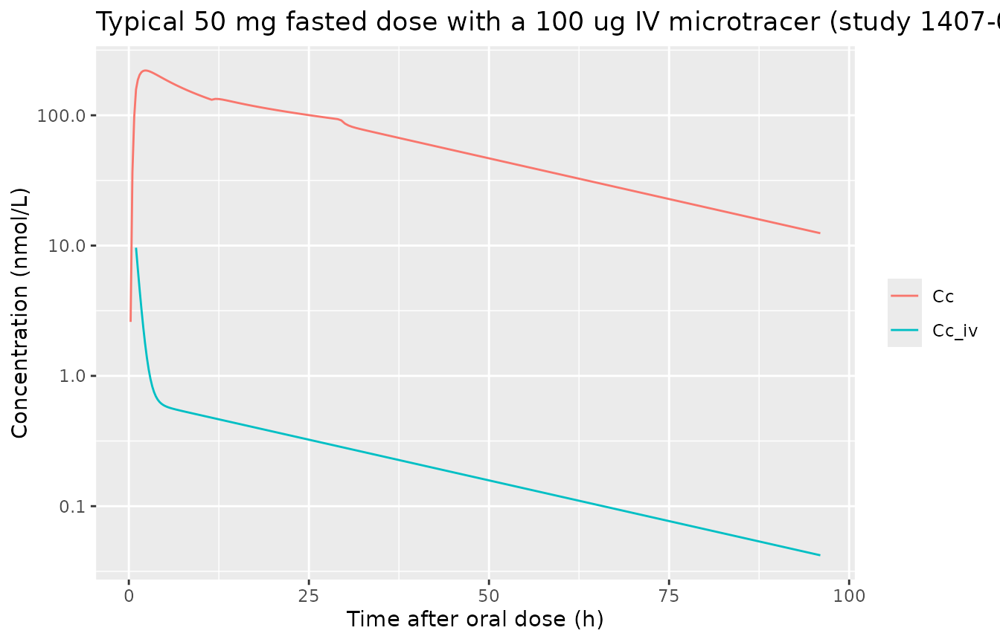
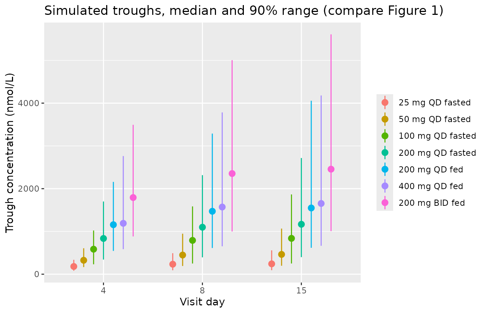
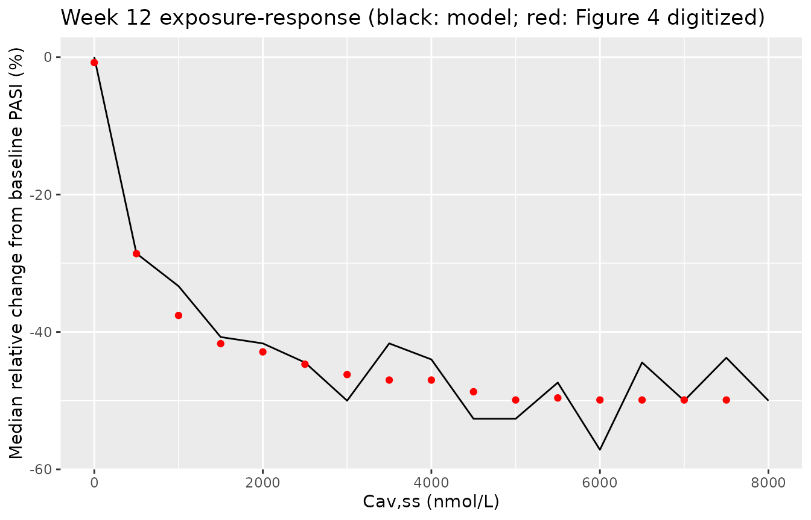

# Bevurogant PK and PASI response (Ooi 2023)

## Model and source

Ooi et al. (2023) analysed oral bevurogant (BI 730357), a RORgammat
antagonist, with two sequential models, packaged here as two files that
share this article:

- `Ooi_2023_bevurogant`: population PK in healthy subjects and in
  patients with moderate-to-severe plaque psoriasis.
- `Ooi_2023_bevurogant_pasi`: a bounded-integer PK/PD model of the
  Psoriasis Area and Severity Index (PASI), driven by the individual
  average steady-state concentration (CAV) that the PK model predicts.

``` r

mod_pk <- readModelDb("Ooi_2023_bevurogant")
mod_pd <- readModelDb("Ooi_2023_bevurogant_pasi")
ui_pk <- rxode2::rxode2(mod_pk)
#> ℹ parameter labels from comments will be replaced by 'label()'
ui_pd <- rxode2::rxode2(mod_pd)
#> ℹ parameter labels from comments will be replaced by 'label()'
```

- Citation: Ooi QX, Wenning L, Plock N, Hoch M, Kerbusch T, Jacobs A,
  Zheng W, Ji Q, Gong J, Shah N, Joshi A, Jeon S, Sachs M, Kemmler M,
  Seeburger J, Hilger E, Pfeifer E. Bounded integer model-based analysis
  of psoriasis area and severity index in patients with
  moderate-to-severe plaque psoriasis receiving BI 730357. CPT
  Pharmacometrics Syst Pharmacol. 2023;12(6):758-769.
  <doi:10.1002/psp4.12948>. Model equations from the Appendix S1 NONMEM
  control stream (run42).
- PK model: Two-compartment population PK model for oral bevurogant (BI
  730357, a RORgammat antagonist) in healthy adults and in patients with
  moderate-to-severe plaque psoriasis (Ooi 2023). Dual absorption: most
  of the bioavailable dose enters the depot as a zero-order input after
  a short lag and is then absorbed first-order, and the remaining
  fraction enters central as a zero-order input after a long (about
  11.5 h) lag. Absolute oral bioavailability on the logit scale is
  study-specific and falls linearly with dose, with shifts for food, the
  intended commercial formulation and twice-daily dosing. Clearance is
  lower in patients and falls with baseline CRP and AST; allometric
  weight scaling. A separate pair of IV states carries the 100 ug
  intravenous microtracer of study 1407-0033, measured as its own
  analyte (ROUTE_ORAL = 0 selects it on an observation record; Cc_iv is
  always output). Combined residual error per study / diet stratum with
  between-subject variability on the proportional part, the additive
  part scaled by the assay LLOQ, and a larger residual for trough
  samples.
- PASI model: Bounded-integer PK/PD model of the Psoriasis Area and
  Severity Index (PASI) in patients with moderate-to-severe plaque
  psoriasis receiving oral bevurogant (BI 730357, a RORgammat
  antagonist) or placebo (Ooi 2023). A probability-scale disease state
  follows a type I indirect response whose production is inhibited by an
  Imax function of the individual average steady-state bevurogant
  concentration (CAV); Imax depends on prior biologic and prior IL-17
  inhibitor use. The logit of the state, minus an individual exponential
  placebo effect, is the latent value on the probit scale of the 73 PASI
  categories (0-72); the observed integer PASI is floor(73 \*
  pnorm(latent + g \* eps)) with an individual scaling g. The baseline
  is on the logit scale with a Box-Cox transformed random effect and a
  baseline sPGA shift.
- Article: <https://doi.org/10.1002/psp4.12948> (open access,
  PMC10272300)

The paper names the compound only by its development code; bevurogant is
its International Nonproprietary Name (molecular weight 532.62 g/mol).
Both models were transcribed from the two NONMEM control streams in
Appendix S1 (PK run 42 and PK/PD run 29), and every value was checked
against Tables 2 and 3 of the paper.

## Population

The PK analysis pooled 109 healthy subjects from three phase I studies
(1407-0032, single oral doses of 50-200 mg fasted; 1407-0033, 50 mg oral
with a 100 ug intravenous microtracer; 1407-0002, 25-400 mg once daily
for 14 or 28 days, fasted and fed) with 244 patients from the phase II
study 1407-0030 (25-200 mg once daily fasted in part 1; 400 mg once
daily or 200 mg twice daily fed in part 2), 7686 plasma concentrations
in total (Table 1, Results). The pooled population was 73.4% male and
aged 18-75 years. The PASI analysis used 1554 PASI assessments from the
274 patients of study 1407-0030 (69.3% male), including placebo, within
the first 12 weeks of treatment. The paper does not tabulate body
weight, CRP, AST, prior biologic use or baseline sPGA.

``` r

str(mod_pk()$population)
#> List of 10
#>  $ species       : chr "human"
#>  $ n_subjects    : int 353
#>  $ n_studies     : int 4
#>  $ n_observations: int 7686
#>  $ age_range     : chr "18-75 years"
#>  $ sex_female_pct: num 26.6
#>  $ disease_state : chr "Healthy subjects (n = 109) and patients with moderate-to-severe plaque psoriasis (n = 244)"
#>  $ dose_range    : chr "25-200 mg single oral doses; 25-400 mg once daily or 200 mg twice daily for up to 28 days (healthy) or 12 weeks"| __truncated__
#>  $ regions       : chr "Not reported"
#>  $ notes         : chr "Phase I studies 1407-0002 (n = 61), 1407-0032 (n = 42) and 1407-0033 (n = 6) in healthy subjects and phase II s"| __truncated__
str(mod_pd()$population)
#> List of 10
#>  $ species       : chr "human"
#>  $ n_subjects    : int 274
#>  $ n_studies     : int 1
#>  $ n_observations: int 1554
#>  $ age_range     : chr "18-75 years"
#>  $ sex_female_pct: num 30.7
#>  $ disease_state : chr "Moderate-to-severe plaque psoriasis (baseline PASI >= 12)"
#>  $ dose_range    : chr "Placebo; 25, 50, 100 or 200 mg once daily fasted for 12 weeks (part 1); 400 mg once daily or 200 mg twice daily"| __truncated__
#>  $ regions       : chr "Not reported"
#>  $ notes         : chr "Phase II study 1407-0030 (Table 1); PASI assessed on days 1, 8, 15, 29, 57 and 85 within the 12-week analysis w"| __truncated__
```

## Source trace

### PK model (`Ooi_2023_bevurogant`)

| Equation / parameter | Value | Source location |
|----|----|----|
| Two-compartment disposition, separate oral and IV states | – | Figure 2; Appendix S1 `$MODEL` (PODEPO, IVCENTR, IVPER1, POCENTR, POPER1) |
| `lcl` | 6.72 L/h | Table 2 ‘CL’ |
| `e_psoriasis_cl` | 0.773 | Table 2 ‘Multiplier for patients on CL’ |
| `lvc`, `lq`, `lvp` | 19.5 L, 23.1 L/h, 169 L | Table 2 |
| `e_wt_cl_q`, `e_wt_vc_vp` | 0.75, 1 (fixed) | Table 2, footnote b (70 kg) |
| `e_crp_cl`, `e_ast_cl` | -0.120, -0.232 | Table 2; centring 0.305 mg/L and 13 U/L from Appendix S1 `CLBCRP` / `CLBAST` |
| `logitfdepot_study0030/0002/0032/0033` | 0.553, 0.652, 0.429, 0.487 | Table 2 ‘F for study …’; Appendix S1 THETA(9), THETA(29)-THETA(31) |
| `e_fed_fdepot`, `e_icf_fdepot`, `e_bid_fdepot` | 0.586, 0.287, -0.448 | Table 2 (logit scale) |
| `e_dose_fdepot_hvfasted/hvfed/pso` | -0.00618, -0.00514, -0.00517 /mg | Table 2; slope x (dose - 50 mg), Appendix S1 `TVDEFF` |
| `ltlag` | 0.167 h (fixed) | Table 2 ‘t lagmain’ |
| `ld1`, `e_fed_d1`, `e_dose_d1` | 0.538 h, 3.52, -0.591 | Table 2; dose power on fed doses only, Appendix S1 `TVD1` |
| `lka`, `e_fed_ka`, `e_icf_ka`, `e_study0032_ka` | 0.203 /h, 1.25, 0.391, 0.575 | Table 2; Appendix S1 `KAFORM`, `KASTUD` |
| `logitffo`, `e_study0033_ffo` | 1 - 0.218, +0.850 | Table 2 ‘F slow’ 0.218 and its study 1407-0033 shift -0.850, written for the complement |
| `ltlag2`, `ld2` | 11.5 h, 17.9 h | Table 2 ‘t lagslow’, ‘D 0slow’ |
| IIV CL, Vc, ka, F, D1, Fslow | SD 0.417, 0.739, 0.285, 0.420, 0.760, 0.774 | Table 2; Appendix S1 `$OMEGA` |
| `etaRUV` | SD 0.408 | Table 2; on the proportional residual only (Appendix S1 `IIVRUV`) |
| Residual strata (prop / add): fasted healthy, patients, fed, IV microtracer | 0.134 / 2.03, 0.203 / 5.34, 0.173 / 2.84, 0.377 / 0.0316 (fixed) | Table 2; additive SDs in multiples of LLOQ (Appendix S1 `ADD = EPS*(LOQ/1)`) |
| Observation: IV states only when `ROUTE_ORAL = 0`, else oral + IV | – | Appendix S1 `$ERROR` `IPRED` |
| `e_predose_ruv` | 1.27 | Table 2 ‘Multiplier for Ctrough on residual unexplained variability’ |
| mg to nmol | 1877.5 nmol/mg | Appendix S1 dataset: AMT 93875.56 nmol for DOSE 50 mg |

### PASI model (`Ooi_2023_bevurogant_pasi`)

| Equation / parameter | Value | Source location |
|----|----|----|
| Bounded-integer observation: category j spans `qnorm(j/73)` to `qnorm((j+1)/73)` | – | Appendix S1 run 29 `CO1`-`CO72` and the Z-score / likelihood block |
| Indirect response on the probability scale, `kin = base * kout` | – | Appendix S1 `$DES` |
| Latent value = logit(state) - placebo | – | Appendix S1 `$ERROR` `IPRED` |
| `addSd_pasiprobit` (scaling g) | 0.0981 | Table 3 ‘Scaling parameter’ |
| `logitrbase` | -0.780 | Table 3 ‘Baseline’ |
| `boxcox_rbase` | 3.03 | Table 3 ‘Box-Cox coefficient for baseline’ |
| `e_spga_rbase` | 0.154 | Table 3 ‘Baseline sPGA effect on baseline’ |
| `pmax` | 0 (fixed) | Table 3 ‘Maximum placebo response’ |
| `logitimax_bionaive/nonil17/il17` | 0.411, 0.284, 0.186 | Table 3 ‘I max for …’ |
| `lic50` | 490 nmol/L | Table 3 ‘IC50’ |
| `lhill` | 1 (fixed) | Table 3 ‘gamma’ |
| `lthalfrec` | 33.8 days | Table 3 ‘Half-life to reach I max’ |
| IIV scaling, Imax, correlation | SD 0.629, 1.82, r = 0.709 | Table 3; Appendix S1 `$OMEGA BLOCK(2)` |
| IIV baseline (Box-Cox), placebo | SD 0.176, 0.236 | Table 3; Appendix S1 `$OMEGA` |

## Typical PK profiles

A single 50 mg fasted dose in a 70 kg healthy subject of study 1407-0033
with the 100 ug IV microtracer given 1 h later. The total concentration
(`Cc`) shows the early peak of the main path and the shoulder from the
slow path, which starts 11.5 h after the dose and lasts 17.9 h. `Cc_iv`
is the microtracer alone, which is also what `Cc` returns on a record
with `ROUTE_ORAL = 0`.

``` r

hv_cov <- data.frame(
  WT = 70, CRP = 0.305, AST = 13, DIS_PSORIASIS = 0,
  STUDY_1407_0002 = 0, STUDY_1407_0032 = 0, STUDY_1407_0033 = 1,
  FED = 0, FORM_BEVUROGANT_ICF = 0, REGI_BID = 0, DOSE_BEVUROGANT_MG = 50,
  SAMPLE_PREDOSE = 0, LLOQ = 5, ROUTE_ORAL = 1
)
obs_t <- sort(unique(c(seq(0, 6, 0.25), seq(6.5, 48, 0.5), seq(49, 96, 1))))
ev_single <- dplyr::bind_rows(
  data.frame(id = 1L, time = 0, amt = 50, rate = -2, evid = 1L, cmt = c("depot", "central")),
  data.frame(id = 1L, time = 1, amt = 0.1, rate = 0, evid = 1L, cmt = "central_iv"),
  data.frame(id = 1L, time = obs_t, amt = 0, rate = 0, evid = 0L, cmt = "central")
) |>
  dplyr::bind_cols(hv_cov[rep(1, 2 + 1 + length(obs_t)), ]) |>
  dplyr::arrange(time, dplyr::desc(evid))

# Every residual SD of this model is computed in model(), so zeroRe() finds no
# sigma to zero and says so; that warning carries no information here.
mod_pk_typ <- withCallingHandlers(
  rxode2::zeroRe(mod_pk),
  warning = function(w) {
    if (grepl("No sigma parameters", conditionMessage(w))) invokeRestart("muffleWarning")
  }
)
#> ℹ parameter labels from comments will be replaced by 'label()'
sim_single <- rxode2::rxSolve(mod_pk_typ, ev_single, returnType = "data.frame")
#> ℹ omega/sigma items treated as zero: 'etalcl', 'etalvc', 'etalka', 'etalogitfdepot', 'etald1', 'etalogitffo', 'etaRUV'
sim_single |>
  dplyr::select(time, Cc, Cc_iv) |>
  tidyr::pivot_longer(-time, names_to = "analyte", values_to = "conc") |>
  dplyr::filter(conc > 0) |>
  ggplot(aes(time, conc, colour = analyte)) +
  geom_line() +
  scale_y_log10() +
  labs(x = "Time after oral dose (h)", y = "Concentration (nmol/L)", colour = NULL,
       title = "Typical 50 mg fasted dose with a 100 ug IV microtracer (study 1407-0033)")
```



Two arithmetic checks pin the conversion and the clearance. The patient
clearance at the reference covariates is 6.72 x 0.773 = 5.19 L/h, the
value the Results quote; and the Appendix S1 dataset row of its mock
patient carries CAV = 199.84 nmol/L next to an individual apparent
clearance of 19.573 L/h on 50 mg once daily, which is exactly the dose
in nmol divided by CL/F x 24 h.

``` r

cl_pat <- exp(ui_pk$theta[["lcl"]]) * ui_pk$theta[["e_psoriasis_cl"]]
cav_mock <- 50 * 93875.56 / 50 / (19.57283 * 24)
c(cl_patient = cl_pat, cav_mock = cav_mock)
#> cl_patient   cav_mock 
#>    5.19456  199.84242
stopifnot(abs(cl_pat - 5.19) < 0.01, abs(cav_mock - 199.84) < 0.01)
```

## Steady-state exposure in patients

### Virtual cohort

Seven regimens of study 1407-0030 are simulated for 15 days, 150
patients each. The paper does not report the covariate distributions of
its patients, so the cohort below is an assumption. Body weight is
log-normal around the model’s 70 kg reference. CRP is log-normal around
2.27 mg/L. That value is back-calculated from the Results, which state
that the higher CRP of patients lowers CL by 21.4% relative to healthy
subjects: (CRP / 0.305)^-0.120 = 0.786. AST is centred on the 13 U/L
reference. All patients take the trial formulation
(`FORM_BEVUROGANT_ICF = 0`), the formulation of the Appendix S1 mock
patient.

``` r

rxode2::rxSetSeed(20230315)
set.seed(20230315)
n_arm <- 150
arms <- data.frame(
  arm = c("25 mg QD fasted", "50 mg QD fasted", "100 mg QD fasted", "200 mg QD fasted",
          "200 mg QD fed", "400 mg QD fed", "200 mg BID fed"),
  dose = c(25, 50, 100, 200, 200, 400, 200),
  tau = c(24, 24, 24, 24, 24, 24, 12),
  fed = c(0, 0, 0, 0, 1, 1, 1)
)
arms$arm <- factor(arms$arm, levels = arms$arm)

cohort <- arms[rep(seq_len(nrow(arms)), each = n_arm), ] |>
  dplyr::mutate(
    id = dplyr::row_number(),
    WT = pmin(pmax(70 * exp(rnorm(dplyr::n(), 0, 0.2)), 40), 140),
    CRP = 2.27 * exp(rnorm(dplyr::n(), 0, 1)),
    AST = 13 * exp(rnorm(dplyr::n(), 0, 0.3)),
    DIS_PSORIASIS = 1, STUDY_1407_0002 = 0, STUDY_1407_0032 = 0, STUDY_1407_0033 = 0,
    FED = fed, FORM_BEVUROGANT_ICF = 0, REGI_BID = as.integer(tau == 12),
    DOSE_BEVUROGANT_MG = dose, SAMPLE_PREDOSE = 0, LLOQ = 5, ROUTE_ORAL = 1
  )
```

``` r

day15 <- 14 * 24
make_events <- function(subj) {
  dose_t <- seq(0, day15, by = subj$tau)
  trough_t <- c(3, 7, 14) * 24
  obs_t <- sort(unique(c(0, trough_t, seq(day15, day15 + subj$tau, by = 0.5))))
  dplyr::bind_rows(
    data.frame(time = rep(dose_t, each = 2), amt = subj$dose, rate = -2, evid = 1L,
               cmt = rep(c("depot", "central"), length(dose_t))),
    data.frame(time = obs_t, amt = 0, rate = 0, evid = 0L, cmt = "central")
  ) |>
    dplyr::mutate(id = subj$id)
}
ev_pk <- lapply(split(cohort, cohort$id), make_events) |>
  dplyr::bind_rows() |>
  dplyr::left_join(cohort, by = "id") |>
  dplyr::arrange(id, time, dplyr::desc(evid))

sim_pk <- rxode2::rxSolve(mod_pk, ev_pk, returnType = "data.frame")
#> ℹ parameter labels from comments will be replaced by 'label()'
sim_pk <- sim_pk[, !duplicated(names(sim_pk))] |>
  dplyr::left_join(cohort |> dplyr::select(id, arm, dose, tau), by = "id")
```

### Trough concentrations (Figure 1)

Figure 1 of the paper shows observed troughs by visit. The simulated
median and 90% range are shown for days 4, 8 and 15. The observed day-15
medians of the three highest regimens were digitized by the maintainers
from the median lines of the Figure 1 box plots: about 1410 nmol/L for
200 mg QD fasted, 2340 nmol/L for 400 mg QD fed and 3260 nmol/L for 200
mg BID fed.

``` r

troughs <- sim_pk |>
  dplyr::filter(time %in% (c(3, 7, 14) * 24)) |>
  dplyr::mutate(day = time / 24 + 1) |>
  dplyr::group_by(arm, day) |>
  dplyr::summarise(median = median(Cc), lo = quantile(Cc, 0.05), hi = quantile(Cc, 0.95),
                   .groups = "drop")
ggplot(troughs, aes(factor(day), median, colour = arm)) +
  geom_pointrange(aes(ymin = lo, ymax = hi), position = position_dodge(width = 0.7)) +
  labs(x = "Visit day", y = "Trough concentration (nmol/L)", colour = NULL,
       title = "Simulated troughs, median and 90% range (compare Figure 1)")
```



``` r

fig1_ref <- data.frame(
  arm = factor(c("200 mg QD fasted", "400 mg QD fed", "200 mg BID fed"), levels = levels(arms$arm)),
  obs = c(1410, 2340, 3260)
)
knitr::kable(troughs |> dplyr::filter(day == 15) |>
               dplyr::left_join(fig1_ref, by = "arm") |>
               dplyr::rename("Regimen" = arm, "Day" = day, "Simulated median (nmol/L)" = median,
                             "5th pct" = lo, "95th pct" = hi,
                             "Figure 1 observed median (nmol/L)" = obs), digits = 0)
```

| Regimen | Day | Simulated median (nmol/L) | 5th pct | 95th pct | Figure 1 observed median (nmol/L) |
|:---|---:|---:|---:|---:|---:|
| 25 mg QD fasted | 15 | 242 | 94 | 558 | NA |
| 50 mg QD fasted | 15 | 463 | 198 | 1067 | NA |
| 100 mg QD fasted | 15 | 838 | 251 | 1865 | NA |
| 200 mg QD fasted | 15 | 1168 | 399 | 2717 | 1410 |
| 200 mg QD fed | 15 | 1549 | 618 | 4056 | NA |
| 400 mg QD fed | 15 | 1654 | 664 | 4179 | 2340 |
| 200 mg BID fed | 15 | 2456 | 1006 | 5608 | 3260 |

### NCA over the day-15 dosing interval

``` r

conc_df <- sim_pk |>
  dplyr::filter(!is.na(Cc)) |>
  dplyr::select(id, time, Cc, arm)
dose_df <- ev_pk |>
  dplyr::filter(evid == 1, cmt == "depot") |>
  dplyr::select(id, time, amt, arm)
intervals <- arms |>
  dplyr::transmute(arm, start = day15, end = day15 + tau,
                   cmax = TRUE, tmax = TRUE, cmin = TRUE, auclast = TRUE, cav = TRUE)
conc_obj <- PKNCA::PKNCAconc(conc_df, Cc ~ time | arm + id)
dose_obj <- PKNCA::PKNCAdose(dose_df, amt ~ time | arm + id)
nca_res <- PKNCA::pk.nca(PKNCA::PKNCAdata(conc_obj, dose_obj, intervals = intervals))
nca_tab <- as.data.frame(nca_res) |>
  dplyr::group_by(arm, PPTESTCD) |>
  dplyr::summarise(median = median(PPORRES), .groups = "drop") |>
  tidyr::pivot_wider(names_from = PPTESTCD, values_from = median)
knitr::kable(nca_tab |>
               dplyr::rename("Regimen" = arm, "Cmax (nmol/L)" = cmax, "Tmax (h)" = tmax,
                             "Cmin (nmol/L)" = cmin, "AUCtau (h*nmol/L)" = auclast,
                             "Cav (nmol/L)" = cav),
             digits = 1)
```

| Regimen | AUCtau (h\*nmol/L) | Cav (nmol/L) | Cmax (nmol/L) | Cmin (nmol/L) | Tmax (h) |
|:---|---:|---:|---:|---:|---:|
| 25 mg QD fasted | 6939.1 | 289.1 | 363.1 | 242.4 | 2.5 |
| 50 mg QD fasted | 13300.3 | 554.2 | 681.3 | 463.2 | 2.5 |
| 100 mg QD fasted | 23498.9 | 979.1 | 1140.6 | 835.9 | 2.5 |
| 200 mg QD fasted | 33262.1 | 1385.9 | 1697.6 | 1153.6 | 2.5 |
| 200 mg QD fed | 44097.9 | 1837.4 | 2432.1 | 1535.2 | 2.5 |
| 400 mg QD fed | 47586.0 | 1982.8 | 2593.5 | 1653.9 | 2.5 |
| 200 mg BID fed | 32546.3 | 2712.2 | 3090.8 | 2427.7 | 2.5 |

The model-based average steady-state concentration used by the paper to
drive the PASI model is CAV = F x dose / (CL x tau), from each subject’s
absolute bioavailability and clearance. It agrees with the NCA value
over the day-15 interval, which confirms that 15 days reach steady state
as the paper assumed.

``` r

cav_df <- sim_pk |>
  dplyr::filter(time == day15) |>
  dplyr::mutate(CAV = ft * dose * 93875.56 / 50 / (cl * tau)) |>
  dplyr::select(id, arm, CAV)
cav_chk <- as.data.frame(nca_res) |>
  dplyr::filter(PPTESTCD == "cav") |>
  dplyr::inner_join(cav_df, by = c("id", "arm")) |>
  dplyr::mutate(pct_diff = 100 * (PPORRES - CAV) / CAV)
stopifnot(
  # Same simulated subject on both sides: only the approach to steady state
  # and trapezoidal error separate them.
  abs(median(cav_chk$pct_diff)) < 3,
  quantile(abs(cav_chk$pct_diff), 0.9) < 6
)
```

### Comparison with the paper’s simulated exposure (Figure 4)

The vertical lines of Figure 4 mark the median simulated Cav,ss of the
three fed regimens: 2137, 2436 and 3444 nmol/L for 200 mg QD, 400 mg QD
and 200 mg BID (digitized by the maintainers from the line positions
against the axis gridlines).

``` r

cav_ref <- data.frame(
  arm = factor(c("200 mg QD fed", "400 mg QD fed", "200 mg BID fed"), levels = levels(arms$arm)),
  cav = c(2137, 2436, 3444)
)
cmp <- nlmixr2lib::ncaComparisonTable(
  simulated = as.data.frame(nca_res) |> dplyr::filter(arm %in% cav_ref$arm),
  reference = cav_ref,
  by = "arm",
  params = "cav",
  units = c(cav = "nmol/L")
)
knitr::kable(cmp)
```

| NCA parameter | arm            | Reference | Simulated | % diff   |
|:--------------|:---------------|:----------|:----------|:---------|
| Cavg (nmol/L) | 200 mg QD fed  | 2140      | 1840      | -14.0%   |
| Cavg (nmol/L) | 400 mg QD fed  | 2440      | 1980      | -18.6%   |
| Cavg (nmol/L) | 200 mg BID fed | 3440      | 2710      | -21.2%\* |

``` r

cav_sim <- cav_df |>
  dplyr::filter(arm %in% cav_ref$arm) |>
  dplyr::group_by(arm) |>
  dplyr::summarise(cav = median(CAV), .groups = "drop") |>
  dplyr::inner_join(cav_ref, by = "arm", suffix = c("_sim", "_ref"))
# Loose structural envelope on the cohort median (its covariates are assumed).
stopifnot(all(abs(log(cav_sim$cav_sim / cav_sim$cav_ref)) < log(1.6)))
```

The cohort medians sit 14-21% below the paper’s lines, and its day-15
troughs above sit 17-29% below the observed medians. The gap is largest
for the fed part-2 regimens. In the paper’s own trough VPC (Figure S1),
its predicted medians match the observations. The weights, CRP values
and formulations of the study 1407-0030 patients, which set CL and F,
are not reported, so the cohort here cannot reproduce them. The typical
patient (70 kg, CRP 2.27 mg/L) is shown below with each formulation. On
the trial formulation it falls 9-16% below the three lines; on the
intended commercial formulation (logit-F shift +0.287) it lies within 4%
of all three. That is consistent with part 2 and the paper’s simulations
using the intended commercial formulation, which the paper does not
state.

``` r

typ <- expand.grid(icf = c(0, 1), arm = c("200 mg QD fed", "400 mg QD fed", "200 mg BID fed"),
                   stringsAsFactors = FALSE) |>
  dplyr::left_join(arms |> dplyr::mutate(arm = as.character(arm)), by = "arm")
th <- ui_pk$theta
typ$cav_typ <- with(typ, {
  lf <- th[["logitfdepot_study0030"]] + th[["e_fed_fdepot"]] + th[["e_icf_fdepot"]] * icf +
    th[["e_bid_fdepot"]] * (tau == 12) + th[["e_dose_fdepot_pso"]] * (dose - 50)
  cl <- exp(th[["lcl"]]) * th[["e_psoriasis_cl"]] * (2.27 / 0.305)^th[["e_crp_cl"]]
  plogis(lf) * dose * 93875.56 / 50 / (cl * tau)
})
typ <- typ |>
  dplyr::left_join(cav_ref |> dplyr::mutate(arm = as.character(arm)), by = "arm")
# Deterministic check on the typical patient: a mis-transcribed F, dose slope,
# CL or mg-to-nmol factor moves these by far more than 20%.
stopifnot(all(abs(typ$cav_typ / typ$cav - 1) < 0.2))
knitr::kable(typ |>
               dplyr::transmute("Regimen" = arm, "Intended commercial formulation" = icf,
                                "Typical Cav,ss (nmol/L)" = cav_typ, "Figure 4 (nmol/L)" = cav),
             digits = 0)
```

| Regimen | Intended commercial formulation | Typical Cav,ss (nmol/L) | Figure 4 (nmol/L) |
|:---|---:|---:|---:|
| 200 mg QD fed | 0 | 1938 | 2137 |
| 200 mg QD fed | 1 | 2211 | 2137 |
| 400 mg QD fed | 0 | 2045 | 2436 |
| 400 mg QD fed | 1 | 2503 | 2436 |
| 200 mg BID fed | 0 | 3031 | 3444 |
| 200 mg BID fed | 1 | 3569 | 3444 |

## PASI model

### Bounded-integer observation

The latent value `pasiprobit` is on the probit scale of the 73 PASI
categories. An observed score is
`floor(73 * pnorm(pasiprobit + g * eps))`, capped at 72, where `g` is
the subject’s scaling SD (`gi` in the model output). The model declares
`pasiprobit ~ add(gi)`, so the draw is made here in R from `pasiprobit`
and `gi`. The paper’s simulations kept only patients with baseline PASI
of at least 12. They redrew the baseline random effect until the latent
baseline reached the PASI-12 boundary, and moved a baseline draw below
12 up to 12. Both rules are applied below. For response rates the
probability of PASI50 / PASI75 is computed exactly from the category
probabilities, summed over the possible baseline scores, rather than
counted from a finite draw.

``` r

cut_pts <- qnorm((1:72) / 73)
# P(score <= k) for k = 0..72 given latent f and scaling g
p_le <- function(f, g) c(pnorm((cut_pts - f) / g), 1)
draw_score <- function(f, g) pmin(floor(73 * pnorm(f + g * rnorm(length(f)))), 72)
# Probability of >= 50% and >= 75% reduction from baseline for one subject
resp_prob <- function(f0, f1, g) {
  cdf0 <- p_le(f0, g)
  pb <- diff(c(0, cdf0))                  # P(baseline = 0..72)
  pb <- c(rep(0, 12), sum(pb[1:13]), pb[14:73])  # baseline < 12 moved to 12
  cdf1 <- p_le(f1, g)
  b <- 0:72
  c(ge50 = sum(pb * cdf1[floor(0.5 * b) + 1]),
    ge75 = sum(pb * cdf1[floor(0.25 * b) + 1]))
}
```

### Exposure-response at week 12 (Figure 4)

Each of 17 CAV levels from 0 to 8000 nmol/L is given to 200 virtual
patients. Prior biologic use follows the mix that reproduces the paper’s
Figure 3: 44% biologic-naive, 50% prior non-IL-17 biologic and 6% prior
IL-17 inhibitor. That mix was back-calculated by the maintainers from
the overall (Figure 3a) and per-category (Figure 3b) response rates,
because the paper does not report it. Baseline sPGA is assumed to be 3
for 75% of patients and 4 for 25%. The median relative change from
baseline in the integer PASI at week 12 is compared with the black
median line of Figure 4, digitized by the maintainers.

``` r

rxode2::rxSetSeed(4)
set.seed(4)
cav_levels <- seq(0, 8000, by = 500)
n_pd <- 200
pd_cov <- function(n) {
  cat3 <- sample(c("naive", "nonil17", "il17"), n, replace = TRUE, prob = c(0.44, 0.50, 0.06))
  data.frame(PRIOR_BIO = as.integer(cat3 != "naive"), PRIOR_IL17 = as.integer(cat3 == "il17"),
             SPGA_BL = sample(c(3, 4), n, replace = TRUE, prob = c(0.75, 0.25)), cat3 = cat3)
}
subj4 <- data.frame(id = seq_len(length(cav_levels) * n_pd),
                    CAV = rep(cav_levels, each = n_pd)) |>
  dplyr::bind_cols(pd_cov(length(cav_levels) * n_pd))
ev4 <- subj4[rep(seq_len(nrow(subj4)), each = 2), ] |>
  dplyr::mutate(time = rep(c(0, 84 * 24), nrow(subj4)), evid = 0L, amt = 0,
                cmt = "latent_pasi")
sim4 <- rxode2::rxSolve(mod_pd, ev4, returnType = "data.frame")
#> ℹ parameter labels from comments will be replaced by 'label()'
sim4 <- sim4[, !duplicated(names(sim4))]
wide4 <- sim4 |>
  dplyr::select(id, time, CAV, pasiprobit, gi) |>
  tidyr::pivot_wider(names_from = time, values_from = pasiprobit, names_prefix = "f_") |>
  dplyr::rename(f0 = "f_0", f12 = "f_2016") |>
  dplyr::filter(f0 >= qnorm(12 / 73))   # baseline-eta acceptance rule
n_rep <- 20
rc4 <- wide4[rep(seq_len(nrow(wide4)), each = n_rep), ] |>
  dplyr::mutate(b = pmax(draw_score(f0, gi), 12), y = draw_score(f12, gi),
                rel = 100 * (y - b) / b) |>
  dplyr::group_by(CAV) |>
  dplyr::summarise(median_rel = median(rel), .groups = "drop")

fig4_ref <- data.frame(
  CAV = seq(0, 7500, by = 500),
  ref = c(-0.8, -28.6, -37.6, -41.7, -42.9, -44.7, -46.2, -47.0, -47.0, -48.7, -49.9,
          -49.6, -49.9, -49.9, -49.9, -49.9)
)
cmp4 <- dplyr::inner_join(rc4, fig4_ref, by = "CAV")
ggplot(rc4, aes(CAV, median_rel)) +
  geom_line() +
  geom_point(data = fig4_ref, aes(CAV, ref), colour = "red") +
  labs(x = "Cav,ss (nmol/L)", y = "Median relative change from baseline PASI (%)",
       title = "Week 12 exposure-response (black: model; red: Figure 4 digitized)")
```



``` r

knitr::kable(cmp4 |> dplyr::rename("Cav,ss (nmol/L)" = CAV, "Simulated median (%)" = median_rel,
                                   "Figure 4 (%)" = ref), digits = 1)
```

| Cav,ss (nmol/L) | Simulated median (%) | Figure 4 (%) |
|----------------:|---------------------:|-------------:|
|               0 |                  0.0 |         -0.8 |
|             500 |                -28.6 |        -28.6 |
|            1000 |                -33.3 |        -37.6 |
|            1500 |                -40.7 |        -41.7 |
|            2000 |                -41.7 |        -42.9 |
|            2500 |                -44.4 |        -44.7 |
|            3000 |                -50.0 |        -46.2 |
|            3500 |                -41.7 |        -47.0 |
|            4000 |                -44.0 |        -47.0 |
|            4500 |                -52.6 |        -48.7 |
|            5000 |                -52.6 |        -49.9 |
|            5500 |                -47.4 |        -49.6 |
|            6000 |                -57.1 |        -49.9 |
|            6500 |                -44.4 |        -49.9 |
|            7000 |                -50.0 |        -49.9 |
|            7500 |                -43.8 |        -49.9 |

``` r

stopifnot(
  # The plateau (Imax, IC50) and its level are what the figure pins.
  abs(median(cmp4$median_rel[cmp4$CAV >= 2000] - cmp4$ref[cmp4$CAV >= 2000])) < 6,
  abs(median(cmp4$median_rel[cmp4$CAV >= 500] - cmp4$ref[cmp4$CAV >= 500])) < 6
)
```

### PASI50 / PASI75 by regimen and prior biologic use (Figure 3)

The three fed regimens are taken from the PK cohort above: each
patient’s CAV drives the PASI model once in each prior-biologic
category, so every regimen-by-category cell has 150 patients. The
expected proportion of PASI75 (\>= 75% reduction) and of at least PASI50
is compared with Figure 3b at week 12, digitized by the maintainers from
the bar heights. The digitization reproduces the text values: overall
week-12 PASI75 of 22.5-26.1% against 23%-26.4% in the Results, and 31.5%
against 32.0% for biologic-naive patients on 200 mg BID.

``` r

rxode2::rxSetSeed(3)
set.seed(3)
cats <- data.frame(cat3 = c("naive", "nonil17", "il17"), PRIOR_BIO = c(0, 1, 1),
                   PRIOR_IL17 = c(0, 0, 1))
subj3 <- cav_df |>
  dplyr::filter(arm %in% cav_ref$arm) |>
  dplyr::rename(pk_id = id) |>
  tidyr::crossing(cats) |>
  dplyr::mutate(id = dplyr::row_number(),
                SPGA_BL = sample(c(3, 4), dplyr::n(), replace = TRUE, prob = c(0.75, 0.25)))
ev3 <- subj3[rep(seq_len(nrow(subj3)), each = 3), ] |>
  dplyr::mutate(time = rep(c(0, 84, 112) * 24, nrow(subj3)), evid = 0L, amt = 0,
                cmt = "latent_pasi")
sim3 <- rxode2::rxSolve(mod_pd, ev3, returnType = "data.frame")
sim3 <- sim3[, !duplicated(names(sim3))] |>
  dplyr::select(-dplyr::any_of(c("arm", "cat3"))) |>
  dplyr::left_join(subj3 |> dplyr::select(id, arm, cat3), by = "id")
wide3 <- sim3 |>
  dplyr::select(id, arm, cat3, time, pasiprobit, gi) |>
  tidyr::pivot_wider(names_from = time, values_from = pasiprobit, names_prefix = "f_") |>
  dplyr::filter(f_0 >= qnorm(12 / 73))
resp3 <- wide3 |>
  dplyr::rowwise() |>
  dplyr::mutate(w12 = list(resp_prob(f_0, f_2016, gi)), w16 = list(resp_prob(f_0, f_2688, gi))) |>
  dplyr::ungroup() |>
  dplyr::mutate(ge50_w12 = sapply(w12, `[`, "ge50"), ge75_w12 = sapply(w12, `[`, "ge75"),
                ge50_w16 = sapply(w16, `[`, "ge50"), ge75_w16 = sapply(w16, `[`, "ge75"))
by_cat <- resp3 |>
  dplyr::group_by(arm, cat3) |>
  dplyr::summarise(PASI75 = 100 * mean(ge75_w12), PASI50plus = 100 * mean(ge50_w12),
                   .groups = "drop")
fig3b <- data.frame(
  arm = rep(c("200 mg QD fed", "400 mg QD fed", "200 mg BID fed"), each = 3),
  cat3 = rep(c("naive", "nonil17", "il17"), 3),
  ref75 = c(27.7, 19.2, 13.1, 28.5, 20.0, 13.8, 31.5, 22.3, 15.4),
  ref50 = c(51.5, 40.8, 32.3, 52.3, 41.5, 32.3, 54.6, 43.1, 34.6)
)
cmp3 <- dplyr::inner_join(by_cat |> dplyr::mutate(arm = as.character(arm)), fig3b,
                          by = c("arm", "cat3"))
cat_lab <- c(naive = "No biologic", nonil17 = "Non-IL-17 inhibitors", il17 = "IL-17 inhibitors")
knitr::kable(cmp3 |>
               dplyr::mutate(cat3 = cat_lab[cat3]) |>
               dplyr::rename("Regimen" = arm, "Prior biologic" = cat3,
                             "PASI75 simulated (%)" = PASI75, "PASI75 Figure 3b (%)" = ref75,
                             ">= PASI50 simulated (%)" = PASI50plus,
                             ">= PASI50 Figure 3b (%)" = ref50),
             digits = 1)
```

| Regimen | Prior biologic | PASI75 simulated (%) | \>= PASI50 simulated (%) | PASI75 Figure 3b (%) | \>= PASI50 Figure 3b (%) |
|:---|:---|---:|---:|---:|---:|
| 200 mg QD fed | IL-17 inhibitors | 12.3 | 28.8 | 13.1 | 32.3 |
| 200 mg QD fed | No biologic | 25.5 | 49.2 | 27.7 | 51.5 |
| 200 mg QD fed | Non-IL-17 inhibitors | 20.8 | 38.0 | 19.2 | 40.8 |
| 400 mg QD fed | IL-17 inhibitors | 11.5 | 26.4 | 13.8 | 32.3 |
| 400 mg QD fed | No biologic | 26.1 | 53.5 | 28.5 | 52.3 |
| 400 mg QD fed | Non-IL-17 inhibitors | 23.2 | 46.1 | 20.0 | 41.5 |
| 200 mg BID fed | IL-17 inhibitors | 14.1 | 33.0 | 15.4 | 34.6 |
| 200 mg BID fed | No biologic | 35.8 | 58.9 | 31.5 | 54.6 |
| 200 mg BID fed | Non-IL-17 inhibitors | 22.6 | 40.2 | 22.3 | 43.1 |

``` r

stopifnot(
  # Imax ordering by prior-biologic category and the overall level.
  abs(median(cmp3$PASI75 - cmp3$ref75)) < 5,
  abs(median(cmp3$PASI50plus - cmp3$ref50)) < 6,
  quantile(abs(cmp3$PASI75 - cmp3$ref75), 0.9) < 9
)
```

Weighting the categories with the 44 / 50 / 6% mix gives the overall
rates of Figure 3a, at weeks 12 and 16.

``` r

mix <- c(naive = 0.44, nonil17 = 0.50, il17 = 0.06)
overall <- resp3 |>
  dplyr::group_by(arm, cat3) |>
  dplyr::summarise(dplyr::across(c(ge75_w12, ge75_w16, ge50_w12, ge50_w16), mean), .groups = "drop") |>
  dplyr::mutate(w = mix[cat3]) |>
  dplyr::group_by(arm) |>
  dplyr::summarise(dplyr::across(c(ge75_w12, ge75_w16, ge50_w12, ge50_w16), ~ 100 * sum(.x * w)))
fig3a <- data.frame(arm = c("200 mg QD fed", "400 mg QD fed", "200 mg BID fed"),
                    ref75_w12 = c(22.5, 23.2, 26.1), ref75_w16 = c(26.8, 27.5, 30.4))
knitr::kable(overall |> dplyr::mutate(arm = as.character(arm)) |>
               dplyr::inner_join(fig3a, by = "arm") |>
               dplyr::rename("Regimen" = arm, "PASI75 wk 12 (%)" = ge75_w12,
                             "PASI75 wk 16 (%)" = ge75_w16, ">= PASI50 wk 12 (%)" = ge50_w12,
                             ">= PASI50 wk 16 (%)" = ge50_w16,
                             "Figure 3a PASI75 wk 12 (%)" = ref75_w12,
                             "Figure 3a PASI75 wk 16 (%)" = ref75_w16),
             digits = 1)
```

| Regimen | PASI75 wk 12 (%) | PASI75 wk 16 (%) | \>= PASI50 wk 12 (%) | \>= PASI50 wk 16 (%) | Figure 3a PASI75 wk 12 (%) | Figure 3a PASI75 wk 16 (%) |
|:---|---:|---:|---:|---:|---:|---:|
| 200 mg QD fed | 22.3 | 26.4 | 42.4 | 45.5 | 22.5 | 26.8 |
| 400 mg QD fed | 23.8 | 28.5 | 48.2 | 51.8 | 23.2 | 27.5 |
| 200 mg BID fed | 27.9 | 32.3 | 48.0 | 51.0 | 26.1 | 30.4 |

## Assumptions and deviations

- **Drug name.** The paper uses only the development code BI 730357; the
  files use the INN bevurogant.
- **IV microtracer as its own analyte.** The control stream predicts the
  IV microtracer measurement (`ROUTE == 0`) from the IV states alone and
  every other measurement from the sum of the oral and IV states. The
  model keeps one observation, `Cc`, and selects the analyte and the IV
  residual stratum per record with `ROUTE_ORAL` (0 = microtracer sample,
  as the source `ROUTE`); `Cc_iv` is also returned on every record. Set
  `ROUTE_ORAL = 1` for ordinary simulations. The isotope label of the
  microtracer is not stated in the paper. The model has one observation
  endpoint rather than two for a numerical reason. In rxode2 5.1.8, a
  model whose residual code branches on the observation compartment
  (every multi-endpoint model) mis-solves a lagged modelled zero-order
  input that is still running at the next dose, and returns negative
  amounts. Here that input is the slow path, 11.5 + 17.9 h, which
  outlasts a 24 h interval. The CAV check above compares the solved
  exposure with the closed form F x dose / (CL x tau) and fails if this
  happens.
- **Slow-path fraction as its complement.** Table 2 reports the
  slow-path fraction Fslow = 0.218 and its study 1407-0033 shift
  (-0.850, logit scale). The model carries the main-path fraction
  `ffo = 1 - Fslow` (logit -logit(0.218), shift +0.850); the
  random-effect variance is unchanged.
- **Dose effect on D1 and the dose slopes.** The control stream applies
  the dose power on D1 to fed doses only, and the patient dose slope on
  F to every patient record, fed or fasted. Table 2 labels the latter
  “fasted patients”. The code is followed in both cases.
- **Fixed-zero study effects on ka** for studies 1407-0002 and 1407-0033
  (THETA(32), THETA(34) 0 FIX) are omitted because they have no effect.
- **Missing covariates.** The control stream uses factor 1 for a missing
  CRP or AST. Supply the reference values (0.305 mg/L, 13 U/L) to
  reproduce this.
- **Residual error.** The additive SDs are multiples of the assay LLOQ,
  supplied per observation as `LLOQ`. Only the 5 nmol/L LLOQ of patient
  study 1407-0030 is on record (Appendix S1 dataset). The
  healthy-volunteer and microtracer assay LLOQs are not reported and
  must be supplied by the user. The between-subject variability on the
  residual applies to the proportional part only, as in the control
  stream.
- **mg to nmol.** Doses are in mg. The model converts with 1877.5
  nmol/mg, the ratio of AMT (nmol) to DOSE (mg) in the Appendix S1
  dataset, consistent with the molecular weight of 532.62 g/mol.
- **Simulation-only random effects omitted.** The PK/PD control stream
  adds four `0.01 FIX` random effects labelled ‘DUMMY’ (on the Box-Cox
  coefficient, IC50, gamma and the half-life), bracketed by simulation
  tags. They are not reported in Table 3 and are not included.
- **Bounded-integer encoding.** `pasiprobit ~ add(gi)` reproduces the
  bounded-integer draw exactly in simulation. It is not the interval
  likelihood the paper estimated with: fitting this file would need the
  observed PASI moved to the probit scale, or a custom `ll()`
  likelihood. The paper’s likelihood code also has two indexing slips
  (score 11 uses the upper boundary of score 12, and score 17 the
  boundary of score 18). These affect estimation only; its simulation
  block is correct and is what is reproduced here.
- **Baseline inclusion rule.** The paper redrew the baseline random
  effect and raised baseline draws below 12 to 12. A model file cannot
  redraw random effects, so these rules are applied in this article. A
  user simulating the model directly gets the unrestricted baseline
  distribution.
- **Placebo time origin.** The placebo effect runs from the first PASI
  record of each subject (day 1). The model uses time since the first
  dose, which is the same in study 1407-0030.
- **Cohort covariates** (weight, CRP, AST, formulation, sPGA mix) are
  assumptions; the prior-biologic mix is back-calculated from Figure 3
  as described above. With the trial formulation, the simulated Cav,ss
  medians fall 14-21% below the Figure 4 lines and the day-15 troughs
  fall 17-29% below the Figure 1 medians. The typical patient on the
  intended commercial formulation matches the Figure 4 lines within 4%.
  The PASI results sit on the exposure-response plateau: a 16% change in
  exposure moves the overall PASI75 rate by about 1 percentage point.
