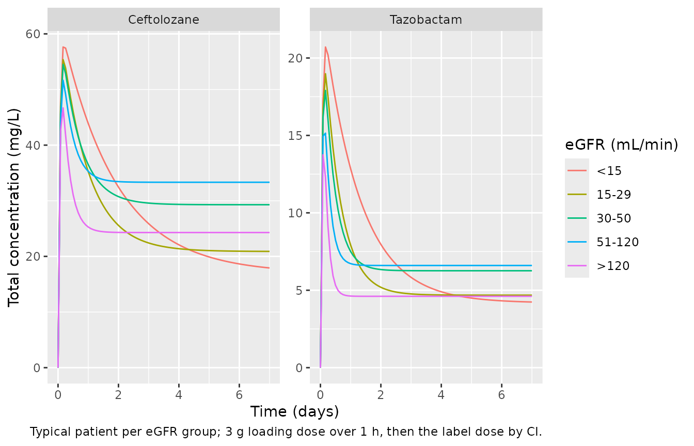
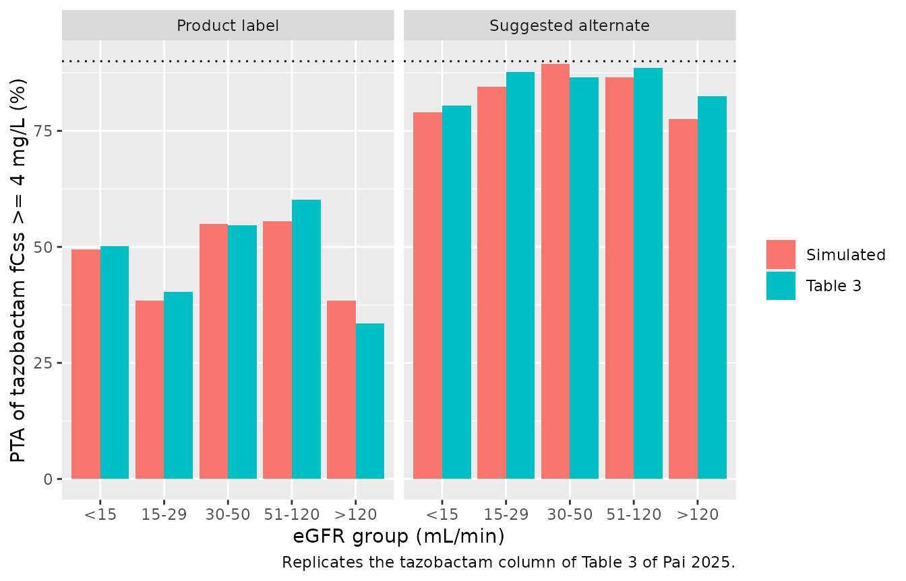

# Ceftolozane and tazobactam (Pai 2025)

## Model and source

- Citation: Pai MP, Cojutti PG, Gatti M, Rinaldi M, Tonetti T,
  Siniscalchi A, Viale P, Pea F. Keeping the horse with the cart: are we
  underdosing tazobactam even when using continuous-infusion
  ceftolozane/tazobactam for effectively preventing resistance
  development by ESBL-producing Enterobacterales? Antimicrob Agents
  Chemother. 2025;69(12):e01215-25. <doi:10.1128/aac.01215-25>
- Description: Joint one-compartment population PK model for ceftolozane
  and tazobactam given together as ceftolozane/tazobactam continuous
  infusion in hospitalized adults with Gram-negative infections
  (retrospective therapeutic drug monitoring cohort, Bologna, Italy).
  The combined ceftolozane + tazobactam dose enters a single dosing
  compartment that empties at 1/h and splits a fixed fraction 1/3 to
  tazobactam and 2/3 to ceftolozane (the 2:1 product ratio); each drug
  then has its own volume (fixed from the registration model) and
  clearance. Both clearances are power functions of the 2021 race-free
  CKD-EPI eGFR de-indexed to the individual Du Bois body surface area
  (mL/min), with strongly correlated random effects. Ceftolozane is the
  unsuffixed parent; tazobactam carries the \_taz suffix.
- Article: <https://doi.org/10.1128/aac.01215-25>

Pai and colleagues analysed steady-state ceftolozane and tazobactam
concentrations from routine therapeutic drug monitoring (TDM) of adults
given ceftolozane/tazobactam by continuous infusion (CI). Both drugs
were fitted simultaneously in Monolix. The combined dose enters one
dosing compartment that empties at a unit rate and splits a fixed 1/3 to
tazobactam and 2/3 to ceftolozane, the 2:1 ratio of the product
(Supplement Figure S1). Each drug has its own volume, fixed from the
registration population PK model, and its own clearance. Both clearances
are power functions of the 2021 race-free CKD-EPI eGFR de-indexed by the
Du Bois body surface area (mL/min), and their random effects are
strongly correlated (r = 0.88). The paper’s question is whether
tazobactam exposure keeps up with ceftolozane: it simulates the
probability of reaching tazobactam fCss \>= 4 mg/L together with
ceftolozane fCss/MIC \>= 4 (Table 3).

## Population

One hundred and thirty-nine adults treated in Bologna, Italy, between
November 2023 and June 2025 contributed 278 plasma samples, each assayed
for both drugs (Results, Table 1). Median (IQR) age was 66 (55-75)
years, with 26.6% aged 75 or older; body weight was 70 (62-85) kg and 78
patients were male. The 2021 CKD-EPI eGFR had a median (IQR) of 85.7
(42.4-107.5) mL/min, and patients on renal replacement therapy were
excluded. Supplement Table S7 splits the cohort into five eGFR groups
(\< 15, 15-29, 30-50, 51-120 and \> 120 mL/min with 7, 18, 17, 79 and 18
patients). Every patient got a 2 g/1 g loading dose over 1 h, then a CI
regimen chosen by eGFR and adjusted by TDM; the median daily dose was 3
g/1.5 g. Median (IQR) free steady-state concentrations were 33.3
(20.8-54.0) mg/L for ceftolozane and 5.46 (2.96-9.85) mg/L for
tazobactam.

The same information is available programmatically via
`readModelDb("Pai_2025_ceftolozane_tazobactam")()$population`.

## Source trace

| Equation / parameter | Value | Source location |
|----|----|----|
| Dosing compartment A1, outflow `-F*A1 - (1-F)*A1` (`lka`) | 1 /h, fixed | Supplement Figure S1 ODEs |
| `frac` (F, fraction to tazobactam) | 0.333, fixed | Supplement Figure S1 table and note (2:1 ratio); Table S6 F_pop = 0.33 |
| `lvc` (V1, ceftolozane) | 32.1 L, fixed | Table S6; Methods “fixed based on prior population PK models” |
| `lvc_taz` (V2, tazobactam) | 43.3 L, fixed | Table S6; Methods |
| `lcl` (CLTOL at CRCL = 60 mL/min) | 2.78 L/h | Table S6 Cltol_pop (RSE 5.74%) |
| `lcl_taz` (CLTAZ at CRCL = 60 mL/min) | 6.73 L/h | Table S6 Cltaz_pop (RSE 6.68%) |
| `e_crcl_cl` | 0.74 | Table S6 beta_Cltol_logtCkdepi2021mlmin_bsa_dd |
| `e_crcl_cl_taz` | 0.84 | Table S6 beta_Cltaz_logtCkdepi2021mlmin_bsa_dd |
| Reference eGFR | 60 mL/min | Table S5 footnote a “(eGFR/60)” |
| `etalcl`, `etalcl_taz` variances | `log(1 + CV^2)`: 0.369, 0.475 (CV 66.76%, 77.98%) | Table S6 |
| Covariance `etalcl`-`etalcl_taz` | 0.88 x sqrt(0.369 x 0.475) = 0.368 | Table S6 corr_Cltol_Cltaz |
| `etalvc`, `etalvc_taz` variances | 0.176, 0.144 (CV 43.92%, 39.41%), fixed | Table S6 (no SE) |
| `addSd`, `propSd` (ceftolozane) | 8.07 mg/L, 0.23 | Table S6 a1, b1 |
| `addSd_taz`, `propSd_taz` (tazobactam) | 1.3 mg/L, 0.41 | Table S6 a2, b2 |
| Combined2 error `sqrt(a^2 + (b f)^2)` | n/a | Table S5 “Combined2” |
| CRCL = CKD-EPI 2021 x BSA(Du Bois) / 1.73 | mL/min | Supplement Table S1 and STATA code |
| Free fractions 0.81 (ceftolozane), 0.70 (tazobactam) | n/a | Methods, Study design |

## Typical concentration-time course

The typical patient at the middle of each Table S7 eGFR group gets the 3
g (2 g/1 g) loading dose over 1 h and then the product-label daily dose
by CI. The model’s steady state must satisfy `Css = (1 - F) R0 / CL` for
ceftolozane and `Css = F R0 / CL_taz` for tazobactam, where R0 is the
combined infusion rate.

``` r

mod <- readModelDb("Pai_2025_ceftolozane_tazobactam")

# Supplement Table S7 eGFR groups (mean, SD in mL/min) and Table 3 regimens as
# combined ceftolozane + tazobactam mg per day.
groups <- tibble::tribble(
  ~egfr_grp, ~egfr_mean, ~egfr_sd, ~label_mg, ~alt_mg,
  "<15",          10,        4,       450,     1125,
  "15-29",        26,        3,      1125,     3000,
  "30-50",        42,        5,      2250,     4500,
  "51-120",       90,       19,      4500,     9000,
  ">120",        138,       18,      4500,     9000
) |>
  dplyr::mutate(egfr_grp = factor(egfr_grp, levels = egfr_grp))

t_end <- 21 * 24
typ_ev <- dplyr::bind_rows(
  groups |> dplyr::mutate(time = 0, evid = 1L, amt = 3000, rate = 3000),
  groups |> dplyr::mutate(time = 1, evid = 1L, amt = label_mg / 24 * (t_end - 1),
                          rate = label_mg / 24),
  groups |> tidyr::crossing(time = seq(0, t_end, by = 2)) |>
    dplyr::mutate(evid = 0L, amt = NA_real_, rate = NA_real_)
) |>
  dplyr::mutate(
    id = as.integer(egfr_grp), CRCL = egfr_mean,
    cmt = dplyr::if_else(evid == 1L, "depot", "central"),
    dvid = dplyr::if_else(evid == 1L, NA_integer_, 1L)
  ) |>
  dplyr::arrange(id, time, dplyr::desc(evid))

typ <- rxode2::rxSolve(mod, events = typ_ev, omega = NA, sigma = NA,
                       keep = c("egfr_grp", "label_mg"), returnType = "data.frame")
#> ℹ parameter labels from comments will be replaced by 'label()'

typ |>
  dplyr::filter(time <= 7 * 24) |>
  tidyr::pivot_longer(c(Cc, Cc_taz), names_to = "analyte", values_to = "conc") |>
  dplyr::mutate(analyte = dplyr::recode(analyte, Cc = "Ceftolozane", Cc_taz = "Tazobactam")) |>
  ggplot(aes(time / 24, conc, colour = egfr_grp)) +
  geom_line() +
  facet_wrap(~analyte, scales = "free_y") +
  labs(x = "Time (days)", y = "Total concentration (mg/L)", colour = "eGFR (mL/min)",
       caption = "Typical patient per eGFR group; 3 g loading dose over 1 h, then the label dose by CI.")
```



``` r


typ_end <- typ |>
  dplyr::filter(time == t_end) |>
  dplyr::mutate(
    css_tol = (1 - 0.333) * label_mg / 24 / cl,
    css_taz = 0.333 * label_mg / 24 / cl_taz
  )
# Deterministic: after 21 days every typical profile is at steady state.
stopifnot(
  all(abs(typ_end$Cc / typ_end$css_tol - 1) < 0.01),
  all(abs(typ_end$Cc_taz / typ_end$css_taz - 1) < 0.01)
)
```

At an eGFR of 10 mL/min the ceftolozane half-life is about 30 h, so the
concentration at 72 h, where the paper reads its PTA, is still rising.

## Virtual cohort and Monte Carlo simulation (Table 3)

Methods: 1000 subjects per regimen were simulated in Simulx for each of
the five eGFR groups, with eGFR distributed as in Supplement Table S7.
Each regimen starts with a 3 g loading dose over 1 h, continues with the
daily dose by CI, and the PTA is read at 72 h (Table 3 footnote). Here
each of the ten group-regimen arms has 200 virtual subjects, with eGFR
drawn from a normal distribution with the Table S7 mean and SD (floored
at 1 mL/min). Free concentrations are 0.81 x Cc and 0.70 x Cc_taz.

``` r

set.seed(20251201)
rxode2::rxSetSeed(20251201)
n_arm <- 200

arms <- groups |>
  tidyr::pivot_longer(c(label_mg, alt_mg), names_to = "regimen", values_to = "daily_mg") |>
  dplyr::mutate(regimen = dplyr::recode(regimen, label_mg = "Product label",
                                        alt_mg = "Suggested alternate"))

subj <- arms |>
  tidyr::uncount(n_arm) |>
  dplyr::mutate(
    id = dplyr::row_number(),
    CRCL = pmax(stats::rnorm(dplyr::n(), egfr_mean, egfr_sd), 1)
  )

ev <- dplyr::bind_rows(
  subj |> dplyr::mutate(time = 0, evid = 1L, amt = 3000, rate = 3000),
  subj |> dplyr::mutate(time = 1, evid = 1L, amt = daily_mg / 24 * 71, rate = daily_mg / 24),
  subj |> dplyr::mutate(time = 72, evid = 0L, amt = NA_real_, rate = NA_real_)
) |>
  dplyr::mutate(
    cmt = dplyr::if_else(evid == 1L, "depot", "central"),
    dvid = dplyr::if_else(evid == 1L, NA_integer_, 1L)
  ) |>
  dplyr::arrange(id, time, dplyr::desc(evid))

sim <- rxode2::rxSolve(mod, events = ev, keep = c("egfr_grp", "regimen", "daily_mg"),
                       returnType = "data.frame")

# Between-subject variability must be present.
stopifnot(dplyr::n_distinct(round(sim$cl_taz, 6)) > 0.9 * nrow(subj))
```

### Replicating Table 3

``` r

mics <- c(2, 4, 8, 16)
pta <- sim |>
  dplyr::mutate(ftol = 0.81 * Cc, ftaz = 0.70 * Cc_taz) |>
  dplyr::group_by(regimen, egfr_grp) |>
  dplyr::summarise(
    TAZ = 100 * mean(ftaz >= 4),
    `2` = 100 * mean(ftol / 2 >= 4),
    `4` = 100 * mean(ftol / 4 >= 4),
    `8` = 100 * mean(ftol / 8 >= 4),
    `16` = 100 * mean(ftol / 16 >= 4),
    .groups = "drop"
  ) |>
  tidyr::pivot_longer(-c(regimen, egfr_grp), names_to = "target", values_to = "sim")

# Table 3 of Pai 2025: tazobactam PTA (CT = 4 mg/L) and ceftolozane PTA at
# MIC 2-16 mg/L.
tab3 <- tibble::tribble(
  ~regimen,              ~egfr_grp, ~TAZ, ~`2`, ~`4`, ~`8`, ~`16`,
  "Product label",       "<15",     50.1, 87.4, 61.0, 17.7,  0.2,
  "Product label",       "15-29",   40.3, 90.3, 56.3, 16.3,  0.7,
  "Product label",       "30-50",   54.6, 96.0, 72.1, 30.1,  3.1,
  "Product label",       "51-120",  60.1, 97.5, 80.9, 39.4,  5.6,
  "Product label",       ">120",    33.5, 93.7, 62.1, 18.9,  1.9,
  "Suggested alternate", "<15",     80.5, 99.0, 90.0, 56.1,  8.8,
  "Suggested alternate", "15-29",   87.7, 99.6, 97.0, 71.1, 24.5,
  "Suggested alternate", "30-50",   86.5, 99.8, 96.0, 71.9, 28.7,
  "Suggested alternate", "51-120",  88.6, 99.9, 97.5, 80.9, 39.2,
  "Suggested alternate", ">120",    82.5, 99.7, 96.5, 71.7, 27.7
) |>
  tidyr::pivot_longer(-c(regimen, egfr_grp), names_to = "target", values_to = "paper")

cmp <- tab3 |>
  dplyr::left_join(pta |> dplyr::mutate(egfr_grp = as.character(egfr_grp)),
                   by = c("regimen", "egfr_grp", "target")) |>
  dplyr::mutate(
    target = dplyr::if_else(target == "TAZ", "TAZ fCss >= 4 mg/L",
                            paste0("TOL MIC ", target, " mg/L")),
    diff = sim - paper
  )

cmp |>
  dplyr::rename(
    "Regimen" = regimen,
    "eGFR (mL/min)" = egfr_grp,
    "Target" = target,
    "Table 3 PTA (%)" = paper,
    "Simulated PTA (%)" = sim,
    "Difference" = diff
  ) |>
  knitr::kable(digits = 1, caption = "PTA at 72 h: Table 3 of Pai 2025 against the simulation.")
```

| Regimen | eGFR (mL/min) | Target | Table 3 PTA (%) | Simulated PTA (%) | Difference |
|:---|:---|:---|---:|---:|---:|
| Product label | \<15 | TAZ fCss \>= 4 mg/L | 50.1 | 49.5 | -0.6 |
| Product label | \<15 | TOL MIC 2 mg/L | 87.4 | 89.0 | 1.6 |
| Product label | \<15 | TOL MIC 4 mg/L | 61.0 | 62.5 | 1.5 |
| Product label | \<15 | TOL MIC 8 mg/L | 17.7 | 24.5 | 6.8 |
| Product label | \<15 | TOL MIC 16 mg/L | 0.2 | 2.5 | 2.3 |
| Product label | 15-29 | TAZ fCss \>= 4 mg/L | 40.3 | 38.5 | -1.8 |
| Product label | 15-29 | TOL MIC 2 mg/L | 90.3 | 88.5 | -1.8 |
| Product label | 15-29 | TOL MIC 4 mg/L | 56.3 | 56.0 | -0.3 |
| Product label | 15-29 | TOL MIC 8 mg/L | 16.3 | 14.5 | -1.8 |
| Product label | 15-29 | TOL MIC 16 mg/L | 0.7 | 0.5 | -0.2 |
| Product label | 30-50 | TAZ fCss \>= 4 mg/L | 54.6 | 55.0 | 0.4 |
| Product label | 30-50 | TOL MIC 2 mg/L | 96.0 | 97.0 | 1.0 |
| Product label | 30-50 | TOL MIC 4 mg/L | 72.1 | 76.5 | 4.4 |
| Product label | 30-50 | TOL MIC 8 mg/L | 30.1 | 31.0 | 0.9 |
| Product label | 30-50 | TOL MIC 16 mg/L | 3.1 | 7.0 | 3.9 |
| Product label | 51-120 | TAZ fCss \>= 4 mg/L | 60.1 | 55.5 | -4.6 |
| Product label | 51-120 | TOL MIC 2 mg/L | 97.5 | 96.5 | -1.0 |
| Product label | 51-120 | TOL MIC 4 mg/L | 80.9 | 81.0 | 0.1 |
| Product label | 51-120 | TOL MIC 8 mg/L | 39.4 | 39.5 | 0.1 |
| Product label | 51-120 | TOL MIC 16 mg/L | 5.6 | 9.0 | 3.4 |
| Product label | \>120 | TAZ fCss \>= 4 mg/L | 33.5 | 38.5 | 5.0 |
| Product label | \>120 | TOL MIC 2 mg/L | 93.7 | 91.0 | -2.7 |
| Product label | \>120 | TOL MIC 4 mg/L | 62.1 | 61.5 | -0.6 |
| Product label | \>120 | TOL MIC 8 mg/L | 18.9 | 21.0 | 2.1 |
| Product label | \>120 | TOL MIC 16 mg/L | 1.9 | 0.5 | -1.4 |
| Suggested alternate | \<15 | TAZ fCss \>= 4 mg/L | 80.5 | 79.0 | -1.5 |
| Suggested alternate | \<15 | TOL MIC 2 mg/L | 99.0 | 98.0 | -1.0 |
| Suggested alternate | \<15 | TOL MIC 4 mg/L | 90.0 | 89.0 | -1.0 |
| Suggested alternate | \<15 | TOL MIC 8 mg/L | 56.1 | 60.0 | 3.9 |
| Suggested alternate | \<15 | TOL MIC 16 mg/L | 8.8 | 10.0 | 1.2 |
| Suggested alternate | 15-29 | TAZ fCss \>= 4 mg/L | 87.7 | 84.5 | -3.2 |
| Suggested alternate | 15-29 | TOL MIC 2 mg/L | 99.6 | 100.0 | 0.4 |
| Suggested alternate | 15-29 | TOL MIC 4 mg/L | 97.0 | 95.5 | -1.5 |
| Suggested alternate | 15-29 | TOL MIC 8 mg/L | 71.1 | 69.5 | -1.6 |
| Suggested alternate | 15-29 | TOL MIC 16 mg/L | 24.5 | 26.0 | 1.5 |
| Suggested alternate | 30-50 | TAZ fCss \>= 4 mg/L | 86.5 | 89.5 | 3.0 |
| Suggested alternate | 30-50 | TOL MIC 2 mg/L | 99.8 | 100.0 | 0.2 |
| Suggested alternate | 30-50 | TOL MIC 4 mg/L | 96.0 | 98.5 | 2.5 |
| Suggested alternate | 30-50 | TOL MIC 8 mg/L | 71.9 | 74.0 | 2.1 |
| Suggested alternate | 30-50 | TOL MIC 16 mg/L | 28.7 | 27.5 | -1.2 |
| Suggested alternate | 51-120 | TAZ fCss \>= 4 mg/L | 88.6 | 86.5 | -2.1 |
| Suggested alternate | 51-120 | TOL MIC 2 mg/L | 99.9 | 100.0 | 0.1 |
| Suggested alternate | 51-120 | TOL MIC 4 mg/L | 97.5 | 97.5 | 0.0 |
| Suggested alternate | 51-120 | TOL MIC 8 mg/L | 80.9 | 78.0 | -2.9 |
| Suggested alternate | 51-120 | TOL MIC 16 mg/L | 39.2 | 33.0 | -6.2 |
| Suggested alternate | \>120 | TAZ fCss \>= 4 mg/L | 82.5 | 77.5 | -5.0 |
| Suggested alternate | \>120 | TOL MIC 2 mg/L | 99.7 | 100.0 | 0.3 |
| Suggested alternate | \>120 | TOL MIC 4 mg/L | 96.5 | 94.0 | -2.5 |
| Suggested alternate | \>120 | TOL MIC 8 mg/L | 71.7 | 65.0 | -6.7 |
| Suggested alternate | \>120 | TOL MIC 16 mg/L | 27.7 | 24.5 | -3.2 |

PTA at 72 h: Table 3 of Pai 2025 against the simulation. {.table}

``` r


stopifnot(
  # Centre: a mis-transcribed clearance, exponent or dose split moves every
  # cell by tens of points.
  abs(median(cmp$diff)) < 5,
  # Envelope: robust to Monte Carlo error with 200 subjects per arm.
  quantile(abs(cmp$diff), 0.9) < 12
)
```

``` r

cmp |>
  dplyr::filter(target == "TAZ fCss >= 4 mg/L") |>
  dplyr::mutate(egfr_grp = factor(egfr_grp, levels = levels(groups$egfr_grp))) |>
  tidyr::pivot_longer(c(paper, sim), names_to = "source", values_to = "pta") |>
  dplyr::mutate(source = dplyr::recode(source, paper = "Table 3", sim = "Simulated")) |>
  ggplot(aes(egfr_grp, pta, fill = source)) +
  geom_col(position = "dodge") +
  geom_hline(yintercept = 90, linetype = "dotted") +
  facet_wrap(~regimen) +
  labs(x = "eGFR group (mL/min)", y = "PTA of tazobactam fCss >= 4 mg/L (%)", fill = NULL,
       caption = "Replicates the tazobactam column of Table 3 of Pai 2025.")
```



The simulation reproduces the paper’s central finding: at the
product-label doses only about 35-60% of patients reach a free
tazobactam concentration of 4 mg/L, while ceftolozane reaches fCss/MIC
\>= 4 in more than 90% of patients up to an MIC of 1-2 mg/L. The doubled
to tripled alternate regimens bring the tazobactam PTA to about 80-90%.

## Free concentration ratio (Table 1)

Because the two drugs share the dose and their clearances are
correlated, the free ratio fCssTOL/fCssTAZ does not depend on the dose
at steady state: `(0.81 x 2 / CL) / (0.70 x 1 / CL_taz)`. Table 1
reports a median (IQR) of 6.3 (4.3-8.4). A steady-state cohort drawn
from the Table S7 eGFR mix, with residual error on both observations, is
compared against it.

``` r

set.seed(20251202)
rxode2::rxSetSeed(20251202)
n_ss <- 200
grp_n <- c(7, 18, 17, 79, 18)

ss_subj <- tibble::tibble(
  id = seq_len(n_ss),
  egfr_grp = sample(groups$egfr_grp, n_ss, replace = TRUE, prob = grp_n)
) |>
  dplyr::left_join(groups, by = "egfr_grp") |>
  dplyr::mutate(
    CRCL = pmax(stats::rnorm(dplyr::n(), egfr_mean, egfr_sd), 1),
    daily_mg = 4500, rate = daily_mg / 24
  )

ss_ev <- dplyr::bind_rows(
  # steady-state infusion record, then the infusion continues over 24 h
  ss_subj |> dplyr::mutate(time = 0, evid = 1L, amt = 0, ss = 1L, ii = 0,
                           cmt = "depot", dvid = NA_integer_, obs_taz = 0L),
  ss_subj |> dplyr::mutate(time = 0, evid = 1L, amt = rate * 24, ss = 0L, ii = 0,
                           cmt = "depot", dvid = NA_integer_, obs_taz = 0L),
  ss_subj |> tidyr::crossing(time = seq(0, 24, by = 2)) |>
    dplyr::mutate(evid = 0L, amt = NA_real_, rate = NA_real_, ss = 0L, ii = 0,
                  cmt = "central", dvid = 1L, obs_taz = 0L),
  ss_subj |> dplyr::mutate(time = 12, evid = 0L, amt = NA_real_, rate = NA_real_,
                           ss = 0L, ii = 0, cmt = "central_taz", dvid = 2L, obs_taz = 1L)
) |>
  dplyr::arrange(id, time, dplyr::desc(evid), dvid)

ss <- rxode2::rxSolve(mod, events = ss_ev, keep = c("egfr_grp", "daily_mg", "obs_taz"),
                      returnType = "data.frame")

ratio <- ss |>
  dplyr::filter(time == 12) |>
  dplyr::mutate(analyte = dplyr::if_else(obs_taz == 1L, "taz", "tol")) |>
  dplyr::select(id, analyte, sim) |>
  tidyr::pivot_wider(names_from = analyte, values_from = sim) |>
  dplyr::filter(tol > 0, taz > 0) |>
  dplyr::mutate(ratio = (0.81 * tol) / (0.70 * taz))

ratio_sum <- tibble::tibble(
  Statistic = c("Median", "25th percentile", "75th percentile"),
  `Table 1` = c(6.3, 4.3, 8.4),
  Simulated = unname(stats::quantile(ratio$ratio, c(0.5, 0.25, 0.75)))
)
knitr::kable(ratio_sum, digits = 2,
             caption = "Free ceftolozane : tazobactam concentration ratio at steady state.")
```

| Statistic       | Table 1 | Simulated |
|:----------------|--------:|----------:|
| Median          |     6.3 |      5.34 |
| 25th percentile |     4.3 |      3.53 |
| 75th percentile |     8.4 |      9.14 |

Free ceftolozane : tazobactam concentration ratio at steady state.
{.table}

``` r


stopifnot(abs(ratio_sum$Simulated[1] / 6.3 - 1) < 0.25)
```

The median ratio is set by the typical clearances (6.73 / 2.78 at the
reference eGFR, a typical free ratio of about 5.6) and the free
fractions; its spread comes from the residual error and the part of the
clearance variability the 0.88 correlation leaves unshared. The
simulated median is about 15% below the observed 6.3, and the simulated
IQR is somewhat wider than the observed one. The paper does not report
the model-predicted ratio, so this is noted rather than resolved; the
observed ratio comes from TDM samples that were not all at the reference
eGFR mix assumed here.

## PKNCA validation

The paper reports no NCA parameters. At steady state under CI, the
average concentration over a 24 h interval must equal `(1 - F) R0 / CL`
for ceftolozane and `F R0 / CL_taz` for tazobactam in every subject.
PKNCA’s `cav` is checked against both identities, one PKNCA block per
analyte, with the eGFR group as the grouping variable.

``` r

ss_conc <- ss |>
  dplyr::filter(obs_taz == 0L, !is.na(Cc)) |>
  dplyr::select(id, time, Cc, Cc_taz, cl, cl_taz, daily_mg, treatment = egfr_grp)

dose_df <- ss_subj |>
  dplyr::transmute(id, time = 0, amt = daily_mg, treatment = egfr_grp)

run_cav <- function(conc_col) {
  o_conc <- PKNCA::PKNCAconc(ss_conc, stats::as.formula(paste(conc_col, "~ time | treatment + id")))
  o_dose <- PKNCA::PKNCAdose(dose_df, amt ~ time | treatment + id)
  # Linear trapezoids: the steady-state profile is flat, and the log-down rule
  # divides two near-zero differences on such a profile.
  o_data <- PKNCA::PKNCAdata(
    o_conc, o_dose,
    intervals = data.frame(start = 0, end = 24, cav = TRUE, cmax = TRUE, cmin = TRUE),
    options = list(auc.method = "linear")
  )
  suppressMessages(PKNCA::pk.nca(o_data))
}

nca_tol <- run_cav("Cc")
nca_taz <- run_cav("Cc_taz")
summary(nca_tol)
#>  start end treatment   N        cmax        cmin         cav
#>      0  24       <15   8  215 [89.1]  215 [89.1]  215 [89.1]
#>      0  24     15-29  30 87.6 [63.9] 87.6 [63.9] 87.6 [63.9]
#>      0  24     30-50  26 49.9 [66.3] 49.9 [66.3] 49.9 [66.3]
#>      0  24    51-120 104 38.1 [69.4] 38.1 [69.4] 38.1 [69.4]
#>      0  24      >120  32 27.1 [69.4] 27.1 [69.4] 27.1 [69.4]
#> 
#> Caption: cmax, cmin, cav: geometric mean and geometric coefficient of variation; N: number of subjects
summary(nca_taz)
#>  start end treatment   N        cmax        cmin         cav
#>      0  24       <15   8  47.8 [125]  47.8 [125]  47.8 [125]
#>      0  24     15-29  30 19.9 [71.5] 19.9 [71.5] 19.9 [71.5]
#>      0  24     30-50  26 11.7 [78.8] 11.7 [78.8] 11.7 [78.8]
#>      0  24    51-120 104 7.68 [78.1] 7.68 [78.1] 7.68 [78.1]
#>      0  24      >120  32 5.17 [71.9] 5.17 [71.9] 5.17 [71.9]
#> 
#> Caption: cmax, cmin, cav: geometric mean and geometric coefficient of variation; N: number of subjects

ident <- ss_conc |>
  dplyr::filter(time == 0) |>
  dplyr::transmute(id, css_tol = (1 - 0.333) * daily_mg / 24 / cl,
                   css_taz = 0.333 * daily_mg / 24 / cl_taz)

cav_chk <- dplyr::bind_rows(
  as.data.frame(nca_tol$result) |> dplyr::mutate(analyte = "tol"),
  as.data.frame(nca_taz$result) |> dplyr::mutate(analyte = "taz")
) |>
  dplyr::filter(PPTESTCD == "cav") |>
  dplyr::left_join(ident, by = "id") |>
  dplyr::mutate(
    css = dplyr::if_else(analyte == "tol", css_tol, css_taz),
    pct_diff = 100 * (PPORRES - css) / css
  )

# Same drawn parameters on both sides: pure numerical error, so a tight bound.
stopifnot(nrow(cav_chk) == 2 * n_ss, all(abs(cav_chk$pct_diff) < 0.5))
```

## Assumptions and deviations

- **Dosing compartment.** Supplement Figure S1 writes
  `ddt_A1 = -F*A1 - (1-F)*A1`, so the dosing compartment empties with an
  implicit rate constant of 1/h. It is encoded as `lka = log(1)`, fixed.
  This adds a short delay after the loading dose and has no effect at
  steady state.
- **Dose units.** Doses are combined ceftolozane + tazobactam amounts in
  mg into `depot`; a “3 g/1.5 g daily” regimen is 4500 mg per day. F is
  0.333 as stated with Supplement Figure S1 (2:1 product ratio); Table
  S6 prints it rounded as 0.33.
- **Table 3 dose misprints.** Table 3 prints “0.70/0.375” g for the
  label 15-29 mL/min regimen and the alternate \< 15 mL/min regimen, and
  “2.0/1.5” g for the alternate 15-29 mL/min regimen. A fixed-ratio
  model can only give 2:1 doses. The simulation uses 0.75/0.375 g (the
  label renal dose) and 2.0/1.0 g (a combined 3 g in 1 g/0.5 g vial
  units). With 2.0/1.0 g the simulated PTAs match the printed ones to
  within a few points, and the 15-29 alternate gives the same exposure
  as the 30-50 alternate (3 g/1.5 g at a 1.6-fold higher eGFR), as Table
  3 shows.
- **Within-group eGFR distribution.** Supplement Table S7 gives the mean
  and SD of each group; a normal distribution floored at 1 mL/min is
  assumed.
- **Fixed IIV on the volumes.** Table S6 gives no standard error for
  omega V1 (0.42) or omega V2 (0.38), so both are fixed together with
  the volumes.
- **IIV variances** come from the printed CVs via `log(1 + CV^2)`; the
  rounded SDs (0.61, 0.69, 0.42, 0.38) give the same values to two
  significant figures.
- **Free concentrations** are total model predictions times 0.81
  (ceftolozane) and 0.70 (tazobactam), the correction factors in
  Methods.
- **Cumulative fraction of response** (Table 3) needs the MIC
  distribution of the 169 ESBL-producing isolates of the cited French
  study, which the paper does not tabulate, so it is not reproduced.
- **Companion analysis.** The same group’s Cojutti 2025 paper
  (<doi:10.1128/aac.01042-25>) models ceftolozane alone in patients with
  *Pseudomonas aeruginosa* infection with the same covariate and fixed
  V1.
