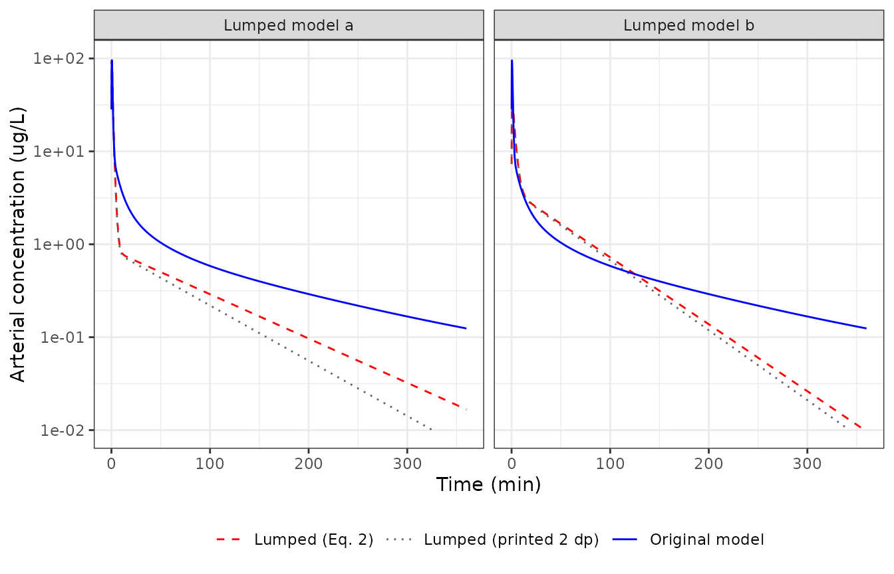
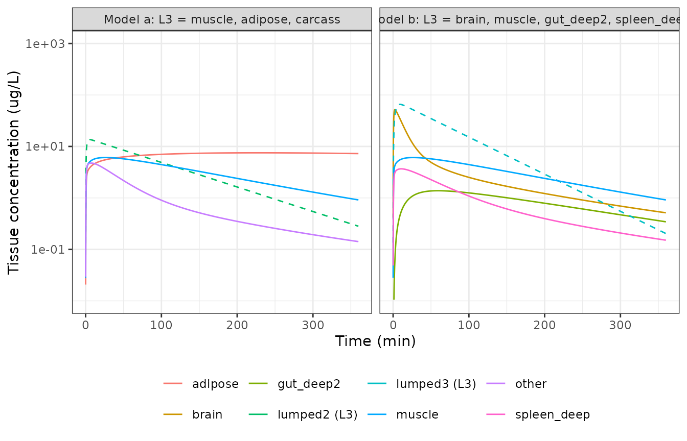

# Fentanyl PBPK and its proper-lumped reductions (Pan 2019)

## Model and source

Pan and Duffull (2019) automate *proper lumping* (Dokoumetzidis and
Aarons): a linear ODE system `dC/dt = K C` is reduced to
`dC_hat/dt = K_hat C_hat` with `K_hat = M K M+` (their Eq. 2), where `M`
is a 0/1 lumping matrix and `M+` its Moore-Penrose pseudo-inverse. The
worked example is the 16-state whole-body fentanyl PBPK model of
Bjorkman et al. (1994), which they reduce to two different 4-state
models (Figure 4a and 4b) with arterial blood held unlumped as the
observed state. All three structures ship in nlmixr2lib:

| Model | States | Source |
|----|----|----|
| `Pan_2019_fentanyl_pbpk` | 16 (original PBPK) | Supplementary Material 1 Sections 1A-1B; deposited `Model_parameter_values.m` |
| `Pan_2019_fentanyl_lumped_a` | `venous`, `arterial`, `lumped1`, `lumped2` | Figure 4a; Supplementary Section 2 |
| `Pan_2019_fentanyl_lumped_b` | `lumped1`, `arterial`, `lumped2`, `lumped3` | Figure 4b; Supplementary Section 3 |

- Citation: Pan S, Duffull SB (2019). Automated proper lumping for
  simplification of linear physiologically based pharmacokinetic
  systems. J Pharmacokinet Pharmacodyn 46(4):361-370.
  <doi:10.1007/s10928-019-09644-5>. Parameter values and the 16 x 16
  micro-rate-constant matrix from Supplementary Material 1 Sections
  1A-1B and the deposited MATLAB files (Model_parameter_values.m,
  Runfile_Autolumping_FenPBPK.m). Physiology originally from Bjorkman S,
  Stanski DR, Verotta D, Harashima H (1994) Comparative tissue
  concentration profiles of fentanyl and alfentanil in humans predicted
  from tissue/blood partition data obtained in rats. Anesthesiology
  80:380-393 (cited as ref 15).
- Article: <https://doi.org/10.1007/s10928-019-09644-5> (open access)
- Full text, Supplementary Material 1 and the deposited MATLAB code:
  <https://europepmc.org/article/PMC/PMC6656793>

``` r

mod_names <- c(
  full = "Pan_2019_fentanyl_pbpk",
  a = "Pan_2019_fentanyl_lumped_a",
  b = "Pan_2019_fentanyl_lumped_b"
)
ui <- lapply(mod_names, function(n) rxode2::rxode(readModelDb(n)))
```

## Population

There is no fitted cohort. The model describes one deterministic 73 kg
reference man (Supplementary Section 1A,
`WT = 73; % average weight for man`) with a cardiac output of 6.7 L/min.
Organ volumes, blood flows and tissue:blood partition coefficients are
those Bjorkman et al. (1994) scaled to man from rat tissue/blood
partition data. Pan 2019 simulate a single 750 ug intravenous bolus and
observe arterial blood over 0-210 min (deposited
`Runfile_Autolumping_FenPBPK.m`). No between-subject variability or
residual error is defined anywhere in the paper.

``` r

str(ui$full$population)
#> List of 7
#>  $ species      : chr "human"
#>  $ n_subjects   : int 1
#>  $ age_range    : chr "adult (reference man)"
#>  $ weight_range : chr "73 kg (reference man)"
#>  $ disease_state: chr "Not applicable: a physiology-based reference individual, not a fitted cohort."
#>  $ dose_range   : chr "750 ug intravenous bolus (Pan 2019); 750 ug over 5 min in the original Bjorkman 1994 study"
#>  $ notes        : chr "A single deterministic reference individual: Supplementary Material 1 Section 1A gives WT = 73 kg ('average wei"| __truncated__
```

## Source trace

Every `ini()` value carries an in-file comment pointing to its source
line. In summary:

| Equation / parameter | Value | Source location |
|----|----|----|
| `qc` | 6.7 L/min | Suppl. 1A `Qcad = 6.7` |
| `v_venous`, `v_arterial` | 3.9, 2.0 L | Suppl. 1A `Vven`, `Vart` |
| `v_<organ>` (brain, heart, kidney, liver, muscle, skin, adipose, other = carcass, gut) | 1.4, 0.33, 0.31, 1.8, 30, 3.3, 12.5, 15.5, 1.2 L | Suppl. 1A `V<org>` |
| `qn_<organ>` (blood flow per kg tissue) | 0.56, 0.8, 4, 0.96, 0.038, 0.12, 0.028, 0.04, 0.83 L/min/kg | Suppl. 1A `Q<org> = <x>*V<org>` |
| `lkp_<organ>` | log(4), log(5.1), log(13.7), log(4.3), log(3.5), log(2.3), log(30.3), log(1), log(9) | Suppl. 1A `KP<org>`; carcass “not available”, set to 1 |
| `v_spleen`, `qn_spleen`, `lkp_spleen` (pancreas + spleen) | 0.14 L, 0.9 L/min/kg, log(27.7) | Suppl. 1A `Vpas = (0.18+0.10)/2`, `Qpas = (0.6+1.2)/2*Vpas`, `KPpas = (24.1+31.3)/2` |
| `cln_spleen_deep`, `vn_spleen`, `vn_spleen_deep` | 2.21 L/min/kg, 0.082, 22.3 L/kg | Suppl. 1A `CL12_pas`, `Vpas_1`, `Vpas_2` (Bjorkman p 388) |
| `cln_liver_deep`, `cln_liver`, `vn_liver_deep` | 0.35, 0.095 L/min/kg, 8.7 L/kg | Suppl. 1A `CL12_hep`, `CL10_hep`, `Vhep_2` |
| `cln_gut_deep`, `cln_gut_deep2`, `vn_gut_deep`, `vn_gut_deep2` | 0.89, 0.03 L/min/kg, 6.4, 3.26 L/kg | Suppl. 1A `CL12_gut`, `CL23_gut`, `Vgut_2`, `Vgut_3` |
| ODE system of `Pan_2019_fentanyl_pbpk` | rows 1-16 of K | Suppl. 1B; `Model_parameter_values.m` state equations |
| Dose into `venous` as `Dose / Vven` | `f(venous) <- 1 / v_venous` | Runfile `IC = [Dose/Vven; zeros(15,1)]` |
| Observation `Cc <- arterial` | state 2 | Runfile `output = [2]` |
| Lumping matrices `M` | Figure 4a / 4b membership | Figure 4 |
| Lumped rate constants `k_<from>_<to>`, `kloss_<state>` | `K_hat = M K M+` | Eq. 2; printed to 2 decimals in Suppl. Sections 2 and 3 |

## Original 16-state system against the deposited matrix

The model file writes the 16 ODEs term by term. As an independent check,
the matrix `K` of Supplementary Section 1B is rebuilt here from the
model’s own `ini()` values and solved with the eigen-decomposition
matrix exponential the authors use (`ME_solution_function.m`). Both
sides use identical parameters, so the only difference is ODE
integration error and a tight bound is appropriate.

``` r

build_k <- function(th) {
  p <- as.list(th)
  kp <- function(o) exp(p[[paste0("lkp_", o)]])
  q <- function(o) p[[paste0("qn_", o)]] * p[[paste0("v_", o)]]
  kt <- function(o) q(o) / (p[[paste0("v_", o)]] * kp(o))
  st <- c(
    "venous", "arterial", "brain", "heart", "kidney", "liver", "muscle",
    "skin", "adipose", "other", "gut", "gut_deep", "gut_deep2", "spleen",
    "spleen_deep", "liver_deep"
  )
  k <- matrix(0, 16, 16, dimnames = list(st, st))
  perf <- c("brain", "heart", "kidney", "liver", "muscle", "skin", "adipose", "other")
  k["venous", "venous"] <- -p$qc / p$v_venous
  for (o in perf) k["venous", o] <- kt(o) * p[[paste0("v_", o)]] / p$v_venous
  k["arterial", "venous"] <- p$qc / p$v_arterial
  k["arterial", "arterial"] <- -p$qc / p$v_arterial
  for (o in setdiff(perf, "liver")) {
    k[o, "arterial"] <- q(o) / p[[paste0("v_", o)]]
    k[o, o] <- -kt(o)
  }
  v_liv <- p$v_liver
  cl12_hep <- p$cln_liver_deep * v_liv
  cl10_hep <- p$cln_liver * v_liv
  v_hep2 <- p$vn_liver_deep * v_liv
  k["liver", "liver"] <- -(cl12_hep + cl10_hep) / v_liv - kt("liver")
  k["liver", "gut"] <- kt("gut") * p$v_gut / v_liv
  k["liver", "spleen"] <- kt("spleen") * p$v_spleen / v_liv
  k["liver", "liver_deep"] <- cl12_hep / v_liv
  cl12_gut <- p$cln_gut_deep * p$v_gut
  cl23_gut <- p$cln_gut_deep2 * p$v_gut
  v_gut2 <- p$vn_gut_deep * p$v_gut
  v_gut3 <- p$vn_gut_deep2 * p$v_gut
  k["gut", "arterial"] <- q("gut") / p$v_gut
  k["gut", "gut"] <- -(q("gut") + cl12_gut) / p$v_gut
  k["gut", "gut_deep"] <- cl12_gut / p$v_gut
  k["gut_deep", "gut"] <- cl12_gut / v_gut2
  k["gut_deep", "gut_deep"] <- -(cl12_gut + cl23_gut) / v_gut2
  k["gut_deep", "gut_deep2"] <- cl23_gut / v_gut2
  k["gut_deep2", "gut_deep"] <- cl23_gut / v_gut3
  k["gut_deep2", "gut_deep2"] <- -cl23_gut / v_gut3
  cl12_pas <- p$cln_spleen_deep * p$v_spleen
  v_pas1 <- p$vn_spleen * p$v_spleen
  v_pas2 <- p$vn_spleen_deep * p$v_spleen
  k["spleen", "arterial"] <- q("spleen") / v_pas1
  k["spleen", "spleen"] <- -(q("spleen") + cl12_pas) / v_pas1
  k["spleen", "spleen_deep"] <- cl12_pas / v_pas1
  k["spleen_deep", "spleen"] <- cl12_pas / v_pas2
  k["spleen_deep", "spleen_deep"] <- -cl12_pas / v_pas2
  k["liver_deep", "liver"] <- cl12_hep / v_hep2
  k["liver_deep", "liver_deep"] <- -cl12_hep / v_hep2
  k
}

# Matrix-exponential solution, as in the authors' ME_solution_function.m.
me_solution <- function(k, ic, times) {
  e <- eigen(k)
  q <- solve(e$vectors, ic)
  Re(e$vectors %*% (q * exp(outer(e$values, times))))
}

K <- build_k(ui$full$theta)
dose <- 750
ic_full <- c(dose / ui$full$theta[["v_venous"]], rep(0, 15))
times_runfile <- seq(0, 210, by = 0.5)

ev_full <- rxode2::et(amt = dose, cmt = "venous", time = 0) |>
  rxode2::et(times_runfile)
sim_full <- as.data.frame(
  rxode2::rxSolve(ui$full, ev_full, rtol = 1e-10, atol = 1e-12)
)
cf_full <- me_solution(K, ic_full, times_runfile)
rel_err <- abs(sim_full$arterial[-1] / cf_full[2, -1] - 1)
max(rel_err)
#> [1] 2.064671e-10
# ODE vs closed form on identical parameters; measured ~1e-10 at these
# tolerances.
stopifnot(max(rel_err) < 1e-7)
```

## Lumped rate matrices (Eq. 2) against Supplementary Sections 2 and 3

The lumping matrices are read off Figure 4. Applying Eq. 2 to the
rebuilt `K` reproduces both printed matrices entry for entry at the
printed precision. Supplementary Section 3 orders the two tissue lumps
of model b as L3 then L2 (the arterial inflow column,
`0.60 = 0.56 + 0.038` for brain plus muscle, identifies L3), so its rows
and columns are reordered here before comparison.

``` r

make_m <- function(groups, states = rownames(K)) {
  m <- matrix(0, length(groups), length(states), dimnames = list(names(groups), states))
  for (g in names(groups)) m[g, groups[[g]]] <- 1
  m
}
# Moore-Penrose pseudo-inverse of a full-row-rank 0/1 lumping matrix.
pinv_m <- function(m) t(m) %*% solve(m %*% t(m))
lump_k <- function(m) m %*% K %*% pinv_m(m)

m_a <- make_m(list(
  venous = "venous", arterial = "arterial",
  lumped1 = c(
    "brain", "heart", "kidney", "liver", "skin", "gut", "gut_deep",
    "gut_deep2", "spleen", "spleen_deep", "liver_deep"
  ),
  lumped2 = c("muscle", "adipose", "other")
))
m_b <- make_m(list(
  lumped1 = c("venous", "other", "gut", "gut_deep"), arterial = "arterial",
  lumped2 = c("heart", "kidney", "spleen", "skin", "adipose", "liver", "liver_deep"),
  lumped3 = c("brain", "muscle", "gut_deep2", "spleen_deep")
))
khat_a <- lump_k(m_a)
khat_b <- lump_k(m_b)

printed_a <- matrix(
  c(
    -1.72, 0, 0.02, 0.08,
    3.35, -3.35, 0, 0,
    0, 17.3, -1.15, 0,
    0, 0.11, 0, -0.02
  ),
  4, byrow = TRUE
)
# Supplement order L1, arterial, L3, L2; reorder to lumped1, arterial,
# lumped2 (= L2), lumped3 (= L3).
printed_b_suppl <- matrix(
  c(
    -0.61, 0.87, 0.03, 0.03,
    0.84, -3.35, 0, 0,
    0.002, 0.60, -0.06, 0.01,
    0.02, 15.9, 6.74, -5.53
  ),
  4, byrow = TRUE
)
ord <- c(1, 2, 4, 3)
printed_b <- printed_b_suppl[ord, ord]

# Each printed entry has its own number of decimals (17.3, -1.15, 0.002), so
# compare each at half a unit in its own last printed place. Printed zeros are
# structural and must be exactly zero.
printed_decimals <- function(x) {
  vapply(x, function(v) nchar(sub("^[0-9]*\\.?", "", sub("0+$", "", sprintf("%.6f", abs(v))))), 1)
}
matches_print <- function(computed, printed) {
  tol <- 0.5 * 10^-printed_decimals(printed)
  nz <- printed != 0
  all(abs(computed[nz] - printed[nz]) <= tol[nz] + 1e-12) && all(computed[!nz] == 0)
}
round(khat_a, 4)
#>           venous arterial lumped1 lumped2
#> venous   -1.7179   0.0000  0.0213  0.0818
#> arterial  3.3500  -3.3500  0.0000  0.0000
#> lumped1   0.0000  17.2856 -1.1546  0.0000
#> lumped2   0.0000   0.1060  0.0000 -0.0173
round(khat_b, 4)
#>          lumped1 arterial lumped2 lumped3
#> lumped1  -0.6084   0.8700  0.0267  0.0346
#> arterial  0.8375  -3.3500  0.0000  0.0000
#> lumped2   0.0154  15.9236 -5.5349  6.7378
#> lumped3   0.0023   0.5980  0.0142 -0.0648
stopifnot(matches_print(khat_a, printed_a), matches_print(khat_b, printed_b))
```

The packaged lumped models carry these Eq. 2 values unrounded (to six
significant figures). The check below rebuilds each model’s rate matrix
from its `ini()` and compares it with `K_hat`.

``` r

khat_from_ini <- function(th, states) {
  k <- matrix(0, length(states), length(states), dimnames = list(states, states))
  for (nm in names(th)) {
    if (startsWith(nm, "kloss_")) {
      s <- sub("^kloss_", "", nm)
      k[s, s] <- -th[[nm]]
    } else if (startsWith(nm, "k_")) {
      ft <- strsplit(sub("^k_", "", nm), "_")[[1]]
      k[ft[2], ft[1]] <- th[[nm]]
    }
  }
  k
}
ini_a <- khat_from_ini(ui$a$theta, rownames(khat_a))
ini_b <- khat_from_ini(ui$b$theta, rownames(khat_b))
max(abs(ini_a - khat_a) / pmax(abs(khat_a), 1e-12))
#> [1] 3.501637e-06
max(abs(ini_b - khat_b) / pmax(abs(khat_b), 1e-12))
#> [1] 1.927711e-06
# Six significant figures in ini(): relative rounding <= 5e-6.
stopifnot(
  all(abs(ini_a - khat_a) <= 1e-5 * abs(khat_a)),
  all(abs(ini_b - khat_b) <= 1e-5 * abs(khat_b))
)
```

## Replicate Figure 6: arterial profiles of the original and lumped models

Pan 2019 Figure 6 overlays the arterial profile of each lumped model on
the original over 0-360 min. The packaged models are simulated below.
The dotted lines repeat each lumped simulation with the rate constants
rounded to the two decimals printed in the supplement.

``` r

times_fig <- sort(unique(c(seq(0, 2, by = 0.05), seq(2, 360, by = 1))))
sim_cc <- function(u, cmt, params = NULL) {
  ev <- rxode2::et(amt = dose, cmt = cmt, time = 0) |> rxode2::et(times_fig)
  out <- if (is.null(params)) {
    rxode2::rxSolve(u, ev, rtol = 1e-10, atol = 1e-12)
  } else {
    rxode2::rxSolve(u, ev, params = params, rtol = 1e-10, atol = 1e-12)
  }
  as.data.frame(out)[, c("time", "Cc")]
}
printed_params <- function(u, printed, states) {
  th <- u$theta
  for (nm in names(th)) {
    if (startsWith(nm, "kloss_")) {
      s <- sub("^kloss_", "", nm)
      th[[nm]] <- -printed[match(s, states), match(s, states)]
    } else if (startsWith(nm, "k_")) {
      ft <- strsplit(sub("^k_", "", nm), "_")[[1]]
      th[[nm]] <- printed[match(ft[2], states), match(ft[1], states)]
    }
  }
  th
}

fig6 <- bind_rows(
  sim_cc(ui$full, "venous") |> mutate(model = "Original model", panel = "a"),
  sim_cc(ui$full, "venous") |> mutate(model = "Original model", panel = "b"),
  sim_cc(ui$a, "venous") |> mutate(model = "Lumped (Eq. 2)", panel = "a"),
  sim_cc(ui$b, "lumped1") |> mutate(model = "Lumped (Eq. 2)", panel = "b"),
  sim_cc(ui$a, "venous", printed_params(ui$a, printed_a, rownames(khat_a))) |>
    mutate(model = "Lumped (printed 2 dp)", panel = "a"),
  sim_cc(ui$b, "lumped1", printed_params(ui$b, printed_b, rownames(khat_b))) |>
    mutate(model = "Lumped (printed 2 dp)", panel = "b")
) |>
  mutate(panel = paste("Lumped model", panel))

ggplot(filter(fig6, time > 0), aes(time, Cc, colour = model, linetype = model)) +
  geom_line() +
  facet_wrap(~panel) +
  scale_y_log10(limits = c(1e-2, 1e2)) +
  scale_colour_manual(values = c("Original model" = "blue", "Lumped (Eq. 2)" = "red", "Lumped (printed 2 dp)" = "grey40")) +
  scale_linetype_manual(values = c("Original model" = "solid", "Lumped (Eq. 2)" = "dashed", "Lumped (printed 2 dp)" = "dotted")) +
  labs(x = "Time (min)", y = "Arterial concentration (ug/L)", colour = NULL, linetype = NULL) +
  theme_bw() +
  theme(legend.position = "bottom")
#> Warning: Removed 55 rows containing missing values or values outside the scale range
#> (`geom_line()`).
```



Replicates Figure 6 of Pan 2019. Values read off the published figure at
360 min are about 0.13 ug/L for the original model, 0.018 ug/L for
lumped model a and 0.01 ug/L for lumped model b; lumped model b crosses
the original at about 120 min, and lumped model a sits near 0.75 ug/L at
15 min. The Eq. 2 rate constants reproduce all of these. The two-decimal
print of the supplement does not hold the terminal phase of model a,
because its slowest constant (0.0173/min) prints as 0.02/min.

``` r

at <- function(m, p, t) {
  d <- filter(fig6, model == m, panel == p)
  approx(d$time, d$Cc, xout = t)$y
}
fig6_points <- tibble::tribble(
  ~quantity, ~figure, ~simulated,
  "Original, 360 min", 0.13, at("Original model", "Lumped model a", 360),
  "Lumped a, 15 min", 0.75, at("Lumped (Eq. 2)", "Lumped model a", 15),
  "Lumped a, 360 min", 0.018, at("Lumped (Eq. 2)", "Lumped model a", 360),
  "Lumped b, 360 min", 0.01, at("Lumped (Eq. 2)", "Lumped model b", 360),
  "Lumped a (printed 2 dp), 360 min", 0.018, at("Lumped (printed 2 dp)", "Lumped model a", 360)
)
knitr::kable(fig6_points, digits = 4)
```

| quantity                         | figure | simulated |
|:---------------------------------|-------:|----------:|
| Original, 360 min                |  0.130 |    0.1243 |
| Lumped a, 15 min                 |  0.750 |    0.7386 |
| Lumped a, 360 min                |  0.018 |    0.0167 |
| Lumped b, 360 min                |  0.010 |    0.0097 |
| Lumped a (printed 2 dp), 360 min |  0.018 |    0.0062 |

``` r


d_b <- filter(fig6, panel == "Lumped model b", model != "Lumped (printed 2 dp)") |>
  select(time, model, Cc) |>
  pivot_wider(names_from = model, values_from = Cc) |>
  filter(time >= 30)
t_cross <- d_b$time[which(d_b[["Lumped (Eq. 2)"]] < d_b[["Original model"]])[1]]
t_cross
#> [1] 126

# Deterministic simulation against values read off a log-scale figure: a
# 20% band covers reading error, while a wrong rate constant or lumping
# assignment moves the 360 min value by several-fold.
stopifnot(
  all(abs(fig6_points$simulated[1:4] / fig6_points$figure[1:4] - 1) < 0.2),
  t_cross > 100, t_cross < 140
)
```

## Replicate Figure 7: lumped tissue against its member tissues

A lumped state is the sum of the concentrations of the original states
it pools (`C_hat = M C`). Figure 7 plots the third lumped state (L3) of
each model against its member tissues in the original model.

``` r

ev_fig <- rxode2::et(amt = dose, cmt = "venous", time = 0) |> rxode2::et(times_fig)
full_tis <- as.data.frame(rxode2::rxSolve(ui$full, ev_fig, rtol = 1e-10, atol = 1e-12))
lump_a <- as.data.frame(rxode2::rxSolve(ui$a, ev_fig, rtol = 1e-10, atol = 1e-12))
ev_b <- rxode2::et(amt = dose, cmt = "lumped1", time = 0) |> rxode2::et(times_fig)
lump_b <- as.data.frame(rxode2::rxSolve(ui$b, ev_b, rtol = 1e-10, atol = 1e-12))

fig7 <- bind_rows(
  full_tis |>
    select(time, muscle, adipose, other) |>
    pivot_longer(-time, names_to = "state", values_to = "conc") |>
    mutate(panel = "Model a: L3 = muscle, adipose, carcass"),
  lump_a |>
    transmute(time, state = "lumped2 (L3)", conc = lumped2, panel = "Model a: L3 = muscle, adipose, carcass"),
  full_tis |>
    select(time, brain, muscle, gut_deep2, spleen_deep) |>
    pivot_longer(-time, names_to = "state", values_to = "conc") |>
    mutate(panel = "Model b: L3 = brain, muscle, gut_deep2, spleen_deep"),
  lump_b |>
    transmute(time, state = "lumped3 (L3)", conc = lumped3, panel = "Model b: L3 = brain, muscle, gut_deep2, spleen_deep")
)

ggplot(filter(fig7, time > 0), aes(time, conc, colour = state, linetype = grepl("^lumped", state))) +
  geom_line() +
  facet_wrap(~panel) +
  scale_y_log10(limits = c(1e-2, 1e3)) +
  scale_linetype_manual(values = c(`FALSE` = "solid", `TRUE` = "dashed"), guide = "none") +
  labs(x = "Time (min)", y = "Tissue concentration (ug/L)", colour = NULL) +
  theme_bw() +
  theme(legend.position = "bottom")
#> Warning: Removed 22 rows containing missing values or values outside the scale range
#> (`geom_line()`).
```



Replicates Figure 7 of Pan 2019 (lumped model a peaks near 13 ug/L,
lumped model b near 70 ug/L).

``` r

peak_a <- max(lump_a$lumped2)
peak_b <- max(lump_b$lumped3)
c(peak_a = peak_a, peak_b = peak_b)
#>   peak_a   peak_b 
#> 13.56888 65.76847
# Read off the log-scale figure; a 25% band covers reading error.
stopifnot(abs(peak_a / 13 - 1) < 0.25, abs(peak_b / 70 - 1) < 0.25)
```

## NCA of the arterial profile (PKNCA)

The paper’s acceptance criterion is the absolute relative difference
(ARD%) in arterial AUC over the runfile grid, 0-210 min in 0.5 min
steps, computed with the linear trapezoidal rule (`cumtrapz`). The NCA
below uses the same grid and the linear rule.

``` r

sim_runfile <- function(u, cmt, label) {
  ev <- rxode2::et(amt = dose, cmt = cmt, time = 0) |> rxode2::et(times_runfile)
  out <- as.data.frame(rxode2::rxSolve(u, ev, rtol = 1e-10, atol = 1e-12))
  # A single-subject solve returns no id column.
  out$id <- 1L
  out$model <- label
  out[, c("id", "model", "time", "Cc")]
}
nca_conc <- bind_rows(
  sim_runfile(ui$full, "venous", "Original (16 states)"),
  sim_runfile(ui$a, "venous", "Lumped a (4 states)"),
  sim_runfile(ui$b, "lumped1", "Lumped b (4 states)")
) |>
  filter(!is.na(Cc))
nca_dose <- distinct(nca_conc, id, model) |> mutate(time = 0, amt = dose)

conc_obj <- PKNCA::PKNCAconc(nca_conc, Cc ~ time | model + id)
dose_obj <- PKNCA::PKNCAdose(nca_dose, amt ~ time | model + id)
intervals <- data.frame(
  start = 0, end = 210, cmax = TRUE, tmax = TRUE, auclast = TRUE,
  aucinf.obs = TRUE, half.life = TRUE
)
nca_res <- PKNCA::pk.nca(
  PKNCA::PKNCAdata(conc_obj, dose_obj,
    intervals = intervals,
    options = list(auc.method = "linear")
  )
)
nca_tab <- as.data.frame(nca_res) |>
  filter(PPTESTCD %in% c("cmax", "tmax", "auclast", "aucinf.obs", "half.life")) |>
  select(model, PPTESTCD, PPORRES) |>
  pivot_wider(names_from = PPTESTCD, values_from = PPORRES)
auc_full <- nca_tab$auclast[nca_tab$model == "Original (16 states)"]
nca_tab <- nca_tab |>
  mutate(ard_pct = 100 * abs(auclast - auc_full) / auc_full) |>
  select(model, cmax, tmax, auclast, ard_pct, aucinf.obs, half.life)
nca_tab |>
  rename(
    "Model" = model,
    "Cmax (ug/L)" = cmax,
    "Tmax (min)" = tmax,
    "AUC0-210 (ug min/L)" = auclast,
    "ARD% in AUC0-210 vs original" = ard_pct,
    "AUC0-inf (ug min/L)" = aucinf.obs,
    "t1/2 (min)" = half.life
  ) |>
  knitr::kable(digits = 3)
```

| Model | Cmax (ug/L) | Tmax (min) | AUC0-210 (ug min/L) | ARD% in AUC0-210 vs original | AUC0-inf (ug min/L) | t1/2 (min) |
|:---|---:|---:|---:|---:|---:|---:|
| Lumped a (4 states) | 93.970 | 0.5 | 194.083 | 35.804 | 201.967 | 63.047 |
| Lumped b (4 states) | 33.547 | 1.0 | 325.628 | 7.707 | 332.644 | 41.658 |
| Original (16 states) | 93.574 | 0.5 | 302.329 | 0.000 | 347.375 | 113.811 |

``` r


# The trapezoidal AUC of the original model equals the closed-form solution
# integrated on the same grid (same parameters, so a tight bound).
auc_cf <- sum(diff(times_runfile) * (head(cf_full[2, ], -1) + tail(cf_full[2, ], -1)) / 2)
stopifnot(abs(auc_full / auc_cf - 1) < 1e-6)
# Deterministic: pins the ARD% values quoted in the text below.
ard <- setNames(nca_tab$ard_pct, nca_tab$model)
stopifnot(
  abs(ard[["Lumped a (4 states)"]] - 36) < 1,
  abs(ard[["Lumped b (4 states)"]] - 8) < 1
)
```

The paper does not report Cmax, Tmax, AUC or half-life for any of the
three models, so there is no published NCA table to compare against.
What it does report – an ARD% of at most 0.002% for every accepted
4-state model – is not reproduced: on the authors’ own grid and rule the
ARD% is about 36% for lumped model a and about 8% for lumped model b.
See the Errata below.

## Assumptions and deviations

- **Dosing site: venous, not arterial.** The Methods say “an arterial
  bolus was used” and the Discussion “a single bolus dose into the
  arterial blood compartment”, but the deposited runfile sets
  `IC = [Dose/Vven; zeros(15,1)]`, i.e. the bolus enters state 1
  (venous) as `Dose / Vven`. The deposited code is the executable source
  of the published matrices and figures, so it is followed: each model
  doses into `venous` (model b: into the venous-containing `lumped1`)
  with `f() <- 1 / v_venous`, so that a dose record of 750 ug reproduces
  the paper’s initial condition.
- **16 states, not 17.** The paper says “In total there were 17 states”
  and Figure 4a labels the venous state “Venous blood, Lung”, but the
  deposited `K` is 16 x 16 and sets the lung concentration equal to the
  venous concentration (`% Clun = Cven`). The lung parameters of Section
  1A (`Vlun`, `Qlun`, `KPlun`) are computed and never used, so they are
  not carried in `ini()`.
- **The deposited K is not flow-conserving.** The liver receives no
  arterial inflow in `K` (only portal inflow from gut and pancreas +
  spleen), and the gut and pancreas + spleen first compartments lose
  drug at `Q * C` but deliver `Q * C / KP` to the liver. Arterial
  outflow to the tissues sums to 6.04 L/min against a cardiac output of
  6.7 L/min. These are properties of the authors’ matrix, which is
  transcribed unchanged; they are not corrected here.
- **Pancreas + spleen as `spleen`.** Bjorkman’s pancreas and spleen are
  averaged into one tissue (`Vpas`, `Qpas`, `KPpas` are means of the
  two), which Figure 4 labels “Spleen”. The canonical `spleen` /
  `spleen_deep` names are used with the pooling stated in the model
  description. Carcass is the canonical `other`; fat is the canonical
  `adipose`.
- **Lumped rate constants from Eq. 2, not the two-decimal print.** The
  supplement prints `K_hat` to two decimals. Each packaged value is the
  Eq. 2 result from the sourced `K` and the Figure 4 lumping, and every
  one rounds to the printed value (checked above). The unrounded values
  are used because they reproduce the paper’s own Figure 6, while the
  printed slowest constant of model a (0.02 for 0.0173/min) does not
  hold its terminal phase. The printed-value variant is shown in the
  Figure 6 replication.
- **Supplementary Section 3 ordering.** The supplement orders the tissue
  lumps of model b as L3 then L2 relative to the Figure 4b labels; the
  packaged model follows the figure (`lumped2` = L2, `lumped3` = L3).
- **Lumped-state naming.** In model a only two states are genuine lumps;
  the unlumped venous state keeps the name `venous` and the Figure 4a
  L2/L3 lumps are `lumped1`/`lumped2`. In model b the venous state is
  pooled with carcass and gut, so the Figure 4b L1/L2/L3 lumps are
  `lumped1`/`lumped2`/`lumped3`.
- **States are concentrations.** Every state in all three models is a
  concentration (ug/L); lumped states are sums of member concentrations.
  Tissue weights in kg are used as volumes in L.
- **No variability.** The paper defines no between-subject variability
  and no residual error, so none is encoded.

### Errata

- **The reported ARD% is not reproducible.** Pan 2019 report that full
  enumeration found a 4-state model with ARD% 0.0001% (minimum 8e-6%)
  and that all simulated-annealing solutions met ARD% \<= 0.002%. With
  the deposited `K`, the Figure 4 lumping and the authors’ own grid,
  initial condition and trapezoidal AUC, the two published 4-state
  models give an ARD% of about 36% (model a) and 8% (model b). The
  paper’s own Figure 6 shows the same visible divergence (model a falls
  an order of magnitude below the original by 360 min), and the packaged
  models reproduce that figure. The stated ARD% values therefore do not
  describe the published models; the cause could not be identified from
  the deposited code.
- **Text vs code on the dosing site** and **17 vs 16 states**: see the
  first two items above.
