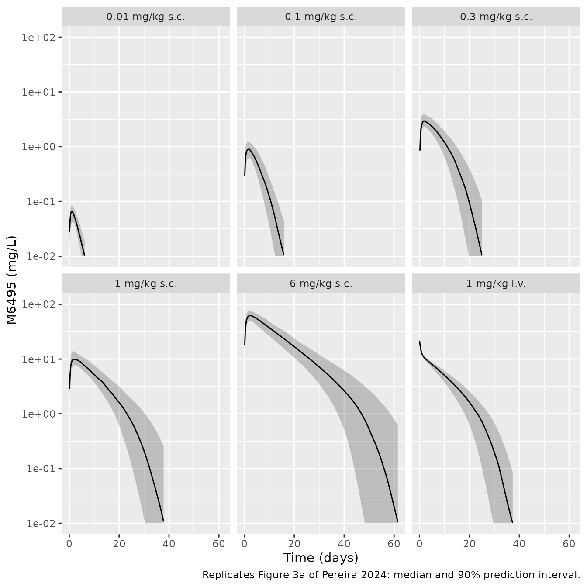
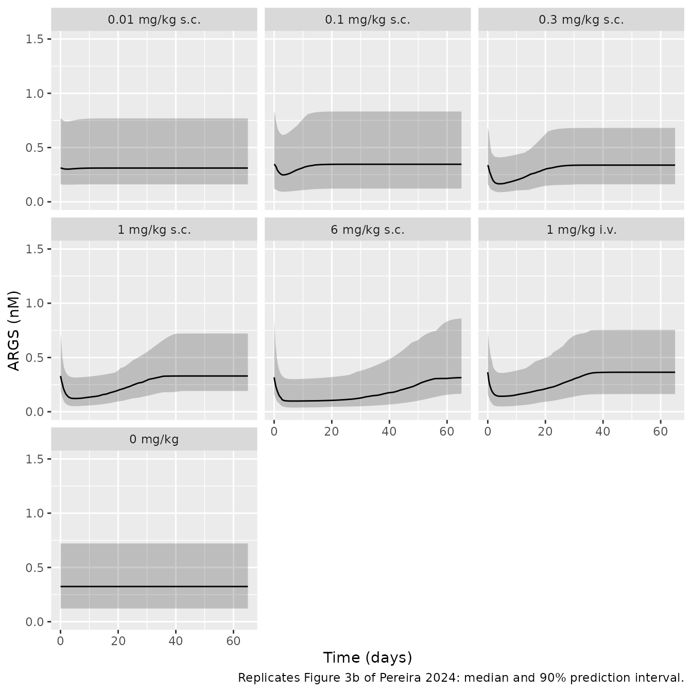
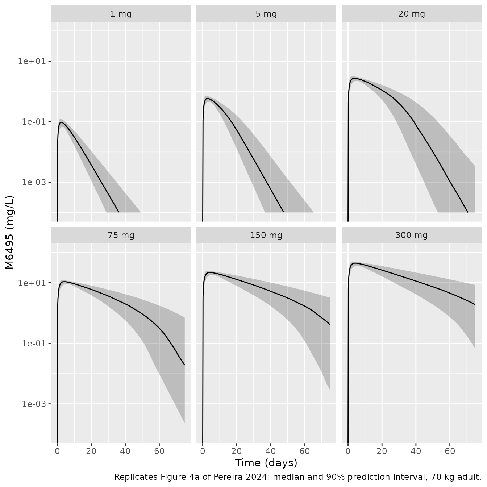
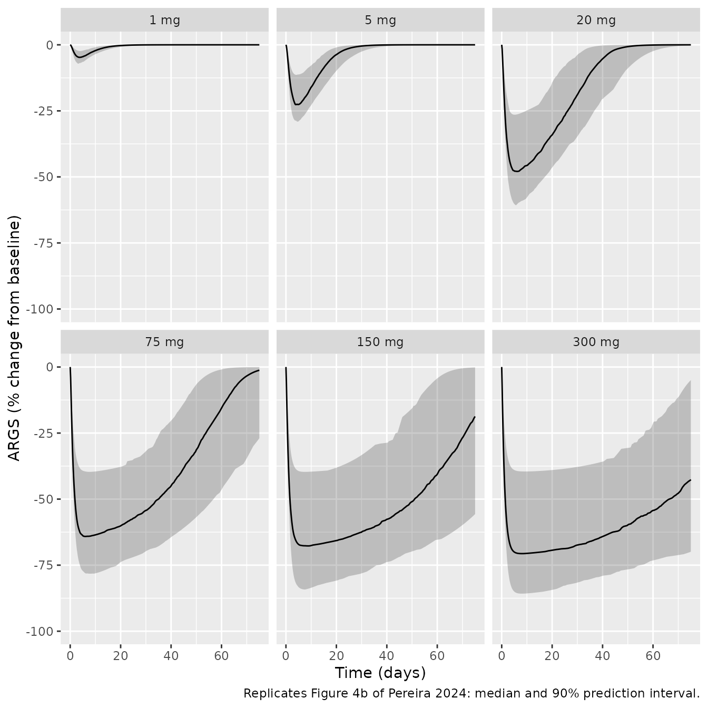
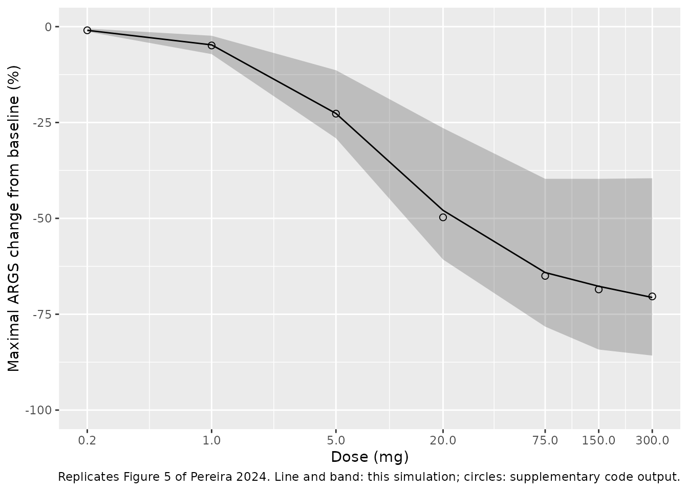

# M6495 anti-ADAMTS-5 nanobody and serum ARGS (Pereira 2024)

## Model and source

Pereira et al. (2024) fitted a joint PK/PD model to M6495, an
albumin-binding NANOBODY that inhibits ADAMTS-5, in cynomolgus monkeys.
The pharmacodynamic marker is ARGS, the aggrecan neo-epitope that
ADAMTS-5 cleavage releases into serum. The monkey model was then scaled
allometrically to a 70 kg human to choose the doses of the
first-in-human single ascending dose study. The paper gives two models,
and both are packaged:

- `Pereira_2024_M6495_cyno`: the fitted monkey model (Table 1).
  Parameters are per kg of body weight and doses are in mg/kg.

- `Pereira_2024_M6495_human`: the scaled human projection (Table 2 and
  the R simulation code in Supplementary Material 1). Doses are in mg.

- Citation: Pereira JNS, Ottevaere I, Serruys B, Guehring H, Ladel C,
  Lindemann S. Translational pharmacokinetic and pharmacodynamic
  modelling of the anti-ADAMTS-5 NANOBODY(R) (M6495) using the
  neo-epitope ARGS as a biomarker. J Pharmacokinet Pharmacodyn.
  2024;52(1):8. <doi:10.1007/s10928-024-09958-z>. PMCID: PMC11662058.

- Article: <https://doi.org/10.1007/s10928-024-09958-z> (open access,
  PMC11662058)

Both models share one structure (Eq. 1-10). The PK part is a
two-compartment model with first-order SC absorption, bioavailability
`F`, and linear clearance in parallel with Michaelis-Menten elimination.
The PD part is an indirect-response model in which M6495 inhibits ARGS
production:

``` math
\frac{dARGS}{dt} = k_{in}\left(1 - \frac{I_{max} C_1}{IC_{50} + C_1}\right) - k_{out} ARGS, \qquad k_{in} = ARGS_{baseline}\, k_{out}.
```

The interindividual random effect on `Imax` goes through a Box-Cox
transform (Eq. 8-10, shape -3.16), which keeps `Imax` below 1.

## Population

The monkey model pools two studies (Supplementary Tables 1 and 2). The
first is a single-dose PK/PD study in 42 animals: SC doses of 0
(vehicle), 0.01, 0.1, 0.3, 1 and 6 mg/kg and an IV dose of 1 mg/kg, with
3 males and 3 females per group. The second is a safety study in 28
animals: SC doses of 0, 6, 30 and 150 mg/kg once weekly for 4 weeks (3 +
3 per group), plus single SC doses of 6 and 30 mg/kg in 2 males each.
That gives 70 animals, 33 of them female. 111 of the 1466 ARGS samples
(7.6%) were below the quantification limit and were left out of the fit.
The human projection has no human subjects of its own. Its ARGS baseline
(0.14 nM, 46% CV) was measured in serum from 48 healthy humans.

``` r

str(rxode2::rxode(readModelDb("Pereira_2024_M6495_cyno"))$population)
#> ℹ parameter labels from comments will be replaced by 'label()'
#> List of 9
#>  $ species       : chr "cynomolgus monkey"
#>  $ n_subjects    : int 70
#>  $ n_studies     : int 2
#>  $ weight_range  : chr "Not reported; Table 2 converts the per-kg estimates for a 3.9 kg monkey."
#>  $ sex_female_pct: num 47.1
#>  $ disease_state : chr "Healthy cynomolgus monkeys (preclinical PK/PD and safety studies)."
#>  $ dose_range    : chr "Single-dose PK/PD study: 0 (vehicle), 0.01, 0.1, 0.3, 1 and 6 mg/kg SC and 1 mg/kg IV. Safety study: 0 (vehicle"| __truncated__
#>  $ regions       : chr NA
#>  $ notes         : chr "Supplementary Tables 1 and 2: 42 animals in the single-dose PK/PD study (7 groups of 3 male and 3 female) and 2"| __truncated__
```

## Source trace

| Quantity | Monkey (`_cyno`) | Human (`_human`) | Source |
|----|----|----|----|
| Structure, PK | Eq. 1-4 | Eq. 1-4 | Methods, Eq. 1-4; Supplementary R code |
| Structure, PD | Eq. 5-7 | Eq. 5-7 | Methods, Eq. 5-7 |
| Box-Cox on the `Imax` eta | Eq. 8-10, -3.16 | -3.16 | Table 1; R code `BXPAR` |
| `ka` | 0.0394 1/h | 0.0191 1/h | Table 1; Table 2 |
| `F` | 1 | 1 | Table 1; Table 2 |
| `CL` | 0.000251 L/kg/h | 0.0085 L/h | Table 1; Table 2 |
| `V1` | 0.046 L/kg | 3.22 L | Table 1; Table 2 |
| `Q` | 0.00163 L/kg/h | 0.0558 L/h | Table 1; Table 2 |
| `V2` | 0.0311 L/kg | 2.177 L | Table 1; Table 2 |
| `Vmax` | 0.000417 mg/kg/h | 0.0142 mg/h | Table 1; Table 2 |
| `Km` | 0.265 mg/L | 0.265 mg/L | Table 1; Table 2 |
| `kout` | 0.0401 1/h | 0.0401 1/h | Table 1; Table 2 |
| `Imax` | 0.725 | 0.725 | Table 1; Table 2 |
| `IC50` | 1.17 mg/L | 1.17 mg/L | Table 1; Table 2 |
| ARGS baseline | 0.36 nM | 0.14 nM | Table 1; Table 2 |
| Allometric exponents | n/a | 1 (V1, V2), 0.75 (CL, Q, Vmax), -0.25 (Ka) | Eq. 11; Table 2; Supplementary Table 3 |
| IIV `ka`, `CL` | 28.1%, 16.2% CV | variance 0.1, 0.1 | Table 1; Methods and R code |
| IIV `F` | 15.1% CV | none | Table 1; R code (`BA = 1`) |
| IIV `Vmax` | 19.3% CV | variance 0.055 | Table 1; R code |
| IIV `Imax` | 20.8% CV | variance 0.039 | Table 1; R code |
| IIV ARGS baseline | 54.2% CV | variance 0.21 | Table 1; R code (Methods: 46% CV) |
| Proportional error, PK and ARGS | 15.2%, 22.1% | 15.2%, 22.1% (carried) | Table 1 |

## Check of the published scaling arithmetic

Table 2 converts the per-kg monkey estimates to a 3.9 kg monkey and then
scales them to 70 kg with Eq. 11. Recomputing both steps from the
packaged values checks the transcription of Table 1, the exponents and
the human values all at once.

``` r

cyno <- rxode2::rxode(readModelDb("Pereira_2024_M6495_cyno"))
#> ℹ parameter labels from comments will be replaced by 'label()'
human <- rxode2::rxode(readModelDb("Pereira_2024_M6495_human"))
#> ℹ parameter labels from comments will be replaced by 'label()'
th_c <- cyno$theta
th_h <- human$theta

scaling <- tibble(
  parameter = c("lka", "lcl", "lvc", "lq", "lvp", "lvmax"),
  exponent = c(-0.25, 0.75, 1, 0.75, 1, 0.75),
  table2_cyno_3.9kg = c(0.0394, 0.00098, 0.194, 0.0064, 0.12, 0.00163)
) |>
  mutate(
    cyno_value = exp(th_c[parameter]),
    # Ka is a rate constant, not normalised to body weight in Table 1.
    cyno_3.9kg = ifelse(parameter == "lka", cyno_value, cyno_value * 3.9),
    human_scaled = cyno_3.9kg * (70 / 3.9)^exponent,
    human_packaged = exp(th_h[parameter]),
    pct_diff = 100 * (human_scaled / human_packaged - 1)
  )
scaling |>
  select(parameter, exponent, table2_cyno_3.9kg, cyno_3.9kg, human_scaled, human_packaged, pct_diff) |>
  knitr::kable(digits = 5, caption = "Table 1 x 3.9 kg, then Eq. 11 to 70 kg, against the packaged human values (Table 2).")
```

| parameter | exponent | table2_cyno_3.9kg | cyno_3.9kg | human_scaled | human_packaged | pct_diff |
|:---|---:|---:|---:|---:|---:|---:|
| lka | -0.25 | 0.03940 | 0.03940 | 0.01914 | 0.0191 | 0.22002 |
| lcl | 0.75 | 0.00098 | 0.00098 | 0.00854 | 0.0085 | 0.42561 |
| lvc | 1.00 | 0.19400 | 0.17940 | 3.22000 | 3.2200 | 0.00000 |
| lq | 0.75 | 0.00640 | 0.00636 | 0.05543 | 0.0558 | -0.65567 |
| lvp | 1.00 | 0.12000 | 0.12129 | 2.17700 | 2.1770 | 0.00000 |
| lvmax | 0.75 | 0.00163 | 0.00163 | 0.01418 | 0.0142 | -0.12946 |

Table 1 x 3.9 kg, then Eq. 11 to 70 kg, against the packaged human
values (Table 2). {.table}

``` r


stopifnot(
  # Every human value follows from Table 1 and Eq. 11 to within the rounding
  # of the printed 3.9 kg column (Q: 0.00636 printed as 0.0064).
  all(abs(scaling$pct_diff) < 1.5),
  # Table 2 prints V1 = 0.194 L for the 3.9 kg monkey, but 0.046 L/kg x 3.9 kg
  # = 0.179 L, and only 0.179 L scales to the printed human V1 of 3.22 L.
  abs(0.046 * 3.9 * (70 / 3.9) - 3.22) / 3.22 < 0.01,
  abs(0.194 * (70 / 3.9) - 3.22) / 3.22 > 0.05
)
```

All six human values reproduce. The one inconsistency is the 3.9 kg `V1`
in Table 2 (0.194 L), which disagrees with Table 1 (0.046 L/kg x 3.9 kg
= 0.179 L). The human `V1` of 3.22 L follows from 0.179 L, so 0.194 is a
misprint in the intermediate column and does not affect either packaged
model.

## Monkey model: replicate Figure 3

Figure 3 of the paper shows the model median and 90% prediction interval
for each group of the single-dose PK/PD study. The simulation below uses
60 virtual animals per group (doses in mg/kg) and observes the central
compartment every 4 hours for 65 days.

``` r

cyno_groups <- tibble(
  group = c("0.01 mg/kg s.c.", "0.1 mg/kg s.c.", "0.3 mg/kg s.c.", "1 mg/kg s.c.", "6 mg/kg s.c.", "1 mg/kg i.v.", "0 mg/kg"),
  amt = c(0.01, 0.1, 0.3, 1, 6, 1, 0),
  cmt = c(rep("depot", 5), "central", "depot")
)
n_cyno <- 60
obs_times <- seq(0, 65 * 24, by = 4)

make_group <- function(i, n, times) {
  ids <- (i - 1L) * n + seq_len(n)
  g <- cyno_groups[i, ]
  dose <- tibble(id = ids, time = 0, evid = 1L, amt = g$amt, cmt = g$cmt, dvid = NA_integer_)
  obs <- tidyr::expand_grid(id = ids, time = times) |>
    mutate(evid = 0L, amt = 0, cmt = "central", dvid = 1L)
  bind_rows(dose, obs) |>
    mutate(group = g$group) |>
    arrange(id, time, desc(evid))
}
ev_cyno <- bind_rows(lapply(seq_len(nrow(cyno_groups)), make_group, n = n_cyno, times = obs_times))
stopifnot(!anyDuplicated(unique(ev_cyno[, c("id", "time", "evid")])))

rxode2::rxSetSeed(20241220)
sim_cyno <- rxode2::rxSolve(readModelDb("Pereira_2024_M6495_cyno"), events = ev_cyno, keep = "group") |>
  as.data.frame() |>
  mutate(group = factor(group, levels = cyno_groups$group))
#> ℹ parameter labels from comments will be replaced by 'label()'
```

``` r

summ_cyno <- sim_cyno |>
  group_by(group, time) |>
  summarise(
    across(c(Cc, ARGS), list(
      lo = ~ quantile(.x, 0.05), med = ~ median(.x), hi = ~ quantile(.x, 0.95)
    )),
    .groups = "drop"
  )

summ_cyno |>
  filter(group != "0 mg/kg", Cc_med > 0.01) |>
  ggplot(aes(time / 24, Cc_med)) +
  geom_ribbon(aes(ymin = pmax(Cc_lo, 0.01), ymax = Cc_hi), alpha = 0.25) +
  geom_line() +
  facet_wrap(~group) +
  scale_y_log10(limits = c(0.01, 100)) +
  labs(x = "Time (days)", y = "M6495 (mg/L)",
       caption = "Replicates Figure 3a of Pereira 2024: median and 90% prediction interval.")
```



``` r


summ_cyno |>
  ggplot(aes(time / 24, ARGS_med)) +
  geom_ribbon(aes(ymin = ARGS_lo, ymax = ARGS_hi), alpha = 0.25) +
  geom_line() +
  facet_wrap(~group) +
  coord_cartesian(ylim = c(0, 1.5)) +
  labs(x = "Time (days)", y = "ARGS (nM)",
       caption = "Replicates Figure 3b of Pereira 2024: median and 90% prediction interval.")
```



The typical-value profiles check the PK and PD scales against two closed
forms. After the 1 mg/kg IV bolus the concentration starts at Dose/V1 =
21.7 mg/L, which is the starting point of the IV panel of Figure 3a.
While the concentration holds near its peak, ARGS falls towards the
steady state of Eq. 5, `ARGS_baseline * (1 - Imax * C / (IC50 + C))`. At
6 mg/kg (peak about 60 mg/L) that is about 0.10 nM, the nadir of the 6
mg/kg panel of Figure 3b.

``` r

typ_cyno <- rxode2::rxSolve(
  rxode2::zeroRe(readModelDb("Pereira_2024_M6495_cyno")),
  events = ev_cyno |> filter((id - 1L) %% n_cyno == 0L),
  keep = "group"
) |>
  as.data.frame()
#> ℹ parameter labels from comments will be replaced by 'label()'
#> ℹ omega/sigma items treated as zero: 'etalka', 'etalfdepot', 'etalcl', 'etalvmax', 'etalimax', 'etalrbase'
#> Warning: multi-subject simulation without without 'omega'

iv0 <- typ_cyno |> filter(group == "1 mg/kg i.v.", time == 0) |> pull(Cc)
typ_6 <- typ_cyno |> filter(group == "6 mg/kg s.c.")
cpk <- max(typ_6$Cc)
args_ss <- 0.36 * (1 - 0.725 * cpk / (1.17 + cpk))
typ_summary <- typ_cyno |>
  group_by(group) |>
  summarise(
    Cmax = max(Cc), Tmax_h = time[which.max(Cc)],
    ARGS_nadir = min(ARGS), ARGS_nadir_day = time[which.min(ARGS)] / 24,
    pct_max_inhibition = 100 * (1 - min(ARGS) / 0.36)
  )
knitr::kable(typ_summary, digits = 3, caption = "Typical-value monkey profiles by dose group.")
```

| group           |   Cmax | Tmax_h | ARGS_nadir | ARGS_nadir_day | pct_max_inhibition |
|:----------------|-------:|-------:|-----------:|---------------:|-------------------:|
| 0 mg/kg         |  0.000 |      0 |      0.360 |          0.000 |              0.000 |
| 0.01 mg/kg s.c. |  0.067 |     24 |      0.349 |          2.333 |              3.071 |
| 0.1 mg/kg s.c.  |  0.869 |     40 |      0.260 |          3.333 |             27.747 |
| 0.3 mg/kg s.c.  |  2.908 |     44 |      0.183 |          4.167 |             49.175 |
| 1 mg/kg i.v.    | 21.739 |      0 |      0.132 |          4.667 |             63.351 |
| 1 mg/kg s.c.    | 10.225 |     52 |      0.131 |          5.167 |             63.704 |
| 6 mg/kg s.c.    | 62.727 |     52 |      0.105 |          6.667 |             70.760 |

Typical-value monkey profiles by dose group. {.table}

``` r


stopifnot(
  abs(iv0 / (1 / 0.046) - 1) < 1e-6,
  # The SC 6 mg/kg nadir sits within 10% of the steady-state inhibition at
  # the peak concentration; ARGS turns over in about a day (kout 0.0401/h),
  # far faster than M6495 declines, so it tracks the quasi-steady state.
  abs(min(typ_6$ARGS) / args_ss - 1) < 0.10
)
```

## Monkey model: NCA

The paper reports no NCA for the monkey studies. The PKNCA results below
describe the packaged model. The 1 mg/kg SC and IV groups have about the
same dose-normalised AUC, as expected for the estimated bioavailability
of 1 (Results: “overlapping profiles of M6495 at 1 mg/kg after i.v. and
s.c. administration”).

``` r

# The numeric ODE solution undershoots zero by about atol in the far tail of
# the low-dose groups; floor it and drop the numerically-zero tail after the
# peak so the half-life fit does not follow integrator noise.
stopifnot(all(sim_cyno$Cc >= -1e-6 * max(sim_cyno$Cc)))
conc_cyno <- sim_cyno |>
  filter(!is.na(Cc), group != "0 mg/kg") |>
  mutate(Cc = pmax(Cc, 0)) |>
  group_by(id) |>
  filter(time <= time[which.max(Cc)] | Cc >= 1e-6 * max(Cc)) |>
  ungroup() |>
  select(id, time, Cc, group)
dose_cyno <- ev_cyno |>
  filter(evid == 1L, group != "0 mg/kg") |>
  select(id, time, amt, group)

intervals <- data.frame(start = 0, end = Inf, cmax = TRUE, tmax = TRUE, aucinf.obs = TRUE, half.life = TRUE)
nca_cyno <- PKNCA::pk.nca(PKNCA::PKNCAdata(
  PKNCA::PKNCAconc(conc_cyno, Cc ~ time | group + id),
  PKNCA::PKNCAdose(dose_cyno, amt ~ time | group + id),
  intervals = intervals
))
nca_cyno_tab <- as.data.frame(nca_cyno$result) |>
  group_by(group, PPTESTCD) |>
  summarise(median = median(PPORRES, na.rm = TRUE), .groups = "drop") |>
  tidyr::pivot_wider(names_from = PPTESTCD, values_from = median)
nca_cyno_tab |>
  select(group, cmax, tmax, aucinf.obs, half.life) |>
  dplyr::rename(
    "Group" = group, "Cmax (mg/L)" = cmax, "Tmax (h)" = tmax,
    "AUCinf (mg*h/L)" = aucinf.obs, "t1/2 (h)" = half.life
  ) |>
  knitr::kable(digits = 3, caption = "Median NCA by monkey dose group (simulated, 60 per group).")
```

| Group           | Cmax (mg/L) | Tmax (h) | AUCinf (mg\*h/L) | t1/2 (h) |
|:----------------|------------:|---------:|-----------------:|---------:|
| 0.01 mg/kg s.c. |       0.067 |       24 |            5.874 |   36.036 |
| 0.1 mg/kg s.c.  |       0.908 |       36 |          126.729 |   36.100 |
| 0.3 mg/kg s.c.  |       2.982 |       48 |          647.420 |   35.524 |
| 1 mg/kg i.v.    |      21.739 |        0 |         3039.254 |   37.006 |
| 1 mg/kg s.c.    |      10.162 |       50 |         2885.968 |   36.842 |
| 6 mg/kg s.c.    |      62.552 |       52 |        22613.708 |   39.226 |

Median NCA by monkey dose group (simulated, 60 per group). {.table}

``` r


auc1 <- nca_cyno_tab |> filter(group %in% c("1 mg/kg s.c.", "1 mg/kg i.v."))
ratio_sc_iv <- auc1$aucinf.obs[auc1$group == "1 mg/kg s.c."] / auc1$aucinf.obs[auc1$group == "1 mg/kg i.v."]
ratio_sc_iv
#> [1] 0.9495644
stopifnot(abs(ratio_sc_iv - 1) < 0.15)
```

## Human projection: replicate Figures 4 and 5

The supplementary R code simulates 500 virtual 70 kg adults per dose
with no residual error. For each subject it expresses ARGS as a
percentage change from that subject’s maximum (its baseline). The
dose-effect curve of Figure 5 is the minimum over time of the median
percentage change. The simulation below repeats this with 200 subjects
per dose and a 4-hour grid, then compares the result with the
dose-effect table the code prints.

``` r

doses_h <- c(0.2, 1, 5, 20, 75, 150, 300)
n_h <- 200
make_human <- function(j, n, times) {
  ids <- (j - 1L) * n + seq_len(n)
  dose <- tibble(id = ids, time = 0, evid = 1L, amt = doses_h[j], cmt = "depot", dvid = NA_integer_)
  obs <- tidyr::expand_grid(id = ids, time = times) |>
    mutate(evid = 0L, amt = 0, cmt = "central", dvid = 1L)
  bind_rows(dose, obs) |>
    mutate(dose = doses_h[j], WT = 70) |>
    arrange(id, time, desc(evid))
}
ev_h <- bind_rows(lapply(seq_along(doses_h), make_human, n = n_h, times = seq(0, 1800, by = 4)))
stopifnot(!anyDuplicated(unique(ev_h[, c("id", "time", "evid")])))

rxode2::rxSetSeed(20241221)
sim_h <- rxode2::rxSolve(readModelDb("Pereira_2024_M6495_human"), events = ev_h, keep = "dose") |>
  as.data.frame() |>
  group_by(id) |>
  mutate(pct = 100 * ARGS / max(ARGS) - 100) |>
  ungroup()
#> ℹ parameter labels from comments will be replaced by 'label()'
```

``` r

summ_h <- sim_h |>
  filter(dose > 0.2) |>
  group_by(dose, time) |>
  summarise(
    across(c(Cc, pct), list(
      lo = ~ quantile(.x, 0.05), med = ~ median(.x), hi = ~ quantile(.x, 0.95)
    )),
    .groups = "drop"
  ) |>
  mutate(dose = factor(paste(dose, "mg"), levels = paste(doses_h[-1], "mg")))

summ_h |>
  ggplot(aes(time / 24, Cc_med)) +
  geom_ribbon(aes(ymin = pmax(Cc_lo, 1e-4), ymax = Cc_hi), alpha = 0.25) +
  geom_line() +
  facet_wrap(~dose) +
  scale_y_log10(limits = c(1e-4, 100)) +
  labs(x = "Time (days)", y = "M6495 (mg/L)",
       caption = "Replicates Figure 4a of Pereira 2024: median and 90% prediction interval, 70 kg adult.")
#> Warning in scale_y_log10(limits = c(1e-04, 100)): log-10 transformation introduced infinite values.
#> log-10 transformation introduced infinite values.
#> log-10 transformation introduced infinite values.
#> Warning: Removed 213 rows containing missing values or values outside the scale range
#> (`geom_ribbon()`).
#> Warning: Removed 423 rows containing missing values or values outside the scale range
#> (`geom_line()`).
```



``` r


summ_h |>
  ggplot(aes(time / 24, pct_med)) +
  geom_ribbon(aes(ymin = pct_lo, ymax = pct_hi), alpha = 0.25) +
  geom_line() +
  facet_wrap(~dose) +
  coord_cartesian(ylim = c(-100, 0)) +
  labs(x = "Time (days)", y = "ARGS (% change from baseline)",
       caption = "Replicates Figure 4b of Pereira 2024: median and 90% prediction interval.")
```



``` r

de_sim <- sim_h |>
  group_by(dose, time) |>
  summarise(m = median(pct), lo = quantile(pct, 0.05), hi = quantile(pct, 0.95), .groups = "drop") |>
  group_by(dose) |>
  summarise(median = min(m), low = min(lo), high = min(hi))

# Printed at the end of the dose-effect section of the supplementary R code
# (500 subjects per dose).
de_pub <- tibble(
  dose = doses_h,
  median_pub = c(-0.9508402, -4.9051079, -22.6929523, -49.7286402, -64.9972906, -68.5255354, -70.3544409),
  low_pub = c(-1.339676, -6.774391, -29.292487, -61.469978, -79.964586, -84.263366, -86.549565),
  high_pub = c(-0.4971686, -2.6027702, -12.1371891, -26.4975193, -34.5721281, -36.4387270, -37.4651324)
)
de_cmp <- inner_join(de_sim, de_pub, by = "dose") |>
  mutate(diff = median - median_pub)
stopifnot(nrow(de_cmp) == length(doses_h))

de_cmp |>
  select(dose, median, median_pub, diff, low, low_pub, high, high_pub) |>
  dplyr::rename(
    "Dose (mg)" = dose, "Simulated median (%)" = median, "Published median (%)" = median_pub,
    "Difference (points)" = diff, "Simulated 5th pct (%)" = low, "Published 5th pct (%)" = low_pub,
    "Simulated 95th pct (%)" = high, "Published 95th pct (%)" = high_pub
  ) |>
  knitr::kable(digits = 2, caption = "Maximal median ARGS change from baseline by dose, against the supplementary code output.")
```

| Dose (mg) | Simulated median (%) | Published median (%) | Difference (points) | Simulated 5th pct (%) | Published 5th pct (%) | Simulated 95th pct (%) | Published 95th pct (%) |
|---:|---:|---:|---:|---:|---:|---:|---:|
| 0.2 | -0.96 | -0.95 | -0.01 | -1.31 | -1.34 | -0.51 | -0.50 |
| 1.0 | -4.75 | -4.91 | 0.15 | -7.17 | -6.77 | -2.37 | -2.60 |
| 5.0 | -22.64 | -22.69 | 0.05 | -29.10 | -29.29 | -11.36 | -12.14 |
| 20.0 | -47.91 | -49.73 | 1.82 | -60.73 | -61.47 | -26.46 | -26.50 |
| 75.0 | -64.13 | -65.00 | 0.87 | -78.23 | -79.96 | -39.68 | -34.57 |
| 150.0 | -67.71 | -68.53 | 0.81 | -84.21 | -84.26 | -39.69 | -36.44 |
| 300.0 | -70.63 | -70.35 | -0.27 | -85.78 | -86.55 | -39.54 | -37.47 |

Maximal median ARGS change from baseline by dose, against the
supplementary code output. {.table style="width:100%;"}

``` r


ggplot(de_cmp, aes(dose)) +
  geom_ribbon(aes(ymin = low, ymax = high), alpha = 0.25) +
  geom_line(aes(y = median)) +
  geom_point(aes(y = median_pub), shape = 1, size = 2) +
  scale_x_log10(breaks = doses_h) +
  coord_cartesian(ylim = c(-100, 0)) +
  labs(x = "Dose (mg)", y = "Maximal ARGS change from baseline (%)",
       caption = "Replicates Figure 5 of Pereira 2024. Line and band: this simulation; circles: supplementary code output.")
```



``` r


stopifnot(
  # A mis-transcribed Imax, IC50, Vmax or volume moves the 20-300 mg values
  # by 10 points or more; Monte-Carlo noise on a median of 200 subjects is
  # about 1-2 points.
  mean(abs(de_cmp$diff)) < 3,
  max(abs(de_cmp$diff)) < 6
)
```

The simulated dose-effect curve agrees with the supplementary code
output at every dose. The 5th and 95th percentiles agree as well, within
the larger Monte-Carlo noise of a tail percentile of 200 subjects. The
model predicts almost no effect at 1 mg and about 70% maximal inhibition
at 150-300 mg, as the paper reports (Results: “minimal at doses in the
range of 1 to 5 mg”; Discussion: “an inhibition of ARGS above 70% at the
highest planned clinical doses”).

## Human projection: NCA

The paper does not tabulate human NCA values; Figure 4a overlays the
projection on the Phase I means. The PKNCA results below describe the
packaged projection for a 70 kg adult. AUC rises more than in proportion
to dose, because the Michaelis-Menten path clears a larger share of a
small dose; at the highest doses AUC/dose approaches the linear limit
F/CL.

``` r

stopifnot(all(sim_h$Cc >= -1e-6 * max(sim_h$Cc)))
# NCA on the first 40 subjects of each dose keeps the render inside its time
# budget; medians of 40 are ample for the dose-proportionality check below.
nca_ids <- ev_h |> distinct(id, dose) |> group_by(dose) |> slice_head(n = 40) |> pull(id)
conc_h <- sim_h |>
  filter(!is.na(Cc), dose > 0.2, id %in% nca_ids) |>
  mutate(Cc = pmax(Cc, 0)) |>
  group_by(id) |>
  filter(time <= time[which.max(Cc)] | Cc >= 1e-6 * max(Cc)) |>
  ungroup() |>
  select(id, time, Cc, dose_mg = dose)
dose_h <- ev_h |>
  filter(evid == 1L, dose > 0.2, id %in% nca_ids) |>
  select(id, time, amt, dose_mg = dose)
nca_h <- PKNCA::pk.nca(PKNCA::PKNCAdata(
  PKNCA::PKNCAconc(conc_h, Cc ~ time | dose_mg + id),
  PKNCA::PKNCAdose(dose_h, amt ~ time | dose_mg + id),
  intervals = data.frame(start = 0, end = Inf, cmax = TRUE, tmax = TRUE, aucinf.obs = TRUE)
))
nca_h_tab <- as.data.frame(nca_h$result) |>
  group_by(dose_mg, PPTESTCD) |>
  summarise(median = median(PPORRES, na.rm = TRUE), .groups = "drop") |>
  tidyr::pivot_wider(names_from = PPTESTCD, values_from = median) |>
  mutate(auc_per_mg = aucinf.obs / dose_mg)
nca_h_tab |>
  select(dose_mg, cmax, tmax, aucinf.obs, auc_per_mg) |>
  dplyr::rename(
    "Dose (mg)" = dose_mg, "Cmax (mg/L)" = cmax, "Tmax (h)" = tmax,
    "AUCinf (mg*h/L)" = aucinf.obs, "AUCinf / dose (h/L)" = auc_per_mg
  ) |>
  knitr::kable(digits = 3, caption = "Median NCA of the human projection (40 simulated 70 kg adults per dose).")
```

| Dose (mg) | Cmax (mg/L) | Tmax (h) | AUCinf (mg\*h/L) | AUCinf / dose (h/L) |
|----------:|------------:|---------:|-----------------:|--------------------:|
|         1 |       0.094 |       56 |           19.405 |              19.405 |
|         5 |       0.581 |       72 |          148.009 |              29.602 |
|        20 |       2.814 |       92 |         1217.624 |              60.881 |
|        75 |      10.994 |      112 |         6134.624 |              81.795 |
|       150 |      22.093 |      108 |        14680.116 |              97.867 |
|       300 |      44.879 |       96 |        31158.219 |             103.861 |

Median NCA of the human projection (40 simulated 70 kg adults per dose).
{.table style="width:100%;"}

``` r


# Linear-only bound: AUC/dose can never exceed F / CL = 1 / 0.0085 h/L, and
# it approaches that bound at the highest dose as the saturable path saturates.
stopifnot(
  all(nca_h_tab$auc_per_mg < 1.2 / 0.0085),
  nca_h_tab$auc_per_mg[nca_h_tab$dose_mg == 300] > 2 * nca_h_tab$auc_per_mg[nca_h_tab$dose_mg == 1]
)
```

## Assumptions and deviations

- **IIV scale in the monkey model.** Table 1 reports IIV as “CV%”. The
  packaged model uses variance = (CV/100)^2. The authors use this
  convention themselves: the supplementary code turns the 46% CV of the
  human ARGS baseline into a variance of 0.21 = 0.46^2. The alternative
  reading, variance = log(1 + CV^2), gives values 1-12% smaller (0.258
  instead of 0.294 for the ARGS baseline, under 2% different for the
  others). The Figure 3 prediction bands cannot settle it, because their
  width varies between the dose panels by more than the two readings
  differ.
- **Human IIV taken from the supplementary code.** The Methods say the
  variability on `Vmax` and `Imax` was kept as in the monkey. The code
  that produced Figures 4 and 5 uses variances of 0.055 and 0.039, which
  do not match Table 1 (19.3% and 20.8% CV give 0.037 and 0.043). The
  packaged human model follows the code, because the code generated the
  published human figures and the dose-effect table above reproduces
  them.
- **No IIV on bioavailability in the human projection.** The code fixes
  `F = 1` for every subject, so the monkey IIV on `F` is not carried
  over.
- **Residual error in the human projection.** The published human
  simulations have no residual error. The monkey proportional errors
  (15.2% PK, 22.1% ARGS) are carried into the human model so that
  simulated observations can be generated. The figures here use the
  error-free predictions, as the paper does.
- **Body weight in the human projection.** Table 2 and the code use a 70
  kg adult, while the Figure 4 caption mentions a 75 kg human. The human
  model is anchored at 70 kg and keeps the allometric exponents of Eq.
  11 as fixed `WT` effects, so other weights can be simulated. Use
  `WT = 70` to reproduce the paper.
- **Bioavailability.** Eq. 3 writes `F` into the absorption flux
  (`Ka * F * A`). Because absorption is first order, this is identical
  to scaling the SC dose by `F`, which is how the model files encode it.
- **Study effect on the ARGS baseline.** The authors also tested a model
  with a study covariate on the monkey ARGS baseline (Supplementary
  Table 4). They kept the base model for the human projection, so the
  packaged monkey model is the base model. The covariate is documented
  in `covariatesDataExcluded`.
- **Table 2 misprint.** The 3.9 kg monkey `V1` in Table 2 (0.194 L)
  should be 0.179 L (see the scaling check above). Neither packaged
  model uses it.
- No erratum to the article was found (Crossref, checked 2026-11-01).
