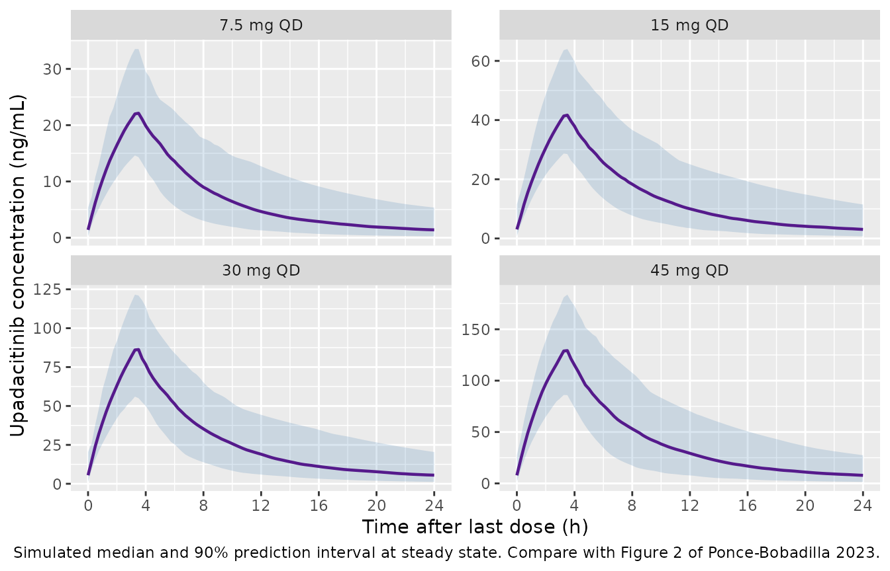
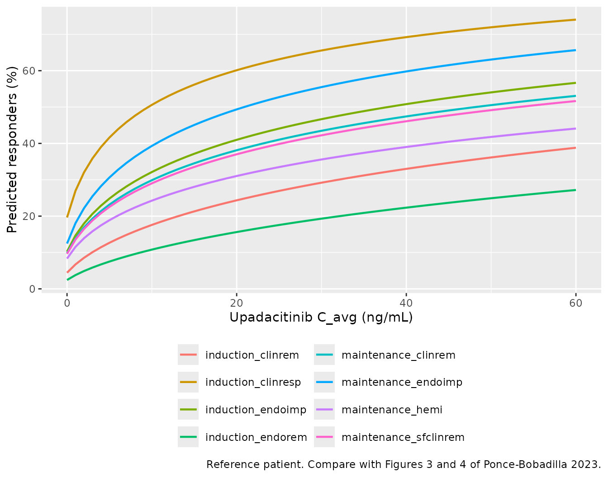

# Upadacitinib in ulcerative colitis (Ponce-Bobadilla 2023)

## Models and source

Ponce-Bobadilla 2023 re-estimates the cross-population upadacitinib
population PK model after adding the ulcerative colitis (UC) phase 2b/3
induction data, then relates the model-estimated steady-state average
concentration (C_(avg)) to efficacy at the end of 8-week induction and
of 52-week maintenance with landmark logistic regressions. Following the
package’s policy of replicating the authors’ model structure, each
fitted model is a separate file and all ten share this vignette.

| Model | Endpoint | Drug term | Source |
|----|----|----|----|
| `PonceBobadilla_2023_upadacitinib` | plasma concentration | 2-compartment, parallel zero- + first-order absorption | OSM Table 6, OSM Methods |
| `..._induction_clinrem` | P(clinical remission, Week 8) | log(1 + C_(avg)) | OSM Table 7 |
| `..._induction_clinresp` | P(clinical response, Week 8) | log(1 + C_(avg)) | OSM Table 7 |
| `..._induction_endoimp` | P(endoscopic improvement, Week 8) | log(1 + C_(avg)) | OSM Table 7 |
| `..._induction_endorem` | P(endoscopic remission, Week 8) | log(1 + C_(avg)) | OSM Table 7 |
| `..._maintenance_clinrem` | P(clinical remission, Week 52) | log(1 + C_(avg)) | OSM Table 7 |
| `..._maintenance_endoimp` | P(endoscopic improvement, Week 52) | log(1 + C_(avg)) | OSM Table 7 |
| `..._maintenance_endorem` | P(endoscopic remission, Week 52) | treatment effect | OSM Table 7 |
| `..._maintenance_hemi` | P(histo-endoscopic mucosal improvement, Week 52) | log(1 + C_(avg)) | OSM Table 7 |
| `..._maintenance_sfclinrem` | P(steroid-free clinical remission, Week 52) | log(1 + C_(avg)) | OSM Table 7 |

- Citation: Ponce-Bobadilla AV, Stodtmann S, Eckert D, Zhou W, Liu W,
  Mohamed M-EF. Upadacitinib population pharmacokinetics and
  exposure-response relationships in ulcerative colitis patients. Clin
  Pharmacokinet. 2023;62(1):101-112. <doi:10.1007/s40262-022-01191-6>.
  Parameter values are Supplementary Table 6 of the Online Supplementary
  Material (OSM); the covariate and residual-error equations are in the
  OSM Methods.
- Article: <https://doi.org/10.1007/s40262-022-01191-6> (open access).
  Every parameter value is in the Online Supplementary Material (OSM)
  published with the article.

``` r

# readModelDb() returns the model FUNCTION; rxode2::rxode() parses it once.
mod_pk <- rxode2::rxode(readModelDb("PonceBobadilla_2023_upadacitinib"))
#> ℹ parameter labels from comments will be replaced by 'label()'

er_names <- c(
  induction_clinrem = "PonceBobadilla_2023_upadacitinib_induction_clinrem",
  induction_clinresp = "PonceBobadilla_2023_upadacitinib_induction_clinresp",
  induction_endoimp = "PonceBobadilla_2023_upadacitinib_induction_endoimp",
  induction_endorem = "PonceBobadilla_2023_upadacitinib_induction_endorem",
  maintenance_clinrem = "PonceBobadilla_2023_upadacitinib_maintenance_clinrem",
  maintenance_endoimp = "PonceBobadilla_2023_upadacitinib_maintenance_endoimp",
  maintenance_endorem = "PonceBobadilla_2023_upadacitinib_maintenance_endorem",
  maintenance_hemi = "PonceBobadilla_2023_upadacitinib_maintenance_hemi",
  maintenance_sfclinrem = "PonceBobadilla_2023_upadacitinib_maintenance_sfclinrem"
)
mod_er <- lapply(er_names, function(nm) rxode2::rxode(readModelDb(nm)))
```

## Population

The PK analysis pooled **1,927 subjects**: phase 1 healthy volunteers,
phase 2b patients with rheumatoid arthritis, Crohn’s disease, atopic
dermatitis and UC, and the phase 3 UC induction trials. **978 UC
patients** from induction Studies 1, 2 and 4 contributed to the
estimation; **623 patients** from maintenance Study 3 were used for a
post hoc validation. Among the 978 UC induction patients (OSM Table 3)
mean age was 42.9 years, mean body weight 73.1 kg (SD 18.3), 38% were
female, 69% White and 26% Asian, 58% were biologic-intolerant or
inadequate responders (Bio-IR), mean creatinine clearance was 112 mL/min
(SD 32.9) and mean AST 17.9 IU/L. Every UC patient received the
extended-release tablet once daily: 7.5, 15, 30 or 45 mg for induction
(7.5-30 mg only in the phase 2b Study 1), 15 or 30 mg for maintenance.

The induction exposure-response analysis used **1,234 UC patients**
(placebo or upadacitinib; Study 1 248, Study 2 472, Study 4 514) and the
maintenance analysis **449 patients** of Study 3, all of them clinical
responders to 45 mg once-daily induction, randomized to placebo, 15 or
30 mg.

``` r

str(readModelDb("PonceBobadilla_2023_upadacitinib")()$population, max.level = 1)
#> List of 12
#>  $ species                : chr "human"
#>  $ n_subjects             : int 1927
#>  $ age_range              : chr "Not tabulated for the pooled dataset; ulcerative colitis induction patients mean 42.9 years (SD 14.4; OSM Table 3)."
#>  $ weight_range           : chr "Not tabulated for the pooled dataset; ulcerative colitis induction patients mean 73.1 kg (SD 18.3; OSM Table 3)."
#>  $ sex_female_pct         : num 38
#>  $ race_ethnicity         : chr "Ulcerative colitis induction patients (N = 978): White 69%, Black or African American 3%, Asian 26%, Other/Mult"| __truncated__
#>  $ disease_state          : chr "Pooled healthy volunteers (phase I) and patients with rheumatoid arthritis, Crohn's disease, atopic dermatitis "| __truncated__
#>  $ dose_range             : chr "Ulcerative colitis: 7.5, 15, 30 or 45 mg once daily extended-release tablet for 8-week induction; 15 or 30 mg o"| __truncated__
#>  $ regions                : chr "Multinational; 22% of ulcerative colitis induction patients from the US and 23% from Asian regions (OSM Table 3)."
#>  $ sex_female_pct_note    : chr "38% female among ulcerative colitis induction (N = 978) and maintenance (N = 623) PK patients (OSM Tables 3-4);"| __truncated__
#>  $ crcl_ulcerative_colitis: chr "Mean 112 mL/min (SD 32.9) in induction patients (OSM Table 3); median 109 mL/min (range 42.0-290) in maintenanc"| __truncated__
#>  $ notes                  : chr "NONMEM 7.4.4, FOCE with interaction. All parameters of the Nader 2020 cross-population model were re-estimated "| __truncated__
```

## Source trace

Every `ini()` value carries an in-file comment naming its source. They
are collected here.

### Population pharmacokinetics (`PonceBobadilla_2023_upadacitinib`)

| Parameter | Value | Source location |
|----|----|----|
| `lcl` (CL/F) | 37.0 L/h | OSM Table 6 |
| `lvc` (Vc/F) | 169 L | OSM Table 6 |
| `lq` (Q/F) | 3.86 L/h | OSM Table 6 (row label merged with the preceding row) |
| `lvp` (Vp/F) | 61.6 L | OSM Table 6 |
| `lka_er` | 0.114 1/h | OSM Table 6 ‘Extended-Release KA’ |
| `ltlag_er` | 0.159 h | OSM Table 6 ‘Extended-Release Absorption Lag Time’ |
| `logitffo` | first-order share 27.5% | OSM Table 6 ‘Fraction … Absorbed through Zero-Order Process’ = 72.5% |
| `ld2` | 3.39 h | OSM Table 6 ‘Zero-Order Absorption Duration’ |
| `lfrel_er` | 79.8% | OSM Table 6 ‘Bioavailability of the Extended-Release …’ |
| `lka_ir` | 1.85 1/h | OSM Table 6 ‘Immediate-Release KA’ |
| `ltlag_ir` | 0.237 h | OSM Table 6 ‘Immediate-Release Absorption Lag Time’ |
| `e_crcl_cl` | 0.213 | OSM Table 6 |
| `e_ast_cl` | -0.0810 | OSM Table 6 |
| `e_sexf_cl` | log(0.874) | OSM Table 6 ‘CL/F Ratio of Females Compared to Males’ |
| `e_dis_healthy_cl` | log(1.22) | OSM Table 6 ‘CL/F Ratio of Healthy Patients …’ |
| `e_dis_ra_cl` | log(0.929) | OSM Table 6 ‘CL/F Ratio of RA Patients …’ |
| `e_wt_vc` | 0.493 | OSM Table 6 |
| `e_sexf_vc` | log(0.811) | OSM Table 6 ‘Vc/F Ratio of Females Compared to Males’ |
| `etalcl`, `etalvc` | 34.5%, 27.0% | OSM Table 6 ISV, as 100 \* sqrt(omega^2) |
| `etalka_er`, `etalka_ir` | 94.3%, 71.4% | OSM Table 6 ISV |
| `propSdPhase1`, `propSdPhase23` | 0.261, 0.456 | OSM Table 6 |
| `addSdBase` | 0.115 ng/mL | OSM Table 6 |
| `ruv_early` | 1.68 | OSM Table 6 ‘Scaling Factor on Residual Error’; OSM Supplementary Results (first 2 h after dosing) |
| Covariate equation | power / exp(cov \* theta) | OSM Methods ‘Population pharmacokinetic modeling’ |
| Residual-error form | C = Chat (1 + eps_Phase) + eps_ADD | OSM Methods |
| Absorption structure, lag on first-order arm | n/a | main text Section 2.3 |
| Reference WT / CrCL / AST | 70 kg / 109 mL/min / 18 IU/L | not printed; see [Assumptions and deviations](#assumptions-and-deviations) |

### Exposure-response (`..._induction_*`, `..._maintenance_*`)

All coefficients are OSM Table 7; the model form is the OSM Methods
equation logit P = alpha + f(C_(avg)) + sum(beta_(j) x_(j)), with f(C) =
beta log(1 + C) for the logarithmic models and beta_(trt) for the
treatment-effect model.

| Model | Intercept | log(1 + C_(avg)) or treatment | Bio-IR | Steroid | Adapted Mayo \> 7 / Remission at Wk 0 | Study 2 | Study 4 |
|----|----|----|----|----|----|----|----|
| induction clinrem | -3.07 | 0.636 | -0.776 | -0.0375 | -0.363 | 0.154 | 0.481 |
| induction clinresp | -1.41 | 0.598 | -1.04 | 0.176 | 0.387 | 0.539 | 0.581 |
| induction endoimp | -2.17 | 0.593 | -0.922 (see [Errata](#errata)) | 0.201 | -0.241 | -0.188 | 0.152 |
| induction endorem | -3.69 | 0.658 | -1.07 | 0.321 | -0.133 | -0.276 | 0.0624 |
| maintenance clinrem | -2.22 | 0.57 | -0.156 | -0.121 | 1.02 | – | – |
| maintenance endoimp | -1.95 | 0.632 | -0.41 | -0.0944 | 0.913 | – | – |
| maintenance endorem | -3.1 | 1.75 (treatment) | -0.277 | -0.444 | 1.04 | – | – |
| maintenance hemi | -2.4 | 0.526 | -0.0883 | -0.138 | 1.01 | – | – |
| maintenance sfclinrem | -2.24 | 0.561 | -0.0667 | -0.367 | 1.04 | – | – |

## Virtual cohort

Observed data are not public. The PK cohort approximates the UC
induction PK population of OSM Table 3, with 200 subjects in each of the
four dose groups.

``` r

# set.seed() fixes the covariate draws; rxode2's own between-subject draws
# depend on the solver thread layout, so every assertion below is on medians,
# means or structural identities, never on the extremes of the cohort.
set.seed(20221226)
rxode2::rxSetSeed(20221226)

N_ARM <- 200L
DOSES <- c(7.5, 15, 30, 45)

pk_subjects <- tibble(
  id = seq_len(N_ARM * length(DOSES)),
  dose = rep(DOSES, each = N_ARM),
  # OSM Table 3, all UC induction patients: weight mean 73.1 (SD 18.3) kg,
  # 38% female, CrCL mean 112 (SD 32.9) mL/min, AST mean 17.9 IU/L.
  WT = pmin(pmax(rnorm(N_ARM * length(DOSES), 73.1, 18.3), 40), 160),
  SEXF = rbinom(N_ARM * length(DOSES), 1L, 0.38),
  CRCL = pmin(pmax(rnorm(N_ARM * length(DOSES), 112, 32.9), 42), 290),
  AST = pmin(pmax(exp(rnorm(N_ARM * length(DOSES), log(16), 0.3)), 5), 150),
  DIS_HEALTHY = 0, DIS_RA = 0, FORM_UPA_ER = 1, STUDY_UPA_PHASE1 = 0
) |>
  mutate(arm = factor(paste(dose, "mg QD"), levels = paste(DOSES, "mg QD")))

summary(pk_subjects[, c("WT", "CRCL", "AST")])
#>        WT              CRCL             AST       
#>  Min.   : 40.00   Min.   : 42.00   Min.   : 5.00  
#>  1st Qu.: 60.66   1st Qu.: 89.31   1st Qu.:12.91  
#>  Median : 74.58   Median :112.25   Median :15.68  
#>  Mean   : 74.43   Mean   :112.25   Mean   :16.59  
#>  3rd Qu.: 87.11   3rd Qu.:135.84   3rd Qu.:19.31  
#>  Max.   :125.58   Max.   :208.94   Max.   :38.44
```

### Event table

The extended-release absorption is a **parallel** process, so each
administration is two dose records at the same time: one into `depot`
(the first-order arm, scaled by `f(depot)`) and one into `central` with
`rate = -2` (the zero-order arm over the modelled `dur(central)`).
Observations point at the ODE state `central`; `Cc` is returned
alongside.

``` r

DOSE_TIMES <- seq(0, 144, by = 24) # seven once-daily doses
OBS_TIMES <- seq(144, 168, by = 0.25) # the seventh dosing interval

expand_rows <- function(df, times) df[rep(seq_len(nrow(df)), each = length(times)), ]

depot_doses <- expand_rows(pk_subjects, DOSE_TIMES) |>
  mutate(time = rep(DOSE_TIMES, nrow(pk_subjects)), amt = dose, evid = 1L,
         cmt = "depot", rate = 0)
central_doses <- depot_doses |> mutate(cmt = "central", rate = -2)
observations <- expand_rows(pk_subjects, OBS_TIMES) |>
  mutate(time = rep(OBS_TIMES, nrow(pk_subjects)), amt = NA_real_, evid = 0L,
         cmt = "central", rate = 0)

events <- bind_rows(depot_doses, central_doses, observations) |>
  select(id, time, amt, evid, cmt, rate, everything()) |>
  arrange(id, time, desc(evid))

stopifnot(length(unique(events$id)) == N_ARM * length(DOSES))
```

## Simulation

``` r

sim <- rxode2::rxSolve(mod_pk, events, keep = c("arm", "dose")) |>
  as.data.frame()
stopifnot(nrow(sim) == N_ARM * length(DOSES) * length(OBS_TIMES), !anyNA(sim$Cc))
```

## Replicate published figures

``` r

# Shape of Figure 2 of Ponce-Bobadilla 2023 (visual predictive check by
# induction dose group, versus time after the last dose).
sim |>
  mutate(tad = time - max(DOSE_TIMES)) |>
  group_by(arm, tad) |>
  summarise(Q05 = quantile(Cc, 0.05), Q50 = median(Cc), Q95 = quantile(Cc, 0.95),
            .groups = "drop") |>
  ggplot(aes(tad, Q50)) +
  geom_ribbon(aes(ymin = Q05, ymax = Q95), alpha = 0.2, fill = "steelblue") +
  geom_line(colour = "purple4", linewidth = 0.8) +
  facet_wrap(~arm, scales = "free_y") +
  scale_x_continuous(breaks = seq(0, 24, by = 4)) +
  labs(x = "Time after last dose (h)", y = "Upadacitinib concentration (ng/mL)",
       caption = paste("Simulated median and 90% prediction interval at steady state.",
                       "Compare with Figure 2 of Ponce-Bobadilla 2023."))
```



## PKNCA validation

Steady-state NCA over the seventh dosing interval. The half-life is not
requested: the extended-release first-order arm absorbs with a 6 h
half-life and 94% IIV, so a 24 h window cannot separate absorption from
elimination.

``` r

sim_nca <- sim |>
  dplyr::filter(!is.na(Cc)) |>
  dplyr::select(id, time, Cc, arm)

conc_obj <- PKNCA::PKNCAconc(sim_nca, Cc ~ time | arm + id)
dose_df <- events |>
  dplyr::filter(evid == 1, cmt == "depot") |>
  dplyr::select(id, time, amt, arm)
dose_obj <- PKNCA::PKNCAdose(dose_df, amt ~ time | arm + id)

intervals <- data.frame(start = 144, end = 168, cmax = TRUE, tmax = TRUE,
                        auclast = TRUE, cav = TRUE)
nca_res <- PKNCA::pk.nca(PKNCA::PKNCAdata(conc_obj, dose_obj, intervals = intervals))
```

C_(trough) in OSM Table 5 is the pre-dose concentration at steady state,
so it is read directly off the profile at the end of the interval rather
than taken from `cmin`; the 0.159 h lag puts the interval minimum just
after the dose.

``` r

ctrough_df <- sim |>
  dplyr::filter(time == max(OBS_TIMES)) |>
  dplyr::transmute(arm, id, PPTESTCD = "ctrough", PPORRES = Cc)

nca_long <- dplyr::bind_rows(
  as.data.frame(nca_res)[, c("arm", "id", "PPTESTCD", "PPORRES")],
  ctrough_df
)
stopifnot(!anyNA(nca_long$PPORRES))
```

### Comparison against OSM Table 5

OSM Table 5 gives model-estimated steady-state exposures in UC patients
by dose group, as median (5th, 95th percentile) of the post hoc
estimates.

``` r

published <- tibble::tribble(
  ~arm,       ~cav,  ~cmax, ~ctrough,
  "7.5 mg QD", 6.69, 20.2,  1.06,
  "15 mg QD",  14.3, 41.3,  2.63,
  "30 mg QD",  27.2, 78.5,  4.94,
  "45 mg QD",  41.4, 121,   7.08
) |>
  mutate(arm = factor(arm, levels = levels(pk_subjects$arm)))

cmp <- nlmixr2lib::ncaComparisonTable(
  simulated = nca_long |> dplyr::filter(PPTESTCD %in% c("cav", "cmax", "ctrough")),
  reference = published,
  by = "arm",
  units = c(cav = "ng/mL", cmax = "ng/mL", ctrough = "ng/mL"),
  tolerance_pct = 20
)
knitr::kable(cmp, caption = "Simulated vs. OSM Table 5 (medians). * differs by >20%.")
```

| NCA parameter   | arm       | Reference | Simulated | % diff   |
|:----------------|:----------|:----------|:----------|:---------|
| Cmax (ng/mL)    | 7.5 mg QD | 20.2      | 22.2      | +10.0%   |
| Cmax (ng/mL)    | 15 mg QD  | 41.3      | 41.7      | +0.9%    |
| Cmax (ng/mL)    | 30 mg QD  | 78.5      | 86.9      | +10.7%   |
| Cmax (ng/mL)    | 45 mg QD  | 121       | 130       | +7.1%    |
| Cavg (ng/mL)    | 7.5 mg QD | 6.69      | 7.26      | +8.5%    |
| Cavg (ng/mL)    | 15 mg QD  | 14.3      | 14.2      | -0.8%    |
| Cavg (ng/mL)    | 30 mg QD  | 27.2      | 27.9      | +2.5%    |
| Cavg (ng/mL)    | 45 mg QD  | 41.4      | 41.4      | -0.1%    |
| Ctrough (ng/mL) | 7.5 mg QD | 1.06      | 1.4       | +32.3%\* |
| Ctrough (ng/mL) | 15 mg QD  | 2.63      | 3.06      | +16.4%   |
| Ctrough (ng/mL) | 30 mg QD  | 4.94      | 5.53      | +11.9%   |
| Ctrough (ng/mL) | 45 mg QD  | 7.08      | 7.85      | +10.9%   |

Simulated vs. OSM Table 5 (medians). \* differs by \>20%. {.table}

``` r

gate <- nca_long |>
  group_by(arm, PPTESTCD) |>
  summarise(median = median(PPORRES), .groups = "drop") |>
  tidyr::pivot_wider(names_from = PPTESTCD, values_from = median) |>
  dplyr::left_join(published, by = "arm", suffix = c("_sim", "_pub")) |>
  mutate(pct_cav = 100 * (cav_sim / cav_pub - 1),
         pct_cmax = 100 * (cmax_sim / cmax_pub - 1),
         pct_ctrough = 100 * (ctrough_sim / ctrough_pub - 1))

# The PK is linear, so the four arms differ only by dose and by which 200
# subjects were drawn; a per-arm median of C_trough (5th-95th percentile spans
# a factor of ten) moves by 10-20% between draws. The gate therefore pools the
# dose-normalized exposures of all 800 subjects and compares the median with
# the 45 mg arm of OSM Table 5 (n = 771, the most precise row). A
# mis-transcribed clearance, bioavailability, dose or unit moves these by tens
# of percent. Observed when written: C_avg +2%, C_max +6%, C_trough +20%
# (forward-simulated troughs sit above the shrunken post hoc ones; the
# typical-value trough alone is +7%).
pooled <- nca_long |>
  dplyr::filter(PPTESTCD %in% c("cav", "cmax", "ctrough")) |>
  mutate(id = as.integer(as.character(id))) |>
  dplyr::left_join(dplyr::distinct(sim, id, dose), by = "id") |>
  group_by(PPTESTCD) |>
  summarise(per_mg = median(PPORRES / dose), .groups = "drop")
pub_per_mg <- c(cav = 41.4, cmax = 121, ctrough = 7.08) / 45
pooled$pct <- 100 * (pooled$per_mg / pub_per_mg[pooled$PPTESTCD] - 1)
pooled
#> # A tibble: 3 × 3
#>   PPTESTCD per_mg   pct
#>   <chr>     <dbl> <dbl>
#> 1 cav       0.939  2.02
#> 2 cmax      2.86   6.25
#> 3 ctrough   0.188 19.8
stopifnot(
  abs(pooled$pct[pooled$PPTESTCD == "cav"]) < 10,
  abs(pooled$pct[pooled$PPTESTCD == "cmax"]) < 20,
  abs(pooled$pct[pooled$PPTESTCD == "ctrough"]) < 30
)
# Dose proportionality (main text Section 3.1): C_avg per mg is flat across arms.
cav_per_mg <- gate$cav_sim / DOSES
stopifnot(max(cav_per_mg) / min(cav_per_mg) < 1.1)

gate |>
  dplyr::select(arm, pct_cav, pct_cmax, pct_ctrough) |>
  mutate(across(where(is.numeric), ~ round(., 1))) |>
  dplyr::rename("Dose group" = arm, "C_avg (%)" = pct_cav, "C_max (%)" = pct_cmax,
                "C_trough (%)" = pct_ctrough) |>
  knitr::kable(caption = "Percent difference of the simulated median from OSM Table 5.")
```

| Dose group | C_avg (%) | C_max (%) | C_trough (%) |
|:-----------|----------:|----------:|-------------:|
| 7.5 mg QD  |       8.5 |      10.0 |         32.3 |
| 15 mg QD   |      -0.8 |       0.9 |         16.4 |
| 30 mg QD   |       2.5 |      10.7 |         11.9 |
| 45 mg QD   |      -0.1 |       7.1 |         10.9 |

Percent difference of the simulated median from OSM Table 5. {.table}

``` r


tmax_med <- nca_long |>
  dplyr::filter(PPTESTCD == "tmax") |>
  group_by(arm) |>
  summarise(tmax = median(PPORRES), .groups = "drop")
tmax_med
#> # A tibble: 4 × 2
#>   arm        tmax
#>   <fct>     <dbl>
#> 1 7.5 mg QD   3.5
#> 2 15 mg QD    3.5
#> 3 30 mg QD    3.5
#> 4 45 mg QD    3.5
```

The published percentiles come from post hoc empirical Bayes estimates
under sparse sampling (three or four samples per patient), so they are
compressed relative to a forward simulation for the absorption
parameters with large IIV; only the medians are gated.

### Internal structural identities

At steady state `C_avg = F_rel x Dose / (CL/F x tau)`, which is exactly
how the OSM computes the exposure metric for the exposure-response
models. The typical-value check has no random draw, so its bound is
tight.

``` r

typical <- tibble(id = 1:6, WT = c(50, 70, 110, 70, 70, 70),
                  CRCL = c(109, 109, 109, 60, 180, 109),
                  AST = c(18, 18, 18, 18, 18, 40), SEXF = c(0, 0, 0, 1, 0, 0),
                  DIS_HEALTHY = 0, DIS_RA = 0, FORM_UPA_ER = 1, STUDY_UPA_PHASE1 = 0)
typ_events <- bind_rows(
  expand_rows(typical, DOSE_TIMES) |>
    mutate(time = rep(DOSE_TIMES, nrow(typical)), amt = 45, evid = 1L, cmt = "depot", rate = 0),
  expand_rows(typical, DOSE_TIMES) |>
    mutate(time = rep(DOSE_TIMES, nrow(typical)), amt = 45, evid = 1L, cmt = "central", rate = -2),
  expand_rows(typical, OBS_TIMES) |>
    mutate(time = rep(OBS_TIMES, nrow(typical)), amt = NA_real_, evid = 0L, cmt = "central", rate = 0)
) |>
  select(id, time, amt, evid, cmt, rate, everything()) |>
  arrange(id, time, desc(evid))

# zeroRe() removes the random effects on purpose; rxode2 notes it.
typ_chk <- suppressWarnings(as.data.frame(rxode2::rxSolve(rxode2::zeroRe(mod_pk), typ_events))) |>
  group_by(id) |>
  summarise(cav = sum(diff(time) * (head(Cc, -1) + tail(Cc, -1)) / 2) / 24,
            cl = first(cl), .groups = "drop") |>
  mutate(pct = 100 * (cav / (0.798 * 45 * 1000 / (cl * 24)) - 1))
#> ℹ omega/sigma items treated as zero: 'etalcl', 'etalvc', 'etalka_er', 'etalka_ir'
stopifnot(max(abs(typ_chk$pct)) < 0.5)
signif(typ_chk$pct, 3)
#> [1] -0.0426 -0.0366 -0.0302 -0.0363 -0.0400 -0.0348

# The reference subject (row 2) has CL/F = 37.0 L/h exactly.
stopifnot(abs(typ_chk$cl[2] - 37.0) < 1e-6)
```

Across the full cohort the same identity holds on the centre of the
distribution; subjects drawing a very slow extended-release Ka are still
approaching steady state at day 7, which puts a tail on the deviation.

``` r

cl_per_id <- sim |> group_by(id) |> summarise(cl = first(cl), dose = first(dose), .groups = "drop")
cav_chk <- nca_long |>
  dplyr::filter(PPTESTCD == "cav") |>
  mutate(id = as.integer(as.character(id))) |>
  dplyr::left_join(cl_per_id, by = "id") |>
  mutate(pct = 100 * (PPORRES / (0.798 * dose * 1000 / (cl * 24)) - 1))
# Observed when written: median 0.06%, 90th percentile 0.23%.
stopifnot(abs(median(cav_chk$pct)) < 1, quantile(abs(cav_chk$pct), 0.9) < 5)
signif(quantile(abs(cav_chk$pct), c(0.5, 0.9)), 3)
#>    50%    90% 
#> 0.0573 0.2300
```

``` r

# FORM_UPA_ER changes only absorption, so AUC(ER) / AUC(IR) after the same
# single dose equals the relative bioavailability 0.798.
single_dose <- function(form, id_offset) {
  s <- tibble(id = id_offset + 1:2, WT = c(60, 90), CRCL = c(90, 130), AST = c(15, 25),
              SEXF = c(1, 0), DIS_HEALTHY = 0, DIS_RA = 0, FORM_UPA_ER = form,
              STUDY_UPA_PHASE1 = 0)
  ot <- seq(0, 240, by = 0.05)
  dep <- s |> mutate(time = 0, amt = 30, evid = 1L, cmt = "depot", rate = 0)
  obs <- s[rep(1:2, each = length(ot)), ] |>
    mutate(time = rep(ot, 2), amt = NA_real_, evid = 0L, cmt = "central", rate = 0)
  ev <- if (form == 1) bind_rows(dep, dep |> mutate(cmt = "central", rate = -2), obs) else bind_rows(dep, obs)
  ev |> select(id, time, amt, evid, cmt, rate, everything()) |> arrange(id, time, desc(evid))
}
trapz_auc <- function(d) {
  d |> group_by(id) |>
    summarise(auc = sum(diff(time) * (head(Cc, -1) + tail(Cc, -1)) / 2), .groups = "drop")
}
mod_typ <- rxode2::zeroRe(mod_pk)
#> Warning: No sigma parameters in the model
auc_er <- suppressWarnings(as.data.frame(rxode2::rxSolve(mod_typ, single_dose(1, 0L)))) |> trapz_auc()
#> ℹ omega/sigma items treated as zero: 'etalcl', 'etalvc', 'etalka_er', 'etalka_ir'
auc_ir <- suppressWarnings(as.data.frame(rxode2::rxSolve(mod_typ, single_dose(0, 10L)))) |> trapz_auc()
#> ℹ omega/sigma items treated as zero: 'etalcl', 'etalvc', 'etalka_er', 'etalka_ir'
frel <- auc_er$auc / auc_ir$auc
stopifnot(max(abs(frel - 0.798)) < 0.005)
round(frel, 4)
#> [1] 0.798 0.798
```

``` r

# The residual error is inflated by 1.68 in the first 2 h after each dose.
# ruv_scale is an algebraic model variable, so it is returned by rxSolve.
ruv <- suppressWarnings(as.data.frame(rxode2::rxSolve(mod_typ, typ_events |> dplyr::filter(id == 2)))) |>
  mutate(tad = time - max(DOSE_TIMES))
#> ℹ omega/sigma items treated as zero: 'etalcl', 'etalvc', 'etalka_er', 'etalka_ir'
stopifnot(all(abs(ruv$ruv_scale[ruv$tad > 0 & ruv$tad < 2] - 1.68) < 1e-12),
          all(abs(ruv$ruv_scale[ruv$tad > 2] - 1) < 1e-12))
```

## Exposure-response

The exposure-response models take C_(avg) as an input column, `CAV`, in
ng/mL (0 for placebo). Here each simulated subject’s PKNCA `cav` from
the cohort above is fed into the logistic models, with the pre-specified
stratification covariates drawn as described under [Assumptions and
deviations](#assumptions-and-deviations), and the predicted probability
is averaged by arm – the same construction as the paper’s Figures 5 and
6, which resampled patients’ exposures and covariates by treatment
group.

``` r

cav_subject <- nca_long |>
  dplyr::filter(PPTESTCD == "cav") |>
  transmute(id = as.integer(as.character(id)), CAV = PPORRES) |>
  dplyr::left_join(cl_per_id |> dplyr::select(id, dose), by = "id")

placebo <- tibble(id = 10000L + seq_len(N_ARM), CAV = 0, dose = 0)
er_base <- bind_rows(placebo, cav_subject) |>
  mutate(arm = factor(ifelse(dose == 0, "Placebo", paste(dose, "mg")),
                      levels = c("Placebo", paste(DOSES, "mg"))),
         time = 0)

n_er <- nrow(er_base)
study <- sample(1:3, n_er, replace = TRUE, prob = c(248, 472, 514))
induction_cov <- er_base |>
  mutate(BIOLOGIC_IR = rbinom(n_er, 1L, 0.58),
         CONMED_STEROID = rbinom(n_er, 1L, 0.406),
         SCORE_AMAYO = sample(5:9, n_er, replace = TRUE, prob = c(0.10, 0.20, 0.30, 0.25, 0.15)),
         STUDY_UPA_UC_S2 = as.integer(study == 2),
         STUDY_UPA_UC_S4 = as.integer(study == 3))

maintenance_cov <- er_base |>
  dplyr::filter(arm %in% c("Placebo", "15 mg", "30 mg")) |>
  mutate(arm = droplevels(arm),
         BIOLOGIC_IR = rbinom(n(), 1L, 0.53),
         CONMED_STEROID = rbinom(n(), 1L, 0.40),
         CLINICAL_REMISSION_BL = rbinom(n(), 1L, 0.35),
         ON_TREATMENT = as.integer(arm != "Placebo"))

# rxSolve() reads a column named `dose` as a dose amount, which would turn
# every active-arm row into a dosing record, so the arm bookkeeping columns are
# dropped before the solve and joined back by id.
predict_arm <- function(model, data) {
  data <- data |> mutate(id = seq_len(n()))
  out <- suppressWarnings(as.data.frame(rxode2::rxSolve(rxode2::zeroRe(model),
                                                        dplyr::select(data, -arm, -dose))))
  prob_col <- grep("^prob_", names(out), value = TRUE)
  stopifnot(nrow(out) == nrow(data))
  tibble(id = as.integer(as.character(out$id)), prob = out[[prob_col]]) |>
    dplyr::left_join(dplyr::select(data, id, arm), by = "id") |>
    group_by(arm) |>
    summarise(pct = 100 * mean(prob), .groups = "drop")
}

er_pred <- bind_rows(lapply(names(mod_er), function(nm) {
  dat <- if (startsWith(nm, "induction")) induction_cov else maintenance_cov
  predict_arm(mod_er[[nm]], dat) |> mutate(model = nm)
}))
```

### Comparison against Figures 5 and 6

Figures 5 and 6 of the paper print the model-predicted percentage of
patients achieving each endpoint by treatment group (Figure 6 omits
maintenance endoscopic remission, the treatment-effect model).

``` r

fig <- tibble::tribble(
  ~model,                  ~arm,      ~fig_pct,
  "induction_clinrem",     "Placebo", 4,  "induction_clinrem",  "7.5 mg", 12,
  "induction_clinrem",     "15 mg",   17, "induction_clinrem",  "30 mg",  24,
  "induction_clinrem",     "45 mg",   28,
  "induction_clinresp",    "Placebo", 23, "induction_clinresp", "7.5 mg", 48,
  "induction_clinresp",    "15 mg",   57, "induction_clinresp", "30 mg",  65,
  "induction_clinresp",    "45 mg",   70,
  "induction_endoimp",     "Placebo", 7,  "induction_endoimp",  "7.5 mg", 20,
  "induction_endoimp",     "15 mg",   26, "induction_endoimp",  "30 mg",  34,
  "induction_endoimp",     "45 mg",   39,
  "induction_endorem",     "Placebo", 2,  "induction_endorem",  "7.5 mg", 6,
  "induction_endorem",     "15 mg",   9,  "induction_endorem",  "30 mg",  13,
  "induction_endorem",     "45 mg",   16,
  "maintenance_clinrem",   "Placebo", 13, "maintenance_clinrem",   "15 mg", 40,
  "maintenance_clinrem",   "30 mg",   48,
  "maintenance_endoimp",   "Placebo", 15, "maintenance_endoimp",   "15 mg", 46,
  "maintenance_endoimp",   "30 mg",   56,
  "maintenance_hemi",      "Placebo", 12, "maintenance_hemi",      "15 mg", 34,
  "maintenance_hemi",      "30 mg",   42,
  "maintenance_sfclinrem", "Placebo", 13, "maintenance_sfclinrem", "15 mg", 39,
  "maintenance_sfclinrem", "30 mg",   47
)

er_cmp <- er_pred |>
  mutate(arm = as.character(arm)) |>
  dplyr::left_join(fig, by = c("model", "arm")) |>
  mutate(diff = pct - fig_pct)

er_cmp |>
  mutate(pct = round(pct, 1), diff = round(diff, 1)) |>
  dplyr::select(model, arm, pct, fig_pct, diff) |>
  dplyr::rename("Model" = model, "Arm" = arm, "Simulated (%)" = pct,
                "Figure 5/6 (%)" = fig_pct, "Difference (pp)" = diff) |>
  knitr::kable(caption = "Arm-mean predicted response vs the paper's Figures 5 and 6.")
```

| Model                 | Arm     | Simulated (%) | Figure 5/6 (%) | Difference (pp) |
|:----------------------|:--------|--------------:|---------------:|----------------:|
| induction_clinrem     | Placebo |           3.5 |              4 |            -0.5 |
| induction_clinrem     | 7.5 mg  |          12.3 |             12 |             0.3 |
| induction_clinrem     | 15 mg   |          17.2 |             17 |             0.2 |
| induction_clinrem     | 30 mg   |          22.6 |             24 |            -1.4 |
| induction_clinrem     | 45 mg   |          26.6 |             28 |            -1.4 |
| induction_clinresp    | Placebo |          22.4 |             23 |            -0.6 |
| induction_clinresp    | 7.5 mg  |          50.0 |             48 |             2.0 |
| induction_clinresp    | 15 mg   |          58.1 |             57 |             1.1 |
| induction_clinresp    | 30 mg   |          64.1 |             65 |            -0.9 |
| induction_clinresp    | 45 mg   |          69.6 |             70 |            -0.4 |
| induction_endoimp     | Placebo |           6.9 |              7 |            -0.1 |
| induction_endoimp     | 7.5 mg  |          20.3 |             20 |             0.3 |
| induction_endoimp     | 15 mg   |          26.7 |             26 |             0.7 |
| induction_endoimp     | 30 mg   |          33.2 |             34 |            -0.8 |
| induction_endoimp     | 45 mg   |          36.8 |             39 |            -2.2 |
| induction_endorem     | Placebo |           1.6 |              2 |            -0.4 |
| induction_endorem     | 7.5 mg  |           6.1 |              6 |             0.1 |
| induction_endorem     | 15 mg   |           8.9 |              9 |            -0.1 |
| induction_endorem     | 30 mg   |          12.1 |             13 |            -0.9 |
| induction_endorem     | 45 mg   |          14.3 |             16 |            -1.7 |
| maintenance_clinrem   | Placebo |          12.4 |             13 |            -0.6 |
| maintenance_clinrem   | 15 mg   |          39.7 |             40 |            -0.3 |
| maintenance_clinrem   | 30 mg   |          48.2 |             48 |             0.2 |
| maintenance_endoimp   | Placebo |          13.4 |             15 |            -1.6 |
| maintenance_endoimp   | 15 mg   |          46.2 |             46 |             0.2 |
| maintenance_endoimp   | 30 mg   |          56.1 |             56 |             0.1 |
| maintenance_endorem   | Placebo |           4.8 |             NA |              NA |
| maintenance_endorem   | 15 mg   |          22.6 |             NA |              NA |
| maintenance_endorem   | 30 mg   |          22.7 |             NA |              NA |
| maintenance_hemi      | Placebo |          10.9 |             12 |            -1.1 |
| maintenance_hemi      | 15 mg   |          33.7 |             34 |            -0.3 |
| maintenance_hemi      | 30 mg   |          41.1 |             42 |            -0.9 |
| maintenance_sfclinrem | Placebo |          11.8 |             13 |            -1.2 |
| maintenance_sfclinrem | 15 mg   |          37.9 |             39 |            -1.1 |
| maintenance_sfclinrem | 30 mg   |          45.8 |             47 |            -1.2 |

Arm-mean predicted response vs the paper’s Figures 5 and 6. {.table}

``` r

chk <- er_cmp |> dplyr::filter(!is.na(fig_pct))
# Each simulated value is a mean over 200 subjects, so it is a centre
# statistic; the residual gap reflects the assumed covariate mix.
# Observed when written: median |difference| 0.6, maximum 2.2 points.
stopifnot(
  nrow(chk) == 32,
  median(abs(chk$diff)) < 3,
  all(abs(chk$diff) < 7)
)
# Main-text claims: 45 mg is 3-5 points above 30 mg at induction Week 8, and
# 30 mg is 8-10 points above 15 mg for the four maintenance endpoints of Fig 6.
gain <- er_pred |>
  dplyr::filter(arm %in% c("15 mg", "30 mg", "45 mg")) |>
  tidyr::pivot_wider(names_from = arm, values_from = pct)
ind_gain <- with(dplyr::filter(gain, startsWith(model, "induction")), `45 mg` - `30 mg`)
mai_gain <- with(dplyr::filter(gain, model %in% fig$model, startsWith(model, "maintenance")), `30 mg` - `15 mg`)
# Observed when written: induction 2.2-5.5, maintenance 7.4-9.8 points.
stopifnot(all(ind_gain > 1 & ind_gain < 7), all(mai_gain > 5 & mai_gain < 13))
round(c(ind_gain, mai_gain), 1)
#> [1] 4.1 5.5 3.6 2.2 8.5 9.8 7.4 8.0
```

``` r

# Maintenance endoscopic remission is a treatment-effect model: 15 and 30 mg
# predict the same rate, and the odds ratio is exp(1.75) exactly.
endorem <- er_pred |> dplyr::filter(model == "maintenance_endorem")
endorem
#> # A tibble: 3 × 3
#>   arm       pct model              
#>   <fct>   <dbl> <chr>              
#> 1 Placebo  4.79 maintenance_endorem
#> 2 15 mg   22.6  maintenance_endorem
#> 3 30 mg   22.7  maintenance_endorem
stopifnot(abs(endorem$pct[endorem$arm == "15 mg"] - endorem$pct[endorem$arm == "30 mg"]) < 3)

ref <- data.frame(id = 1:2, time = 0, BIOLOGIC_IR = 0, CONMED_STEROID = 0,
                  CLINICAL_REMISSION_BL = 0, ON_TREATMENT = c(0, 1))
p <- suppressWarnings(as.data.frame(rxode2::rxSolve(rxode2::zeroRe(mod_er$maintenance_endorem), ref)))$prob_endorem
stopifnot(abs(log(p[2] / (1 - p[2])) - log(p[1] / (1 - p[1])) - 1.75) < 1e-8)
```

``` r

# Shape of Figures 3 and 4: probability against C_avg for a reference patient
# (non-Bio-IR, no corticosteroids, Adapted Mayo <= 7, Study 1 at induction;
# not in remission at maintenance Week 0).
grid <- tibble(id = 1:61, time = 0, CAV = seq(0, 60, by = 1), BIOLOGIC_IR = 0,
               CONMED_STEROID = 0, SCORE_AMAYO = 6, STUDY_UPA_UC_S2 = 0,
               STUDY_UPA_UC_S4 = 0, CLINICAL_REMISSION_BL = 0)
curves <- bind_rows(lapply(setdiff(names(mod_er), "maintenance_endorem"), function(nm) {
  out <- suppressWarnings(as.data.frame(rxode2::rxSolve(rxode2::zeroRe(mod_er[[nm]]), grid)))
  tibble(model = nm, CAV = grid$CAV, prob = out[[grep("^prob_", names(out), value = TRUE)]])
}))
ggplot(curves, aes(CAV, 100 * prob, colour = model)) +
  geom_line(linewidth = 0.8) +
  labs(x = "Upadacitinib C_avg (ng/mL)", y = "Predicted responders (%)", colour = NULL,
       caption = "Reference patient. Compare with Figures 3 and 4 of Ponce-Bobadilla 2023.") +
  theme(legend.position = "bottom") +
  guides(colour = guide_legend(ncol = 2))
```



## Assumptions and deviations

- **Covariate reference values.** The OSM Methods normalize continuous
  PK covariates to “the median of the population”, but the medians of
  the pooled 1,927-subject dataset are not printed. The model uses
  values the paper does print: 70 kg (the 70.35 kg median body weight of
  the UC exposure-response population, OSM Table 8), 109 mL/min (median
  creatinine clearance of the maintenance PK population, OSM Table 4;
  the 108.70 mL/min centering of the predecessor Klunder 2019 model
  agrees) and 18 IU/L (rounded mean AST of the UC induction PK
  population, OSM Table 3; no median printed). Given the exponents
  (0.493, 0.213 and -0.081) a 10% error in a reference moves the
  affected parameter by at most 5%.
- **ISV scale.** OSM Table 6 reports ISV as percentages without a
  footnote. They are read as 100 x sqrt(omega^2), the convention the
  same group states for the predecessor model (Klunder 2019 Table 3).
  The printed 95% confidence intervals agree: squared, they are
  symmetric about the squared estimate (for the immediate-release Ka,
  0.629^2 and 0.790^2 average to 0.5099 against 0.714^2 = 0.5098), as a
  Wald interval on omega^2 should be, whereas on the log(1 + CV^2) scale
  the midpoints miss by up to 0.007. The CL/F-Vc/F covariance is not
  reported (only the removal of the Ka correlations is), so the random
  effects are uncorrelated.
- **Lag time.** The main text describes the absorption as “mixed zero-
  and first-order absorption with lag time (for the first order
  absorption)”, so the lag is applied to the depot arm only. The
  predecessor Klunder 2019 control stream applied a single lag to both
  arms; the difference is a 0.16 h shift of the zero-order input.
- **Residual-error window.** The 1.68 scaling factor applies to both the
  proportional and the additive SD within 2 h of the most recent dose
  (`tad(depot) < 2`); the OSM describes “a separate error term … for the
  first two hours after dosing” without specifying which components it
  scales.
- **Phase indicator.** `STUDY_UPA_PHASE1` selects the proportional
  residual SD (phase 1 versus phase 2/3), following the OSM
  residual-error equation. All UC simulations use 0.
- **Virtual cohort.** PK covariates were drawn from the OSM Table 3
  means and SDs; AST was drawn log-normally around 16 IU/L. The
  exposure-response covariates not tabulated for the analysis sets were
  assumed: Bio-IR 58% (induction) and 53% (maintenance) from the PK
  subsets, corticosteroid use 41% and 40%, a baseline Adapted Mayo score
  with 40% above 7, the study mix in proportion to the Study 1/2/4
  sample sizes, and 35% in clinical remission at maintenance Week 0.
  These assumptions only affect the arm-mean comparison with Figures 5
  and 6, which agrees within a few percentage points.
- **Maintenance exposure.** The maintenance models are evaluated with
  the steady-state C_(avg) of the 15 and 30 mg arms from the same PK
  cohort; the paper found PK consistent between induction and
  maintenance.
- **Placeholder residual on the logistic models.** Each carries
  `addSd_prob_<endpoint> <- fixed(0.001)` purely so nlmixr2 accepts the
  model for simulation; the source maximizes a Bernoulli likelihood.
- **Models not extracted.** The exploratory covariate-screening and
  interaction refits (OSM Tables 8-10) were not retained as final
  models: the paper states that the covariates “did not change the
  estimated effect of upadacitinib C_(avg)” and had no significant
  interaction with exposure. The safety analyses report quartile plots
  only, with no fitted coefficients.

## Errata

1.  **Sign of the Bio-IR coefficient for induction endoscopic
    improvement.** OSM Table 7 prints the estimate as 0.922 with a 95%
    confidence interval of (-1.2, -0.64). An estimate cannot lie outside
    its own interval; the midpoint of the interval is -0.92, and the
    exploratory refits of the same endpoint in OSM Table 9 give -0.962
    and -0.875. With +0.922 the placebo arm would be predicted at about
    17% rather than the 7% printed in Figure 5. The model uses -0.922.
2.  **Merged row label in OSM Table 6.** The row reading “Formulation
    Relative to the Immediate-Release Formulation (%) Q/F (L/h) 3.86”
    combines the tail of the extended-release bioavailability label with
    the Q/F row; 3.86 is Q/F.
3.  **Trial naming.** The Introduction names the maintenance study
    “U-ACCOMPLISH, Study 3 (NCT03653026)”, whereas OSM Table 1 lists
    Study 3 under NCT02819635 and Study 4 under NCT03653026. The study
    indicators follow OSM Table 1 and the paper’s study numbers.
