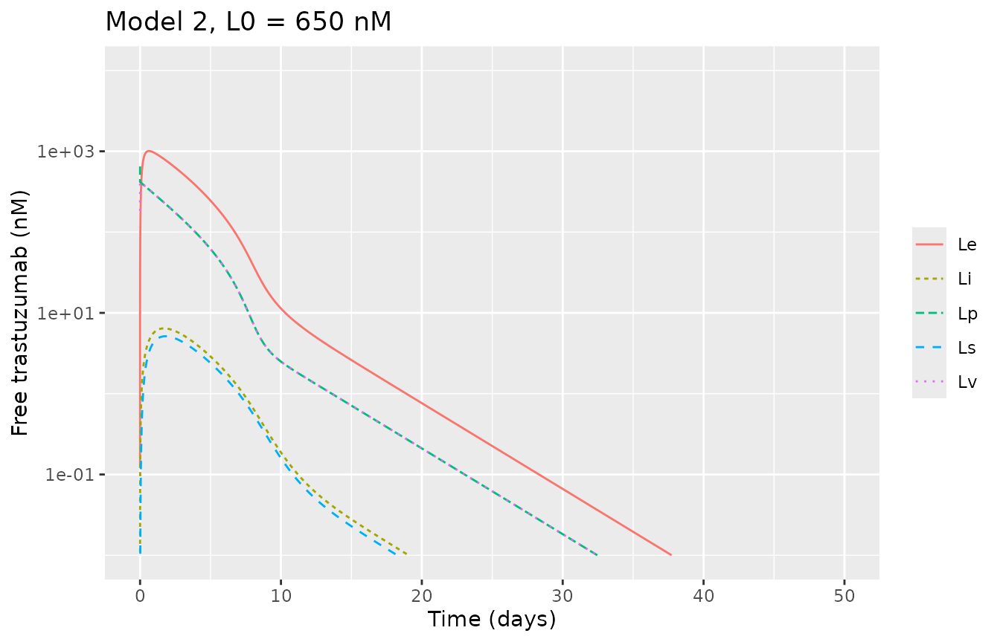
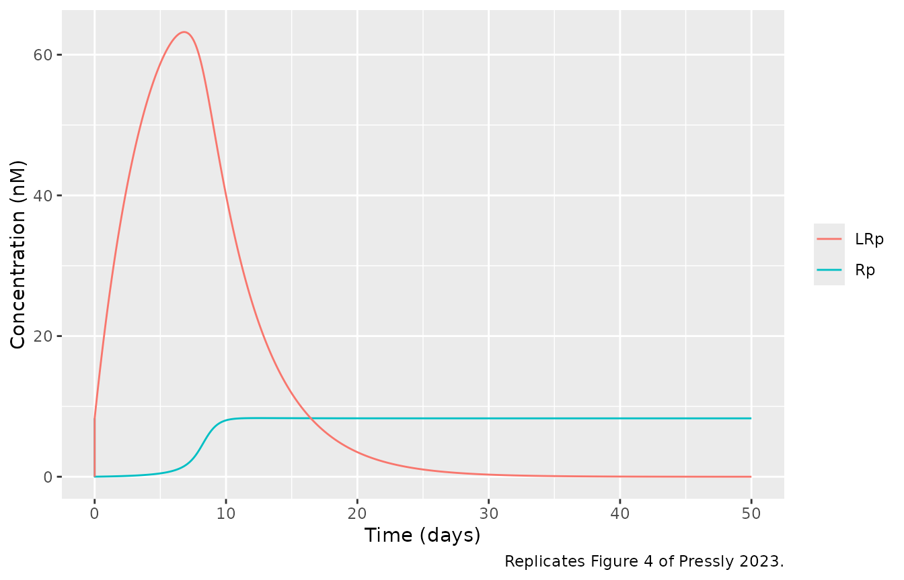
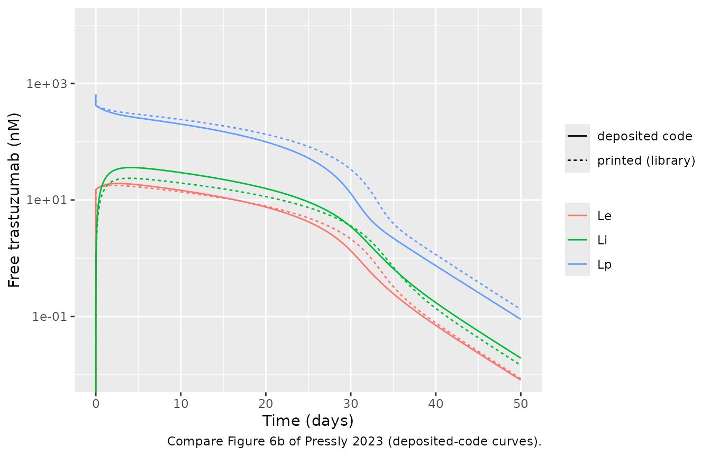
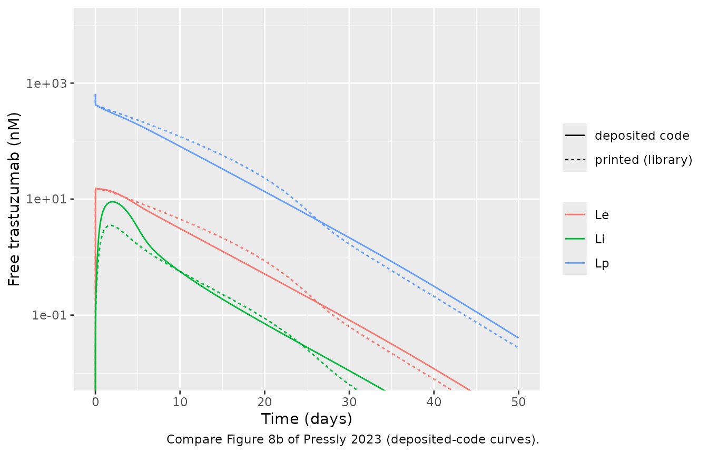
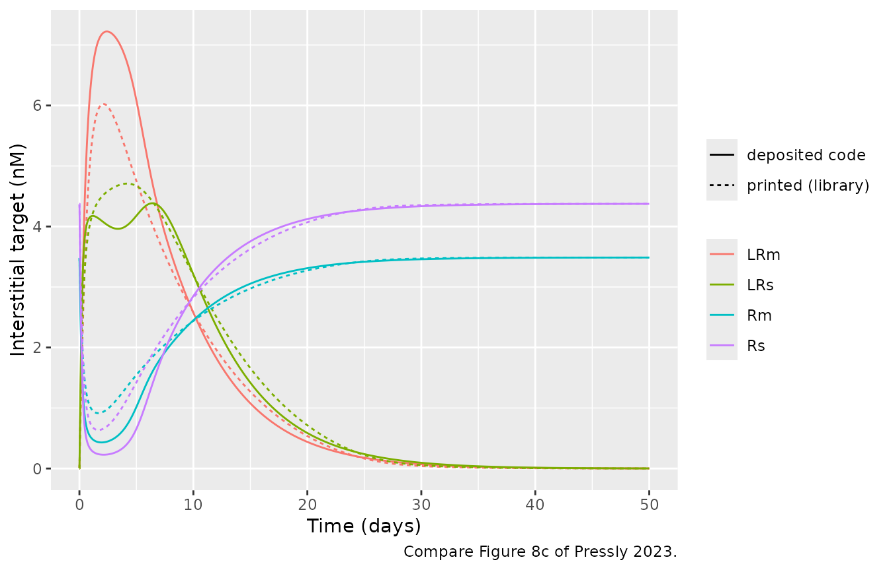
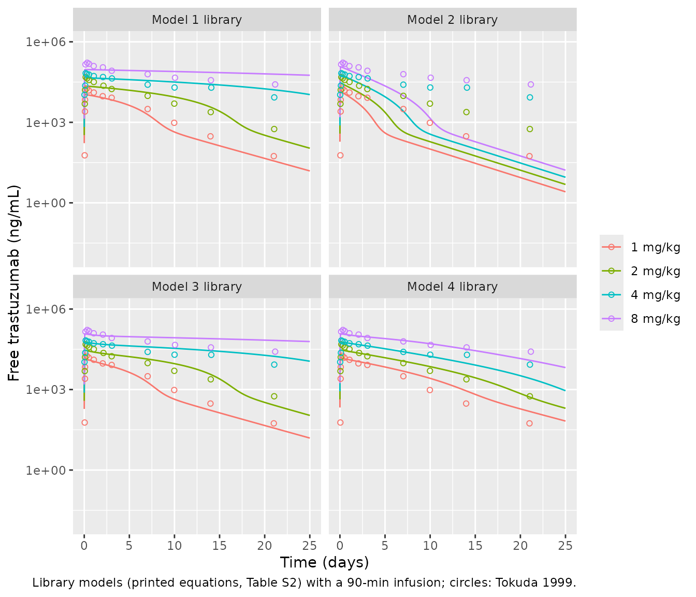
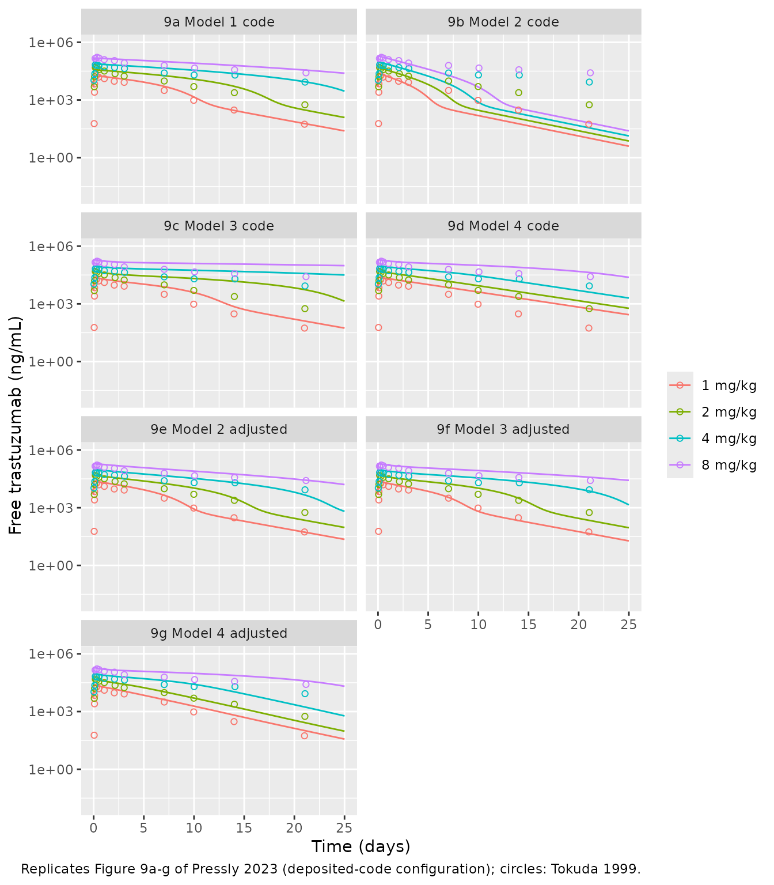

# Trastuzumab TMDD to minimal-PBPK model hierarchy (Pressly 2023)

## Model and source

- Article: Pressly MA, Peletier LA, Zheng S, Sharma VD, Lien YTK, Wang
  W, Zhou H, Schmidt S. The quest for balance between capturing data and
  model complexity: A quantitative clinical pharmacology approach
  applied to monoclonal antibodies. *CPT Pharmacometrics Syst
  Pharmacol.* 2023;12(5):639-652. <https://doi.org/10.1002/psp4.12927>
  (PMC10196441, open access).
- Supplementary Material S1-S5 (model assumptions, the parameter table
  S2, flow-rate analysis, the FcRn derivation and a sensitivity
  analysis) and Data S1, the authors’ MATLAB code for every simulation
  in the paper.

Pressly 2023 is a tutorial. It builds four nested target-mediated drug
disposition (TMDD) models for a monoclonal antibody, from the basic
Mager and Jusko model to the minimal PBPK-TMDD model with target
shedding of Li et al. (2014), and applies all four to trastuzumab with
one shared parameter set (Supplementary Table S2, taken mostly from Li
et al. 2014). Nothing is estimated. The simulations are compared with
mean trastuzumab concentrations from the phase-I dose-escalation study
of Tokuda et al. (1999).

| Paper model | Structure | In this library |
|----|----|----|
| 1 | Basic two-compartment TMDD (Eqs 1-6) | `Pressly_2023_trastuzumab_tmdd` |
| 2 | Model 1 with tissue resolved into vascular, endothelial, interstitial and lymph spaces (Eqs 7-12) | `Pressly_2023_trastuzumab_mpbpk` |
| 3 | Model 2 with quasi-steady-state FcRn recycling in the endothelium (Eqs 16-22) | `Pressly_2023_trastuzumab_mpbpk_fcrn` |
| 4 | Model 3 with the target moved to the interstitium as membrane-bound and shed HER2 (Eqs 23-36) | `Pressly_2023_trastuzumab_mpbpk_shedding` |

``` r

mods <- c(
  "Pressly_2023_trastuzumab_tmdd", "Pressly_2023_trastuzumab_mpbpk",
  "Pressly_2023_trastuzumab_mpbpk_fcrn", "Pressly_2023_trastuzumab_mpbpk_shedding"
)
m1 <- rxode2::rxode2(readModelDb(mods[1]))
m2 <- rxode2::rxode2(readModelDb(mods[2]))
m3 <- rxode2::rxode2(readModelDb(mods[3]))
m4 <- rxode2::rxode2(readModelDb(mods[4]))

tibble::tibble(
  Model = mods,
  `Paper model` = 1:4,
  `ODE states` = c(length(m1$state), length(m2$state), length(m3$state), length(m4$state)),
  Parameters = c(nrow(m1$iniDf), nrow(m2$iniDf), nrow(m3$iniDf), nrow(m4$iniDf))
) |>
  knitr::kable()
```

| Model                                   | Paper model | ODE states | Parameters |
|:----------------------------------------|------------:|-----------:|-----------:|
| Pressly_2023_trastuzumab_tmdd           |           1 |          4 |         11 |
| Pressly_2023_trastuzumab_mpbpk          |           2 |          7 |         20 |
| Pressly_2023_trastuzumab_mpbpk_fcrn     |           3 |          7 |         25 |
| Pressly_2023_trastuzumab_mpbpk_shedding |           4 |         11 |         32 |

``` r

stopifnot(
  identical(c(length(m1$state), length(m2$state), length(m3$state), length(m4$state)), c(4L, 7L, 7L, 11L))
)
```

## Population

There is no fitted population. The parameter set describes a typical 70
kg adult; the authors use the 70 kg weight only to convert the mg/kg
doses. The comparison data are the mean concentrations of Tokuda et
al. (1999), 18 Japanese patients with HER2-overexpressing metastatic
breast cancer who received single 90-min i.v. infusions of 1, 2, 4 or 8
mg/kg. The authors digitised those data and ship them in Data S1; they
are reproduced below. The source has no inter-individual variability and
no residual error, so every `ini()` value is `fixed()` and `propSd` is
`fixed(0)`.

``` r

pop <- readModelDb(mods[4])() |>
  environment() |>
  (\(e) e$population)()
tibble::tibble(Field = names(pop), Value = vapply(pop, \(x) paste(as.character(x), collapse = " "), "")) |>
  knitr::kable()
```

| Value |
|-------|

## Units and the dose conversion

Time is hours. The paper writes every equation in concentrations (nM).
In the model files the antibody states hold amounts (nmol) so that a
dose is an amount into `central`; each antibody equation is the printed
one multiplied through by its volume. Target and complex states keep the
printed concentrations (nM). `Cc` is the free plasma antibody
concentration in ug/mL (`Lp * MW / 1e6`), and the free concentration in
every space is also returned in nM (`lig_p`, `lig_v`, `lig_e`, `lig_i`,
`lig_s`).

Supplementary Material S2 converts a mg/kg dose with a 70 kg body
weight, the molecular weight 145,532 Da and the 3 L plasma volume, so
`L0 = 650` nM (the bolus of Figures 4, 6 and 8) is an amount of 1950
nmol.

``` r

MW <- 145532 # Table S2 'MW'
VP <- 3 # Table S2 plasma volume (L)
mgkg_to_nmol <- function(mgkg, wt = 70) mgkg * wt / MW * 1e6
dose_bolus <- 650 * VP # nmol; L0 = 650 nM in Figures 4, 6, 8

tibble::tibble(
  Dose = c("650 nM bolus", "1 mg/kg", "2 mg/kg", "4 mg/kg", "8 mg/kg"),
  `Amount (nmol)` = c(dose_bolus, mgkg_to_nmol(c(1, 2, 4, 8))),
  `Initial plasma concentration (nM)` = c(dose_bolus, mgkg_to_nmol(c(1, 2, 4, 8))) / VP
) |>
  knitr::kable(digits = 1)
```

| Dose         | Amount (nmol) | Initial plasma concentration (nM) |
|:-------------|--------------:|----------------------------------:|
| 650 nM bolus |          1950 |                             650.0 |
| 1 mg/kg      |           481 |                             160.3 |
| 2 mg/kg      |           962 |                             320.7 |
| 4 mg/kg      |          1924 |                             641.3 |
| 8 mg/kg      |          3848 |                            1282.7 |

``` r

# Data S1 'D01 = 160.3314' nM for 1 mg/kg (MW 145531.86 in the code)
stopifnot(abs(mgkg_to_nmol(1) / VP - 160.3314) < 0.01)
```

## Source trace

Every `ini()` value carries an in-file comment naming its source. The
two tables below collect them.

| Equation | Paper location | Model file |
|----|----|----|
| Free plasma antibody, Model 1 | Eq 1 (`kpt Vp = ktp Vt = Cldist`) | `d/dt(central)`, `_tmdd` |
| Tissue antibody, Model 1 | Eq 2 | `d/dt(peripheral1)`, `_tmdd` |
| Free plasma target, plasma complex | Eqs 3-4, 7 | `d/dt(target)`, `d/dt(complex)`, `_tmdd` to `_mpbpk_fcrn` |
| Baseline target `R0 = ksyn/kdeg` | Eqs 5, 6, 12, 22 | `target(0)` |
| Plasma antibody, Models 2-4 | Eqs 7, 16, 23 (equation images) | `d/dt(central)` |
| Vascular space | Eqs 8, 17, 24 | `d/dt(tissue_vasc)` |
| Endothelium | Eqs 9, 19, 25 | `d/dt(endosome)` |
| Interstitial space | Eqs 10, 20, 28 | `d/dt(tissue_isf)` |
| Lymph | Eqs 11, 21, 36 | `d/dt(lymph)` |
| FcRn-bound fraction `1 - fu` (QSS quadratic) | Eq 18; Supplementary Material S4 | `lig_e_bound` |
| Shed target in plasma, its complex | Eq 23 | `d/dt(target)`, `d/dt(complex)`, `_mpbpk_shedding` |
| Shed and membrane target in the interstitium, their complexes | Eq 28 | `d/dt(target_isf)` … `d/dt(complex_mem_isf)` |
| Antibody-free baselines of the three targets | Eqs 29-30 | `target_mem_isf(0)`, `target_isf(0)`, `target(0)` |

| Parameter | Value | Models | Source |
|----|----|----|----|
| `mw` | 145,532 g/mol | 1-4 | Table S2 ‘MW’ |
| `lkon`, `lkoff` | 2.52 1/(nM h), 1.26 1/h | 1-4 | Table S2 ‘kon,p’, ‘koff,p’; ‘KD,sh = KD,m = 1.26/2.52’ |
| `lksyn` | 0.83 nM/h | 1-3 | Table S2 ‘ksyn,p’ |
| `lkdeg` | 0.1 1/h | 1-4 | Table S2 ‘kdeg,p’ |
| `lkint` | 0.01 1/h | 1-4 | Table S2 ‘kint,p’ |
| `kel` | 0 1/h | 1-4 | Table S2 ‘kel,p’ |
| `lvc` | 3 L | 1-4 | Table S2 ‘Vc’, ‘Vp’ |
| `lvp` | 3 L | 1 | Table S2 ‘Vp’ (tissue volume; `ktp = Q/Vp`) |
| `lq` | 300 L/h | 1 | Table S2 ‘kpt = Q/Vc’, ‘ktp = Q/Vp’, ‘Q’ |
| `lv_tissue_vasc`, `lv_endosome`, `lv_tissue_isf`, `lv_lymph` | 1.61, 0.08, 11.2, 0.2702 L | 2-4 | Table S2 ‘Vv’, ‘Ve’, ‘Vi’, ‘Vs’ |
| `lqc`, `lq_lymph` | 300, 0.119 L/h | 2-4 | Table S2 ‘Q’, ‘S’ |
| `sigma_v`, `sigma_i` | 0.9, 0.2 | 2-4 | Table S2 |
| `lkup`, `delta_kup` | 0.0298 1/h, 1 | 2-4 | Table S2 ‘kup’, ‘delta’ |
| `lclint` | 0.01751 L/h | 2-4 | Table S2 ‘CLint’ |
| `lc_fcrn_t` | 40,000 nM | 3-4 | Table S2 ‘FcRn’ |
| `lkon_fcrn`, `lkoff_fcrn` | 1 1/(nM h), 774 1/h | 3-4 | Table S2 ‘kon,F’, ‘koff,F’ |
| `fr`, `lkrec` | 0.715, 16.7 1/h | 3-4 | Table S2 ‘FR’, ‘krc’ (Simcyp V21) |
| `lksyn_mem`, `lkdeg_mem`, `lkint_mem` | 0.83 nM/h, 0.1 1/h, 0.1 1/h | 4 | Table S2 ‘ksyn,m’, ‘kdeg,m’, ‘kint,m’ |
| `lksh`, `lkdeg_shed`, `lkint_shed` | 0.138, 0.1, 0.01 1/h | 4 | Table S2 ‘ksh’, ‘kdeg,sh’, ‘kint,sh’ |
| `llambda_shed`, `alpha_shed` | 0.01 1/h, 0 | 4 | Table S2 ‘lambda’, ‘alpha’ |

## The authors’ simulation code differs from the printed model

The four model files follow the printed equations and Table S2. The
MATLAB code in Data S1, which produced the paper’s figures, departs from
them in several places:

| Item | Printed (model files) | Data S1 code |
|----|----|----|
| Model 1 plasma elimination `kel` | 0 (Table S2) | 0.004 1/h (`tmdd1.m`, `tmdd1_data_impulse.m`) |
| `FR` | 0.715 | 0.5 (every Model 3 and 4 file) |
| `sigma_i` | 0.2 | 0.19 (Figure 9 files for Models 3 and 4) |
| `KD,F = koff,F/kon,F` | 774 nM | 773 nM (Figure 9 files) |
| Model 3 endothelial clearance | `fu * CLint * Le` (Eq 19) | `CLint * Le`, total (`tmdd3*.m`) |
| Model 4 shed-target transfer to plasma | `lambda * Rsh,i * Vi/Vp` (Eqs 23, 30) | `lambda * Rsh,i * Ve/Vp` (every Model 4 file) |
| Model 4 initial plasma shed target | Eq 30 steady state, 1.63 nM | 0 |
| Model 4 `kint,p` | 0.01 1/h | 0.1 1/h in `tmdd4.m` (Figure 8 only) |
| Initial plasma target, Figure 9, Models 1-3 | `ksyn/kdeg` = 8.3 nM | 3.5 nM |
| Figure 9e-g adjustments | kup, krc, lambda as in the caption | the same, plus `ksyn` 0.83 -\> 1 for Figure 9f |
| Infusion | 90-min i.v. infusion (text) | `D/tinf * p(t)`, `tinf = 0.0625` with a Hill switch-off at 0.1 h: 1.62 x the dose in about 6 min |

The library ships the printed model. The code configuration is rebuilt
below, by `ini()` and `model()` overrides, wherever a figure is
compared.

``` r

# Deposited-code configurations (Data S1). Model 2's code equals the printed model.
code_m1 <- m1 |> rxode2::ini(kel = 0.004)
code_m3 <- m3 |>
  rxode2::ini(fr = 0.5, lkoff_fcrn = log(773), sigma_i = 0.19) |>
  rxode2::model(
    d/dt(endosome) <- kup * tissue_vasc + delta_kup * kup * tissue_isf - clint * lig_e -
      krec * lig_e_bound * v_endosome
  )
code_m4 <- m4 |>
  rxode2::ini(fr = 0.5, lkoff_fcrn = log(773), sigma_i = 0.19) |>
  rxode2::model(
    d/dt(target) <- lambda_shed * target_isf * v_endosome / vc - kdeg * target -
      kon * lig_p * target + koff * complex
  ) |>
  rxode2::model(target(0) <- 0)

# The Figure 9 files also start the plasma target of Models 1-3 at 3.5 nM.
fig9_m1 <- code_m1 |> rxode2::model(target(0) <- 3.5)
fig9_m2 <- m2 |> rxode2::model(target(0) <- 3.5)
fig9_m3 <- code_m3 |> rxode2::model(target(0) <- 3.5)

# Figure 9e-g adjustments (caption values; tmdd*_data_impulse_opt.m).
fig9_m2_adj <- fig9_m2 |> rxode2::ini(lkup = log(0.00536))
fig9_m3_adj <- fig9_m3 |> rxode2::ini(lkrec = log(1.7), lksyn = log(1))
fig9_m4_adj <- code_m4 |> rxode2::ini(lkrec = log(3.13), llambda_shed = log(0.5), lkup = log(0.0298 * 1.7))

tight <- list(rtol = 1e-8, atol = 1e-10, maxsteps = 1e6, returnType = "data.frame")
solve_tight <- function(mod, ev) do.call(rxode2::rxSolve, c(list(mod, ev), tight))
```

## Didactic simulations: 650 nM bolus (Figures 4, 6 and 8)

``` r

tgrid <- sort(unique(c(seq(0, 0.2, by = 0.002), seq(0.2, 2, by = 0.02), seq(2, 1200, by = 0.5))))
ev_bolus <- dplyr::bind_rows(
  data.frame(time = 0, amt = dose_bolus, evid = 1L, cmt = "central"),
  data.frame(time = tgrid, amt = 0, evid = 0L, cmt = "central")
)
s1 <- solve_tight(m1, ev_bolus)
s2 <- solve_tight(m2, ev_bolus)
s3 <- solve_tight(m3, ev_bolus)
s4 <- solve_tight(m4, ev_bolus)
s3_code <- solve_tight(code_m3 |> rxode2::ini(lkoff_fcrn = log(774), sigma_i = 0.2), ev_bolus) # tmdd3.m
#> ℹ change initial estimate of `lkoff_fcrn` to `6.65157187358973`
#> ℹ change initial estimate of `sigma_i` to `0.2`
s4_code <- solve_tight(code_m4 |> rxode2::ini(lkint = log(0.1), lkoff_fcrn = log(774), sigma_i = 0.2), ev_bolus) # tmdd4.m
#> ℹ change initial estimate of `lkint` to `-2.30258509299405`
#> ℹ change initial estimate of `lkoff_fcrn` to `6.65157187358973`
#> ℹ change initial estimate of `sigma_i` to `0.2`
```

``` r

ligand_long <- function(s, label) {
  s |>
    dplyr::select(time, Lp = lig_p, Lv = lig_v, Le = lig_e, Li = lig_i, Ls = lig_s) |>
    tidyr::pivot_longer(-time, names_to = "space", values_to = "conc") |>
    dplyr::mutate(model = label, day = time / 24)
}
plot_ligand <- function(d, title) {
  ggplot(dplyr::filter(d, conc > 1e-2), aes(day, conc, colour = space, linetype = space)) +
    geom_line() +
    scale_y_log10() +
    coord_cartesian(xlim = c(0, 50), ylim = c(1e-2, 1e4)) +
    labs(x = "Time (days)", y = "Free trastuzumab (nM)", colour = NULL, linetype = NULL, title = title)
}
```

### Model 2 (Figure 4)

The printed Model 2 and the authors’ `tmdd2.m` are the same, so this
replicates Figure 4 directly. The text gives four checkpoints: plasma
and vascular concentrations merge within minutes at
`L = Vp/(Vp + Vv) L0 = 423` nM; the endothelial concentration climbs to
about twice that; the plasma profile falls steeply at about 7.5 days;
and while the target stays saturated the complex climbs toward
`R* = ksyn/kint = 83` nM (Eq 15).

``` r

plot_ligand(ligand_long(s2, "Model 2"), "Model 2, L0 = 650 nM")
```



``` r

ggplot(s2, aes(time / 24)) +
  geom_line(aes(y = target, colour = "Rp")) +
  geom_line(aes(y = complex, colour = "LRp")) +
  coord_cartesian(xlim = c(0, 50)) +
  labs(x = "Time (days)", y = "Concentration (nM)", colour = NULL,
       caption = "Replicates Figure 4 of Pressly 2023.")
```



``` r


lbar <- VP / (VP + 1.61) * 650
lp_mixed <- s2$lig_p[s2$time == 0.1]
le_peak <- max(s2$lig_e)
lrp_peak_day <- s2$time[which.max(s2$complex)] / 24
c(L_bar = lbar, Lp_6min = lp_mixed, Le_peak = le_peak, LRp_peak = max(s2$complex), LRp_peak_day = lrp_peak_day)
#>        L_bar      Lp_6min      Le_peak     LRp_peak LRp_peak_day 
#>     422.9935     416.9825    1007.6577      63.2222       6.8125
stopifnot(
  abs(lbar - 423) < 0.5, # Supplementary Material S3: L = 0.651 x 650 = 423 nM
  # Lp after mixing sits below L by the drug bound to the 8.3 nM target.
  abs(lp_mixed / lbar - 1) < 0.02,
  le_peak / lbar > 2 && le_peak / lbar < 2.6, # 'about twice'; Figure 4a peak ~1000 nM
  max(s2$complex) < 0.83 / 0.01, # bounded by R* = 83 nM (Eq 15)
  abs(max(s2$complex) - 63) < 3, # Figure 4c peak ~63 nM
  abs(lrp_peak_day - 7) < 1 # 'peaking around day 7 in model 2'
)
```

### Model 3 (Figure 6)

Figure 6 was drawn by `tmdd3.m`, which recycles with `FR = 0.5` and
clears total rather than FcRn-unbound endothelial antibody. Both are
shown. In both, FcRn protection holds the complex near its `R*` plateau
for weeks instead of the single day-7 peak of Model 2, as the text
describes.

``` r

dplyr::bind_rows(ligand_long(s3, "printed (library)"), ligand_long(s3_code, "deposited code")) |>
  dplyr::filter(space %in% c("Lp", "Le", "Li")) |>
  ggplot(aes(day, conc, colour = space, linetype = model)) +
  geom_line() +
  scale_y_log10() +
  coord_cartesian(xlim = c(0, 50), ylim = c(1e-2, 1e4)) +
  labs(x = "Time (days)", y = "Free trastuzumab (nM)", colour = NULL, linetype = NULL,
       caption = "Compare Figure 6b of Pressly 2023 (deposited-code curves).")
#> Warning in scale_y_log10(): log-10 transformation introduced infinite values.
```



``` r


landmarks <- function(s, label) {
  tibble::tibble(
    Configuration = label,
    `Lp day 10 (nM)` = s$lig_p[s$time == 240],
    `Lp day 30 (nM)` = s$lig_p[s$time == 720],
    `LRp max (nM)` = max(s$complex),
    `Day Lp < 1 nM` = s$time[which(s$lig_p < 1)[1]] / 24
  )
}
lm3 <- dplyr::bind_rows(landmarks(s2, "Model 2"), landmarks(s3, "Model 3 printed"), landmarks(s3_code, "Model 3 code"))
knitr::kable(lm3, digits = 2)
```

| Configuration   | Lp day 10 (nM) | Lp day 30 (nM) | LRp max (nM) | Day Lp \< 1 nM |
|:----------------|---------------:|---------------:|-------------:|---------------:|
| Model 2         |           2.50 |           0.02 |        63.22 |          13.62 |
| Model 3 printed |         240.54 |          33.47 |        80.00 |          40.67 |
| Model 3 code    |         200.58 |          12.90 |        79.39 |          38.65 |

``` r

stopifnot(
  all(lm3$`LRp max (nM)`[2:3] > 79 & lm3$`LRp max (nM)`[2:3] < 83), # Figure 6c plateau ~80 nM
  all(lm3$`Day Lp < 1 nM`[2:3] > 2 * lm3$`Day Lp < 1 nM`[1]) # FcRn prolongs the TMDD phase
)
```

### Model 4 (Figure 8)

Supplementary Material S5.3 gives the antibody-free steady state of the
interstitial targets as `Rm,ss = 3.49` and `Rs,ss = 4.37` nM (Eq 29);
the model starts there. It prints `Rp,ss = 0.093` nM for the plasma shed
target, which neither the printed Eq 30 (1.63 nM) nor the code (0)
gives; it matches the authors’ `tmddPBPK4aaa.m` formula
`lambda/kdeg * Rm * Vp/Vi`. Figure 8 was drawn by `tmdd4.m` (`Ve/Vp`
transfer, plasma shed target starting at 0, `kint,p = 0.1`), which
leaves almost no free target in plasma.

``` r

dplyr::bind_rows(ligand_long(s4, "printed (library)"), ligand_long(s4_code, "deposited code")) |>
  dplyr::filter(space %in% c("Lp", "Le", "Li")) |>
  ggplot(aes(day, conc, colour = space, linetype = model)) +
  geom_line() +
  scale_y_log10() +
  coord_cartesian(xlim = c(0, 50), ylim = c(1e-2, 1e4)) +
  labs(x = "Time (days)", y = "Free trastuzumab (nM)", colour = NULL, linetype = NULL,
       caption = "Compare Figure 8b of Pressly 2023 (deposited-code curves).")
#> Warning in scale_y_log10(): log-10 transformation introduced infinite values.
```



``` r


dplyr::bind_rows(
  s4 |> dplyr::mutate(model = "printed (library)"),
  s4_code |> dplyr::mutate(model = "deposited code")
) |>
  dplyr::select(time, model, Rs = target_isf, LRs = complex_isf, Rm = target_mem_isf, LRm = complex_mem_isf) |>
  tidyr::pivot_longer(c(Rs, LRs, Rm, LRm), names_to = "species", values_to = "conc") |>
  ggplot(aes(time / 24, conc, colour = species, linetype = model)) +
  geom_line() +
  coord_cartesian(xlim = c(0, 50)) +
  labs(x = "Time (days)", y = "Interstitial target (nM)", colour = NULL, linetype = NULL,
       caption = "Compare Figure 8c of Pressly 2023.")
```



``` r


c(Rm0 = s4$target_mem_isf[1], Rs0 = s4$target_isf[1], Rp0 = s4$target[1],
  LRm_peak = max(s4$complex_mem_isf), LRm_peak_code = max(s4_code$complex_mem_isf))
#>           Rm0           Rs0           Rp0      LRm_peak LRm_peak_code 
#>      3.487395      4.375095      1.633369      6.025472      7.222965
stopifnot(
  abs(s4$target_mem_isf[1] - 3.49) < 0.005, # S5.3 Rm,ss = 3.49 nM
  abs(s4$target_isf[1] - 4.37) < 0.01, # S5.3 Rs,ss = 4.37 nM
  abs(s4$target[1] - 0.01 / 0.1 * s4$target_isf[1] * 11.2 / 3) < 1e-6, # Eq 30
  abs(max(s4_code$complex_mem_isf) - 7.2) < 0.4 # Figure 8c LRm peak ~7.2 nM
)
```

### Antibody mass balance

Each model loses antibody only through the printed elimination terms:
complex internalisation in plasma (`kint`), endothelial clearance
(`CLint`, Models 2-4), and in Model 4 internalisation of the two
interstitial complexes. The antibody left in the states plus the
integrated elimination must equal the dose.

``` r

cum_trapz <- function(t, f) c(0, cumsum(diff(t) * (head(f, -1) + tail(f, -1)) / 2))
closure <- function(s, drug, flux) max(abs((drug + cum_trapz(s$time, flux)) / dose_bolus - 1))
mb <- c(
  `Model 1` = closure(s1, with(s1, central + peripheral1 + 3 * complex), with(s1, 0.01 * 3 * complex)),
  `Model 2` = closure(
    s2, with(s2, central + tissue_vasc + endosome + tissue_isf + lymph + 3 * complex),
    with(s2, 0.01 * 3 * complex + 0.01751 * lig_e)
  ),
  `Model 3` = closure(
    s3, with(s3, central + tissue_vasc + endosome + tissue_isf + lymph + 3 * complex),
    with(s3, 0.01 * 3 * complex + 0.01751 * lig_e_free)
  ),
  `Model 4` = closure(
    s4, with(s4, central + tissue_vasc + endosome + tissue_isf + lymph + 3 * complex +
      11.2 * (complex_isf + complex_mem_isf)),
    with(s4, 0.01 * 3 * complex + 0.01751 * lig_e_free + 11.2 * (0.01 * complex_isf + 0.1 * complex_mem_isf))
  )
)
mb
#>      Model 1      Model 2      Model 3      Model 4 
#> 4.180703e-07 3.168164e-05 3.670304e-07 5.025482e-06
stopifnot(all(mb < 1e-3))
```

## Trastuzumab case study (Figure 9)

### Data

``` r

# Tokuda 1999 mean concentrations as digitised by the authors (Data S1,
# tmdd*_data_impulse.m). The code labels them ng/L; the values are ng/mL
# (the 8 mg/kg peak of 165,691 is 166 ug/mL).
tokuda <- dplyr::bind_rows(
  tibble::tibble(
    mgkg = 1, day = c(0.05, 0.08, 0.09, 0.27, 0.50, 1.06, 2.05, 3.04, 7.03, 9.97, 13.99, 21.01),
    ngmL = c(59, 2532, 6882, 18146, 15438, 12872, 9412, 8254, 3131, 960, 301, 55)
  ),
  tibble::tibble(
    mgkg = 2, day = c(0.06, 0.09, 0.16, 0.31, 0.52, 1.06, 2.13, 3.04, 7.03, 9.98, 14.02, 21.05),
    ngmL = c(4882, 16075, 48329, 43687, 37927, 31944, 23123, 17427, 9702, 4982, 2408, 562)
  ),
  tibble::tibble(
    mgkg = 4, day = c(0.03, 0.11, 0.16, 0.30, 0.52, 1.06, 2.08, 3.07, 7.03, 10.01, 14.08, 21.06),
    ngmL = c(10625, 23357, 67445, 62841, 60353, 52928, 48820, 43248, 25323, 19872, 19673, 8508)
  ),
  tibble::tibble(
    mgkg = 8, day = c(0.14, 0.33, 0.53, 1.05, 2.07, 3.05, 7.03, 10.06, 14.04, 21.16),
    ngmL = c(143845, 165691, 151295, 124880, 111750, 83378, 62210, 45949, 37169, 25839)
  )
) |>
  dplyr::mutate(treatment = paste(mgkg, "mg/kg"), Cc = ngmL / 1000)
```

### Dosing

The text describes a 90-min infusion, which is how the library models
are dosed here. The Figure 9 code instead adds `D/tinf * p(t)` to the
plasma equation with `tinf = 0.0625` and
`p(t) = 1 - t^12/(0.1^12 + t^12)` (t in hours): a near-rectangular input
that switches off at 0.1 h and delivers `integral(p)/tinf` = 1.62 times
the dose. The code configuration reproduces that input as a zero-order
infusion of the same rate and total amount.

``` r

p_int <- integrate(function(t) 1 - t^12 / (0.1^12 + t^12), 0, Inf)$value
code_factor <- p_int / 0.0625
code_factor
#> [1] 1.618424
stopifnot(abs(code_factor - 1.6184) < 1e-3)

obs_h <- sort(unique(c(seq(0, 2, by = 0.02), seq(2, 50 * 24, by = 1), tokuda$day * 24)))
make_dose_group <- function(i, mgkg, amt, dur) {
  dplyr::bind_rows(
    data.frame(id = i, time = 0, amt = amt, dur = dur, evid = 1L, cmt = "central"),
    data.frame(id = i, time = obs_h, amt = 0, dur = 0, evid = 0L, cmt = "central")
  ) |>
    dplyr::mutate(mgkg = mgkg, treatment = paste(mgkg, "mg/kg"))
}
doses <- c(1, 2, 4, 8)
ev_paper <- dplyr::bind_rows(lapply(seq_along(doses), function(i) {
  make_dose_group(i, doses[i], mgkg_to_nmol(doses[i]), 1.5)
}))
ev_code <- dplyr::bind_rows(lapply(seq_along(doses), function(i) {
  make_dose_group(i, doses[i], mgkg_to_nmol(doses[i]) * code_factor, 0.0625 * code_factor)
}))
stopifnot(!anyDuplicated(ev_paper[ev_paper$evid == 0, c("id", "time")]))
```

### Simulations

``` r

# warning = FALSE: rxode2 warns that a multi-subject solve has no omega; these
# models have no between-subject variability by design.
fig9_solve <- function(mod, ev, label) {
  do.call(rxode2::rxSolve, c(list(mod, ev, keep = c("treatment", "mgkg")), tight)) |>
    dplyr::mutate(config = label)
}
sim9 <- dplyr::bind_rows(
  fig9_solve(m1, ev_paper, "Model 1 library"),
  fig9_solve(m2, ev_paper, "Model 2 library"),
  fig9_solve(m3, ev_paper, "Model 3 library"),
  fig9_solve(m4, ev_paper, "Model 4 library"),
  fig9_solve(fig9_m1, ev_code, "9a Model 1 code"),
  fig9_solve(fig9_m2, ev_code, "9b Model 2 code"),
  fig9_solve(fig9_m3, ev_code, "9c Model 3 code"),
  fig9_solve(code_m4, ev_code, "9d Model 4 code"),
  fig9_solve(fig9_m2_adj, ev_code, "9e Model 2 adjusted"),
  fig9_solve(fig9_m3_adj, ev_code, "9f Model 3 adjusted"),
  fig9_solve(fig9_m4_adj, ev_code, "9g Model 4 adjusted")
)
stopifnot(!anyNA(sim9$Cc), all(sim9$Cc >= -1e-6 * max(sim9$Cc)))
```

``` r

ggplot(dplyr::filter(sim9, grepl("library", config), time > 0, time <= 25 * 24),
       aes(time / 24, Cc * 1000, colour = treatment)) +
  geom_line() +
  geom_point(data = tokuda, aes(day, ngmL), shape = 1) +
  facet_wrap(~config) +
  scale_y_log10(limits = c(1e-2, 1e6)) +
  labs(x = "Time (days)", y = "Free trastuzumab (ng/mL)", colour = NULL,
       caption = "Library models (printed equations, Table S2) with a 90-min infusion; circles: Tokuda 1999.")
```



``` r

ggplot(dplyr::filter(sim9, !grepl("library", config), time > 0, time <= 25 * 24),
       aes(time / 24, Cc * 1000, colour = treatment)) +
  geom_line() +
  geom_point(data = tokuda, aes(day, ngmL), shape = 1) +
  facet_wrap(~config, ncol = 2) +
  scale_y_log10(limits = c(1e-2, 1e6)) +
  labs(x = "Time (days)", y = "Free trastuzumab (ng/mL)", colour = NULL,
       caption = "Replicates Figure 9a-g of Pressly 2023 (deposited-code configuration); circles: Tokuda 1999.")
```



### Fit to the Tokuda data

The paper’s conclusions on Figure 9 are qualitative: Model 1 “captures
the clinical data very well”, Models 2-4 do worse with the shared
parameters, and each adjustment improves the fit. The table scores each
configuration by the root-mean-square log error against the Tokuda means
after the infusion (day \> 0.2), and the day-21 prediction per dose.

``` r

pred_at <- sim9 |>
  dplyr::select(config, treatment, time, Cc) |>
  dplyr::inner_join(tokuda |> dplyr::mutate(time = day * 24) |> dplyr::select(treatment, time, day, obs = Cc),
                    by = c("treatment", "time"))
stopifnot(nrow(pred_at) == nrow(tokuda) * length(unique(sim9$config)))
score <- pred_at |>
  dplyr::filter(day > 0.2) |>
  dplyr::group_by(config) |>
  dplyr::summarise(rms_log = sqrt(mean(log(Cc / obs)^2)), .groups = "drop")
day21 <- sim9 |>
  dplyr::filter(time == 21 * 24) |>
  dplyr::select(config, treatment, Cc) |>
  dplyr::mutate(Cc = signif(Cc * 1000, 3)) |>
  tidyr::pivot_wider(names_from = treatment, values_from = Cc)
score_tab <- dplyr::left_join(score, day21, by = "config")
score_tab |>
  dplyr::rename(Configuration = config, `RMS log error` = rms_log) |>
  knitr::kable(digits = 2, caption = "Day-21 columns: free trastuzumab (ng/mL). Tokuda day 21: 55 / 562 / 8508 / 25839 ng/mL.")
```

| Configuration       | RMS log error | 1 mg/kg | 2 mg/kg | 4 mg/kg |  8 mg/kg |
|:--------------------|--------------:|--------:|--------:|--------:|---------:|
| 9a Model 1 code     |          0.39 |   59.60 |   304.0 |  8910.0 |  36100.0 |
| 9b Model 2 code     |          2.20 |   10.50 |    19.6 |    36.0 |     65.7 |
| 9c Model 3 code     |          0.89 |  128.00 |  5510.0 | 37900.0 | 104000.0 |
| 9d Model 4 code     |          0.73 |  564.00 |  1210.0 |  4110.0 |  43000.0 |
| 9e Model 2 adjusted |          0.44 |   53.90 |   224.0 |  4640.0 |  27500.0 |
| 9f Model 3 adjusted |          0.41 |   45.50 |   222.0 |  7390.0 |  38700.0 |
| 9g Model 4 adjusted |          0.50 |  103.00 |   269.0 |  1750.0 |  40000.0 |
| Model 1 library     |          0.46 |   36.50 |   262.0 | 16300.0 |  62500.0 |
| Model 2 library     |          2.57 |    6.85 |    12.9 |    23.9 |     43.7 |
| Model 3 library     |          0.43 |   36.80 |   263.0 | 17400.0 |  67800.0 |
| Model 4 library     |          0.44 |  154.00 |   529.0 |  2630.0 |  12400.0 |

Day-21 columns: free trastuzumab (ng/mL). Tokuda day 21: 55 / 562 / 8508
/ 25839 ng/mL. {.table}

``` r


rms <- setNames(score$rms_log, score$config)
d21_8 <- setNames(day21$`8 mg/kg`, day21$config)
stopifnot(
  # Figure 9a: the code configuration of Model 1 tracks the data
  # (measured 0.39; the 8 mg/kg day-21 value is 1.4x the observed mean).
  rms[["9a Model 1 code"]] < 0.45,
  d21_8[["9a Model 1 code"]] < 1.5 * 25839,
  # Each Figure 9e-g adjustment improves on its unadjusted panel, as the text
  # says (measured 2.20 -> 0.44, 0.89 -> 0.41, 0.73 -> 0.50).
  rms[["9e Model 2 adjusted"]] < rms[["9b Model 2 code"]] / 3,
  rms[["9f Model 3 adjusted"]] < rms[["9c Model 3 code"]] / 1.5,
  rms[["9g Model 4 adjusted"]] < rms[["9d Model 4 code"]],
  # With the tabulated kel = 0 the library Model 1 has no linear clearance,
  # so at 8 mg/kg, where the target is saturated, it holds the antibody too
  # long (measured 62,500 ng/mL at day 21, 2.4x the observed mean).
  d21_8[["Model 1 library"]] > 2 * 25839,
  # Model 2 with the shared parameters clears far too fast whichever input
  # is used (Figure 9b).
  rms[["Model 2 library"]] > 2,
  rms[["9b Model 2 code"]] > 2
)
```

Two effects separate the library rows from the Figure 9 rows. The first
is the input: the Figure 9 code delivers 1.62 times the stated dose, so
with the dose actually given in the Tokuda study the library Models 3
and 4 sit closer to the data than their Figure 9c and 9d panels (RMS log
error 0.43 and 0.44 against 0.89 and 0.73). The second is the set of
code deviations tabulated above. Model 1 shows both: with `kel = 0` and
the true dose its overall error is similar to Figure 9a, but its 8 mg/kg
profile stays too high once the target is saturated, because nothing but
the target removes the antibody. Model 2 has the same structure in the
library and in the code, so its two rows differ by the input alone.

### PKNCA: clearance against Tokuda 1999

Tokuda et al. report trastuzumab clearance falling from 14.1 mL/kg/day
at 1 mg/kg to 5.6 mL/kg/day at 8 mg/kg, which the paper quotes as the
nonlinearity the models must capture. PKNCA computes `dose/AUC0-inf` on
the free plasma profiles of each library model with the 90-min infusion,
simulated for 50 days.

``` r

nca_conc <- sim9 |>
  dplyr::filter(grepl("library", config), mgkg %in% c(1, 8), !is.na(Cc)) |>
  dplyr::mutate(day = time / 24, Cc = pmax(Cc, 0)) |>
  dplyr::select(config, treatment, id, day, Cc)
stopifnot(all(nca_conc$day[!duplicated(nca_conc[, c("config", "id")])] == 0))
nca_dose <- nca_conc |>
  dplyr::distinct(config, treatment, id) |>
  dplyr::mutate(day = 0, amt = as.numeric(sub(" mg/kg", "", treatment)))

o_conc <- PKNCA::PKNCAconc(nca_conc, Cc ~ day | config + treatment + id)
o_dose <- PKNCA::PKNCAdose(nca_dose, amt ~ day | config + treatment + id, route = "intravascular", duration = 1.5 / 24)
intervals <- data.frame(start = 0, end = Inf, cmax = TRUE, aucinf.obs = TRUE, cl.obs = TRUE)
nca <- PKNCA::pk.nca(PKNCA::PKNCAdata(o_conc, o_dose, intervals = intervals))

# cl.obs is (mg/kg) / (ug*day/mL) = L/day/kg; convert to mL/day/kg.
sim_cl <- as.data.frame(nca) |>
  dplyr::filter(PPTESTCD == "cl.obs") |>
  dplyr::transmute(config, treatment, PPTESTCD, PPORRES = PPORRES * 1000)
stopifnot(nrow(sim_cl) == 8L, !anyNA(sim_cl$PPORRES))
published_cl <- tidyr::expand_grid(
  config = unique(sim_cl$config),
  tibble::tibble(treatment = c("1 mg/kg", "8 mg/kg"), cl.obs = c(14.1, 5.6))
)
cmp <- nlmixr2lib::ncaComparisonTable(
  simulated = sim_cl,
  reference = published_cl,
  by = c("config", "treatment"),
  units = c(cl.obs = "mL/day/kg"),
  tolerance_pct = 20
)
# ncaParamLabel() names cl.obs 'CL/F'; the dose here is intravenous.
cmp |>
  dplyr::mutate(`NCA parameter` = sub("CL/F", "CL", `NCA parameter`, fixed = TRUE)) |>
  knitr::kable(caption = "Free-antibody clearance, library models vs. Tokuda 1999. * differs from the reference by >20%.")
```

| NCA parameter  | config          | treatment | Reference | Simulated | % diff    |
|:---------------|:----------------|:----------|:----------|:----------|:----------|
| CL (mL/day/kg) | Model 1 library | 1 mg/kg   | 14.1      | 20.6      | +45.9%\*  |
| CL (mL/day/kg) | Model 1 library | 8 mg/kg   | 5.6       | 2.52      | -55.0%\*  |
| CL (mL/day/kg) | Model 2 library | 1 mg/kg   | 14.1      | 39        | +176.3%\* |
| CL (mL/day/kg) | Model 2 library | 8 mg/kg   | 5.6       | 23.2      | +314.3%\* |
| CL (mL/day/kg) | Model 3 library | 1 mg/kg   | 14.1      | 18.8      | +33.3%\*  |
| CL (mL/day/kg) | Model 3 library | 8 mg/kg   | 5.6       | 2.32      | -58.6%\*  |
| CL (mL/day/kg) | Model 4 library | 1 mg/kg   | 14.1      | 11.8      | -16.5%    |
| CL (mL/day/kg) | Model 4 library | 8 mg/kg   | 5.6       | 6.77      | +20.9%\*  |

Free-antibody clearance, library models vs. Tokuda 1999. \* differs from
the reference by \>20%. {.table style="width:100%;"}

``` r

cl <- tidyr::pivot_wider(sim_cl, names_from = treatment, values_from = PPORRES)
cl
#> # A tibble: 4 × 4
#>   config          PPTESTCD `1 mg/kg` `8 mg/kg`
#>   <chr>           <chr>        <dbl>     <dbl>
#> 1 Model 1 library cl.obs        20.6      2.52
#> 2 Model 2 library cl.obs        39.0     23.2 
#> 3 Model 3 library cl.obs        18.8      2.32
#> 4 Model 4 library cl.obs        11.8      6.77
# Every model reproduces the direction of the nonlinearity: clearance falls
# with dose because the target saturates.
cl_at <- function(cfg, dose) cl[[dose]][cl$config == cfg]
stopifnot(
  all(cl$`1 mg/kg` > cl$`8 mg/kg`),
  # Measured: Model 2 39.0 / 23.2; Models 1 and 3 2.5 and 2.3 at 8 mg/kg;
  # Model 4 11.8 / 6.8 mL/day/kg (Tokuda: 14.1 / 5.6).
  cl_at("Model 2 library", "1 mg/kg") > 2 * 14.1,
  cl_at("Model 1 library", "8 mg/kg") < 5.6 / 2,
  cl_at("Model 3 library", "8 mg/kg") < 5.6 / 2,
  abs(cl_at("Model 4 library", "1 mg/kg") / 14.1 - 1) < 0.25,
  abs(cl_at("Model 4 library", "8 mg/kg") / 5.6 - 1) < 0.25
)
```

The starred rows are expected: none of the four models was fitted. All
four reproduce the direction of the nonlinearity. Model 2 clears 2-4
times too fast, as Figure 9b shows. Models 1 and 3 overshoot the fall in
clearance, since with `kel = 0` (Model 1) or strong FcRn protection
(Model 3) little but the saturable target removes antibody at 8 mg/kg.
Model 4, whose interstitial target and endothelial clearance both act,
comes closest to both reported values.

## Assumptions and deviations

- **Printed model, not the simulation code.** The model files follow the
  printed equations and Supplementary Table S2. The authors’ MATLAB code
  differs in the places tabulated above. The maintainers ruled that the
  paper’s own parameter table and equations take precedence; the code
  configuration is rebuilt in this article for every figure comparison.
  As a result, the library models do not reproduce the adjusted Figure
  9f and 9g panels; the code configurations do.
- **Model 1 has no linear elimination.** Table S2 lists `kel,p = 0`, and
  the library keeps it, so free antibody leaves Model 1 only through the
  target. Every Model 1 simulation in the paper, including Figure 9a,
  used `kel = 0.004` 1/h; use `ini(kel = 0.004)` to reproduce them.
  Because the tabulated value is zero, `kel` is carried untransformed in
  all four files (a log-scale `lkel` cannot hold 0), and the convention
  checker’s log-transform warning on it is expected.
- **Typographical points in the source.** Eq 20 prints
  `(1 - sigma_v) L * Lv` where the lymph flow `S` is meant (as in Eqs 10
  and 28). Table S2 labels both `Vc` and `Vp` “Volume of plasma
  compartment”; with `kpt = Q/Vc` and `ktp = Q/Vp`, `Vp` there is the
  Model 1 tissue volume. Table S2 gives `FR` the unit 1/h; it is a
  fraction. Supplementary Material S5.3 prints `Rp,ss = 0.093` nM,
  inconsistent with Eq 30 (see the Model 4 section).
- **Shared binding constants.** Table S2 defines `KD,sh = KD,m` as
  `koff,p/kon,p` and the text sets `kon,sh = kon,m`, `koff,sh = koff,m`.
  Model 4 therefore uses one `kon` / `koff` pair for all three binding
  reactions.
- **Free, not total, antibody.** `Cc` is free plasma antibody, which is
  what the authors plot against the Tokuda data. The Tokuda assay
  measured serum trastuzumab, presumably total; with nM target
  concentrations against uM antibody the difference is small at the
  doses studied.
- **Dosing.** Library comparisons use the 90-min infusion stated in the
  text; the code configurations use the code’s 6-min, 1.62-fold input
  (see Dosing). The code’s endothelial initial value of 5.1e-5 nM in
  Model 4, there to avoid a division by zero in the FcRn fraction, is
  not reproduced; the library form of the FcRn quadratic has no
  singularity at zero.
- **No variability or residual error.** `propSd` is `fixed(0)` in all
  four files.
- **Integrator.** The authors used MATLAB `ode15s` / `ode23s`; here the
  models are solved with LSODA at tight tolerances.
