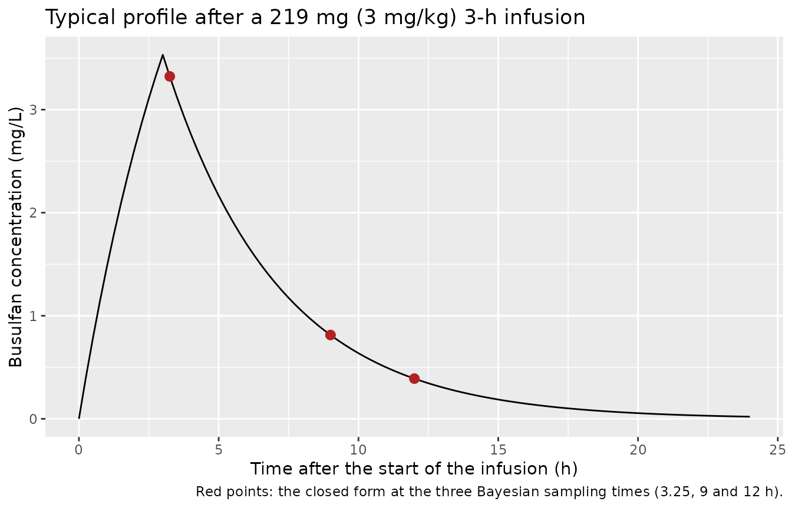
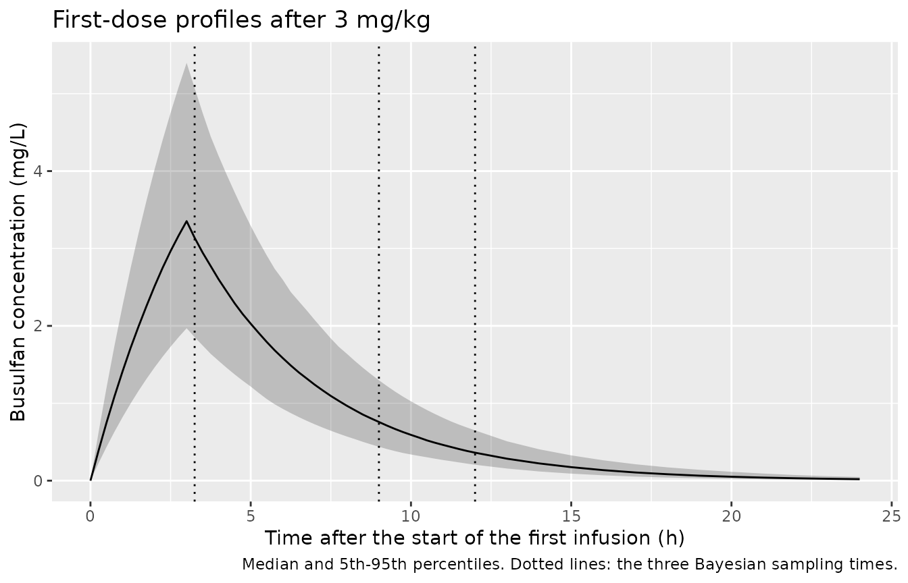
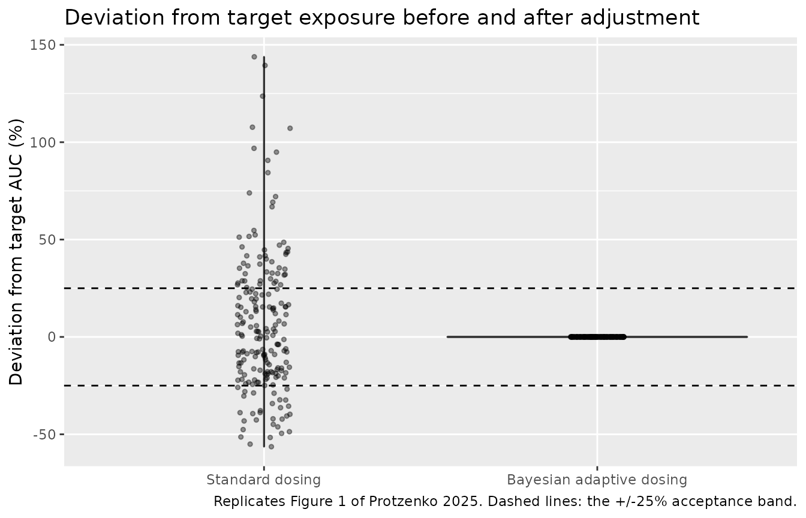

# Busulfan (Protzenko 2025)

## Model and source

- Citation: Protzenko D, Bouchacourt B, Carriat L, Maroselli P, Boeri C,
  Devillier R, Ciccolini J. Adaptive dosing of high-dose busulfan in
  real-world adult patients undergoing haematopoietic cell transplant
  conditioning. Br J Clin Pharmacol. 2025;91(4):1171.
  <doi:10.1111/bcp.16343>
- Description: One-compartment IV-infusion population PK prior for
  high-dose once-daily busulfan in adults undergoing haematopoietic cell
  transplant conditioning, parameterised on the inverse volume of
  distribution (1/V) and the elimination rate constant k with correlated
  additive-normal between-subject variability, from a standard two-stage
  analysis of 16 richly sampled patients and used as the Bayesian prior
  for three-sample adaptive dosing (Protzenko 2025)
- Article: <https://doi.org/10.1111/bcp.16343>

Protzenko 2025 describes a real-world programme of Bayesian adaptive
dosing for high-dose, once-daily intravenous busulfan in adults
conditioned for haematopoietic cell transplantation. The pharmacokinetic
engine is a one-compartment model with a 3-h zero-order infusion. Its
population prior was built by the standard two-stage method from 16
richly sampled patients: each profile was fitted individually by
weighted least squares, and the mean vector and covariance matrix of the
individual estimates became the prior.

Two features of the prior determine how the packaged model is written:

1.  **The estimated parameters are `1/V` and `k`**, not `CL` and `V`.
    Clearance is derived, `CL = V * k`.
2.  **The between-subject distribution is Gaussian on that linear
    scale** (“assuming Gaussian distribution for interindividual
    variability”). The random effects are therefore additive on `1/V`
    and on `k`, and they are correlated, rather than exponential on `V`
    and `CL`.

## Population

The prior comes from 16 adults undergoing haematopoietic cell
transplantation with high-dose busulfan in the HGB-207 protocol (EudraCT
2015-004122-33), each with eight samples from 2 to 12 h after the start
of the infusion. The paper does not report their demographics.

The prior was then applied to 71 adults treated between January 2016 and
September 2022 at the Institut Paoli Calmettes, Marseille (Table 1): age
53 +/- 14 years (range 19-71), 49% female, weight 73 +/- 17 kg (range
40-135), body surface area 1.87 +/- 0.26 m^2. The commonest diagnoses
were acute myeloid leukaemia (31%), acute lymphoblastic leukaemia (21%)
and myelofibrosis (14%). Every patient received fludarabine. Busulfan
was started at 3 mg/kg once daily as a 3-h infusion, for four doses (n =
60), five (n = 5) or six (n = 6), with a cumulative AUC target of 66.0
mg\*h/L (42% of patients), 82.6 mg\*h/L (17%) or 87.6 mg\*h/L (39%).
Three samples taken after the first dose, at 3 h 15 min, 9 h and 12 h
after the start of the infusion, gave the individual Bayesian estimates
used to adjust the remaining doses.

The same information is available programmatically via
`readModelDb("Protzenko_2025_busulfan")()$population`.

## Source trace

| Equation / parameter | Value | Source location |
|----|----|----|
| `lvc` | `log(1 / 2.277e-2)`, V = 43.92 L | Methods, mean population parameters: `1/V = 2.277e-2 L^-1` |
| `lkel` | `log(0.2448)` | Methods, mean population parameters: `k = 2.448e-1 h^-1` |
| `etavcinv` | 2.018e-5 L^-2 | Methods, covariance matrix, element (1,1) |
| `etavcinv`-`etakel` covariance | 3.104e-5 L^-1 h^-1 | Methods, covariance matrix, elements (1,2) and (2,1) |
| `etakel` | 5.338e-4 h^-2 | Methods, covariance matrix, element (2,2) |
| `propSd` | 0 (held) | Methods: proportional error variance in the first-stage fits; magnitude not reported |
| One-compartment infusion model | n/a | Methods, the two printed expressions for `c(t)` during and after the infusion |
| `CL = V * k`, `AUC = D / CL`, `t1/2 = ln 2 / k` | n/a | Methods, derived individual parameters |
| Adapted dose `D* = (AUC* - AUC_i) * CL_i / n` | n/a | Methods, adaptive-dosing equation (`n` = remaining administrations) |

## Typical values and the printed closed form

The typical values follow directly from the mean vector. The model must
also reproduce the paper’s two closed-form expressions for the
concentration during and after a zero-order infusion,

- `c(t) = D/T * 1/(kV) * (1 - exp(-k t))` for `0 <= t < T`, and
- `c(t) = D/T * 1/(kV) * (exp(-k (t - T)) - exp(-k t))` for `t >= T`.

Both sides of this check use the same parameters, so the difference is
pure numerical error and the bound is tight.

``` r

mod <- rxode2::rxode2(readModelDb("Protzenko_2025_busulfan"))
#> ℹ parameter labels from comments will be replaced by 'label()'
mod_typ <- rxode2::zeroRe(mod)

dose_typ <- 3 * 73 # 3 mg/kg at the cohort mean weight of 73 kg
t_inf <- 3
obs_t <- sort(unique(c(seq(0, 24, by = 0.25), 3.25, 9, 12)))

ev_typ <- rxode2::et(amt = dose_typ, dur = t_inf, cmt = "central") |>
  rxode2::et(obs_t, cmt = "central")
sim_typ <- rxode2::rxSolve(mod_typ, ev_typ, returnType = "data.frame")
#> ℹ omega/sigma items treated as zero: 'etavcinv', 'etakel'

v_typ <- 1 / 2.277e-2
k_typ <- 0.2448
closed_form <- function(t, d, tinf, k, v) {
  ifelse(
    t < tinf,
    d / tinf / (k * v) * (1 - exp(-k * t)),
    d / tinf / (k * v) * (exp(-k * (t - tinf)) - exp(-k * t))
  )
}
cf <- closed_form(sim_typ$time, dose_typ, t_inf, k_typ, v_typ)

tibble::tibble(
  Quantity = c("V (L)", "k (1/h)", "CL = V * k (L/h)", "t1/2 = ln 2 / k (h)"),
  Model = c(sim_typ$vc[1], sim_typ$kel[1], sim_typ$cl[1], log(2) / sim_typ$kel[1]),
  `From the mean vector` = c(v_typ, k_typ, v_typ * k_typ, log(2) / k_typ)
) |>
  dplyr::mutate(dplyr::across(-Quantity, \(x) signif(x, 4))) |>
  knitr::kable(caption = "Typical values of the packaged model.")
```

| Quantity            |   Model | From the mean vector |
|:--------------------|--------:|---------------------:|
| V (L)               | 43.9200 |              43.9200 |
| k (1/h)             |  0.2448 |               0.2448 |
| CL = V \* k (L/h)   | 10.7500 |              10.7500 |
| t1/2 = ln 2 / k (h) |  2.8310 |               2.8310 |

Typical values of the packaged model. {.table}

``` r


stopifnot(
  abs(sim_typ$cl[1] / (v_typ * k_typ) - 1) < 1e-8,
  max(abs(sim_typ$Cc - cf)) < 1e-4 * max(cf)
)
```

``` r

ggplot(sim_typ, aes(time, Cc)) +
  geom_line() +
  geom_point(data = tibble::tibble(time = obs_t, cf = closed_form(obs_t, dose_typ, t_inf, k_typ, v_typ)) |>
               dplyr::filter(time %in% c(3.25, 9, 12)),
             aes(time, cf), colour = "firebrick", size = 2.5) +
  labs(x = "Time after the start of the infusion (h)",
       y = "Busulfan concentration (mg/L)",
       title = "Typical profile after a 219 mg (3 mg/kg) 3-h infusion",
       caption = "Red points: the closed form at the three Bayesian sampling times (3.25, 9 and 12 h).")
```



## Between-subject variability

``` r

set.seed(20250414)

# Arms follow the Table 1 split of cumulative AUC targets (16 000, 20 000 and
# 21 200 uM*min); the single patient with an 18 000 uM*min target is folded
# into the 20 000 arm. Values in mg*h/L are those the paper prints.
arms <- tibble::tibble(
  target = c("66.0 mg*h/L", "82.6 mg*h/L", "87.6 mg*h/L"),
  auc_target = c(66.0, 82.6, 87.6),
  n = c(85L, 35L, 80L)
)

# Weight: log-normal matched to Table 1 (mean 73 kg, SD 17 kg), truncated to the
# observed 40-135 kg range.
subjects <- arms |>
  tidyr::uncount(n) |>
  dplyr::mutate(
    id = dplyr::row_number(),
    WT = pmin(pmax(73 * exp(stats::rnorm(dplyr::n(), -0.026, 0.23)), 40), 135),
    dose1 = 3 * WT
  )

ev1 <- dplyr::bind_rows(
  subjects |> dplyr::transmute(id, time = 0, amt = dose1, dur = t_inf,
                               evid = 1L, cmt = "central", target),
  subjects |> dplyr::select(id, target) |>
    tidyr::expand_grid(time = sort(unique(c(seq(0, 12, by = 0.25), seq(13, 48, by = 1))))) |>
    dplyr::mutate(amt = NA_real_, dur = NA_real_, evid = 0L, cmt = "central")
) |>
  dplyr::arrange(id, time, dplyr::desc(evid))

# Random effects are drawn once, in base R, from the model's covariance matrix
# and passed to every solve. The first-dose and the full-course simulations
# then describe the same patients, and the cohort does not depend on rxode2's
# random-number stream.
omega <- mod$omega
eta <- matrix(stats::rnorm(nrow(subjects) * nrow(omega)), nrow(subjects)) %*% chol(omega)
colnames(eta) <- rownames(omega)
eta_params <- data.frame(id = subjects$id, eta)

sim1 <- rxode2::rxSolve(mod_typ, ev1, params = eta_params, keep = "target",
                        returnType = "data.frame")
#> Warning: multi-subject simulation without without 'omega'
stopifnot(dplyr::n_distinct(sim1$id) == nrow(subjects))

indiv <- sim1 |>
  dplyr::group_by(id, target) |>
  dplyr::summarise(vcinv = vcinv[1], kel = kel[1], vc = vc[1], cl = cl[1],
                   .groups = "drop")

tibble::tibble(
  Quantity = c("Mean of 1/V (L^-1)", "SD of 1/V (L^-1)", "Mean of k (1/h)",
               "SD of k (1/h)", "Correlation of 1/V and k"),
  Simulated = c(mean(indiv$vcinv), sd(indiv$vcinv), mean(indiv$kel),
                sd(indiv$kel), stats::cor(indiv$vcinv, indiv$kel)),
  Prior = c(2.277e-2, sqrt(2.018e-5), 0.2448, sqrt(5.338e-4),
            3.104e-5 / sqrt(2.018e-5 * 5.338e-4))
) |>
  dplyr::mutate(dplyr::across(-Quantity, \(x) signif(x, 3))) |>
  knitr::kable(caption = paste(
    "Simulated individual parameters against the two-stage prior. The prior",
    "implies coefficients of variation of 19.7% on 1/V and 9.4% on k, with a",
    "correlation of 0.30."
  ))
```

| Quantity                 | Simulated |   Prior |
|:-------------------------|----------:|--------:|
| Mean of 1/V (L^-1)       |   0.02260 | 0.02280 |
| SD of 1/V (L^-1)         |   0.00449 | 0.00449 |
| Mean of k (1/h)          |   0.24600 | 0.24500 |
| SD of k (1/h)            |   0.02260 | 0.02310 |
| Correlation of 1/V and k |   0.26500 | 0.29900 |

Simulated individual parameters against the two-stage prior. The prior
implies coefficients of variation of 19.7% on 1/V and 9.4% on k, with a
correlation of 0.30. {.table}

``` r


stopifnot(
  abs(stats::median(indiv$kel) / 0.2448 - 1) < 0.05,
  abs(stats::median(indiv$vcinv) / 2.277e-2 - 1) < 0.05
)
```

### Clearance against the 71-patient Bayesian estimates

The paper reports the individual Bayesian clearances after the first
dose in the 71-patient cohort as 12.0 +/- 3.1 L/h, with quartiles 9.8
and 13.9 L/h (Results, intra-patient variability; Figure 4). These are
posterior estimates in a different cohort from the 16 patients behind
the prior, so they are a consistency check on the prior’s location and
spread, not a reproduction.

``` r

tibble::tibble(
  Statistic = c("Mean (L/h)", "SD (L/h)", "Q1 (L/h)", "Q3 (L/h)"),
  `Simulated from the prior` = c(mean(indiv$cl), sd(indiv$cl),
                                 stats::quantile(indiv$cl, 0.25),
                                 stats::quantile(indiv$cl, 0.75)),
  `Published, first dose` = c(12.0, 3.1, 9.8, 13.9)
) |>
  dplyr::mutate(`Simulated from the prior` = round(`Simulated from the prior`, 1)) |>
  knitr::kable(caption = "Busulfan clearance: prior predictive versus the published first-dose Bayesian estimates.")
```

| Statistic  | Simulated from the prior | Published, first dose |
|:-----------|-------------------------:|----------------------:|
| Mean (L/h) |                     11.3 |                  12.0 |
| SD (L/h)   |                      2.4 |                   3.1 |
| Q1 (L/h)   |                      9.6 |                   9.8 |
| Q3 (L/h)   |                     12.6 |                  13.9 |

Busulfan clearance: prior predictive versus the published first-dose
Bayesian estimates. {.table}

``` r


# The prior's centre sits a little below the application cohort; a mis-scaled
# 1/V or k would move it by far more than this bound.
stopifnot(abs(stats::median(indiv$cl) / 12.0 - 1) < 0.2)
```

The prior predicts a typical clearance of 10.8 L/h and a coefficient of
variation of roughly 20%, against 12.0 L/h and 26% in the application
cohort. The narrower prior spread is expected: it reflects 16 selected
trial patients, while the real-world cohort spans 40-135 kg and every
patient in it is included without censoring.

``` r

sim1 |>
  dplyr::filter(time <= 24) |>
  dplyr::group_by(time) |>
  dplyr::summarise(Q05 = stats::quantile(Cc, 0.05), Q50 = stats::median(Cc),
                   Q95 = stats::quantile(Cc, 0.95), .groups = "drop") |>
  ggplot(aes(time, Q50)) +
  geom_ribbon(aes(ymin = Q05, ymax = Q95), alpha = 0.25) +
  geom_line() +
  geom_vline(xintercept = c(3.25, 9, 12), linetype = "dotted") +
  labs(x = "Time after the start of the first infusion (h)",
       y = "Busulfan concentration (mg/L)",
       title = "First-dose profiles after 3 mg/kg",
       caption = "Median and 5th-95th percentiles. Dotted lines: the three Bayesian sampling times.")
```



## PKNCA validation of the first dose

``` r

nca1_conc <- sim1 |>
  dplyr::filter(!is.na(Cc)) |>
  dplyr::select(id, time, Cc, target)
nca1_conc <- dplyr::bind_rows(
  nca1_conc,
  nca1_conc |> dplyr::distinct(id, target) |> dplyr::mutate(time = 0, Cc = 0)
) |>
  dplyr::distinct(id, target, time, .keep_all = TRUE) |>
  dplyr::arrange(id, time)

nca1_dose <- subjects |> dplyr::transmute(id, target, time = 0, amt = dose1)

nca1 <- PKNCA::pk.nca(PKNCA::PKNCAdata(
  PKNCA::PKNCAconc(nca1_conc, Cc ~ time | target + id, concu = "mg/L", timeu = "h"),
  PKNCA::PKNCAdose(nca1_dose, amt ~ time | target + id, doseu = "mg"),
  intervals = data.frame(start = 0, end = Inf, cmax = TRUE, tmax = TRUE,
                         aucinf.obs = TRUE, half.life = TRUE, cl.obs = TRUE)
))
nca1_df <- as.data.frame(nca1)

nca1_wide <- nca1_df |>
  dplyr::filter(PPTESTCD %in% c("aucinf.obs", "cl.obs", "half.life", "cmax")) |>
  dplyr::select(id, target, PPTESTCD, PPORRES) |>
  tidyr::pivot_wider(names_from = PPTESTCD, values_from = PPORRES) |>
  dplyr::left_join(indiv |> dplyr::select(id, cl, kel), by = "id")

# NCA clearance and half-life against each subject's own model parameters.
stopifnot(
  abs(stats::median(nca1_wide$cl.obs / nca1_wide$cl) - 1) < 0.01,
  abs(stats::median(nca1_wide$half.life / (log(2) / nca1_wide$kel)) - 1) < 0.02
)

sim_summary <- nca1_wide |>
  dplyr::summarise(cl.obs = mean(cl.obs), half.life = mean(half.life))
reference <- tibble::tibble(cl.obs = 12.0, half.life = log(2) / 0.2448)

nlmixr2lib::ncaComparisonTable(
  simulated = sim_summary,
  reference = reference,
  params = c("cl.obs", "half.life"),
  units = c(cl.obs = "L/h", half.life = "h"),
  tolerance_pct = 20
) |>
  # Busulfan is given intravenously, so the observed clearance is CL, not CL/F.
  dplyr::mutate(`NCA parameter` = sub("CL/F", "CL", `NCA parameter`, fixed = TRUE)) |>
  knitr::kable(caption = paste(
    "First-dose NCA (cohort means) against the published mean first-dose",
    "Bayesian clearance (12.0 L/h) and the half-life implied by the prior mean",
    "k (ln 2 / 0.2448 h^-1). * marks a >20% difference."
  ))
```

| NCA parameter | Reference | Simulated | % diff |
|:--------------|:----------|:----------|:-------|
| t½ (h)        | 2.83      | 2.84      | +0.2%  |
| CL (L/h)      | 12        | 11.3      | -5.7%  |

First-dose NCA (cohort means) against the published mean first-dose
Bayesian clearance (12.0 L/h) and the half-life implied by the prior
mean k (ln 2 / 0.2448 h^-1). \* marks a \>20% difference. {.table}

## Bayesian adaptive dosing (Figures 1 and 2)

The paper’s adjustment sets each remaining dose to
`D* = (AUC* - AUC_1) * CL_i / n`, where `AUC*` is the cumulative target,
`AUC_1` the first-dose exposure and `n` the number of remaining
administrations. The simulation below reproduces the four-dose regimen
given to 60 of the 71 patients (D-6, D-5, D-4 and D-2, so doses at 0,
24, 48 and 96 h). The first dose is 3 mg/kg; `AUC_1` and `CL_i` are
taken from the first-dose NCA above, which stands in for a Bayesian
estimate with no estimation error.

``` r

intermediate <- nca1_wide |>
  dplyr::left_join(subjects |> dplyr::select(id, auc_target, dose1), by = "id") |>
  dplyr::mutate(
    dev1 = 100 * (aucinf.obs / (auc_target / 4) - 1),
    dose_adj = (auc_target - aucinf.obs) * cl.obs / 3
  )

dose_times <- c(0, 24, 48, 96)
ev_course <- dplyr::bind_rows(
  intermediate |>
    dplyr::select(id, target, dose1, dose_adj) |>
    tidyr::expand_grid(dose_no = 1:4) |>
    dplyr::transmute(id, target, time = dose_times[dose_no],
                     amt = ifelse(dose_no == 1, dose1, dose_adj),
                     dur = t_inf, evid = 1L, cmt = "central"),
  intermediate |>
    dplyr::select(id, target) |>
    tidyr::expand_grid(time = seq(0, 144, by = 0.25)) |>
    dplyr::mutate(amt = NA_real_, dur = NA_real_, evid = 0L, cmt = "central")
) |>
  dplyr::arrange(id, time, dplyr::desc(evid))

sim_course <- rxode2::rxSolve(mod_typ, ev_course, params = eta_params,
                              keep = "target", returnType = "data.frame")
#> Warning: multi-subject simulation without without 'omega'

course_conc <- sim_course |>
  dplyr::filter(!is.na(Cc)) |>
  dplyr::select(id, time, Cc, target)
course_dose <- ev_course |>
  dplyr::filter(evid == 1) |>
  dplyr::select(id, target, time, amt)

nca_course <- PKNCA::pk.nca(PKNCA::PKNCAdata(
  PKNCA::PKNCAconc(course_conc, Cc ~ time | target + id, concu = "mg/L", timeu = "h"),
  PKNCA::PKNCAdose(course_dose, amt ~ time | target + id, doseu = "mg"),
  intervals = data.frame(start = c(0, 24, 48, 96), end = c(24, 48, 96, 144),
                         auclast = TRUE)
))

cumulative <- as.data.frame(nca_course) |>
  dplyr::filter(PPTESTCD == "auclast") |>
  dplyr::group_by(id, target) |>
  dplyr::summarise(cauc = sum(PPORRES), .groups = "drop") |>
  dplyr::left_join(intermediate |> dplyr::select(id, auc_target, dev1), by = "id") |>
  dplyr::mutate(dev_final = 100 * (cauc / auc_target - 1))

# With CL_i known exactly the adjustment is exact; the tolerance only covers
# trapezoidal error and the sub-0.1% tail beyond 144 h.
stopifnot(max(abs(cumulative$dev_final)) < 1)
```

``` r

summ_dev <- function(x) {
  c(`Mean absolute deviation (%)` = mean(abs(x)),
    `Q1 of absolute deviation (%)` = unname(stats::quantile(abs(x), 0.25)),
    `Q3 of absolute deviation (%)` = unname(stats::quantile(abs(x), 0.75)),
    `Outside +/-25% (%)` = 100 * mean(abs(x) > 25),
    `Minimum deviation (%)` = min(x),
    `Maximum deviation (%)` = max(x))
}

tibble::tibble(
  Statistic = names(summ_dev(cumulative$dev1)),
  `Simulated, standard dose` = round(summ_dev(cumulative$dev1), 1),
  `Published, standard dose` = c(19.5, 8.3, 27.3, 31, -47.6, 60.1),
  `Simulated, after adjustment` = round(summ_dev(cumulative$dev_final), 2),
  `Published, after adjustment` = c(11.7, 3.6, 17.5, 10, -41.3, 40.5)
) |>
  knitr::kable(caption = paste(
    "Deviation from the intermediate target (AUC*/4) after the first 3 mg/kg",
    "dose, and from the cumulative target after Bayesian adjustment",
    "(Results; Figures 1 and 2 of Protzenko 2025)."
  ))
```

| Statistic | Simulated, standard dose | Published, standard dose | Simulated, after adjustment | Published, after adjustment |
|:---|---:|---:|---:|---:|
| Mean absolute deviation (%) | 27.4 | 19.5 | 0 | 11.7 |
| Q1 of absolute deviation (%) | 11.7 | 8.3 | 0 | 3.6 |
| Q3 of absolute deviation (%) | 37.5 | 27.3 | 0 | 17.5 |
| Outside +/-25% (%) | 41.5 | 31.0 | 0 | 10.0 |
| Minimum deviation (%) | -56.4 | -47.6 | 0 | -41.3 |
| Maximum deviation (%) | 143.8 | 60.1 | 0 | 40.5 |

Deviation from the intermediate target (AUC\*/4) after the first 3 mg/kg
dose, and from the cumulative target after Bayesian adjustment (Results;
Figures 1 and 2 of Protzenko 2025). {.table}

``` r

# Replicates Figure 1 of Protzenko 2025.
cumulative |>
  dplyr::select(id, `Standard dosing` = dev1, `Bayesian adaptive dosing` = dev_final) |>
  tidyr::pivot_longer(-id, names_to = "Stage", values_to = "dev") |>
  dplyr::mutate(Stage = factor(Stage, c("Standard dosing", "Bayesian adaptive dosing"))) |>
  ggplot(aes(Stage, dev)) +
  geom_violin(fill = "grey85") +
  geom_jitter(width = 0.08, height = 0, alpha = 0.4, size = 1) +
  geom_hline(yintercept = c(-25, 25), linetype = "dashed") +
  labs(x = NULL, y = "Deviation from target AUC (%)",
       title = "Deviation from target exposure before and after adjustment",
       caption = "Replicates Figure 1 of Protzenko 2025. Dashed lines: the +/-25% acceptance band.")
```



The standard-dose column is the out-of-sample part of this check: the
deviation after a 3 mg/kg dose depends only on the prior’s distribution
of clearance and on the cohort’s weight distribution. The simulated
spread is wider than the published one (a mean absolute deviation of
27.4% against 19.5%, and a largest overshoot of 144% against 60.1%).
That is expected from two things the simulation does not reproduce. The
prior has no effect of body weight on clearance, so under a strict mg/kg
dose the first-dose AUC is proportional to weight and the heaviest
virtual patients overshoot most. And in the clinic the 3 mg/kg starting
dose was modified for extreme weight, comorbidity, age or performance
status: the starting doses ranged only from 126 to 294 mg (1.6-4.0
mg/kg), against 120-405 mg for a strict 3 mg/kg dose over the 40-135 kg
weight range.

The adjusted column is not a reproduction of the paper’s 11.7%: the
packaged model, like the paper’s prior, assumes that each patient’s
clearance stays constant across the course, so an error-free adjustment
lands on target exactly. The paper attributes its residual deviation to
exactly the variability this model does not contain – a change of more
than 20% in clearance between the first and last dose in a third of the
patients (a mean decrease of 27% in 16 patients, a mean increase of 43%
in 7) – together with the estimation error of a three-sample Bayesian
fit.

## Assumptions and deviations

- **Additive-normal random effects.** The prior is Gaussian on `1/V` and
  `k`, so the model adds `etavcinv` to `1/V` and `etakel` to `k`. Normal
  random effects can in principle produce a non-positive value; here the
  means sit 5.1 and 10.6 standard deviations above zero, so this never
  occurs in practice. Because the eta on `k` is additive, the convention
  checker’s suggestion to rename it `etalkel` would mislabel it as a
  log-scale effect, and the name `etakel` is kept.
- **Residual error held at zero.** The first-stage fits used a
  proportional error variance model, but the paper reports neither its
  magnitude nor the error model of the Bayesian step. `propSd` is held
  at 0, so simulated concentrations are individual predictions. The
  bioanalytical method has precision and accuracy within 15%.
- **Prior cohort demographics.** The paper does not report the age,
  weight or dosing of the 16 patients behind the prior; the virtual
  cohort above follows the 71-patient application cohort (Table 1).
- **Rich-sampling design.** The Methods describe eight samples per
  patient from 2 to 12 h; the Discussion describes the same protocol as
  six samples.
- **AUC unit conversion.** The paper prints the targets as 66.0, 82.6
  and 87.6 mg\*h/L for 16 000, 20 000 and 21 200 uM\*min. With a
  busulfan molar mass of 246.3 g/mol the conversions are 65.7, 82.1 and
  87.0 mg\*h/L; the printed values are used.
- **Cumulative AUC formula.** The Methods print the cumulative AUC as
  `AUC1 + (n - 2) * AUClast`, which counts one administration fewer than
  `n`. The simulation sums the per-interval AUCs of all four doses
  directly.
- **Simulated regimen.** Only the four-dose regimen (60 of 71 patients)
  is simulated; every simulated patient starts at exactly 3 mg/kg (the
  cohort’s actual starting doses averaged 2.9 mg/kg, range 1.6-4.0, at
  the clinician’s discretion). The single patient with an 18 000 uM\*min
  target is folded into the 20 000 uM\*min arm.
- **Bayesian estimation.** The first-dose NCA stands in for the Kinetic
  Pro Bayesian estimate, so the adjustment uses each simulated patient’s
  true clearance. The paper’s estimates had standard errors below 20%.
