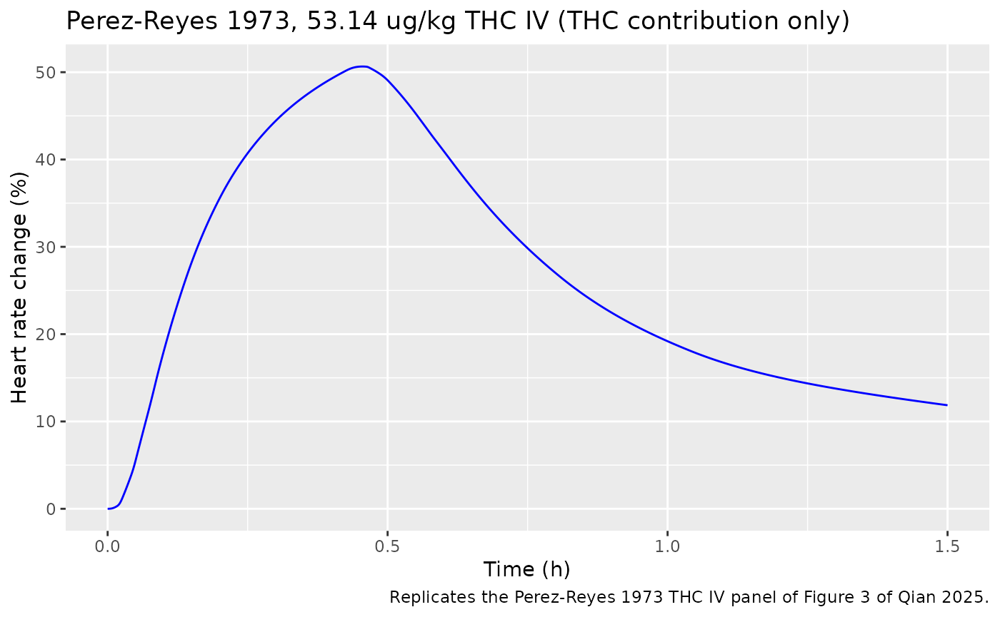
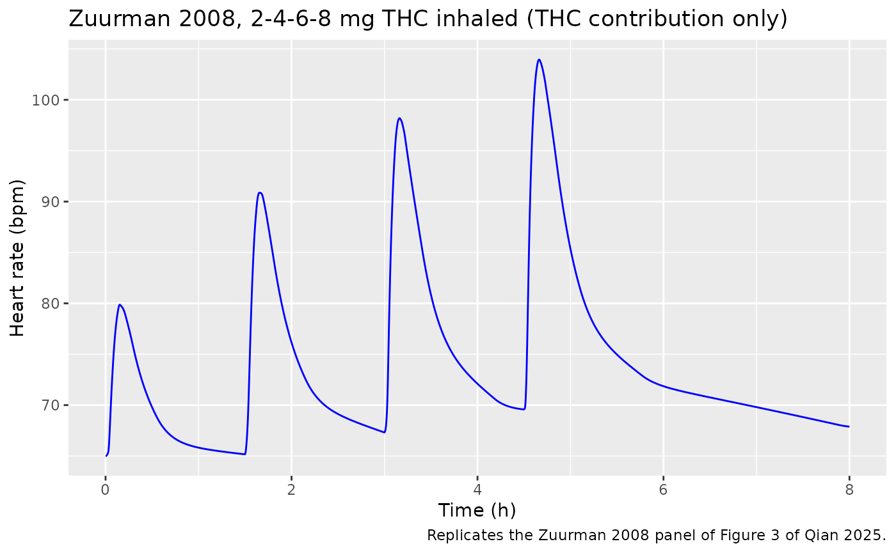
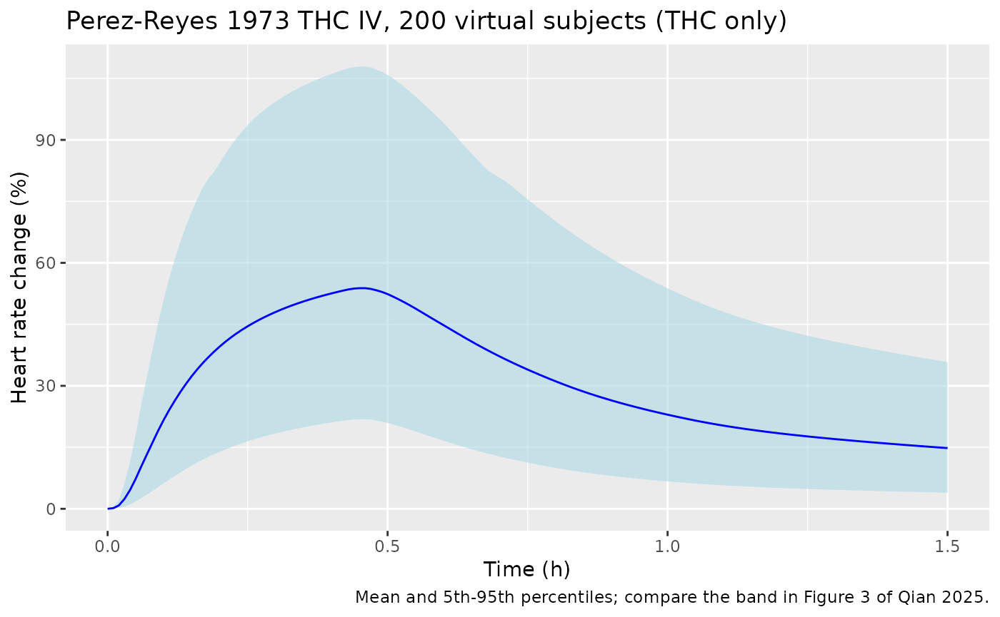

# Delta-9-tetrahydrocannabinol heart rate (Qian 2025)

## Model and source

- Citation: Qian L, Zhou Z. (2025). Quantifying Heart Rate Changes After
  Delta-9-Tetrahydrocannabinol Administration Using a PBPK-PD Model in
  Healthy Adults. Pharmaceutics 17(2):237.
  <doi:10.3390/pharmaceutics17020237>. Inter-individual variability of
  Emax and EC50 from Strougo A et al. (2008) J Psychopharmacol
  22:717-726, <doi:10.1177/0269881108089870> (reference 20 of Qian
  2025).
- Description: Heart-rate pharmacodynamic model of
  delta-9-tetrahydrocannabinol (THC) and its active metabolite
  11-hydroxy-THC (11-OH-THC) in healthy adults, the PD layer of the Qian
  2025 PBPK-PD model. Each analyte’s total heart concentration feeds its
  own effect compartment (THC: separate transfer and loss rate constants
  k1e and ke0; 11-OH-THC: a single equilibration rate constant), and the
  sum of the two effect-compartment concentrations drives one hyperbolic
  Emax increase of heart rate relative to the pre-dose baseline, with
  Emax and EC50 shared by both analytes. Only this PD layer is
  reproduced here: the PBPK layer is a Simcyp whole-body model whose
  organ volumes, blood flows and tissue partition coefficients are
  platform outputs the paper does not print, so the THC and 11-OH-THC
  heart concentrations are supplied by the user as time-varying
  covariates (umol/L) rather than generated by a PK model in this file.
  Inter- individual variability on Emax and EC50 is taken from Strougo
  2008; no residual-error model is reported, so it is zero.
- Article: <https://doi.org/10.3390/pharmaceutics17020237> (open access,
  PMC11858910)
- Supplement:
  <https://www.mdpi.com/article/10.3390/pharmaceutics17020237/s1> (Table
  S1 per-study predicted and observed peak heart rates; Figure S2
  predicted THC plasma, brain and heart concentrations; the Lua code of
  the heart-rate PD model)

Qian 2025 extended the authors’ Simcyp whole-body PBPK model of
delta-9-tetrahydrocannabinol (THC) and its active metabolite
11-hydroxy-THC (11-OH-THC) (Qian 2025, Clin Transl Sci 18:e70119) with a
heart-rate PD model, and used it to predict the risk of resting
tachycardia after oral and inhaled THC.

**Only the PD layer is packaged here.** The PBPK layer is a platform
whole-body model whose organ volumes, blood flows and tissue partition
coefficients are Simcyp outputs that neither paper tabulates, so it
cannot be rebuilt from the publications. The PD layer is printed in
full: Equations 1-5, the PD rows of Table 1, and the Lua code in the
supplement. It is driven by the total THC and 11-OH-THC concentrations
in the PBPK heart compartment, which the authors chose over plasma and
brain drivers (Results). Here those two concentrations enter as the
time-varying covariates `CHEART_TETRAHYDROCANNABINOL_UM` and
`CHEART_11OH_TETRAHYDROCANNABINOL_UM` (umol/L); the user supplies them
from their own PK model or PBPK output.

``` r

mod <- readModelDb("Qian_2025_tetrahydrocannabinol")
ui <- rxode2::rxode(mod)
ui
#>  ── rxode2-based free-form 2-cmt ODE model ────────────────────────────────────── 
#>  ── Initalization: ──  
#> Fixed Effects ($theta): 
#>  lk1e_thc  lke0_thc lke0_11oh     lemax     lec50     addSd 
#>  1.386294  1.871802  2.708050  4.653960 -1.897120  0.000000 
#> 
#> Omega ($omega): 
#>          etalemax etalec50
#> etalemax  0.09749 0.000000
#> etalec50  0.00000 0.484954
#> attr(,"lotriFix")
#>          etalemax etalec50
#> etalemax     TRUE    FALSE
#> etalec50    FALSE     TRUE
#> 
#> States ($state or $stateDf): 
#>   Compartment Number Compartment Name
#> 1                  1           effect
#> 2                  2      effect_11oh
#>  ── μ-referencing ($muRefTable): ──  
#>   theta      eta level
#> 1 lemax etalemax    id
#> 2 lec50 etalec50    id
#> 
#>  ── Model (Normalized Syntax): ── 
#> function() {
#>     compartmentData <- list(effect = list(analyte = "delta-9-tetrahydrocannabinol", 
#>         units = "umol/L", specimen = "not applicable", verified = TRUE), 
#>         effect_11oh = list(analyte = "11-hydroxy-delta-9-tetrahydrocannabinol", 
#>             units = "umol/L", specimen = "not applicable", verified = TRUE))
#>     covariateData <- list(CHEART_TETRAHYDROCANNABINOL_UM = list(description = "Total THC concentration in the heart tissue compartment (umol/L), the driver of the THC effect compartment", 
#>         units = "umol/L", type = "continuous", reference_category = NULL, 
#>         notes = "Qian 2025 Equation 3 and the supplementary Lua code ('Substrate heart concentration'): the effect compartment is fed by the TOTAL THC concentration in the heart compartment of the authors' Simcyp whole-body PBPK model, which the paper selected over plasma and brain as the driving compartment (Results). EC50 is in umol/L (Table 1), so a concentration in ng/mL must be divided by the THC molecular weight 314.46 g/mol. In the source the heart profile is a Simcyp output (Qian 2025, Clin Transl Sci 18:e70119; oral fa 0.45 and ka 0.7 1/h, inhaled lung fa 0.05-0.9 and lung ka 12 or 200 1/h, Table 1 and supplementary Table S1) and is not reproducible from the publication; the paper notes the predicted heart and plasma THC profiles are similar (supplementary Figure S2). Set to 0 for drug-free records.", 
#>         source_name = "C_THC (Qian 2025 Equation 3); 'Substrate heart concentration' (supplementary Lua code)"), 
#>         CHEART_11OH_TETRAHYDROCANNABINOL_UM = list(description = "Total 11-hydroxy-THC concentration in the heart tissue compartment (umol/L), the driver of the 11-OH-THC effect compartment", 
#>             units = "umol/L", type = "continuous", reference_category = NULL, 
#>             notes = "Qian 2025 Equation 1 and the supplementary Lua code ('Sub Pri Metabolite1 heart concentration'): the TOTAL 11-OH-THC concentration in the heart compartment of the authors' Simcyp PBPK model, formed from THC or given directly as an intravenous dose. In umol/L: divide a concentration in ng/mL by the 11-OH-THC molecular weight 330.46 g/mol. The paper does not print any 11-OH-THC concentration profile. Set to 0 for drug-free records.", 
#>             source_name = "C_11-OH-THC (Qian 2025 Equation 1); 'Sub Pri Metabolite1 heart concentration' (supplementary Lua code)"), 
#>         HR_BL = list(description = "Pre-dose baseline heart rate (beats/min)", 
#>             units = "beats/min", type = "continuous", reference_category = NULL, 
#>             notes = "Qian 2025 Equation 4: 'Baseline is the baseline of the heart rate, which is the observed heart rate from the studies measured before THC dosing'; the closest observed mean pre-dose heart rate of each study was used, with no inter-individual variability (Discussion). The tachycardia-risk simulations used 70 beats/min (Methods 2.6).", 
#>             source_name = "Baseline (Qian 2025 Equation 4)"))
#>     description <- "Heart-rate pharmacodynamic model of delta-9-tetrahydrocannabinol (THC) and its active metabolite 11-hydroxy-THC (11-OH-THC) in healthy adults, the PD layer of the Qian 2025 PBPK-PD model. Each analyte's total heart concentration feeds its own effect compartment (THC: separate transfer and loss rate constants k1e and ke0; 11-OH-THC: a single equilibration rate constant), and the sum of the two effect-compartment concentrations drives one hyperbolic Emax increase of heart rate relative to the pre-dose baseline, with Emax and EC50 shared by both analytes. Only this PD layer is reproduced here: the PBPK layer is a Simcyp whole-body model whose organ volumes, blood flows and tissue partition coefficients are platform outputs the paper does not print, so the THC and 11-OH-THC heart concentrations are supplied by the user as time-varying covariates (umol/L) rather than generated by a PK model in this file. Inter- individual variability on Emax and EC50 is taken from Strougo 2008; no residual-error model is reported, so it is zero."
#>     population <- list(species = "human", n_subjects = NA_integer_, 
#>         n_studies = 30L, age_range = "healthy adults (per-study demographics not tabulated); tachycardia-risk simulations used virtual adults aged 18-65 years", 
#>         weight_range = "not reported", sex_female_pct = NA_real_, 
#>         race_ethnicity = "not reported", disease_state = "healthy adult volunteers; occasional cannabis users only (chronic users with a non-zero baseline THC concentration were excluded)", 
#>         dose_range = "THC 2-69.4 mg (intravenous, oral and inhaled) and 11-OH-THC 2.27 mg or 46.99 ug/kg intravenous, single doses and inhaled dose series", 
#>         regions = "not reported (studies taken from the published literature)", 
#>         notes = "Observed mean heart-rate profiles were digitised from 30 published clinical trials comprising 42 THC dosing regimens plus two intravenous 11-OH-THC regimens (Methods 2.2; supplementary Table S1). The PD parameters were optimised on one intravenous study that gave both THC and 11-OH-THC (Perez-Reyes 1973), verified on one oral (Kirk 1998) and one inhaled (Zuurman 2008) study, and validated on the rest. Model development used a Simcyp virtual healthy-adult population (ten trials per study design); the number of real individuals behind the digitised means is not reported.")
#>     reference <- "Qian L, Zhou Z. (2025). Quantifying Heart Rate Changes After Delta-9-Tetrahydrocannabinol Administration Using a PBPK-PD Model in Healthy Adults. Pharmaceutics 17(2):237. doi:10.3390/pharmaceutics17020237. Inter-individual variability of Emax and EC50 from Strougo A et al. (2008) J Psychopharmacol 22:717-726, doi:10.1177/0269881108089870 (reference 20 of Qian 2025)."
#>     units <- list(time = "h", dosing = "(not applicable; THC and 11-OH-THC heart concentrations are supplied as covariates, not as dose records)", 
#>         concentration = "umol/L (THC and 11-OH-THC heart and effect-compartment concentrations; hr is in beats/min)")
#>     vignette <- "Qian_2025_tetrahydrocannabinol"
#>     ini({
#>         lk1e_thc <- 1.38629436111989
#>         label("THC transfer rate constant from the heart compartment into its effect compartment k1e (1/h)")
#>         lke0_thc <- 1.87180217690159
#>         label("THC effect-compartment loss rate constant ke0 (1/h)")
#>         lke0_11oh <- 2.70805020110221
#>         label("11-OH-THC effect-compartment equilibration rate constant, k1e = ke0 (1/h)")
#>         lemax <- 4.65396035015752
#>         label("Maximum increase in heart rate from baseline Emax (% of baseline)")
#>         lec50 <- -1.89711998488588
#>         label("Summed THC + 11-OH-THC effect-compartment concentration for half-maximal increase EC50 (umol/L)")
#>         addSd <- fix(0, 0)
#>         label("Additive residual SD on heart rate (beats/min; zero - no residual-error model is reported)")
#>         etalemax ~ fix(0.09749)
#>         etalec50 ~ fix(0.484954)
#>     })
#>     model({
#>         k1e_thc <- exp(lk1e_thc)
#>         ke0_thc <- exp(lke0_thc)
#>         ke0_11oh <- exp(lke0_11oh)
#>         emax <- exp(lemax + etalemax)
#>         ec50 <- exp(lec50 + etalec50)
#>         d/dt(effect) <- k1e_thc * CHEART_TETRAHYDROCANNABINOL_UM - 
#>             ke0_thc * effect
#>         d/dt(effect_11oh) <- ke0_11oh * (CHEART_11OH_TETRAHYDROCANNABINOL_UM - 
#>             effect_11oh)
#>         ce_sum <- effect + effect_11oh
#>         pchg_hr <- emax * ce_sum/(ec50 + ce_sum)
#>         hr <- HR_BL * (1 + pchg_hr/100)
#>         hr ~ add(addSd)
#>     })
#> }
```

## Population

The PD parameters were optimised on one intravenous study that gave both
THC and 11-OH-THC to healthy volunteers (Perez-Reyes 1973), verified on
one oral (Kirk 1998) and one inhaled (Zuurman 2008) study with dense
heart-rate sampling, and validated on the remaining studies: 30
published clinical trials with 42 THC dosing regimens (2-69.4 mg
intravenous, oral and inhaled) and two intravenous 11-OH-THC regimens
(Methods 2.2; supplementary Table S1). All participants were healthy
adults at rest; chronic cannabis users were excluded because of their
non-zero baseline THC concentrations (Discussion). The data are
digitised literature means, so the number of individuals and their
demographics are not reported. Each study’s mean pre-dose heart rate
served as its baseline, without inter-individual variability.

## Source trace

| Model element | Value | Source |
|----|----|----|
| THC effect compartment `d/dt(effect) = k1e_thc * C_THC - ke0_thc * effect` | – | Equation 3; Lua `handleCustomOdeRateStep` |
| 11-OH-THC effect compartment `d/dt(effect_11oh) = ke0_11oh * (C_11OH - effect_11oh)` | – | Equation 1 with k1e = ke0; Lua (single `ke02`) |
| Heart rate `HR = HR_BL * (1 + Emax/100 * Ce_sum / (EC50 + Ce_sum))` | – | Equation 4; Lua `handleCustomOdeEventStep` |
| Percent change `pchg_hr = Emax * Ce_sum / (EC50 + Ce_sum)` | – | Equation 5 |
| Driving compartment: heart (total concentrations) | – | Results; Lua `Substrate heart concentration` |
| `k1e_thc` | 4 1/h | Table 1 (Optimized); Lua `k1e1` |
| `ke0_thc` | 6.5 1/h | Table 1 (Optimized); Lua `ke01` |
| `ke0_11oh` (= k1e of 11-OH-THC) | 15 1/h | Table 1 (Optimized, both rows); Lua `ke02` |
| `emax` | 105 % | Table 1 (11-OH-THC Optimized; THC ‘Same as 11-OH-THC’) |
| `ec50` | 0.15 umol/L | Table 1 (11-OH-THC Optimized; THC ‘Same as 11-OH-THC’) |
| IIV on Emax | CV 32 % (fixed) | Table 1, from Strougo 2008 |
| IIV on EC50 | CV 79 % (fixed) | Table 1, from Strougo 2008 |
| Residual error | none (0) | not reported |

## Deterministic structure checks

With constant heart concentrations the effect compartments reach
closed-form plateaus: the THC effect compartment settles at
`(k1e/ke0) * C_THC`, because the THC transfer and loss constants differ,
while the 11-OH-THC effect compartment settles at `C_11OH`. Heart rate
then follows Equation 4 exactly.

``` r

typ <- rxode2::zeroRe(mod)
p <- ui$theta
k1e <- exp(p[["lk1e_thc"]])
ke0 <- exp(p[["lke0_thc"]])
emax <- exp(p[["lemax"]])
ec50 <- exp(p[["lec50"]])

ss_grid <- data.frame(
  id = 1:4,
  CHEART_TETRAHYDROCANNABINOL_UM = c(0, 0.1, 0, 0.3),
  CHEART_11OH_TETRAHYDROCANNABINOL_UM = c(0, 0, 0.1, 0.05),
  HR_BL = 70
)
ss_ev <- merge(ss_grid, data.frame(time = c(0, 5, 10))) |>
  arrange(id, time) |>
  mutate(evid = 0, cmt = "effect")
ss <- rxode2::rxSolve(typ, ss_ev, returnType = "data.frame") |>
  filter(time == 10)
#> ℹ omega/sigma items treated as zero: 'etalemax', 'etalec50'
#> Warning: multi-subject simulation without without 'omega'

ce_expected <- k1e / ke0 * ss$CHEART_TETRAHYDROCANNABINOL_UM +
  ss$CHEART_11OH_TETRAHYDROCANNABINOL_UM
hr_expected <- 70 * (1 + emax / 100 * ce_expected / (ec50 + ce_expected))
ss |>
  transmute(id, effect, effect_11oh, hr, hr_expected = hr_expected) |>
  knitr::kable(digits = 4)
```

|  id | effect | effect_11oh |       hr | hr_expected |
|----:|-------:|------------:|---------:|------------:|
|   1 | 0.0000 |        0.00 |  70.0000 |     70.0000 |
|   2 | 0.0615 |        0.00 |  91.3818 |     91.3818 |
|   3 | 0.0000 |        0.10 |  99.4000 |     99.4000 |
|   4 | 0.1846 |        0.05 | 114.8350 |    114.8350 |

``` r


stopifnot(
  # Both sides share every parameter, so only ODE tolerance separates them.
  max(abs(ss$effect + ss$effect_11oh - ce_expected)) < 1e-5,
  max(abs(ss$hr - hr_expected)) < 1e-3,
  # No drug, no effect.
  abs(ss$hr[1] - 70) < 1e-8
)
```

The summed effect-compartment concentration needed to push a 70
beats/min baseline past the 100 beats/min tachycardia threshold of
Methods 2.6 is `EC50 * p / (Emax - p)` with `p = 100 * 30/70`:

``` r

p_needed <- 100 * (100 - 70) / 70
ce_threshold <- ec50 * p_needed / (emax - p_needed)
c(percent_increase = p_needed, ce_umol_L = ce_threshold,
  thc_ng_mL = ce_threshold * 314.46)
#> percent_increase        ce_umol_L        thc_ng_mL 
#>       42.8571429        0.1034483       32.5303448
```

That is about 0.10 umol/L (33 ng/mL of THC-equivalent) in the effect
compartments for the typical subject.

## Replicating the THC-driven heart-rate profiles

The paper prints the PBPK-predicted THC heart concentrations for one
intravenous, one oral and one inhaled study (supplementary Figure S2).
The maintainers digitised the heart curves (blue dashed lines) of panels
A and C and fed them to the model as `CHEART_TETRAHYDROCANNABINOL_UM`
after dividing by the THC molecular weight, 314.46 g/mol (the value used
in `Wolowich_2025_thc`). **The paper prints no 11-OH-THC concentration
profile, so `CHEART_11OH_TETRAHYDROCANNABINOL_UM` is set to 0 here.**
These replications therefore isolate the THC contribution and should
fall at or a little below the paper’s predictions, which include the
metabolite.

``` r

# Supplementary Figure S2A: Perez-Reyes 1973, 53.14 ug/kg THC intravenous
# infusion; predicted heart concentration (ng/mL).
fig_s2a <- data.frame(
  time = c(0.004, 0.018, 0.025, 0.042, 0.050, 0.071, 0.085, 0.092, 0.141,
           0.201, 0.297, 0.424, 0.428, 0.445, 0.463, 0.466, 0.473, 0.488,
           0.502, 0.551, 0.576, 0.583, 0.615, 0.647, 0.809, 1.042, 1.505,
           1.509, 1.541, 1.972),
  conc = c(0.5, 5.3, 18.0, 24.4, 35.5, 42.4, 52.0, 52.5, 63.7, 71.1, 77.5,
           83.8, 83.8, 75.3, 68.4, 57.3, 56.2, 50.9, 40.3, 28.1, 24.9, 25.5,
           21.8, 20.2, 15.4, 11.7, 8.5, 9.6, 8.5, 7.4)
)
# Supplementary Figure S2C: Zuurman 2008, 2, 4, 6 and 8 mg THC inhaled at
# 0, 1.5, 3 and 4.5 h; predicted heart concentration (ng/mL).
fig_s2c <- data.frame(
  time = c(0.014, 0.028, 0.042, 0.057, 0.085, 0.141, 0.155, 0.184, 0.212,
           0.297, 0.551, 1.498, 1.526, 1.541, 1.555, 1.583, 1.597, 1.611,
           1.625, 1.654, 1.668, 1.682, 1.696, 1.738, 1.809, 2.148, 2.997,
           3.011, 3.025, 3.039, 3.053, 3.067, 3.081, 3.110, 3.166, 3.180,
           3.194, 3.208, 3.223, 3.406, 4.184, 4.495, 4.509, 4.523, 4.537,
           4.551, 4.565, 4.580, 4.608, 4.650, 4.664, 4.678, 4.693, 4.707,
           4.721, 4.735, 4.749, 4.848, 5.103, 5.767, 7.887),
  conc = c(2.1, 5.3, 39.2, 46.6, 46.6, 32.8, 19.0, 16.9, 10.6, 4.2, 1.1,
           0.0, 36.0, 74.1, 93.1, 97.4, 96.3, 85.7, 84.7, 46.6, 45.5, 38.1,
           26.5, 18.0, 10.6, 5.3, 2.1, 11.6, 38.1, 116.4, 138.6, 143.9,
           145.0, 143.9, 65.6, 59.3, 45.5, 41.3, 26.5, 12.7, 5.3, 5.3, 8.5,
           67.7, 140.7, 188.4, 195.8, 196.8, 195.8, 133.3, 96.3, 76.2, 68.8,
           56.1, 50.8, 37.0, 37.0, 20.1, 14.8, 8.5, 3.2)
)

mw_thc <- 314.46

# Observation grid on the heart-concentration driver, interpolated linearly
# from the digitised points (0 before the first point).
driver_events <- function(fig, t_end, hr_bl, dt = 0.002) {
  tt <- seq(0, t_end, by = dt)
  conc <- stats::approx(c(0, fig$time), c(0, fig$conc), xout = tt, rule = 2)$y
  data.frame(
    id = 1L, time = tt, evid = 0L, cmt = "effect",
    CHEART_TETRAHYDROCANNABINOL_UM = conc / mw_thc,
    CHEART_11OH_TETRAHYDROCANNABINOL_UM = 0,
    HR_BL = hr_bl
  )
}
```

### Intravenous THC: Perez-Reyes 1973 (Figure 3)

This study reported percent change in heart rate, so the baseline value
is immaterial for `pchg_hr`; 70 beats/min is used.

``` r

ev_iv <- driver_events(fig_s2a, t_end = 1.5, hr_bl = 70)
sim_iv <- rxode2::rxSolve(typ, ev_iv, covsInterpolation = "linear",
                          returnType = "data.frame")
#> ℹ omega/sigma items treated as zero: 'etalemax', 'etalec50'
peak_iv <- max(sim_iv$pchg_hr)
tpeak_iv <- sim_iv$time[which.max(sim_iv$pchg_hr)]

ggplot(sim_iv, aes(time, pchg_hr)) +
  geom_line(colour = "blue") +
  labs(x = "Time (h)", y = "Heart rate change (%)",
       title = "Perez-Reyes 1973, 53.14 ug/kg THC IV (THC contribution only)",
       caption = "Replicates the Perez-Reyes 1973 THC IV panel of Figure 3 of Qian 2025.")
```



``` r

iv_tab <- data.frame(
  quantity = c("Peak heart-rate change (%)", "Time of peak (h)"),
  this_model_THC_only = c(peak_iv, tpeak_iv),
  paper_predicted = c(54.2, NA),
  paper_observed = c(55.7, NA)
)
knitr::kable(iv_tab, digits = 2)
```

| quantity | this_model_THC_only | paper_predicted | paper_observed |
|:---|---:|---:|---:|
| Peak heart-rate change (%) | 50.65 | 54.2 | 55.7 |
| Time of peak (h) | 0.46 | NA | NA |

``` r


stopifnot(
  # Table S1 predicted peak 54.2 % includes the 11-OH-THC formed during the
  # infusion, so the THC-only peak must sit at or a little below
  # it. A molar-vs-mass unit slip on EC50 (factor 314) or a swapped k1e/ke0
  # moves the peak by far more than 15 %.
  peak_iv <= 54.2 * 1.02,
  peak_iv >= 54.2 * 0.85,
  # Figure 3 peaks at about 0.45 h, just after the end of the infusion.
  tpeak_iv > 0.4, tpeak_iv < 0.55
)
```

The THC-only peak is about 7 % below the paper’s prediction, the gap the
metabolite contributes in this study.

### Inhaled THC: Zuurman 2008 (Figure 3)

Four rising inhaled doses at 1.5-hour intervals. The baseline, about 65
beats/min, is read from the first observation of the Zuurman 2008 panel
of Figure 3; Table S1 gives a predicted peak heart rate of 99.0
beats/min (observed 95.8).

``` r

ev_inh <- driver_events(fig_s2c, t_end = 8, hr_bl = 65)
sim_inh <- rxode2::rxSolve(typ, ev_inh, covsInterpolation = "linear",
                           returnType = "data.frame")
#> ℹ omega/sigma items treated as zero: 'etalemax', 'etalec50'
inh_peaks <- sim_inh |>
  mutate(dose = cut(time, c(-Inf, 1.5, 3, 4.5, Inf),
                    labels = c("2 mg", "4 mg", "6 mg", "8 mg"))) |>
  group_by(dose) |>
  summarise(peak_hr = max(hr), t_peak = time[which.max(hr)], .groups = "drop")
knitr::kable(inh_peaks, digits = 2)
```

| dose | peak_hr | t_peak |
|:-----|--------:|-------:|
| 2 mg |   79.87 |   0.15 |
| 4 mg |   90.87 |   1.65 |
| 6 mg |   98.19 |   3.16 |
| 8 mg |  103.95 |   4.66 |

``` r


ggplot(sim_inh, aes(time, hr)) +
  geom_line(colour = "blue") +
  labs(x = "Time (h)", y = "Heart rate (bpm)",
       title = "Zuurman 2008, 2-4-6-8 mg THC inhaled (THC contribution only)",
       caption = "Replicates the Zuurman 2008 panel of Figure 3 of Qian 2025.")
```



The typical-value peaks (about 80, 91, 98 and 104 beats/min) track the
mean-prediction peaks drawn in Figure 3 (about 80, 89, 95 and 99) and
the Table S1 predicted peak of 99.0, within the digitisation precision
of the narrow inhaled spikes.

``` r

stopifnot(
  # Typical-value final peak within 10 % of Table S1 predicted 99.0 bpm.
  abs(max(inh_peaks$peak_hr) / 99.0 - 1) < 0.10,
  # Each successive, larger dose gives a higher peak (Figure 3).
  all(diff(inh_peaks$peak_hr) > 0)
)
```

### Oral THC: why the metabolite matters

Figure S2B shows a predicted heart THC peak of only about 1.2 ng/mL
(0.004 umol/L) after 7.5 mg oral THC (Kirk 1998). Through the
typical-value model that alone raises heart rate by

``` r

ce_oral <- k1e / ke0 * 1.2 / mw_thc
72.5 * emax / 100 * ce_oral / (ec50 + ce_oral)
#> [1] 1.173416
```

beats/min (steady-state upper bound), whereas Table S1 predicts a rise
from about 72.5 beats/min (the Figure 3 baseline) to 78.4. The remainder
comes from 11-OH-THC, which after oral dosing is formed extensively by
first-pass metabolism. Users simulating oral THC must therefore supply a
realistic 11-OH-THC heart profile; setting it to 0 would understate the
effect several fold.

## Variability: stochastic simulation

Table 1 carries inter-individual variability on Emax (CV 32 %) and EC50
(CV 79 %), taken from Strougo 2008. A cohort of 200 virtual subjects
driven by the intravenous THC heart profile gives the spread below;
Figure 3 shows a 5th-95th percentile band of roughly 25-88 % at the peak
for this study (with the metabolite included). Emax enters the effect
linearly, so its variability leaves the population mean unchanged, but
the effect is convex in EC50, so by Jensen’s inequality the mean sits a
little ABOVE the typical-value curve while the median tracks it.

``` r

set.seed(20250201)
rxode2::rxSetSeed(20250201)
n_sub <- 200
ev_vpc <- do.call(rbind, lapply(seq_len(n_sub), function(i) {
  e <- driver_events(fig_s2a, t_end = 1.5, hr_bl = 70, dt = 0.01)
  e$id <- i
  e
}))
sim_vpc <- rxode2::rxSolve(mod, ev_vpc, covsInterpolation = "linear",
                           returnType = "data.frame")
vpc <- sim_vpc |>
  group_by(time) |>
  summarise(
    p05 = quantile(pchg_hr, 0.05), p50 = median(pchg_hr),
    p95 = quantile(pchg_hr, 0.95), mean = mean(pchg_hr), .groups = "drop"
  )
ggplot(vpc, aes(time)) +
  geom_ribbon(aes(ymin = p05, ymax = p95), fill = "lightblue", alpha = 0.6) +
  geom_line(aes(y = mean), colour = "blue") +
  labs(x = "Time (h)", y = "Heart rate change (%)",
       title = "Perez-Reyes 1973 THC IV, 200 virtual subjects (THC only)",
       caption = "Mean and 5th-95th percentiles; compare the band in Figure 3 of Qian 2025.")
```



``` r


peak_by_id <- sim_vpc |>
  group_by(id) |>
  summarise(peak = max(pchg_hr), .groups = "drop")
summary(peak_by_id$peak)
#>    Min. 1st Qu.  Median    Mean 3rd Qu.    Max. 
#>   12.48   37.27   49.98   53.82   69.44  136.20

stopifnot(
  # Convex in EC50, linear in Emax: the population mean sits at or above the
  # typical-value peak, and the median tracks it (log-normal median =
  # typical parameters).
  max(vpc$mean) >= peak_iv * 0.98,
  abs(median(peak_by_id$peak) / peak_iv - 1) < 0.25,
  # The EC50 CV of 79 % makes the peak distribution wide.
  quantile(peak_by_id$peak, 0.95) > quantile(peak_by_id$peak, 0.05) * 1.3
)
```

## Non-compartmental analysis

Not applicable. The model has no PK layer and no dosing records, so
there is no concentration-time profile for PKNCA to summarise; the drug
enters only as the supplied heart concentrations. The paper’s own
validation metric, the ratio of predicted to observed peak heart rate
(supplementary Table S1), is reproduced above for the two studies whose
driving concentrations are printed.

## Assumptions and deviations

- **PBPK layer not reproduced.** The Simcyp whole-body PBPK model that
  generates the heart concentrations (Qian 2025, Clin Transl Sci) prints
  only drug-specific inputs; its organ physiology and partition
  coefficients are platform outputs. The heart concentrations are
  therefore covariates. The paper’s tachycardia-risk curves (Figure 4)
  need that PBPK model and are not replicated.
- **Inter-individual variability distribution.** The Simcyp Lua code
  samples Emax and EC50 from truncated normal distributions with the
  Table 1 CVs; the truncation limits are a platform setting not printed
  in the paper. The model uses log-normal variability with the same CVs
  (`omega^2 = log(1 + CV^2)`), which keeps both parameters positive (an
  untruncated normal with CV 79 % would give a negative EC50 to about 10
  % of subjects). The CVs come from Strougo 2008 and are fixed.
- **11-OH-THC rate constants.** Table 1 lists k1e = ke0 = 15 1/h for
  11-OH-THC and the Lua code uses one constant for both terms, so the
  model has a single `ke0_11oh`.
- **Percent-change output.** Equation 5 (percent change from baseline)
  is available as `pchg_hr`; the Lua code’s commented percent-change
  branch (`HR = Emax * ... + Baseline`) is the same quantity with a zero
  baseline.
- **No residual error** is reported, so `addSd` is fixed to 0.
- **Baseline variability** was not modelled by the authors (Discussion);
  `HR_BL` is a per-subject input.
- **Digitised inputs.** The heart concentrations in the replications are
  digitised from supplementary Figure S2, where the blue dashed heart
  curve overlies the plasma curve; the narrow inhaled spikes are the
  least precise part of the digitisation. The Zuurman 2008 baseline (65
  beats/min) is read from Figure 3.
- **Molecular weights** of THC (314.46 g/mol) and 11-OH-THC (330.46
  g/mol) are not given in Qian 2025; the values are those of
  `Wolowich_2025_thc`.
