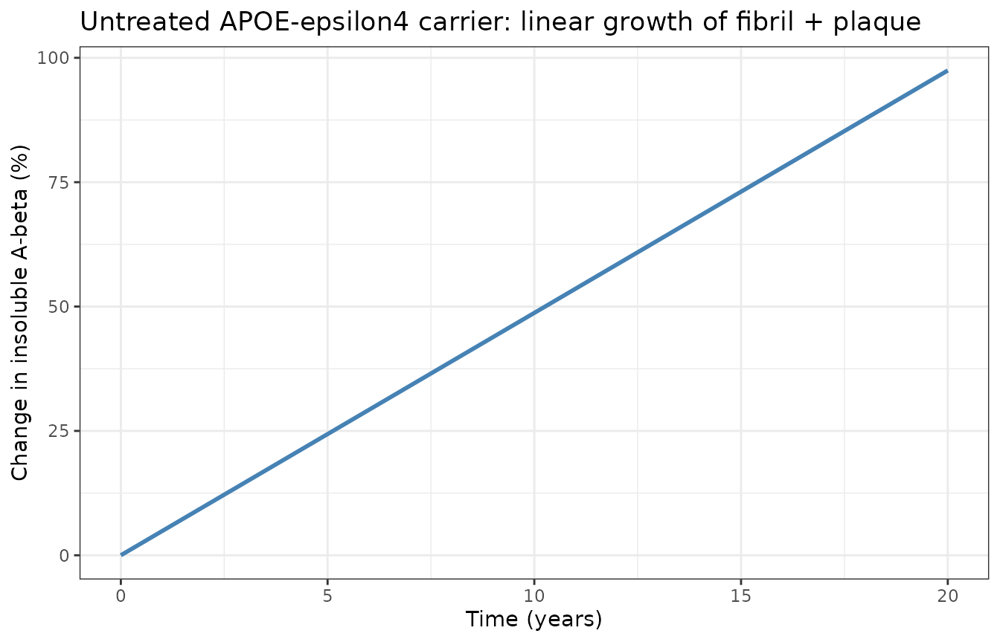
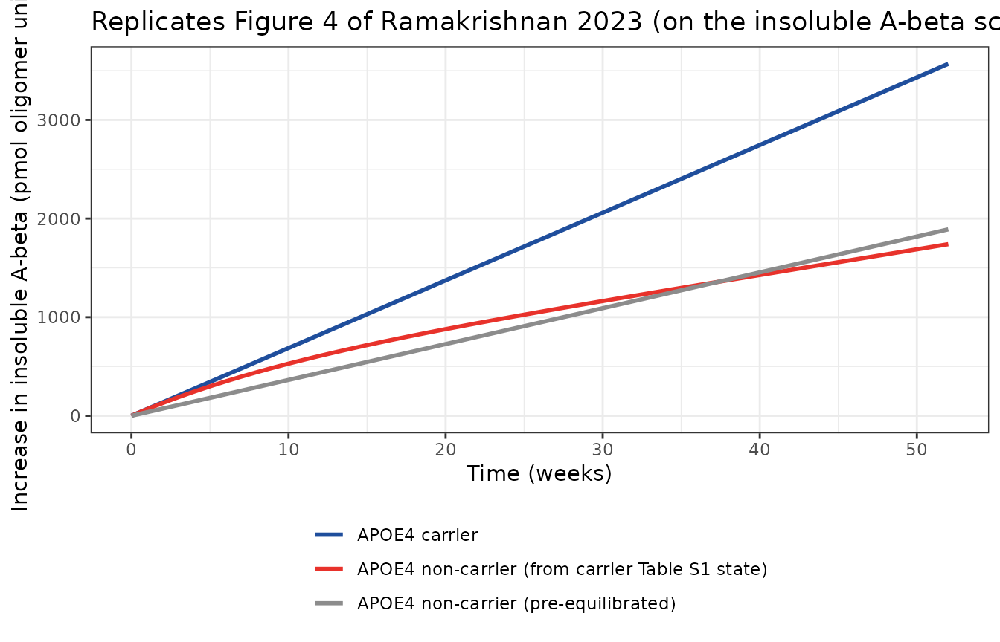

# Amyloid-beta pathway QSP in Alzheimer's disease (Ramakrishnan 2023)

## Model and source

``` r

mod <- rxode2::rxode2(readModelDb("Ramakrishnan_2023_amyloid_qsp"))
mod$state
#>  [1] "app"          "sappb"        "c99"          "ab40_brain"   "ab42_brain"  
#>  [6] "olig_brain"   "fibril_brain" "plaque_brain" "ab40_csf"     "ab42_csf"    
#> [11] "olig_csf"     "ab40_plasma"  "ab42_plasma"  "olig_plasma"
```

- Citation: Ramakrishnan V, Friedrich C, Witt C, Sheehan R, Pryor M,
  Atwal JK, Wildsmith K, Kudrycki K, Lee SH, Mazer N, Hofmann C, Fuji
  RN, Jin JY, Ramanujan S, Dolton M, Quartino A. Quantitative systems
  pharmacology model of the amyloid pathway in Alzheimer’s disease:
  Insights into the therapeutic mechanisms of clinical candidates. CPT
  Pharmacometrics Syst Pharmacol. 2023;12(1):62-73.
  <doi:10.1002/psp4.12876>. ODEs, initial amounts (Table S1), parameter
  values (Table S2) and rule definitions (Table S4) from the
  Supplementary Material; APOE-epsilon4 non-carrier values from
  main-text Table 3.
- Article (open access): <https://doi.org/10.1002/psp4.12876>
  (PMC9835125).
- The ODEs, the initial amounts (Table S1), the parameter values (Table
  S2) and the rule definitions (Table S4) are in the Supplementary
  Material. The APOE-epsilon4 non-carrier values are in main-text Table
  3.

Ramakrishnan and colleagues (Genentech, Rosa & Co. and Roche) built a
MATLAB SimBiology QSP model of amyloid-beta (A-beta) in Alzheimer’s
disease. A-beta40 and A-beta42 are produced from APP by BACE1 and
gamma-secretase and tracked separately, aggregate into oligomers
(10-mers), fibrils and plaque in the brain, and move between brain, CSF
and plasma. The model was calibrated to an APOE-epsilon4 carrier virtual
patient and then tested on an APOE-epsilon4 non-carrier.

### What this file encodes, and what it cannot

**Encoded: the paper’s own A-beta pathway (natural-history) layer.** APP
processing, the two monomer pools with their five clearance routes, the
sequestered A-beta42 pool, oligomer / fibril / plaque aggregation, CSF
and plasma transport, peripheral production, and the APOE-epsilon4
non-carrier virtual patient. Every value is printed in the paper or its
supplement, and the published initial amounts are a steady state of the
printed equations (checked below).

**Not encoded: the anti-A-beta antibody layer.** The paper calibrates
solanezumab, crenezumab, aducanumab and gantenerumab, with 18 further
antibody and complex states. Table S3 of the supplement lists the 34
antibody-specific parameters (absorption, clearance, peripheral
exchange, association and dissociation rates for each A-beta species and
compartment, and the microglial-activation multipliers) by name,
description and unit only, with no values. Main-text Table 2 gives
equilibrium dissociation constants but not the association /
dissociation rates the ODEs use. The brain, CSF and plasma volumes that
the bimolecular binding terms divide by, and the rule that sets
`Microglia_Activation` during treatment, are also not published. Figures
2, 3 and S1 (antibody PK, target engagement and SUVR change on
treatment) therefore cannot be reproduced. The equations for those
states are printed in the supplement, so the layer can be added once the
values become available.

## Population

The model is a deterministic, typical-value QSP model, not a population
fit. It represents an individual with Alzheimer’s disease during the
roughly 20-year phase in which brain A-beta aggregation grows linearly.
Table 1 of the paper lists the CSF A-beta42 and amyloid-PET SUVR values
(normal, prodromal, AD) that guided virtual patient development. Brain
A-beta amounts derive from McDonald 2015 and Roberts 2017, CSF A-beta42
from Genentech study ABE4869g, and plasma A-beta from Roher 2009, Ovod
2017 and internal data (Table S1).

``` r

str(mod$meta$population)
#> List of 6
#>  $ species      : chr "human (in silico virtual patients)"
#>  $ n_subjects   : int NA
#>  $ n_studies    : int NA
#>  $ disease_state: chr "Alzheimer's disease during the ~20-year phase of linear A-beta aggregation (the upward slope of the amyloid S c"| __truncated__
#>  $ dose_range   : chr "No dosing in this file. The paper calibrated its antibody layer to solanezumab, crenezumab, aducanumab and gant"| __truncated__
#>  $ notes        : chr "Deterministic typical-value QSP model calibrated to literature and internal Genentech data rather than fitted t"| __truncated__
```

## Source trace

| Model element | Source |
|----|----|
| APP, sAPP-beta, C99 ODEs and the BACE1 / gamma-secretase rate laws | Supplemental methods, ODEs for d(APP)/dt, d(sAPPbeta)/dt, d(C99)/dt |
| A-beta40 and A-beta42 brain monomer ODEs (5 clearance routes, oligomerisation, sequestered pool) | Supplemental methods, d(Abeta40_M)/dt, d(Abeta42_M)/dt |
| Oligomer, fibril and plaque ODEs | Supplemental methods, d(AbetaAll_O)/dt, d(AbetaAll_F)/dt, d(AbetaAll_P)/dt |
| CSF and plasma ODEs, including the 0.125 A-beta42 dilution factor and the doubled CSF clearance term | Supplemental methods, d(Abeta40_M_CSF)/dt through d(AbetaAll_O_Pl)/dt |
| Composite rate rules (`k_ab40_olig`, `k_olig_clr`, `k_olig_fib`, `k_fib_clr`, …) | Table S4 ‘Rules calculations’ |
| All rate constants, fractions, EC50 / Emax values, production rates | Table S2 ‘Parameters that do not change across mAbs’ |
| BACE1 activity and gamma-secretase activity (both normalised to 1) | Table S1 |
| Initial amounts of all 14 states | Table S1 ‘Initial Amount’ (moles converted to pmol) |
| APOE-epsilon4 non-carrier values (BACE1 Km 8.438, Vmax 0.253; receptor, CSF and plasma clearance fractions) | Main-text Table 3 |
| SUVR proportional to insoluble (fibril + plaque) A-beta | Methods, paragraph on temporal scope |
| `Microglia_Activation` = 0 without antibody | Results, ‘Investigation of plaque clearance by plaque-binding IgG1 antibodies’ (microglia are activated in the presence of therapeutic antibody) |

``` r

ini_df <- as.data.frame(mod$iniDf)
ini_df |>
  dplyr::filter(!is.na(ntheta)) |>
  dplyr::select(Parameter = name, Value = est, Description = label) |>
  knitr::kable(digits = 6)
```

| Parameter | Value | Description |
|:---|---:|:---|
| k_app_prod | 3.990e-01 | APP production rate APP_production_rate_k (umol/L/h) |
| k_app_c99 | 1.000e+00 | APP cleavage rate to C99 APP_to_C99_rate_k (1/h) |
| bace1_emax | 4.550e-01 | BACE1 maximum activation of APP cleavage, APOE4 carrier BACE1_APP_toC99_emax (unitless) |
| bace1_emax_nc | 2.530e-01 | BACE1 maximum activation of APP cleavage, APOE4 non-carrier (unitless) |
| bace1_ec50 | 7.760e+00 | APP level for half-maximal BACE1 cleavage, APOE4 carrier BACE1_APP_toC99_ec50 (umol/L) |
| bace1_ec50_nc | 8.438e+00 | APP level for half-maximal BACE1 cleavage, APOE4 non-carrier (umol/L) |
| k_app_sappa | 1.420e-02 | APP cleavage rate to sAPP-alpha APP_to_sAPPalpha_rate_k (1/h) |
| k_sappb_cl | 7.000e-01 | sAPP-beta clearance rate sAPPbeta_clearance_rate_k (1/h) |
| k_c99_abeta | 0.000e+00 | C99 conversion to A-beta and secretion into ISF C99_to_Abeta_rate_k ((L/h)\*(mol/umol)) |
| gsec_ab42_emax | 9.500e-04 | Gamma-secretase maximum activation of C99 cleavage to A-beta42 (unitless) |
| gsec_ab42_ec50 | 5.160e+00 | C99 level for half-maximal cleavage to A-beta42 (umol/L) |
| gsec_ab40_emax | 1.660e-03 | Gamma-secretase maximum activation of C99 cleavage to A-beta40 (unitless) |
| gsec_ab40_ec50 | 9.700e-01 | C99 level for half-maximal cleavage to A-beta40 (umol/L) |
| k_c99_cl | 5.080e-02 | C99 clearance rate C99_clearance_rate_k (1/h) |
| bace1 | 1.000e+00 | BACE1 activity, normalized (unitless) |
| gsec | 1.000e+00 | Gamma-secretase activity, normalized (unitless) |
| k_ab40_cl | 8.340e-02 | A-beta40 total clearance rate in brain ISF Abeta40M_clearance_rate_k (1/h) |
| f_ab40_astro | 1.000e-01 | Fraction of A-beta40 clearance by astrocyte receptor uptake, APOE4 carrier (unitless) |
| f_ab40_astro_nc | 2.000e-01 | Fraction of A-beta40 clearance by astrocyte receptor uptake, APOE4 non-carrier (unitless) |
| f_ab40_degenz | 1.990e-01 | Fraction of A-beta40 clearance by enzymatic degradation (unitless) |
| f_ab40_mglia | 5.000e-02 | Fraction of A-beta40 clearance by microglial phagocytosis (unitless) |
| f_ab40_olig | 1.000e-03 | Fraction of A-beta40 monomer clearance incorporated into oligomer (unitless) |
| f_ab40_csf | 3.010e-01 | Fraction of A-beta40 clearance by bulk flow to CSF, APOE4 carrier (unitless) |
| f_ab40_csf_nc | 6.020e-01 | Fraction of A-beta40 clearance by bulk flow to CSF, APOE4 non-carrier (unitless) |
| f_ab40_bbb | 3.490e-01 | Fraction of A-beta40 clearance by active BBB transport to plasma, APOE4 carrier (unitless) |
| f_ab40_bbb_nc | 6.980e-01 | Fraction of A-beta40 clearance by active BBB transport to plasma, APOE4 non-carrier (unitless) |
| k_ab42_cl | 3.560e-02 | A-beta42 total clearance rate in brain ISF Abeta42M_clearance_rate_k (1/h) |
| f_ab42_astro | 1.170e-01 | Fraction of A-beta42 clearance by astrocyte receptor uptake, APOE4 carrier (unitless) |
| f_ab42_astro_nc | 2.350e-01 | Fraction of A-beta42 clearance by astrocyte receptor uptake, APOE4 non-carrier (unitless) |
| f_ab42_degenz | 1.590e-01 | Fraction of A-beta42 clearance by enzymatic degradation (unitless) |
| f_ab42_mglia | 1.170e-01 | Fraction of A-beta42 clearance by microglial phagocytosis (unitless) |
| f_ab42_olig | 7.000e-03 | Fraction of A-beta42 monomer clearance incorporated into oligomer (unitless) |
| f_ab42_csf | 3.530e-01 | Fraction of A-beta42 clearance by bulk flow to CSF, APOE4 carrier (unitless) |
| f_ab42_csf_nc | 7.070e-01 | Fraction of A-beta42 clearance by bulk flow to CSF, APOE4 non-carrier (unitless) |
| f_ab42_bbb | 2.460e-01 | Fraction of A-beta42 clearance by active BBB transport to plasma, APOE4 carrier (unitless) |
| f_ab42_bbb_nc | 4.920e-01 | Fraction of A-beta42 clearance by active BBB transport to plasma, APOE4 non-carrier (unitless) |
| k_ab42_seq | 3.570e+01 | A-beta42 secretion from sequestered brain pools Abeta42M_SequesteredPool_secretion_rate (pmol/h) |
| f_ab42_dilution | 1.250e-01 | Brain-to-CSF and brain-to-plasma dilution factor for A-beta42 (unitless) |
| k_olig_cl | 5.570e-04 | A-beta oligomer total clearance rate in brain ISF AbetaAllO_clearance_rate_k (1/h) |
| f_olig_astro | 5.530e-03 | Fraction of oligomer clearance by astrocyte receptor uptake (unitless) |
| f_olig_degenz | 7.340e-03 | Fraction of oligomer clearance by enzymatic degradation (unitless) |
| f_olig_mglia | 9.220e-03 | Fraction of oligomer clearance by microglial phagocytosis (unitless) |
| f_olig_fib | 9.620e-01 | Fraction of oligomer clearance by aggregation into fibrils (unitless) |
| f_olig_csf | 1.110e-02 | Fraction of oligomer clearance by transport to CSF (unitless) |
| f_olig_bbb | 5.150e-03 | Fraction of oligomer clearance by transport to plasma (unitless) |
| k_fib_degrade | 0.000e+00 | Fibril disaggregation rate to oligomer AbetaAllF_degrade_rate_k (1/h) |
| k_fib_cl | 4.000e-05 | Fibril total clearance rate AbetaAllF_clearance_rate_k (1/h) |
| f_fib_mglia | 3.000e-01 | Fraction of fibril clearance by microglia (unitless) |
| f_fib_plaque | 7.000e-01 | Fraction of fibril clearance by aggregation into plaque (unitless) |
| k_plaque_cl | 0.000e+00 | Endogenous plaque clearance rate AbetaAllP_clearance_rate_k (1/h) |
| k_ab40_csf_cl | 1.250e-01 | A-beta40 clearance rate in CSF Abeta40M_CSF_clearance_rate_k (1/h) |
| k_ab42_csf_cl | 1.250e-01 | A-beta42 clearance rate in CSF Abeta42M_CSF_clearance_rate_k (1/h) |
| k_olig_csf_cl | 1.250e-01 | Oligomer clearance rate in CSF AbetaAllO_CSF_clearance_rate_k (1/h) |
| k_ab40_periph | 5.720e+01 | Peripheral A-beta40 production rate Abeta40M_periph_production_rate_k (pmol/h) |
| k_ab42_periph | 3.750e+00 | Peripheral A-beta42 production rate Abeta42M_periph_production_rate_k (pmol/h) |
| k_ab40_pl_cl | 2.310e-01 | A-beta40 clearance rate in plasma Abeta40M_Pl_clearance_rate_k (1/h) |
| k_ab42_pl_cl | 2.310e-01 | A-beta42 clearance rate in plasma Abeta42M_Pl_clearance_rate_k (1/h) |
| k_olig_pl_cl | 2.310e-01 | Oligomer clearance rate in plasma AbetaAllO_Pl_clearance_rate_k (1/h) |
| bl_app | 1.000e+01 | Initial APP concentration in neurons (umol/L) |
| bl_sappb | 3.700e-01 | Initial sAPP-beta concentration in neurons (umol/L) |
| bl_c99 | 5.050e+00 | Initial C99 concentration in neurons (umol/L) |
| bl_ab40_brain | 1.370e+03 | Initial A-beta40 monomer amount in brain (pmol) |
| bl_ab42_brain | 1.980e+03 | Initial A-beta42 monomer amount in brain (pmol) |
| bl_olig_brain | 1.090e+03 | Initial A-beta oligomer amount in brain (pmol oligomer units) |
| bl_fibril_brain | 1.460e+04 | Initial A-beta fibril amount in brain (pmol oligomer units) |
| bl_plaque_brain | 5.890e+04 | Initial A-beta plaque amount in brain (pmol oligomer units) |
| bl_ab40_csf | 1.380e+02 | Initial A-beta40 monomer amount in CSF (pmol) |
| bl_ab42_csf | 1.240e+01 | Initial A-beta42 monomer amount in CSF (pmol) |
| bl_olig_csf | 2.690e-02 | Initial A-beta oligomer amount in CSF (pmol oligomer units) |
| bl_ab40_plasma | 4.950e+02 | Initial A-beta40 monomer amount in plasma (pmol) |
| bl_ab42_plasma | 3.230e+01 | Initial A-beta42 monomer amount in plasma (pmol) |
| bl_olig_plasma | 2.810e-02 | Initial A-beta oligomer amount in plasma (pmol oligomer units) |

## Steady state of the soluble species

Without antibody the soluble species should sit at their Table S1
amounts and insoluble A-beta should grow linearly (“constant linear
growth”, Methods). The initial amounts are printed to three significant
figures, so the solved steady state is allowed a 2% offset from them.

``` r

yr <- 24 * 365.25
ev <- rxode2::et(seq(0, 20 * yr, by = yr / 4))
sim_c <- as.data.frame(rxode2::rxSolve(mod, ev, params = c(APOE4_CARRIER = 1)))

soluble <- c(
  "app", "sappb", "c99", "ab40_brain", "ab42_brain", "olig_brain",
  "fibril_brain", "ab40_csf", "ab42_csf", "olig_csf", "ab40_plasma",
  "ab42_plasma", "olig_plasma"
)
bl <- setNames(
  as.numeric(mod$theta[paste0("bl_", soluble)]),
  soluble
)
end_state <- unlist(sim_c[nrow(sim_c), soluble])
ss_check <- data.frame(
  State = soluble,
  `Table S1 initial` = signif(bl, 4),
  `After 20 years` = signif(end_state, 4),
  `Change (%)` = round(100 * (end_state / bl - 1), 2),
  check.names = FALSE
)
knitr::kable(ss_check, row.names = FALSE)
```

| State        | Table S1 initial | After 20 years | Change (%) |
|:-------------|-----------------:|---------------:|-----------:|
| app          |         1.00e+01 |      1.003e+01 |       0.32 |
| sappb        |         3.70e-01 |      3.665e-01 |      -0.95 |
| c99          |         5.05e+00 |      5.050e+00 |       0.00 |
| ab40_brain   |         1.37e+03 |      1.373e+03 |       0.25 |
| ab42_brain   |         1.98e+03 |      1.976e+03 |      -0.21 |
| olig_brain   |         1.09e+03 |      1.089e+03 |      -0.07 |
| fibril_brain |         1.46e+04 |      1.459e+04 |      -0.06 |
| ab40_csf     |         1.38e+02 |      1.379e+02 |      -0.06 |
| ab42_csf     |         1.24e+01 |      1.241e+01 |       0.12 |
| olig_csf     |         2.69e-02 |      2.694e-02 |       0.14 |
| ab40_plasma  |         4.95e+02 |      4.953e+02 |       0.06 |
| ab42_plasma  |         3.23e+01 |      3.232e+01 |       0.05 |
| olig_plasma  |         2.81e-02 |      2.810e-02 |       0.01 |

``` r

stopifnot(all(abs(end_state / bl - 1) < 0.02))
```

Fibrils are included above because their clearance (`k_fib_cl` 4e-5 /h)
is balanced by oligomer aggregation at the Table S1 amounts. Plaque has
no endogenous clearance (`k_plaque_cl` = 0), so it accumulates at the
constant fibril-to-plaque flux:

``` r

plaque_rate <- 0.7 * 4e-5 * 1.46e-8 * 1e12 * yr # pmol oligomer units per year
slope <- diff(sim_c$plaque_brain) / diff(sim_c$time) * yr
c(expected = plaque_rate, simulated_min = min(slope), simulated_max = max(slope))
#>      expected simulated_min simulated_max 
#>      3583.541      3581.496      3583.526
stopifnot(all(abs(slope / plaque_rate - 1) < 0.01))

ggplot(sim_c, aes(time / yr, pct_insol)) +
  geom_line(colour = "steelblue", linewidth = 1) +
  labs(
    x = "Time (years)", y = "Change in insoluble A-beta (%)",
    title = "Untreated APOE-epsilon4 carrier: linear growth of fibril + plaque"
  ) +
  theme_bw()
```



### Flux balance at baseline

The same check done by hand at the Table S1 amounts, for the monomer
pools. Production and loss agree to the precision of the printed values.

``` r

th <- mod$theta
c99 <- th[["bl_c99"]]
prod40 <- 1e12 * th[["k_c99_abeta"]] * c99 * th[["gsec_ab40_emax"]] /
  (th[["gsec_ab40_ec50"]] + c99)
prod42 <- 1e12 * th[["k_c99_abeta"]] * c99 * th[["gsec_ab42_emax"]] /
  (th[["gsec_ab42_ec50"]] + c99) + th[["k_ab42_seq"]]
loss40 <- th[["k_ab40_cl"]] * th[["bl_ab40_brain"]] *
  (th[["f_ab40_csf"]] + th[["f_ab40_bbb"]] + th[["f_ab40_astro"]] +
    th[["f_ab40_degenz"]] + th[["f_ab40_mglia"]] + 10 * th[["f_ab40_olig"]])
loss42 <- th[["k_ab42_cl"]] * th[["bl_ab42_brain"]] *
  (th[["f_ab42_csf"]] + th[["f_ab42_bbb"]] + th[["f_ab42_astro"]] +
    th[["f_ab42_degenz"]] + th[["f_ab42_mglia"]] + 10 * th[["f_ab42_olig"]])
flux <- data.frame(
  Pool = c("A-beta40 brain", "A-beta42 brain"),
  `Production (pmol/h)` = signif(c(prod40, prod42), 4),
  `Loss (pmol/h)` = signif(c(loss40, loss42), 4),
  check.names = FALSE
)
knitr::kable(flux)
```

| Pool           | Production (pmol/h) | Loss (pmol/h) |
|:---------------|--------------------:|--------------:|
| A-beta40 brain |               115.6 |        115.30 |
| A-beta42 brain |                74.7 |         74.86 |

``` r

stopifnot(abs(prod40 / loss40 - 1) < 0.01, abs(prod42 / loss42 - 1) < 0.01)
```

### Perturbation recovery

Doubling the brain A-beta40 and A-beta42 monomer pools at time zero
should relax back to the baseline within a few monomer half-lives
(A-beta42 is the slower, `log(2) / k_ab42_cl` = 19.5 h, plus the
oligomer time scale).

``` r

ev_short <- rxode2::et(seq(0, 24 * 60, by = 6))
pert <- as.data.frame(rxode2::rxSolve(
  mod, ev_short,
  # The starting amounts come from the bl_<state> parameters.
  params = c(
    APOE4_CARRIER = 1,
    bl_ab40_brain = 2 * bl[["ab40_brain"]],
    bl_ab42_brain = 2 * bl[["ab42_brain"]]
  )
))
monomers <- c("ab40_brain", "ab42_brain")
start_pert <- unlist(pert[1, monomers])
end_pert <- unlist(pert[nrow(pert), monomers])
rbind(start = start_pert / bl[monomers], end = end_pert / bl[monomers])
#>       ab40_brain ab42_brain
#> start   2.000000  2.0000000
#> end     1.002549  0.9978982
stopifnot(
  all(abs(start_pert / bl[monomers] - 2) < 1e-6),
  all(abs(end_pert / bl[monomers] - 1) < 0.02)
)
```

## Checks against values quoted in the paper

``` r

s0 <- sim_c[1, ]
# Plasma half-life of A-beta 'is ~3 h' (Results, Plasma and CSF).
t_half_plasma <- log(2) / th[["k_ab40_pl_cl"]]
# CSF A-beta40:A-beta42 'was ~10:1' (Supplemental methods; Table S1).
csf_40_42 <- 1 / s0$ratio_ab4240_csf
# '40% of A-beta in plasma was derived from effluxed A-beta from the brain'
# (Results). Fraction of plasma A-beta input that comes from the brain,
# either directly across the BBB or via CSF.
in_bbb <- th[["f_ab40_bbb"]] * th[["k_ab40_cl"]] * bl[["ab40_brain"]] +
  th[["f_ab42_dilution"]] * th[["f_ab42_bbb"]] * th[["k_ab42_cl"]] * bl[["ab42_brain"]]
in_csf <- th[["k_ab40_csf_cl"]] * bl[["ab40_csf"]] + th[["k_ab42_csf_cl"]] * bl[["ab42_csf"]]
in_periph <- th[["k_ab40_periph"]] + th[["k_ab42_periph"]]
frac_bbb <- in_bbb / (in_bbb + in_csf + in_periph)
frac_brain <- (in_bbb + in_csf) / (in_bbb + in_csf + in_periph)
checks <- data.frame(
  Quantity = c(
    "Plasma A-beta half-life (h)",
    "CSF A-beta40:A-beta42 ratio",
    "Plasma A-beta input from brain, BBB only (%)",
    "Plasma A-beta input from brain, BBB + CSF (%)"
  ),
  Paper = c("~3", "~10:1", "40", "40"),
  Model = c(
    round(t_half_plasma, 2), round(csf_40_42, 1),
    round(100 * frac_bbb, 1), round(100 * frac_brain, 1)
  )
)
knitr::kable(checks)
```

| Quantity                                      | Paper | Model |
|:----------------------------------------------|:------|------:|
| Plasma A-beta half-life (h)                   | ~3    |   3.0 |
| CSF A-beta40:A-beta42 ratio                   | ~10:1 |  11.1 |
| Plasma A-beta input from brain, BBB only (%)  | 40    |  34.5 |
| Plasma A-beta input from brain, BBB + CSF (%) | 40    |  50.0 |

``` r

stopifnot(
  abs(t_half_plasma - 3) < 0.1,
  abs(csf_40_42 - 10) < 1.5,
  frac_bbb < 0.40, frac_brain > 0.40
)
```

The plasma half-life and the CSF ratio match. The paper’s 40%
brain-derived share of plasma A-beta falls between the direct-BBB share
(about 35%) and the share including the CSF-to-plasma route (about 50%).
The paper does not say which routes its 40% counts.

## Replicate Figure 4: APOE-epsilon4 carrier vs non-carrier

Figure 4 of the paper shows the percent change in SUVR over 52 weeks for
the two virtual patients. Both lines are straight from week 0: about
1.225% for the carrier and 0.65% for the non-carrier at week 52
(digitised by the maintainers).

A straight non-carrier line requires its soluble and fibril pools to be
at the non-carrier’s own steady state at week 0. Started from the
carrier’s Table S1 amounts, the non-carrier’s oligomer pool first
relaxes for several months and its curve bends. The non-carrier is
therefore pre-equilibrated for 30 years (about 10 fibril time constants)
and its plaque reset to the Table S1 value before the 52-week
comparison.

``` r

pre <- as.data.frame(rxode2::rxSolve(
  mod, rxode2::et(c(0, 30 * yr)),
  params = c(APOE4_CARRIER = 0)
))
inits_nc <- unlist(pre[nrow(pre), soluble])
inits_nc[["plaque_brain"]] <- mod$theta[["bl_plaque_brain"]]
# The model sets each state's initial value from its bl_<state> parameter, so
# a different starting state is supplied by overriding those parameters
# (rxSolve's `inits =` would be overwritten by the model's state(0) lines).
bl_nc <- setNames(inits_nc, paste0("bl_", names(inits_nc)))

ev52 <- rxode2::et(seq(0, 52 * 7 * 24, by = 7 * 24))
run52 <- function(carrier, bl_override = NULL, label) {
  s <- as.data.frame(rxode2::rxSolve(
    mod, ev52,
    params = c(APOE4_CARRIER = carrier, bl_override)
  ))
  s$delta_insol <- s$insol_brain - s$insol_brain[1]
  s$vp <- label
  s
}
f4 <- dplyr::bind_rows(
  run52(1, NULL, "APOE4 carrier"),
  run52(0, bl_nc, "APOE4 non-carrier (pre-equilibrated)"),
  run52(0, NULL, "APOE4 non-carrier (from carrier Table S1 state)")
)

ggplot(f4, aes(time / (7 * 24), delta_insol, colour = vp)) +
  geom_line(linewidth = 1) +
  scale_colour_manual(values = c("#1f4e9c", "#e8322b", "grey55")) +
  labs(
    x = "Time (weeks)", y = "Increase in insoluble A-beta (pmol oligomer units)",
    colour = NULL,
    title = "Replicates Figure 4 of Ramakrishnan 2023 (on the insoluble A-beta scale)"
  ) +
  theme_bw() +
  theme(legend.position = "bottom", legend.direction = "vertical")
```



The SUVR-to-insoluble-A-beta constant is not published, so the absolute
SUVR axis cannot be reproduced. The ratio of the two slopes can: under
any linear mapping from insoluble A-beta to SUVR it equals the ratio of
the insoluble A-beta increments.

``` r

w52 <- f4 |>
  dplyr::filter(time == max(time)) |>
  dplyr::select(vp, delta_insol, insol_brain)
ratio_model <- w52$delta_insol[w52$vp == "APOE4 non-carrier (pre-equilibrated)"] /
  w52$delta_insol[w52$vp == "APOE4 carrier"]
ratio_paper <- 0.65 / 1.225
data.frame(
  Comparison = "Non-carrier / carrier progression at week 52",
  `Figure 4 (digitised)` = round(ratio_paper, 3),
  Model = round(ratio_model, 3),
  check.names = FALSE
) |>
  knitr::kable()
```

| Comparison                                   | Figure 4 (digitised) | Model |
|:---------------------------------------------|---------------------:|------:|
| Non-carrier / carrier progression at week 52 |                0.531 |  0.53 |

``` r

stopifnot(abs(ratio_model / ratio_paper - 1) < 0.05)
```

The non-carrier’s slower progression comes from Table 3 alone: lower
BACE1 Vmax reduces C99 and so A-beta production, and doubled receptor,
CSF and plasma clearance fractions lower the steady-state monomer pools.
The oligomer pool, and with it the rate at which fibrils and plaque
form, falls to about 53% of the carrier’s.

``` r

ss_nc <- inits_nc[c("app", "c99", "ab40_brain", "ab42_brain", "olig_brain", "fibril_brain")]
ss_c <- bl[c("app", "c99", "ab40_brain", "ab42_brain", "olig_brain", "fibril_brain")]
data.frame(
  State = names(ss_c),
  Carrier = signif(ss_c, 4),
  `Non-carrier` = signif(ss_nc, 4),
  `Non-carrier / carrier` = round(ss_nc / ss_c, 3),
  check.names = FALSE
) |>
  knitr::kable(row.names = FALSE)
```

| State        |  Carrier | Non-carrier | Non-carrier / carrier |
|:-------------|---------:|------------:|----------------------:|
| app          |    10.00 |      16.350 |                 1.635 |
| c99          |     5.05 |       3.285 |                 0.650 |
| ab40_brain   |  1370.00 |     725.100 |                 0.529 |
| ab42_brain   |  1980.00 |    1047.000 |                 0.529 |
| olig_brain   |  1090.00 |     577.000 |                 0.529 |
| fibril_brain | 14600.00 |    7729.000 |                 0.529 |

## Assumptions and deviations

- **Antibody layer omitted.** See “What this file encodes, and what it
  cannot” above. The 18 antibody and complex states, Table S3 and the
  microglial-activation terms are not encoded because their values are
  not published. With no antibody present, `Microglia_Activation` is 0
  and every term it multiplies drops out of the printed ODEs and Table
  S4 rules. This reading is supported by the steady state: the soluble
  and fibril pools balance at the Table S1 amounts only with those terms
  at zero.
- **Units.** Table S1 gives A-beta amounts in moles; the model holds
  them in pmol (x 1e12) so the states are numerically well scaled. Rates
  given in moles per hour (sequestered A-beta42 secretion, peripheral
  production) are scaled the same way. APP, sAPP-beta and C99 stay in
  umol/L.
- **C99 loss to A-beta as printed.** The supplement’s C99 ODE subtracts
  the C99-to-A-beta flux in mol/h (`C99_to_Abeta_rate_k` carries
  mol/umol) from a umol/L state without a neuronal volume. The term is
  kept as printed; at baseline it is about 1.5e-10 against a C99
  turnover of about 0.26 umol/L/h, so it has no numerical effect.
- **Doubled CSF clearance.** Each printed CSF ODE subtracts its CSF
  clearance term twice, but only one copy enters plasma. Kept as
  printed: with the doubled loss the Table S1 CSF amounts are exactly at
  steady state, and without it they are not.
- **Swapped Table S2 descriptions.** The descriptions of
  `AbetaAllO_BraintoCSF_clearance_fraction` (‘transport across BBB’) and
  `AbetaAllO_BraintoPlasma_Active_clearance_fraction` (‘bulk flow to
  CSF’) appear swapped. The model follows the parameter names, which is
  how the ODEs use them.
- **SUVR.** The paper computes SUVR as linearly proportional to
  insoluble (fibril + plaque) A-beta but does not publish the constant.
  The model outputs the insoluble amount (`insol_brain`) and its percent
  change from the Table S1 baseline (`pct_insol`). Insoluble A-beta
  grows by about 4.9% per year, while Figure 4 shows about 1.2% per year
  in SUVR. The paper’s mapping must therefore include an offset, such as
  non-specific tracer binding. The carrier versus non-carrier comparison
  above does not depend on it.
- **Non-carrier initial state.** The paper reports one set of initial
  amounts. The model starts every virtual patient from it; the Figure 4
  replication pre-equilibrates the non-carrier as described above.
- **A-beta42:A-beta40 ratio.** The paper reports that the non-carrier
  has a lower A-beta42:A-beta40 ratio. With the published values the
  steady-state brain monomer ratio is essentially unchanged (lower
  A-beta42 production is offset by the sequestered A-beta42 pool, which
  Table 3 does not change), and the lower aggregation rate shows up in
  the oligomer pool instead.
