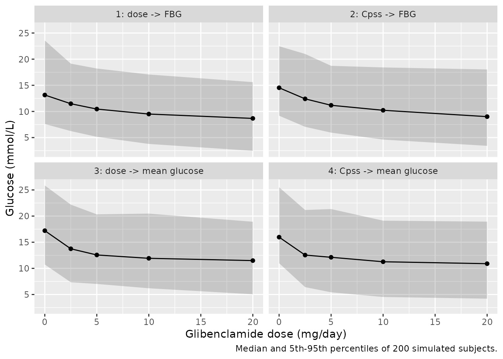
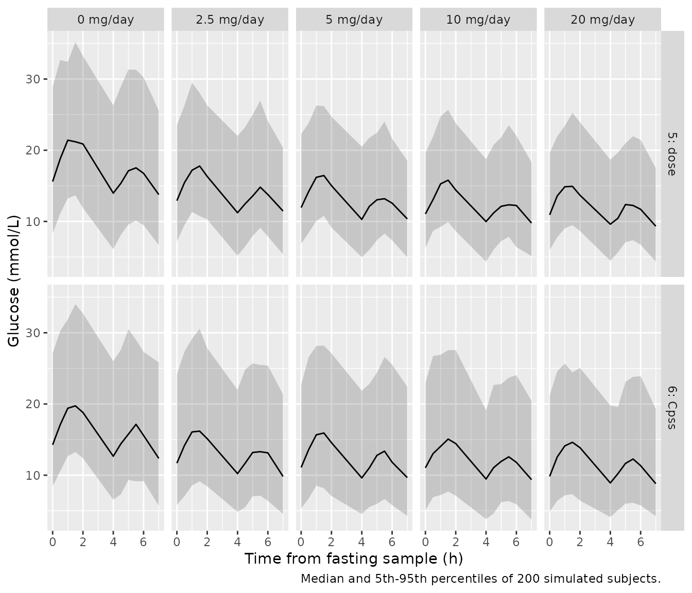

# Glibenclamide glucose response PK/PD (Rambiritch 2016)

## Model and source

Rambiritch 2016 fitted **six** pharmacodynamic models to one
glibenclamide dose-escalation study: three glucose endpoints, each
driven either by the daily dose or by the average steady-state plasma
concentration (Cpss). All six are reported as final, with full parameter
tables, so each is a separate model file and all six share this
vignette.

| Model | Driver | Endpoint | Model file |
|----|----|----|----|
| 1 | Dose | Fasting blood glucose (FBG) | `Rambiritch_2016_glibenclamide_dose_fpg` |
| 2 | Cpss | Fasting blood glucose | `Rambiritch_2016_glibenclamide_cpss_fpg` |
| 3 | Dose | Mean glucose over the sampling day | `Rambiritch_2016_glibenclamide_dose_meanglucose` |
| 4 | Cpss | Mean glucose over the sampling day | `Rambiritch_2016_glibenclamide_cpss_meanglucose` |
| 5 | Dose | Full glucose-time profile | `Rambiritch_2016_glibenclamide_dose_glucoseprofile` |
| 6 | Cpss | Full glucose-time profile | `Rambiritch_2016_glibenclamide_cpss_glucoseprofile` |

The companion population PK paper on the same cohort is a separate
model, `Rambiritch_2016_glibenclamide`; its CL/F (2.16 L/h) converts
dose to Cpss in Models 2, 4 and 6.

``` r

stems <- c(
  m1 = "Rambiritch_2016_glibenclamide_dose_fpg",
  m2 = "Rambiritch_2016_glibenclamide_cpss_fpg",
  m3 = "Rambiritch_2016_glibenclamide_dose_meanglucose",
  m4 = "Rambiritch_2016_glibenclamide_cpss_meanglucose",
  m5 = "Rambiritch_2016_glibenclamide_dose_glucoseprofile",
  m6 = "Rambiritch_2016_glibenclamide_cpss_glucoseprofile"
)
uis <- lapply(stems, function(s) rxode2::rxode(readModelDb(s)))
#> ℹ parameter labels from comments will be replaced by 'label()'
#> ℹ parameter labels from comments will be replaced by 'label()'
#> ℹ parameter labels from comments will be replaced by 'label()'
#> ℹ parameter labels from comments will be replaced by 'label()'
#> ℹ parameter labels from comments will be replaced by 'label()'
#> ℹ parameter labels from comments will be replaced by 'label()'
outputs <- c(
  m1 = "fpg", m2 = "fpg", m3 = "glucose_mean", m4 = "glucose_mean",
  m5 = "glucose", m6 = "glucose"
)
```

- Citation: Rambiritch V, Naidoo P, Pillai G. Glibenclamide population
  pharmacokinetic/pharmacodynamic modeling in South African type 2
  diabetic subjects. Clin Pharmacol. 2016;8:141-150.
  <doi:10.2147/CPAA.S102674>. Parameter values are the ‘Dose-fasting
  glucose model’ column of Table 1; the structural equation is Equation
  1.
- Article: <https://doi.org/10.2147/CPAA.S102674>

The structure is an inhibitory Emax model on a drug-free baseline:

- Models 1, 3, 5 (Equation 1):
  `Effect = E0 * (1 - DOSE * Emax / (DOSE + ED50))`
- Models 2, 4, 6 (Equations 2-3):
  `Effect = E0 * (1 - Cpss * Emax / (Cpss + EC50))`, with
  `Cpss = DOSE / (CL/F * 24)`
- Models 5 and 6 replace the constant `E0` with a two-harmonic Fourier
  series with an 8-hour period (Equation 4), which captures the glucose
  excursions after breakfast (time 0) and lunch (about 4 hours later):
  `E0(t) = A0 + A1 cos(2 pi t/8) + B1 sin(2 pi t/8) + A2 cos(4 pi t/8) + B2 sin(4 pi t/8)`.

## Population

Twenty-four adults with poorly controlled type 2 diabetes in
KwaZulu-Natal, South Africa, were escalated through glibenclamide 0,
2.5, 5, 10 and 20 mg once daily at 2-week intervals. Glucose was
measured by glucometer over an 8-hour sampling day on each dose level
(fasting sample at time 0, breakfast, lunch about 4 hours later).
Subject 16 stopped at 5 mg/day because of hypoglycaemia and subjects 20,
21 and 24 had incomplete data, but all 24 were in the PK/PD data set.
The paper does not reprint demographics; the companion PK paper’s Table
1 describes the same cohort: age 39-73 years (mean 54), weight
42.0-107.8 kg (mean 71.1), 20 female and 2 male among the 22
characterised at entry, mean fasting blood glucose 15.4 mmol/L and mean
HbA1c 12.2%.

``` r

str(uis$m1$population[c("n_subjects", "sex_female_pct", "dose_range")])
#> List of 3
#>  $ n_subjects    : int 24
#>  $ sex_female_pct: num 91
#>  $ dose_range    : chr "Glibenclamide 0, 2.5, 5, 10 and 20 mg once daily, escalated at 2-week intervals"
```

## Source trace

Every `ini()` value carries an in-file comment naming its table and
column. In summary:

| Element | Source |
|----|----|
| Inhibitory Emax on dose | Equation 1 |
| Inhibitory Emax on Cpss | Equation 2 |
| `Cpss = DOSE / (CL/F x 24)`, CL/F = 2.16 L/h | Equation 3; footnotes of Tables 1-3 (companion PK paper, its Table 3) |
| Fourier baseline, period 8 h | Equation 4 and the text below it |
| Exponential BSV on A0 / E0 (and Emax, ED50, EC50) | Equation 5 |
| Additive BSV on A1, B1, A2, B2 with one shared variance | Equation 6 and the text below it |
| Proportional residual error | Equation 7 |
| Models 1-2 parameters | Table 1 |
| Models 3-4 parameters | Table 2 |
| Models 5-6 parameters | Table 3 |
| BSV on CL/F in Models 2, 4, 6 (33.91% CV) | Companion PK paper, Table 3 |

``` r

param_tab <- bind_rows(lapply(names(uis), function(m) {
  ini <- uis[[m]]$iniDf
  data.frame(
    model = m,
    parameter = ini$name,
    estimate = signif(ifelse(grepl("^l", ini$name) & is.na(ini$neta1),
      exp(ini$est), ini$est), 4),
    fixed = ini$fix
  )
}))
param_tab |>
  dplyr::rename(
    "Model" = model, "Parameter" = parameter,
    "Estimate (back-transformed for log-scale thetas; variance for etas)" = estimate,
    "Fixed" = fixed
  ) |>
  knitr::kable()
```

| Model | Parameter | Estimate (back-transformed for log-scale thetas; variance for etas) | Fixed |
|:---|:---|---:|:---|
| m1 | le0 | 14.1000000 | FALSE |
| m1 | lemax | 0.3700000 | FALSE |
| m1 | led50 | 4.5600000 | FALSE |
| m1 | propSd | 0.1500000 | FALSE |
| m1 | etale0 | 0.0843900 | FALSE |
| m1 | etalemax | 0.2370000 | FALSE |
| m1 | etaled50 | 0.0000000 | FALSE |
| m2 | lcl | 2.1600000 | TRUE |
| m2 | le0 | 14.3000000 | FALSE |
| m2 | lemax | 0.3900000 | FALSE |
| m2 | lec50 | 85.2000000 | FALSE |
| m2 | propSd | 0.1400000 | FALSE |
| m2 | etalcl | 0.1150000 | TRUE |
| m2 | etale0 | 0.0750800 | FALSE |
| m2 | etalemax | 0.3080000 | FALSE |
| m2 | etalec50 | 0.0000002 | FALSE |
| m3 | le0 | 16.7000000 | FALSE |
| m3 | lemax | 0.3400000 | FALSE |
| m3 | led50 | 1.8500000 | FALSE |
| m3 | propSd | 0.0875000 | FALSE |
| m3 | etale0 | 0.0732800 | FALSE |
| m3 | etalemax | 0.2600000 | FALSE |
| m3 | etaled50 | 1.4500000 | FALSE |
| m4 | lcl | 2.1600000 | TRUE |
| m4 | le0 | 16.7000000 | FALSE |
| m4 | lemax | 0.3400000 | FALSE |
| m4 | lec50 | 36.0000000 | FALSE |
| m4 | propSd | 0.0892000 | FALSE |
| m4 | etalcl | 0.1150000 | TRUE |
| m4 | etale0 | 0.0725800 | FALSE |
| m4 | etalemax | 0.2590000 | FALSE |
| m4 | etalec50 | 1.1700000 | FALSE |
| m5 | le0 | 15.9000000 | FALSE |
| m5 | e0_glucose_fourier_cos1 | 0.9500000 | FALSE |
| m5 | e0_glucose_fourier_sin1 | 1.4500000 | FALSE |
| m5 | e0_glucose_fourier_cos2 | -1.9500000 | FALSE |
| m5 | e0_glucose_fourier_sin2 | 2.6300000 | FALSE |
| m5 | e0_glucose_fourier_period | 8.0000000 | TRUE |
| m5 | lemax | 0.3400000 | FALSE |
| m5 | led50 | 2.2100000 | FALSE |
| m5 | propSd | 0.1300000 | FALSE |
| m5 | etale0 | 0.0824300 | FALSE |
| m5 | etae0_glucose_fourier_cos1 | 1.4600000 | FALSE |
| m5 | etae0_glucose_fourier_sin1 | 1.4600000 | FALSE |
| m5 | etae0_glucose_fourier_cos2 | 1.4600000 | FALSE |
| m5 | etae0_glucose_fourier_sin2 | 1.4600000 | FALSE |
| m5 | etalemax | 0.0033060 | FALSE |
| m5 | etaled50 | 0.0228900 | FALSE |
| m6 | lcl | 2.1600000 | TRUE |
| m6 | le0 | 15.4000000 | FALSE |
| m6 | e0_glucose_fourier_cos1 | 0.9700000 | FALSE |
| m6 | e0_glucose_fourier_sin1 | 1.4500000 | FALSE |
| m6 | e0_glucose_fourier_cos2 | -1.8600000 | FALSE |
| m6 | e0_glucose_fourier_sin2 | 2.5700000 | FALSE |
| m6 | e0_glucose_fourier_period | 8.0000000 | TRUE |
| m6 | lemax | 0.3100000 | FALSE |
| m6 | lec50 | 43.6000000 | FALSE |
| m6 | propSd | 0.1300000 | FALSE |
| m6 | etalcl | 0.1150000 | TRUE |
| m6 | etale0 | 0.1070000 | FALSE |
| m6 | etae0_glucose_fourier_cos1 | 0.0049700 | FALSE |
| m6 | etae0_glucose_fourier_sin1 | 0.0049700 | FALSE |
| m6 | etae0_glucose_fourier_cos2 | 0.0049700 | FALSE |
| m6 | etae0_glucose_fourier_sin2 | 0.0049700 | FALSE |
| m6 | etalemax | 0.2060000 | FALSE |
| m6 | etalec50 | 4.8800000 | FALSE |

## Deterministic checks against the paper

These use the typical-value parameters only, so every comparison is
exact up to the rounding of the printed numbers.

``` r

typical <- function(m, dose, time = 0) {
  ev <- expand.grid(time = time, DOSE = dose)
  ev$id <- seq_len(nrow(ev))
  ev$evid <- 0
  sim <- rxode2::rxSolve(rxode2::zeroRe(uis[[m]]), ev, returnType = "data.frame")
  stopifnot(nrow(sim) == nrow(ev))
  data.frame(DOSE = ev$DOSE, time = ev$time, value = sim[[outputs[[m]]]])
}
```

### Derived ED50 of the Cpss models (unit check on EC50)

Each table footnote prints `derived ED50 = EC50 x CL/f x 24`. With CL/F
= 2.16 L/h the multiplier is 51.84 L, so the printed derived ED50s
(4.41, 1.87 and 2.26 mg) hold only if EC50 is in ug/L (ng/mL), not the
`mg/L` the table headers print. The models encode EC50 in ng/mL; solving
each Cpss model at the paper’s derived ED50 must give exactly half of
the maximal inhibition.

``` r

derived <- data.frame(
  model = c("m2", "m4", "m6"),
  ec50_ngml = c(85.20, 36.00, 43.60),
  printed_ed50_mg = c(4.41, 1.87, 2.26)
)
derived$computed_ed50_mg <- derived$ec50_ngml * 2.16 * 24 / 1000
derived$frac_of_emax_at_printed_ed50 <- vapply(seq_len(nrow(derived)), function(i) {
  m <- derived$model[i]
  e0 <- typical(m, 0)$value
  eff <- typical(m, derived$printed_ed50_mg[i])$value
  emax <- exp(uis[[m]]$iniDf$est[uis[[m]]$iniDf$name == "lemax"])
  (1 - eff / e0) / emax
}, numeric(1))
#> ℹ omega/sigma items treated as zero: 'etalcl', 'etale0', 'etalemax', 'etalec50'
#> ℹ omega/sigma items treated as zero: 'etalcl', 'etale0', 'etalemax', 'etalec50'
#> ℹ omega/sigma items treated as zero: 'etalcl', 'etale0', 'etalemax', 'etalec50'
#> ℹ omega/sigma items treated as zero: 'etalcl', 'etale0', 'etalemax', 'etalec50'
#> ℹ omega/sigma items treated as zero: 'etalcl', 'etale0', 'etae0_glucose_fourier_cos1', 'etae0_glucose_fourier_sin1', 'etae0_glucose_fourier_cos2', 'etae0_glucose_fourier_sin2', 'etalemax', 'etalec50'
#> ℹ omega/sigma items treated as zero: 'etalcl', 'etale0', 'etae0_glucose_fourier_cos1', 'etae0_glucose_fourier_sin1', 'etae0_glucose_fourier_cos2', 'etae0_glucose_fourier_sin2', 'etalemax', 'etalec50'
derived |>
  dplyr::rename(
    "Model" = model, "EC50 (ng/mL)" = ec50_ngml,
    "Printed derived ED50 (mg)" = printed_ed50_mg,
    "EC50 x 51.84 L (mg)" = computed_ed50_mg,
    "Inhibition at printed ED50 / Emax" = frac_of_emax_at_printed_ed50
  ) |>
  knitr::kable(digits = 3)
```

| Model | EC50 (ng/mL) | Printed derived ED50 (mg) | EC50 x 51.84 L (mg) | Inhibition at printed ED50 / Emax |
|:---|---:|---:|---:|---:|
| m2 | 85.2 | 4.41 | 4.417 | 0.500 |
| m4 | 36.0 | 1.87 | 1.866 | 0.501 |
| m6 | 43.6 | 2.26 | 2.260 | 0.500 |

``` r

stopifnot(
  # printed derived ED50s are rounded to 0.01 mg
  all(abs(derived$computed_ed50_mg - derived$printed_ed50_mg) < 0.01),
  # a 1000x unit slip in EC50 would put this near 0 or near 1, not 0.5
  all(abs(derived$frac_of_emax_at_printed_ed50 - 0.5) < 0.005)
)
```

### Maximal effect: FBG from 15.4 to 10.6 and 9.7 mmol/L

The Discussion translates the range of Emax (0.37 for Model 1 to 0.31
for Model 6) into a reduction of FBG from the cohort mean of 15.4 mmol/L
to 9.7 and 10.6 mmol/L. At a dose far above every ED50 the models reach
`E0 * (1 - Emax)`.

``` r

frac_remaining <- vapply(c("m1", "m6"), function(m) {
  typical(m, 1e6)$value / typical(m, 0)$value
}, numeric(1))
#> ℹ omega/sigma items treated as zero: 'etale0', 'etalemax', 'etaled50'
#> ℹ omega/sigma items treated as zero: 'etale0', 'etalemax', 'etaled50'
#> ℹ omega/sigma items treated as zero: 'etalcl', 'etale0', 'etae0_glucose_fourier_cos1', 'etae0_glucose_fourier_sin1', 'etae0_glucose_fourier_cos2', 'etae0_glucose_fourier_sin2', 'etalemax', 'etalec50'
#> ℹ omega/sigma items treated as zero: 'etalcl', 'etale0', 'etae0_glucose_fourier_cos1', 'etae0_glucose_fourier_sin1', 'etae0_glucose_fourier_cos2', 'etae0_glucose_fourier_sin2', 'etalemax', 'etalec50'
fbg_max <- unname(15.4 * frac_remaining)
data.frame(
  model = c("Model 1", "Model 6"),
  row.names = NULL,
  predicted = round(fbg_max, 2),
  paper = c(9.7, 10.6)
) |>
  dplyr::rename("Model" = model, "FBG at maximal effect (mmol/L)" = predicted,
    "Paper (mmol/L)" = paper) |>
  knitr::kable()
```

| Model   | FBG at maximal effect (mmol/L) | Paper (mmol/L) |
|:--------|-------------------------------:|---------------:|
| Model 1 |                           9.70 |            9.7 |
| Model 6 |                          10.63 |           10.6 |

``` r

stopifnot(all(abs(fbg_max - c(9.7, 10.6)) < 0.05))
```

### Fourier baseline of Models 5 and 6

The placebo glucose profile has two peaks, one after breakfast and one
after lunch about 4 hours later. Because every term of the series
completes a whole number of cycles in 8 hours, the series averages to
`A0` over the sampling day – a check that the period and harmonics are
encoded as printed.

``` r

grid <- seq(0, 8, by = 0.01)
fourier <- bind_rows(lapply(c("m5", "m6"), function(m) {
  cbind(model = m, typical(m, 0, grid))
}))
#> ℹ omega/sigma items treated as zero: 'etale0', 'etae0_glucose_fourier_cos1', 'etae0_glucose_fourier_sin1', 'etae0_glucose_fourier_cos2', 'etae0_glucose_fourier_sin2', 'etalemax', 'etaled50'
#> Warning: multi-subject simulation without without 'omega'
#> ℹ omega/sigma items treated as zero: 'etalcl', 'etale0', 'etae0_glucose_fourier_cos1', 'etae0_glucose_fourier_sin1', 'etae0_glucose_fourier_cos2', 'etae0_glucose_fourier_sin2', 'etalemax', 'etalec50'
#> Warning: multi-subject simulation without without 'omega'
peaks <- fourier |>
  group_by(model) |>
  summarise(
    peak1_h = time[time < 4][which.max(value[time < 4])],
    peak2_h = time[time >= 4][which.max(value[time >= 4])],
    day_mean = mean(value[-length(value)]),
    a0 = exp(uis[[model[1]]]$iniDf$est[uis[[model[1]]]$iniDf$name == "le0"])
  )
peaks |>
  dplyr::rename("Model" = model, "First peak (h)" = peak1_h,
    "Second peak (h)" = peak2_h, "Mean over 0-8 h (mmol/L)" = day_mean,
    "A0 (mmol/L)" = a0) |>
  knitr::kable(digits = 2)
```

| Model | First peak (h) | Second peak (h) | Mean over 0-8 h (mmol/L) | A0 (mmol/L) |
|:------|---------------:|----------------:|-------------------------:|------------:|
| m5    |           1.39 |            5.43 |                     15.9 |        15.9 |
| m6    |           1.38 |            5.42 |                     15.4 |        15.4 |

``` r

stopifnot(
  nrow(peaks) == 2,
  # paper: peaks at about 2 and 6 h, i.e. about 4 h apart
  all(peaks$peak1_h > 1 & peaks$peak1_h < 2.5),
  all(peaks$peak2_h > 5 & peaks$peak2_h < 6.5),
  all(abs(peaks$peak2_h - peaks$peak1_h - 4) < 0.5),
  # whole-cycle average equals A0 to grid precision
  all(abs(peaks$day_mean - peaks$a0) < 1e-3)
)
```

The model’s peaks sit at about 1.4 and 5.4 hours. The paper’s “about 2
and 6 hours” describes the observed data on its sampling grid (samples
at 1.5 and 2 h after breakfast and at 5.5 and 6 h), so the agreement is
within one sampling interval.

### Typical dose-response across the six models

``` r

doses <- c(0, 2.5, 5, 10, 20)
dr <- bind_rows(lapply(names(uis), function(m) {
  t0 <- if (m %in% c("m5", "m6")) grid else 0
  typical(m, doses, t0) |>
    group_by(DOSE) |>
    summarise(value = mean(value), .groups = "drop") |>
    mutate(model = m, pct_of_baseline = 100 * value / value[DOSE == 0])
}))
#> ℹ omega/sigma items treated as zero: 'etale0', 'etalemax', 'etaled50'
#> Warning: multi-subject simulation without without 'omega'
#> ℹ omega/sigma items treated as zero: 'etalcl', 'etale0', 'etalemax', 'etalec50'
#> Warning: multi-subject simulation without without 'omega'
#> ℹ omega/sigma items treated as zero: 'etale0', 'etalemax', 'etaled50'
#> Warning: multi-subject simulation without without 'omega'
#> ℹ omega/sigma items treated as zero: 'etalcl', 'etale0', 'etalemax', 'etalec50'
#> Warning: multi-subject simulation without without 'omega'
#> ℹ omega/sigma items treated as zero: 'etale0', 'etae0_glucose_fourier_cos1', 'etae0_glucose_fourier_sin1', 'etae0_glucose_fourier_cos2', 'etae0_glucose_fourier_sin2', 'etalemax', 'etaled50'
#> Warning: multi-subject simulation without without 'omega'
#> ℹ omega/sigma items treated as zero: 'etalcl', 'etale0', 'etae0_glucose_fourier_cos1', 'etae0_glucose_fourier_sin1', 'etae0_glucose_fourier_cos2', 'etae0_glucose_fourier_sin2', 'etalemax', 'etalec50'
#> Warning: multi-subject simulation without without 'omega'
dr |>
  select(model, DOSE, pct_of_baseline) |>
  tidyr::pivot_wider(names_from = DOSE, values_from = pct_of_baseline) |>
  dplyr::rename("Model" = model) |>
  knitr::kable(digits = 1, caption = "Typical glucose as % of the drug-free value, by daily dose (mg). For Models 5-6 the value is the 0-8 h average.")
```

| Model |   0 |  2.5 |    5 |   10 |   20 |
|:------|----:|-----:|-----:|-----:|-----:|
| m1    | 100 | 86.9 | 80.6 | 74.6 | 69.9 |
| m2    | 100 | 85.9 | 79.3 | 72.9 | 68.1 |
| m3    | 100 | 80.5 | 75.2 | 71.3 | 68.9 |
| m4    | 100 | 80.5 | 75.2 | 71.3 | 68.9 |
| m5    | 100 | 82.0 | 76.4 | 72.2 | 69.4 |
| m6    | 100 | 83.7 | 78.7 | 74.7 | 72.1 |

Typical glucose as % of the drug-free value, by daily dose (mg). For
Models 5-6 the value is the 0-8 h average. {.table}

``` r

gain <- dr |>
  group_by(model) |>
  summarise(
    first5 = 100 - pct_of_baseline[DOSE == 5],
    extra = pct_of_baseline[DOSE == 5] - pct_of_baseline[DOSE == 20]
  )
stopifnot(nrow(gain) == 6, all(gain$extra < gain$first5))
```

Across the six models, the first 5 mg/day lowers typical glucose by
19-25 percentage points of baseline, and going on from 5 to 20 mg/day
lowers it by only a further 6-11 points. This matches the paper’s
conclusion that doses above 5 mg/day add little.

## Virtual cohort and simulation

Each simulated subject is escalated through the five dose levels exactly
as in the study, with one sampling day at steady state on each level
(days 14, 28, 42, 56 and 70). The profile models are sampled at the
paper’s times (0, 0.5, 1, 1.5, 2, 4, 4.5, 5, 5.5, 6 and 7 hours); the
fasting and mean-glucose models have one value per sampling day. 200
subjects per model.

``` r

rxode2::rxSetSeed(20160926)
n_sub <- 200
samp_h <- c(0, 0.5, 1, 1.5, 2, 4, 4.5, 5, 5.5, 6, 7)
make_events <- function(hours) {
  expand.grid(h = hours, level = seq_along(doses), id = seq_len(n_sub)) |>
    mutate(
      DOSE = doses[level],
      time = (14 * level) * 24 + h,
      evid = 0
    ) |>
    arrange(id, time)
}
sims <- bind_rows(lapply(names(uis), function(m) {
  ev <- make_events(if (m %in% c("m5", "m6")) samp_h else 0)
  s <- rxode2::rxSolve(uis[[m]], ev, returnType = "data.frame")
  stopifnot(nrow(s) == nrow(ev))
  data.frame(
    model = m, id = s$id, DOSE = ev$DOSE, h = ev$h,
    ipred = s[[outputs[[m]]]], dv = s$sim
  )
}))
```

### Replicates Figures 1-3: glucose by dose level

Figures 1-3 of Rambiritch 2016 show per-subject observed and predicted
FBG (Models 1 and 2) and mean glucose (Model 4) across the dose levels.
The simulated median and 5th-95th percentiles are below.

``` r

sims |>
  filter(model %in% c("m1", "m2", "m3", "m4")) |>
  group_by(model, DOSE) |>
  summarise(
    lo = quantile(dv, 0.05), med = median(dv), hi = quantile(dv, 0.95),
    .groups = "drop"
  ) |>
  mutate(model = factor(model, labels = c(
    "1: dose -> FBG", "2: Cpss -> FBG",
    "3: dose -> mean glucose", "4: Cpss -> mean glucose"
  ))) |>
  ggplot(aes(DOSE, med)) +
  geom_ribbon(aes(ymin = lo, ymax = hi), alpha = 0.2) +
  geom_line() +
  geom_point() +
  facet_wrap(~model) +
  labs(x = "Glibenclamide dose (mg/day)", y = "Glucose (mmol/L)",
    caption = "Median and 5th-95th percentiles of 200 simulated subjects.")
```



### Replicates Figure 4: full glucose profile by dose level

Figure 4 shows each subject’s glucose profile over the sampling day, one
column per dose level. The simulated median and 5th-95th percentiles for
Model 6 (the model plotted in Figure 4) and Model 5 are below.

``` r

sims |>
  filter(model %in% c("m5", "m6")) |>
  group_by(model, DOSE, h) |>
  summarise(
    lo = quantile(dv, 0.05), med = median(dv), hi = quantile(dv, 0.95),
    .groups = "drop"
  ) |>
  mutate(
    model = factor(model, labels = c("5: dose", "6: Cpss")),
    dose_lab = factor(paste(DOSE, "mg/day"), levels = paste(doses, "mg/day"))
  ) |>
  ggplot(aes(h, med)) +
  geom_ribbon(aes(ymin = lo, ymax = hi), alpha = 0.2) +
  geom_line() +
  facet_grid(model ~ dose_lab) +
  labs(x = "Time from fasting sample (h)", y = "Glucose (mmol/L)",
    caption = "Median and 5th-95th percentiles of 200 simulated subjects.")
```



### Cohort checks

Two checks tie the simulated cohort to the typical-value model. First,
the simulated median at the drug-free level should sit on E0: the etas
are centred on zero and the proportional residual error is symmetric.
Second, for the dose models (1 and 3) each subject’s fractional glucose
remaining at 20 mg/day, `1 - f * Emax_i` with `f = 20 / (20 + ED50)`, is
monotone in that subject’s Emax, so its median is exactly the typical
value. (The cohort median of glucose itself at high dose sits below the
typical value – by about 6% at 20 mg/day in Model 1 even with 20 000
subjects – because the long tail of Emax skews the product; that is why
the drug effect is checked per subject.)

``` r

typ_tab <- bind_rows(lapply(c("m1", "m2", "m3", "m4"), function(m) {
  cbind(model = m, typical(m, doses))
})) |>
  select(model, DOSE, typical = value)
#> ℹ omega/sigma items treated as zero: 'etale0', 'etalemax', 'etaled50'
#> Warning: multi-subject simulation without without 'omega'
#> ℹ omega/sigma items treated as zero: 'etalcl', 'etale0', 'etalemax', 'etalec50'
#> Warning: multi-subject simulation without without 'omega'
#> ℹ omega/sigma items treated as zero: 'etale0', 'etalemax', 'etaled50'
#> Warning: multi-subject simulation without without 'omega'
#> ℹ omega/sigma items treated as zero: 'etalcl', 'etale0', 'etalemax', 'etalec50'
#> Warning: multi-subject simulation without without 'omega'
base_chk <- sims |>
  filter(model %in% c("m1", "m2", "m3", "m4"), DOSE == 0) |>
  group_by(model) |>
  summarise(sim_median = median(dv), .groups = "drop") |>
  left_join(filter(typ_tab, DOSE == 0), by = "model") |>
  mutate(ratio = sim_median / typical)
inh_chk <- sims |>
  filter(model %in% c("m1", "m3"), DOSE %in% c(0, 20)) |>
  group_by(model, id) |>
  summarise(frac = ipred[DOSE == 20] / ipred[DOSE == 0], .groups = "drop") |>
  group_by(model) |>
  summarise(sim_median = median(frac), .groups = "drop") |>
  left_join(
    typ_tab |>
      group_by(model) |>
      summarise(typical = typical[DOSE == 20] / typical[DOSE == 0]),
    by = "model"
  ) |>
  mutate(ratio = sim_median / typical)
stopifnot(nrow(base_chk) == 4, nrow(inh_chk) == 2,
  !anyNA(base_chk$ratio), !anyNA(inh_chk$ratio))
bind_rows(
  mutate(base_chk, check = "Glucose at 0 mg/day (mmol/L)"),
  mutate(inh_chk, check = "Fraction remaining at 20 mg/day")
) |>
  select(check, model, sim_median, typical, ratio) |>
  dplyr::rename("Check" = check, "Model" = model,
    "Simulated median" = sim_median, "Typical value" = typical,
    "Ratio" = ratio) |>
  knitr::kable(digits = 3)
```

| Check                           | Model | Simulated median | Typical value | Ratio |
|:--------------------------------|:------|-----------------:|--------------:|------:|
| Glucose at 0 mg/day (mmol/L)    | m1    |           13.144 |        14.100 | 0.932 |
| Glucose at 0 mg/day (mmol/L)    | m2    |           14.527 |        14.300 | 1.016 |
| Glucose at 0 mg/day (mmol/L)    | m3    |           17.210 |        16.700 | 1.031 |
| Glucose at 0 mg/day (mmol/L)    | m4    |           15.970 |        16.700 | 0.956 |
| Fraction remaining at 20 mg/day | m1    |            0.678 |         0.699 | 0.971 |
| Fraction remaining at 20 mg/day | m3    |            0.721 |         0.689 | 1.047 |

``` r

# Over ten 200-subject cohorts the largest deviations were 0.068 (baseline)
# and 0.055 (inhibition); the standard error of a 200-subject median is about
# 0.026 for each. A 15% error in E0 or a 10% error in the inhibition fails.
stopifnot(
  all(abs(base_chk$ratio - 1) < 0.12),
  all(abs(inh_chk$ratio - 1) < 0.10)
)
neg_pct <- 100 * mean(sims$ipred < 0)
```

With exponential BSV on Emax (up to 55% CV), a small share of simulated
subjects draws `Emax > 1` and so a negative predicted glucose at the
highest doses: 0.05% of simulated predictions here. This is a property
of the published model, not of the encoding; see the assumptions below.

## PKNCA

Not applicable. None of the six models has a PK layer or a
concentration-time course: the driver is the daily dose, or a
steady-state concentration computed algebraically from it, and each
endpoint is an algebraic function of that driver (and, for Models 5 and
6, of time within the sampling day). The deterministic checks above take
the place of an NCA comparison; the companion PK model
`Rambiritch_2016_glibenclamide` carries the NCA validation for the
glibenclamide concentrations.

## Assumptions and deviations

- **EC50 units.** Tables 1-3 head the EC50 row `mg/L`. The paper’s own
  derived-ED50 footnotes reproduce only if EC50 is in ug/L (ng/mL),
  consistently across Models 2, 4 and 6, and only then does a 5 mg/day
  dose (Cpss about 96 ng/mL) sit near EC50, as the paper’s conclusions
  require. The models use ng/mL.
- **BSV conversion.** Every BSV is taken as `omega^2 = (CV/100)^2`. For
  the Fourier coefficients this is the only reading consistent with the
  paper: their BSV is additive (Equation 6) with one variance shared by
  all four coefficients, and the table prints one identical number on
  all four rows (120.83 in Model 5, 7.05 in Model 6). That number is
  therefore `sqrt(omega^2) x 100` of the additive eta, i.e. an SD of
  1.2083 and 0.0705 mmol/L. A CV reading would give four different SDs,
  contradicting the shared variance.
- **Fourier etas.** “The omega matrix for all the coefficients was
  constrained to the same value, ie, the eta values were drawn from the
  same distribution” is encoded as four independent etas with equal
  variance, not one eta shared by all four coefficients.
- **Form of the BSV on Emax, ED50 and EC50.** Equation 5 states the
  exponential form for the baseline only; the same form is assumed for
  Emax, ED50 and EC50, which are positive and reported as %CV. An
  exponential Emax can exceed 1 in a small share of subjects, giving a
  negative predicted glucose at high doses.
- **Near-zero BSV.** ED50 in Model 1 (0.01% CV) and EC50 in Model 2
  (0.04% CV) are kept as the tiny variances printed rather than dropped.
- **Residual error.** The glucose data were log-transformed and fitted
  with an additive error on the log scale; Equation 7 prints the
  proportional form, which is used here. The residual SD is the printed
  %CV (for example 15% for Model 1); the printed variance (0.02) is the
  same value rounded.
- **CL/F in the Cpss models.** The paper computed each subject’s Cpss
  from their individual CL/F from the companion PK model, which is not
  published per subject. The models use the population CL/F of 2.16 L/h
  with that model’s BSV of 33.91% CV, held fixed, so simulated Cpss
  carries the between-subject PK variability the Cpss driver was
  introduced to separate from PD variability. When fitting real data
  with known individual CL/F, the user may replace the random effect
  with the subject’s own value.
- **Time in Models 5 and 6.** `t` is hours from the fasting sample at
  the start of the sampling day. A continuous time axis across days
  stays in phase because 24 hours is three 8-hour periods, provided each
  day’s sampling starts at the same clock time; the series describes the
  0-8 h window only.
- **Demographics.** Taken from the companion PK paper’s Table 1 (same
  study), which characterises 22 of the 24 subjects.
- **Units.** Doses are in mg of glibenclamide and the outputs are
  glucose in mmol/L, so the dose and output units are deliberately of
  different dimensions.
