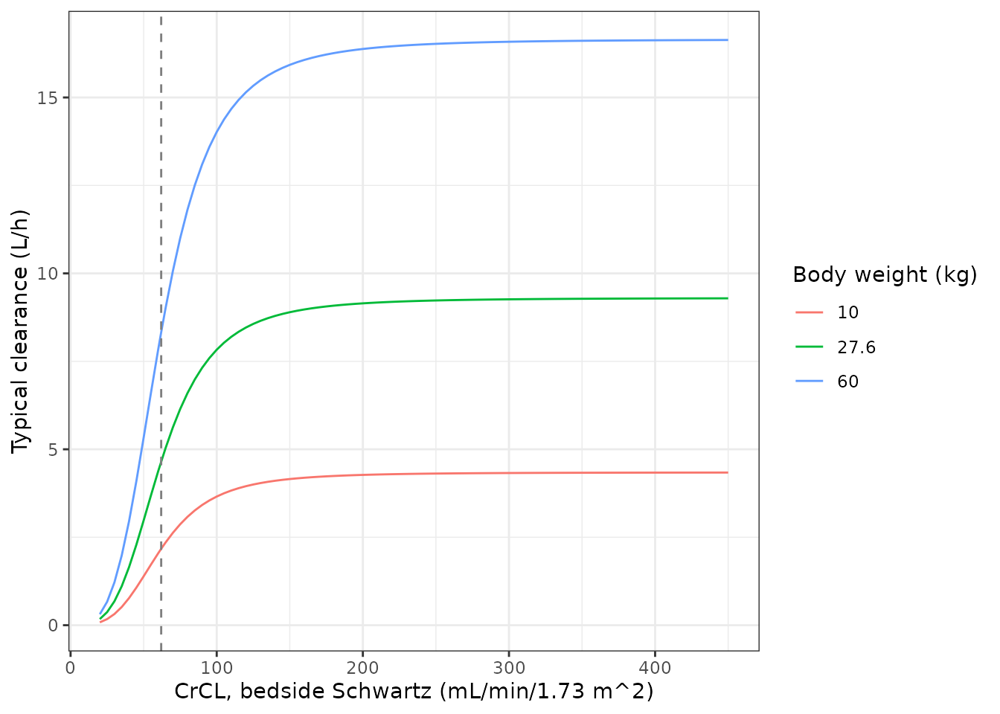
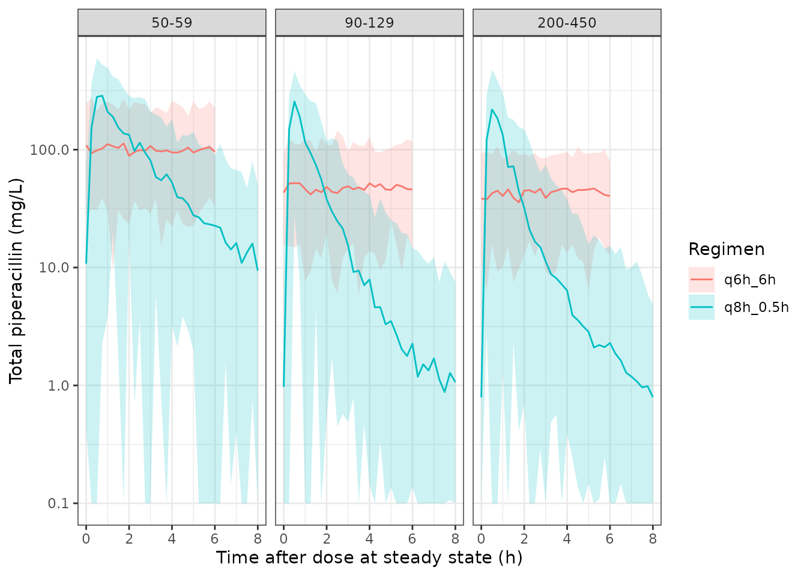

# Piperacillin (Ravix 2025)

## Model and source

- Citation: Ravix A, Di Paolo ER, Dao K, Perez MH, Crisinel PA, Buclin
  T, Andre P, Marzolini C, Csajka C, Guidi M. Piperacillin dosing in
  pediatric patients and augmented renal clearance: are current
  guidelines sufficient to achieve therapeutic concentration coverage? J
  Antimicrob Chemother. 2025;80(12):3419-3430. <doi:10.1093/jac/dkaf387>
- Description: Two-compartment IV population PK model for piperacillin
  in hospitalised children aged 1 month to 18 years, including patients
  with augmented renal clearance (Ravix 2025). All four disposition
  parameters scale allometrically with body weight (fixed exponents 0.75
  on CL and Q, 1 on V1 and V2, reference 27.6 kg); clearance is
  additionally a sigmoid (Hill) function of bedside-Schwartz creatinine
  clearance that saturates at 9.3 L/h (EC50 62 mL/min/1.73 m^2, Hill
  3.5). Exponential inter-individual variability on CL only;
  proportional residual error with separate magnitudes for samples drawn
  under intermittent and continuous infusion.
- Article: <https://doi.org/10.1093/jac/dkaf387> (open access;
  PMC12670153)

The supplementary files (Table S1 model-development summary, File S1
final NONMEM control stream, File S2 per-guideline simulation results)
are available with the article.

## Population

Ravix et al. analysed 386 piperacillin plasma concentrations from 104
hospitalised children aged 1 month to 18 years at the Lausanne
University Hospital, collected during routine therapeutic drug
monitoring between 2012 and 2022 (Table 2). At the time of sampling the
median age was 9.2 years (0.3-18.1) and the median body weight 27.6 kg
(5-73). Forty of the 104 patients were girls. Concentrations came from
oncology (36%), intensive care (18%), intermediate care (15%), surgery
(11%) and general paediatrics (20%). Renal function, estimated with the
bedside Schwartz equation, was strongly skewed toward augmented renal
clearance: median 146 mL/min/1.73 m^2 (23-540), with 22% of samples at
or above 200 and 38% between 130 and 199 mL/min/1.73 m^2. Most patients
received intermittent infusions (median 97 mg/kg per dose, three times
daily, median infusion 1 h); 22 patients also or only received
continuous infusions (median 321 mg/kg/day). Patients on ECMO or renal
replacement therapy were excluded.

The same information is available programmatically via
`readModelDb("Ravix_2025_piperacillin")()$population`.

## Source trace

Every `ini()` value carries an in-file comment pointing to its source.
The structural values are the Table 3 final estimates; the File S1
control stream carries near-identical starting values (CL 9.33, V1 8.43,
Q 0.624, V2 2.07, Hill 3.38, EC50 61.6) and confirms the equation forms.

| Equation / parameter | Value | Source location |
|----|----|----|
| `lclmax` (maximum CL at saturating CrCL, 27.6 kg) | log(9.30) L/h | Table 3, thetaCL |
| `lcrcl50` (CrCL at half-maximal CL) | log(62.00) mL/min/1.73 m^2 | Table 3, EC50 |
| `lhill` (Hill coefficient) | log(3.50) | Table 3, Hill |
| `lvc` (V1, 27.6 kg) | log(8.40) L | Table 3, thetaV1 |
| `lq` (Q, 27.6 kg) | log(0.63) L/h | Table 3, thetaQ |
| `lvp` (V2, 27.6 kg) | log(2.00) L | Table 3, thetaV2 |
| `e_wt_cl`, `e_wt_q` | 0.75 (fixed) | Methods, Model building; File S1 \$THETA 5 and 7 FIX |
| `e_wt_vc`, `e_wt_vp` | 1 (fixed) | Methods, Model building; File S1 \$THETA 6 and 8 FIX |
| `etalclmax` | 0.31^2 | Table 3, IIVCL 31% CV; scale from File S1 \$OMEGA 0.0955 |
| `propSd_intermittent` | 0.63 | Table 3, sigmaIntermittent 63%; File S1 \$SIGMA 0.393 |
| `propSd_continuous` | 0.44 | Table 3, sigmacontinuous 44%; File S1 \$SIGMA 0.19 |
| CL = thetaCL (BW/27.6)^0.75 CrCL^Hill / (EC50^Hill + CrCL^Hill) e^eta | n/a | Table 3 ‘Final equations’; File S1 \$PK (FCLCR, MBW = 27.6) |
| V1, Q, V2 allometric on BW/27.6 | n/a | Table 3 ‘Final equations’; File S1 \$PK |
| Two-compartment IV, linear elimination | n/a | Results, Population pharmacokinetic model; File S1 ADVAN3 TRANS4 |
| Proportional error, magnitude by infusion type | n/a | File S1 \$ERROR (CONTINUE = 0 / 1) |
| Unbound = 0.7 x total (simulations only) | n/a | Methods, Simulation |

## Typical-value checks

Clearance is the product of an allometric term and a Hill function of
CrCL that reaches half of its maximum at 62 mL/min/1.73 m^2. The curve
below is the typical clearance for children of 10, 27.6 and 60 kg.

``` r

mod <- readModelDb("Ravix_2025_piperacillin")
crcl_grid <- c(seq(20, 450, by = 5), 62)
tv_grid <- expand.grid(WT = c(10, 27.6, 60), CRCL = crcl_grid)
typical_cl <- function(WT, CRCL) {
  9.30 * (WT / 27.6)^0.75 * CRCL^3.5 / (62^3.5 + CRCL^3.5)
}

tv_ev <- tv_grid |>
  mutate(id = row_number(), time = 0, evid = 0, amt = 0, cmt = "central", REGIMEN_CONTINF = 0)
tv_sim <- rxode2::rxSolve(rxode2::zeroRe(mod), tv_ev, returnType = "data.frame") |>
  select(id, cl) |>
  left_join(tv_ev |> select(id, WT, CRCL), by = "id") |>
  mutate(cl_closed = typical_cl(WT, CRCL))
#> ℹ parameter labels from comments will be replaced by 'label()'
#> ℹ omega/sigma items treated as zero: 'etalclmax'

# The solve and the closed form use the same parameters, so only floating
# point separates them.
stopifnot(
  nrow(tv_sim) == nrow(tv_grid),
  max(abs(tv_sim$cl / tv_sim$cl_closed - 1)) < 1e-8,
  # Half-maximal clearance at CrCL = EC50 for a 27.6 kg child.
  abs(tv_sim$cl[tv_sim$WT == 27.6 & tv_sim$CRCL == 62] - 9.30 / 2) < 1e-6
)

ggplot(tv_sim |> filter(CRCL != 62 | WT != 27.6), aes(CRCL, cl, colour = factor(WT))) +
  geom_line() +
  geom_vline(xintercept = 62, linetype = "dashed", colour = "grey50") +
  labs(x = "CrCL, bedside Schwartz (mL/min/1.73 m^2)", y = "Typical clearance (L/h)",
       colour = "Body weight (kg)") +
  theme_bw()
```



At steady state under a constant-rate infusion, a linear model’s
concentration must equal the infusion rate divided by clearance. Solving
the two-compartment ODE system long enough to reach steady state and
comparing it with that identity checks the compartment wiring and units.

``` r

css_cases <- expand.grid(WT = c(8, 27.6, 60), CRCL = c(35, 62, 150, 300)) |>
  mutate(id = row_number(), rate = 300 * WT / 24) # 300 mg/kg/day continuous
css_ev <- bind_rows(
  css_cases |> transmute(id, time = 0, evid = 1, amt = rate * 96, rate, cmt = "central",
                         WT, CRCL, REGIMEN_CONTINF = 1),
  css_cases |> transmute(id, time = 95, evid = 0, amt = 0, rate = 0, cmt = "central",
                         WT, CRCL, REGIMEN_CONTINF = 1)
) |> arrange(id, time, desc(evid))
css_sim <- rxode2::rxSolve(rxode2::zeroRe(mod), css_ev, returnType = "data.frame") |>
  select(id, Cc) |>
  left_join(css_cases, by = "id") |>
  mutate(css_closed = rate / typical_cl(WT, CRCL), pct_diff = 100 * (Cc / css_closed - 1))
#> ℹ parameter labels from comments will be replaced by 'label()'
#> ℹ omega/sigma items treated as zero: 'etalclmax'

knitr::kable(css_sim |> select(WT, CRCL, Cc, css_closed, pct_diff) |>
  rename(`WT (kg)` = WT, `CrCL` = CRCL, `Simulated Css (mg/L)` = Cc,
         `Rate / CL (mg/L)` = css_closed, `Difference (%)` = pct_diff), digits = 2)
```

| WT (kg) | CrCL | Simulated Css (mg/L) | Rate / CL (mg/L) | Difference (%) |
|--------:|-----:|---------------------:|-----------------:|---------------:|
|     8.0 |   35 |               228.60 |           228.60 |           0.00 |
|    27.6 |   35 |               311.53 |           311.55 |          -0.01 |
|    60.0 |   35 |               378.14 |           378.30 |          -0.04 |
|     8.0 |   62 |                54.44 |            54.44 |           0.00 |
|    27.6 |   62 |                74.19 |            74.19 |           0.00 |
|    60.0 |   62 |                90.09 |            90.09 |           0.00 |
|     8.0 |  150 |                28.46 |            28.46 |           0.00 |
|    27.6 |  150 |                38.78 |            38.78 |           0.00 |
|    60.0 |  150 |                47.09 |            47.09 |           0.00 |
|     8.0 |  300 |                27.33 |            27.33 |           0.00 |
|    27.6 |  300 |                37.25 |            37.25 |           0.00 |
|    60.0 |  300 |                45.23 |            45.23 |           0.00 |

``` r


# Same parameters on both sides; 95 h is many terminal half-lives here.
stopifnot(max(abs(css_sim$pct_diff)) < 0.1)
```

## Virtual cohort

The source simulated 1000 virtual patients per renal-function band with
body weight uniform between 5 and 73 kg and CrCL uniform within each
band (Methods, Simulation). Here each band gets 200 patients. The same
patients receive three of the guideline regimens tabulated in File S2,
each of which appears in every CrCL band:

- `q8h_0.5h`: 100 mg/kg every 8 h over 0.5 h, maximum 4000 mg per dose
  (SwissPedDose, also Lexicomp and Micromedex);
- `q8h_4h`: 100 mg/kg every 8 h over 4 h, maximum 4000 mg per dose
  (RedBook);
- `q6h_6h`: 100 mg/kg every 6 h over 6 h, maximum 3000 mg per dose, that
  is a continuous infusion of 400 mg/kg/day (Nelson Textbook).

``` r

set.seed(20251201)
rxode2::rxSetSeed(20251201)

n_per_band <- 200
bands <- data.frame(
  band = c("30-39", "40-49", "50-59", "60-89", "90-129", "130-199", "200-450"),
  lo = c(30, 40, 50, 60, 90, 130, 200),
  hi = c(40, 50, 60, 90, 130, 200, 450)
)
band_levels <- bands$band

patients <- bands |>
  rowwise() |>
  reframe(band = band, WT = runif(n_per_band, 5, 73), CRCL = runif(n_per_band, lo, hi)) |>
  mutate(patient = row_number())

regimens <- data.frame(
  regimen = c("q8h_0.5h", "q8h_4h", "q6h_6h"),
  mgkg = 100, ii = c(8, 8, 6), dur = c(0.5, 4, 6), cap = c(4000, 4000, 3000),
  continf = c(0, 0, 1)
)

cohort <- tidyr::crossing(patients, regimens) |>
  mutate(id = row_number(), amt = pmin(mgkg * WT, cap))

stopifnot(
  nrow(cohort) == n_per_band * nrow(bands) * nrow(regimens),
  all(table(cohort$regimen, cohort$band) == n_per_band)
)
```

Each patient is dosed to steady state (`ss = 1`) and sampled at the
trough, the end of the steady-state dosing interval. With 100% fT \> MIC
as the target, the unbound trough is the quantity that decides target
attainment.

``` r

trough_ev <- bind_rows(
  cohort |> transmute(id, time = 0, evid = 1, amt, rate = amt / dur, ii, ss = 1,
                      cmt = "central", WT, CRCL, REGIMEN_CONTINF = continf),
  cohort |> transmute(id, time = ii, evid = 0, amt = 0, rate = 0, ii = 0, ss = 0,
                      cmt = "central", WT, CRCL, REGIMEN_CONTINF = continf)
) |> arrange(id, time, desc(evid))

trough <- rxode2::rxSolve(mod, trough_ev, returnType = "data.frame") |>
  select(id, Cc) |>
  left_join(cohort |> select(id, band, regimen, WT, CRCL), by = "id") |>
  mutate(cmin_free = 0.7 * Cc, band = factor(band, levels = band_levels))
#> ℹ parameter labels from comments will be replaced by 'label()'

stopifnot(nrow(trough) == nrow(cohort), !anyNA(trough$Cc), all(trough$Cc > 0))
```

The model’s own predictions are total concentrations (`Cc`, the IPRED of
the source). The unbound fraction of 0.7 is the source’s simulation
assumption (Methods, Simulation) and is applied here, outside the model,
in the same way. As in the source, the residual error is not part of the
target-attainment calculation.

## Replicate Figure 2: probability of target attainment

``` r

mic_grid <- c(0.25, 0.5, 1, 2, 4, 8, 16, 32, 64)
# File S2 (per-guideline workbook): PTA (%) for 100% fT > MIC.
published <- tibble::tribble(
  ~regimen, ~band, ~pta,
  "q8h_0.5h", "200-450", c(71.1, 36.6, 12.5, 2.7, 0.2, 0, 0, 0, 0),
  "q8h_0.5h", "130-199", c(75.4, 40.3, 15.1, 3.5, 0.4, 0, 0, 0, 0),
  "q8h_0.5h", "90-129", c(85.6, 53.9, 24.2, 7.5, 1.2, 0.1, 0, 0, 0),
  "q8h_0.5h", "60-89", c(97.6, 85, 59, 31.7, 13.2, 3, 0.3, 0, 0),
  "q8h_0.5h", "50-59", c(100, 99.6, 97.6, 88, 64, 34.8, 11.2, 1.4, 0),
  "q8h_0.5h", "40-49", c(100, 100, 100, 99.6, 96.8, 85.7, 61.5, 24.7, 4.4),
  "q8h_0.5h", "30-39", c(100, 100, 100, 100, 100, 99.9, 98.9, 92.1, 64.3),
  "q8h_4h", "200-450", c(94.5, 71.8, 38.7, 15.3, 3.6, 0.4, 0, 0, 0),
  "q8h_4h", "130-199", c(95.8, 75.8, 42.8, 18, 4.8, 0.5, 0, 0, 0),
  "q8h_4h", "90-129", c(98.1, 86.3, 57.1, 28.4, 9.6, 1.4, 0.1, 0, 0),
  "q8h_4h", "60-89", c(99.8, 97.6, 87.5, 63.9, 37.1, 14.9, 2.5, 0.1, 0),
  "q8h_4h", "50-59", c(100, 100, 99.8, 98.4, 91.1, 67.3, 33.3, 7.2, 0.2),
  "q8h_4h", "40-49", c(100, 100, 100, 100, 99.7, 97.3, 85, 51.7, 11.9),
  "q8h_4h", "30-39", c(100, 100, 100, 100, 100, 100, 99.9, 98.1, 81.9),
  "q6h_6h", "200-450", c(100, 100, 100, 100, 100, 99.9, 85.7, 15.4, 0),
  "q6h_6h", "130-199", c(100, 100, 100, 100, 100, 99.9, 87.3, 18.3, 0),
  "q6h_6h", "90-129", c(100, 100, 100, 100, 100, 100, 91.6, 28.4, 0.2),
  "q6h_6h", "60-89", c(100, 100, 100, 100, 100, 100, 98, 62.4, 4.5),
  "q6h_6h", "50-59", c(100, 100, 100, 100, 100, 100, 100, 94.7, 39.2),
  "q6h_6h", "40-49", c(100, 100, 100, 100, 100, 100, 100, 99.6, 84.5),
  "q6h_6h", "30-39", c(100, 100, 100, 100, 100, 100, 100, 100, 99.6)
) |>
  mutate(mic = list(mic_grid)) |>
  tidyr::unnest(c(pta, mic)) |>
  rename(pta_published = pta)

simulated_pta <- tidyr::crossing(trough |> select(id, band, regimen, cmin_free),
                                 mic = mic_grid) |>
  group_by(regimen, band, mic) |>
  summarise(pta_simulated = 100 * mean(cmin_free > mic), .groups = "drop")

pta <- simulated_pta |>
  left_join(published |> mutate(band = factor(band, levels = band_levels)),
            by = c("regimen", "band", "mic")) |>
  mutate(diff = pta_simulated - pta_published)
stopifnot(nrow(pta) == 3 * 7 * 9, !anyNA(pta$pta_published))
```

``` r

pta |>
  ggplot(aes(mic, pta_simulated, colour = regimen)) +
  annotate("rect", xmin = 8, xmax = 30, ymin = -Inf, ymax = Inf, fill = "palegreen", alpha = 0.3) +
  geom_hline(yintercept = 90, colour = "darkgreen") +
  geom_line() +
  geom_point(aes(y = pta_published), shape = 1) +
  scale_x_log10(breaks = mic_grid) +
  facet_wrap(~band, ncol = 2) +
  labs(x = "MIC (mg/L)", y = "PTA, 100% fT > MIC (%)", colour = "Regimen") +
  theme_bw() +
  theme(axis.text.x = element_text(angle = 45, hjust = 1))
```


Replicates Figure 2 of Ravix 2025 for three of the guideline regimens
(lines: this model; points: the source’s File S2 values). The shaded
band is the 8-30 mg/L therapeutic range; the horizontal line is the 90%
acceptability criterion.

``` r

pta |>
  filter(mic == 8) |>
  select(regimen, band, pta_simulated, pta_published) |>
  arrange(regimen, band) |>
  rename(Regimen = regimen, `CrCL band (mL/min/1.73 m^2)` = band,
         `Simulated PTA at MIC 8 (%)` = pta_simulated,
         `Published PTA at MIC 8 (%)` = pta_published) |>
  knitr::kable(digits = 1)
```

| Regimen | CrCL band (mL/min/1.73 m^2) | Simulated PTA at MIC 8 (%) | Published PTA at MIC 8 (%) |
|:---|:---|---:|---:|
| q6h_6h | 30-39 | 100.0 | 100.0 |
| q6h_6h | 40-49 | 100.0 | 100.0 |
| q6h_6h | 50-59 | 100.0 | 100.0 |
| q6h_6h | 60-89 | 100.0 | 100.0 |
| q6h_6h | 90-129 | 99.5 | 100.0 |
| q6h_6h | 130-199 | 100.0 | 99.9 |
| q6h_6h | 200-450 | 100.0 | 99.9 |
| q8h_0.5h | 30-39 | 100.0 | 99.9 |
| q8h_0.5h | 40-49 | 95.5 | 85.7 |
| q8h_0.5h | 50-59 | 68.0 | 34.8 |
| q8h_0.5h | 60-89 | 15.5 | 3.0 |
| q8h_0.5h | 90-129 | 3.5 | 0.1 |
| q8h_0.5h | 130-199 | 0.5 | 0.0 |
| q8h_0.5h | 200-450 | 1.5 | 0.0 |
| q8h_4h | 30-39 | 100.0 | 100.0 |
| q8h_4h | 40-49 | 100.0 | 97.3 |
| q8h_4h | 50-59 | 87.0 | 67.3 |
| q8h_4h | 60-89 | 43.5 | 14.9 |
| q8h_4h | 90-129 | 11.0 | 1.4 |
| q8h_4h | 130-199 | 4.0 | 0.5 |
| q8h_4h | 200-450 | 4.5 | 0.4 |

The model reproduces every conclusion the source draws from Figure 2 and
Table 4:

- the continuous 400 mg/kg/day infusion reaches the 90% criterion at the
  susceptibility breakpoint (MIC 8 mg/L) in every CrCL band;
- 100 mg/kg every 8 h over 30 min falls far short of it at MIC 8 once
  CrCL is above 60 mL/min/1.73 m^2;
- extending the infusion to 4 h raises target attainment but does not
  rescue intermittent dosing above 60 mL/min/1.73 m^2;
- because clearance saturates with CrCL, the 130-199 and 200-450 bands
  give nearly the same target attainment.

The simulated curves sit consistently to the right of the published
ones, that is, this implementation predicts higher unbound troughs than
the source’s simulations. The difference is largest where the curves are
steepest:

``` r

pta_mid <- pta |> filter(pta_published > 5, pta_published < 95)
pta_mid |>
  group_by(regimen) |>
  summarise(`Grid points` = n(), `Median difference (points)` = median(diff),
            `Largest difference (points)` = max(diff), .groups = "drop") |>
  knitr::kable(digits = 1)
```

| regimen  | Grid points | Median difference (points) | Largest difference (points) |
|:---------|------------:|---------------------------:|----------------------------:|
| q6h_6h   |          10 |                        8.7 |                        20.1 |
| q8h_0.5h |          23 |                       22.4 |                        33.2 |
| q8h_4h   |          23 |                       23.6 |                        33.1 |

The maintainers checked the offset against the parameter values. Table 3
and the File S1 control stream agree on the equation forms and, within
rounding, on every value; the File S1 starting values give the same
result. Under a continuous infusion the steady-state concentration
depends only on dose and clearance (shown in the identity check above),
and there the published values, including the File S2 neurotoxicity
column (4.3% of unbound concentrations above 361.4 mg/L at CrCL 30-39
for the Nelson regimen), are matched only if clearance is about 30%
higher than Table 3 gives. The intermittent regimens need a similar
factor. The source does not state any further assumption in its
simulation that would account for this, so the model is shipped with the
published estimates and the offset is recorded here rather than adjusted
away.

``` r

pta_at <- function(reg, b, m) {
  pta$pta_simulated[pta$regimen == reg & pta$band == b & pta$mic == m]
}
stopifnot(
  # Continuous infusion attains the target at the breakpoint in every band.
  all(pta$pta_simulated[pta$regimen == "q6h_6h" & pta$mic == 8] >= 90),
  # 30-min intermittent dosing misses it once CrCL exceeds 60.
  all(sapply(c("60-89", "90-129", "130-199", "200-450"), function(b) pta_at("q8h_0.5h", b, 8)) < 50),
  # Prolonging the infusion helps at a mid-range MIC in normal renal function.
  pta_at("q8h_4h", "90-129", 2) > pta_at("q8h_0.5h", "90-129", 2) + 10,
  # Clearance saturates: the two augmented-clearance bands nearly coincide.
  abs(pta_at("q8h_0.5h", "130-199", 1) - pta_at("q8h_0.5h", "200-450", 1)) < 15,
  # Envelope of the offset to File S2, on the steep part of the curves only.
  # Centre and a robust quantile rather than extremes (cohort draws differ
  # across rxode2 builds and thread counts).
  median(pta_mid$diff) > -5,
  median(pta_mid$diff) < 30,
  quantile(abs(pta_mid$diff), 0.9) < 45
)
```

## Concentration-time profiles and PKNCA

The source’s Figure 1 is a prediction-corrected VPC of the observed TDM
data, which is not available. The profiles below show the simulated
steady-state course over one dosing interval for the 30-min and
continuous regimens in three CrCL bands, with residual error, as a
median and 90% prediction interval.

``` r

prof_bands <- c("50-59", "90-129", "200-450")
prof_cohort <- cohort |>
  filter(band %in% prof_bands, regimen %in% c("q8h_0.5h", "q6h_6h")) |>
  group_by(band, regimen) |>
  slice_head(n = 100) |>
  ungroup()

prof_ev <- bind_rows(
  prof_cohort |> transmute(id, time = 0, evid = 1, amt, rate = amt / dur, ii, ss = 1,
                           cmt = "central", WT, CRCL, REGIMEN_CONTINF = continf),
  prof_cohort |>
    select(id, ii, WT, CRCL, continf) |>
    tidyr::crossing(tt = seq(0, 8, by = 0.25)) |>
    filter(tt <= ii) |>
    transmute(id, time = tt, evid = 0, amt = 0, rate = 0, ii = 0, ss = 0,
              cmt = "central", WT, CRCL, REGIMEN_CONTINF = continf)
) |> arrange(id, time, desc(evid))

prof <- rxode2::rxSolve(mod, prof_ev, returnType = "data.frame") |>
  left_join(prof_cohort |> select(id, band, regimen, amt, ii), by = "id") |>
  mutate(band = factor(band, levels = band_levels))

prof |>
  group_by(band, regimen, time) |>
  summarise(p05 = quantile(sim, 0.05), p50 = median(sim), p95 = quantile(sim, 0.95),
            .groups = "drop") |>
  ggplot(aes(time, p50, colour = regimen, fill = regimen)) +
  geom_ribbon(aes(ymin = pmax(p05, 0.1), ymax = p95), alpha = 0.2, colour = NA) +
  geom_line() +
  scale_y_log10() +
  facet_wrap(~band) +
  labs(x = "Time after dose at steady state (h)", y = "Total piperacillin (mg/L)",
       colour = "Regimen", fill = "Regimen") +
  theme_bw()
```



The source reports no NCA parameters, so there is no published table to
compare against. PKNCA is used instead to verify the implementation: for
a linear model the steady-state AUC over one dosing interval equals Dose
/ CL for each patient.

``` r

conc_df <- prof |>
  filter(!is.na(Cc)) |>
  mutate(treatment = paste(regimen, band)) |>
  select(id, time, Cc, treatment)
dose_df <- prof_cohort |>
  mutate(time = 0, treatment = paste(regimen, band)) |>
  select(id, time, amt, ii, treatment)

conc_obj <- PKNCA::PKNCAconc(conc_df, Cc ~ time | treatment + id, concu = "mg/L", timeu = "h")
dose_obj <- PKNCA::PKNCAdose(dose_df, amt ~ time | treatment + id, doseu = "mg")
intervals <- prof_cohort |>
  distinct(regimen, band, ii) |>
  transmute(treatment = paste(regimen, band), start = 0, end = ii,
            cmax = TRUE, cmin = TRUE, auclast = TRUE, cav = TRUE)
nca <- PKNCA::pk.nca(PKNCA::PKNCAdata(conc_obj, dose_obj, intervals = intervals,
                                      options = list(auc.method = "linear")))
nca_df <- as.data.frame(nca$result)

nca_df |>
  filter(PPTESTCD %in% c("cmax", "cmin", "auclast")) |>
  group_by(treatment, PPTESTCD) |>
  summarise(median = median(PPORRES), .groups = "drop") |>
  tidyr::pivot_wider(names_from = PPTESTCD, values_from = median) |>
  rename(Group = treatment, `Median Cmax (mg/L)` = cmax, `Median Cmin (mg/L)` = cmin,
         `Median AUCtau (mg*h/L)` = auclast) |>
  knitr::kable(digits = 1)
```

| Group | Median AUCtau (mg\*h/L) | Median Cmax (mg/L) | Median Cmin (mg/L) |
|:---|---:|---:|---:|
| q6h_6h 200-450 | 281.2 | 46.9 | 46.9 |
| q6h_6h 50-59 | 625.6 | 104.3 | 104.3 |
| q6h_6h 90-129 | 293.7 | 49.0 | 49.0 |
| q8h_0.5h 200-450 | 278.7 | 244.4 | 0.9 |
| q8h_0.5h 50-59 | 714.1 | 300.9 | 15.3 |
| q8h_0.5h 90-129 | 298.8 | 249.2 | 1.2 |

``` r

cl_ind <- prof |>
  group_by(id) |>
  summarise(cl = first(cl), amt = first(amt), .groups = "drop")
auc_chk <- nca_df |>
  filter(PPTESTCD == "auclast") |>
  select(id, treatment, auclast = PPORRES) |>
  left_join(cl_ind, by = "id") |>
  mutate(pct_diff = 100 * (auclast / (amt / cl) - 1))
stopifnot(nrow(auc_chk) == nrow(prof_cohort), !anyNA(auc_chk$pct_diff))

auc_chk |>
  group_by(treatment) |>
  summarise(`Median difference (%)` = median(pct_diff),
            `Max abs difference (%)` = max(abs(pct_diff)), .groups = "drop") |>
  rename(Group = treatment) |>
  knitr::kable(digits = 2)
```

| Group            | Median difference (%) | Max abs difference (%) |
|:-----------------|----------------------:|-----------------------:|
| q6h_6h 200-450   |                     0 |                      0 |
| q6h_6h 50-59     |                     0 |                      0 |
| q6h_6h 90-129    |                     0 |                      0 |
| q8h_0.5h 200-450 |                     0 |                      0 |
| q8h_0.5h 50-59   |                     0 |                      0 |
| q8h_0.5h 90-129  |                     0 |                      0 |

``` r


# Both sides use each patient's own simulated clearance; the remaining
# difference is linear-trapezoid error on the 0.25 h grid, which is tiny here
# because the end of each infusion falls on a grid point. A wrong clearance,
# dose or unit moves the median by tens of percent.
stopifnot(
  abs(median(auc_chk$pct_diff)) < 2,
  quantile(abs(auc_chk$pct_diff), 0.9) < 5
)
```

## Assumptions and deviations

- **IIV scale.** Table 3 prints the IIV of clearance as 31% CV without
  stating the conversion. The variance is taken as 0.31^2 (CV =
  sqrt(omega^2)): the File S1 `$OMEGA` value 0.0955 converts to 30.9% by
  that rule but to 32% by sqrt(exp(omega^2) - 1), and both
  residual-error variances in File S1 (0.393 and 0.19) convert to the
  printed 63% and 44% by the same square root.
- **Residual error by infusion type.** The source estimates separate
  proportional errors for samples drawn under intermittent and
  continuous infusion (File S1 `CONTINUE` flag). The model selects
  between them with the `REGIMEN_CONTINF` column on the observation rows
  (1 = continuous infusion). In the profiles above the 6-hourly infusion
  over 6 h is treated as a continuous infusion.
- **Unbound concentrations.** The source computed unbound piperacillin
  as 0.7 x total for its simulations; this vignette does the same
  outside the model. The model’s `Cc` is the total plasma concentration.
- **Virtual cohort.** 200 patients per CrCL band (1000 in the source),
  with body weight uniform 5-73 kg and CrCL uniform within each band, as
  in the source. The source’s Methods mention eight CrCL categories but
  list seven, and its File S2 workbook reports seven; the seven are
  simulated here.
- **Simulated target attainment runs higher than File S2.** See the
  discussion after Figure 2. The unexplained offset is equivalent to
  roughly 30% higher clearance in the source’s simulations than in Table
  3; the published estimates are kept unchanged and every qualitative
  conclusion of the source is reproduced.
- **Sex.** Table 2 prints ‘Female/Male 40 (31%)/64 (62%)’; 40 of 104
  patients is 38.5%, the value used in the population metadata.
- **Errata.** A Europe PMC search on 2026-11-11 found no correction
  notice for this article.
