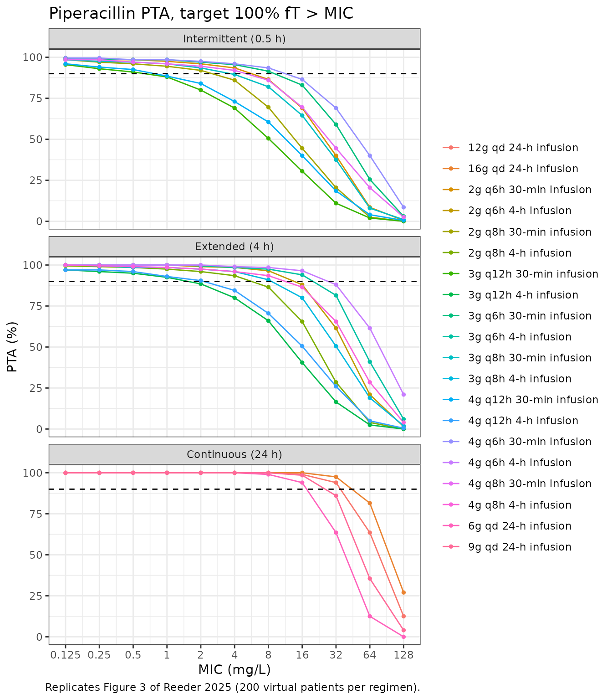
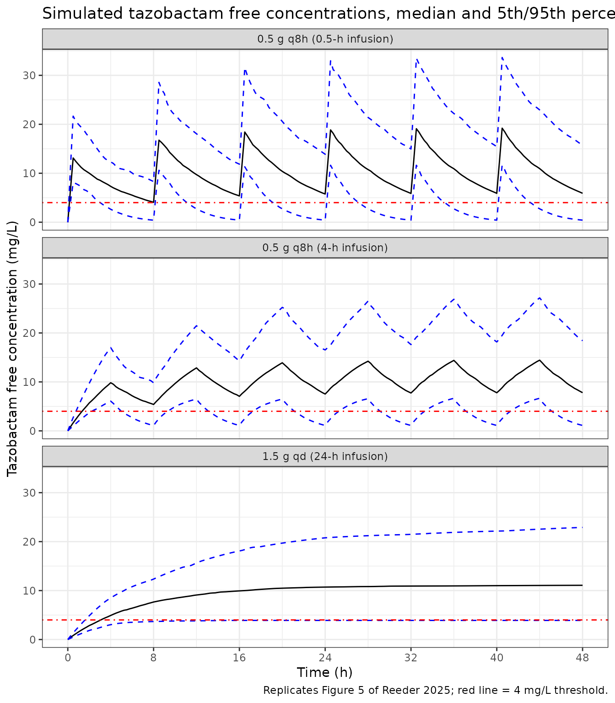

# Piperacillin-tazobactam in critically ill adults (Reeder 2025)

## Model and source

- Citation: Reeder JA, Creech CB, Nation RL, Gu K, Nalbant D, Wu N,
  Jimenez-Truque N, Fissell W, Rolsma S, Fishbane N, Kirkpatrick C,
  Patel P, Watanabe A, Landersdorfer C, Winokur P, An G (2025).
  Utilizing an Opportunistic Clinical Study and Population-Based
  Pharmacokinetic Models to Identify Rational Empiric Dosing Regimens
  for Piperacillin-Tazobactam in Critically Ill Patients. The Journal of
  Clinical Pharmacology 65(4):452-465. <doi:10.1002/jcph.6161>.
- Piperacillin model: One-compartment population PK model with linear
  elimination for the piperacillin component of intravenously infused
  piperacillin-tazobactam in critically ill adults in the ICU (Reeder
  2025; 111 patients, 239 plasma concentrations from opportunistic
  sampling). Outside continuous renal replacement therapy (CRRT),
  clearance is the sum of a renal arm proportional to Cockcroft-Gault
  creatinine clearance on lean body weight and a non-renal arm scaling
  with lean body weight to the 0.75 power; in patients on CRRT a single
  estimated CRRT clearance replaces both arms. Uncorrelated
  interindividual variability on total clearance and volume and a
  combined proportional plus additive residual error. The companion
  tazobactam model is Reeder_2025_tazobactam.
- Tazobactam model: One-compartment population PK model with linear
  elimination for the tazobactam component of intravenously infused
  piperacillin-tazobactam in critically ill adults in the ICU (Reeder
  2025; 108 patients, 229 plasma concentrations from opportunistic
  sampling). Clearance is the sum of a renal arm proportional to
  Cockcroft-Gault creatinine clearance on lean body weight and a
  constant non-renal arm; in patients on continuous renal replacement
  therapy (CRRT) an estimated CRRT clearance replaces the renal arm
  while the non-renal arm is retained. Uncorrelated interindividual
  variability on total clearance and volume and a combined proportional
  plus additive residual error. The companion piperacillin model is
  Reeder_2025_piperacillin.
- Article: <https://doi.org/10.1002/jcph.6161> (open access,
  PMC11938006)

Reeder et al. fitted two separate one-compartment population PK models,
one for piperacillin and one for tazobactam, to opportunistically
sampled plasma concentrations from critically ill adults receiving
piperacillin-tazobactam as 4-hour extended infusions. The models are
packaged as `Reeder_2025_piperacillin` and `Reeder_2025_tazobactam`.
Both use Cockcroft-Gault creatinine clearance computed on lean body
weight (`CRCL`, mL/min) and a continuous renal replacement therapy
indicator (`RRT_CRRT_STATUS`); piperacillin additionally uses lean body
weight (`LBM`, kg) on its non-renal clearance.

## Population

112 critically ill adults were enrolled in the ICUs of the University of
Iowa and Vanderbilt University Medical Center (Table 1 of the paper).
Median age was 64 years (range 21-88), 45% were female, and 90% were
white. Median total body weight was 92 kg (41-160) and median lean body
weight 57 kg (30-89). Median Cockcroft-Gault creatinine clearance was 82
mL/min (10-289) on total body weight and 51 mL/min (8-173) on lean body
weight. 26% had acute kidney injury, 33% sepsis, 27% septic shock and
39% were mechanically ventilated; 10 patients (8.9%) were on continuous
renal replacement therapy (8 CVVHDF, 2 CVVH). All but one patient
received 3375 mg piperacillin-tazobactam (3000 mg / 375 mg) as 4-hour
infusions, mostly every 8 hours (Table S1). After outlier removal the
piperacillin analysis used 239 concentrations from 111 patients and the
tazobactam analysis 229 concentrations from 108 patients.

The same information is available programmatically:

``` r

str(rxode2::rxode(readModelDb("Reeder_2025_piperacillin"))$population[
  c("n_subjects", "age_median", "weight_median", "sex_female_pct")
])
#> ℹ parameter labels from comments will be replaced by 'label()'
#> List of 4
#>  $ n_subjects    : int 111
#>  $ age_median    : chr "64 years"
#>  $ weight_median : chr "92 kg total body weight; 57 kg lean body weight"
#>  $ sex_female_pct: num 45
```

## Source trace

Every `ini()` value carries an in-file comment pointing to its source.
The table collects them.

| Model | Equation / parameter | Value | Source location |
|----|----|----|----|
| piperacillin | `lcl_renal` | log(1.97 L/h) | Table 2, CLR (RSE 29%) |
| piperacillin | `lcl_nonren` | log(2.58 L/h) | Table 2, CLNR (RSE 27%) |
| piperacillin | `lcl_crrt` | log(3.32 L/h) | Table 2, CLCRRT = CLT,CRRT (RSE 12%); footnote a |
| piperacillin | `lvc` | log(23.5 L) | Table 2, V (RSE 10%) |
| piperacillin | `e_crcl_cl_renal` | 1.00, held constant | Table 2, `CLR * (CLCR,LBW/51 mL/min)^theta` |
| piperacillin | `e_lbm_cl_nonren` | 0.75, held constant | Table 2, `CLNR * (LBW/57 kg)^theta` |
| piperacillin | `etalcl` | 0.1996 (47% CV) | Table 2, IIV CL; footnote c (total CL) |
| piperacillin | `etalvc` | 0.1034 (33% CV) | Table 2, IIV V |
| piperacillin | `propSd`, `addSd` | 0.39, 0.326 mg/L | Table 2, CVCP and SDCP |
| piperacillin | CL equation | `((CLR + CLNR) (1 - CRRT) + CLCRRT CRRT) exp(eta)` | Table 2 footnotes a and c |
| tazobactam | `lcl_renal` | log(2.38 L/h) | Table 2, CLR (RSE 23%) |
| tazobactam | `lcl_nonren` | log(1.63 L/h) | Table 2, CLNR (RSE 38%) |
| tazobactam | `lcl_crrt` | log(0.957 L/h) | Table 2, CLCRRT (RSE 70%) |
| tazobactam | `lvc` | log(25.3 L) | Table 2, V (RSE 14%) |
| tazobactam | `e_crcl_cl_renal` | 1.00, held constant | Table 2, `CLR * (CLCR,LBW/51 mL/min)^theta` |
| tazobactam | `etalcl` | 0.1484 (40% CV) | Table 2, IIV CL; footnote c (total CL) |
| tazobactam | `etalvc` | 0.0975 (32% CV) | Table 2, IIV V |
| tazobactam | `propSd`, `addSd` | 0.40, 0.255 mg/L | Table 2, CVCP and SDCP |
| tazobactam | CL equation | `(CLR (1 - CRRT) + CLNR + CLCRRT CRRT) exp(eta)` | Table 2 footnotes b and c |
| both | `d/dt(central) <- -kel * central` | n/a | Results, “one-compartment model with zero-order input and first-order elimination” |
| both | `Cc ~ add(addSd) + prop(propSd)` | n/a | Results, “combined proportional and additive error model” |

## Typical-value check against Table 2

Table 2 also prints the derived total clearances at the reference
covariates (CLcr,LBW 51 mL/min, LBW 57 kg). Solving the packaged models
with the random effects removed must reproduce them to the printed
precision.

``` r

mod_pip <- readModelDb("Reeder_2025_piperacillin")
mod_taz <- readModelDb("Reeder_2025_tazobactam")

ref_ev <- data.frame(
  id = 1:2, time = 0, evid = 1, amt = 1000, rate = 250, cmt = "central",
  CRCL = 51, LBM = 57, RRT_CRRT_STATUS = c(0, 1)
) |>
  dplyr::bind_rows(data.frame(
    id = 1:2, time = 1, evid = 0, amt = 0, rate = 0, cmt = "central",
    CRCL = 51, LBM = 57, RRT_CRRT_STATUS = c(0, 1)
  )) |>
  dplyr::arrange(id, time)

typ <- function(mod, drug) {
  rxode2::rxSolve(rxode2::zeroRe(mod), events = ref_ev) |>
    as.data.frame() |>
    dplyr::distinct(id, cl) |>
    dplyr::mutate(drug = drug, CRRT = c("no", "yes")[id])
}
typ_tab <- dplyr::bind_rows(
  typ(mod_pip, "piperacillin"),
  typ(mod_taz, "tazobactam")
) |>
  dplyr::mutate(published = c(4.55, 3.32, 4.01, 2.59))
#> ℹ parameter labels from comments will be replaced by 'label()'
#> ℹ omega/sigma items treated as zero: 'etalcl', 'etalvc'
#> Warning: multi-subject simulation without without 'omega'
#> ℹ parameter labels from comments will be replaced by 'label()'
#> ℹ omega/sigma items treated as zero: 'etalcl', 'etalvc'
#> Warning: multi-subject simulation without without 'omega'

typ_tab |>
  dplyr::select(drug, CRRT, cl, published) |>
  dplyr::rename(
    "Drug" = drug, "On CRRT" = CRRT,
    "Model CL (L/h)" = cl, "Table 2 CLT (L/h)" = published
  ) |>
  knitr::kable(digits = 3)
```

| Drug         | On CRRT | Model CL (L/h) | Table 2 CLT (L/h) |
|:-------------|:--------|---------------:|------------------:|
| piperacillin | no      |          4.550 |              4.55 |
| piperacillin | yes     |          3.320 |              3.32 |
| tazobactam   | no      |          4.010 |              4.01 |
| tazobactam   | yes     |          2.587 |              2.59 |

``` r


# Both sides are the same arithmetic on the same Table 2 values; the only
# difference is the 3-significant-figure rounding of the printed totals.
stopifnot(max(abs(typ_tab$cl / typ_tab$published - 1)) < 0.005)
```

## Virtual cohort

The individual patient data are not public. The virtual cohort below
approximates Table 1: lean body weight log-normal around the 57 kg
median and clipped to the observed 30-89 kg range; Cockcroft-Gault
creatinine clearance on lean body weight proportional to lean body
weight (as the Cockcroft-Gault formula makes it) times a log-normal
factor, centred on 51 mL/min and clipped to 8-173 mL/min; total body
weight as lean body weight times a log-normal ratio centred on 92/57,
clipped to 41-160 kg. 9% of subjects (18 of 200) are on CRRT, drawn from
the lowest-clearance third of the cohort. Total body weight is used only
to form the total-body-weight creatinine clearance used to stratify the
target-attainment tables; it does not enter either model.

Between-subject random effects are drawn in base R from each model’s
omega matrix and passed through `params =` to the models with the random
effects zeroed, so the cohort is identical on every machine and every
dosing regimen is simulated on the same 200 virtual patients.

``` r

set.seed(20250325)
n_sub <- 200L

clip <- function(x, lo, hi) pmin(pmax(x, lo), hi)
cohort <- tibble::tibble(k = seq_len(n_sub)) |>
  dplyr::mutate(
    LBM = clip(exp(rnorm(n_sub, log(57), 0.22)), 30, 89),
    CRCL = clip(51 * (LBM / 57) * exp(rnorm(n_sub, 0, 0.61)), 8, 173),
    WT = clip(LBM * exp(rnorm(n_sub, log(92 / 57), 0.15)), 41, 160),
    CRCL_TBW = CRCL * WT / LBM
  )
low_third <- which(cohort$CRCL <= quantile(cohort$CRCL, 1 / 3))
cohort$RRT_CRRT_STATUS <- 0
cohort$RRT_CRRT_STATUS[sample(low_third, 18)] <- 1

draw_eta <- function(mod, n) {
  omega <- rxode2::rxode2(mod)$omega
  eta <- matrix(rnorm(n * nrow(omega)), n) %*% chol(omega)
  colnames(eta) <- rownames(omega)
  as.data.frame(eta)
}
eta_pip <- draw_eta(mod_pip, n_sub)
#> ℹ parameter labels from comments will be replaced by 'label()'
eta_taz <- draw_eta(mod_taz, n_sub)
#> ℹ parameter labels from comments will be replaced by 'label()'

cohort |>
  dplyr::summarise(
    `LBW median (range), kg` = sprintf("%.0f (%.0f-%.0f)", median(LBM), min(LBM), max(LBM)),
    `TBW median (range), kg` = sprintf("%.0f (%.0f-%.0f)", median(WT), min(WT), max(WT)),
    `CLcr,LBW median (range), mL/min` = sprintf("%.0f (%.0f-%.0f)", median(CRCL), min(CRCL), max(CRCL)),
    `CLcr,TBW median (range), mL/min` = sprintf("%.0f (%.0f-%.0f)", median(CRCL_TBW), min(CRCL_TBW), max(CRCL_TBW)),
    `CRRT, n (%)` = sprintf("%d (%.1f%%)", sum(RRT_CRRT_STATUS), 100 * mean(RRT_CRRT_STATUS))
  ) |>
  tidyr::pivot_longer(dplyr::everything(), names_to = "Covariate", values_to = "Virtual cohort") |>
  dplyr::mutate(`Table 1` = c("57 (30-89)", "92 (41-160)", "51 (8-173)", "82 (10-289)", "10 (8.9%)")) |>
  knitr::kable()
```

| Covariate                       | Virtual cohort | Table 1     |
|:--------------------------------|:---------------|:------------|
| LBW median (range), kg          | 56 (31-89)     | 57 (30-89)  |
| TBW median (range), kg          | 93 (42-160)    | 92 (41-160) |
| CLcr,LBW median (range), mL/min | 50 (9-173)     | 51 (8-173)  |
| CLcr,TBW median (range), mL/min | 85 (15-357)    | 82 (10-289) |
| CRRT, n (%)                     | 18 (9.0%)      | 10 (8.9%)   |

## Piperacillin probability of target attainment (Figure 3, Table 3)

The paper simulated 20 piperacillin regimens: 2, 3 or 4 g every 6, 8 or
12 h as 0.5-hour intermittent or 4-hour extended infusions, and 6, 9, 12
or 16 g per day as a continuous infusion. Free concentrations were the
total concentrations times 0.70 (30% protein binding). Here each regimen
is simulated for 48 hours and the target 100% fT \> MIC is evaluated
over the second day (24-48 h): a subject attains the target at a given
MIC when its lowest free concentration in that window exceeds the MIC.

``` r

regimens <- dplyr::bind_rows(
  tidyr::expand_grid(
    dose_g = c(2, 3, 4), tau = c(6, 8, 12), dur = c(0.5, 4)
  ) |>
    dplyr::filter(!(dose_g == 2 & tau == 12)),
  tibble::tibble(dose_g = c(6, 9, 12, 16), tau = 24, dur = 24)
) |>
  dplyr::mutate(
    infusion = dplyr::case_when(
      dur == 0.5 ~ "Intermittent (0.5 h)",
      dur == 4 ~ "Extended (4 h)",
      TRUE ~ "Continuous (24 h)"
    ),
    regimen = ifelse(
      dur == 24,
      sprintf("%gg qd 24-h infusion", dose_g),
      sprintf("%gg q%gh %s infusion", dose_g, tau, ifelse(dur == 0.5, "30-min", "4-h"))
    ),
    r = dplyr::row_number()
  )
stopifnot(nrow(regimens) == 20)

make_events <- function(reg, cohort, obs_times) {
  subj <- cohort |>
    dplyr::mutate(id = (reg$r - 1L) * nrow(cohort) + k)
  doses <- tidyr::expand_grid(subj, time = seq(0, 48 - reg$tau, by = reg$tau)) |>
    dplyr::mutate(evid = 1, amt = reg$dose_g * 1000, rate = amt / reg$dur)
  obs <- tidyr::expand_grid(subj, time = obs_times) |>
    dplyr::mutate(evid = 0, amt = 0, rate = 0)
  dplyr::bind_rows(doses, obs) |>
    dplyr::mutate(cmt = "central", regimen = reg$regimen, infusion = reg$infusion)
}
ev_pta <- lapply(split(regimens, regimens$r), make_events,
  cohort = cohort, obs_times = seq(24, 48, by = 0.25)
) |>
  dplyr::bind_rows() |>
  dplyr::arrange(id, time, dplyr::desc(evid))
stopifnot(!anyDuplicated(ev_pta[ev_pta$evid == 0, c("id", "time")]))

# params rows must follow the ascending id order of the event table.
params_pta <- dplyr::bind_cols(
  id = sort(unique(ev_pta$id)),
  eta_pip[rep(seq_len(n_sub), nrow(regimens)), , drop = FALSE]
)
```

``` r

sim_pta <- rxode2::rxSolve(
  rxode2::zeroRe(mod_pip),
  events = ev_pta, params = params_pta,
  keep = c("regimen", "infusion", "CRCL_TBW")
) |>
  as.data.frame()
#> ℹ parameter labels from comments will be replaced by 'label()'
#> Warning: multi-subject simulation without without 'omega'

mic_grid <- 2^(-3:7) # 0.125 to 128 mg/L
fu_pip <- 0.70

min_free <- sim_pta |>
  dplyr::group_by(id, regimen, infusion, CRCL, CRCL_TBW) |>
  dplyr::summarise(cmin_free = min(fu_pip * Cc), .groups = "drop")

pta_by <- function(df, ...) {
  df |>
    dplyr::group_by(regimen, infusion, ...) |>
    dplyr::reframe(MIC = mic_grid, PTA = sapply(mic_grid, function(m) mean(cmin_free > m)))
}
breakpoint <- function(pta) {
  pta |>
    dplyr::summarise(
      bp = if (any(PTA >= 0.9)) max(MIC[PTA >= 0.9]) else 0.0625,
      .groups = "drop"
    )
}
pta_all <- pta_by(min_free)
```

``` r

# Replicates Figure 3 of Reeder 2025: PTA versus MIC for 100% fT > MIC.
pta_all |>
  dplyr::mutate(infusion = factor(infusion, levels = c(
    "Intermittent (0.5 h)", "Extended (4 h)", "Continuous (24 h)"
  ))) |>
  ggplot(aes(MIC, 100 * PTA, colour = regimen)) +
  geom_line() +
  geom_point(size = 1) +
  geom_hline(yintercept = 90, linetype = "dashed") +
  scale_x_continuous(trans = "log2", breaks = mic_grid, labels = as.character(mic_grid)) +
  facet_wrap(~infusion, ncol = 1) +
  labs(
    x = "MIC (mg/L)", y = "PTA (%)", colour = NULL,
    title = "Piperacillin PTA, target 100% fT > MIC",
    caption = "Replicates Figure 3 of Reeder 2025 (200 virtual patients per regimen)."
  ) +
  theme_bw() +
  theme(legend.position = "right")
```



The breakpoint is the highest MIC at which at least 90% of patients
attain the target. Table 3 of the paper gives it for the whole
population and by creatinine-clearance band.

``` r

published_all <- tibble::tribble(
  ~regimen, ~bp_paper,
  "2g q6h 30-min infusion", 4, "2g q8h 30-min infusion", 2,
  "3g q6h 30-min infusion", 8, "3g q8h 30-min infusion", 4,
  "3g q12h 30-min infusion", 1, "4g q6h 30-min infusion", 8,
  "4g q8h 30-min infusion", 4, "4g q12h 30-min infusion", 1,
  "2g q6h 4-h infusion", 8, "2g q8h 4-h infusion", 4,
  "3g q6h 4-h infusion", 16, "3g q8h 4-h infusion", 8,
  "3g q12h 4-h infusion", 2, "4g q6h 4-h infusion", 16,
  "4g q8h 4-h infusion", 8, "4g q12h 4-h infusion", 2,
  "6g qd 24-h infusion", 16, "9g qd 24-h infusion", 16,
  "12g qd 24-h infusion", 32, "16g qd 24-h infusion", 32
)
cmp_all <- breakpoint(pta_all |> dplyr::group_by(regimen)) |>
  dplyr::inner_join(published_all, by = "regimen") |>
  dplyr::mutate(dilutions = log2(bp / bp_paper)) |>
  dplyr::arrange(match(regimen, published_all$regimen))
stopifnot(nrow(cmp_all) == 20)

cmp_all |>
  dplyr::rename(
    "Regimen" = regimen, "Simulated breakpoint (mg/L)" = bp,
    "Table 3 breakpoint (mg/L)" = bp_paper, "Difference (doubling dilutions)" = dilutions
  ) |>
  knitr::kable(caption = "Piperacillin breakpoints, all patients, target 100% fT > MIC.")
```

| Regimen | Simulated breakpoint (mg/L) | Table 3 breakpoint (mg/L) | Difference (doubling dilutions) |
|:---|---:|---:|---:|
| 2g q6h 30-min infusion | 4.0 | 4 | 0 |
| 2g q8h 30-min infusion | 2.0 | 2 | 0 |
| 3g q6h 30-min infusion | 8.0 | 8 | 0 |
| 3g q8h 30-min infusion | 2.0 | 4 | -1 |
| 3g q12h 30-min infusion | 0.5 | 1 | -1 |
| 4g q6h 30-min infusion | 8.0 | 8 | 0 |
| 4g q8h 30-min infusion | 4.0 | 4 | 0 |
| 4g q12h 30-min infusion | 0.5 | 1 | -1 |
| 2g q6h 4-h infusion | 8.0 | 8 | 0 |
| 2g q8h 4-h infusion | 4.0 | 4 | 0 |
| 3g q6h 4-h infusion | 16.0 | 16 | 0 |
| 3g q8h 4-h infusion | 8.0 | 8 | 0 |
| 3g q12h 4-h infusion | 1.0 | 2 | -1 |
| 4g q6h 4-h infusion | 16.0 | 16 | 0 |
| 4g q8h 4-h infusion | 8.0 | 8 | 0 |
| 4g q12h 4-h infusion | 2.0 | 2 | 0 |
| 6g qd 24-h infusion | 16.0 | 16 | 0 |
| 9g qd 24-h infusion | 16.0 | 16 | 0 |
| 12g qd 24-h infusion | 32.0 | 32 | 0 |
| 16g qd 24-h infusion | 32.0 | 32 | 0 |

Piperacillin breakpoints, all patients, target 100% fT \> MIC. {.table
style="width:100%;"}

``` r

published_strata <- tibble::tribble(
  ~regimen, ~lt60, ~mid, ~ge130,
  "2g q6h 30-min infusion", 8, 4, 2, "2g q8h 30-min infusion", 8, 2, 0.5,
  "3g q6h 30-min infusion", 16, 8, 2, "3g q8h 30-min infusion", 8, 2, 0.5,
  "3g q12h 30-min infusion", 4, 0.5, 0.0625, "4g q6h 30-min infusion", 16, 8, 4,
  "4g q8h 30-min infusion", 16, 4, 1, "4g q12h 30-min infusion", 4, 0.5, 0.125,
  "2g q6h 4-h infusion", 16, 8, 4, "2g q8h 4-h infusion", 8, 4, 2,
  "3g q6h 4-h infusion", 32, 16, 8, "3g q8h 4-h infusion", 16, 8, 2,
  "3g q12h 4-h infusion", 4, 1, 0.25, "4g q6h 4-h infusion", 32, 16, 8,
  "4g q8h 4-h infusion", 16, 8, 4, "4g q12h 4-h infusion", 8, 2, 0.25,
  "6g qd 24-h infusion", 16, 8, 8, "9g qd 24-h infusion", 32, 16, 8,
  "12g qd 24-h infusion", 32, 16, 16, "16g qd 24-h infusion", 64, 32, 16
) |>
  tidyr::pivot_longer(-regimen, names_to = "band", values_to = "bp_paper")

band_of <- function(x) {
  dplyr::case_when(x < 60 ~ "lt60", x < 130 ~ "mid", TRUE ~ "ge130")
}
strata_cmp <- dplyr::bind_rows(
  min_free |> dplyr::mutate(band = band_of(CRCL_TBW), basis = "CLcr,TBW"),
  min_free |> dplyr::mutate(band = band_of(CRCL), basis = "CLcr,LBW")
) |>
  pta_by(band, basis) |>
  dplyr::group_by(regimen, band, basis) |>
  breakpoint() |>
  dplyr::inner_join(published_strata, by = c("regimen", "band")) |>
  dplyr::mutate(dilutions = log2(bp / bp_paper))

strata_cmp |>
  dplyr::group_by(basis) |>
  dplyr::summarise(
    `Median difference (dilutions)` = median(dilutions),
    `Within 1 dilution (%)` = 100 * mean(abs(dilutions) <= 1),
    .groups = "drop"
  ) |>
  dplyr::rename("Band variable" = basis) |>
  knitr::kable(caption = "Agreement with the Table 3 creatinine-clearance bands (<60, 60-129, >=130 mL/min) under either Cockcroft-Gault body-weight basis.")
```

| Band variable | Median difference (dilutions) | Within 1 dilution (%) |
|:--------------|------------------------------:|----------------------:|
| CLcr,LBW      |                             0 |                    75 |
| CLcr,TBW      |                             0 |                   100 |

Agreement with the Table 3 creatinine-clearance bands (\<60, 60-129,
\>=130 mL/min) under either Cockcroft-Gault body-weight basis. {.table}

``` r


strata_cmp |>
  dplyr::filter(basis == "CLcr,TBW") |>
  dplyr::mutate(band = factor(band, c("lt60", "mid", "ge130"), c("<60", "60-129", ">=130"))) |>
  dplyr::select(regimen, band, bp, bp_paper) |>
  tidyr::pivot_wider(names_from = band, values_from = c(bp, bp_paper)) |>
  dplyr::arrange(match(regimen, published_all$regimen)) |>
  dplyr::select(
    regimen, `bp_<60`, `bp_paper_<60`, `bp_60-129`, `bp_paper_60-129`,
    `bp_>=130`, `bp_paper_>=130`
  ) |>
  dplyr::rename(
    "Regimen" = regimen,
    "Sim <60" = `bp_<60`, "Paper <60" = `bp_paper_<60`,
    "Sim 60-129" = `bp_60-129`, "Paper 60-129" = `bp_paper_60-129`,
    "Sim >=130" = `bp_>=130`, "Paper >=130" = `bp_paper_>=130`
  ) |>
  knitr::kable(caption = "Piperacillin breakpoints (mg/L) by CLcr band, banded on total-body-weight Cockcroft-Gault clearance. Paper values below 0.125 mg/L are shown as 0.0625.")
```

| Regimen | Sim \<60 | Paper \<60 | Sim 60-129 | Paper 60-129 | Sim \>=130 | Paper \>=130 |
|:---|---:|---:|---:|---:|---:|---:|
| 2g q6h 30-min infusion | 8 | 8 | 8 | 4.0 | 1.0000 | 2.0000 |
| 2g q8h 30-min infusion | 4 | 8 | 4 | 2.0 | 0.2500 | 0.5000 |
| 3g q6h 30-min infusion | 16 | 16 | 8 | 8.0 | 2.0000 | 2.0000 |
| 3g q8h 30-min infusion | 8 | 8 | 4 | 2.0 | 0.5000 | 0.5000 |
| 3g q12h 30-min infusion | 2 | 4 | 1 | 0.5 | 0.0625 | 0.0625 |
| 4g q6h 30-min infusion | 16 | 16 | 16 | 8.0 | 2.0000 | 4.0000 |
| 4g q8h 30-min infusion | 8 | 16 | 8 | 4.0 | 0.5000 | 1.0000 |
| 4g q12h 30-min infusion | 2 | 4 | 1 | 0.5 | 0.0625 | 0.1250 |
| 2g q6h 4-h infusion | 16 | 16 | 16 | 8.0 | 4.0000 | 4.0000 |
| 2g q8h 4-h infusion | 8 | 8 | 8 | 4.0 | 1.0000 | 2.0000 |
| 3g q6h 4-h infusion | 32 | 32 | 16 | 16.0 | 8.0000 | 8.0000 |
| 3g q8h 4-h infusion | 16 | 16 | 8 | 8.0 | 2.0000 | 2.0000 |
| 3g q12h 4-h infusion | 4 | 4 | 2 | 1.0 | 0.1250 | 0.2500 |
| 4g q6h 4-h infusion | 32 | 32 | 32 | 16.0 | 8.0000 | 8.0000 |
| 4g q8h 4-h infusion | 16 | 16 | 16 | 8.0 | 2.0000 | 4.0000 |
| 4g q12h 4-h infusion | 4 | 8 | 2 | 2.0 | 0.2500 | 0.2500 |
| 6g qd 24-h infusion | 16 | 16 | 16 | 8.0 | 8.0000 | 8.0000 |
| 9g qd 24-h infusion | 32 | 32 | 16 | 16.0 | 16.0000 | 8.0000 |
| 12g qd 24-h infusion | 32 | 32 | 32 | 16.0 | 16.0000 | 16.0000 |
| 16g qd 24-h infusion | 64 | 64 | 32 | 32.0 | 32.0000 | 16.0000 |

Piperacillin breakpoints (mg/L) by CLcr band, banded on
total-body-weight Cockcroft-Gault clearance. Paper values below 0.125
mg/L are shown as 0.0625. {.table}

Banding on total-body-weight Cockcroft-Gault clearance puts every
stratified breakpoint within one doubling dilution of Table 3, against
three quarters when banding on the lean-body-weight form, which suggests
Table 3 bands on the total-body-weight clearance.

``` r

# The virtual cohort only approximates the study's covariate distribution, and
# breakpoints move in two-fold steps, so the gate is on agreement in the
# centre: a mis-transcribed clearance or volume shifts every breakpoint by one
# or more dilutions in the same direction.
stopifnot(
  abs(median(cmp_all$dilutions)) <= 0.5,
  mean(abs(cmp_all$dilutions) <= 1) >= 0.8
)
```

## Tazobactam free-concentration profiles (Figure 5)

The paper simulated tazobactam 0.5 g every 8 hours as 0.5-hour and as
4-hour infusions and 1.5 g per day as a continuous infusion, with a free
fraction of 0.70, and compared the free concentrations with a 4 mg/L
minimum critical concentration.

``` r

taz_regimens <- tibble::tibble(
  r = 1:3, dose_g = c(0.5, 0.5, 1.5), tau = c(8, 8, 24), dur = c(0.5, 4, 24),
  regimen = c("0.5 g q8h (0.5-h infusion)", "0.5 g q8h (4-h infusion)", "1.5 g qd (24-h infusion)"),
  infusion = regimen
)
ev_taz <- lapply(split(taz_regimens, taz_regimens$r), make_events,
  cohort = cohort, obs_times = seq(0, 48, by = 0.25)
) |>
  dplyr::bind_rows() |>
  dplyr::arrange(id, time, dplyr::desc(evid))
params_taz <- dplyr::bind_cols(
  id = sort(unique(ev_taz$id)),
  eta_taz[rep(seq_len(n_sub), nrow(taz_regimens)), , drop = FALSE]
)
sim_taz <- rxode2::rxSolve(
  rxode2::zeroRe(mod_taz),
  events = ev_taz, params = params_taz, keep = "regimen"
) |>
  as.data.frame() |>
  dplyr::mutate(Cfree = 0.70 * Cc)
#> ℹ parameter labels from comments will be replaced by 'label()'
#> Warning: multi-subject simulation without without 'omega'

taz_q <- sim_taz |>
  dplyr::group_by(regimen, time) |>
  dplyr::summarise(
    Q05 = quantile(Cfree, 0.05), Q50 = median(Cfree), Q95 = quantile(Cfree, 0.95),
    .groups = "drop"
  )
```

``` r

# Replicates Figure 5 of Reeder 2025.
ggplot(taz_q, aes(time)) +
  geom_line(aes(y = Q50)) +
  geom_line(aes(y = Q05), linetype = "dashed", colour = "blue") +
  geom_line(aes(y = Q95), linetype = "dashed", colour = "blue") +
  geom_hline(yintercept = 4, colour = "red", linetype = "dotdash") +
  facet_wrap(~regimen, ncol = 1) +
  scale_x_continuous(breaks = seq(0, 48, 8)) +
  labs(
    x = "Time (h)", y = "Tazobactam free concentration (mg/L)",
    title = "Simulated tazobactam free concentrations, median and 5th/95th percentiles",
    caption = "Replicates Figure 5 of Reeder 2025; red line = 4 mg/L threshold."
  ) +
  theme_bw()
```



The figure’s continuous-infusion panel plateaus at about 10.9 mg/L
(median), 4.3 mg/L (5th percentile) and 25.7 mg/L (95th percentile) by
48 hours, read off Figure 5c by the maintainers. The typical patient’s
steady-state free concentration is `0.70 x 62.5 mg/h / 4.01 L/h` = 10.9
mg/L, so the median of the published figure sits exactly on the model’s
typical value.

``` r

taz_48 <- taz_q |>
  dplyr::filter(time == 48, regimen == "1.5 g qd (24-h infusion)")
taz_cmp <- tibble::tibble(
  Statistic = c("5th percentile", "Median", "95th percentile"),
  Simulated = c(taz_48$Q05, taz_48$Q50, taz_48$Q95),
  `Figure 5c (digitised)` = c(4.3, 10.9, 25.7)
) |>
  dplyr::mutate(`Difference (%)` = 100 * (Simulated / `Figure 5c (digitised)` - 1))
knitr::kable(taz_cmp, digits = 1, caption = "Tazobactam free concentration at 48 h, 1.5 g/day continuous infusion.")
```

| Statistic       | Simulated | Figure 5c (digitised) | Difference (%) |
|:----------------|----------:|----------------------:|---------------:|
| 5th percentile  |       3.9 |                   4.3 |           -9.3 |
| Median          |      11.1 |                  10.9 |            1.6 |
| 95th percentile |      22.9 |                  25.7 |          -10.9 |

Tazobactam free concentration at 48 h, 1.5 g/day continuous infusion.
{.table}

``` r


# The median tracks clearance and dose directly; the tails also depend on how
# well the virtual covariate distribution matches the real one, so they get a
# wider envelope.
stopifnot(
  abs(taz_cmp$`Difference (%)`[2]) < 15,
  all(abs(taz_cmp$`Difference (%)`) < 40)
)

# Paper: >95% of patients above 4 mg/L on the continuous infusion and more
# than half above it throughout the dosing interval on either 0.5 g q8h form.
above_mcc <- sim_taz |>
  dplyr::filter(time >= 24) |>
  dplyr::group_by(regimen, id) |>
  dplyr::summarise(above = all(Cfree > 4), .groups = "drop") |>
  dplyr::group_by(regimen) |>
  dplyr::summarise(`Patients above 4 mg/L throughout 24-48 h (%)` = 100 * mean(above))
above_mcc |>
  dplyr::rename("Regimen" = regimen) |>
  knitr::kable(digits = 1)
```

| Regimen                    | Patients above 4 mg/L throughout 24-48 h (%) |
|:---------------------------|---------------------------------------------:|
| 0.5 g q8h (0.5-h infusion) |                                         69.0 |
| 0.5 g q8h (4-h infusion)   |                                         78.5 |
| 1.5 g qd (24-h infusion)   |                                         94.0 |

``` r

stopifnot(all(above_mcc[[2]] > 50))
```

The paper states that more than half of patients stay above 4 mg/L
throughout the interval on both 0.5 g q8h regimens and more than 95% on
the continuous infusion. The simulated continuous-infusion attainment
sits just below 95%, consistent with the simulated 5th percentile at 48
h (3.9 mg/L) lying just below the published one (4.3 mg/L); the virtual
cohort’s creatinine-clearance tail is slightly wider than the study’s.

## Steady-state NCA for the studied regimen (PKNCA)

The study regimen was 3375 mg piperacillin-tazobactam (3000 mg / 375 mg)
as a 4-hour infusion every 8 hours. Simulating 15 doses and running
PKNCA on the last dosing interval gives the steady-state exposure of
each component. The paper reports no NCA, so the check is internal: at
steady state the AUC over one dosing interval equals dose / CL for every
subject.

``` r

nca_events <- function(drug_dose, cohort, offset) {
  subj <- cohort |> dplyr::mutate(id = offset + k)
  doses <- tidyr::expand_grid(subj, time = seq(0, 112, by = 8)) |>
    dplyr::mutate(evid = 1, amt = drug_dose, rate = drug_dose / 4)
  obs <- tidyr::expand_grid(subj, time = seq(112, 120, by = 0.25)) |>
    dplyr::mutate(evid = 0, amt = 0, rate = 0)
  dplyr::bind_rows(doses, obs) |>
    dplyr::mutate(cmt = "central") |>
    dplyr::arrange(id, time, dplyr::desc(evid))
}
ss_solve <- function(mod, eta, drug_dose, drug) {
  ev <- nca_events(drug_dose, cohort, 0L) |> dplyr::mutate(treatment = drug)
  rxode2::rxSolve(
    rxode2::zeroRe(mod),
    events = ev, keep = "treatment",
    params = dplyr::bind_cols(id = seq_len(n_sub), eta)
  ) |>
    as.data.frame() |>
    dplyr::mutate(dose = drug_dose)
}
sim_ss <- dplyr::bind_rows(
  ss_solve(mod_pip, eta_pip, 3000, "piperacillin 3000 mg q8h 4-h"),
  ss_solve(mod_taz, eta_taz, 375, "tazobactam 375 mg q8h 4-h")
)
#> ℹ parameter labels from comments will be replaced by 'label()'
#> Warning: multi-subject simulation without without 'omega'
#> ℹ parameter labels from comments will be replaced by 'label()'
#> Warning: multi-subject simulation without without 'omega'

conc_df <- sim_ss |>
  dplyr::filter(!is.na(Cc)) |>
  dplyr::select(id, time, Cc, treatment)
dose_df <- dplyr::bind_rows(
  nca_events(3000, cohort, 0L) |> dplyr::mutate(treatment = "piperacillin 3000 mg q8h 4-h"),
  nca_events(375, cohort, 0L) |> dplyr::mutate(treatment = "tazobactam 375 mg q8h 4-h")
) |>
  dplyr::filter(evid == 1) |>
  dplyr::select(id, time, amt, treatment)

conc_obj <- PKNCA::PKNCAconc(conc_df, Cc ~ time | treatment + id, concu = "mg/L", timeu = "h")
dose_obj <- PKNCA::PKNCAdose(dose_df, amt ~ time | treatment + id, doseu = "mg")
intervals <- data.frame(
  start = 112, end = 120,
  cmax = TRUE, tmax = TRUE, cmin = TRUE, auclast = TRUE, cav = TRUE
)
nca_res <- PKNCA::pk.nca(PKNCA::PKNCAdata(conc_obj, dose_obj, intervals = intervals))
summary(nca_res)
#>  Interval Start Interval End                    treatment   N AUClast (h*mg/L)
#>             112          120 piperacillin 3000 mg q8h 4-h 200       640 [58.7]
#>             112          120    tazobactam 375 mg q8h 4-h 200      92.1 [60.0]
#>  Cmax (mg/L) Cmin (mg/L)          Tmax (h)  Cav (mg/L)
#>   113 [46.0]  41.2 [144] 4.00 [4.00, 4.00] 80.0 [58.7]
#>  15.3 [46.9]  7.06 [118] 4.00 [4.00, 4.00] 11.5 [60.0]
#> 
#> Caption: AUClast, Cmax, Cmin, Cav: geometric mean and geometric coefficient of variation; Tmax: median and range; N: number of subjects
```

``` r

auc_chk <- as.data.frame(nca_res$result) |>
  dplyr::filter(PPTESTCD == "auclast") |>
  dplyr::select(treatment, id, auclast = PPORRES) |>
  dplyr::inner_join(
    sim_ss |> dplyr::distinct(treatment, id, cl, dose),
    by = c("treatment", "id")
  ) |>
  dplyr::mutate(pct_diff = 100 * (auclast / (dose / cl) - 1))

auc_chk |>
  dplyr::group_by(treatment) |>
  dplyr::summarise(
    `Median AUCtau (mg*h/L)` = median(auclast),
    `Median dose/CL (mg*h/L)` = median(dose / cl),
    `Median difference (%)` = median(pct_diff),
    `90th pct abs difference (%)` = quantile(abs(pct_diff), 0.9)
  ) |>
  dplyr::rename("Component" = treatment) |>
  knitr::kable(digits = 2)
```

| Component | Median AUCtau (mg\*h/L) | Median dose/CL (mg\*h/L) | Median difference (%) | 90th pct abs difference (%) |
|:---|---:|---:|---:|---:|
| piperacillin 3000 mg q8h 4-h | 637.11 | 637.17 | -0.01 | 0.05 |
| tazobactam 375 mg q8h 4-h | 95.38 | 95.38 | -0.01 | 0.05 |

``` r


# Both sides use the same per-subject parameters, so the residual is the
# approach to steady state after 15 doses plus trapezoidal error on a 0.25-h
# grid (measured: 90th percentile 0.05%). A mis-entered dose, rate or
# clearance moves AUCtau by tens of percent. The slowest-clearance subjects
# are the ones still accumulating, so the gate is on the centre and a robust
# quantile, not the extreme.
stopifnot(
  all(abs(tapply(auc_chk$pct_diff, auc_chk$treatment, median)) < 1),
  all(tapply(abs(auc_chk$pct_diff), auc_chk$treatment, quantile, 0.9) < 3)
)
```

## Assumptions and deviations

- **No correlation between the CL and V random effects.** The base
  models estimated a CL-V correlation (Tables S2 and S3), but Table 2 of
  the final models reports only the two variances and no covariance or
  correlation, so the packaged models carry independent etas. If the
  final models retained the correlation, simulated variability in
  concentrations is somewhat overstated here.
- **Covariate exponents held constant.** The 1.00 exponent of creatinine
  clearance on renal clearance (both drugs) and the 0.75 exponent of
  lean body weight on piperacillin non-renal clearance are printed in
  Table 2 with no RSE and no bootstrap interval, as round theory values,
  so they are encoded with `fixed()`.
- **Piperacillin CRRT clearance.** Table 2 prints CLCRRT = 3.32 L/h
  without an RSE and CLT,CRRT = 3.32 L/h (RSE 12%); footnote a states
  they are the same quantity, so one parameter carries the estimate.
- **Lean body weight formula unknown.** The paper does not name the
  formula, so the covariate is mapped to the canonical `LBM` column.
  Users should check that their formula reproduces the 57 kg cohort
  median for a cohort with median total body weight 92 kg.
- **Virtual cohort.** Covariate distributions were approximated from the
  Table 1 medians and ranges (see above), with CRRT patients drawn from
  the lowest-clearance third; the paper resampled its own 111
  (piperacillin) or 108 (tazobactam) patients 100 times. Simulated
  breakpoints and percentiles therefore agree with the paper in the
  centre rather than row by row.
- **Target-attainment window.** The paper does not state over which
  interval 100% fT \> MIC was assessed; the second day of a 48-hour
  simulation (24-48 h) is used, matching the 48-hour horizon stated for
  the tazobactam simulations. Residual error is not added to the
  simulated concentrations.
- **Creatinine-clearance bands.** Table 3 does not say whether its bands
  use creatinine clearance on total or lean body weight. Both are
  tabulated above; the per-regimen table uses the total-body-weight
  basis, the conventional basis for an augmented-renal-clearance cut-off
  of 130 mL/min.
- **Figure 5c percentiles** were read off the published figure by the
  maintainers (to about 0.3 mg/L).
- No erratum or correction notice for the paper was found on Europe PMC
  as of 2026-11-03.
