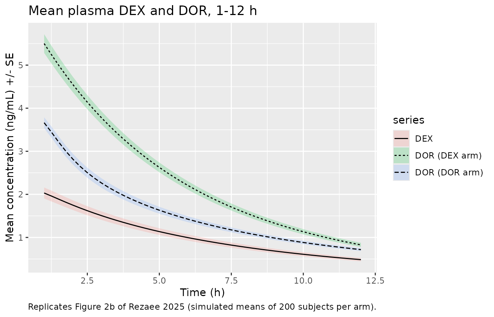
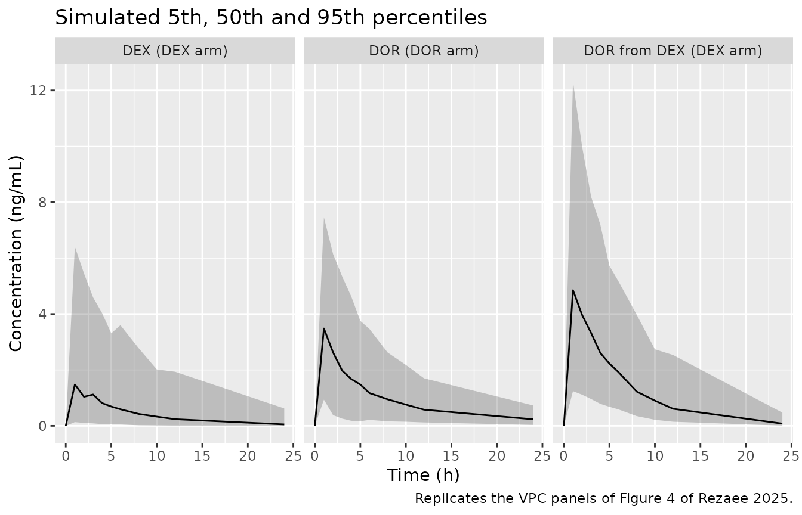
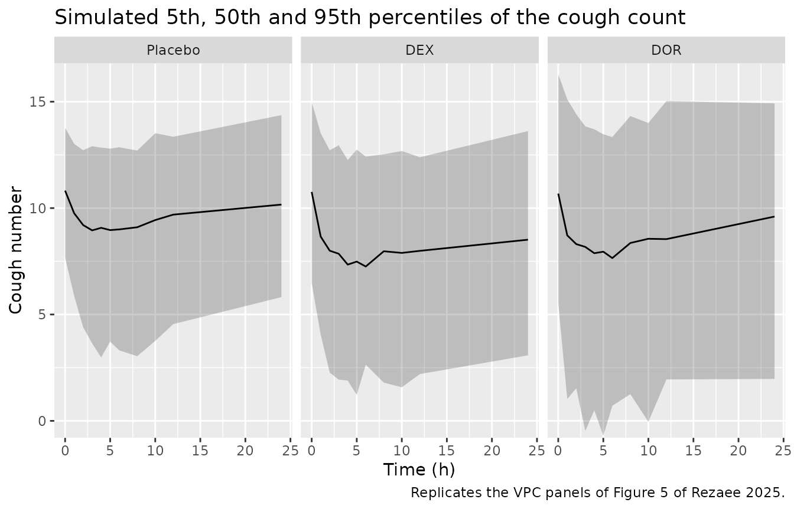
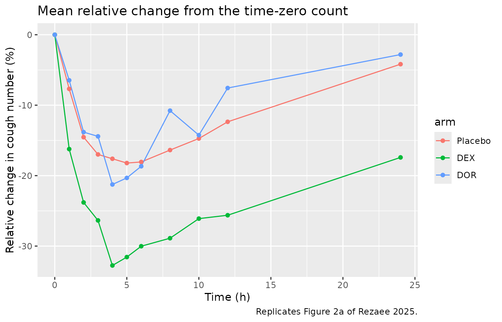

# Dextromethorphan and dextrorphan antitussive PK/PD (Rezaee 2025)

## Model and source

- Citation: Rezaee S, Wright CE, Morice AH, Rostami-Hodjegan A.
  Dextromethorphan Versus Dextrorphan: A Quantitative Comparison of
  Antitussive Potency Following Separate Administration of Metabolite. J
  Clin Pharmacol. 2025;65(11):1616-1625. <doi:10.1002/jcph.70049>.
- Description: Joint parent-metabolite population PK/PD model for oral
  dextromethorphan and its active O-demethylated metabolite dextrorphan,
  with an effect-compartment model of citric-acid-induced cough
  suppression in healthy CYP2D6 normal-metaboliser volunteers (Rezaee
  2025). Dextromethorphan dose: one depot draining to the
  one-compartment parent at ka and directly to the one-compartment
  metabolite (first-pass formation, no dose apportionment) at a separate
  rate constant, with systemic parent-to-metabolite conversion and equal
  apparent volumes for both. Dextrorphan dosed on its own: first-order
  absorption into a two-compartment disposition sharing the metabolite
  elimination rate constant. Cough count: baseline minus a placebo time
  course scale \* k \* t \* exp(-k \* t), multiplied by a sigmoid Imax
  term driven by the potency-weighted sum of the dextromethorphan and
  dextrorphan effect-site concentrations (relative potency of
  dextrorphan 0.26).
- Article: <https://doi.org/10.1002/jcph.70049> (open access,
  PMC12555100)

Rezaee 2025 gave healthy volunteers a single oral dose of placebo,
dextromethorphan (DEX) or its O-demethylated metabolite dextrorphan
(DOR) in a three-period crossover, and counted the coughs provoked by a
citric-acid challenge over 24 h. The PK was fitted first: a joint
parent-metabolite model for the DEX period (one depot draining to both
the one-compartment parent and, through first-pass conversion, the
one-compartment metabolite; Figure 1), and a two-compartment model for
DOR given on its own. The PD was then fitted with the PK held fixed: a
placebo time course multiplied by a sigmoid Imax term driven by the
potency-weighted sum of the DEX and DOR effect-site concentrations.

## Population

Twenty-three healthy non-smoking volunteers (12 male, 11 female) aged
19-51 years took part. All were CYP2D6 normal metabolisers by genotype,
had FEV1 above 80% of predicted, and were screened to cough 7-14 times
to five inhalations of 10% citric acid with no more than 20% variability
within and between days. The three periods were at least 7 days apart,
in a balanced Latin-square order: placebo, 40.5 mg dextromethorphan
hydrobromide, and 44.6 mg dextrorphan D-tartrate. Plasma and cough
counts were sampled at 0, 1, 2, 3, 4, 5, 6, 8, 10, 12 and 24 h (Methods,
“Subjects and study design”). Body weight and race are not reported, and
no covariate was retained (Results: “Neither sex nor age was found to
significantly influence any model parameters”).

The same information is available programmatically via
`readModelDb("Rezaee_2025_dextromethorphan")()$population`.

## Source trace

Every `ini()` value carries an in-file comment pointing at its source in
`inst/modeldb/specificDrugs/Rezaee_2025_dextromethorphan.R`. They are
collected here. Between-subject variability was reported as CV%; for
these log-normal parameters the model stores `omega^2 = log(1 + CV^2)`.

| Equation / parameter | Value | Source location |
|----|----|----|
| Joint parent-metabolite structure, single depot without dose apportionment | n/a | Figure 1; Methods, “Pharmacokinetic Model” |
| `lka` (ka(DEX)) | 2.6 1/h, fixed | Table 2; Results (“fixed to the reported values of 2.6 h-1”) |
| `lk_dxor_form` (ka(DORDEX)) | 9.1 1/h | Table 2 |
| `lvc` (V/F, shared by DEX and formed DOR) | 4874 L | Table 2; Results (“equal extravascular apparent volume”) |
| `lkel` (k(DEX)) | 0.1 1/h | Table 2 |
| `lkmet` (kpm) | 0.04 1/h | Table 2 |
| `lkel_dxor` (k(DOR)) | 0.2 1/h | Table 2 |
| `lka_dxor` (ka(DOR)) | 2.6 1/h, fixed | Table 2 |
| `lvc_dxor` (V1/F(DOR)) | 6984 L | Table 2 |
| `lk12_dxor`, `lk21_dxor` | 0.57, 0.60 1/h | Table 2 |
| BSV: ka(DORDEX), V/F, k(DEX), k(DOR), kpm, V1/F(DOR), k12, k21 | 198, 48, 108, 32, 43, 32, 196, 299 %CV | Table 2 |
| `propSd`, `propSd_dxor`, `propSd_dxor_direct` | 0.3, 0.3, 0.2 | Table 2 (DEX, DORDEX, DOR) |
| Placebo equation | see below | Methods equation 1, read with Rostami-Hodjegan 2001 |
| `lrbase` (Baseline_cough) | 10.7 coughs | Table 3 |
| `lscale_pbo` (scale) | 4.5 coughs | Table 3 |
| `lkpbo` (K) | 0.2 1/h | Table 3 |
| Combined-effect equation | n/a | Methods equation 2 |
| `lke0`, `lke0_dxor` | 0.08, 0.02 1/h | Table 3 |
| `lic50` | 0.3 ng/mL | Table 3 |
| `limax` | 0.23 | Table 3 |
| `lhill` (n) | 2.8 | Table 3 |
| `lrelpot_dxor` (relative potency) | 0.26 | Table 3 |
| BSV: Baseline, scale, K, ke0(DEX), ke0(DOR), IC50, Imax, n, potency | 14, 115, 85, 176, 171, 107425, 68, 205, 27 %CV | Table 3 |
| `addSd_cough_placebo`, `_dextromethorphan`, `_dextrorphan` | 1.4, 2.0, 2.9 coughs | Table 3 |

The model equations are

- PK, DEX period: `d(depot)/dt = -(ka + k_dxor_form) * depot`;
  `d(central)/dt = ka * depot - (kel + kmet) * central`;
  `d(central_dxor)/dt = k_dxor_form * depot + kmet * central - kel_dxor * central_dxor`,
  with both concentrations on the shared volume `V/F`.
- PK, DOR period: `depot_dxor` absorbed at `ka_dxor` into `central_dxor`
  (volume `V1/F(DOR)`), exchanging with `peripheral1_dxor` at `k12` /
  `k21`, eliminated at the same `k(DOR)`.
- Placebo: `cough_placebo = Baseline - scale * K * t * exp(-K * t)`.
- Drug: `cough = cough_placebo * (1 - Imax * D^n / (1 + D^n))` with
  `D = Ce_DEX / IC50 + Ce_DOR * Pot / IC50` and
  `d(Ce)/dt = ke0 * (C - Ce)` for each moiety.

## Virtual cohort

The observed data are not public. Each period is simulated as its own
cohort of 200 virtual subjects (the study was a 23-subject crossover);
the period indicators `TRT_DEXTROMETHORPHAN` and `TRT_DEXTRORPHAN` mark
the treatment. The doses are the salt masses stated in the paper.

``` r

obs_times <- sort(unique(c(seq(0, 24, by = 0.25))))
paper_times <- c(0, 1, 2, 3, 4, 5, 6, 8, 10, 12, 24)
stopifnot(all(paper_times %in% obs_times))

make_cohort <- function(n, arm, amt, dose_cmt, trt_dxm, trt_dxor, id_offset) {
  ids <- id_offset + seq_len(n)
  dose_rows <- tibble(
    id = ids, time = 0, evid = 1L, amt = amt, cmt = dose_cmt, dvid = NA_integer_
  )
  obs_rows <- tidyr::expand_grid(id = ids, time = obs_times) |>
    mutate(evid = 0L, amt = 0, cmt = "central", dvid = 1L)
  rows <- if (amt > 0) bind_rows(dose_rows, obs_rows) else obs_rows
  rows |>
    mutate(
      arm = arm,
      TRT_DEXTROMETHORPHAN = trt_dxm,
      TRT_DEXTRORPHAN = trt_dxor
    ) |>
    arrange(id, time, desc(evid))
}

n_per_arm <- 200L
events <- bind_rows(
  make_cohort(n_per_arm, "Placebo", 0, "depot", 0L, 0L, id_offset = 0L),
  make_cohort(n_per_arm, "DEX", 40.5, "depot", 1L, 0L, id_offset = 1000L),
  make_cohort(n_per_arm, "DOR", 44.6, "depot_dxor", 0L, 1L, id_offset = 2000L)
)
stopifnot(!anyDuplicated(events[events$evid == 0, c("id", "time")]))
```

## Simulation

``` r

mod <- readModelDb("Rezaee_2025_dextromethorphan")
ui <- rxode2::rxode(mod)
#> ℹ parameter labels from comments will be replaced by 'label()'
theta <- ui$theta

rxode2::rxSetSeed(20250516)
sim <- rxode2::rxSolve(
  mod,
  events = events,
  keep = c("arm", "TRT_DEXTROMETHORPHAN", "TRT_DEXTRORPHAN"),
  returnType = "data.frame"
)
#> ℹ parameter labels from comments will be replaced by 'label()'

# Simulated observations: add the published residual errors to the individual
# predictions, then apply the assay limits (DEX 0.5 ng/mL, DOR 0.3 ng/mL).
set.seed(20250516)
sim <- sim |>
  mutate(
    arm = factor(arm, levels = c("Placebo", "DEX", "DOR")),
    Cc_obs = Cc * (1 + theta[["propSd"]] * rnorm(n())),
    Cc_dxor_obs = Cc_dxor * (1 + sd_dxor * rnorm(n())),
    cough_obs = cough + sd_cough * rnorm(n())
  )
```

## Replicate published figures

### Figure 2b: mean plasma concentrations

``` r

fig2b <- bind_rows(
  sim |> filter(arm == "DEX") |> transmute(id, time, series = "DEX", conc = Cc),
  sim |> filter(arm == "DEX") |> transmute(id, time, series = "DOR (DEX arm)", conc = Cc_dxor),
  sim |> filter(arm == "DOR") |> transmute(id, time, series = "DOR (DOR arm)", conc = Cc_dxor)
) |>
  filter(time >= 1, time <= 12) |>
  group_by(series, time) |>
  summarise(mean = mean(conc), se = sd(conc) / sqrt(n()), .groups = "drop")

ggplot(fig2b, aes(time, mean, linetype = series, shape = series)) +
  geom_ribbon(aes(ymin = mean - se, ymax = mean + se, fill = series), alpha = 0.2, colour = NA) +
  geom_line() +
  labs(
    x = "Time (h)", y = "Mean concentration (ng/mL) +/- SE",
    title = "Mean plasma DEX and DOR, 1-12 h",
    caption = "Replicates Figure 2b of Rezaee 2025 (simulated means of 200 subjects per arm)."
  )
```



``` r

fig2b |>
  filter(time %in% c(1, 2, 4, 6, 8, 12)) |>
  select(series, time, mean) |>
  pivot_wider(names_from = series, values_from = mean) |>
  dplyr::rename("Time (h)" = time) |>
  knitr::kable(digits = 2, caption = "Simulated mean concentrations (ng/mL).")
```

| Time (h) |  DEX | DOR (DEX arm) | DOR (DOR arm) |
|---------:|-----:|--------------:|--------------:|
|        1 | 2.03 |          5.50 |          3.66 |
|        2 | 1.75 |          4.55 |          2.82 |
|        4 | 1.30 |          3.14 |          1.90 |
|        6 | 0.99 |          2.20 |          1.42 |
|        8 | 0.77 |          1.57 |          1.11 |
|       12 | 0.48 |          0.83 |          0.72 |

Simulated mean concentrations (ng/mL). {.table}

The published means peak at about 4.6 ng/mL for DOR formed from DEX, 4
ng/mL for DOR given on its own and 3.6 ng/mL for DEX, with DOR above DEX
after DEX dosing for most of the profile. The simulated DOR means track
both published DOR profiles closely, at 1 h (about 4.6 and 4 ng/mL) and
at 12 h (about 0.85 ng/mL in each arm). The simulated DEX mean is lower
and falls faster: the published DEX mean stays near 1.7-2.2 ng/mL from 8
to 12 h, whereas the simulated mean falls to about 0.5 ng/mL (see also
the NCA comparison below).

### Figure 4: visual predictive check of the PK

``` r

vpc_pk <- bind_rows(
  sim |> filter(arm == "DEX") |> transmute(time, panel = "DEX (DEX arm)", conc = Cc_obs),
  sim |> filter(arm == "DEX") |> transmute(time, panel = "DOR from DEX (DEX arm)", conc = Cc_dxor_obs),
  sim |> filter(arm == "DOR") |> transmute(time, panel = "DOR (DOR arm)", conc = Cc_dxor_obs)
) |>
  filter(time %in% paper_times) |>
  group_by(panel, time) |>
  summarise(
    q05 = quantile(conc, 0.05), q50 = median(conc), q95 = quantile(conc, 0.95),
    .groups = "drop"
  )

ggplot(vpc_pk, aes(time, q50)) +
  geom_ribbon(aes(ymin = q05, ymax = q95), alpha = 0.25) +
  geom_line() +
  facet_wrap(~panel) +
  labs(
    x = "Time (h)", y = "Concentration (ng/mL)",
    title = "Simulated 5th, 50th and 95th percentiles",
    caption = "Replicates the VPC panels of Figure 4 of Rezaee 2025."
  )
```



### Figure 5: visual predictive check of the cough count

``` r

vpc_pd <- sim |>
  filter(time %in% paper_times) |>
  group_by(arm, time) |>
  summarise(
    q05 = quantile(cough_obs, 0.05), q50 = median(cough_obs), q95 = quantile(cough_obs, 0.95),
    .groups = "drop"
  )

ggplot(vpc_pd, aes(time, q50)) +
  geom_ribbon(aes(ymin = q05, ymax = q95), alpha = 0.25) +
  geom_line() +
  facet_wrap(~arm) +
  coord_cartesian(ylim = c(0, 16)) +
  labs(
    x = "Time (h)", y = "Cough number",
    title = "Simulated 5th, 50th and 95th percentiles of the cough count",
    caption = "Replicates the VPC panels of Figure 5 of Rezaee 2025."
  )
```



In Figure 5 the predicted median falls from about 10.7 coughs to about 9
under placebo, 8 under DEX and 8.5 under DOR within the first few hours,
and recovers only partly by 24 h. The simulated medians follow the same
pattern.

### Figure 2a: relative change in cough number

``` r

rel <- sim |>
  filter(time %in% paper_times) |>
  group_by(id) |>
  mutate(pct = 100 * (cough_obs - cough_obs[time == 0]) / cough_obs[time == 0]) |>
  ungroup()

rel |>
  group_by(arm, time) |>
  summarise(mean = mean(pct), se = sd(pct) / sqrt(n()), .groups = "drop") |>
  ggplot(aes(time, mean, colour = arm)) +
  geom_line() +
  geom_point() +
  labs(
    x = "Time (h)", y = "Relative change in cough number (%)",
    title = "Mean relative change from the time-zero count",
    caption = "Replicates Figure 2a of Rezaee 2025."
  )
```



## PKNCA validation

Table 1 of the paper reports non-compartmental Cmax, Tmax and AUC0-24
from the observed profiles. Most 24-h samples were below the limit of
quantification, so the simulated observations are put on the paper’s
sampling times, values below the assay limits are removed, and AUC is
taken to the last quantifiable concentration.

``` r

blq_to_na <- function(conc, time, lloq) ifelse(time == 0, 0, ifelse(conc < lloq, NA_real_, conc))

nca_dex <- sim |>
  filter(arm == "DEX", time %in% paper_times) |>
  transmute(id, time, treatment = "DEX", Cc = blq_to_na(Cc_obs, time, 0.5)) |>
  filter(!is.na(Cc))
nca_dex <- bind_rows(
  nca_dex,
  nca_dex |> distinct(id, treatment) |> mutate(time = 0, Cc = 0)
) |>
  distinct(id, treatment, time, .keep_all = TRUE) |>
  arrange(id, time)

dose_dex <- events |>
  filter(evid == 1, arm == "DEX") |>
  transmute(id, time, amt, treatment = "DEX")

intervals <- data.frame(start = 0, end = 24, cmax = TRUE, tmax = TRUE, auclast = TRUE)

res_dex <- PKNCA::pk.nca(PKNCA::PKNCAdata(
  PKNCA::PKNCAconc(nca_dex, Cc ~ time | treatment + id),
  PKNCA::PKNCAdose(dose_dex, amt ~ time | treatment + id),
  intervals = intervals
))
```

``` r

nca_dor <- sim |>
  filter(arm %in% c("DEX", "DOR"), time %in% paper_times) |>
  transmute(
    id, time,
    treatment = ifelse(arm == "DEX", "DOR (from DEX)", "DOR"),
    Cc_dxor = blq_to_na(Cc_dxor_obs, time, 0.3)
  ) |>
  filter(!is.na(Cc_dxor))
nca_dor <- bind_rows(
  nca_dor,
  nca_dor |> distinct(id, treatment) |> mutate(time = 0, Cc_dxor = 0)
) |>
  distinct(id, treatment, time, .keep_all = TRUE) |>
  arrange(id, time)

dose_dor <- events |>
  filter(evid == 1, arm %in% c("DEX", "DOR")) |>
  transmute(id, time, amt, treatment = ifelse(arm == "DEX", "DOR (from DEX)", "DOR"))

res_dor <- PKNCA::pk.nca(PKNCA::PKNCAdata(
  PKNCA::PKNCAconc(nca_dor, Cc_dxor ~ time | treatment + id),
  PKNCA::PKNCAdose(dose_dor, amt ~ time | treatment + id),
  intervals = intervals
))
```

### Comparison against published NCA

The reference values are the Table 1 medians;
[`ncaComparisonTable()`](https://nlmixr2.github.io/nlmixr2lib/reference/ncaComparisonTable.md)
pools the simulated subjects by median as well.

``` r

published <- tibble::tribble(
  ~treatment,       ~cmax, ~tmax, ~auclast,
  "DEX",            2.2,   1.0,   16.7,
  "DOR (from DEX)", 4.9,   1.0,   31.4,
  "DOR",            3.8,   1.0,   18.9
)
sim_nca <- bind_rows(as.data.frame(res_dex), as.data.frame(res_dor))
cmp <- nlmixr2lib::ncaComparisonTable(
  simulated = sim_nca,
  reference = published,
  by = "treatment",
  units = c(cmax = "ng/mL", tmax = "h", auclast = "ng*h/mL"),
  tolerance_pct = 20
)
knitr::kable(cmp, caption = "Simulated vs. published (Table 1 median) NCA. * differs from the reference by >20%.")
```

| NCA parameter      | treatment      | Reference | Simulated | % diff   |
|:-------------------|:---------------|:----------|:----------|:---------|
| Cmax (ng/mL)       | DEX            | 2.2       | 1.73      | -21.2%\* |
| Cmax (ng/mL)       | DOR (from DEX) | 4.9       | 5.45      | +11.2%   |
| Cmax (ng/mL)       | DOR            | 3.8       | 3.66      | -3.7%    |
| Tmax (h)           | DEX            | 1         | 1         | +0.0%    |
| Tmax (h)           | DOR (from DEX) | 1         | 1         | +0.0%    |
| Tmax (h)           | DOR            | 1         | 1         | +0.0%    |
| AUClast (ng\*h/mL) | DEX            | 16.7      | 9.48      | -43.2%\* |
| AUClast (ng\*h/mL) | DOR (from DEX) | 31.4      | 25.5      | -18.8%   |
| AUClast (ng\*h/mL) | DOR            | 18.9      | 19.4      | +2.5%    |

Simulated vs. published (Table 1 median) NCA. \* differs from the
reference by \>20%. {.table}

``` r

med <- sim_nca |>
  filter(PPTESTCD %in% c("cmax", "auclast")) |>
  group_by(treatment, PPTESTCD) |>
  summarise(sim = median(PPORRES, na.rm = TRUE), .groups = "drop") |>
  inner_join(
    published |> select(-tmax) |> pivot_longer(-treatment, names_to = "PPTESTCD", values_to = "ref"),
    by = c("treatment", "PPTESTCD")
  ) |>
  mutate(pct = 100 * (sim - ref) / ref)
stopifnot(nrow(med) == 6)
dor_rows <- med |> filter(treatment != "DEX")
# Dextrorphan, both periods: a wrong volume or formation route moves these
# medians by far more than 30%; the margin admits the cohort-to-cohort spread of
# a median of 200 subjects across rxode2 builds and thread counts.
stopifnot(all(abs(dor_rows$pct) < 30))
```

The dextrorphan rows agree with Table 1. The DEX Cmax and AUC are lower
than the published medians. The published DEX values are highly skewed
(mean AUC 26.7 versus median 16.7 ng\*h/mL, with Figure 4 showing
individual concentrations above 10 ng/mL), and the paper reports a BSV
of 108% on k(DEX) but none on ka(DEX), which was fixed. The model was
not adjusted.

### Cough-response summaries

Table 1 also summarises the observed cough response. The same quantities
are computed from the simulated cough counts (with the additive residual
error) as the change relative to the time-zero count.

``` r

pd_sum <- rel |>
  group_by(arm, id) |>
  summarise(
    emax = min(pct),
    temax = time[which.min(pct)],
    auec = sum(diff(time) * (head(pct, -1) + tail(pct, -1)) / 2),
    .groups = "drop"
  ) |>
  group_by(arm) |>
  summarise(across(c(emax, temax, auec), median), .groups = "drop") |>
  mutate(arm = as.character(arm))

pd_pub <- tibble::tribble(
  ~arm,      ~emax_pub, ~temax_pub, ~auec_pub,
  "DEX",     -44,       3.0,        -286,
  "DOR",     -46,       5.5,        -170,
  "Placebo", -30,       3.5,        -105
)

pd_sum |>
  inner_join(pd_pub, by = "arm") |>
  select(arm, emax, emax_pub, temax, temax_pub, auec, auec_pub) |>
  dplyr::rename(
    "Arm" = arm,
    "Emax, simulated (%)" = emax,
    "Emax, Table 1 median (%)" = emax_pub,
    "TEmax, simulated (h)" = temax,
    "TEmax, Table 1 median (h)" = temax_pub,
    "AUEC0-24, simulated (%*h)" = auec,
    "AUEC0-24, Table 1 median (%*h)" = auec_pub
  ) |>
  knitr::kable(digits = 1, caption = "Median simulated vs. observed cough-response summaries.")
```

| Arm | Emax, simulated (%) | Emax, Table 1 median (%) | TEmax, simulated (h) | TEmax, Table 1 median (h) | AUEC0-24, simulated (%\*h) | AUEC0-24, Table 1 median (%\*h) |
|:---|---:|---:|---:|---:|---:|---:|
| Placebo | -34.4 | -30 | 5 | 3.5 | -257.4 | -105 |
| DEX | -56.4 | -44 | 5 | 3.0 | -552.4 | -286 |
| DOR | -65.5 | -46 | 5 | 5.5 | -425.8 | -170 |

Median simulated vs. observed cough-response summaries. {.table}

These summaries are taken from noisy cough counts, so they depend
heavily on the residual error and on the time-zero count (the paper’s
baseline was counted at t = -1 h). The simulated maximum reductions and
their timing are of the same order as the observed ones. The simulated
integrated reduction is larger than the observed median in all three
arms, placebo included. This follows from the published placebo
parameters: for the typical subject the placebo term alone integrates to
`-100 * (scale / K) * (1 - exp(-24 K) * (1 + 24 K)) / Baseline` = -200
%*h over 24 h, against an observed median of -105 %*h. The authors also
note that the model overestimates the effect in the DOR arm. No
parameter was adjusted.

## Typical-value checks

These checks use the typical-value model (all random effects set to
zero), so they test the equations and do not depend on the simulated
cohort.

``` r

mod_tv <- rxode2::zeroRe(mod, "omega")
#> ℹ parameter labels from comments will be replaced by 'label()'
fine <- seq(0, 96, by = 0.01)
ev_tv <- bind_rows(
  tibble(id = 1L, time = 0, evid = 1L, amt = 40.5, cmt = "depot", dvid = NA_integer_),
  tibble(id = 1L, time = fine, evid = 0L, amt = 0, cmt = "central", dvid = 1L),
  tibble(id = 2L, time = fine, evid = 0L, amt = 0, cmt = "central", dvid = 1L)
) |>
  mutate(
    TRT_DEXTROMETHORPHAN = ifelse(id == 1L, 1L, 0L),
    TRT_DEXTRORPHAN = 0L
  ) |>
  arrange(id, time, desc(evid))
# One subject per solve: the typical-value model has no omega.
solve_one <- function(i) {
  rxode2::rxSolve(mod_tv, events = filter(ev_tv, id == i), returnType = "data.frame")
}
dex <- solve_one(1L)
#> ℹ omega/sigma items treated as zero: 'etalk_dxor_form', 'etalvc', 'etalkel', 'etalkel_dxor', 'etalkmet', 'etalvc_dxor', 'etalk12_dxor', 'etalk21_dxor', 'etalrbase', 'etalscale_pbo', 'etalkpbo', 'etalke0', 'etalke0_dxor', 'etalic50', 'etalimax', 'etalhill', 'etalrelpot_dxor'
pbo <- solve_one(2L)
#> ℹ omega/sigma items treated as zero: 'etalk_dxor_form', 'etalvc', 'etalkel', 'etalkel_dxor', 'etalkmet', 'etalvc_dxor', 'etalk12_dxor', 'etalk21_dxor', 'etalrbase', 'etalscale_pbo', 'etalkpbo', 'etalke0', 'etalke0_dxor', 'etalic50', 'etalimax', 'etalhill', 'etalrelpot_dxor'

# Placebo: Baseline - scale * K * t * exp(-K t) has its minimum
# Baseline - scale / e at t = 1 / K.
min_expected <- exp(theta[["lrbase"]]) - exp(theta[["lscale_pbo"]]) / exp(1)
stopifnot(
  abs(min(pbo$cough) - min_expected) < 1e-6,
  abs(pbo$time[which.min(pbo$cough)] - 1 / exp(theta[["lkpbo"]])) < 0.011
)

# Formed dextrorphan: AUCinf = Dose * fraction reaching DOR / (k(DOR) * V).
ka <- exp(theta[["lka"]])
kf <- exp(theta[["lk_dxor_form"]])
kel <- exp(theta[["lkel"]])
kmet <- exp(theta[["lkmet"]])
kdor <- exp(theta[["lkel_dxor"]])
v <- exp(theta[["lvc"]])
frac_dor <- kf / (ka + kf) + ka / (ka + kf) * kmet / (kel + kmet)
auc_dor_expected <- 1000 * 40.5 * frac_dor / (kdor * v)
auc_dex_expected <- 1000 * 40.5 * ka / (ka + kf) / ((kel + kmet) * v)
trap <- function(x, y) sum(diff(x) * (head(y, -1) + tail(y, -1)) / 2)
stopifnot(
  abs(trap(dex$time, dex$Cc_dxor) / auc_dor_expected - 1) < 0.01,
  abs(trap(dex$time, dex$Cc) / auc_dex_expected - 1) < 0.01
)
c(
  placebo_min = min(pbo$cough),
  auc_dor_formed = trap(dex$time, dex$Cc_dxor),
  auc_dor_expected = auc_dor_expected,
  auc_dex = trap(dex$time, dex$Cc),
  auc_dex_expected = auc_dex_expected
)
#>      placebo_min   auc_dor_formed auc_dor_expected          auc_dex 
#>         9.044543        34.951581        34.952225        13.189319 
#> auc_dex_expected 
#>        13.189519
```

## Assumptions and deviations

- **Placebo equation.** Methods equation 1 is printed as
  `E_Placebo = Baseline_cough x scale x k x e^(-k x t)`. Read literally
  it starts below baseline at t = 0 and falls to about 0.1 coughs by 24
  h, which contradicts the text (“return to the baseline”), the placebo
  VPC in Figure 5 (median about 10.7 at t = 0, about 9 at 3-5 h, back
  towards 10 by 24 h) and the combined-effect equation, in which
  `E_Placebo` is the cough count itself. The authors cite their earlier
  placebo model (Rostami-Hodjegan 2001, Pulm Pharmacol Ther 14:315),
  which reports a maximum reduction of 1.6 coughs from baseline at
  4-4.5 h. The maintainers therefore encode
  `cough_placebo = Baseline - scale * k * t * exp(-k * t)`: its maximum
  reduction, `scale / e` = 4.5 / 2.718 = 1.66 coughs at t = 1/k = 5 h,
  reproduces that report from the Table 3 values and matches Figure 5.
- **Doses.** The paper does not say whether the salt or the base mass
  was entered in the analysis. The simulations use the stated salt
  masses (40.5 mg dextromethorphan hydrobromide, 44.6 mg dextrorphan
  D-tartrate). With these, the dextrorphan Cmax and AUC in both periods
  agree with Table 1. Base-equivalent doses (about 30 and 28 mg) would
  lower every prediction by 27-37% and miss the DEX-period dextrorphan
  values. Concentrations are in mass units throughout, as in the paper,
  including the DEX-to-DOR conversion.
- **One model for three periods.** The authors fitted separate DOR
  dispositions to formed DOR (one compartment, volume shared with DEX)
  and to DOR given on its own (two compartments, own central volume),
  with `k(DOR)` common to both. The model holds both in one set of
  states and switches the DOR volume and the peripheral exchange with
  `TRT_DEXTRORPHAN`. Set it to 1 only for a period in which DOR alone is
  given.
- **Period-specific residual errors.** Tables 2 and 3 give separate
  residual errors for each arm; `TRT_DEXTROMETHORPHAN` and
  `TRT_DEXTRORPHAN` select them. In the placebo period both indicators
  are 0.
- **Time origin.** The placebo term is a function of time since the
  dose, so each period must be simulated with the dose (or, for placebo,
  the start of the period) at t = 0.
- **Between-subject variability.** All CV% values are converted with
  `omega^2 = log(1 + CV^2)`. The IC50 BSV of 107,425% (variance 13.96)
  is carried as printed; it makes individual IC50 values span many
  orders of magnitude. Imax is log-normal as reported, so a small
  fraction of simulated subjects (about 1%) have Imax above 1, which
  drives their cough count below zero at high effect-site
  concentrations. Etas are uncorrelated (no covariance was reported).
- **Form of the Imax term.** The model writes `Imax * D^n / (1 + D^n)`
  as the identical `Imax / (1 + D^(-n))`. With the IC50 variance above,
  `D^n` overflows to infinity for some simulated subjects, and the
  printed form then returns `Inf / Inf`, which is not a number.
- **Crossover.** The virtual cohorts treat each period as a separate set
  of subjects. Inter-occasion variability was tested by the authors and
  not retained, so this does not change the model; only the
  within-subject correlation across periods is lost.
- **Cough counts as a continuous variable.** As in the paper, the cough
  count is modelled as continuous with an additive error.
- No erratum or correction notice was found for the article (Europe PMC
  search, 2026-11-10).
