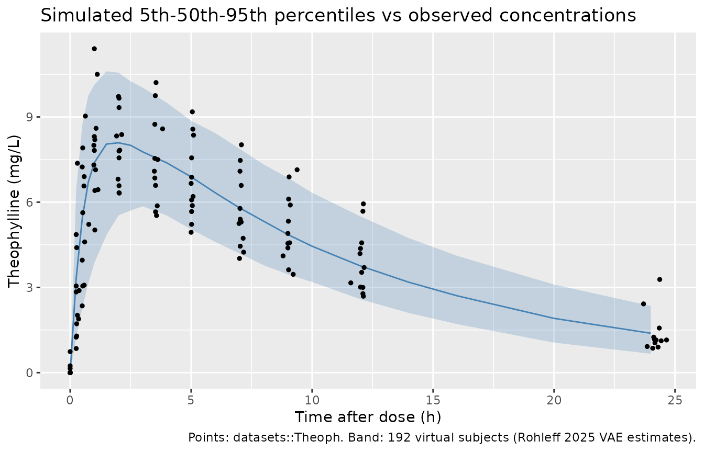
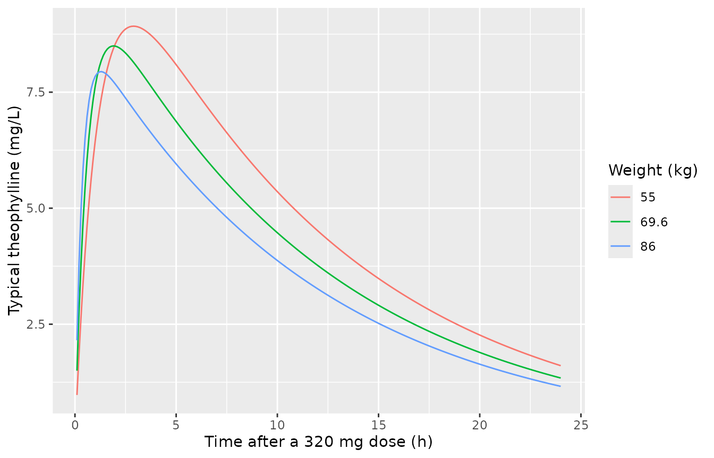
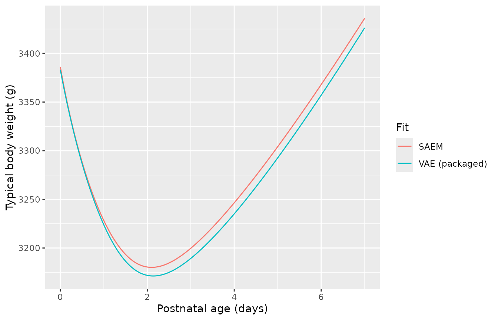
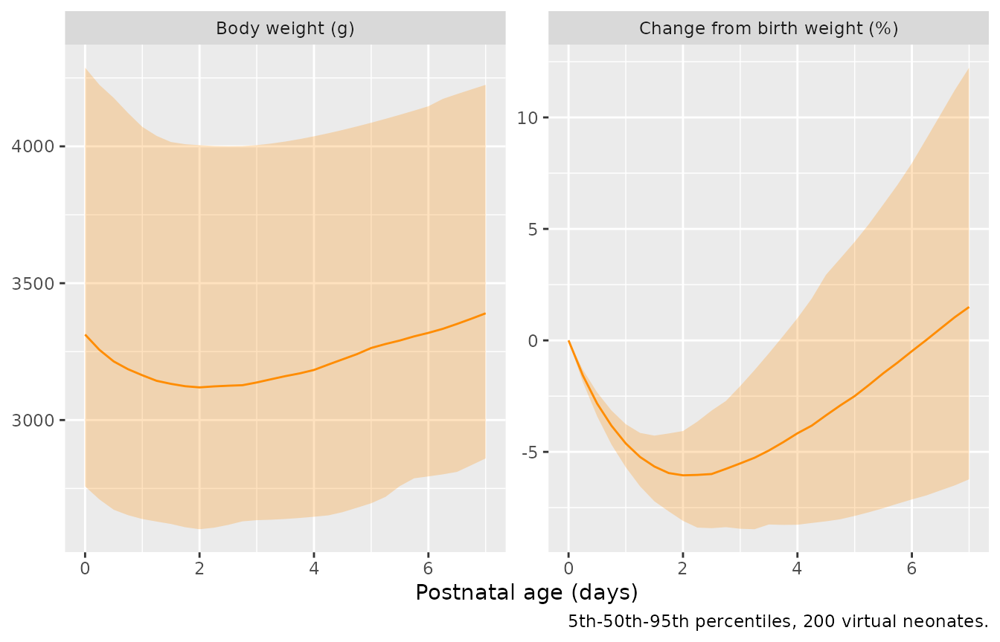

# Theophylline PK and neonatal weight change (Rohleff 2025)

## Model and source

Rohleff 2025 introduces a variational-autoencoder (VAE) estimator for
nonlinear mixed-effects models that estimates the population parameters
and selects covariates in a single run. The paper demonstrates it on two
real datasets, and each fitted model is packaged here:

- `Rohleff_2025_theophylline` – one-compartment oral PK of theophylline
  in 12 subjects (Section 3.1, Table 1).

- `Rohleff_2025_neonatalWeight` – body-weight change over the first week
  of life in 2425 neonates (Section 3.2, Supporting Information Table
  S3).

- Citation: Rohleff J, Bachmann F, Nahum U, Bram D, Steffens B, Pfister
  M, Koch G, Schropp J. Redefining Parameter Estimation and Covariate
  Selection via Variational Autoencoders: One Run Is All You Need. CPT
  Pharmacometrics Syst Pharmacol. 2025;14(8):2232-2243.
  <doi:10.1002/psp4.70129>.

- Article: <https://doi.org/10.1002/psp4.70129> (open access,
  PMC12706427)

- Code: <https://github.com/janrohleff/vae_nlme> (the authors’ Python
  implementation)

Both models use the estimates from the paper’s own method (the VAE
column). The paper also reports the same models fitted with SAEM-based
methods (COSSAC, SAMBA and SCM for theophylline, SAEM for the neonates);
those are used below as comparisons, not as alternative model files.

## Population

**Theophylline.** Twelve subjects each received a single oral
theophylline dose at time zero, with plasma concentrations measured over
about 24 h and baseline weight and sex recorded (Section 3.1). This is
the classic dataset distributed with NONMEM and with R as
[`datasets::Theoph`](https://rdrr.io/r/datasets/Theoph.html) (Pinheiro
and Bates 2000, the paper’s reference 18). Weights range from 54.6 to
86.4 kg (mean 69.6 kg), 5 of 12 subjects are female, and the doses are
3.10-5.86 mg/kg, about 320 mg in total for 11 subjects and 268 mg for
one.

**Neonates.** 2425 neonates had their body weight measured repeatedly
over the first 7 days of life (Section 3.2), with sex, mode of delivery,
gestational age, maternal age and parity as candidate covariates. The
cohort is that of Wilbaux et al. (J Pediatr 2016; Clin Nutr 2019), both
of which describe term neonates. The paper gives no demographic table
and the data are not public.

``` r

str(readModelDb("Rohleff_2025_theophylline")()$population, give.attr = FALSE)
#> List of 9
#>  $ species       : chr "human"
#>  $ n_subjects    : int 12
#>  $ n_studies     : int 1
#>  $ weight_range  : chr "54.6-86.4 kg (mean 69.6 kg; authors' deposited dataset)"
#>  $ sex_female_pct: num 41.7
#>  $ disease_state : chr "Not stated in the paper ('N = 12 patients'); the dataset is the classic theophylline study distributed with NON"| __truncated__
#>  $ dose_range    : chr "Single oral theophylline loading dose at t = 0; 267.8-320.7 mg total (3.10-5.86 mg/kg) in the deposited dataset."
#>  $ n_observations: int 120
#>  $ notes         : chr "Section 3.1 'Data': plasma theophylline concentrations from 12 subjects after a single oral dose at t = 0, with"| __truncated__
str(readModelDb("Rohleff_2025_neonatalWeight")()$population, give.attr = FALSE)
#> List of 7
#>  $ species      : chr "human"
#>  $ n_subjects   : int 2425
#>  $ n_studies    : int 1
#>  $ age_range    : chr "Birth to 7 days postnatal age"
#>  $ disease_state: chr "Neonates followed over the first week of life (the cohort of Wilbaux et al., J Pediatr 2016 and Clin Nutr 2019,"| __truncated__
#>  $ dose_range   : chr "n/a (no drug)"
#>  $ notes        : chr "Section 3.2 'Data': repeated body weights from 2425 neonates over the first 7 days of life, with sex, mode of d"| __truncated__
```

## Source trace

| Model | Parameter / equation | Value | Source location |
|----|----|----|----|
| theophylline | `lka` | log(1.63) 1/h | Table 1, VAE, `ka,pop` |
| theophylline | `lkel` | log(0.086) 1/h | Table 1, VAE, `ke,pop` |
| theophylline | `lvc` | log(31.97) L | Table 1, VAE, `Vpop` |
| theophylline | `e_wt_ka` | 2.55 | Table 1, VAE, `beta_ka,w` |
| theophylline | `e_wt_vc` | 0.57 | Table 1, VAE, `beta_V,w` |
| theophylline | `etalka` | 0.2809 (= 0.53^2) | Table 1, VAE, `omega_ka` (SD) |
| theophylline | `etalkel` | 0.0225 (= 0.15^2) | Table 1, VAE, `omega_ke` (SD) |
| theophylline | `etalvc` | 0.0169 (= 0.13^2) | Table 1, VAE, `omega_V` (SD) |
| theophylline | `addSd` | 0.71 mg/L | Table 1, VAE, error model `a` |
| theophylline | weight reference 69.583 kg | mean of the 12 weights | Section 3.1 (`w_pop` = mean weight); value computed from the authors’ deposited dataset |
| theophylline | `d/dt(depot)`, `d/dt(central)`, `Cc = central / vc` |  | Equation 14 and the line after it |
| theophylline | log-normal individual parameters with `log(w / w_pop)` covariate |  | Section 3.1, ‘Model Description’ |
| neonatal weight | `lrbase` (W0) | log(3383.2) g | Table S3, VAE, `W0,pop` |
| neonatal weight | `lkin` | log(106.8) g/day | Table S3, VAE, `kin,pop` |
| neonatal weight | `lkin_t50` (Tlag) | log(1.56) day | Table S3, VAE, `Tlag,pop` |
| neonatal weight | `lkout` | log(0.072) 1/day | Table S3, VAE, `kout,pop` |
| neonatal weight | `lkout_t50` (T50) | log(1.18) day | Table S3, VAE, `T50,pop` |
| neonatal weight | `etalrbase` | 0.0196 (= 0.14^2) | Table S3, VAE, `omega_W0` (SD) |
| neonatal weight | `etalkin` | 0.0529 (= 0.23^2) | Table S3, VAE, `omega_kin` (SD) |
| neonatal weight | `etalkin_t50` | 0.0144 (= 0.12^2) | Table S3, VAE, `omega_Tlag` (SD) |
| neonatal weight | `etalkout` | 0.0100 (= 0.10^2) | Table S3, VAE, `omega_kout` (SD) |
| neonatal weight | `etalkout_t50` | 0.0576 (= 0.24^2) | Table S3, VAE, `omega_T50` (SD) |
| neonatal weight | `addSd` | 33.0 g | Table S3, VAE, error model `a` |
| neonatal weight | `d/dt(bw) = kprod - kelim * bw`, `bw(0) = W0` |  | Equation 15 |
| neonatal weight | `kprod = kin / (1 + exp(-2 (t - Tlag)))`, `kelim = kout (1 - t / (T50 + t))` |  | Equation 15 |

Both tables report omega as the standard deviation of a log-normal
random effect, so each `ini()` variance is the square of the printed
value. The residual error is a constant (additive) error model in both
cases (Equation 2).

## Theophylline

### Closed-form check

The authors’ decoder evaluates the analytic solution of Equation 14,
`C(t) = D ka / (V (ka - ke)) (exp(-ke t) - exp(-ka t))`. The packaged
ODE model is solved for a typical subject at the mean weight and
compared with it.

``` r

mod_theo <- readModelDb("Rohleff_2025_theophylline")
wt_ref <- 69.583
ev_typ <- dplyr::bind_rows(
  data.frame(id = 1L, time = 0, evid = 1L, amt = 320, cmt = "depot", WT = wt_ref),
  data.frame(
    id = 1L, time = seq(0.25, 24, by = 0.25), evid = 0L, amt = 0,
    cmt = "central", WT = wt_ref
  )
)
sim_typ <- rxode2::rxSolve(
  rxode2::zeroRe(mod_theo), events = ev_typ, rtol = 1e-10, atol = 1e-12
)
#> ℹ parameter labels from comments will be replaced by 'label()'
#> ℹ omega/sigma items treated as zero: 'etalka', 'etalkel', 'etalvc'
closed_form <- with(
  list(ka = 1.63, ke = 0.086, V = 31.97, D = 320),
  D * ka / (V * (ka - ke)) * (exp(-ke * sim_typ$time) - exp(-ka * sim_typ$time))
)
rel_err <- max(abs(sim_typ$Cc / closed_form - 1))
rel_err
#> [1] 2.890022e-11
# Measured ~3e-11 at these tolerances; the bound is far above that and far
# below any transcription error.
stopifnot(rel_err < 1e-7)
```

### Virtual cohort and VPC against the observed data

The model was fitted to
[`datasets::Theoph`](https://rdrr.io/r/datasets/Theoph.html), so the
observed concentrations can be overlaid directly. Each of the 12
subjects (with their own weight and total dose) is replicated 16 times,
giving 192 virtual subjects.

``` r

theoph <- as.data.frame(datasets::Theoph) |>
  dplyr::mutate(
    id = as.integer(as.character(Subject)),
    amt = Dose * Wt
  )
subjects <- theoph |>
  dplyr::distinct(id, WT = Wt, amt)

n_rep <- 16L
grid <- c(0, 0.25, 0.5, 0.75, 1, 1.5, 2, 2.5, 3, 4, 5, 6, 7, 8, 9, 10, 12, 14, 16, 20, 24)
cohort <- tidyr::crossing(rep = seq_len(n_rep), subjects) |>
  dplyr::mutate(sim_id = (rep - 1L) * nrow(subjects) + id)
stopifnot(!anyDuplicated(cohort$sim_id), nrow(cohort) <= 200)

theo_events <- dplyr::bind_rows(
  cohort |>
    dplyr::transmute(id = sim_id, time = 0, evid = 1L, amt, cmt = "depot", WT),
  cohort |>
    dplyr::select(id = sim_id, WT) |>
    tidyr::crossing(time = grid) |>
    dplyr::mutate(evid = 0L, amt = 0, cmt = "central")
) |>
  dplyr::mutate(treatment = "Single oral dose") |>
  dplyr::arrange(id, time, dplyr::desc(evid))

rxode2::rxSetSeed(20251)
sim_theo <- rxode2::rxSolve(mod_theo, events = theo_events, keep = "treatment")
#> ℹ parameter labels from comments will be replaced by 'label()'
```

``` r

vpc <- as.data.frame(sim_theo) |>
  dplyr::group_by(time) |>
  dplyr::summarise(
    Q05 = quantile(Cc, 0.05), Q50 = median(Cc), Q95 = quantile(Cc, 0.95),
    .groups = "drop"
  )
ggplot(vpc, aes(time, Q50)) +
  geom_ribbon(aes(ymin = Q05, ymax = Q95), alpha = 0.25, fill = "steelblue") +
  geom_line(colour = "steelblue") +
  geom_point(data = theoph, aes(Time, conc), inherit.aes = FALSE, size = 1) +
  labs(
    x = "Time after dose (h)", y = "Theophylline (mg/L)",
    title = "Simulated 5th-50th-95th percentiles vs observed concentrations",
    caption = "Points: datasets::Theoph. Band: 192 virtual subjects (Rohleff 2025 VAE estimates)."
  )
```



### PKNCA: simulated cohort vs the observed data

The paper reports no NCA, so the reference is NCA of the observed
[`datasets::Theoph`](https://rdrr.io/r/datasets/Theoph.html) profiles.
The observed pre-dose samples are set to zero, matching the data the
authors fitted (which contain no time-zero records).

``` r

nca_intervals <- data.frame(
  start = 0, end = Inf,
  cmax = TRUE, tmax = TRUE, auclast = TRUE, half.life = TRUE
)

sim_conc <- as.data.frame(sim_theo) |>
  dplyr::filter(!is.na(Cc)) |>
  dplyr::select(id, time, Cc, treatment)
sim_conc <- dplyr::bind_rows(
  sim_conc,
  sim_conc |> dplyr::distinct(id, treatment) |> dplyr::mutate(time = 0, Cc = 0)
) |>
  dplyr::distinct(id, treatment, time, .keep_all = TRUE) |>
  dplyr::arrange(id, time)
sim_dose <- theo_events |>
  dplyr::filter(evid == 1L) |>
  dplyr::select(id, time, amt, treatment)
nca_sim <- PKNCA::pk.nca(PKNCA::PKNCAdata(
  PKNCA::PKNCAconc(sim_conc, Cc ~ time | treatment + id),
  PKNCA::PKNCAdose(sim_dose, amt ~ time | treatment + id),
  intervals = nca_intervals
))

obs_conc <- theoph |>
  dplyr::transmute(id, time = Time, Cc = ifelse(Time == 0, 0, conc), treatment = "Single oral dose")
obs_dose <- subjects |>
  dplyr::transmute(id, time = 0, amt, treatment = "Single oral dose")
nca_obs <- PKNCA::pk.nca(PKNCA::PKNCAdata(
  PKNCA::PKNCAconc(obs_conc, Cc ~ time | treatment + id),
  PKNCA::PKNCAdose(obs_dose, amt ~ time | treatment + id),
  intervals = nca_intervals
))

obs_median <- as.data.frame(nca_obs) |>
  dplyr::group_by(treatment, PPTESTCD) |>
  dplyr::summarise(value = median(PPORRES, na.rm = TRUE), .groups = "drop") |>
  tidyr::pivot_wider(names_from = PPTESTCD, values_from = value)

cmp <- nlmixr2lib::ncaComparisonTable(
  simulated = nca_sim,
  reference = obs_median,
  by = "treatment",
  params = c("cmax", "tmax", "auclast", "half.life"),
  units = c(cmax = "mg/L", tmax = "h", auclast = "mg*h/L", half.life = "h"),
  tolerance_pct = 20
)
knitr::kable(
  cmp,
  caption = "Median NCA of the simulated cohort vs the observed datasets::Theoph profiles. * differs by >20%."
)
```

| NCA parameter     | treatment        | Reference | Simulated | % diff   |
|:------------------|:-----------------|:----------|:----------|:---------|
| Cmax (mg/L)       | Single oral dose | 8.46      | 8.37      | -1.2%    |
| Tmax (h)          | Single oral dose | 1.14      | 2         | +76.2%\* |
| AUClast (mg\*h/L) | Single oral dose | 92.3      | 100       | +8.5%    |
| t½ (h)            | Single oral dose | 7.87      | 8.37      | +6.4%    |

Median NCA of the simulated cohort vs the observed datasets::Theoph
profiles. \* differs by \>20%. {.table}

Cmax, AUClast and half-life agree with the observed profiles to within
about 10%. Tmax is starred: the simulated median is 2 h while the
observed median is 1.14 h. The typical-value Tmax of the model is
`log(ka / ke) / (ka - ke)` = 1.9 h, so the simulated value follows from
the published ka and ke rather than from an encoding error. The observed
Tmax values are split into two groups: seven subjects peak at 0.6-1.2 h
and five at 1.9-3.6 h, so the median of 12 lands at the upper edge of
the early group. When the cohort is re-simulated on each subject’s own
sampling times, the median simulated Tmax is 2.0 h whether or not
residual error is added. The difference is therefore real: the fitted
log-normal ka places the peak later than about half of these subjects
show it. It is not a sampling or noise artefact. Cmax and AUC, the
quantities that depend on V and ke, are reproduced, and Tmax is left out
of the gate below.

``` r

med_pct <- function(nca, ref, param) {
  sim_med <- median(
    as.data.frame(nca)$PPORRES[as.data.frame(nca)$PPTESTCD == param],
    na.rm = TRUE
  )
  100 * (sim_med / ref[[param]] - 1)
}
pct <- vapply(
  c("cmax", "auclast", "half.life"),
  function(p) med_pct(nca_sim, obs_median, p),
  numeric(1)
)
pct
#>      cmax   auclast half.life 
#> -1.168739  8.499920  6.355625
# Medians of a 192-subject cohort against a 12-subject observed reference.
# A mis-transcribed ka, ke or V, or a dose/unit slip, moves these by tens of
# percent; the bound leaves room for the 12-subject reference's own noise.
stopifnot(all(abs(pct) < 20))
```

### Weight effect

Body weight enters as `(WT / 69.6)^2.55` on ka and `(WT / 69.6)^0.57` on
V. The large ka exponent mainly moves the absorption phase.

``` r

# zeroRe() on a several-subject event table makes rxode2 warn that it is
# simulating without omega; that is the intent here, so only that warning is
# muffled.
muffle_no_omega <- function(w) {
  if (grepl("without 'omega'", conditionMessage(w), fixed = TRUE)) {
    invokeRestart("muffleWarning")
  }
}
solve_typical <- function(m, ev) {
  withCallingHandlers(
    rxode2::rxSolve(rxode2::zeroRe(m), events = ev, keep = "WT"),
    warning = muffle_no_omega
  )
}

wts <- c(55, wt_ref, 86)
ev_wt <- dplyr::bind_rows(lapply(seq_along(wts), function(i) {
  dplyr::bind_rows(
    data.frame(id = i, time = 0, evid = 1L, amt = 320, cmt = "depot", WT = wts[i]),
    data.frame(id = i, time = seq(0.1, 24, by = 0.1), evid = 0L, amt = 0, cmt = "central", WT = wts[i])
  )
}))
sim_wt <- solve_typical(mod_theo, ev_wt)
#> ℹ parameter labels from comments will be replaced by 'label()'
#> ℹ omega/sigma items treated as zero: 'etalka', 'etalkel', 'etalvc'
ggplot(as.data.frame(sim_wt), aes(time, Cc, colour = factor(round(WT, 1)))) +
  geom_line() +
  labs(
    x = "Time after a 320 mg dose (h)", y = "Typical theophylline (mg/L)",
    colour = "Weight (kg)"
  )
```



### Agreement with the SAEM-based fits

Table 1 reports the same covariate model from COSSAC and SCM (identical
columns: ka 1.60, ke 0.087, V 31.82, `beta_ka,w` 2.58, `beta_V,w` 0.57).
The typical profiles of the VAE and COSSAC/SCM estimates are nearly
identical, as the paper reports.

``` r

mod_cossac <- mod_theo |>
  rxode2::ini(lka = log(1.60), lkel = log(0.087), lvc = log(31.82), e_wt_ka = 2.58)
#> ℹ parameter labels from comments will be replaced by 'label()'
#> ℹ change initial estimate of `lka` to `0.470003629245736`
#> ℹ change initial estimate of `lkel` to `-2.44184716032755`
#> ℹ change initial estimate of `lvc` to `3.46009502290964`
#> ℹ change initial estimate of `e_wt_ka` to `2.58`
sim_cossac <- solve_typical(mod_cossac, ev_wt)
#> ℹ omega/sigma items treated as zero: 'etalka', 'etalkel', 'etalvc'
max_rel <- max(abs(sim_cossac$Cc / sim_wt$Cc - 1))
max_rel
#> [1] 0.01966659
# Deterministic: measured 0.020, from the small differences in ka, ke and V and
# the 0.03 difference in the ka weight exponent across the three weights.
stopifnot(max_rel < 0.03)
```

## Neonatal weight change

### Equation 15 solved independently

The packaged model is compared with a fixed-step fourth-order
Runge-Kutta integration of Equation 15 written directly from the paper.

``` r

mod_neo <- readModelDb("Rohleff_2025_neonatalWeight")

eq15_rhs <- function(t, w, p) {
  kprod <- p$kin / (1 + exp(-2 * (t - p$tlag)))
  kelim <- p$kout * (1 - t / (p$t50 + t))
  kprod - kelim * w
}
rk4_eq15 <- function(p, t_end, h) {
  n <- round(t_end / h)
  w <- numeric(n + 1)
  w[1] <- p$w0
  for (i in seq_len(n)) {
    t <- (i - 1) * h
    k1 <- eq15_rhs(t, w[i], p)
    k2 <- eq15_rhs(t + h / 2, w[i] + h / 2 * k1, p)
    k3 <- eq15_rhs(t + h / 2, w[i] + h / 2 * k2, p)
    k4 <- eq15_rhs(t + h, w[i] + h * k3, p)
    w[i + 1] <- w[i] + h / 6 * (k1 + 2 * k2 + 2 * k3 + k4)
  }
  data.frame(time = seq(0, by = h, length.out = n + 1), w = w)
}

p_vae <- list(w0 = 3383.2, kin = 106.8, tlag = 1.56, kout = 0.072, t50 = 1.18)
ref <- rk4_eq15(p_vae, t_end = 7, h = 0.001)

ev_neo <- data.frame(id = 1L, time = seq(0, 7, by = 0.01), evid = 0L, amt = 0, cmt = "bw")
typ_neo <- as.data.frame(rxode2::rxSolve(
  rxode2::zeroRe(mod_neo), events = ev_neo, rtol = 1e-10, atol = 1e-10
))
#> ℹ parameter labels from comments will be replaced by 'label()'
#> ℹ omega/sigma items treated as zero: 'etalrbase', 'etalkin', 'etalkin_t50', 'etalkout', 'etalkout_t50'
ref_at <- ref$w[match(round(typ_neo$time, 3), round(ref$time, 3))]
stopifnot(!anyNA(ref_at))
rk4_err <- max(abs(typ_neo$bw / ref_at - 1))
rk4_err
#> [1] 2.230955e-10
stopifnot(rk4_err < 1e-7)
```

### Typical trajectory: VAE vs SAEM estimates

Table S3 reports the covariate-free fit by both the VAE and SAEM. The
two parameter sets give almost the same typical course: a loss of about
6% of birth weight with the nadir a little after day 2, and birth weight
regained before day 7.

``` r

mod_neo_saem <- mod_neo |>
  rxode2::ini(
    lrbase = log(3386.2), lkin = log(99.6), lkin_t50 = log(1.61),
    lkout = log(0.076), lkout_t50 = log(0.9)
  )
#> ℹ parameter labels from comments will be replaced by 'label()'
#> ℹ change initial estimate of `lrbase` to `8.12746362769413`
#> ℹ change initial estimate of `lkin` to `4.60116216459055`
#> ℹ change initial estimate of `lkin_t50` to `0.476234178996372`
#> ℹ change initial estimate of `lkout` to `-2.57702193869581`
#> ℹ change initial estimate of `lkout_t50` to `-0.105360515657826`
typ_saem <- as.data.frame(rxode2::rxSolve(
  rxode2::zeroRe(mod_neo_saem), events = ev_neo, rtol = 1e-10, atol = 1e-10
))
#> ℹ omega/sigma items treated as zero: 'etalrbase', 'etalkin', 'etalkin_t50', 'etalkout', 'etalkout_t50'

summarise_course <- function(d, w0) {
  i <- which.min(d$bw)
  data.frame(
    nadir_day = d$time[i],
    nadir_pct = 100 * (d$bw[i] / w0 - 1),
    day7_pct = 100 * (d$bw[nrow(d)] / w0 - 1),
    regain_day = d$time[which(d$time > d$time[i] & d$bw >= w0)[1]]
  )
}
course <- dplyr::bind_rows(
  cbind(Fit = "VAE (packaged)", summarise_course(typ_neo, 3383.2)),
  cbind(Fit = "SAEM", summarise_course(typ_saem, 3386.2))
)
course |>
  dplyr::rename(
    "Nadir (day)" = nadir_day, "Nadir (% of W0)" = nadir_pct,
    "Day 7 (% of W0)" = day7_pct, "Birth weight regained (day)" = regain_day
  ) |>
  knitr::kable(digits = 2, caption = "Typical weight course from the two Table S3 parameter sets.")
```

| Fit | Nadir (day) | Nadir (% of W0) | Day 7 (% of W0) | Birth weight regained (day) |
|:---|---:|---:|---:|---:|
| VAE (packaged) | 2.14 | -6.26 | 1.27 | 6.39 |
| SAEM | 2.10 | -6.09 | 1.47 | 6.28 |

Typical weight course from the two Table S3 parameter sets. {.table}

``` r


# Deterministic regression checks on the packaged (VAE) typical course:
# measured nadir -6.26% at day 2.14; a transcription error in any of the five
# parameters moves these well beyond the bounds.
vae <- course[course$Fit == "VAE (packaged)", ]
stopifnot(
  abs(vae$nadir_pct - (-6.26)) < 0.05,
  abs(vae$nadir_day - 2.14) < 0.02,
  abs(vae$nadir_pct - course$nadir_pct[course$Fit == "SAEM"]) < 0.5
)

dplyr::bind_rows(
  dplyr::mutate(typ_neo, Fit = "VAE (packaged)"),
  dplyr::mutate(typ_saem, Fit = "SAEM")
) |>
  ggplot(aes(time, bw, colour = Fit)) +
  geom_line() +
  labs(x = "Postnatal age (days)", y = "Typical body weight (g)")
```



### Simulated variability

There are no public observations to overlay, so this shows the spread
the model implies for 200 virtual neonates, in grams and as percent
change from each neonate’s own birth weight.

``` r

n_neo <- 200L
neo_events <- data.frame(id = seq_len(n_neo)) |>
  tidyr::crossing(time = seq(0, 7, by = 0.25)) |>
  dplyr::mutate(evid = 0L, amt = 0, cmt = "bw")
rxode2::rxSetSeed(20252)
sim_neo <- as.data.frame(rxode2::rxSolve(mod_neo, events = neo_events)) |>
  dplyr::group_by(id) |>
  dplyr::mutate(pct = 100 * (bw / bw[time == 0] - 1)) |>
  dplyr::ungroup()
#> ℹ parameter labels from comments will be replaced by 'label()'

sim_neo |>
  tidyr::pivot_longer(c(bw, pct), names_to = "scale", values_to = "value") |>
  dplyr::mutate(scale = ifelse(scale == "bw", "Body weight (g)", "Change from birth weight (%)")) |>
  dplyr::group_by(scale, time) |>
  dplyr::summarise(
    Q05 = quantile(value, 0.05), Q50 = median(value), Q95 = quantile(value, 0.95),
    .groups = "drop"
  ) |>
  ggplot(aes(time, Q50)) +
  geom_ribbon(aes(ymin = Q05, ymax = Q95), alpha = 0.25, fill = "darkorange") +
  geom_line(colour = "darkorange") +
  facet_wrap(~scale, scales = "free_y") +
  labs(x = "Postnatal age (days)", y = NULL, caption = "5th-50th-95th percentiles, 200 virtual neonates.")
```



``` r


nadirs <- sim_neo |>
  dplyr::group_by(id) |>
  dplyr::summarise(nadir_pct = min(pct), .groups = "drop")
median(nadirs$nadir_pct)
#> [1] -6.10586
# Centre of the per-neonate nadir distribution; it sits near the typical
# -6.3% because the IIV is moderate. A wrong kout or kin moves it by several
# percentage points.
stopifnot(abs(median(nadirs$nadir_pct) - (-6.3)) < 1.5)
```

## Assumptions and deviations

- **Which estimates.** Both models use the VAE column, the paper’s own
  method. Table 1 also gives COSSAC, SAMBA and SCM estimates for
  theophylline and Table S3 gives SAEM estimates for the neonates; they
  are shown above as comparisons.
- **Theophylline weight reference.** The paper normalises weight by “the
  mean weight over the N individuals” without printing it. 69.583 kg is
  the mean of the 12 weights in the authors’ deposited dataset, which
  are those of
  [`datasets::Theoph`](https://rdrr.io/r/datasets/Theoph.html).
- **Theophylline sex.** Sex was offered on all three parameters and
  every method dropped it; it is recorded in `covariatesDataExcluded`
  (the paper codes male = 1).
- **SAMBA column.** The Results text says SAMBA “suggests only the
  covariate effect `beta_V,w`”, but Table 1 prints a SAMBA value for
  `beta_ka,w` (2.53) and none for `beta_V,w`. The packaged model does
  not use the SAMBA column, so the inconsistency does not affect it.
- **Observed pre-dose samples.**
  [`datasets::Theoph`](https://rdrr.io/r/datasets/Theoph.html) has small
  non-zero concentrations at time zero; the authors’ fitted dataset has
  no time-zero records. For the NCA reference they are set to zero,
  consistent with the single-dose model.
- **Neonatal covariate model not packaged.** The VAE retained covariate
  effects (Figure 4: sex, mode of delivery, gestational age and parity
  on W0; sex, mode of delivery, gestational age, maternal age and parity
  on kin; maternal age and parity on Tlag; maternal age on kout;
  gestational age on T50), but the paper prints only their convergence
  traces (Figure 5) and never the fixed effects or omegas of the
  covariate model. The model cannot be reconstructed from the paper, so
  the covariate-free fit of Table S3, which is fully reported, is
  packaged instead. The selected covariates are listed in
  `covariatesDataExcluded`; the paper does not state how sex, mode of
  delivery or parity were coded.
- **Neonatal parameter names.** The paper’s `Tlag` (the midpoint of the
  smoothed onset of weight gain) is `kin_t50` and its `T50` (the age at
  which the fractional loss rate has halved) is `kout_t50`, following
  the library’s `<parameter>_t50` naming for time-varying parameters.
  The steepness 2 per day of the onset sigmoid is a fixed constant of
  Equation 15, not an estimate.
- **Units.** Time is in days and weight in grams for the neonatal model
  (Table S3 values, e.g. W0 = 3383.2); the paper states neither
  explicitly.
- No erratum or correction to the paper was found on EuropePMC as of
  2026-11-11.
