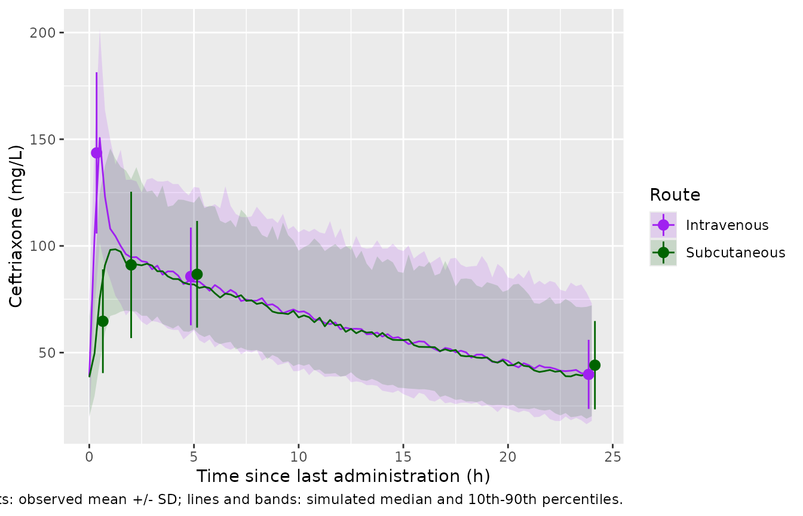
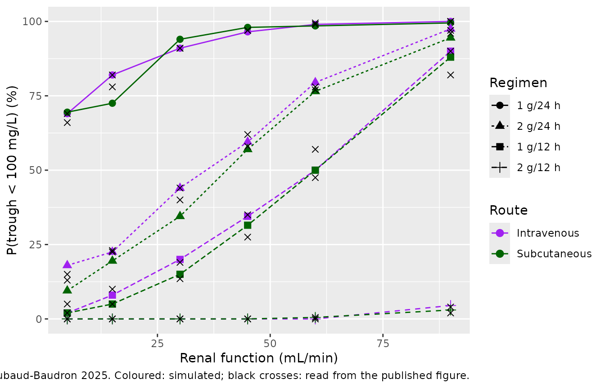

# Ceftriaxone (Roubaud-Baudron 2025)

## Model and source

- Citation: Roubaud-Baudron C, Fauchon H, Stanke-Labesque F, Paccalin M,
  Breilh D, Gregoire N, Forestier E, Ferry T, Gavazzi G, Goutelle S; the
  Infectiology and Geriatrics InterGroup (SPILF-SFGG GInGer).
  Pharmacokinetics of Subcutaneous and Intravenous Ceftriaxone in an
  Older Population: The PhASAge Study. Open Forum Infect Dis.
  2025;12(6):ofaf313. <doi:10.1093/ofid/ofaf313>.
- Description: Two-compartment population PK model for ceftriaxone given
  intravenously or subcutaneously (1 g every 24 h) to patients aged 65
  years or older (PhASAge study, France). Subcutaneous doses enter a
  depot with first-order absorption and a bioavailability of 99%;
  intravenous doses enter the central compartment. Clearance is
  additive-linear in Cockcroft-Gault creatinine clearance (an intercept
  plus a slope on CRCL / 59.66) with an additive (normal, L/h)
  between-subject random effect; the absorption rate and central volume
  carry log-normal random effects. Proportional residual error.
  Parametric model fitted in Monolix 2023-R1 (SAEM).
- Article: <https://doi.org/10.1093/ofid/ofaf313> (open access)

The PhASAge study compared ceftriaxone 1 g every 24 h given by
intravenous or subcutaneous infusion to hospitalised patients aged 65
years or older. Intravenous and subcutaneous concentrations were
analysed together in Monolix 2023-R1. The final parametric model has two
compartments, first-order absorption from a subcutaneous depot, and a
proportional residual error. The absorption rate and the central volume
are log-normally distributed between subjects. Clearance is normally
distributed and depends linearly on Cockcroft-Gault creatinine clearance
(Table 2, footnote c):

`CLi = 0.35 + 0.3 x (CLcri / 59.66) + etaiCL` (L/h)

The paper also reports a nonparametric Pmetrics model of the same
structure (Supplementary Tables S1 and S2). It is not encoded here.

## Population

Forty-seven patients with PK samples were analysed: 23 intravenous and
24 subcutaneous (Table 1). Mean age was 85.5 (SD 7.6) years and 51% were
women. Mean weight was 67.4 (SD 14.3) kg, mean Cockcroft-Gault
creatinine clearance 57.5 (SD 26.5) mL/min and mean serum albumin 31.1
(SD 4.8) g/L. Most patients were functionally dependent (77% with a Katz
ADL score below 6) and nearly all took four or more other drugs. The
main infections were urinary (56%) and pulmonary (23%). Patients had
received ceftriaxone for more than 48 h before sampling, so
concentrations were taken as steady state. Subcutaneous doses were
infused over a median of 30 min, mostly into the abdomen or thigh. The
study ran in 5 French hospitals from August 2019 to February 2022.

The same information is available programmatically via
`readModelDb("RoubaudBaudron_2025_ceftriaxone")()$population`.

## Source trace

| Equation / parameter | Value | Source location |
|----|----|----|
| Two-compartment model, first-order SC absorption | – | Results, “Population PK Model”; Supplementary Methods |
| `ka` | 1.63 1/h | Table 2 |
| `vc` | 7.13 L | Table 2 |
| `vp` | 8.29 L | Table 2 |
| `q` | 9.14 L/h | Table 2 |
| `lcl_int` (CL at CRCL = 0) | 0.35 L/h | Table 2 “CL”; footnote c equation |
| `e_crcl_cl` | 0.3 L/h per unit CRCL / 59.66 | Table 2 “beta Cockcroft”; footnote c equation |
| CRCL divisor | 59.66 mL/min | Table 2 footnote c equation |
| `lfdepot` (SC bioavailability) | 0.99 | Results, “Ceftriaxone Concentrations” and Abstract (not tabulated) |
| `etalka` | SD 0.56 (variance 0.3136), CV 60.86% | Table 2 random effects |
| `etalvc` | SD 0.46 (variance 0.2116), CV 48.7% | Table 2 random effects |
| `etacl` (additive, L/h) | SD 0.14 (variance 0.0196), CV 40.79% | Table 2 random effects; Results “clearance was normally distributed” |
| No IIV on Vp, Q | – | Results, “Population PK Model” |
| `propSd` | 0.11 | Table 2 “Residual error, b” |

## Virtual cohort and dosing

The paper’s own dosing simulations sampled creatinine clearance from a
log-normal distribution with median 51.95 mL/min and log-scale SD 0.51
(Supplementary Table S3 footnote). The same distribution is used here;
its mean (about 59 mL/min) is close to the Table 1 cohort mean of 57.5
mL/min.

``` r

mod <- readModelDb("RoubaudBaudron_2025_ceftriaxone")
n_per_route <- 200
dose_mg <- 1000
tau <- 24
n_doses <- 14
t_last <- (n_doses - 1) * tau # start of the final dosing interval

rxode2::rxSetSeed(20250625)
cohort <- tibble::tibble(
  id = seq_len(2 * n_per_route),
  route = rep(c("Intravenous", "Subcutaneous"), each = n_per_route),
  CRCL = exp(rnorm(2 * n_per_route, log(51.95), 0.51))
)

make_events <- function(cohort, dose_mg, tau, n_doses, obs_times) {
  dose_rows <- cohort |>
    tidyr::expand_grid(dose_n = seq_len(n_doses) - 1) |>
    dplyr::mutate(
      time = dose_n * tau,
      evid = 1L,
      amt = dose_mg,
      dur = 0.5,
      cmt = ifelse(route == "Intravenous", "central", "depot")
    ) |>
    dplyr::select(-dose_n)
  obs_rows <- cohort |>
    tidyr::expand_grid(time = obs_times) |>
    dplyr::mutate(evid = 0L, amt = 0, dur = 0, cmt = "central")
  dplyr::bind_rows(dose_rows, obs_rows) |>
    dplyr::arrange(id, time, dplyr::desc(evid))
}

# Steady-state dosing interval on a 0.25-h grid, plus the study sampling times
# relative to the last dose (Cend at 0.5 h, C2h at 2 h, C5h at 5 h, C0 at 24 h).
obs_grid <- t_last + sort(unique(c(seq(0, tau, by = 0.25), 0.5, 2, 5)))
events <- make_events(cohort, dose_mg, tau, n_doses, obs_grid)
sim <- rxode2::rxSolve(mod, events, keep = "route", returnType = "data.frame") |>
  dplyr::mutate(tad = time - t_last)
#> ℹ parameter labels from comments will be replaced by 'label()'
```

## Replicate Figure 1: steady-state concentrations by route

Figure 1 (left) shows the observed mean (SD) concentrations at each
sampling time; the means are also reported in the Results text. The
simulated values below include residual error (column `sim`).

Because clearance is normally distributed with an SD of 0.14 L/h, a few
simulated subjects with low creatinine clearance draw a clearance close
to zero. Their troughs run to several hundred mg/L, and they pull the
simulated *means* well above the centre of the distribution. The 23-24
patients per arm in the study contain no such extremes. The simulated
*median* is therefore compared against the observed mean; the simulated
mean is shown alongside.

``` r

sampling <- tibble::tribble(
  ~route,         ~sample, ~tad, ~obs_mean, ~obs_sd,
  "Intravenous",  "Cend",  0.5,  143.6,     37.8,
  "Intravenous",  "C5h",   5,    85.7,      22.9,
  "Intravenous",  "C0",    24,   39.8,      16.2,
  "Subcutaneous", "Cend",  0.5,  64.7,      24.3,
  "Subcutaneous", "C2h",   2,    91.1,      34.3,
  "Subcutaneous", "C5h",   5,    86.7,      25.0,
  "Subcutaneous", "C0",    24,   44.1,      20.7
)

sim_samples <- sim |>
  dplyr::inner_join(sampling |> dplyr::select(route, sample, tad), by = c("route", "tad")) |>
  dplyr::group_by(route, sample, tad) |>
  dplyr::summarise(
    sim_median = median(sim), sim_mean = mean(sim), sim_sd = sd(sim),
    .groups = "drop"
  )

fig1_cmp <- sampling |>
  dplyr::left_join(sim_samples, by = c("route", "sample", "tad")) |>
  dplyr::mutate(pct_diff = 100 * (sim_median - obs_mean) / obs_mean)

fig1_cmp |>
  dplyr::mutate(dplyr::across(c(sim_median, sim_mean, sim_sd, pct_diff), \(x) round(x, 1))) |>
  dplyr::select(route, sample, tad, obs_mean, obs_sd, sim_median, sim_mean, sim_sd, pct_diff) |>
  dplyr::rename(
    Route = route, Sample = sample, `Time after dose (h)` = tad,
    `Observed mean (mg/L)` = obs_mean, `Observed SD` = obs_sd,
    `Simulated median (mg/L)` = sim_median,
    `Simulated mean (mg/L)` = sim_mean, `Simulated SD` = sim_sd,
    `% diff (median vs observed mean)` = pct_diff
  ) |>
  knitr::kable(caption = "Steady-state concentrations by route: Results text vs simulation.")
```

| Route | Sample | Time after dose (h) | Observed mean (mg/L) | Observed SD | Simulated median (mg/L) | Simulated mean (mg/L) | Simulated SD | % diff (median vs observed mean) |
|:---|:---|---:|---:|---:|---:|---:|---:|---:|
| Intravenous | Cend | 0.5 | 143.6 | 37.8 | 150.6 | 154.2 | 43.2 | 4.9 |
| Intravenous | C5h | 5.0 | 85.7 | 22.9 | 83.2 | 90.0 | 31.7 | -2.9 |
| Intravenous | C0 | 24.0 | 39.8 | 16.2 | 37.7 | 44.0 | 26.5 | -5.4 |
| Subcutaneous | Cend | 0.5 | 64.7 | 24.3 | 75.4 | 80.8 | 32.1 | 16.5 |
| Subcutaneous | C2h | 2.0 | 91.1 | 34.3 | 93.6 | 99.2 | 30.9 | 2.8 |
| Subcutaneous | C5h | 5.0 | 86.7 | 25.0 | 81.9 | 87.9 | 27.4 | -5.5 |
| Subcutaneous | C0 | 24.0 | 44.1 | 20.7 | 38.9 | 43.4 | 24.5 | -11.9 |

Steady-state concentrations by route: Results text vs simulation.
{.table}

``` r

sim_band <- sim |>
  dplyr::group_by(route, tad) |>
  dplyr::summarise(
    median = median(sim), lo = quantile(sim, 0.1), hi = quantile(sim, 0.9),
    .groups = "drop"
  )
ggplot(sim_band, aes(tad, median, colour = route, fill = route)) +
  geom_ribbon(aes(ymin = lo, ymax = hi), alpha = 0.15, colour = NA) +
  geom_line() +
  geom_pointrange(
    data = sampling,
    aes(tad, obs_mean, ymin = obs_mean - obs_sd, ymax = obs_mean + obs_sd),
    position = position_dodge(width = 0.6)
  ) +
  scale_colour_manual(values = c(Intravenous = "purple", Subcutaneous = "darkgreen")) +
  scale_fill_manual(values = c(Intravenous = "purple", Subcutaneous = "darkgreen")) +
  labs(
    x = "Time since last administration (h)", y = "Ceftriaxone (mg/L)",
    colour = "Route", fill = "Route",
    caption = "Replicates Figure 1 (left) of Roubaud-Baudron 2025. Points: observed mean +/- SD; lines and bands: simulated median and 10th-90th percentiles."
  )
```



``` r

stopifnot(
  # The route difference at the end of infusion is the absorption signature:
  # the intravenous Cend is about twice the subcutaneous one.
  with(fig1_cmp, sim_median[route == "Intravenous" & sample == "Cend"] >
    1.5 * sim_median[route == "Subcutaneous" & sample == "Cend"]),
  # Centre of the cohort: a mis-transcribed CL, V or dose moves every sample.
  abs(median(fig1_cmp$pct_diff)) < 15,
  all(abs(fig1_cmp$pct_diff) < 30)
)
```

## PKNCA validation

The last dosing interval of a 14-day course is effectively steady state.
PKNCA computes the AUC over it, which the paper reports as a mean of
1621 (SD 409) mg.h/L for the intravenous group and 1608 (SD 538) mg.h/L
for the subcutaneous group (Results; the paper’s AUCs were computed from
the final model).
[`ncaComparisonTable()`](https://nlmixr2.github.io/nlmixr2lib/reference/ncaComparisonTable.md)
summarises the per-subject PKNCA results by their median, which is
robust to the near-zero-clearance draws described above; the reference
values are the paper’s means. The trough (`cmin`) reference is the
observed C0 mean.

``` r

# PKNCA reserves the column name `route`, so the grouping column is
# `treatment`.
conc <- sim |>
  dplyr::filter(!is.na(Cc)) |>
  dplyr::select(id, treatment = route, tad, Cc) |>
  dplyr::distinct()
dose_df <- cohort |>
  dplyr::mutate(tad = 0, amt = dose_mg) |>
  dplyr::select(id, treatment = route, tad, amt)

conc_obj <- PKNCA::PKNCAconc(conc, Cc ~ tad | treatment + id)
dose_obj <- PKNCA::PKNCAdose(dose_df, amt ~ tad | treatment + id)
intervals <- data.frame(
  start = 0, end = tau,
  auclast = TRUE, cmax = TRUE, tmax = TRUE, cmin = TRUE
)
nca <- PKNCA::pk.nca(PKNCA::PKNCAdata(conc_obj, dose_obj, intervals = intervals))
nca_ind <- as.data.frame(nca$result) |>
  dplyr::select(id, route = treatment, PPTESTCD, PPORRES) |>
  tidyr::pivot_wider(names_from = PPTESTCD, values_from = PPORRES)

# At steady state the AUC over one interval equals F x dose / CL for every
# subject; both sides use the same drawn parameters, so the residual is
# trapezoid error on the 0.25-h grid plus the small approach to steady state.
auc_chk <- nca_ind |>
  dplyr::left_join(sim |> dplyr::distinct(id, cl), by = "id") |>
  dplyr::mutate(
    f = ifelse(route == "Subcutaneous", 0.99, 1),
    ratio = auclast / (f * dose_mg / cl)
  )
stopifnot(abs(median(auc_chk$ratio) - 1) < 0.01)

reference <- tibble::tibble(
  route = c("Intravenous", "Subcutaneous"),
  auclast = c(1621, 1608),
  cmin = c(39.8, 44.1)
)
cmp <- nlmixr2lib::ncaComparisonTable(
  simulated = nca_ind |> dplyr::select(route, auclast, cmin),
  reference = reference,
  by = "route",
  params = c("auclast", "cmin"),
  units = c(auclast = "mg*h/L", cmin = "mg/L"),
  tolerance_pct = 20
)
knitr::kable(cmp, caption = "Simulated cohort medians vs the paper's means (AUC over the steady-state interval and trough).")
```

| NCA parameter     | route        | Reference | Simulated | % diff |
|:------------------|:-------------|:----------|:----------|:-------|
| Cmin (mg/L)       | Intravenous  | 39.8      | 39.7      | -0.2%  |
| Cmin (mg/L)       | Subcutaneous | 44.1      | 38.7      | -12.2% |
| AUClast (mg\*h/L) | Intravenous  | 1620      | 1610      | -0.4%  |
| AUClast (mg\*h/L) | Subcutaneous | 1610      | 1530      | -5.0%  |

Simulated cohort medians vs the paper’s means (AUC over the steady-state
interval and trough). {.table}

``` r

pct <- as.numeric(gsub("[^0-9.-]", "", cmp[["% diff"]]))
stopifnot(!anyNA(pct), all(abs(pct) < 20))
```

The simulated troughs use the individual prediction without residual
error, while the paper’s C0 means are observed concentrations; the
trough rows compare like with like only on average.

## Replicate Figure 2: probability of a non-toxic trough

Figure 2 gives the probability that the steady-state trough is below 100
mg/L (the paper’s neurotoxicity threshold) at fixed creatinine
clearances, for four regimens and both routes. Following Supplementary
Table S3, the trough is taken at the end of a 7-day course. The paper
used 1000 virtual patients per scenario; 200 are used here, so each
probability carries a Monte-Carlo SE of up to about 3.5 percentage
points. The individual prediction `Cc` is used, without residual error.

``` r

crcl_levels <- c(5, 15, 30, 45, 60, 90)
regimens <- tibble::tribble(
  ~regimen,   ~dose, ~ii,
  "1 g/24 h", 1000,  24,
  "2 g/24 h", 2000,  24,
  "1 g/12 h", 1000,  12,
  "2 g/12 h", 2000,  12
)
n_fig2 <- 200
t_end <- 168

grid <- tidyr::expand_grid(
  regimen = regimens$regimen,
  route = c("Intravenous", "Subcutaneous"),
  CRCL = crcl_levels,
  rep = seq_len(n_fig2)
) |>
  dplyr::left_join(regimens, by = "regimen") |>
  dplyr::mutate(id = dplyr::row_number())

fig2_dose <- grid |>
  dplyr::mutate(n = t_end / ii) |>
  tidyr::uncount(n, .id = "k") |>
  dplyr::mutate(
    time = (k - 1) * ii, evid = 1L, amt = dose, dur = 0.5,
    cmt = ifelse(route == "Intravenous", "central", "depot")
  )
fig2_obs <- grid |>
  dplyr::mutate(time = t_end, evid = 0L, amt = 0, dur = 0, cmt = "central")
fig2_events <- dplyr::bind_rows(fig2_dose, fig2_obs) |>
  dplyr::select(id, time, evid, amt, dur, cmt, CRCL) |>
  dplyr::arrange(id, time, dplyr::desc(evid))

rxode2::rxSetSeed(20250626)
fig2_sim <- rxode2::rxSolve(mod, fig2_events, returnType = "data.frame")

fig2 <- fig2_sim |>
  dplyr::select(id, Cc) |>
  dplyr::left_join(grid |> dplyr::select(id, regimen, route, CRCL), by = "id") |>
  dplyr::group_by(regimen, route, CRCL) |>
  dplyr::summarise(p_sim = 100 * mean(Cc < 100), .groups = "drop")

# Figure 2 read by the maintainers (percent, to about +/- 2 points).
fig2_paper <- tibble::tibble(
  regimen = rep(regimens$regimen, each = 12),
  route = rep(rep(c("Intravenous", "Subcutaneous"), each = 6), 4),
  CRCL = rep(crcl_levels, 8),
  p_paper = c(
    69, 82, 91, 97, 99, 100, 66, 78, 91, 97, 99.5, 100, # 1 g/24 h
    15, 23, 44, 62, 78, 97, 13, 22.5, 40, 58, 77, 96, # 2 g/24 h
    5, 10, 19, 35, 57, 90, 2, 5, 13.5, 27.5, 47.5, 82, # 1 g/12 h
    0, 0, 0, 0, 0.5, 4, 0, 0, 0, 0, 0, 2 # 2 g/12 h
  )
)
fig2_cmp <- fig2 |>
  dplyr::left_join(fig2_paper, by = c("regimen", "route", "CRCL")) |>
  dplyr::mutate(diff = p_sim - p_paper)

fig2_cmp |>
  dplyr::mutate(regimen = factor(regimen, levels = regimens$regimen)) |>
  dplyr::arrange(regimen, route, CRCL) |>
  dplyr::rename(
    Regimen = regimen, Route = route, `CRCL (mL/min)` = CRCL,
    `Simulated (%)` = p_sim, `Figure 2 (%)` = p_paper,
    `Difference (points)` = diff
  ) |>
  knitr::kable(caption = "Probability (%) of a trough below 100 mg/L after 7 days.")
```

| Regimen | Route | CRCL (mL/min) | Simulated (%) | Figure 2 (%) | Difference (points) |
|:---|:---|---:|---:|---:|---:|
| 1 g/24 h | Intravenous | 5 | 69.0 | 69.0 | 0.0 |
| 1 g/24 h | Intravenous | 15 | 82.0 | 82.0 | 0.0 |
| 1 g/24 h | Intravenous | 30 | 91.0 | 91.0 | 0.0 |
| 1 g/24 h | Intravenous | 45 | 96.5 | 97.0 | -0.5 |
| 1 g/24 h | Intravenous | 60 | 99.0 | 99.0 | 0.0 |
| 1 g/24 h | Intravenous | 90 | 100.0 | 100.0 | 0.0 |
| 1 g/24 h | Subcutaneous | 5 | 69.5 | 66.0 | 3.5 |
| 1 g/24 h | Subcutaneous | 15 | 72.5 | 78.0 | -5.5 |
| 1 g/24 h | Subcutaneous | 30 | 94.0 | 91.0 | 3.0 |
| 1 g/24 h | Subcutaneous | 45 | 98.0 | 97.0 | 1.0 |
| 1 g/24 h | Subcutaneous | 60 | 98.5 | 99.5 | -1.0 |
| 1 g/24 h | Subcutaneous | 90 | 99.5 | 100.0 | -0.5 |
| 2 g/24 h | Intravenous | 5 | 18.0 | 15.0 | 3.0 |
| 2 g/24 h | Intravenous | 15 | 22.5 | 23.0 | -0.5 |
| 2 g/24 h | Intravenous | 30 | 44.0 | 44.0 | 0.0 |
| 2 g/24 h | Intravenous | 45 | 59.5 | 62.0 | -2.5 |
| 2 g/24 h | Intravenous | 60 | 79.5 | 78.0 | 1.5 |
| 2 g/24 h | Intravenous | 90 | 97.5 | 97.0 | 0.5 |
| 2 g/24 h | Subcutaneous | 5 | 9.5 | 13.0 | -3.5 |
| 2 g/24 h | Subcutaneous | 15 | 19.5 | 22.5 | -3.0 |
| 2 g/24 h | Subcutaneous | 30 | 34.5 | 40.0 | -5.5 |
| 2 g/24 h | Subcutaneous | 45 | 57.0 | 58.0 | -1.0 |
| 2 g/24 h | Subcutaneous | 60 | 76.5 | 77.0 | -0.5 |
| 2 g/24 h | Subcutaneous | 90 | 94.5 | 96.0 | -1.5 |
| 1 g/12 h | Intravenous | 5 | 2.0 | 5.0 | -3.0 |
| 1 g/12 h | Intravenous | 15 | 8.0 | 10.0 | -2.0 |
| 1 g/12 h | Intravenous | 30 | 20.0 | 19.0 | 1.0 |
| 1 g/12 h | Intravenous | 45 | 34.5 | 35.0 | -0.5 |
| 1 g/12 h | Intravenous | 60 | 50.0 | 57.0 | -7.0 |
| 1 g/12 h | Intravenous | 90 | 90.0 | 90.0 | 0.0 |
| 1 g/12 h | Subcutaneous | 5 | 2.0 | 2.0 | 0.0 |
| 1 g/12 h | Subcutaneous | 15 | 5.0 | 5.0 | 0.0 |
| 1 g/12 h | Subcutaneous | 30 | 15.0 | 13.5 | 1.5 |
| 1 g/12 h | Subcutaneous | 45 | 31.5 | 27.5 | 4.0 |
| 1 g/12 h | Subcutaneous | 60 | 50.0 | 47.5 | 2.5 |
| 1 g/12 h | Subcutaneous | 90 | 88.0 | 82.0 | 6.0 |
| 2 g/12 h | Intravenous | 5 | 0.0 | 0.0 | 0.0 |
| 2 g/12 h | Intravenous | 15 | 0.0 | 0.0 | 0.0 |
| 2 g/12 h | Intravenous | 30 | 0.0 | 0.0 | 0.0 |
| 2 g/12 h | Intravenous | 45 | 0.0 | 0.0 | 0.0 |
| 2 g/12 h | Intravenous | 60 | 0.0 | 0.5 | -0.5 |
| 2 g/12 h | Intravenous | 90 | 4.5 | 4.0 | 0.5 |
| 2 g/12 h | Subcutaneous | 5 | 0.0 | 0.0 | 0.0 |
| 2 g/12 h | Subcutaneous | 15 | 0.0 | 0.0 | 0.0 |
| 2 g/12 h | Subcutaneous | 30 | 0.0 | 0.0 | 0.0 |
| 2 g/12 h | Subcutaneous | 45 | 0.0 | 0.0 | 0.0 |
| 2 g/12 h | Subcutaneous | 60 | 0.5 | 0.0 | 0.5 |
| 2 g/12 h | Subcutaneous | 90 | 3.0 | 2.0 | 1.0 |

Probability (%) of a trough below 100 mg/L after 7 days. {.table
style="width:100%;"}

``` r

fig2_cmp |>
  dplyr::mutate(regimen = factor(regimen, levels = regimens$regimen)) |>
  ggplot(aes(CRCL, p_sim, colour = route, shape = regimen)) +
  geom_line(aes(linetype = regimen)) +
  geom_point(size = 2.5) +
  geom_point(aes(y = p_paper), shape = 4, size = 2, colour = "black") +
  scale_colour_manual(values = c(Intravenous = "purple", Subcutaneous = "darkgreen")) +
  labs(
    x = "Renal function (mL/min)", y = "P(trough < 100 mg/L) (%)",
    colour = "Route", shape = "Regimen", linetype = "Regimen",
    caption = "Replicates Figure 2 of Roubaud-Baudron 2025. Coloured: simulated; black crosses: read from the published figure."
  )
```



``` r

stopifnot(
  # Structural: a wrong CRCL slope or intercept shifts every curve.
  abs(median(fig2_cmp$diff)) < 5,
  quantile(abs(fig2_cmp$diff), 0.9) < 12
)
```

## Assumptions and deviations

- **Subcutaneous bioavailability.** Table 2 does not list a
  bioavailability parameter. The Abstract and Results state that it “was
  estimated at 99% by population modeling”, so `lfdepot` is set to
  `log(0.99)` as an estimated (not fixed) value. Its precision is not
  reported.
- **Clearance equation.** The Supplementary Methods describe covariate
  effects as “log-linear”, but Table 2 footnote c prints a linear ratio,
  `0.35 + 0.3 x (CLcr / 59.66)`. The printed equation is used. It also
  fits the paper’s reported median individual clearance (0.63 L/h): at
  the cohort’s creatinine clearance of about 55 mL/min it gives 0.63
  L/h, whereas a log-ratio form would give about 0.33 L/h.
- **Additive random effect on clearance.** Clearance is normally
  distributed in the paper, so `etacl` is added to the linear clearance
  (SD 0.14 L/h). At very low creatinine clearance a small fraction of
  simulated subjects can draw a clearance near or below zero (about 0.4%
  at 5 mL/min). The model is encoded as published, without truncation.
- **Infusion durations.** The paper reports a median subcutaneous
  infusion time of 30 min (Table 1) but gives no intravenous infusion
  time. Both routes are simulated as 30-min infusions. Subcutaneous
  infusions go into the absorption depot.
- **Sampling times.** “Cend” is taken at the end of the 30-min infusion,
  and C2h and C5h at 2 h and 5 h after the start of the last dose,
  matching their x-axis positions in Figure 1. The paper does not
  specify whether these times run from the start or the end of infusion.
- **Creatinine clearance distribution.** The virtual cohort uses the
  log-normal distribution the paper used for its own simulations (median
  51.95 mL/min, log-scale SD 0.51; Supplementary Table S3 footnote), not
  the observed individual values.
- **Figure 2.** The published probabilities were read off Figure 2 by
  the maintainers to about +/- 2 percentage points. The paper does not
  state when the trough was sampled; the end of a 7-day course
  (Supplementary Table S3 design) is used.
- **Unbound concentrations.** The paper’s PTA analysis converts total to
  unbound concentrations with the Sanz-Codina 2023 equation, which
  depends on albumin and concentration. That equation is not part of
  this model, so the PTA results (Table 3, Supplementary Table S3) are
  not replicated. The toxicity threshold in Figure 2 applies to total
  concentrations and is replicated.
- **Nonparametric model.** The Pmetrics model (Supplementary Tables
  S1-S2) is a discrete support-point distribution. It is not encoded.
